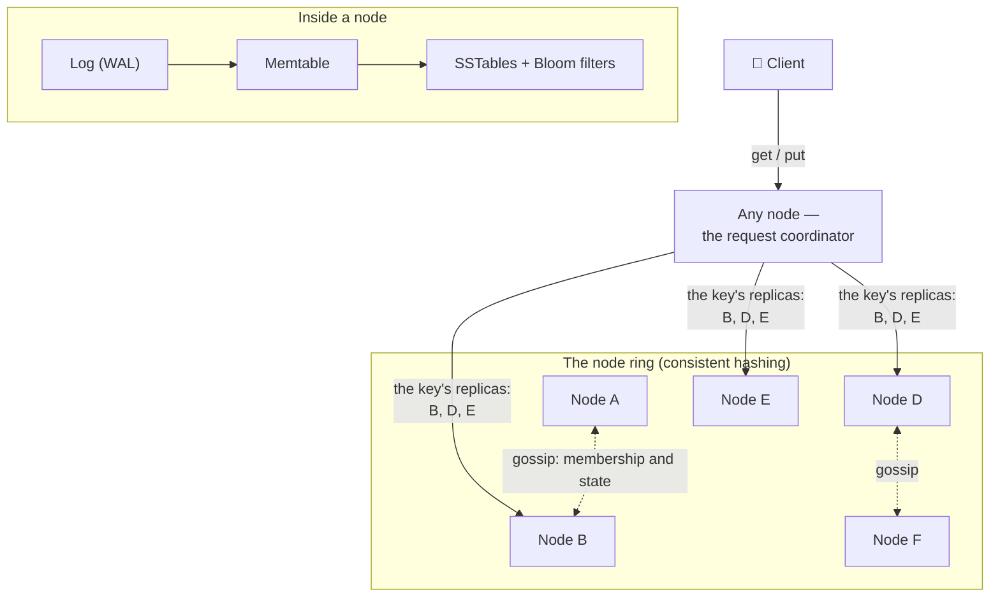
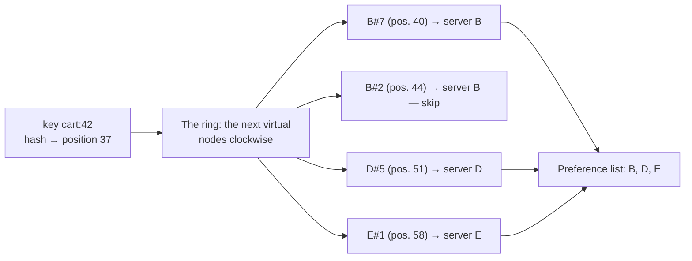
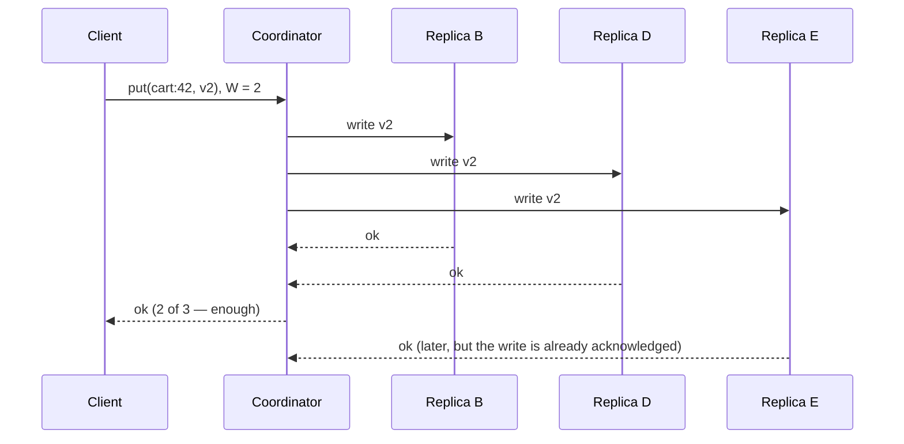
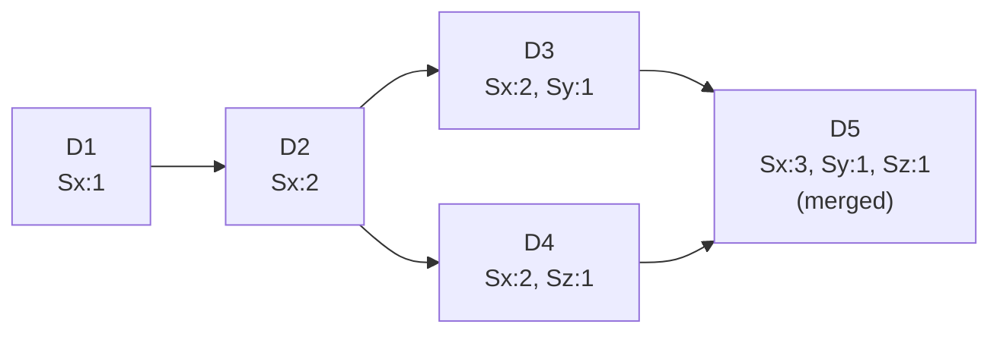
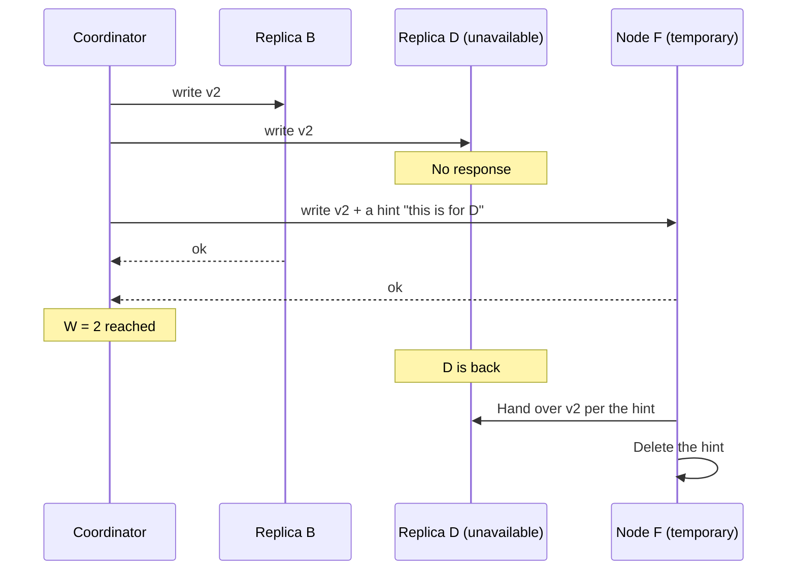
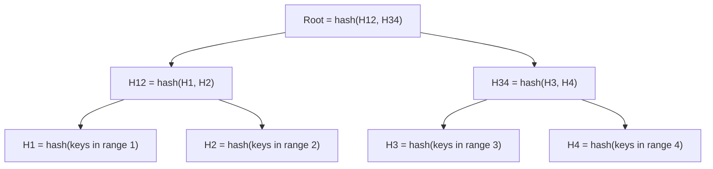
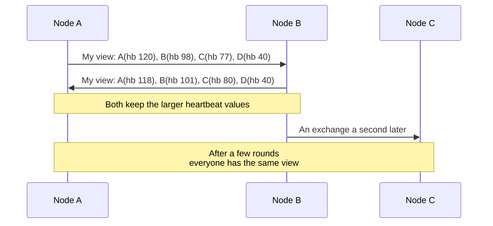
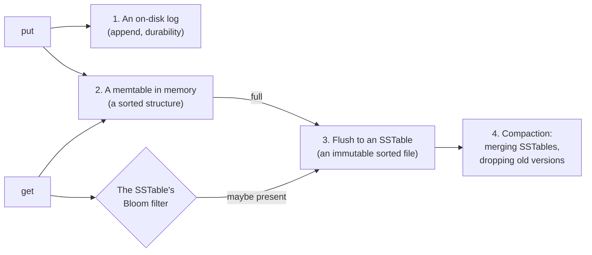
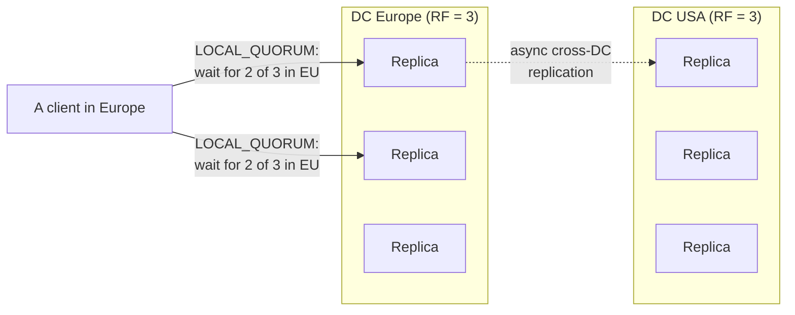

**English** | [Русский](README_RU.md)

# Tier 1 · 19. Distributed Key-Value Store (like Dynamo)

> **Level:** Hard · **Interview time:** 45–60 min · **Study time:** ~5–6 h
> **Key aspects:** consistent hashing and virtual nodes, replication and quorums (N, W, R), versions and conflicts (last-write-wins, vector clocks, CRDTs), sloppy quorums and hinted handoff, read repair, anti-entropy with Merkle trees, gossip and failure detection, an LSM storage engine, tunable consistency, multiple data centers
> **Builds on:** [05-replication](../../05-replication/README.md#9-leaderless-and-quorums), [06-partitioning](../../06-partitioning/README.md), [07-consistency-models](../../07-consistency-models/README.md), [04-databases](../../04-databases/README.md#7-b-tree-vs-lsm-tree), [Tier 1 · 03 Distributed Cache](../03-distributed-cache/README.md#7-deep-dive-2-distributing-keys-across-nodes)

---

## 🗺️ How to Read This Walkthrough

The walkthrough follows an interview, but every step includes explanations: **why** a decision is made, **how** a mechanism works and **what happens** if you do it differently. The "📘 Explanation" blocks are theory right where you need it.

| Icon | Meaning |
|:----:|:--------|
| 🎤 | Interviewer |
| 🗣️ | What I (the candidate) say out loud |
| ✏️ | What I draw on the whiteboard |
| ⏱️ | Time budget for the step |
| 📘 | A detailed explanation of a concept |

Callouts: **TIP** — a good technique, **WARNING** — a trap, **IMPORTANT** — a Senior+ signal.

---

## 📑 Contents

0. [What This Problem Teaches](#0-what-this-problem-teaches)
1. [Problem Statement](#1-problem-statement)
2. [Clarifying Questions and Requirements](#2-clarifying-questions-and-requirements)
3. [Capacity Estimates](#3-capacity-estimates)
4. [API](#4-api)
5. [High-Level Design](#5-high-level-design)
6. [Deep Dive 1: Distributing Data](#6-deep-dive-1-distributing-data)
7. [Deep Dive 2: Replication and Quorums](#7-deep-dive-2-replication-and-quorums)
8. [Deep Dive 3: Versions and Conflicts](#8-deep-dive-3-versions-and-conflicts)
9. [Deep Dive 4: Temporary Failures — Sloppy Quorums and Hinted Handoff](#9-deep-dive-4-temporary-failures--sloppy-quorums-and-hinted-handoff)
10. [Deep Dive 5: Repairing Replicas — Read Repair and Merkle Trees](#10-deep-dive-5-repairing-replicas--read-repair-and-merkle-trees)
11. [Deep Dive 6: Membership and Failure Detection](#11-deep-dive-6-membership-and-failure-detection)
12. [Deep Dive 7: The Storage Engine on a Node](#12-deep-dive-7-the-storage-engine-on-a-node)
13. [Deep Dive 8: Tunable Consistency and Multiple Data Centers](#13-deep-dive-8-tunable-consistency-and-multiple-data-centers)
14. [Bottlenecks and Failure Scenarios](#14-bottlenecks-and-failure-scenarios)
15. [What Changes at 10x Scale](#15-what-changes-at-10x-scale)
16. [Key Concepts and New Terms](#16-key-concepts-and-new-terms)
17. [Variations and Follow-Up Questions](#17-variations-and-follow-up-questions)
18. [Common Mistakes](#18-common-mistakes)
19. [Cheat Sheet and Self-Check](#19-cheat-sheet-and-self-check)

---

## 0. What This Problem Teaches

This is the "final exam" of distributed systems: it gathers nearly every technique from Amazon's paper **"Dynamo: Amazon's Highly Available Key-value Store"** (2007), which underlies Cassandra, Riak, Voldemort and (in part) DynamoDB.

| What's tested | Where it shows up |
|:--------------|:------------------|
| Partitioning | Consistent hashing, virtual nodes |
| Leaderless replication | Any node accepts writes, N/W/R quorums |
| The CAP trade-off | Writes always available at the cost of possible conflicts |
| Reasoning about time and versions | Vector clocks, last-write-wins, CRDTs |
| Handling failures | Hinted handoff, read repair, anti-entropy |
| Decentralization | Gossip, no master |
| Storage on a single node | LSM trees, compaction, Bloom filters, tombstones |

> [!TIP]
> The interviewer expects you to build the system **in layers**: data distribution → replication → consistency and conflicts → failure handling → membership → storage on a node. Each layer solves its own problem; name them in order, and the conversation stays structured.

---

## 1. Problem Statement

> 🎤 "Design a distributed key-value store like Amazon Dynamo: get and put operations, horizontal scaling to hundreds of nodes, high availability — writes must work even through node failures and network partitions."

**A usage example from the Dynamo paper — a shopping cart:**

```
put("cart:42", ["book"])
put("cart:42", ["book", "headphones"])
get("cart:42") → ["book", "headphones"]

The key requirement: "Add to cart" must always work —
even when some servers are unavailable. Losing an added item is worse
than occasionally showing a removed one.
```

**Time plan:**

| Step | ⏱️ |
|:-----|:--:|
| Requirements | 5 min |
| Estimates | 3 min |
| API and high-level | 5 min |
| Deep dives | 30 min |
| Wrap-up | 4 min |

---

## 2. Clarifying Questions and Requirements

⏱️ 5 min

| My question | Interviewer's answer | What it changes and why |
|:------------|:---------------------|:------------------------|
| Data volume? | Hundreds of TB, growing | Sharding across hundreds of nodes |
| Load? | ~1M operations/s | Horizontal scaling |
| Value size? | ~1 KB on average, up to 1 MB | A simple storage format |
| Under a network partition, what matters more: availability or consistency? | **Availability**: writes must always work | An AP system: quorums, sloppy quorums, conflict resolution |
| Cross-key transactions? | No | Single-key operations |
| Consistency? | Tunable: eventual by default, sometimes stronger | N, W, R parameters per request |
| Latency? | p99 < 10 ms | No lengthy coordination on every request |
| Multiple data centers? | Yes | Cross-DC replication, local quorums |

### Functional requirements

1. `put(key, value)`, `get(key)`, `delete(key)`.
2. A tunable consistency level per request.
3. Automatic data distribution and rebalancing when nodes are added.
4. Detecting and resolving conflicts between concurrent writes.

### Non-functional requirements

| Requirement | Target | Why |
|:------------|:-------|:----|
| Write availability | Always, even through failures | Carts, sessions, profiles — losing a write is worse than a stale read |
| Scalability | Linear growth by adding nodes | Data keeps growing |
| Latency | Single-digit milliseconds at p99 | The store sits on services' critical path |
| Durability | No loss when nodes fail | Several replicas, an on-disk log |
| Decentralization | No single point of failure | Every node is an equal |

---

## 3. Capacity Estimates

⏱️ 3 min

```
Data:              100 TB logical × 3 replicas = 300 TB
Nodes:             ~2–4 TB of usable data per node → ~100–150 nodes
Load:              1M operations/s ÷ 100 nodes ≈ 10,000 operations/s per node
                   (with replication, every write lands on 3 nodes)
Latency:           a write = waiting for the fastest W of N replicas
```

### Conclusions

| Conclusion | Design consequence |
|:-----------|:-------------------|
| Hundreds of nodes | Failures happen **constantly** — handling them is the norm, not the exception |
| 10,000 operations/s per node | A write-optimized storage engine (LSM) |
| No master | Any node coordinates requests; membership spreads via gossip |

---

## 4. API

⏱️ 2 min

```
get(key, consistency = ONE | QUORUM | ALL)
  → [ (value, context), ... ]        ← may return several conflicting versions

put(key, value, context, consistency)
  → ok                                ← context — the version obtained on read

delete(key, context)
```

📘 **Why `context` in put.** The context carries the version (e.g. vector clocks) of the value the client read and modified. That lets the store tell whether the new write **replaces** the old one or a **concurrent** version has appeared — which is needed to resolve conflicts (deep dive 3).

---

## 5. High-Level Design

⏱️ 5 min



🗣️ "The system's layers:
1. **distribution**: consistent hashing with virtual nodes — a key maps to a point on the ring, and its replicas to the next N nodes clockwise;
2. **replication**: any node can coordinate; it sends the request to N replicas and waits for W (writes) or R (reads) responses;
3. **versions**: every write carries a version (vector clocks or a timestamp); concurrent versions get resolved;
4. **failures**: hinted handoff for temporary ones, read repair and anti-entropy (Merkle trees) for divergence;
5. **membership**: a gossip protocol, no central coordinator;
6. **storage**: an LSM engine on every node."

---

## 6. Deep Dive 1: Distributing Data

> 🎤 "How are keys distributed across nodes, and what happens when a node is added?"

Consistent hashing is covered in detail in [Distributed Cache](../03-distributed-cache/README.md#7-deep-dive-2-distributing-keys-across-nodes) and [06-partitioning](../../06-partitioning/README.md). In short, and what matters for a store:

| Decision | Why |
|:---------|:----|
| **A hash ring** | Adding a node moves only ~1/N of the keys |
| **Virtual nodes** (hundreds per server) | Even load; when a node fails, its load spreads across many neighbors; more powerful servers get more virtual nodes |
| **The preference list** | For a key — N **distinct physical** nodes clockwise (virtual nodes of the same server are skipped), ideally in different racks and zones |



### Adding a node

📘 A new node gets its virtual positions on the ring; neighboring nodes **stream** it the data for the ranges it now owns. While the transfer runs, the old owners keep serving requests. It's an **explicit** administrative operation, not an automatic reaction to temporary unavailability — so a flapping node doesn't trigger mass data movement.

---

## 7. Deep Dive 2: Replication and Quorums

> 🎤 "How do you replicate data without a leader, and what consistency does that give?"

### N, W, R

| Parameter | Meaning |
|:----------|:--------|
| **N** | The number of replicas of each key (usually 3) |
| **W** | How many replicas must acknowledge a write for it to count as successful |
| **R** | How many replicas must respond to a read |



### Why R + W > N

📘 If `R + W > N`, the set of replicas answering a read **must overlap** with the set that acknowledged the latest write. So at least one replica that was read holds the latest acknowledged version.

```
N = 3, W = 2, R = 2:  2 + 2 = 4 > 3
  B and D acknowledged the write
  A read asks any two: {B, E}, {D, E}, {B, D} — every pair includes B or D ✅

N = 3, W = 1, R = 1:  1 + 1 = 2 ≤ 3
  Only B acknowledged the write, and the read asked E — a stale value ❌
```

| Configuration (N = 3) | Properties | For |
|:----------------------|:-----------|:----|
| W = 2, R = 2 | Balanced; tolerates one replica failure for both writes and reads | The default |
| W = 1, R = 3 | Very fast, available writes; slow reads | Writes matter more; reads are rare |
| W = 3, R = 1 | Fast reads; writes unavailable if any replica fails | Reads far outnumber writes |
| W = 1, R = 1 | Maximum speed and availability, eventual consistency | Caches, non-critical data |

### Latency

📘 The coordinator waits for the **fastest** W (or R) responses out of N. A slow replica doesn't hold up the request as long as there are enough others. That matters for p99: with W = 2 of 3, one "lagging" machine doesn't affect latency.

> [!WARNING]
> **R + W > N doesn't give linearizability.** Anomalies are possible: a write fails to reach W acknowledgments but lands on one replica anyway (the client got an error, yet the value is partially written); a sloppy quorum (deep dive 4) writes to "foreign" nodes; concurrent writes create conflicting versions. Quorums give "usually fresh reads", not strong consistency (see [07-consistency-models](../../07-consistency-models/README.md)).

---

## 8. Deep Dive 3: Versions and Conflicts

> 🎤 "Two clients changed the cart at the same time through different nodes. Which version is correct?"

📘 In a system that always accepts writes (even during a network partition), **concurrent writes inevitably create conflicting versions**. You need to detect and resolve them.

### Last-write-wins (LWW)

Each write gets a timestamp; the latest wins.

| ✅ Pros | ❌ Cons |
|:-------|:-------|
| Simple, one value | **Loses writes**: of two concurrent writes, one silently disappears |
| No conflicts for the client | Depends on clocks: with clock skew, an earlier write can appear "later" |

Cassandra uses LWW at the level of individual columns — a simplicity trade-off: losses are possible but limited to one field.

### Vector clocks

📘 **Vector clocks** are a list of "node → counter" pairs showing which changes a version has "seen". They let you determine whether one version **precedes** another or the two are **concurrent**.

**An example from the Dynamo paper:**

```
1. A client writes through node Sx:              D1 [(Sx, 1)]
2. The client changes D1 through Sx:              D2 [(Sx, 2)]            ← D2 is newer than D1
3. Client 1 changes D2 through node Sy:           D3 [(Sx, 2), (Sy, 1)]
4. Client 2 concurrently changes D2 through Sz:   D4 [(Sx, 2), (Sz, 1)]

   D3 and D4: neither "includes" the other (D3 lacks Sz, D4 lacks Sy) → A CONFLICT
   get returns both versions

5. The client merges them (e.g. a union of carts) and writes through Sx:
                                                  D5 [(Sx, 3), (Sy, 1), (Sz, 1)]  ← newer than D3 and D4
```



| Comparison rule | Conclusion |
|:----------------|:-----------|
| Every counter of A ≤ the counters of B (and at least one is <) | A precedes B → B replaces A |
| Each version has some counter larger than the other's | Concurrent → a conflict, keep both |

| ✅ Pros | ❌ Cons |
|:-------|:-------|
| Detect real conflicts, don't lose writes | The client must be able to merge versions |
| Independent of physical clocks | The list grows with the number of coordinating nodes → old entries get truncated (with a small risk of false conflicts) |

### CRDTs

📘 **CRDTs (conflict-free replicated data types)** are data structures that merge **automatically and deterministically**, without the client:

| CRDT | How it merges | Example |
|:-----|:--------------|:--------|
| G-Counter | A counter per node, the total is the sum; merging takes the maximum per node | A like counter |
| PN-Counter | Two G-Counters: increments and decrements | A counter that can decrease |
| OR-Set | A set whose additions and removals carry unique tags | A cart: a removed item doesn't "come back", an added one isn't lost |
| LWW-Register | A value with a timestamp | A simple field |

### What to choose

| Situation | Choice |
|:----------|:-------|
| Overwriting a whole value, occasional loss is acceptable | LWW |
| Writes must not be lost, the client can merge | Vector clocks + returning all versions |
| Standard structures (counters, sets) | CRDTs |
| An operation needs strong consistency | A quorum operation with consensus (deep dive 8) |

> [!IMPORTANT]
> **Senior+ signal:** explain that in an AP system conflicts are **not a bug but an inevitability**, and show with a vector clock example how to tell "newer" from "concurrent". And know that LWW silently loses writes.

---

## 9. Deep Dive 4: Temporary Failures — Sloppy Quorums and Hinted Handoff

> 🎤 "One of a key's three replicas is temporarily unavailable, and W = 2 is required. What if a second one is down too?"

### A strict quorum versus a sloppy quorum

| | A strict quorum | A sloppy quorum |
|:-|:----------------|:----------------|
| Where to write | Only to the N nodes in the preference list | To the first N **available** nodes on the ring |
| If replicas are unavailable | The write is rejected | A temporary node accepts the write |
| Availability | Lower | Maximum |
| Consistency | Higher | Lower: a reader asking the "right" replicas may not see the write |

### Hinted handoff



| Detail | Why |
|:-------|:----|
| The temporary node stores the write separately, marked "for D" | It doesn't mix it with its own data |
| It hands it over when D returns | Replica D catches up without a full data comparison |
| Hints are kept for a limited time | If D stays away for long — recovery via anti-entropy |

📘 Hinted handoff solves **temporary** failures (a reboot, a brief network blip). For long and permanent ones — anti-entropy.

---

## 10. Deep Dive 5: Repairing Replicas — Read Repair and Merkle Trees

> 🎤 "Replicas have diverged: a hint got lost here, a disk was replaced there. How do you synchronize them?"

### Read repair

📘 On a read with R > 1, the coordinator compares the versions from the replicas. If some replica returned a stale version, the coordinator **sends it the fresh one** — a repair "along the way".

| Pro | Con |
|:----|:----|
| Costs nothing extra — it works during ordinary reads | It only repairs keys that get read; rarely read keys can stay divergent for years |

### Anti-entropy with Merkle trees

📘 Comparing replicas key by key means shipping billions of keys over the network. A **Merkle tree** finds the differences while transferring very little data:



```
Replicas B and D compare trees for a shared range:

1. Compare the roots:      they differ → descend
2. Compare H12 and H34:    H12 matches (ranges 1–2 are identical), H34 differs
3. Compare H3 and H4:      H3 matches, H4 differs
4. Exchange keys only for range 4

Instead of comparing every key — a few hashes and one small range.
```

| Detail | Why |
|:-------|:----|
| A tree per key range on a node | Ranges correspond to the ring's virtual nodes |
| Tree depth | A balance: deeper finds differences more precisely, but takes more memory |
| Periodic runs (repair) | E.g. once a week for every range |
| Rebuilding the tree | Expensive as data changes — built from a snapshot or maintained incrementally |

| Mechanism | What it repairs | When |
|:----------|:----------------|:-----|
| Hinted handoff | Writes missed during a brief outage | When the node returns |
| Read repair | Keys that get read | On read |
| Anti-entropy (Merkle) | Everything else | Periodically in the background |

---

## 11. Deep Dive 6: Membership and Failure Detection

> 🎤 "There's no master. How do nodes learn who's in the cluster and who has died?"

### Gossip

📘 Once a second, each node picks a **random** neighbor and exchanges its view of the cluster: the list of nodes, their state, a "generation" number and a heartbeat counter. Information spreads like a rumor: within O(log N) rounds the whole cluster knows it.



| Detail | Why |
|:-------|:----|
| A random choice of neighbor | No center, resilient to failures |
| **Seed nodes** | A new node knows the addresses of a few "seed" nodes to join the cluster; they're not masters |
| A generation number | A restarted node is distinguished from its old self |

### Failure detection

| Approach | How |
|:---------|:----|
| A heartbeat timeout | No news about a node for N seconds → consider it unavailable |
| **The phi accrual failure detector** (Cassandra) | Instead of a binary "alive/dead" — an estimate of the failure probability from the distribution of heartbeat intervals; the threshold adapts to the network |
| A local opinion | Each node decides on its own whether to send requests to an unavailable node (and uses hinted handoff) |

📘 **Temporary unavailability ≠ removal from the cluster.** A node that "isn't responding" isn't removed from the ring automatically — otherwise a flaky network would cause constant data movement. Permanently removing or replacing a node is an explicit administrator operation.

---

## 12. Deep Dive 7: The Storage Engine on a Node

> 🎤 "How does each node store data so it can sustain 10,000 writes per second?"

📘 An **LSM tree** (log-structured merge tree) optimizes for writes (see [04-databases](../../04-databases/README.md#7-b-tree-vs-lsm-tree)):



| Component | Why |
|:----------|:----|
| **The commit log** | A write is first appended to the log — after a crash the memtable is rebuilt from it |
| **The memtable** | Fast in-memory writes, kept sorted |
| **An SSTable** | A sorted immutable file; flushing the memtable is a sequential write |
| **A Bloom filter** per SSTable | Reads skip files that definitely don't contain the key |
| **Compaction** | Merges SSTables, keeping each key's latest version; caps the number of files a read must touch |

| Compaction strategy | How | Trade-off |
|:--------------------|:----|:----------|
| Size-tiered | Merge SSTables of similar size | Fast writes; more files per read and more temporary space |
| Leveled | Levels with non-overlapping key ranges | Faster reads; more data rewriting |

### Deletes and tombstones

📘 A delete writes a **tombstone** (a deletion marker) rather than erasing: you can't erase from immutable SSTables, and other replicas must learn about the delete.

> [!WARNING]
> **"Resurrecting" deleted data.** A tombstone is kept for a limited time (`gc_grace_seconds` in Cassandra, 10 days by default). If a replica was unavailable for longer than the tombstone is kept and wasn't repaired, then when it returns it will "bring back" the deleted value — the other replicas no longer have the deletion marker. That's why **repair must run more often** than tombstones expire.

---

## 13. Deep Dive 8: Tunable Consistency and Multiple Data Centers

> 🎤 "How do you give different operations different consistency, and how do you run across several data centers?"

### Per-request consistency levels

| Level | How many replicas | For |
|:------|:------------------|:----|
| `ONE` | 1 | Maximum speed, eventual |
| `QUORUM` | A majority of all replicas | Balanced |
| `LOCAL_QUORUM` | A majority of replicas in your DC | Balanced without cross-region latency |
| `EACH_QUORUM` | A majority in every DC | A write visible in every region |
| `ALL` | Every replica | Strict, but unavailable if any replica fails |

### Multiple data centers



| Decision | Why |
|:---------|:----|
| A replication factor per DC | Data is available locally in every region |
| `LOCAL_QUORUM` by default | Latency stays within the region; cross-region replication is async |
| A whole DC fails | Clients switch to another DC, where the data exists (possibly without the last few seconds) |

### Strong consistency for specific operations

📘 Sometimes you need an atomic "write only if the value hasn't changed" (compare-and-set): e.g. registering a unique username. Quorums aren't enough for that. The fix — **per-key consensus**: Cassandra implements lightweight transactions on Paxos — slower (several round trips), so only for rare operations.

> [!NOTE]
> **Dynamo, DynamoDB and Cassandra aren't the same thing.** The original Dynamo (2007) is leaderless, with vector clocks and sloppy quorums. Cassandra took the ring and quorums but uses LWW instead of vector clocks. The modern DynamoDB service works differently: each partition has a leader elected via Multi-Paxos, reads are eventually consistent by default, and strongly consistent reads are available on request. It's worth naming these differences in the interview.

---

## 14. Bottlenecks and Failure Scenarios

| Scenario | What happens | How we protect |
|:---------|:-------------|:---------------|
| A replica fails temporarily | Fewer responses | A W-of-N quorum, sloppy quorums, hinted handoff |
| A node is down for long | Replicas diverge | Anti-entropy with Merkle trees |
| Concurrent writes | Conflicting versions | Vector clocks / CRDTs / LWW |
| Clock skew under LWW | Losing the later write | Vector clocks or CRDTs for important data |
| A delete plus a long replica outage | Resurrected data | Repair more often than tombstones expire |
| A flapping node | Constant data movement | Temporary unavailability doesn't remove a node from the ring |
| A hot key | Three replicas overloaded | A cache in front of the store, splitting the value |
| A huge value or partition | Slow operations and compaction | Size limits, data modeling |
| A DC fails | A region is unavailable | Replicas in other DCs, client failover |
| Growing vector clocks | Large metadata | Truncating old entries |

---

## 15. What Changes at 10x Scale

> 🎤 "Thousands of nodes and petabytes?"

| Change | Why |
|:-------|:----|
| **Limiting gossip** (a hierarchy, fewer broadcasts) | Gossip traffic grows with the node count |
| **Automated, prioritized repair** | A full repair over petabytes takes days |
| **Tiered storage** for cold data | Cost |
| **Several clusters** by data domain | Failure isolation, simpler operations |
| **A leader per partition** (as in DynamoDB) to simplify consistency | Fewer conflicts, simpler for clients |

---

## 16. Key Concepts and New Terms

### What's applied from Fundamentals

| Concept | Where it's covered | How it applies here |
|:--------|:-------------------|:--------------------|
| Leaderless replication, quorums | [05-replication](../../05-replication/README.md#9-leaderless-and-quorums) | N, W, R |
| Consistent hashing | [06-partitioning](../../06-partitioning/README.md), [Tier 1 · 03](../03-distributed-cache/README.md) | The ring and virtual nodes |
| CAP, eventual consistency | [07-consistency-models](../../07-consistency-models/README.md) | The AP choice, quorum anomalies |
| LSM trees | [04-databases](../../04-databases/README.md#7-b-tree-vs-lsm-tree) | A node's storage engine |
| Paxos, consensus | [08-consensus](../../08-consensus/README.md) | Lightweight transactions |

### New terms in this problem

| Term | In short |
|:-----|:---------|
| **The preference list** | N distinct physical nodes for a key along the ring |
| **N, W, R** | Replicas, write acknowledgments, read responses |
| **R + W > N** | Read and write quorums overlap |
| **Vector clocks** | A version as "node → counter"; tells "newer" from "concurrent" |
| **CRDTs** | Structures that merge automatically without conflicts |
| **A sloppy quorum** | Writing to the first N available nodes |
| **Hinted handoff** | A temporary node holds a write for an unavailable one and hands it over later |
| **Read repair** | Fixing stale replicas during reads |
| **A Merkle tree** | A tree of hashes for quickly finding differences |
| **Gossip** | Spreading state by exchanges with random neighbors |
| **The phi accrual detector** | A probabilistic estimate of a node's failure |
| **A tombstone** | A deletion marker in an LSM store |

---

## 17. Variations and Follow-Up Questions

<details>
<summary><b>Why is there no master, as in Bigtable or HBase?</b></summary>

A master is a point of failure and a potential bottleneck; while it's being elected or recovering, some operations are unavailable. Dynamo was designed for the requirement "writes are always available", so every node is an equal: any can coordinate a request, and membership spreads via gossip. The price — version conflicts and more complex recovery.
</details>

<details>
<summary><b>How do you implement a counter (e.g. views) in such a system?</b></summary>

Not via "read — add — write" (concurrent updates get lost under LWW), but with a CRDT counter: each replica keeps its own counter, the total is the sum, and merging takes the maximum per replica. Cassandra provides a dedicated counter type, but with idempotency limitations on retries.
</details>

<details>
<summary><b>How do you provide read-your-writes for a user?</b></summary>

Options: read and write at `QUORUM` (R + W > N); pin the user's session to one coordinator and read from the same replicas; or keep the version of the last write on the client and require reads no older than it (see session guarantees in [07-consistency-models](../../07-consistency-models/README.md#7-session-guarantees)).
</details>

<details>
<summary><b>How does this store differ from the distributed cache (#3)?</b></summary>

A cache can lose data — the source of truth is in the database; hence async replication, eviction and no version conflicts. A store is **the source of truth**: a durable log, several replicas, quorums, conflict resolution, divergence repair and tombstones.
</details>

<details>
<summary><b>How do you back it up?</b></summary>

Snapshots of the immutable SSTables on each node (cheap: the files don't change, so hard links are enough) + a log archive for point-in-time recovery. Snapshots go to object storage; on restore, keep in mind that different nodes were captured at slightly different moments — run a repair after restoring.
</details>

---

## 18. Common Mistakes

| ❌ Mistake | Why it's bad | ✅ Do this instead |
|:----------|:-------------|:------------------|
| `hash % N` for distribution | Moving almost all data when a node is added | Consistent hashing with virtual nodes |
| Replicas on virtual nodes of the same server | One server failure kills every replica | A preference list of distinct physical nodes and racks |
| Treating R + W > N as strong consistency | Anomalies under failures and sloppy quorums | Understand the guarantees; consensus for strict operations |
| LWW for data where writes mustn't be lost | Silent loss | Vector clocks or CRDTs |
| Removing a node from the ring on a timeout | An avalanche of data movement | Temporary unavailability ≠ removal |
| Read repair only | Rarely read keys diverge forever | Anti-entropy with Merkle trees |
| Comparing replicas key by key | Huge network traffic | Merkle trees |
| Deleting without tombstones | Deleted data comes back from other replicas | Tombstones + repair more often than they expire |
| A B-tree with in-place updates under heavy writes | Random I/O | An LSM tree |
| Confusing Dynamo with DynamoDB | Describing the wrong guarantees | Know the architectural differences |

---

## 19. Cheat Sheet and Self-Check

### 30-second answer

> A leaderless AP store, in layers. Distribution: consistent hashing with hundreds of virtual nodes per server; the preference list is N = 3 distinct physical nodes in different racks. Replication: any node coordinates, sends the request to N replicas and waits for the fastest W or R; R + W > N makes quorums overlap (usually fresh reads), but not linearizability. Conflicts: vector clocks tell "newer" from "concurrent", and concurrent versions are returned to the client to merge; CRDTs merge automatically; LWW is simple but loses writes. Temporary failures — sloppy quorums and hinted handoff; divergence — read repair and periodic anti-entropy with Merkle trees. Membership — gossip with seed nodes, a phi accrual detector; temporary unavailability doesn't remove a node from the ring. On each node — LSM: a log, a memtable, SSTables with Bloom filters, compaction, tombstones (repair more often than they expire). Consistency per request (ONE/QUORUM/LOCAL_QUORUM/ALL), several DCs with a replication factor per DC; strict operations — per-key Paxos.

### Self-check

- [ ] I can list the system's 6 layers and what each solves
- [ ] I can build a preference list accounting for virtual nodes
- [ ] I can explain with an example why R + W > N makes quorums overlap
- [ ] I can compare N/W/R configurations
- [ ] I can explain why quorums don't give linearizability
- [ ] I can trace a vector clock example and spot the conflict
- [ ] I can compare LWW, vector clocks and CRDTs
- [ ] I can explain sloppy quorums and hinted handoff
- [ ] I can explain finding divergence with a Merkle tree
- [ ] I can explain gossip and failure detection
- [ ] I can describe an LSM engine and the problem of resurrected deletes
- [ ] I can explain the differences between Dynamo, Cassandra and DynamoDB

### Further reading

- DeCandia et al., *Dynamo: Amazon's Highly Available Key-value Store* (SOSP 2007)
- Lakshman, Malik, *Cassandra: A Decentralized Structured Storage System* (2009)
- Elhemali et al., *Amazon DynamoDB: A Scalable, Predictably Performant, and Fully Managed NoSQL Database Service* (USENIX ATC 2022)
- Shapiro et al., *Conflict-free Replicated Data Types* (2011)
- Hayashibara et al., *The φ Accrual Failure Detector* (2004)
- Martin Kleppmann, *Designing Data-Intensive Applications* — chapters 5 and 6
- Alex Xu, *System Design Interview*, Vol. 1 — chapter "Design a Key-Value Store"