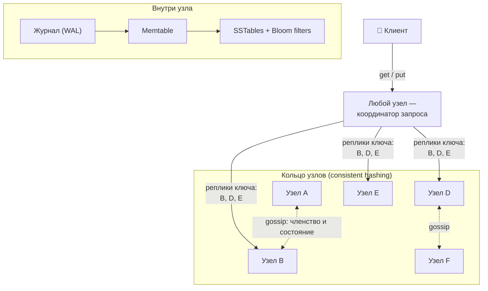
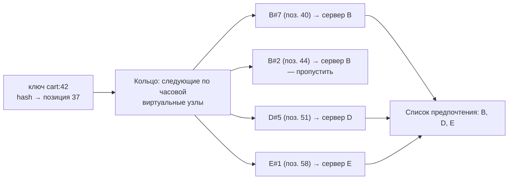
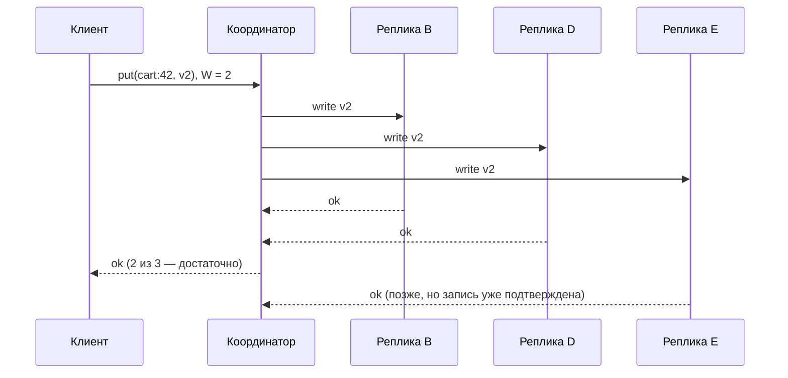
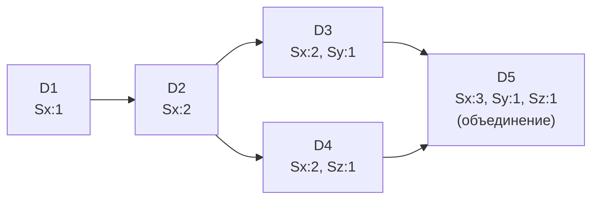
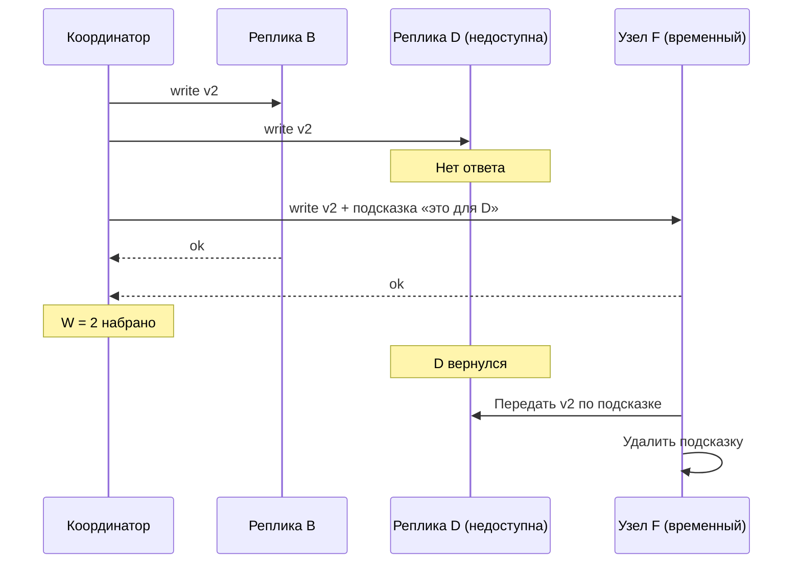
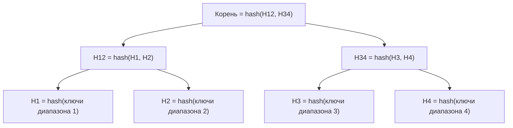
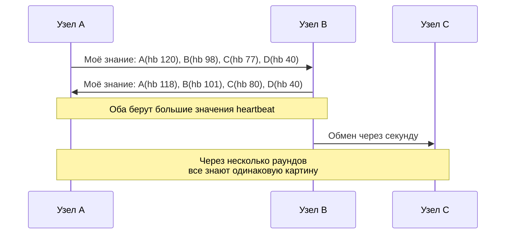
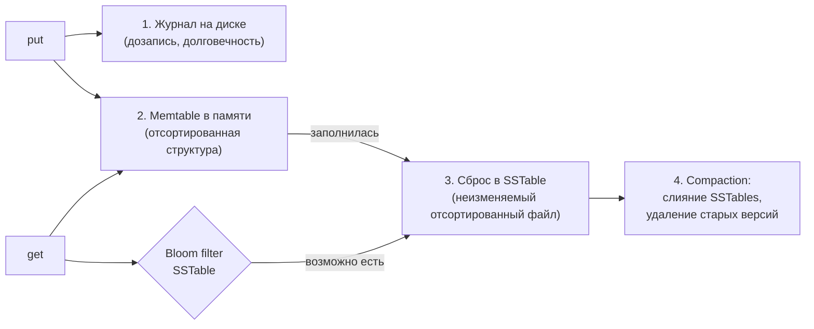
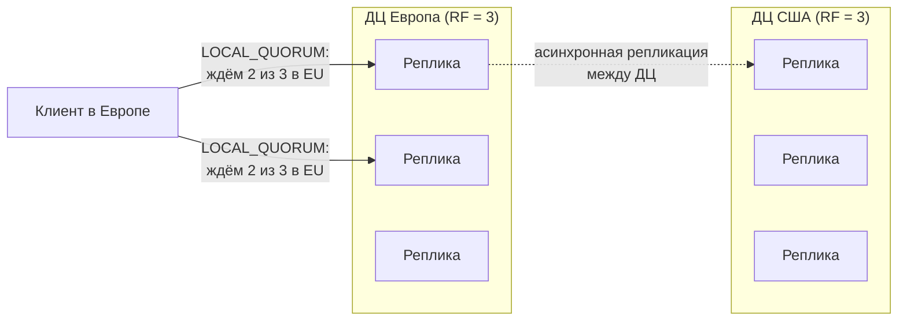

[English](README.md) | **Русский**

# Tier 1 · 19. Распределённое key-value хранилище (как Dynamo)

> **Уровень:** Hard · **Время на интервью:** 45–60 мин · **Время на разбор:** ~5–6 ч
> **Ключевые аспекты:** consistent hashing и виртуальные узлы, репликация и кворумы (N, W, R), версии и конфликты (last-write-wins, векторные часы, CRDT), sloppy quorum и hinted handoff, read repair, anti-entropy на деревьях Меркла, gossip и обнаружение отказов, LSM-движок хранения, настраиваемая консистентность, несколько дата-центров
> **Опирается на:** [05-replication](../../01_Fundamentals/05_Replication/README.ru.md#9-leaderless-и-кворумы), [06-partitioning](../../01_Fundamentals/06_Partitioning/README.ru.md), [07-consistency-models](../../01_Fundamentals/07_Consistency%20models/README.ru.md), [04-databases](../../01_Fundamentals/04_Databases/README.ru.md#7-b-tree-vs-lsm-tree), [Tier 1 · 03 Distributed Cache](../03_Design%20a%20Distributed%20Cache/README.ru.md#7-deep-dive-2-распределение-ключей-по-узлам)

---

## 🗺️ Как читать этот разбор

Разбор построен как интервью, но в каждом шаге есть объяснения: **почему** принимается решение, **как работает** механизм и **что будет**, если сделать иначе. Блоки «📘 Объяснение» — теория прямо по ходу задачи.

| Значок | Что значит |
|:------:|:-----------|
| 🎤 | Реплика интервьюера |
| 🗣️ | Что говорю вслух я (кандидат) |
| ✏️ | Что рисую на доске |
| ⏱️ | Сколько времени тратить на шаг |
| 📘 | Подробное объяснение концепции |

Блоки **TIP** — хороший приём, **WARNING** — ловушка, **IMPORTANT** — сигнал для уровня Senior+.

---

## 📑 Содержание

0. [Чему учит эта задача](#0-чему-учит-эта-задача)
1. [Условие задачи](#1-условие-задачи)
2. [Уточняющие вопросы и требования](#2-уточняющие-вопросы-и-требования)
3. [Оценки нагрузки](#3-оценки-нагрузки)
4. [API](#4-api)
5. [High-level дизайн](#5-high-level-дизайн)
6. [Deep dive 1: распределение данных](#6-deep-dive-1-распределение-данных)
7. [Deep dive 2: репликация и кворумы](#7-deep-dive-2-репликация-и-кворумы)
8. [Deep dive 3: версии и конфликты](#8-deep-dive-3-версии-и-конфликты)
9. [Deep dive 4: временные отказы — sloppy quorum и hinted handoff](#9-deep-dive-4-временные-отказы--sloppy-quorum-и-hinted-handoff)
10. [Deep dive 5: восстановление реплик — read repair и деревья Меркла](#10-deep-dive-5-восстановление-реплик--read-repair-и-деревья-меркла)
11. [Deep dive 6: членство и обнаружение отказов](#11-deep-dive-6-членство-и-обнаружение-отказов)
12. [Deep dive 7: движок хранения на узле](#12-deep-dive-7-движок-хранения-на-узле)
13. [Deep dive 8: настраиваемая консистентность и несколько дата-центров](#13-deep-dive-8-настраиваемая-консистентность-и-несколько-дата-центров)
14. [Узкие места и сценарии сбоев](#14-узкие-места-и-сценарии-сбоев)
15. [Что изменится при росте в 10 раз](#15-что-изменится-при-росте-в-10-раз)
16. [Ключевые концепции и новые понятия](#16-ключевые-концепции-и-новые-понятия)
17. [Варианты задачи и follow-up вопросы](#17-варианты-задачи-и-follow-up-вопросы)
18. [Типичные ошибки](#18-типичные-ошибки)
19. [Шпаргалка и самопроверка](#19-шпаргалка-и-самопроверка)

---

## 0. Чему учит эта задача

Это задача-«экзамен» по распределённым системам: в ней собраны почти все приёмы из статьи Amazon **«Dynamo: Amazon's Highly Available Key-value Store»** (2007), на которой построены Cassandra, Riak, Voldemort и (в части идей) DynamoDB.

| Что проверяют | Где это в задаче |
|:--------------|:-----------------|
| Партиционирование | Consistent hashing, виртуальные узлы |
| Репликация без лидера | Любой узел принимает запись, кворумы N/W/R |
| Компромисс CAP | Всегда доступна запись ценой возможных конфликтов |
| Логика времени и версий | Векторные часы, last-write-wins, CRDT |
| Обработка отказов | Hinted handoff, read repair, anti-entropy |
| Децентрализация | Gossip, нет мастера |
| Хранение на одном узле | LSM-дерево, compaction, Bloom filter, tombstones |

> [!TIP]
> Интервьюер ждёт, что ты построишь систему **по слоям**: распределение данных → репликация → консистентность и конфликты → обработка отказов → членство → хранение на узле. Каждый слой решает свою задачу; называй их по порядку, и разговор будет структурированным.

---

## 1. Условие задачи

> 🎤 «Спроектируй распределённое key-value хранилище, как Amazon Dynamo: операции get и put, горизонтальное масштабирование на сотни узлов, высокая доступность — запись должна работать даже при отказах узлов и сетевых разрывах».

**Пример использования из статьи Dynamo — корзина покупок:**

```
put("cart:42", ["книга"])
put("cart:42", ["книга", "наушники"])
get("cart:42") → ["книга", "наушники"]

Главное требование: «Добавить в корзину» должно работать всегда —
даже если часть серверов недоступна. Потерять добавленный товар хуже,
чем иногда показать удалённый.
```

**План по времени:**

| Шаг | ⏱️ |
|:----|:--:|
| Требования | 5 мин |
| Оценки | 3 мин |
| API и high-level | 5 мин |
| Deep dives | 30 мин |
| Итоги | 4 мин |

---

## 2. Уточняющие вопросы и требования

⏱️ 5 мин

| Мой вопрос | Ответ интервьюера | Что это меняет и почему |
|:-----------|:------------------|:------------------------|
| Объём данных? | Сотни ТБ, рост | Шардирование на сотни узлов |
| Нагрузка? | ~1M операций/с | Горизонтальное масштабирование |
| Размер значения? | В среднем ~1 КБ, до 1 МБ | Простой формат хранения |
| Что важнее при сетевом разрыве: доступность или консистентность? | **Доступность**: запись должна работать всегда | AP-система: кворумы, sloppy quorum, разрешение конфликтов |
| Нужны ли транзакции между ключами? | Нет | Операции над одним ключом |
| Консистентность? | Настраиваемая: по умолчанию eventual, иногда — сильнее | Параметры N, W, R на запрос |
| Задержка? | p99 < 10 мс | Никаких долгих координаций на каждом запросе |
| Несколько дата-центров? | Да | Репликация между ДЦ, локальные кворумы |

### Функциональные требования

1. `put(key, value)`, `get(key)`, `delete(key)`.
2. Настраиваемый уровень консистентности на запрос.
3. Автоматическое распределение данных и перераспределение при добавлении узлов.
4. Обнаружение и разрешение конфликтов одновременных записей.

### Нефункциональные требования

| Требование | Цель | Почему |
|:-----------|:-----|:-------|
| Доступность записи | Всегда, даже при отказах | Корзина, сессии, профили — потеря записи хуже устаревшего чтения |
| Масштабируемость | Линейный рост добавлением узлов | Данные растут |
| Задержка | Единицы миллисекунд на p99 | Хранилище в критическом пути сервисов |
| Долговечность | Без потерь при отказе узлов | Несколько реплик, журнал на диске |
| Децентрализация | Нет единой точки отказа | Любой узел равноправен |

---

## 3. Оценки нагрузки

⏱️ 3 мин

```
Данные:            100 ТБ логически × 3 реплики = 300 ТБ
Узлы:              ~2–4 ТБ полезных данных на узел → ~100–150 узлов
Нагрузка:          1M операций/с ÷ 100 узлов ≈ 10 000 операций/с на узел
                   (с учётом репликации каждая запись — на 3 узла)
Задержка:          запись = ожидание W самых быстрых реплик из N
```

### Выводы

| Вывод | Следствие для дизайна |
|:------|:----------------------|
| Сотни узлов | Отказы происходят **постоянно** — обработка отказов не исключение, а норма |
| 10 000 операций/с на узел | Движок хранения с быстрой записью (LSM) |
| Нет мастера | Любой узел координирует запросы; членство — через gossip |

---

## 4. API

⏱️ 2 мин

```
get(key, consistency = ONE | QUORUM | ALL)
  → [ (value, context), ... ]        ← может вернуть несколько конфликтующих версий

put(key, value, context, consistency)
  → ok                                ← context — версия, полученная при чтении

delete(key, context)
```

📘 **Зачем `context` в put.** Context содержит версию (например, векторные часы) той версии, которую клиент прочитал и изменил. Так хранилище понимает, **заменяет** ли новая запись старую или возникла **параллельная** версия, — это нужно для разрешения конфликтов (deep dive 3).

---

## 5. High-level дизайн

⏱️ 5 мин



🗣️ «Слои системы:
1. **распределение**: consistent hashing с виртуальными узлами — ключ попадает на точку кольца, реплики — на следующие N узлов по часовой стрелке;
2. **репликация**: любой узел может быть координатором; он отправляет запрос N репликам и ждёт W (запись) или R (чтение) ответов;
3. **версии**: каждая запись имеет версию (векторные часы или временную метку); параллельные версии разрешаются;
4. **отказы**: hinted handoff для временных, read repair и anti-entropy (деревья Меркла) для расхождений;
5. **членство**: gossip-протокол, без центрального координатора;
6. **хранение**: LSM-движок на каждом узле».

---

## 6. Deep dive 1: распределение данных

> 🎤 «Как ключи распределяются по узлам и что происходит при добавлении узла?»

Подробно consistent hashing разобран в [Distributed Cache](../03_Design%20a%20Distributed%20Cache/README.ru.md#7-deep-dive-2-распределение-ключей-по-узлам) и [06-partitioning](../../01_Fundamentals/06_Partitioning/README.ru.md). Кратко и что важно для хранилища:

| Решение | Почему |
|:--------|:-------|
| **Кольцо хэшей** | Добавление узла перемещает только ~1/N ключей |
| **Виртуальные узлы** (сотни на сервер) | Равномерная нагрузка; при отказе нагрузка распределяется на многих соседей; мощным серверам — больше виртуальных узлов |
| **Список предпочтения (preference list)** | Для ключа — N **разных физических** узлов по часовой стрелке (виртуальные узлы одного сервера пропускаются), желательно в разных стойках и зонах |



### Добавление узла

📘 Новый узел получает свои виртуальные позиции на кольце; соседние узлы **передают** ему данные диапазонов, за которые он теперь отвечает (streaming). Пока передача идёт, старые владельцы продолжают обслуживать запросы. Это **явная** административная операция, а не автоматическая реакция на временную недоступность — чтобы мигающий узел не вызывал массового перемещения данных.

---

## 7. Deep dive 2: репликация и кворумы

> 🎤 «Как реплицировать данные без лидера и какую консистентность это даёт?»

### N, W, R

| Параметр | Что значит |
|:---------|:-----------|
| **N** | Число реплик каждого ключа (обычно 3) |
| **W** | Сколько реплик должны подтвердить запись, чтобы она считалась успешной |
| **R** | Сколько реплик должны ответить на чтение |



### Почему R + W > N

📘 Если `R + W > N`, множество реплик, ответивших на чтение, **обязательно пересекается** с множеством реплик, подтвердивших последнюю запись. Значит, хотя бы одна прочитанная реплика содержит последнюю подтверждённую версию.

```
N = 3, W = 2, R = 2:  2 + 2 = 4 > 3
  Запись подтвердили B и D
  Чтение спрашивает любые две: {B, E}, {D, E}, {B, D} — в каждой паре есть B или D ✅

N = 3, W = 1, R = 1:  1 + 1 = 2 ≤ 3
  Запись подтвердил только B, чтение спросило E — устаревшее значение ❌
```

| Конфигурация (N = 3) | Свойства | Для чего |
|:---------------------|:---------|:---------|
| W = 2, R = 2 | Баланс; переживает отказ одной реплики и на запись, и на чтение | По умолчанию |
| W = 1, R = 3 | Очень быстрая и доступная запись; медленное чтение | Запись важнее, читают редко |
| W = 3, R = 1 | Быстрое чтение; запись недоступна при отказе любой реплики | Читают намного чаще, чем пишут |
| W = 1, R = 1 | Максимальная скорость и доступность, eventual consistency | Кэши, некритичные данные |

### Задержка

📘 Координатор ждёт **самые быстрые** W (или R) ответов из N. Медленная реплика не тормозит запрос, если остальных достаточно. Это важно для p99: с W = 2 из 3 одна «тормозящая» машина не влияет на задержку.

> [!WARNING]
> **R + W > N не даёт линеаризуемости.** Возможны аномалии: запись не набрала W подтверждений, но успела попасть на одну реплику (клиент получил ошибку, а значение частично записано); sloppy quorum (deep dive 4) пишет на «чужие» узлы; одновременные записи создают конфликтующие версии. Кворумы дают «обычно свежее чтение», но не строгую консистентность (см. [07-consistency-models](../../01_Fundamentals/07_Consistency%20models/README.ru.md)).

---

## 8. Deep dive 3: версии и конфликты

> 🎤 «Два клиента одновременно изменили корзину через разные узлы. Какая версия правильная?»

📘 В системе, где запись принимается всегда (даже при разрыве сети), **одновременные записи неизбежно создают конфликтующие версии**. Нужно уметь их обнаружить и разрешить.

### Last-write-wins (LWW)

Каждая запись получает временную метку; побеждает самая поздняя.

| ✅ Плюсы | ❌ Минусы |
|:--------|:---------|
| Просто, одно значение | **Теряет записи**: из двух одновременных одна молча исчезает |
| Нет конфликтов для клиента | Зависит от часов: при расхождении часов «поздней» окажется запись, сделанная раньше |

Cassandra использует LWW на уровне отдельных колонок — это компромисс простоты: потеря возможна, но ограничена одним полем.

### Векторные часы

📘 **Векторные часы** — список пар «узел → счётчик», который показывает, какие изменения «видела» версия. По ним можно определить, **предшествует** ли одна версия другой или они **параллельны**.

**Пример из статьи Dynamo:**

```
1. Клиент записывает через узел Sx:              D1 [(Sx, 1)]
2. Клиент меняет D1 через Sx:                     D2 [(Sx, 2)]            ← D2 новее D1
3. Клиент 1 меняет D2 через узел Sy:              D3 [(Sx, 2), (Sy, 1)]
4. Клиент 2 одновременно меняет D2 через Sz:      D4 [(Sx, 2), (Sz, 1)]

   D3 и D4: ни одна не «включает» другую (у D3 нет Sz, у D4 нет Sy) → КОНФЛИКТ
   get возвращает обе версии

5. Клиент объединяет их (например, объединение корзин) и записывает через Sx:
                                                  D5 [(Sx, 3), (Sy, 1), (Sz, 1)]  ← новее D3 и D4
```



| Правило сравнения | Вывод |
|:------------------|:------|
| Все счётчики A ≤ счётчиков B (и хотя бы один <) | A предшествует B → B заменяет A |
| Есть счётчики больше у каждой из версий | Параллельные → конфликт, хранить обе |

| ✅ Плюсы | ❌ Минусы |
|:--------|:---------|
| Обнаруживают настоящие конфликты, не теряют записи | Клиент должен уметь объединять версии |
| Не зависят от физических часов | Список растёт с числом узлов-координаторов → усечение старых записей (с небольшим риском ложных конфликтов) |

### CRDT

📘 **CRDT (conflict-free replicated data types)** — структуры данных, которые объединяются **автоматически и детерминированно** без участия клиента:

| CRDT | Как объединяется | Пример |
|:-----|:-----------------|:-------|
| G-Counter | Счётчик на каждый узел, итог — сумма; объединение — максимум по каждому узлу | Счётчик лайков |
| PN-Counter | Два G-Counter: прибавления и вычитания | Счётчик с уменьшением |
| OR-Set | Множество, где добавления и удаления помечены уникальными тегами | Корзина: удалённый товар не «воскресает», добавленный не теряется |
| LWW-Register | Значение с временной меткой | Простое поле |

### Что выбрать

| Ситуация | Выбор |
|:---------|:------|
| Перезапись целого значения, потеря изредка допустима | LWW |
| Нельзя терять записи, клиент умеет объединять | Векторные часы + возврат всех версий |
| Типовые структуры (счётчики, множества) | CRDT |
| Нужна строгая консистентность для операции | Кворумная операция с консенсусом (deep dive 8) |

> [!IMPORTANT]
> **Сигнал Senior+:** объяснить, что в AP-системе конфликты — **не ошибка, а неизбежность**, и показать на примере векторных часов, как отличить «новее» от «параллельно». И знать, что LWW молча теряет записи.

---

## 9. Deep dive 4: временные отказы — sloppy quorum и hinted handoff

> 🎤 «Одна из трёх реплик ключа временно недоступна, а нужно W = 2. Что делать, если вторая тоже недоступна?»

### Строгий кворум против sloppy quorum

| | Строгий кворум | Sloppy quorum |
|:-|:---------------|:--------------|
| Куда писать | Только на N узлов из списка предпочтения | На первые N **доступных** узлов по кольцу |
| Если реплики недоступны | Запись отклоняется | Запись принимается временным узлом |
| Доступность | Ниже | Максимальная |
| Консистентность | Выше | Ниже: читатель, спросивший «правильные» реплики, может не увидеть запись |

### Hinted handoff



| Деталь | Почему |
|:-------|:-------|
| Временный узел хранит запись отдельно, с пометкой «для D» | Не путает её со своими данными |
| Передаёт при возвращении D | Реплика D догоняет без полного сравнения данных |
| Подсказки хранятся ограниченное время | Если D не вернулся долго — восстановление через anti-entropy |

📘 Hinted handoff решает **временные** отказы (перезагрузка, короткий сетевой сбой). Для долгих и постоянных — anti-entropy.

---

## 10. Deep dive 5: восстановление реплик — read repair и деревья Меркла

> 🎤 «Реплики разошлись: где-то потерялась подсказка, где-то диск заменили. Как их синхронизировать?»

### Read repair

📘 При чтении с R > 1 координатор сравнивает версии от реплик. Если какая-то реплика вернула устаревшую версию, координатор **отправляет ей свежую** — исправление «попутно».

| Плюс | Минус |
|:-----|:------|
| Ничего не стоит отдельно — работает при обычных чтениях | Исправляет только ключи, которые читают; редко читаемые могут оставаться расходящимися годами |

### Anti-entropy на деревьях Меркла

📘 Сравнивать реплики ключ за ключом — это передача миллиардов ключей по сети. **Дерево Меркла** позволяет найти различия, передав очень мало данных:



```
Реплики B и D сравнивают деревья для общего диапазона:

1. Сравнить корни:      различаются → спуститься
2. Сравнить H12 и H34:  H12 совпадает (диапазоны 1–2 одинаковы), H34 различается
3. Сравнить H3 и H4:    H3 совпадает, H4 различается
4. Обменяться ключами только диапазона 4

Вместо сравнения всех ключей — несколько хэшей и один маленький диапазон.
```

| Деталь | Почему |
|:-------|:-------|
| Дерево на каждый диапазон ключей узла | Диапазоны соответствуют виртуальным узлам кольца |
| Глубина дерева | Баланс: глубже — точнее находит различия, но больше памяти |
| Периодический запуск (repair) | Например, раз в неделю для всех диапазонов |
| Перестройка дерева | Дорого при изменении данных — строят снимок или поддерживают инкрементально |

| Механизм | Что восстанавливает | Когда |
|:---------|:--------------------|:------|
| Hinted handoff | Записи, пропущенные во время короткого отказа | При возвращении узла |
| Read repair | Читаемые ключи | При чтении |
| Anti-entropy (Меркл) | Всё остальное | Периодически в фоне |

---

## 11. Deep dive 6: членство и обнаружение отказов

> 🎤 «Нет мастера. Как узлы узнают, кто в кластере и кто упал?»

### Gossip

📘 Каждый узел раз в секунду выбирает **случайного** соседа и обменивается с ним своей картиной кластера: список узлов, их состояние, номер «поколения» и счётчик heartbeat. Информация распространяется как слух: за O(log N) раундов её знает весь кластер.



| Деталь | Почему |
|:-------|:-------|
| Случайный выбор соседа | Нет центра, устойчиво к отказам |
| **Seed-узлы** | Новый узел знает адреса нескольких «затравочных» узлов, чтобы войти в кластер; они не мастера |
| Номер поколения | Перезапущенный узел отличается от старой версии себя |

### Обнаружение отказов

| Подход | Как |
|:-------|:----|
| Таймаут heartbeat | Нет новостей о узле N секунд → считать недоступным |
| **Phi accrual failure detector** (Cassandra) | Вместо бинарного «жив/мёртв» — оценка вероятности отказа по распределению интервалов между heartbeat; порог настраивается под сеть |
| Локальное мнение | Каждый узел сам решает, отправлять ли запросы недоступному узлу (и использовать hinted handoff) |

📘 **Временная недоступность ≠ удаление из кластера.** Узел, который «не отвечает», не удаляется из кольца автоматически — иначе мигающая сеть вызывала бы постоянное перемещение данных. Постоянное удаление или замена узла — явная операция администратора.

---

## 12. Deep dive 7: движок хранения на узле

> 🎤 «Как каждый узел хранит данные, чтобы выдерживать 10 000 записей в секунду?»

📘 **LSM-дерево** (log-structured merge tree) оптимизирует запись (см. [04-databases](../../01_Fundamentals/04_Databases/README.ru.md#7-b-tree-vs-lsm-tree)):



| Компонент | Зачем |
|:----------|:------|
| **Журнал (commit log)** | Запись сначала дозаписывается в журнал — после сбоя memtable восстанавливается |
| **Memtable** | Быстрая запись в память, отсортированное хранение |
| **SSTable** | Отсортированный неизменяемый файл; сброс memtable — последовательная запись |
| **Bloom filter** на SSTable | Чтение пропускает файлы, где ключа точно нет |
| **Compaction** | Сливает SSTables, оставляя последнюю версию ключа; ограничивает число файлов для чтения |

| Стратегия compaction | Как | Компромисс |
|:---------------------|:----|:-----------|
| Size-tiered | Сливать SSTables похожего размера | Быстрая запись, больше файлов на чтение и временного места |
| Leveled | Уровни с непересекающимися диапазонами ключей | Быстрее чтение, больше перезаписи данных |

### Удаления и tombstones

📘 Удаление — это запись **tombstone** (метки удаления), а не стирание: в неизменяемых SSTable стереть нельзя, а другие реплики должны узнать об удалении.

> [!WARNING]
> **«Воскрешение» удалённых данных.** Tombstone хранится ограниченное время (`gc_grace_seconds` в Cassandra, по умолчанию 10 дней). Если реплика была недоступна дольше, чем хранится tombstone, и не прошла repair, то после возвращения она «вернёт» удалённое значение — у остальных реплик метки удаления уже нет. Поэтому **repair должен выполняться чаще**, чем истекает срок хранения tombstones.

---

## 13. Deep dive 8: настраиваемая консистентность и несколько дата-центров

> 🎤 «Как дать разным операциям разную консистентность и как работать в нескольких дата-центрах?»

### Уровни консистентности на запрос

| Уровень | Сколько реплик | Для чего |
|:--------|:---------------|:---------|
| `ONE` | 1 | Максимальная скорость, eventual |
| `QUORUM` | Большинство всех реплик | Баланс |
| `LOCAL_QUORUM` | Большинство реплик в своём ДЦ | Баланс без межрегиональной задержки |
| `EACH_QUORUM` | Большинство в каждом ДЦ | Запись, видимая во всех регионах |
| `ALL` | Все реплики | Строго, но недоступно при отказе любой реплики |

### Несколько дата-центров



| Решение | Почему |
|:--------|:-------|
| Фактор репликации на каждый ДЦ | Данные доступны локально в каждом регионе |
| `LOCAL_QUORUM` по умолчанию | Задержка — внутри региона; межрегиональная репликация асинхронна |
| Отказ целого ДЦ | Клиенты переключаются на другой ДЦ, данные там есть (возможно, без последних секунд) |

### Строгая консистентность для отдельных операций

📘 Иногда нужна атомарная операция «записать, только если значение не изменилось» (compare-and-set): например, регистрация уникального логина. Кворумов для этого недостаточно. Решение — **консенсус на уровне ключа**: Cassandra реализует lightweight transactions на Paxos — медленнее (несколько раундов обмена), поэтому только для редких операций.

> [!NOTE]
> **Dynamo, DynamoDB и Cassandra — не одно и то же.** Оригинальный Dynamo (2007) — leaderless, векторные часы, sloppy quorum. Cassandra взяла кольцо и кворумы, но использует LWW вместо векторных часов. Современный сервис DynamoDB устроен иначе: у каждой партиции есть лидер, выбираемый через Multi-Paxos, и по умолчанию чтение с eventual consistency, а по запросу — строго консистентное чтение. На интервью стоит назвать эти различия.

---

## 14. Узкие места и сценарии сбоев

| Сценарий | Что произойдёт | Как защищаемся |
|:---------|:---------------|:---------------|
| Временный отказ реплики | Меньше ответов | Кворум W из N, sloppy quorum, hinted handoff |
| Долгий отказ узла | Реплики расходятся | Anti-entropy на деревьях Меркла |
| Одновременные записи | Конфликтующие версии | Векторные часы / CRDT / LWW |
| Расхождение часов при LWW | Потеря более поздней записи | Векторные часы или CRDT для важных данных |
| Удаление и долгий отказ реплики | Воскрешение данных | Repair чаще срока хранения tombstones |
| Мигающий узел | Постоянное перемещение данных | Временная недоступность не удаляет узел из кольца |
| Горячий ключ | Перегрузка трёх реплик | Кэш перед хранилищем, разбиение значения |
| Огромное значение или партиция | Медленные операции и compaction | Лимиты размера, моделирование данных |
| Отказ ДЦ | Регион недоступен | Реплики в других ДЦ, переключение клиентов |
| Рост векторных часов | Большие метаданные | Усечение старых записей |

---

## 15. Что изменится при росте в 10 раз

> 🎤 «Тысячи узлов и петабайты?»

| Изменение | Почему |
|:----------|:-------|
| **Ограничение gossip** (иерархия, меньше рассылок) | Объём gossip-трафика растёт с числом узлов |
| **Автоматизация repair** с приоритетами | Полный repair на петабайтах занимает дни |
| **Tiered storage** для холодных данных | Стоимость |
| **Несколько кластеров** по доменам данных | Изоляция отказов, проще эксплуатация |
| **Лидер на партицию** (как в DynamoDB) для упрощения консистентности | Меньше конфликтов, проще клиенту |

---

## 16. Ключевые концепции и новые понятия

### Что из Fundamentals применяется

| Концепция | Где разобрана | Как применяется здесь |
|:----------|:--------------|:----------------------|
| Leaderless-репликация, кворумы | [05-replication](../../01_Fundamentals/05_Replication/README.ru.md#9-leaderless-и-кворумы) | N, W, R |
| Consistent hashing | [06-partitioning](../../01_Fundamentals/06_Partitioning/README.ru.md), [Tier 1 · 03](../03_Design%20a%20Distributed%20Cache/README.ru.md) | Кольцо и виртуальные узлы |
| CAP, eventual consistency | [07-consistency-models](../../01_Fundamentals/07_Consistency%20models/README.ru.md) | AP-выбор, аномалии кворумов |
| LSM-деревья | [04-databases](../../01_Fundamentals/04_Databases/README.ru.md#7-b-tree-vs-lsm-tree) | Движок хранения узла |
| Paxos, консенсус | [08-consensus](../../01_Fundamentals/08_Consensus/README.ru.md) | Lightweight transactions |

### Новые понятия этой задачи

| Понятие | Кратко |
|:--------|:-------|
| **Список предпочтения** | N разных физических узлов для ключа по кольцу |
| **N, W, R** | Реплики, подтверждения записи, ответы на чтение |
| **R + W > N** | Пересечение кворумов чтения и записи |
| **Векторные часы** | Версия как «узел → счётчик»; отличают «новее» от «параллельно» |
| **CRDT** | Структуры, объединяемые автоматически без конфликтов |
| **Sloppy quorum** | Запись на первые N доступных узлов |
| **Hinted handoff** | Временный узел хранит запись для недоступного и передаёт позже |
| **Read repair** | Исправление устаревших реплик при чтении |
| **Дерево Меркла** | Дерево хэшей для быстрого поиска различий |
| **Gossip** | Распространение состояния обменом со случайными соседями |
| **Phi accrual detector** | Вероятностная оценка отказа узла |
| **Tombstone** | Метка удаления в LSM-хранилище |

---

## 17. Варианты задачи и follow-up вопросы

<details>
<summary><b>Почему нет мастера, как в Bigtable или HBase?</b></summary>

Мастер — точка отказа и потенциальное узкое место; при его выборе или сбое часть операций недоступна. Dynamo проектировался под требование «запись доступна всегда», поэтому все узлы равноправны: любой может координировать запрос, членство распространяется gossip'ом. Цена — конфликты версий и более сложное восстановление.
</details>

<details>
<summary><b>Как реализовать счётчик (например, просмотры) в такой системе?</b></summary>

Не через «прочитать — прибавить — записать» (одновременные обновления потеряются при LWW), а через CRDT-счётчик: у каждой реплики свой счётчик, итог — сумма, объединение — максимум по каждой реплике. Cassandra предоставляет специальный тип counter, но с ограничениями по идемпотентности при повторах.
</details>

<details>
<summary><b>Как обеспечить read-your-writes для пользователя?</b></summary>

Варианты: читать и писать с `QUORUM` (R + W > N); привязывать сессию пользователя к одному координатору и читать с теми же репликами; или хранить в клиенте версию последней записи и требовать чтение не старее её (см. сессионные гарантии в [07-consistency-models](../../01_Fundamentals/07_Consistency%20models/README.ru.md#7-сессионные-гарантии)).
</details>

<details>
<summary><b>Чем это хранилище отличается от распределённого кэша (#3)?</b></summary>

Кэш может терять данные — источник правды в базе; поэтому там асинхронная репликация, вытеснение, нет конфликтов версий. Хранилище — **источник правды**: долговечный журнал, несколько реплик, кворумы, разрешение конфликтов, восстановление расхождений и tombstones.
</details>

<details>
<summary><b>Как сделать резервное копирование?</b></summary>

Снимки неизменяемых SSTable на каждом узле (дёшево: файлы не меняются, достаточно жёстких ссылок) + архив журналов для восстановления на момент времени. Снимки отправляются в объектное хранилище; при восстановлении нужно учитывать, что разные узлы сняты в немного разные моменты, — после восстановления выполнить repair.
</details>

---

## 18. Типичные ошибки

| ❌ Ошибка | Почему плохо | ✅ Как правильно |
|:---------|:-------------|:----------------|
| `hash % N` для распределения | Перемещение почти всех данных при добавлении узла | Consistent hashing с виртуальными узлами |
| Реплики на виртуальных узлах одного сервера | Отказ сервера убивает все реплики | Список предпочтения из разных физических узлов и стоек |
| Считать R + W > N строгой консистентностью | Аномалии при сбоях и sloppy quorum | Понимать гарантии; консенсус для строгих операций |
| LWW для данных, где нельзя терять записи | Молчаливая потеря | Векторные часы или CRDT |
| Удалять узел из кольца при таймауте | Лавина перемещения данных | Временная недоступность ≠ удаление |
| Только read repair | Редко читаемые ключи расходятся навсегда | Anti-entropy на деревьях Меркла |
| Сравнивать реплики ключ за ключом | Огромный сетевой трафик | Деревья Меркла |
| Удаление без tombstones | Удалённое возвращается с других реплик | Tombstones + repair чаще срока их хранения |
| B-tree с обновлениями на месте при высокой записи | Случайный ввод-вывод | LSM-дерево |
| Путать Dynamo и DynamoDB | Неверное описание гарантий | Знать различия архитектур |

---

## 19. Шпаргалка и самопроверка

### Ответ за 30 секунд

> Leaderless AP-хранилище по слоям. Распределение: consistent hashing с сотнями виртуальных узлов на сервер; список предпочтения — N = 3 разных физических узла в разных стойках. Репликация: любой узел — координатор, отправляет запрос N репликам и ждёт W или R самых быстрых; R + W > N даёт пересечение кворумов (обычно свежее чтение), но не линеаризуемость. Конфликты: векторные часы отличают «новее» от «параллельно», параллельные версии возвращаются клиенту для объединения; CRDT — автоматическое объединение; LWW — просто, но теряет записи. Временные отказы — sloppy quorum и hinted handoff; расхождения — read repair и периодический anti-entropy на деревьях Меркла. Членство — gossip с seed-узлами, phi accrual detector; временная недоступность не удаляет узел из кольца. На узле — LSM: журнал, memtable, SSTables с Bloom filters, compaction, tombstones (repair чаще срока их хранения). Консистентность — на запрос (ONE/QUORUM/LOCAL_QUORUM/ALL), несколько ДЦ с фактором репликации на ДЦ; строгие операции — Paxos на ключ.

### Самопроверка

- [ ] Могу перечислить 6 слоев системы и что решает каждый
- [ ] Могу построить список предпочтения с учётом виртуальных узлов
- [ ] Могу объяснить, почему R + W > N даёт пересечение, на примере
- [ ] Могу сравнить конфигурации N/W/R
- [ ] Могу объяснить, почему кворумы не дают линеаризуемость
- [ ] Могу проследить пример векторных часов и найти конфликт
- [ ] Могу сравнить LWW, векторные часы и CRDT
- [ ] Могу объяснить sloppy quorum и hinted handoff
- [ ] Могу объяснить поиск расхождений деревом Меркла
- [ ] Могу объяснить gossip и обнаружение отказов
- [ ] Могу описать LSM-движок и проблему воскрешения удалённых данных
- [ ] Могу объяснить различия Dynamo, Cassandra и DynamoDB

### Что почитать

- DeCandia et al., *Dynamo: Amazon's Highly Available Key-value Store* (SOSP 2007)
- Lakshman, Malik, *Cassandra: A Decentralized Structured Storage System* (2009)
- Elhemali et al., *Amazon DynamoDB: A Scalable, Predictably Performant, and Fully Managed NoSQL Database Service* (USENIX ATC 2022)
- Shapiro et al., *Conflict-free Replicated Data Types* (2011)
- Hayashibara et al., *The φ Accrual Failure Detector* (2004)
- Martin Kleppmann, *Designing Data-Intensive Applications* — главы 5 и 6
- Alex Xu, *System Design Interview*, Vol. 1 — глава «Design a Key-Value Store»