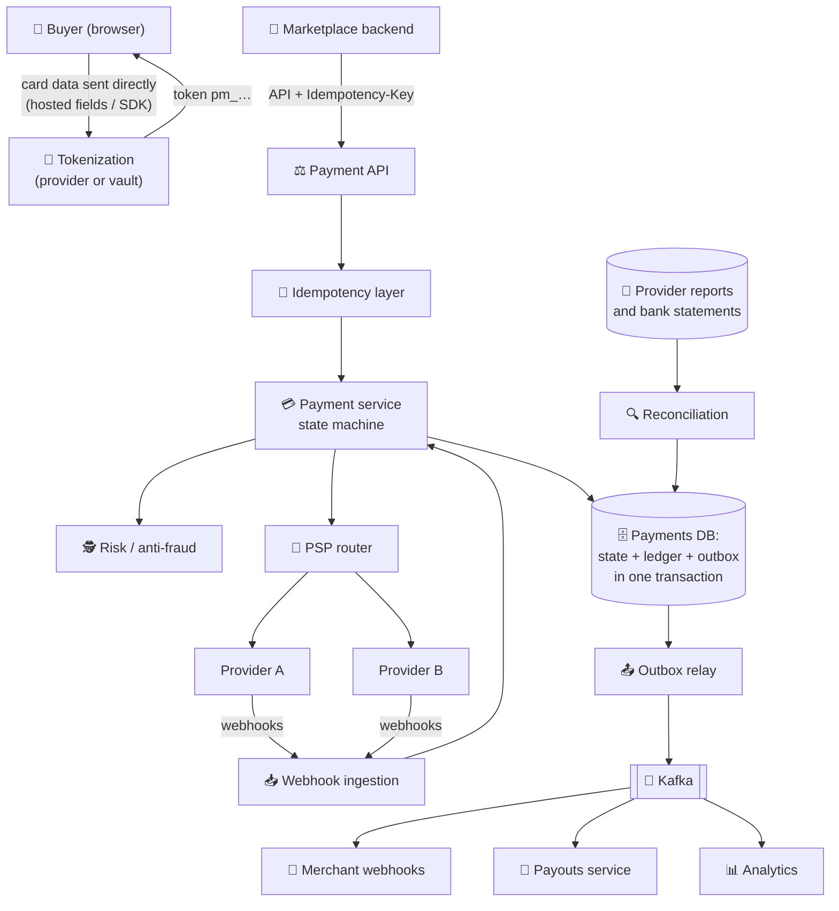
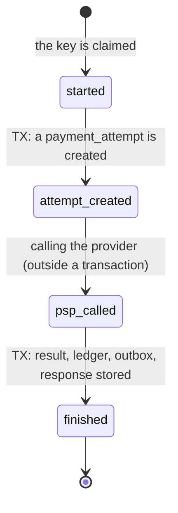
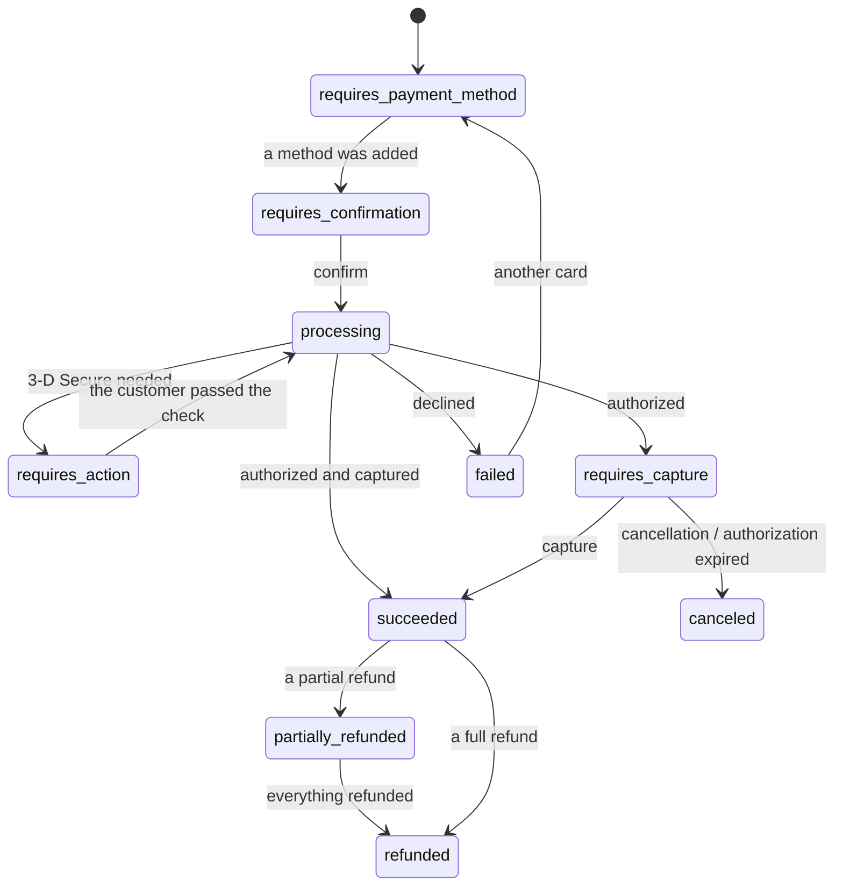
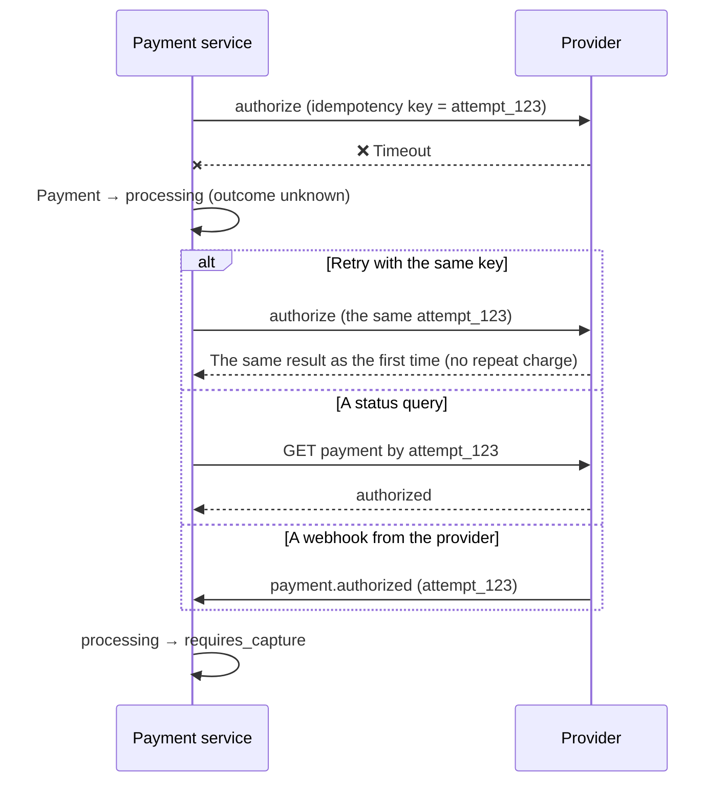
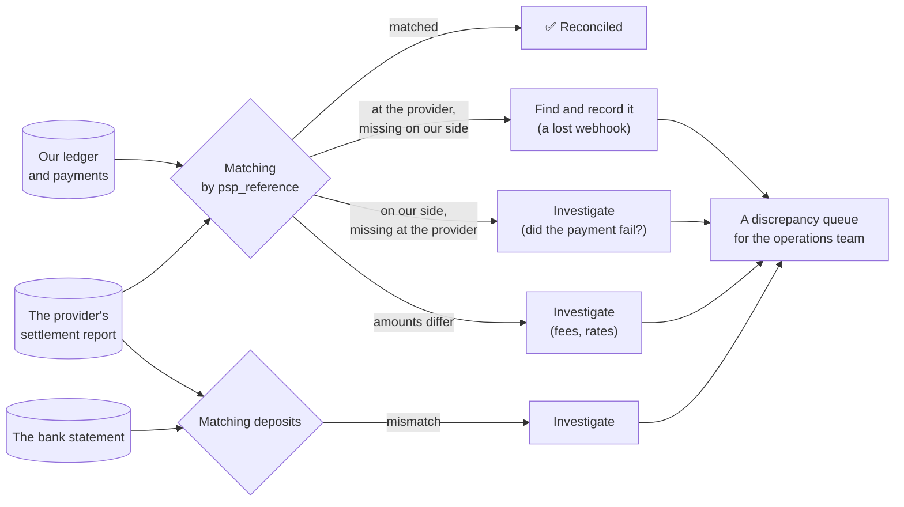

**English** | [Русский](README.ru.md)

# Tier 1 · 20. Idempotent Payment System (like Stripe)

> **Level:** Hard · **Interview time:** 45–60 min · **Study time:** ~5–6 h
> **Key aspects:** idempotency keys, the payment state machine, authorization and capture, working with payment providers and unknown outcomes, webhooks, double-entry bookkeeping, keeping state, ledger and events consistent, reconciliation against provider and bank reports, seller payouts, currencies, PCI DSS and tokenization, anti-fraud
> **Builds on:** [10-idempotency](../../01_Fundamentals/10_Idempotency/README.md), [11-distributed-transactions](../../01_Fundamentals/11_Distributed%20transactions/README.md), [12-communication](../../01_Fundamentals/12_Communication/README.md#9-webhooks), [04-databases](../../01_Fundamentals/04_Databases/README.md), [13-reliability-patterns](../../01_Fundamentals/13_Reliability%20patterns/README.md), [Tier 1 · 17 Ad Click Aggregator](../17_Design%20an%20Ad%20Click%20Aggregator/README.md#12-deep-dive-6-reconciliation-and-billing)

---

## 🗺️ How to Read This Walkthrough

The walkthrough follows an interview, but every step includes explanations: **why** a decision is made, **how** a mechanism works and **what happens** if you do it differently. The "📘 Explanation" blocks are theory right where you need it.

| Icon | Meaning |
|:----:|:--------|
| 🎤 | Interviewer |
| 🗣️ | What I (the candidate) say out loud |
| ✏️ | What I draw on the whiteboard |
| ⏱️ | Time budget for the step |
| 📘 | A detailed explanation of a concept |

Callouts: **TIP** — a good technique, **WARNING** — a trap, **IMPORTANT** — a Senior+ signal.

---

## 📑 Contents

0. [What This Problem Teaches](#0-what-this-problem-teaches)
1. [Problem Statement](#1-problem-statement)
2. [Clarifying Questions and Requirements](#2-clarifying-questions-and-requirements)
3. [Capacity Estimates](#3-capacity-estimates)
4. [API](#4-api)
5. [Data Model](#5-data-model)
6. [High-Level Design](#6-high-level-design)
7. [Deep Dive 1: Idempotency Keys](#7-deep-dive-1-idempotency-keys)
8. [Deep Dive 2: The Payment State Machine](#8-deep-dive-2-the-payment-state-machine)
9. [Deep Dive 3: Providers, Unknown Outcomes and Webhooks](#9-deep-dive-3-providers-unknown-outcomes-and-webhooks)
10. [Deep Dive 4: Double-Entry Bookkeeping](#10-deep-dive-4-double-entry-bookkeeping)
11. [Deep Dive 5: Keeping State, the Ledger and Events Consistent](#11-deep-dive-5-keeping-state-the-ledger-and-events-consistent)
12. [Deep Dive 6: Reconciliation](#12-deep-dive-6-reconciliation)
13. [Deep Dive 7: Seller Payouts and Currencies](#13-deep-dive-7-seller-payouts-and-currencies)
14. [Deep Dive 8: Security, Anti-Fraud and Reliability](#14-deep-dive-8-security-anti-fraud-and-reliability)
15. [Bottlenecks and Failure Scenarios](#15-bottlenecks-and-failure-scenarios)
16. [What Changes at 10x Scale](#16-what-changes-at-10x-scale)
17. [Key Concepts and New Terms](#17-key-concepts-and-new-terms)
18. [Variations and Follow-Up Questions](#18-variations-and-follow-up-questions)
19. [Common Mistakes](#19-common-mistakes)
20. [Cheat Sheet and Self-Check](#20-cheat-sheet-and-self-check)

---

## 0. What This Problem Teaches

A payment system is a problem where **mistakes are measured in money**. A double charge means an angry customer and a refund; a lost payment means lost revenue; a bookkeeping discrepancy means trouble with auditors and regulators. Yet the load is usually modest: the difficulty isn't scale, it's **correctness under failures**.

| What's tested | Where it shows up |
|:--------------|:------------------|
| Idempotency in practice | Retried requests don't create repeated charges |
| State machines | The payment lifecycle with asynchronous transitions |
| Working with unreliable external systems | Provider timeouts, unknown outcomes, webhooks |
| Accounting for money | Double-entry bookkeeping, an immutable ledger |
| Distributed transactions | State, ledger and events without a distributed transaction |
| Reconciliation | Our data versus provider and bank reports |
| Security and regulation | PCI DSS, tokenization, auditing |

> [!TIP]
> Say it up front: **"the load is modest; correctness is what matters"**. That immediately shows the interviewer you understand the essence of the problem, and lets you spend time on idempotency, unknown outcomes and the ledger rather than sharding.

---

## 1. Problem Statement

> 🎤 "Design a payment system for a marketplace: buyers pay for orders by card, the system takes a fee and pays out to sellers; refunds are needed. Above all — never charge twice, and keep accurate books."

**What happens during a payment:**

```
1. The buyer clicks "Pay €100"
2. The money is authorized on the card (blocked), then captured
3. The marketplace keeps a €3 fee; the seller is owed €97
4. A few days later the provider transfers the money to the marketplace's account
5. Once a week the seller's balance is paid out
If the network dropped at step 2 and the buyer clicked "Pay" again — there must be one charge
```

**Time plan:**

| Step | ⏱️ |
|:-----|:--:|
| Requirements | 5 min |
| Estimates | 2 min |
| API and data | 6 min |
| High-level design | 6 min |
| Deep dives | 25–30 min |
| Wrap-up | 3 min |

---

## 2. Clarifying Questions and Requirements

⏱️ 5 min

| My question | Interviewer's answer | What it changes and why |
|:------------|:---------------------|:------------------------|
| Volume? | ~1M payments per day, peaks during sales | Modest load: tens to hundreds per second |
| Payment methods? | Cards via external providers (PSPs); others later | An abstraction over providers |
| Do we handle card data ourselves? | No, minimize the PCI DSS scope | Tokenization; card data never passes through our servers |
| Authorization and capture separately? | Yes: capture after the order is confirmed | A two-step payment |
| Refunds? | Full and partial | A separate entity, recorded in the ledger |
| Seller payouts? | Yes, on a schedule | A payouts service, seller balances |
| Currencies? | Several | Storing in the payment currency, exchange rates |
| Bookkeeping requirements? | Auditability, retention for years | An immutable double-entry ledger |

### Functional requirements

1. Creating and confirming a payment; authorization and capture.
2. Safe retries of any request (idempotency).
3. Full and partial refunds.
4. Recording every money movement (a ledger), seller balances.
5. Seller payouts.
6. Notifying merchants (webhooks) about payment events.
7. Reconciliation with providers and the bank.

### Non-functional requirements

| Requirement | Target | Why |
|:------------|:-------|:----|
| Correctness | No double charges and no lost payments | Customers' money |
| Consistency | Strong for money | A balance can't be "slightly behind" and wrong |
| Availability | High; fail over when a provider is down | Unavailable checkout = lost sales |
| Auditability | Every money movement is explainable and immutable | Regulators, disputes |
| Security | PCI DSS compliance, encryption, access control | A mandatory requirement |
| Latency | Seconds (provider-dependent) | The buyer waits on the checkout page |

---

## 3. Capacity Estimates

⏱️ 2 min

```
Payments:         1M per day → ~12/s on average, peak (a sale) ~500/s
Ledger entries:   ~5 entries per payment → 5M per day
Storage:          payments ~2 GB/day + the ledger ~1 GB/day → ~1 TB per year
                  retained for 7–10 years — a few TB
```

🗣️ "The load is small: one well-tuned relational database with replicas copes, and with growth — sharding by merchant. **The difficulty isn't scale but correctness**: how not to charge twice on a timeout, how not to lose a payment on a failure, how to keep books that always balance."

---

## 4. API

⏱️ 3 min

```http
# Create a payment (an intent to pay)
POST /v1/payment_intents
Idempotency-Key: 6f1a…            ← unique for this client attempt
{ "amount": 10000, "currency": "EUR",          ← the amount in minor units (cents)
  "customer_id": "cus_42", "order_id": "ord_9001",
  "capture_method": "manual" }
→ 201 { "id": "pi_7…", "status": "requires_payment_method", "client_secret": "…" }

# Confirm with a payment method (a card token from the frontend)
POST /v1/payment_intents/pi_7…/confirm
Idempotency-Key: 9c3e…
{ "payment_method": "pm_card_tok_…" }
→ 200 { "status": "requires_capture" | "requires_action" | "processing" | "failed" }

# Capture (after the order is confirmed)
POST /v1/payment_intents/pi_7…/capture       Idempotency-Key: …   { "amount": 10000 }

# Refund
POST /v1/refunds        Idempotency-Key: …   { "payment_intent": "pi_7…", "amount": 3000 }

# Webhooks to the merchant
POST {merchant_url}     { "type": "payment_intent.succeeded", "data": {...}, "id": "evt_…" }
```

📘 **Why amounts are integers in minor units.** Floating-point numbers can't represent decimal fractions exactly: `0.1 + 0.2 = 0.30000000000000004`. That's unacceptable for money. Amounts are stored as integers in the currency's minor units (cents for EUR, while for JPY the minor unit is the yen itself).

---

## 5. Data Model

⏱️ 3 min

| Table | Key fields | Why |
|:------|:-----------|:----|
| `payment_intents` | id, merchant_id, amount, currency, status, version, captured_amount, refunded_amount, created_at | The payment's state |
| `payment_attempts` | id, payment_intent_id, psp, psp_reference, status, request/response, created_at | Each attempt to call a provider is a separate record |
| `idempotency_keys` | (merchant_id, key) unique, request_hash, status, response_code, response_body, locked_at, created_at | Request retries |
| `ledger_transactions` | id, type, source_type, source_id (unique), created_at | A group of entries for one business operation |
| `ledger_entries` | id, transaction_id, account_id, direction (debit/credit), amount, currency | Immutable entries |
| `accounts` | id, owner (merchant / platform / psp), type, currency | Ledger accounts |
| `refunds`, `payouts` | id, related entities, amount, status, psp_reference | Refunds and payouts |
| `outbox` | id, event_type, payload, published | Reliable event publishing |
| `webhook_events_in` | psp_event_id (unique), payload, processed_at | Deduplicating incoming provider webhooks |

> [!NOTE]
> Card data (the number, the CVV) is **absent** from these tables: only a payment method token from the provider or a token vault (deep dive 8).

---

## 6. High-Level Design

⏱️ 6 min



🗣️ "Key decisions:
- **card data never touches our servers**: the frontend sends it directly to tokenization, and we work with the token;
- **an idempotency layer** in front of all the logic;
- **the payment service** is the payment's state machine; it reaches providers through a router;
- **the payment state, ledger entries and the outbox event — in one transaction** of one database;
- provider **webhooks** are deduplicated and applied as state machine transitions;
- **reconciliation** compares our data with provider and bank reports daily."

---

## 7. Deep Dive 1: Idempotency Keys

> 🎤 "A client sent a payment request, got a timeout and retried. How do you guarantee a single charge?"

### Where retries come from

| Source | Example |
|:-------|:--------|
| A network timeout | The request arrived and was processed, the response was lost — the client retries |
| The user | A double click on "Pay" |
| Retries in code | A client library automatically retries on a 5xx error |
| A merchant process restart | The payment job runs again after a crash |

### Semantics

📘 The client generates **a unique key per logical operation** (e.g. a UUID) and sends it in the `Idempotency-Key` header. The server guarantees:

| Situation | Server response |
|:----------|:----------------|
| The key is new | Perform the operation, store the result |
| The key exists, the operation completed, same parameters | Return the **stored** response — without re-executing |
| The key exists, **different** parameters | A `422` error: the key was used for a different request |
| The key exists, the operation is **still running** | `409 Conflict`: retry later |

Stripe keeps keys for 24 hours — enough time for a client to retry (see [10-idempotency](../../01_Fundamentals/10_Idempotency/README.md)).

### Implementation

```sql
-- 1. Atomically "claim" the key
INSERT INTO idempotency_keys (merchant_id, key, request_hash, status, locked_at)
VALUES (:m, :k, :hash, 'in_progress', now())
ON CONFLICT (merchant_id, key) DO NOTHING;

-- 2. If no row was inserted — the key already exists:
SELECT status, request_hash, response_code, response_body
FROM idempotency_keys WHERE merchant_id = :m AND key = :k;
--   a different hash        → 422
--   status = 'completed'    → return the stored response
--   status = 'in_progress'  → 409 (or wait, if locked_at is old — recovery)

-- 3. Perform the operation (several steps, see below)

-- 4. Store the response
UPDATE idempotency_keys SET status = 'completed', response_code = 200, response_body = :resp
WHERE merchant_id = :m AND key = :k;
```

### Recovery points

📘 A payment operation consists of steps with an external call in the middle: "create an attempt → call the provider → update the state". If the process crashed between steps, a retry with the same key must **continue where it stopped**, not start over. The approach described by Brandur Leach (Stripe) — **atomic phases and recovery points**:



| Rule | Why |
|:-----|:----|
| Each phase between external calls is **one DB transaction**, which ends by writing a recovery point to the key's row | After a crash, a retry sees which phase completed |
| The external call happens between transactions, **with its own idempotency key at the provider** (the attempt id) | A repeated provider call won't create a second charge |
| Stuck keys (`in_progress` for long) | A background process resumes them from the last recovery point |

> [!IMPORTANT]
> **Senior+ signal:** idempotency is needed **at every boundary**: from the merchant to us (our idempotency key) and from us to the provider (the attempt id as the provider's idempotency key). If even one boundary lacks it, a retry after a timeout can charge twice.

---

## 8. Deep Dive 2: The Payment State Machine

> 🎤 "What states does a payment have, and how do you guard against invalid transitions?"



| Principle | Implementation |
|:----------|:---------------|
| Only allowed transitions | A transition table in code; `refunded → processing` is impossible |
| Optimistic locking | `UPDATE … SET status = :new, version = version + 1 WHERE id = :id AND status = :expected AND version = :v` |
| Idempotent transitions | A repeated "authorized" event for an already-authorized payment is a no-op, not an error |
| Only forward transitions | A late "processing" webhook doesn't roll a payment back from `succeeded` |
| An event per transition | An outbox record in the same transaction (deep dive 5) |

📘 **Authorization and capture.** **Authorization** blocks the amount on the buyer's card (the money hasn't moved yet); **capture** transfers it. In between there's time to confirm the order (is the item in stock?). An authorization expires after a few days (depending on the card network) — if not captured in time, the hold is released.

---

## 9. Deep Dive 3: Providers, Unknown Outcomes and Webhooks

> 🎤 "You called the provider, and 30 seconds later — a timeout. Was the money charged or not?"

### An unknown outcome

📘 This is **the single most important situation** in the problem. A timeout doesn't mean "not charged": the provider may have completed the operation successfully while the response was lost.

| Action | Consequence |
|:-------|:------------|
| ❌ Treat it as a failure and offer to pay again | A double charge is possible |
| ❌ Retry the request **with a new** provider idempotency key | A double charge is possible |
| ✅ Move the payment to `processing` (unknown) and find out the result | Correct |

### How to find out the result



| Mechanism | When |
|:----------|:-----|
| Retrying **with the same** idempotency key | The provider returns the stored result |
| Querying status by our identifier | If the provider supports lookup by key |
| A webhook | The provider reports the result itself |
| Reconciliation (deep dive 6) | The final safety net: anything unresolved surfaces in the report |

> [!WARNING]
> With an unknown outcome, the buyer is shown "Payment is processing", not "Error, please try again". Otherwise they'll pay again — and if the first charge succeeded, they'll be charged twice.

### Provider webhooks

| Rule | Why |
|:-----|:----|
| **Verify the signature** | Protection against forged "payment succeeded" notifications (see [12-communication](../../01_Fundamentals/12_Communication/README.md#9-webhooks)) |
| **Dedup by event id** (a unique index) | Providers resend webhooks on errors |
| **Order isn't guaranteed** | Apply only forward transitions; when in doubt — fetch the current status from the provider |
| Respond `200` quickly | Store the event and process it asynchronously, otherwise the provider retries |
| The webhook arrived before the API response | The state machine accepts a transition from any source; the second source becomes a no-op |

### 3-D Secure

📘 In Europe (SCA requirements) the bank may require confirmation from the buyer: the payment moves to `requires_action`, the frontend shows the bank's window, and after confirmation the payment continues. The state lives on the server, so a closed tab doesn't lose the payment.

---

## 10. Deep Dive 4: Double-Entry Bookkeeping

> 🎤 "How do you keep books for money so they always balance?"

### The principle

📘 **Double entry**: each business operation is a **ledger transaction** made of several **entries**; the sum of debits equals the sum of credits. Money doesn't appear or disappear — it moves between accounts.

```
Invariant: Σ debits = Σ credits in every ledger transaction
Consequence: the sum of all balances (with sign) is always zero — any error shows up immediately
```

### Accounts

| Account | What it reflects |
|:--------|:-----------------|
| `psp_receivable` | How much the provider owes us |
| `merchant_payable:{merchant}` | How much we owe the seller |
| `platform_fee_revenue` | Our fee |
| `psp_fees_expense` | The provider's fees |
| `bank_cash` | Money in our bank account |

### An example: a €100 payment with a €3 marketplace fee

```
1. The payment is captured:
   Debit   psp_receivable              10,000
   Credit  merchant_payable:seller_7    9,700
   Credit  platform_fee_revenue           300
   (debits 10,000 = credits 10,000 ✅)

2. The provider transferred the money, keeping its €1.50 fee:
   Debit   bank_cash                    9,850
   Debit   psp_fees_expense               150
   Credit  psp_receivable              10,000

3. A payout to the seller:
   Debit   merchant_payable:seller_7    9,700
   Credit  bank_cash                    9,700

4. A €30 partial refund (the fee is refunded proportionally):
   Debit   merchant_payable:seller_7    2,910
   Debit   platform_fee_revenue            90
   Credit  psp_receivable               3,000
```

| Principle | Why |
|:----------|:----|
| **Append-only** | Entries are never changed or deleted; an error is fixed with a **reversing** transaction |
| Integer amounts in minor units | No rounding errors |
| A currency on every entry | You can't add euros to dollars |
| A link to the source | `source_type` + `source_id` (unique) — one ledger transaction per business event; reprocessing creates no duplicates |
| Balance = the sum of entries | For speed — cached balances or periodic snapshots, reconciled against the sum of entries |

> [!IMPORTANT]
> **Senior+ signal:** the ledger is **the source of truth about money**, not a `balance` field in the seller's table. A balance field may be a cache, but it must always be derivable from the immutable entries, and that's checked automatically.

---

## 11. Deep Dive 5: Keeping State, the Ledger and Events Consistent

> 🎤 "A payment became succeeded. You need to write ledger entries and send the merchant a webhook. How do you lose nothing on a failure?"

### The dual-write problem

If you update the status in the database first and then send an event to Kafka, a crash between the steps loses the event. If you do it the other way around — the event goes out but the status isn't updated (see [11-distributed-transactions](../../01_Fundamentals/11_Distributed%20transactions/README.md)).

### The fix: one transaction + an outbox

```sql
BEGIN;
  UPDATE payment_intents SET status = 'succeeded', version = version + 1
  WHERE id = :pi AND status = 'requires_capture' AND version = :v;

  INSERT INTO ledger_transactions (id, type, source_type, source_id) VALUES (:tx, 'capture', 'payment_intent', :pi);
  INSERT INTO ledger_entries … ;          -- entries whose debits equal credits

  INSERT INTO outbox (event_type, payload) VALUES ('payment_intent.succeeded', :json);
COMMIT;
-- A separate process reads the outbox and publishes to Kafka (at-least-once)
```

| Decision | Why |
|:---------|:----|
| State, ledger and outbox — **in one database and one transaction** | All or nothing; no distributed transaction |
| The outbox relay publishes at-least-once | No event is lost; consumers are idempotent |
| Consumers (payouts, merchant webhooks) dedup by event id | Redelivery is safe |
| If the ledger is a separate service | It consumes events and creates ledger transactions with a unique `source_id` — idempotently |

📘 **Why not a distributed transaction with the provider.** The provider is an external system and doesn't take part in a two-phase commit. So interaction with it is structured as a **saga**: each step is idempotent, and on failure a compensation runs (voiding the authorization, a refund).

---

## 12. Deep Dive 6: Reconciliation

> 🎤 "A webhook got lost, there's a bug in the code, the provider made a mistake. How do you know the books have drifted from reality?"

📘 **Reconciliation** is a daily comparison of our records against external sources of truth. No payment service works without it.



| Reconciliation level | What's compared |
|:---------------------|:----------------|
| **Internal** | The sum of entries = cached balances; every ledger transaction is balanced |
| **With the provider** | Each operation in the provider's report ↔ our payment attempt and entries |
| **With the bank** | The provider's transfer totals ↔ deposits in the bank account |

| Discrepancy | A typical cause | Action |
|:------------|:----------------|:-------|
| Succeeded at the provider, `processing` on our side | A lost webhook, a timeout | Transition the payment, create the entries |
| Succeeded on our side, missing at the provider | A bug, test mode, a cancelled operation | Investigate; if needed — a correcting entry |
| Amounts differ | Fees, exchange rates, partial operations | An adjustment, checking the configuration |

> [!TIP]
> Reconciliation is **the safety net** for every other mechanism. Idempotency, webhooks and the state machine make errors rare, and reconciliation guarantees that every remaining error is found.

---

## 13. Deep Dive 7: Seller Payouts and Currencies

> 🎤 "How do you pay out to sellers and work with several currencies?"

### Payouts

| Step | How |
|:-----|:----|
| The seller's balance | The sum of entries on the `merchant_payable:{seller}` account |
| Holds | Part of the money isn't paid out right away (a reserve for refunds and disputes, the provider's settlement time) |
| A schedule | E.g. weekly; the payable amount accounts for holds |
| Creating a payout | A `payout` record with idempotency key = (seller, period) — rerunning the job won't create a second payout |
| Sending to the bank | Batch transfers; the bank's response arrives via a statement or notification |
| A returned payout | Wrong bank details → the money comes back → reversing entries, a notification to the seller |

### Currencies

| Decision | Why |
|:---------|:----|
| A payment is stored in **the buyer's currency** | That's the actual amount of the operation |
| Ledger accounts per currency | Balances in each currency separately |
| Conversion — a separate ledger transaction with **a locked exchange rate** | Auditing: you can see at what rate and when |
| Rounding rules are explicit | E.g. banker's rounding; the remainder goes to a separate account |
| Currencies with different decimal places | EUR — 2, JPY — 0, some — 3 |

---

## 14. Deep Dive 8: Security, Anti-Fraud and Reliability

> 🎤 "How do you protect card data, stop fraudsters and survive a provider outage?"

### PCI DSS and tokenization

📘 The **PCI DSS** standard imposes strict requirements on every system that stores, processes or transmits card data. The fewer systems touch cards, the smaller the compliance scope.

| Decision | Effect |
|:---------|:-------|
| Card input fields come from the provider (an iframe, an SDK) | The card number goes from the browser straight to the provider, bypassing our servers |
| We store only a **token** | A breach of our database doesn't expose cards |
| If you need your own vault | A separate isolated zone with encryption, strict access and auditing |

### Anti-fraud

| Measure | When |
|:--------|:-----|
| Risk scoring before authorization | Attempt velocity per card / device / IP, a mismatch between the card's country and the IP, the buyer's history, ML models |
| 3-D Secure for risky payments | Shifting fraud liability to the bank |
| Blocking and manual review | High risk |
| Handling chargebacks | A dispute from the buyer's bank → hold entries, gathering evidence |

### Reliability

| Decision | Why |
|:---------|:----|
| **Several providers** and routing | One provider's outage doesn't stop accepting payments; routing by cost and approval rate |
| A circuit breaker per provider | Fail over quickly on an outage |
| **Failing over only on a clear failure** | After a timeout you mustn't send the same payment to another provider — the first may have processed it (a double charge). Failover is fine if the request definitely didn't arrive (a connection error before sending) or was explicitly declined |
| DB replicas, backups, a recovery plan | Money must not be lost |
| An access audit log | Who viewed and changed what |

---

## 15. Bottlenecks and Failure Scenarios

| Scenario | What happens | How we protect |
|:---------|:-------------|:---------------|
| The client retried a request | A double charge | An idempotency key |
| A provider timeout | An unknown outcome | `processing` status, a retry with the same key, a status query, a webhook, reconciliation |
| A crash mid-operation | An unfinished operation | Atomic phases, recovery points |
| Duplicate webhooks | Repeated transitions | Dedup by event id, idempotent transitions |
| Out-of-order webhooks | A state rollback | Only forward transitions |
| A crash between status and event | A lost event | An outbox in the same transaction |
| A bookkeeping error | The books don't balance | The balance invariant, automated checks, reversals |
| A provider outage | No payments accepted | Several providers, failover on a clear failure |
| Failing over after a timeout | A double charge | Don't fail over on an unknown outcome |
| A lost webhook | A "stuck" payment | Reconciliation, status polling |
| Floating-point numbers | Errors in cents | Integer amounts in minor units |

---

## 16. What Changes at 10x Scale

> 🎤 "10 million payments a day and dozens of countries?"

| Change | Why |
|:-------|:----|
| **Sharding by merchant** | Volume growth; a merchant's data stays together |
| **A separate ledger service** with its own database | Scaling bookkeeping independently |
| **Local payment methods** and providers by country | Different countries use different payment methods |
| **Smart routing** by approval rate and cost | Money at scale |
| **Regional data storage** | Regulatory requirements |

---

## 17. Key Concepts and New Terms

### What's applied from Fundamentals

| Concept | Where it's covered | How it applies here |
|:--------|:-------------------|:--------------------|
| Idempotency keys | [10-idempotency](../../01_Fundamentals/10_Idempotency/README.md) | Request retries at every boundary |
| Outbox, sagas | [11-distributed-transactions](../../01_Fundamentals/11_Distributed%20transactions/README.md) | State + events, interacting with the provider |
| Webhooks | [12-communication](../../01_Fundamentals/12_Communication/README.md#9-webhooks) | Provider and merchant notifications |
| Transactions, optimistic locking | [04-databases](../../01_Fundamentals/04_Databases/README.md) | The state machine, atomic phases |
| Circuit breakers | [13-reliability-patterns](../../01_Fundamentals/13_Reliability%20patterns/README.md) | Provider outages |
| An adjustment ledger, reconciliation | [Tier 1 · 17](../17_Design%20an%20Ad%20Click%20Aggregator/README.md#12-deep-dive-6-reconciliation-and-billing) | A similar approach to monetary accuracy |

### New terms in this problem

| Term | In short |
|:-----|:---------|
| **PSP** | A payment provider connecting us to the card networks |
| **Authorization / capture** | Blocking the amount / actually transferring it |
| **Recovery points** | Saved operation progress for resuming after a crash |
| **An unknown outcome** | A timeout isn't a decline — you must find out |
| **Double entry** | Every operation is entries with equal debits and credits |
| **A reversal** | Correcting with an opposite transaction instead of changing |
| **Reconciliation** | Comparing our records with provider and bank reports |
| **Tokenization** | Replacing card data with a token |
| **PCI DSS** | The card data security standard |
| **3-D Secure / SCA** | Additional payment confirmation by the buyer |
| **A chargeback** | Disputing a payment via the buyer's bank |

---

## 18. Variations and Follow-Up Questions

<details>
<summary><b>Why not use a distributed transaction between us and the provider?</b></summary>

The provider is an external system and doesn't take part in a two-phase commit; besides, 2PC locks resources and handles failures poorly. The interaction is built as a saga: idempotent steps with idempotency keys, compensations on failure (voiding an authorization, a refund) and reconciliation as the final guarantee.
</details>

<details>
<summary><b>How do you implement subscriptions (monthly charges)?</b></summary>

On the due date a scheduler creates a payment with idempotency key = (subscription, period) — a rerun won't charge twice. It uses a stored card token with the customer's consent to recurring charges. On failure — retries on a schedule (dunning), notifications to the customer, pausing the subscription.
</details>

<details>
<summary><b>What if the success webhook arrives before the API response?</b></summary>

The state machine accepts a transition from any source: the webhook moves the payment to `succeeded`, and the later API response tries the same transition and becomes a no-op (the condition on the current status isn't met, or the transition is idempotent). The order of the sources doesn't matter.
</details>

<details>
<summary><b>How do you handle partial refunds?</b></summary>

A refund is a separate entity with its own idempotency key, status and provider attempt. A check: the sum of all refunds doesn't exceed the captured amount (a condition in the same transaction that creates the refund). The entries reflect the refund and a proportional fee adjustment.
</details>

<details>
<summary><b>How do you show a seller their balance in real time?</b></summary>

The balance is the sum of entries on the seller's account; for fast reads, a cached balance is maintained, updated in the same transaction as the entries and periodically reconciled against their sum. "Pending" amounts (not yet received from the provider, or held) are shown separately.
</details>

---

## 19. Common Mistakes

| ❌ Mistake | Why it's bad | ✅ Do this instead |
|:----------|:-------------|:------------------|
| No idempotency key | Double charges on retries | A key per operation, a stored response |
| A new provider key on a retry | A double charge at the provider | The attempt id as a persistent provider key |
| Timeout = failure | The buyer pays twice | An "unknown" status, finding out the result |
| Failing over to another provider after a timeout | A double charge | Only on a clear failure |
| A `balance` field as the source of truth | Discrepancies with no trail | An immutable double-entry ledger |
| Changing or deleting entries | No audit trail | Reversing transactions |
| Floating-point numbers for money | Rounding errors | Integer amounts in minor units |
| Status and event in different transactions | Lost events | An outbox in the same transaction |
| Webhooks without signatures and dedup | Forgeries and repeated transitions | A signature, a unique event id |
| Card data on your own servers without need | A huge PCI DSS scope | Tokenization via the provider |
| No reconciliation | Errors pile up unnoticed | Daily reconciliation with providers and the bank |

---

## 20. Cheat Sheet and Self-Check

### 30-second answer

> The load is modest — correctness is what matters. Every merchant request carries an Idempotency-Key: the key is atomically claimed in a table, a retry returns the stored response, different parameters get a 422, and the operation proceeds in atomic phases with recovery points. A payment is a state machine with optimistic locking and forward-only transitions; authorization and capture are separate. We call the provider with the attempt id as its idempotency key; a timeout = "unknown" → `processing`, then a retry with the same key, a status query, a webhook or reconciliation; failing over to another provider only on a clear failure. Webhooks — signatures, dedup by event id. Bookkeeping — an immutable double-entry ledger in integer minor units, reversals instead of changes, balances derived from entries. Status, entries and the outbox event — in one transaction; consumers are idempotent. Daily reconciliation against provider reports and the bank. Cards — only via the provider's tokenization; anti-fraud and 3-D Secure before authorization; payouts keyed by (seller, period).

### Self-check

- [ ] I can explain why correctness, not scale, is what matters here
- [ ] I can describe idempotency key semantics in 4 cases and implement them
- [ ] I can explain atomic phases and recovery points
- [ ] I can draw the payment state machine and explain authorization and capture
- [ ] I can explain what to do on a provider timeout and why you can't retry with a new key
- [ ] I can describe the rules for handling webhooks
- [ ] I can write the entries for a payment, a provider transfer, a payout and a refund
- [ ] I can explain how state, the ledger and events stay consistent
- [ ] I can describe the three levels of reconciliation and typical discrepancies
- [ ] I can explain tokenization, PCI DSS and safe provider failover

### Further reading

- Brandur Leach, *Implementing Stripe-like Idempotency Keys in Postgres* (2017)
- Stripe API Reference: Idempotent requests, PaymentIntents, Webhooks
- Martin Fowler, *Accounting Patterns* (double entry, postings)
- Square Engineering / Uber Engineering — articles on payment ledgers
- PCI Security Standards Council — PCI DSS
- Alex Xu, Sahn Lam, *System Design Interview*, Vol. 2 — chapters "Payment System" and "Digital Wallet"