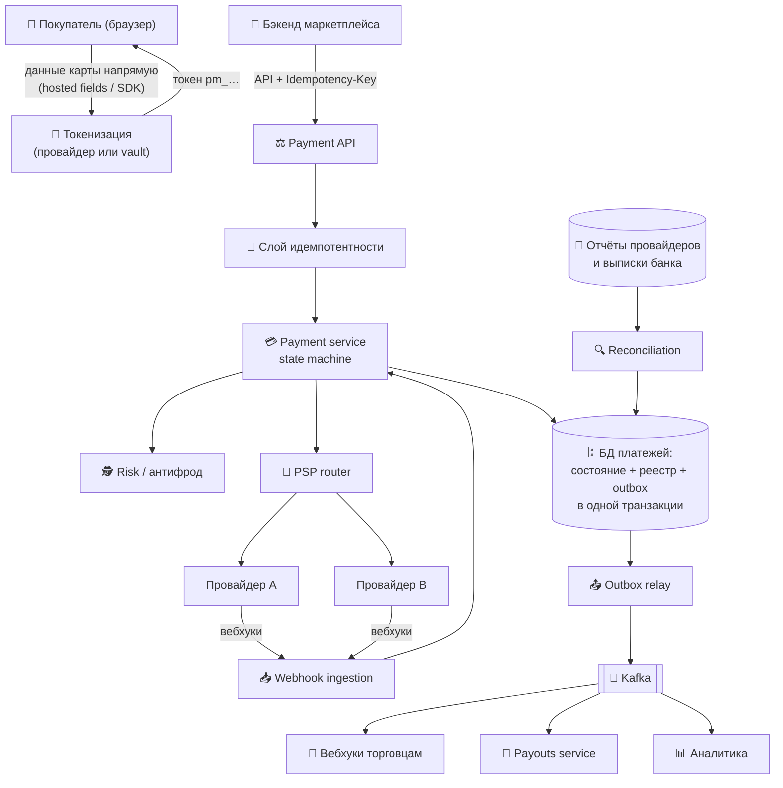
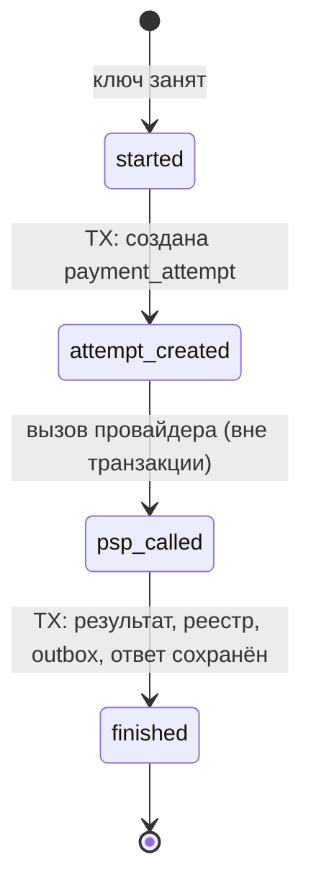
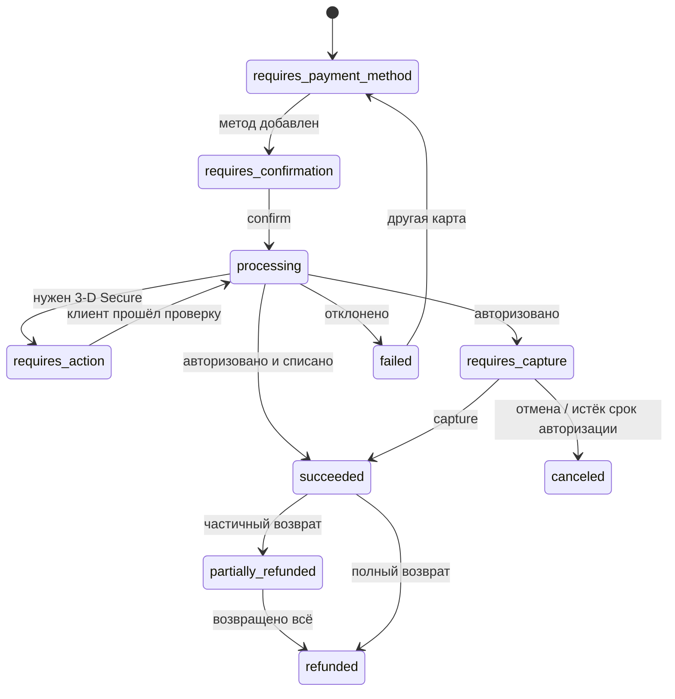
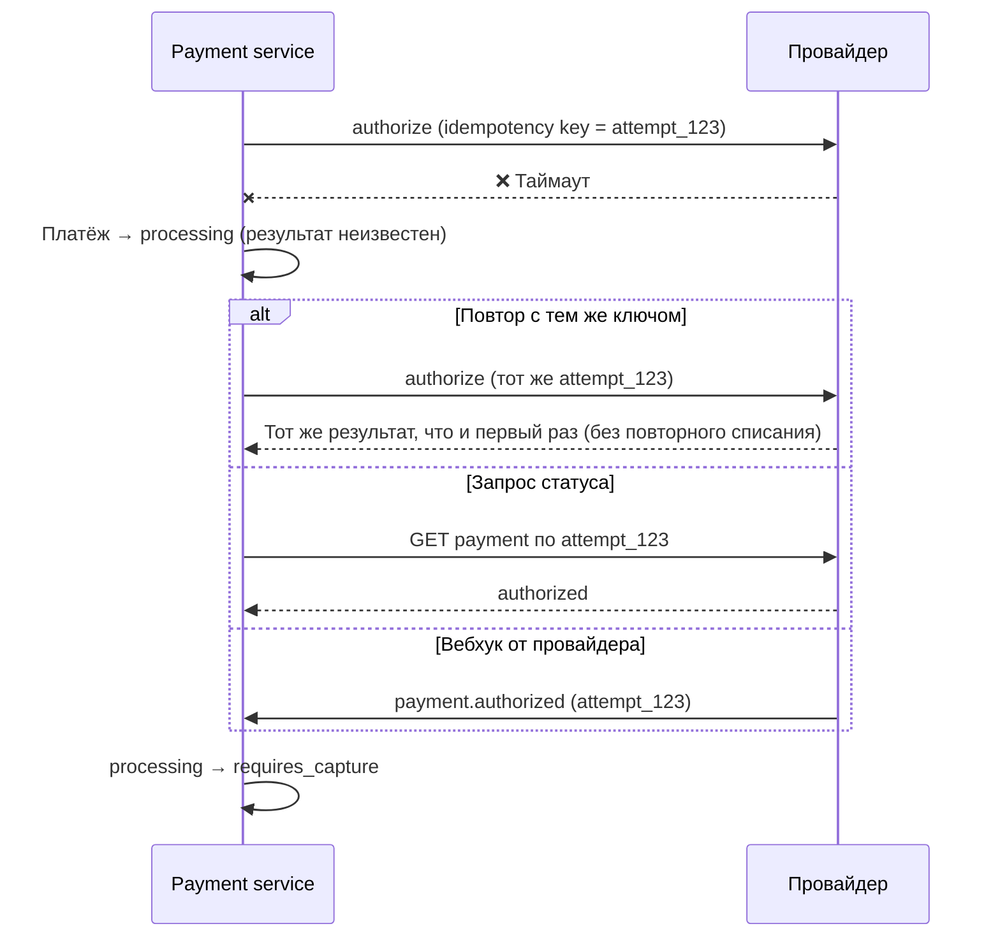
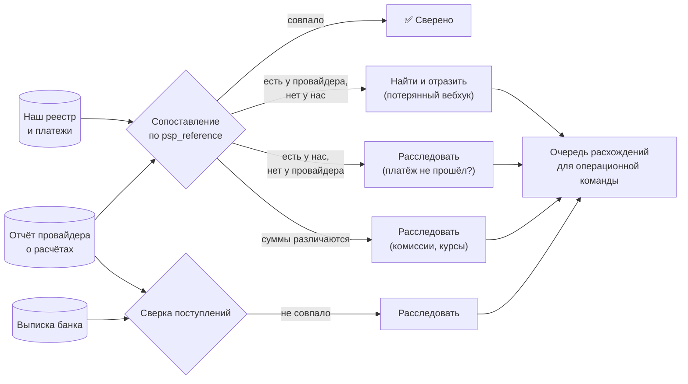

[English](README.md) | **Русский**

# Tier 1 · 20. Идемпотентная платёжная система (как Stripe)

> **Уровень:** Hard · **Время на интервью:** 45–60 мин · **Время на разбор:** ~5–6 ч
> **Ключевые аспекты:** idempotency keys, state machine платежа, авторизация и списание, работа с платёжными провайдерами и неизвестными результатами, вебхуки, бухгалтерия двойной записи, согласованность состояния, реестра и событий, сверка с отчётами провайдеров и банков, выплаты продавцам, валюты, PCI DSS и токенизация, антифрод
> **Опирается на:** [10-idempotency](../../01_Fundamentals/10_Idempotency/README.ru.md), [11-distributed-transactions](../../01_Fundamentals/11_Distributed%20transactions/README.ru.md), [12-communication](../../01_Fundamentals/12_Communication/README.ru.md#9-вебхуки), [04-databases](../../01_Fundamentals/04_Databases/README.ru.md), [13-reliability-patterns](../../01_Fundamentals/13_Reliability%20patterns/README.ru.md), [Tier 1 · 17 Ad Click Aggregator](../17_Design%20an%20Ad%20Click%20Aggregator/README.ru.md#12-deep-dive-6-сверка-и-биллинг)

---

## 🗺️ Как читать этот разбор

Разбор построен как интервью, но в каждом шаге есть объяснения: **почему** принимается решение, **как работает** механизм и **что будет**, если сделать иначе. Блоки «📘 Объяснение» — теория прямо по ходу задачи.

| Значок | Что значит |
|:------:|:-----------|
| 🎤 | Реплика интервьюера |
| 🗣️ | Что говорю вслух я (кандидат) |
| ✏️ | Что рисую на доске |
| ⏱️ | Сколько времени тратить на шаг |
| 📘 | Подробное объяснение концепции |

Блоки **TIP** — хороший приём, **WARNING** — ловушка, **IMPORTANT** — сигнал для уровня Senior+.

---

## 📑 Содержание

0. [Чему учит эта задача](#0-чему-учит-эта-задача)
1. [Условие задачи](#1-условие-задачи)
2. [Уточняющие вопросы и требования](#2-уточняющие-вопросы-и-требования)
3. [Оценки нагрузки](#3-оценки-нагрузки)
4. [API](#4-api)
5. [Модель данных](#5-модель-данных)
6. [High-level дизайн](#6-high-level-дизайн)
7. [Deep dive 1: idempotency keys](#7-deep-dive-1-idempotency-keys)
8. [Deep dive 2: state machine платежа](#8-deep-dive-2-state-machine-платежа)
9. [Deep dive 3: провайдеры, неизвестные результаты и вебхуки](#9-deep-dive-3-провайдеры-неизвестные-результаты-и-вебхуки)
10. [Deep dive 4: бухгалтерия двойной записи](#10-deep-dive-4-бухгалтерия-двойной-записи)
11. [Deep dive 5: согласованность состояния, реестра и событий](#11-deep-dive-5-согласованность-состояния-реестра-и-событий)
12. [Deep dive 6: сверка](#12-deep-dive-6-сверка)
13. [Deep dive 7: выплаты продавцам и валюты](#13-deep-dive-7-выплаты-продавцам-и-валюты)
14. [Deep dive 8: безопасность, антифрод и надёжность](#14-deep-dive-8-безопасность-антифрод-и-надёжность)
15. [Узкие места и сценарии сбоев](#15-узкие-места-и-сценарии-сбоев)
16. [Что изменится при росте в 10 раз](#16-что-изменится-при-росте-в-10-раз)
17. [Ключевые концепции и новые понятия](#17-ключевые-концепции-и-новые-понятия)
18. [Варианты задачи и follow-up вопросы](#18-варианты-задачи-и-follow-up-вопросы)
19. [Типичные ошибки](#19-типичные-ошибки)
20. [Шпаргалка и самопроверка](#20-шпаргалка-и-самопроверка)

---

## 0. Чему учит эта задача

Платёжная система — задача, где **ошибка измеряется в деньгах**. Двойное списание — разгневанный клиент и возврат; потерянный платёж — недополученная выручка; расхождение в учёте — проблемы с аудиторами и регуляторами. При этом нагрузка обычно невысокая: сложность не в масштабе, а в **корректности при сбоях**.

| Что проверяют | Где это в задаче |
|:--------------|:-----------------|
| Идемпотентность на практике | Повторы запросов не создают повторных списаний |
| Конечные автоматы | Жизненный цикл платежа с асинхронными переходами |
| Работа с ненадёжными внешними системами | Таймауты провайдера, неизвестный результат, вебхуки |
| Учёт денег | Бухгалтерия двойной записи, неизменяемый реестр |
| Распределённые транзакции | Состояние, реестр и события без распределённой транзакции |
| Сверка | Наши данные против отчётов провайдеров и банков |
| Безопасность и регулирование | PCI DSS, токенизация, аудит |

> [!TIP]
> Скажи в начале: **«нагрузка невысокая, главное — корректность»**. Это сразу показывает интервьюеру, что ты понимаешь суть задачи, и позволяет потратить время на идемпотентность, неизвестные результаты и реестр, а не на шардирование.

---

## 1. Условие задачи

> 🎤 «Спроектируй платёжную систему для маркетплейса: покупатели оплачивают заказы картой, система берёт комиссию и выплачивает деньги продавцам; нужны возвраты. Главное — никогда не списать деньги дважды и вести точный учёт».

**Что происходит при оплате:**

```
1. Покупатель нажимает «Оплатить 100 €»
2. Деньги авторизуются на карте (заблокированы), затем списываются
3. Маркетплейс удерживает комиссию 3 €, продавцу причитается 97 €
4. Через несколько дней провайдер переводит деньги на счёт маркетплейса
5. Раз в неделю продавцу выплачивается его баланс
Если сеть оборвалась на шаге 2 и клиент нажал «Оплатить» ещё раз — списание должно быть одно
```

**План по времени:**

| Шаг | ⏱️ |
|:----|:--:|
| Требования | 5 мин |
| Оценки | 2 мин |
| API и данные | 6 мин |
| High-level дизайн | 6 мин |
| Deep dives | 25–30 мин |
| Итоги | 3 мин |

---

## 2. Уточняющие вопросы и требования

⏱️ 5 мин

| Мой вопрос | Ответ интервьюера | Что это меняет и почему |
|:-----------|:------------------|:------------------------|
| Объём? | ~1M платежей в сутки, пики в распродажи | Невысокая нагрузка: десятки–сотни в секунду |
| Способы оплаты? | Карты через внешних провайдеров (PSP); позже — другие | Абстракция над провайдерами |
| Обрабатываем ли данные карт сами? | Нет, минимизировать зону PCI DSS | Токенизация, карта не проходит через наши серверы |
| Авторизация и списание отдельно? | Да: списание после подтверждения заказа | Двухшаговый платёж |
| Возвраты? | Полные и частичные | Отдельная сущность, учёт в реестре |
| Выплаты продавцам? | Да, по расписанию | Сервис выплат, балансы продавцов |
| Валюты? | Несколько | Хранение в валюте платежа, курсы |
| Требования к учёту? | Аудируемость, хранение годами | Неизменяемый реестр двойной записи |

### Функциональные требования

1. Создание и подтверждение платежа, авторизация и списание.
2. Безопасные повторы любых запросов (idempotency).
3. Полные и частичные возвраты.
4. Учёт всех движений денег (реестр), балансы продавцов.
5. Выплаты продавцам.
6. Уведомления торговцам (вебхуки) о событиях платежей.
7. Сверка с провайдерами и банком.

### Нефункциональные требования

| Требование | Цель | Почему |
|:-----------|:-----|:-------|
| Корректность | Ни двойных списаний, ни потерянных платежей | Деньги клиентов |
| Консистентность | Строгая для денег | Баланс не может «немного отставать» и быть неверным |
| Доступность | Высокая; при сбое провайдера — переключение | Недоступная оплата = потерянные продажи |
| Аудируемость | Каждое движение денег объяснимо и неизменно | Регуляторы, споры |
| Безопасность | Соответствие PCI DSS, шифрование, контроль доступа | Обязательное требование |
| Задержка | Секунды (зависит от провайдера) | Покупатель ждёт на странице оплаты |

---

## 3. Оценки нагрузки

⏱️ 2 мин

```
Платежи:          1M в сутки → ~12/с в среднем, пик (распродажа) ~500/с
Записи реестра:   ~5 проводок на платёж → 5M в сутки
Хранение:         платежи ~2 ГБ/сутки + реестр ~1 ГБ/сутки → ~1 ТБ в год
                  хранение 7–10 лет — несколько ТБ
```

🗣️ «Нагрузка небольшая: одна хорошо настроенная реляционная база с репликами справится, а при росте — шардирование по торговцу. **Сложность задачи не в масштабе, а в корректности**: как не списать дважды при таймауте, как не потерять платёж при сбое, как вести учёт, который всегда сходится».

---

## 4. API

⏱️ 3 мин

```http
# Создать платёж (намерение оплатить)
POST /v1/payment_intents
Idempotency-Key: 6f1a…            ← уникален для этой попытки клиента
{ "amount": 10000, "currency": "EUR",          ← сумма в минимальных единицах (центах)
  "customer_id": "cus_42", "order_id": "ord_9001",
  "capture_method": "manual" }
→ 201 { "id": "pi_7…", "status": "requires_payment_method", "client_secret": "…" }

# Подтвердить с платёжным методом (токен карты от фронтенда)
POST /v1/payment_intents/pi_7…/confirm
Idempotency-Key: 9c3e…
{ "payment_method": "pm_card_tok_…" }
→ 200 { "status": "requires_capture" | "requires_action" | "processing" | "failed" }

# Списать (после подтверждения заказа)
POST /v1/payment_intents/pi_7…/capture       Idempotency-Key: …   { "amount": 10000 }

# Возврат
POST /v1/refunds        Idempotency-Key: …   { "payment_intent": "pi_7…", "amount": 3000 }

# Вебхуки торговцу
POST {merchant_url}     { "type": "payment_intent.succeeded", "data": {...}, "id": "evt_…" }
```

📘 **Почему суммы в целых минимальных единицах.** Числа с плавающей точкой не представляют точно десятичные дроби: `0.1 + 0.2 = 0.30000000000000004`. В деньгах это недопустимо. Суммы хранятся целыми числами в минимальных единицах валюты (центы для EUR, а для JPY минимальная единица — сама иена).

---

## 5. Модель данных

⏱️ 3 мин

| Таблица | Ключевые поля | Зачем |
|:--------|:--------------|:------|
| `payment_intents` | id, merchant_id, amount, currency, status, version, captured_amount, refunded_amount, created_at | Состояние платежа |
| `payment_attempts` | id, payment_intent_id, psp, psp_reference, status, request/response, created_at | Каждая попытка обращения к провайдеру — отдельная запись |
| `idempotency_keys` | (merchant_id, key) unique, request_hash, status, response_code, response_body, locked_at, created_at | Повторы запросов |
| `ledger_transactions` | id, type, source_type, source_id (unique), created_at | Группа проводок одной бизнес-операции |
| `ledger_entries` | id, transaction_id, account_id, direction (debit/credit), amount, currency | Неизменяемые проводки |
| `accounts` | id, owner (merchant / platform / psp), type, currency | Счета реестра |
| `refunds`, `payouts` | id, связанные сущности, amount, status, psp_reference | Возвраты и выплаты |
| `outbox` | id, event_type, payload, published | Надёжная публикация событий |
| `webhook_events_in` | psp_event_id (unique), payload, processed_at | Дедупликация входящих вебхуков провайдера |

> [!NOTE]
> Данные карт (номер, CVV) в этих таблицах **отсутствуют**: только токен платёжного метода от провайдера или хранилища токенов (deep dive 8).

---

## 6. High-level дизайн

⏱️ 6 мин



🗣️ «Ключевые решения:
- **данные карты не касаются наших серверов**: фронтенд отправляет их напрямую в токенизацию, мы работаем с токеном;
- **слой идемпотентности** перед всей логикой;
- **payment service** — конечный автомат платежа; обращается к провайдерам через маршрутизатор;
- **состояние платежа, проводки реестра и событие outbox — в одной транзакции** одной базы;
- **вебхуки** провайдеров — дедуплицируются и применяются как переходы автомата;
- **сверка** ежедневно сравнивает наши данные с отчётами провайдеров и банка».

---

## 7. Deep dive 1: idempotency keys

> 🎤 «Клиент отправил запрос на оплату, получил таймаут и повторил. Как гарантировать одно списание?»

### Откуда повторы

| Источник | Пример |
|:---------|:-------|
| Таймаут сети | Запрос дошёл и обработан, ответ потерялся — клиент повторяет |
| Пользователь | Двойной клик по «Оплатить» |
| Ретраи в коде | Библиотека клиента автоматически повторяет при ошибке 5xx |
| Перезапуск процесса торговца | Задача оплаты выполняется заново после сбоя |

### Семантика

📘 Клиент генерирует **уникальный ключ на каждую логическую операцию** (например, UUID) и отправляет его в заголовке `Idempotency-Key`. Сервер гарантирует:

| Ситуация | Ответ сервера |
|:---------|:--------------|
| Ключ новый | Выполнить операцию, сохранить результат |
| Ключ уже есть, операция завершена, параметры те же | Вернуть **сохранённый** ответ — без повторного выполнения |
| Ключ уже есть, параметры **другие** | Ошибка `422`: ключ использован для другого запроса |
| Ключ уже есть, операция **ещё выполняется** | `409 Conflict`: повторите позже |

Stripe хранит ключи 24 часа — за это время клиент успевает повторить запрос (см. [10-idempotency](../../01_Fundamentals/10_Idempotency/README.ru.md)).

### Реализация

```sql
-- 1. Атомарно «занять» ключ
INSERT INTO idempotency_keys (merchant_id, key, request_hash, status, locked_at)
VALUES (:m, :k, :hash, 'in_progress', now())
ON CONFLICT (merchant_id, key) DO NOTHING;

-- 2. Если строка не вставилась — ключ уже есть:
SELECT status, request_hash, response_code, response_body
FROM idempotency_keys WHERE merchant_id = :m AND key = :k;
--   hash другой            → 422
--   status = 'completed'   → вернуть сохранённый ответ
--   status = 'in_progress' → 409 (или ждать, если locked_at давно — восстановление)

-- 3. Выполнить операцию (несколько шагов, см. ниже)

-- 4. Сохранить ответ
UPDATE idempotency_keys SET status = 'completed', response_code = 200, response_body = :resp
WHERE merchant_id = :m AND key = :k;
```

### Точки восстановления

📘 Операция оплаты состоит из шагов с внешним вызовом посередине: «создать попытку → вызвать провайдера → обновить состояние». Если процесс упал между шагами, повтор с тем же ключом должен **продолжить с места остановки**, а не начать заново. Подход, описанный Brandur Leach (Stripe), — **атомарные фазы и точки восстановления**:



| Правило | Почему |
|:--------|:-------|
| Каждая фаза между внешними вызовами — **одна транзакция БД**, в конце которой записывается точка восстановления в строку ключа | После сбоя повтор видит, какая фаза завершена |
| Внешний вызов — между транзакциями, **с собственным ключом идемпотентности у провайдера** (id попытки) | Повторный вызов провайдера не создаст второе списание |
| Застрявшие ключи (`in_progress` давно) | Фоновый процесс продолжает их с последней точки восстановления |

> [!IMPORTANT]
> **Сигнал Senior+:** идемпотентность нужна **на каждой границе**: от торговца к нам (наш idempotency key) и от нас к провайдеру (id попытки как ключ идемпотентности провайдера). Если хотя бы на одной границе её нет, повтор после таймаута может списать деньги дважды.

---

## 8. Deep dive 2: state machine платежа

> 🎤 «Какие состояния у платежа и как защититься от некорректных переходов?»



| Принцип | Реализация |
|:--------|:-----------|
| Только разрешённые переходы | Таблица переходов в коде; `refunded → processing` невозможен |
| Оптимистичная блокировка | `UPDATE … SET status = :new, version = version + 1 WHERE id = :id AND status = :expected AND version = :v` |
| Идемпотентные переходы | Повторное событие «авторизовано» для уже авторизованного платежа — no-op, а не ошибка |
| Переходы только вперёд | Запоздавший вебхук «processing» не откатывает платёж из `succeeded` |
| Событие на каждый переход | Запись в outbox в той же транзакции (deep dive 5) |

📘 **Авторизация и списание.** **Авторизация** блокирует сумму на карте покупателя (деньги ещё не ушли); **списание (capture)** переводит её. Между ними — время на подтверждение заказа (есть ли товар). Авторизация истекает через несколько дней (зависит от сети карт) — если не списать вовремя, блокировка снимается.

---

## 9. Deep dive 3: провайдеры, неизвестные результаты и вебхуки

> 🎤 «Вы вызвали провайдера, и через 30 секунд — таймаут. Деньги списаны или нет?»

### Неизвестный результат

📘 Это **самая важная ситуация** в задаче. Таймаут не значит «не списано»: провайдер мог успешно провести операцию, а ответ потерялся.

| Действие | Последствие |
|:---------|:------------|
| ❌ Считать неудачей и предложить оплатить снова | Возможно двойное списание |
| ❌ Повторить запрос **с новым** ключом идемпотентности провайдера | Возможно двойное списание |
| ✅ Перевести платёж в `processing` (неизвестно) и выяснить результат | Корректно |

### Как выяснить результат



| Механизм | Когда |
|:---------|:------|
| Повтор **с тем же** ключом идемпотентности | Провайдер вернёт сохранённый результат |
| Запрос статуса по нашему идентификатору | Если провайдер поддерживает поиск по ключу |
| Вебхук | Провайдер сам сообщает о результате |
| Сверка (deep dive 6) | Окончательная страховка: всё неразрешённое выяснится по отчёту |

> [!WARNING]
> Покупателю при неизвестном результате показывают «Платёж обрабатывается», а не «Ошибка, попробуйте ещё раз». Иначе он повторит оплату — и при успешном первом списании получит два.

### Вебхуки провайдера

| Правило | Почему |
|:--------|:-------|
| **Проверка подписи** | Защита от поддельных уведомлений «платёж успешен» (см. [12-communication](../../01_Fundamentals/12_Communication/README.ru.md#9-вебхуки)) |
| **Дедупликация по event id** (уникальный индекс) | Провайдер повторяет вебхуки при ошибках |
| **Порядок не гарантирован** | Применять только переходы вперёд; при сомнениях — запросить актуальный статус у провайдера |
| Быстрый ответ `200` | Сохранить событие и обработать асинхронно, иначе провайдер повторит |
| Вебхук пришёл раньше ответа API | Автомат принимает переход из любого источника; второй источник становится no-op |

### 3-D Secure

📘 В Европе (требования SCA) банк может потребовать подтверждения покупателем: платёж переходит в `requires_action`, фронтенд показывает окно банка, после подтверждения — продолжение. Состояние хранится на сервере, поэтому закрытая вкладка не теряет платёж.

---

## 10. Deep dive 4: бухгалтерия двойной записи

> 🎤 «Как вести учёт денег, чтобы он всегда сходился?»

### Принцип

📘 **Двойная запись**: каждая бизнес-операция — это **транзакция реестра** из нескольких **проводок**; сумма дебетов равна сумме кредитов. Деньги не появляются и не исчезают — они перемещаются между счетами.

```
Инвариант: Σ дебетов = Σ кредитов в каждой транзакции реестра
Следствие: сумма всех балансов (с учётом знака) всегда равна нулю — любая ошибка видна сразу
```

### Счета

| Счёт | Что отражает |
|:-----|:-------------|
| `psp_receivable` | Сколько провайдер должен нам перевести |
| `merchant_payable:{merchant}` | Сколько мы должны продавцу |
| `platform_fee_revenue` | Наша комиссия |
| `psp_fees_expense` | Комиссии провайдера |
| `bank_cash` | Деньги на нашем банковском счёте |

### Пример: платёж 100 €, комиссия маркетплейса 3 €

```
1. Платёж списан (capture):
   Дебет   psp_receivable              10 000
   Кредит  merchant_payable:seller_7    9 700
   Кредит  platform_fee_revenue           300
   (дебеты 10 000 = кредиты 10 000 ✅)

2. Провайдер перевёл деньги, удержав свою комиссию 1,50 €:
   Дебет   bank_cash                    9 850
   Дебет   psp_fees_expense               150
   Кредит  psp_receivable              10 000

3. Выплата продавцу:
   Дебет   merchant_payable:seller_7    9 700
   Кредит  bank_cash                    9 700

4. Частичный возврат 30 € (комиссия возвращается пропорционально):
   Дебет   merchant_payable:seller_7    2 910
   Дебет   platform_fee_revenue            90
   Кредит  psp_receivable               3 000
```

| Принцип | Почему |
|:--------|:-------|
| **Только добавление** | Проводки никогда не изменяются и не удаляются; ошибка исправляется **сторнирующей** транзакцией |
| Целые суммы в минимальных единицах | Без ошибок округления |
| Валюта в каждой проводке | Нельзя складывать евро с долларами |
| Связь с источником | `source_type` + `source_id` (unique) — одна транзакция реестра на одно бизнес-событие; повторная обработка не создаёт дублей |
| Баланс = сумма проводок | Для скорости — кэшированные балансы или периодические снимки, сверяемые с суммой проводок |

> [!IMPORTANT]
> **Сигнал Senior+:** реестр — **источник правды о деньгах**, а не поле `balance` в таблице продавца. Поле баланса может быть кэшем, но всегда должно выводиться из неизменяемых проводок, и это проверяется автоматически.

---

## 11. Deep dive 5: согласованность состояния, реестра и событий

> 🎤 «Платёж стал succeeded. Нужно записать проводки и отправить вебхук торговцу. Как не потерять ничего при сбое?»

### Проблема двойной записи

Если сначала обновить статус в базе, а потом отправить событие в Kafka, — падение между шагами теряет событие. Если наоборот — событие уходит, а статус не обновлён (см. [11-distributed-transactions](../../01_Fundamentals/11_Distributed%20transactions/README.ru.md)).

### Решение: одна транзакция + outbox

```sql
BEGIN;
  UPDATE payment_intents SET status = 'succeeded', version = version + 1
  WHERE id = :pi AND status = 'requires_capture' AND version = :v;

  INSERT INTO ledger_transactions (id, type, source_type, source_id) VALUES (:tx, 'capture', 'payment_intent', :pi);
  INSERT INTO ledger_entries … ;          -- проводки, сумма дебетов = сумме кредитов

  INSERT INTO outbox (event_type, payload) VALUES ('payment_intent.succeeded', :json);
COMMIT;
-- Отдельный процесс читает outbox и публикует в Kafka (at-least-once)
```

| Решение | Почему |
|:--------|:-------|
| Состояние, реестр и outbox — **в одной базе и одной транзакции** | Либо всё, либо ничего; нет распределённой транзакции |
| Outbox relay публикует с at-least-once | Событие не теряется; потребители идемпотентны |
| Потребители (выплаты, вебхуки торговцам) дедуплицируют по id события | Повторная доставка безопасна |
| Если реестр — отдельный сервис | Он потребляет события и создаёт транзакции реестра с уникальным `source_id` — идемпотентно |

📘 **Почему не распределённая транзакция с провайдером.** Провайдер — внешняя система, она не участвует в двухфазной фиксации. Поэтому взаимодействие с ним оформляется как **сага**: каждый шаг идемпотентен, а при неудаче выполняется компенсация (отмена авторизации, возврат).

---

## 12. Deep dive 6: сверка

> 🎤 «Вебхук потерялся, в коде баг, провайдер ошибся. Как узнать, что учёт расходится с реальностью?»

📘 **Сверка (reconciliation)** — ежедневное сравнение наших записей с внешними источниками правды. Ни один платёжный сервис не работает без неё.



| Уровень сверки | Что сравнивается |
|:---------------|:-----------------|
| **Внутренняя** | Сумма проводок = кэшированные балансы; каждая транзакция реестра сбалансирована |
| **С провайдером** | Каждая операция в отчёте провайдера ↔ наша попытка оплаты и проводки |
| **С банком** | Суммы переводов провайдера ↔ поступления на банковский счёт |

| Расхождение | Типичная причина | Действие |
|:------------|:-----------------|:---------|
| Успешно у провайдера, у нас `processing` | Потерянный вебхук, таймаут | Перевести платёж, создать проводки |
| Успешно у нас, нет у провайдера | Баг, тестовый режим, отменённая операция | Расследовать, при необходимости — корректирующая проводка |
| Разные суммы | Комиссии, курсы, частичные операции | Корректировка, проверка настроек |

> [!TIP]
> Сверка — **страховочная сеть** для всех остальных механизмов. Идемпотентность, вебхуки и state machine делают ошибки редкими, а сверка гарантирует, что каждая оставшаяся ошибка будет найдена.

---

## 13. Deep dive 7: выплаты продавцам и валюты

> 🎤 «Как выплачивать деньги продавцам и работать с несколькими валютами?»

### Выплаты

| Шаг | Как |
|:----|:----|
| Баланс продавца | Сумма проводок счёта `merchant_payable:{seller}` |
| Удержание | Часть денег не выплачивается сразу (резерв на возвраты и споры, срок поступления от провайдера) |
| Расписание | Например, еженедельно; доступная к выплате сумма — с учётом удержаний |
| Создание выплаты | Запись `payout` с idempotency key = (продавец, период) — повторный запуск задачи не создаст вторую выплату |
| Отправка в банк | Пакетные переводы; ответ банка — через выписку или уведомление |
| Возврат выплаты | Неверные реквизиты → деньги возвращаются → сторнирующие проводки, уведомление продавцу |

### Валюты

| Решение | Почему |
|:--------|:-------|
| Платёж хранится в **валюте покупателя** | Это фактическая сумма операции |
| Счета реестра — по валютам | Балансы в каждой валюте отдельно |
| Конвертация — отдельная транзакция реестра с **зафиксированным курсом** | Аудит: видно, по какому курсу и когда |
| Правила округления описаны явно | Например, банковское округление; разница — на отдельный счёт |
| Валюты с разным числом знаков | EUR — 2 знака, JPY — 0, некоторые — 3 |

---

## 14. Deep dive 8: безопасность, антифрод и надёжность

> 🎤 «Как защитить данные карт, отсечь мошенников и пережить сбой провайдера?»

### PCI DSS и токенизация

📘 Стандарт **PCI DSS** предъявляет строгие требования ко всем системам, которые хранят, обрабатывают или передают данные карт. Чем меньше систем касаются карт, тем меньше зона соответствия.

| Решение | Эффект |
|:--------|:-------|
| Поля ввода карты — от провайдера (iframe, SDK) | Номер карты идёт из браузера напрямую провайдеру, минуя наши серверы |
| Мы храним только **токен** | Утечка нашей базы не раскрывает карты |
| Если нужен собственный vault | Отдельная изолированная зона с шифрованием, строгим доступом и аудитом |

### Антифрод

| Мера | Когда |
|:-----|:------|
| Оценка риска до авторизации | Скорость попыток с карты / устройства / IP, несоответствие страны карты и IP, история покупателя, ML-модели |
| 3-D Secure для рискованных | Перенос ответственности за мошенничество на банк |
| Блокировка и ручная проверка | Высокий риск |
| Обработка чарджбэков | Спор от банка покупателя → проводки удержания, сбор доказательств |

### Надёжность

| Решение | Почему |
|:--------|:-------|
| **Несколько провайдеров** и маршрутизация | Отказ одного провайдера не останавливает приём платежей; выбор по стоимости и проценту одобрений |
| Circuit breaker на провайдера | Быстро переключиться при сбое |
| **Переключение только при явной неудаче** | При таймауте нельзя отправлять тот же платёж другому провайдеру — первый мог его провести (двойное списание). Переключаться можно, если запрос точно не дошёл (ошибка соединения до отправки) или явно отклонён |
| Реплики БД, резервное копирование, план восстановления | Деньги нельзя терять |
| Аудит-журнал доступа | Кто и что смотрел и менял |

---

## 15. Узкие места и сценарии сбоев

| Сценарий | Что произойдёт | Как защищаемся |
|:---------|:---------------|:---------------|
| Клиент повторил запрос | Двойное списание | Idempotency key |
| Таймаут провайдера | Неизвестный результат | Статус `processing`, повтор с тем же ключом, запрос статуса, вебхук, сверка |
| Падение посреди операции | Незавершённая операция | Атомарные фазы, точки восстановления |
| Дубли вебхуков | Повторные переходы | Дедупликация по event id, идемпотентные переходы |
| Вебхуки не по порядку | Откат состояния | Только переходы вперёд |
| Падение между статусом и событием | Потерянное событие | Outbox в той же транзакции |
| Ошибка в проводках | Учёт не сходится | Инвариант баланса, автоматическая проверка, сторно |
| Отказ провайдера | Нет приёма платежей | Несколько провайдеров, переключение при явной неудаче |
| Переключение после таймаута | Двойное списание | Не переключать при неизвестном результате |
| Потерянный вебхук | Платёж «завис» | Сверка, опрос статуса |
| Числа с плавающей точкой | Ошибки в копейках | Целые суммы в минимальных единицах |

---

## 16. Что изменится при росте в 10 раз

> 🎤 «10 миллионов платежей в сутки и десятки стран?»

| Изменение | Почему |
|:----------|:-------|
| **Шардирование по торговцу** | Рост объёма; данные торговца вместе |
| **Отдельный сервис реестра** с собственной базой | Независимое масштабирование учёта |
| **Локальные методы оплаты** и провайдеры по странам | Разные способы оплаты в разных странах |
| **Умная маршрутизация** по проценту одобрения и стоимости | Деньги на масштабе |
| **Региональное хранение данных** | Требования регуляторов |

---

## 17. Ключевые концепции и новые понятия

### Что из Fundamentals применяется

| Концепция | Где разобрана | Как применяется здесь |
|:----------|:--------------|:----------------------|
| Idempotency keys | [10-idempotency](../../01_Fundamentals/10_Idempotency/README.ru.md) | Повторы запросов на всех границах |
| Outbox, саги | [11-distributed-transactions](../../01_Fundamentals/11_Distributed%20transactions/README.ru.md) | Состояние + события, взаимодействие с провайдером |
| Вебхуки | [12-communication](../../01_Fundamentals/12_Communication/README.ru.md#9-вебхуки) | Уведомления провайдеров и торговцам |
| Транзакции, оптимистичная блокировка | [04-databases](../../01_Fundamentals/04_Databases/README.ru.md) | State machine, атомарные фазы |
| Circuit breaker | [13-reliability-patterns](../../01_Fundamentals/13_Reliability%20patterns/README.ru.md) | Отказ провайдера |
| Реестр корректировок, сверка | [Tier 1 · 17](../17_Design%20an%20Ad%20Click%20Aggregator/README.ru.md#12-deep-dive-6-сверка-и-биллинг) | Похожий подход к точности денег |

### Новые понятия этой задачи

| Понятие | Кратко |
|:--------|:-------|
| **PSP** | Платёжный провайдер, подключающий нас к сетям карт |
| **Авторизация / списание** | Блокировка суммы / фактический перевод |
| **Точки восстановления** | Сохранённый прогресс операции для продолжения после сбоя |
| **Неизвестный результат** | Таймаут не значит отказ — нужно выяснить |
| **Двойная запись** | Каждая операция — проводки с равными дебетами и кредитами |
| **Сторно** | Исправление обратной транзакцией вместо изменения |
| **Сверка** | Сравнение наших записей с отчётами провайдеров и банка |
| **Токенизация** | Замена данных карты токеном |
| **PCI DSS** | Стандарт безопасности данных карт |
| **3-D Secure / SCA** | Дополнительное подтверждение платежа покупателем |
| **Чарджбэк** | Оспаривание платежа через банк покупателя |

---

## 18. Варианты задачи и follow-up вопросы

<details>
<summary><b>Почему не использовать распределённую транзакцию между нами и провайдером?</b></summary>

Провайдер — внешняя система и не участвует в двухфазной фиксации; к тому же 2PC блокирует ресурсы и плохо переносит сбои. Взаимодействие строится как сага: идемпотентные шаги с ключами идемпотентности, компенсации при неудаче (отмена авторизации, возврат) и сверка как окончательная гарантия.
</details>

<details>
<summary><b>Как реализовать подписки (ежемесячные списания)?</b></summary>

Планировщик в нужную дату создаёт платёж с idempotency key = (подписка, период) — повторный запуск не спишет дважды. Используется сохранённый токен карты с согласием клиента на повторные списания. При отказе — повторные попытки по расписанию (dunning), уведомления клиенту, приостановка подписки.
</details>

<details>
<summary><b>Что если вебхук об успехе пришёл раньше, чем ответ на API-запрос?</b></summary>

Конечный автомат принимает переход из любого источника: вебхук переводит платёж в `succeeded`, а пришедший позже ответ API пытается сделать тот же переход и становится no-op (условие по текущему статусу не выполняется, или переход идемпотентен). Порядок источников не важен.
</details>

<details>
<summary><b>Как обрабатывать частичные возвраты?</b></summary>

Возврат — отдельная сущность со своим idempotency key, статусом и попыткой у провайдера. Проверка: сумма всех возвратов не превышает списанную сумму (условие в той же транзакции, что и создание возврата). Проводки отражают возврат и пропорциональную корректировку комиссии.
</details>

<details>
<summary><b>Как показать продавцу его баланс в реальном времени?</b></summary>

Баланс — сумма проводок по счёту продавца; для быстрого чтения поддерживается кэшированный баланс, обновляемый в той же транзакции, что и проводки, и периодически сверяемый с суммой проводок. Отдельно показываются «ожидающие» суммы (ещё не поступившие от провайдера или удержанные).
</details>

---

## 19. Типичные ошибки

| ❌ Ошибка | Почему плохо | ✅ Как правильно |
|:---------|:-------------|:----------------|
| Нет idempotency key | Двойные списания при повторах | Ключ на каждую операцию, сохранённый ответ |
| Новый ключ провайдера при повторе | Двойное списание у провайдера | Id попытки как постоянный ключ провайдера |
| Таймаут = неудача | Покупатель платит дважды | Статус «неизвестно», выяснение результата |
| Переключение на другого провайдера после таймаута | Двойное списание | Только при явной неудаче |
| Поле `balance` как источник правды | Расхождения без следов | Неизменяемый реестр двойной записи |
| Изменение или удаление проводок | Нет аудита | Сторнирующие транзакции |
| Числа с плавающей точкой для денег | Ошибки округления | Целые суммы в минимальных единицах |
| Статус и событие в разных транзакциях | Потерянные события | Outbox в той же транзакции |
| Вебхуки без подписи и дедупликации | Подделки и повторные переходы | Подпись, уникальный event id |
| Данные карт на своих серверах без необходимости | Огромная зона PCI DSS | Токенизация через провайдера |
| Нет сверки | Ошибки накапливаются незаметно | Ежедневная сверка с провайдерами и банком |

---

## 20. Шпаргалка и самопроверка

### Ответ за 30 секунд

> Нагрузка небольшая — главное корректность. Каждый запрос торговца несёт Idempotency-Key: ключ атомарно занимается в таблице, повтор возвращает сохранённый ответ, другие параметры — 422, операция идёт атомарными фазами с точками восстановления. Платёж — конечный автомат с оптимистичной блокировкой и переходами только вперёд; авторизация и списание раздельно. К провайдеру — с id попытки как его ключом идемпотентности; таймаут = «неизвестно» → `processing`, затем повтор с тем же ключом, запрос статуса, вебхук или сверка; переключение на другого провайдера только при явной неудаче. Вебхуки — подпись, дедупликация по event id. Учёт — неизменяемый реестр двойной записи в целых минимальных единицах, сторно вместо изменений, баланс выводится из проводок. Статус, проводки и событие outbox — в одной транзакции; потребители идемпотентны. Ежедневная сверка с отчётами провайдеров и банком. Карты — только через токенизацию провайдера, антифрод и 3-D Secure до авторизации; выплаты — с ключом (продавец, период).

### Самопроверка

- [ ] Могу объяснить, почему главное здесь — корректность, а не масштаб
- [ ] Могу описать семантику idempotency key в 4 случаях и реализовать её
- [ ] Могу объяснить атомарные фазы и точки восстановления
- [ ] Могу нарисовать state machine платежа и объяснить авторизацию и списание
- [ ] Могу объяснить, что делать при таймауте провайдера, и почему нельзя повторять с новым ключом
- [ ] Могу описать правила обработки вебхуков
- [ ] Могу составить проводки для платежа, перевода от провайдера, выплаты и возврата
- [ ] Могу объяснить, как состояние, реестр и события остаются согласованными
- [ ] Могу описать три уровня сверки и типичные расхождения
- [ ] Могу объяснить токенизацию, PCI DSS и безопасное переключение провайдеров

### Что почитать

- Brandur Leach, *Implementing Stripe-like Idempotency Keys in Postgres* (2017)
- Stripe API Reference: Idempotent requests, PaymentIntents, Webhooks
- Martin Fowler, *Accounting Patterns* (двойная запись, проводки)
- Square Engineering / Uber Engineering — статьи о платёжных реестрах
- PCI Security Standards Council — PCI DSS
- Alex Xu, Sahn Lam, *System Design Interview*, Vol. 2 — главы «Payment System» и «Digital Wallet»