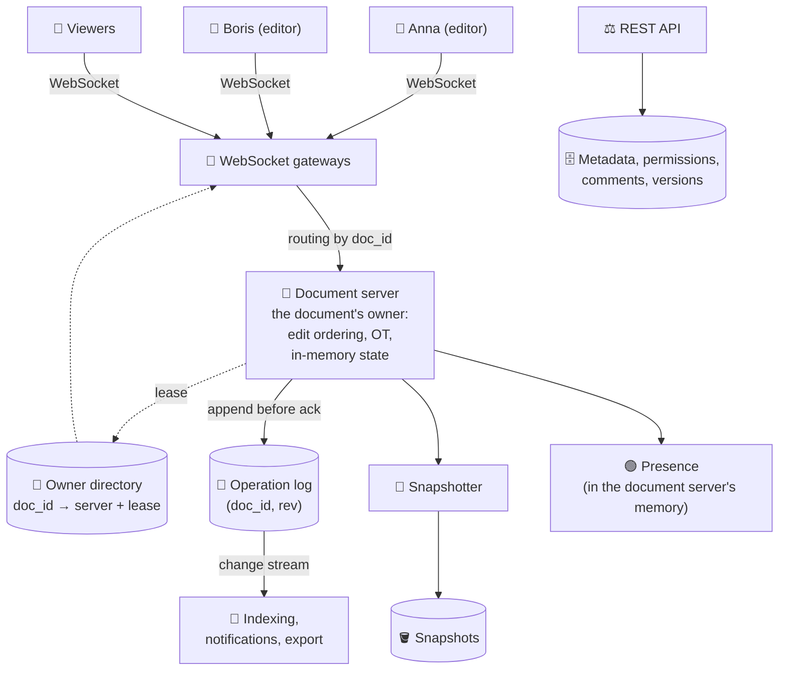
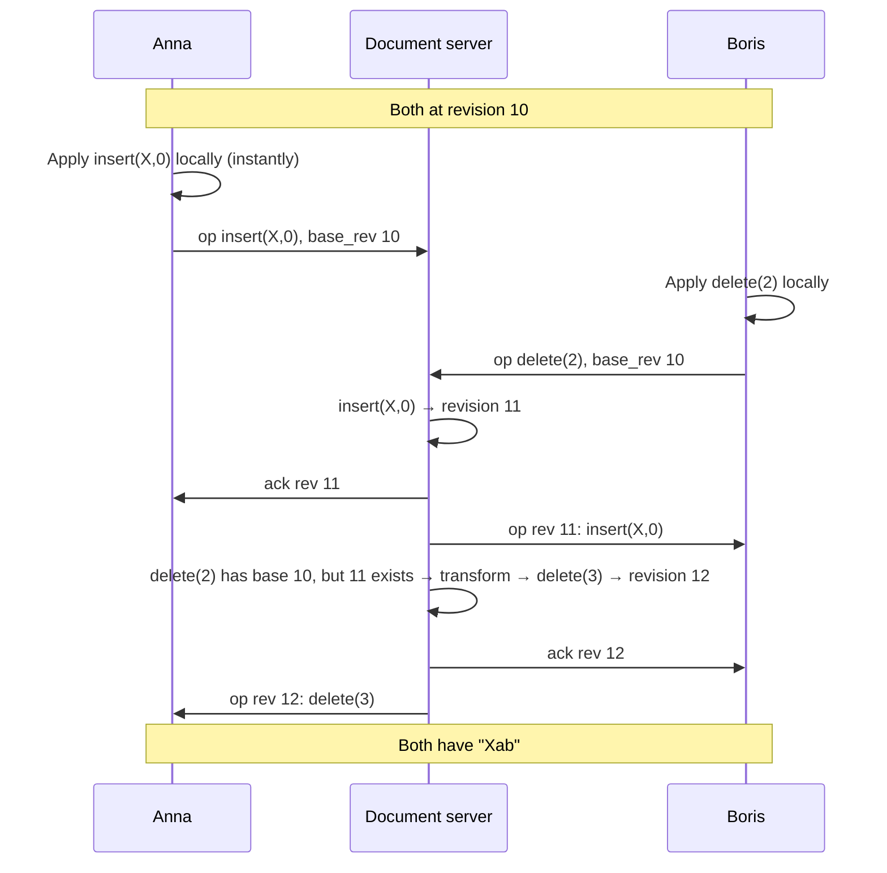
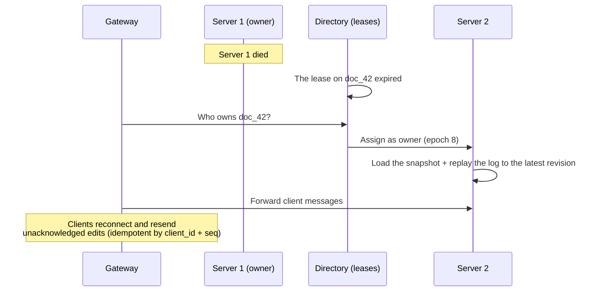
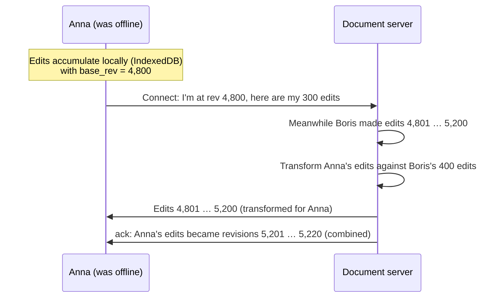

**English** | [Русский](README_RU.md)

# Tier 2 · 4A · 01. Google Docs (Real-Time Collaborative Editing)

> **Level:** Advanced · **Interview time:** 45–60 min · **Study time:** ~6–7 h
> **Key aspects:** why concurrent edits diverge, Operational Transformation (OT), CRDTs (Yjs, Automerge), the document server as the single source of ordering, an operation log and snapshots, cursors and presence, offline edits, version history, rich text and comments, access control
> **Builds on:** [12-communication](../../../12-communication/README.md#8-scaling-websockets), [07-consistency-models](../../../07-consistency-models/README.md), [08-consensus](../../../08-consensus/README.md#9-leases-and-leader-election-for-applications), [Tier 1 · 06 Chat](../../../tier-1/06-chat-system/README.md#8-deep-dive-2-sending-a-message-and-ordering), [Tier 1 · 19 KV Store](../../../tier-1/19-distributed-kv-store/README.md#8-deep-dive-3-versions-and-conflicts) (CRDTs)

---

## 🗺️ How to Read This Walkthrough

The walkthrough follows an interview, but every step includes explanations: **why** a decision is made, **how** a mechanism works and **what happens** if you do it differently. The "📘 Explanation" blocks are theory right where you need it.

| Icon | Meaning |
|:----:|:--------|
| 🎤 | Interviewer |
| 🗣️ | What I (the candidate) say out loud |
| ✏️ | What I draw on the whiteboard |
| ⏱️ | Time budget for the step |
| 📘 | A detailed explanation of a concept |

Callouts: **TIP** — a good technique, **WARNING** — a trap, **IMPORTANT** — a Senior+ signal.

---

## 📑 Contents

0. [What This Problem Teaches](#0-what-this-problem-teaches)
1. [Problem Statement](#1-problem-statement)
2. [Clarifying Questions and Requirements](#2-clarifying-questions-and-requirements)
3. [Capacity Estimates](#3-capacity-estimates)
4. [API and Protocol](#4-api-and-protocol)
5. [Data Model](#5-data-model)
6. [High-Level Design](#6-high-level-design)
7. [Deep Dive 1: Why Concurrent Edits Diverge](#7-deep-dive-1-why-concurrent-edits-diverge)
8. [Deep Dive 2: Operational Transformation](#8-deep-dive-2-operational-transformation)
9. [Deep Dive 3: CRDTs](#9-deep-dive-3-crdts)
10. [Deep Dive 4: The Document Server and Ownership](#10-deep-dive-4-the-document-server-and-ownership)
11. [Deep Dive 5: The Operation Log, Snapshots and Version History](#11-deep-dive-5-the-operation-log-snapshots-and-version-history)
12. [Deep Dive 6: Cursors and Presence](#12-deep-dive-6-cursors-and-presence)
13. [Deep Dive 7: Offline Edits and Reconnection](#13-deep-dive-7-offline-edits-and-reconnection)
14. [Deep Dive 8: Formatting, Comments and Permissions](#14-deep-dive-8-formatting-comments-and-permissions)
15. [Bottlenecks and Failure Scenarios](#15-bottlenecks-and-failure-scenarios)
16. [What Changes at 10x Scale](#16-what-changes-at-10x-scale)
17. [Key Concepts and New Terms](#17-key-concepts-and-new-terms)
18. [Variations and Follow-Up Questions](#18-variations-and-follow-up-questions)
19. [Common Mistakes](#19-common-mistakes)
20. [Cheat Sheet and Self-Check](#20-cheat-sheet-and-self-check)

---

## 0. What This Problem Teaches

Collaborative editing is one of the hardest Advanced problems because you can't "just put the data in a database". Several people change **the same text at the same time**, each sees their own changes instantly, and in the end everyone must have **the same** document that preserves each person's intentions.

| What's tested | Where it shows up |
|:--------------|:------------------|
| Understanding concurrency at the data level | Why position-based edits diverge |
| Reconciliation algorithms | OT and CRDTs, and their trade-offs |
| Choosing a single source of ordering | The document's owning server |
| Real-time communication | WebSocket, instant echo, broadcasting edits |
| Storage as a log | Operations + snapshots, version history |
| Ephemeral state | Cursors, who's in the document right now |
| Offline and recovery | Edits made without a network, and merging them |

> [!TIP]
> The interviewer almost always expects a conversation about **OT versus CRDTs**. Start with a simple divergence example (two people, the string "abc"), show how transformation fixes it, and only then discuss the architecture. Without that example, talk of servers and databases sounds superficial.

---

## 1. Problem Statement

> 🎤 "Design Google Docs: several users edit one document at the same time, see each other's changes and cursors in real time, can work offline, and there's version history and comments."

**What the user sees:**

```
Anna and Boris opened the same document.
Anna types at the start of a paragraph — a fraction of a second later Boris sees her text and a colored cursor labeled "Anna".
Boris simultaneously deletes a word at the end of the same paragraph — it disappears for Anna.
Both end up with text that matches character for character.
Anna keeps writing on a train with no network — when it comes back, her edits merge with Boris's.
```

**Time plan:**

| Step | ⏱️ |
|:-----|:--:|
| Requirements | 5 min |
| Estimates | 3 min |
| API and data | 5 min |
| High-level design | 6 min |
| Deep dives | 25–30 min |
| Wrap-up | 3 min |

---

## 2. Clarifying Questions and Requirements

⏱️ 5 min

| My question | Interviewer's answer | What it changes and why |
|:------------|:---------------------|:------------------------|
| How many people edit one document at once? | Usually 1–5, at most around 100 editors; there can be more viewers | The document server handles a small group's edits; viewers get a separate broadcast |
| Scale? | Hundreds of millions of documents, millions open at once | Documents are spread across many servers |
| Latency? | Your own edit — instant; others' edits — within ~200 ms | Local application + async sync |
| Offline? | Yes; edits merge on reconnect | A local operation buffer, merging |
| Formatting? | Yes: bold, headings, lists, tables | A rich-text model, not just a string |
| Version history? | Yes: restore any version, see who changed what | An operation log + snapshots |
| Comments and suggestions? | Yes | Anchors that shift with the text |
| Access control? | Owner, editor, commenter, viewer | Checks on connect and on every operation |

### Functional requirements

1. Real-time collaborative editing of rich text.
2. Showing other users' cursors and selections, plus a list of who's present.
3. Offline editing with merging afterwards.
4. Version history: viewing and restoring.
5. Comments and suggestion mode.
6. Access control and link sharing.

### Non-functional requirements

| Requirement | Target | Why |
|:------------|:-------|:----|
| **Convergence** | Everyone sees the same document once all edits have been exchanged | Otherwise the document "drifts apart" between people |
| **Intention preservation** | An edit lands where its author intended | Anna's insertion mustn't end up inside someone else's word |
| Responsiveness | Your own keystroke — without waiting for the network | Typing with lag is impossible |
| Durability | Acknowledged edits are never lost | It's the user's work |
| Availability | Work continues through server failures (locally and after reconnecting) | A document is a working tool |
| Scale | Millions of open documents | Distributing documents horizontally |

---

## 3. Capacity Estimates

⏱️ 3 min

```
Documents open at once:                ~5M
Active editors:                        ~10M
Typing at any moment:                  ~10% → ~1M
The client batches keystrokes:         ~5 batches/s while typing actively
→ ~5M edit messages per second at peak across the cluster
  ~100 B per batch → ~500 MB/s of inbound edit traffic
  + broadcasting to the document's other participants (1–3 recipients on average)

Storage:
  An average document is ~50 KB, ~1B documents → ~50 TB of snapshots
  The operation log grows continuously → compacting old edits into versions
```

### Conclusions

| Conclusion | Design consequence |
|:-----------|:-------------------|
| There are many edits, but each concerns **one** document | Sharding by document: all of a document's edits go to one server |
| A document has few simultaneous editors | One server easily orders a document's edits |
| Millions of documents | Thousands of document servers, distributed by `doc_id` |
| The log grows forever | Snapshots and history compaction |

---

## 4. API and Protocol

⏱️ 3 min

### REST

```http
GET  /v1/documents/{id}                 → metadata, permissions, a snapshot link, the revision number
GET  /v1/documents/{id}/revisions?from=… → version history
POST /v1/documents/{id}/restore         { "revision": 4812 }
POST /v1/documents/{id}/comments        { "anchor": {...}, "text": "…" }
```

### WebSocket (an editing session)

```
Client → server
  { "type": "op",       "client_id": "c-17", "seq": 42, "base_rev": 4810,
    "ops": [ { "retain": 120 }, { "insert": "Hello", "attrs": { "bold": true } } ] }
  { "type": "presence", "cursor": 125, "selection": [120, 125] }

Server → client
  { "type": "ack",      "seq": 42, "rev": 4811 }                     ← my edit was accepted as revision 4811
  { "type": "op",       "rev": 4812, "author": "Boris", "ops": [...] } ← someone else's edit, already transformed
  { "type": "presence", "user": "Boris", "cursor": 300 }
```

| Field | Why |
|:------|:----|
| `base_rev` | The document version the client made the edit on — the server must know which edits the client hasn't seen yet |
| `client_id` + `seq` | Idempotency: a resend after a drop won't be applied twice |
| `rev` | The edit's sequence number in the document — the same for every participant |

---

## 5. Data Model

⏱️ 3 min

| Data | Key / schema | Store | Why |
|:-----|:-------------|:------|:----|
| **Documents** | doc_id → owner, title, permissions, current revision, a link to the latest snapshot | A relational / NewSQL DB | Metadata and permissions |
| **The operation log** | (doc_id, rev) → ops, author, client_id, seq, ts | Wide-column / Bigtable-like | Appends per document, reading a range of revisions |
| **Snapshots** | (doc_id, rev) → the document's full state | Object storage | Fast opening without replaying the whole history |
| **Named versions** | (doc_id) → rev, name, author | A DB | "The version for the client" |
| **Comments** | (doc_id) → comment_id, anchor, reply thread | A DB | Tied to a range of text |
| **Presence** | doc_id → participants, cursors | In memory only | Ephemeral |

---

## 6. High-Level Design

⏱️ 6 min



🗣️ "Key decisions:
- each open document has **a single owning server** — it determines the order of edits and performs transformation, which simplifies the algorithm a lot;
- **WebSocket gateways** hold connections and route messages to the document's owner via a directory;
- an edit is **written to the log before it's acknowledged** to the client — so it can't be lost;
- **snapshots** periodically capture the state so opening a document doesn't require replaying the whole history;
- **presence** lives in the document server's memory and is broadcast without being stored."

---

## 7. Deep Dive 1: Why Concurrent Edits Diverge

> 🎤 "Why can't you just broadcast edits like 'insert a character at position 5' to everyone?"

### A divergence example

```
The starting text for both: "abc"

Anna:  insert("X", position 0)   → Anna has "Xabc"
Boris: delete(position 2)        → Boris has "ab"   (deleted "c")

Each receives the other's edit and applies it as is:

Anna:   "Xabc" + delete(2)       → "b" is deleted → "Xac"   ❌
Boris:  "ab"   + insert("X", 0)  → "Xab"

Result: Anna has "Xac", Boris has "Xab" — the documents DIVERGED.
```

📘 **What the problem is.** Position 2 in Boris's edit referred to the text "abc". By then, Anna's text was already different — "Xabc" — and position 2 points to a different character. The edit "lost" its meaning because it ran in a different context.

### What the algorithm must provide

| Property | Meaning |
|:---------|:--------|
| **Convergence** | Once everyone has received every edit, everyone's documents are identical |
| **Causality** | An edit made after its author saw another edit is applied after that edit everywhere |
| **Intention preservation** | An edit has the effect its author intended: Boris meant to delete "c", not "b" |

There are two families of solutions:
- **Operational Transformation (OT)** — **transform** the edit to fit the current context: turn "delete(2)" into "delete(3)", because a character was inserted before position 2;
- **CRDTs** — **don't use positions at all**: every character has a unique identifier, and edits reference identifiers rather than position numbers.

---

## 8. Deep Dive 2: Operational Transformation

> 🎤 "How does OT work?"

### The transformation function

📘 `transform(a, b)` takes two edits made **on the same version** and returns a version of edit `a` that can be applied **after** `b` while preserving its meaning.

```
The example above: transform(delete(2), insert("X", 0))
  The insertion was BEFORE the deletion position → the deletion shifts right by the insertion's length
  → delete(3)

Anna:   "Xabc" + delete(3) → "c" is deleted → "Xab"   ✅
Boris:  "ab"   + insert("X", 0) → "Xab"              ✅
The documents converged.
```

### Rules for insertion and deletion

| Edit a | Applied before it: b | Result of transform(a, b) |
|:-------|:---------------------|:--------------------------|
| insert(p₁) | insert(p₂), p₂ < p₁ | insert(p₁ + length of b) |
| insert(p₁) | insert(p₂), p₂ = p₁ | Ordered by client ID (deterministically); one of them shifts |
| insert(p₁) | delete(p₂), p₂ < p₁ | insert(p₁ − 1) |
| delete(p₁) | insert(p₂), p₂ ≤ p₁ | delete(p₁ + length of b) |
| delete(p₁) | delete(p₂), p₂ < p₁ | delete(p₁ − 1) |
| delete(p₁) | delete(p₂), p₂ = p₁ | Nothing (the character is already gone) |
| any | an edit to the right of a's position | Unchanged |

### OT with a central server

📘 OT between arbitrary participants without a coordinator is hard and historically produced many bugs: the transformations must "converge" for any order of application. Google Docs (a Google Wave heritage) uses **the server as the single source of ordering**: the server assigns each edit a revision number, and every participant applies edits **in the same order**.



### Client state

| Client state | What it is |
|:-------------|:-----------|
| **Acknowledged** | The document at the latest revision the server confirmed |
| **The sent edit** (awaiting ack) | One edit in flight; no new ones are sent until it's acknowledged |
| **The buffer** | Edits made after sending; they accumulate and are combined into one |

When someone else's edit arrives, the client **transforms it against its own unacknowledged edits** (and vice versa) to apply it to its screen without losing its own changes. Having one edit in flight at a time is a simplification that makes the algorithm robust: the server always transforms the client's edit against a known set of revisions.

| ✅ Pros of server-based OT | ❌ Cons |
|:---------------------------|:-------|
| Compact edits (positions, not an identifier per character) | Needs a central server per document |
| Proven in production (Google Docs) | Long offline periods → many edits to transform on reconnect |
| No metadata accumulating in the document | Transformation functions for rich text, tables and lists are complex and need thorough testing |

---

## 9. Deep Dive 3: CRDTs

> 🎤 "And CRDTs? How are they better or worse?"

### The idea

📘 **A text CRDT** gets rid of positions. Each character gets **a unique identifier** — e.g. (participant ID, counter). An insertion is described as "insert the character with id (A, 5) **after** the character with id (B, 3)". A deletion is "mark the character (B, 3) as deleted" (a tombstone).

```
The text "abc":   a(A,1) → b(A,2) → c(A,3)

Anna:  insert X(anna,1) at the start (after the "document start")
Boris: delete c(A,3)

Anyone, in any order:
  apply "X after start"  → X(anna,1) a b c
  apply "delete (A,3)"   → X a b [c deleted]
  → "Xab" for everyone — with no transformations
```

📘 **Why order doesn't matter.** The operations commute: "insert after a specific character" and "delete a specific character" give the same result in any order, because they reference immutable identifiers rather than shifting positions. When two insertions follow the same character, the order between them is decided deterministically (e.g. by identifiers) — the same for everyone.

### Implementations

| Algorithm / library | Characteristics |
|:--------------------|:----------------|
| **RGA** (Replicated Growable Array) | A classic sequence algorithm on a linked list with identifiers |
| **Yjs** (YATA) | A fast, compact library: characters are merged into blocks; used in many editors |
| **Automerge** | A document as JSON with full history; handy for apps with offline mode |
| **Logoot / fractional indexes** | A position as a number between its neighbors ("between 0.5 and 0.6 → 0.55") |

### Comparison

| | OT (with a server) | CRDTs |
|:-|:-------------------|:------|
| Needs a central order | Yes | No: edits converge in any order |
| Offline and P2P | Harder: long offline periods → many transformations | Natural |
| Metadata size | Small | An identifier per character (compressed into blocks), tombstones accumulate |
| Garbage collection | Not needed | Removing tombstones requires knowing every participant has seen them |
| Complexity | Transformation functions for every pair of edit types | Complex data structures, but merging "out of the box" |
| Anomalies | — | Interleaving the text of two authors who inserted at the same spot simultaneously (depending on the algorithm) |
| Who uses it | Google Docs | Many modern editors and offline-capable apps (Yjs, Automerge); Figma described its approach as CRDT-inspired, but with an authoritative server |

🗣️ "For a product like Google Docs I choose **OT with a document-owning server**: we have a server anyway (permissions, history, broadcasting), edits are compact, and long offline periods are rare. If strong offline support, P2P or serverless local work were requirements, I'd choose **a CRDT** (e.g. Yjs). Many modern systems use a hybrid: CRDT structures for merging and a server for ordering, storage and permissions."

> [!IMPORTANT]
> **Senior+ signal:** don't call one approach "the right one" — tie the choice to the requirements: **there's a central server and offline is rare → OT**; **offline-first, P2P, local apps → CRDTs**. And know each one's cost: the complexity of transformations versus metadata and tombstones.

---

## 10. Deep Dive 4: The Document Server and Ownership

> 🎤 "You have one server per document. How do you spread millions of documents, and what happens if a server dies?"

### Distribution

| Decision | How |
|:---------|:----|
| **A document owner** | Each open document is served by exactly one document server |
| **An owner directory** | `doc_id → server` with a lease in a coordination service, or consistent hashing on `doc_id` |
| **Routing** | A gateway receives a message, looks up the directory (with a cache) and forwards it to the owner |
| **Lazy opening** | A document is loaded onto a server on first connection: a snapshot + the log's tail; it's unloaded when everyone disconnects |

### A server failure



| Mechanism | Why |
|:----------|:----|
| An edit is acknowledged **only after it's written to the log** | Nothing acknowledged is lost when the owner dies |
| **The lease epoch** in log records (a conditional write) | If the old owner "wakes up", its writes with a stale epoch are rejected — fencing (see [08-consensus](../../../08-consensus/README.md#10-split-brain-and-fencing-tokens)) |
| Idempotency by `client_id` + `seq` | Resending unacknowledged edits doesn't duplicate them |

### A popular document

| Situation | Solution |
|:----------|:---------|
| 100 simultaneous editors | One server copes: edits are few and transformations cheap |
| Thousands of viewers (e.g. a document shown at an all-hands) | Viewers get the revision stream via a separate (read-only) broadcast tier, without loading the owner; a cap on the number of editors |

> [!TIP]
> The key observation: **sharding by document is natural**. Edits to different documents are independent, so one server per document creates no global bottleneck, and within a document it reduces ordering to something trivial.

---

## 11. Deep Dive 5: The Operation Log, Snapshots and Version History

> 🎤 "How do you store a document so it opens quickly and has version history?"

### A log + snapshots

📘 A document is stored as **an operation log** (event sourcing): the state = applying every edit in order. To avoid replaying millions of edits on every open, a **snapshot** is taken periodically.

```
doc_42's log:   rev 1 … rev 4,800 … rev 4,812
Snapshots:      rev 4,000, rev 4,800

Opening the document = load snapshot rev 4,800 + apply edits 4,801 … 4,812
```

| Decision | Why |
|:---------|:----|
| A snapshot every N edits or T minutes of activity | Caps the work on open |
| Snapshots in object storage | Cheap; documents can be large |
| The log in a store with appends and key-range reads | The "(doc_id, rev)" pattern |
| Writing edits in batches (group commit) | Fewer store calls during fast typing |

### Version history

| Feature | How |
|:--------|:----|
| "Show yesterday's version" | Find the nearest snapshot + replay the log to the target revision |
| "Who changed what" | Log edits carry their author; adjacent edits by the same author are merged into blocks for display |
| Restoring a version | A new edit that turns the current document into the old version (history isn't rewritten) |
| Keeping long history | Old edits are "rolled up" into automatic versions (e.g. hourly or daily) — individual keystrokes from a year ago aren't needed |

---

## 12. Deep Dive 6: Cursors and Presence

> 🎤 "How do you show other participants' cursors?"

| Decision | Why |
|:---------|:----|
| Cursors travel as **separate ephemeral messages** | Not stored; they never enter the log or the history |
| **Rate limiting** (~10 updates per second, only on change) | Cursors move constantly — unthrottled, they'd be the main message stream |
| A cursor position is **transformed** along with edits | If Boris inserted text before Anna's cursor, her cursor shifts for everyone — otherwise it "drifts" to the wrong place |
| In a CRDT the cursor is tied to **a character's identifier** | It stays in place automatically during others' edits |
| The participant list — heartbeats with a TTL | Close the tab — disappear from the list within seconds (details in Tier 2 4A #5) |
| Color and label | Assigned to a participant for the session |

> [!WARNING]
> A typical mistake is storing cursors in a database or in the edit log. Cursors change many times more often than text and have no value after the document is closed.

---

## 13. Deep Dive 7: Offline Edits and Reconnection

> 🎤 "Anna wrote for two hours on a train without a network. What happens when she reconnects?"



| Problem | Solution |
|:--------|:---------|
| Edits mustn't be lost if the browser closes | Local storage (IndexedDB) until the server acknowledges |
| Resending after a drop | Idempotency by `client_id` + `seq` |
| Many edits to transform (OT) | Combine local edits into fewer before sending; transformation costs O(n × m) |
| Very long offline periods and large divergence | Merging still happens, but the result may surprise the user → show "your edits were merged with others'", and offer a version comparison if needed |
| Permissions changed while offline | The server checks permissions on connect: if edit access was revoked, the edits aren't accepted and the user is offered to save a copy |

📘 This is where CRDTs shine: offline edits merge without transformation, simply by combining sets of operations. That's why offline-first apps more often choose CRDTs.

---

## 14. Deep Dive 8: Formatting, Comments and Permissions

> 🎤 "A document isn't just a string. What about formatting, comments and permissions?"

### Rich text

📘 A common representation of edits is a sequence of **retain / insert / delete operations with attributes** (that's how the Delta format in the Quill editor works):

```
[ { "retain": 10 },                                   ← skip 10 characters
  { "retain": 5, "attributes": { "bold": true } },    ← make the next 5 bold
  { "insert": "new text", "attributes": { "italic": true } },
  { "delete": 3 } ]
```

| Specific | How to handle it |
|:---------|:-----------------|
| Formatting is an edit too | It's transformed as a retain with attributes; simultaneous "bold" and "italic" on the same range — both apply |
| Structure (paragraphs, lists, tables) | A tree of blocks; transformations for structural edits are harder (splitting and merging paragraphs, table rows) |
| Embedded objects (images, tables) | One object "character" in the text, with the object's data stored separately |

### Comments and suggestions

| Feature | How |
|:--------|:----|
| **A comment anchor** | A range of text; its positions are transformed along with edits (or tied to character identifiers in a CRDT) |
| The text under a comment was deleted | The comment is marked as having "lost its anchor" and stays in the list |
| **Suggestion mode** | Edits are marked as suggestions: visible to others, but they become part of the text only once accepted |
| Reply threads and notifications | Ordinary CRUD + notifications to those mentioned (see [Tier 1 · 05](../../../tier-1/05-notification-system/README.md)) |

### Access control

| Decision | Why |
|:---------|:----|
| A check when joining the session | Without read access the document won't open |
| A check **on every edit** | A commenter can't send a text edit, even with a forged client |
| Revoking permissions in real time | The document server receives an event and switches the user's session to read-only or closes it |
| Link access | A link token with a role; it can be revoked |

---

## 15. Bottlenecks and Failure Scenarios

| Scenario | What happens | How we protect |
|:---------|:-------------|:---------------|
| Concurrent position-based edits | Documents diverge | OT (transformation) or CRDTs |
| A document server dies | The session is interrupted | A lease, a new owner, snapshot + log, resending unacknowledged edits |
| Two owners of one document | Two edit orders | A lease with an epoch, conditional writes to the log |
| An edit is resent | Applied twice | Idempotency by `client_id` + `seq` |
| Losing an acknowledged edit | Lost work | Writing to the log before the ack |
| A long offline period | A heavy merge | Combining edits, CRDTs for offline scenarios, notifying the user |
| A flood of cursors | Overload | Rate limiting, ephemerality |
| A large document | Slow opening | Snapshots, lazily loading parts of the document |
| Thousands of viewers | Load on the owner | A separate read-only broadcast tier |
| An active editor's access is revoked | Unwanted edits | A check on every edit, a revocation event |

---

## 16. What Changes at 10x Scale

> 🎤 "10× more documents and users?"

| Change | Why |
|:-------|:----|
| **More document servers**, distributed by `doc_id` | Linear: documents are independent |
| **Regional document servers** | A document is served in the region where most of its participants work; it moves when activity shifts |
| **Hierarchical broadcasting** for very popular documents | Viewers via edge nodes |
| **More aggressive history compaction** | Log volume |
| **CRDT structures for offline mobile clients** | More work happens without a network |

---

## 17. Key Concepts and New Terms

### What's applied

| Concept | Where it's covered | How it applies here |
|:--------|:-------------------|:--------------------|
| WebSocket gateways | [12-communication](../../../12-communication/README.md#8-scaling-websockets) | Editing sessions |
| Leases and fencing | [08-consensus](../../../08-consensus/README.md#9-leases-and-leader-election-for-applications) | The document owner |
| Ordering from the entity's owner | [Tier 1 · 06](../../../tier-1/06-chat-system/README.md#8-deep-dive-2-sending-a-message-and-ordering) | Document revisions, like chat seq |
| CRDTs | [Tier 1 · 19](../../../tier-1/19-distributed-kv-store/README.md#8-deep-dive-3-versions-and-conflicts) | Merging without a central order |
| Consistency models | [07-consistency-models](../../../07-consistency-models/README.md) | Convergence (strong eventual consistency) |

### New terms in this problem

| Term | In short |
|:-----|:---------|
| **Convergence and intention preservation** | The same document for everyone, and each edit where its author meant it |
| **Operational Transformation** | Transforming an edit to fit the context after others' edits |
| **A transformation function** | transform(a, b) — a version of a that can be applied after b |
| **OT with a central server** | The server sets a single order of revisions |
| **A text CRDT** | Characters with unique identifiers; edits reference identifiers |
| **A tombstone** | A deleted-character marker in a CRDT |
| **A revision** | An edit's sequence number in the document |
| **An operation log + snapshots** | Event sourcing for a document |
| **Delta (retain / insert / delete)** | An edit format for rich text |
| **A comment anchor** | A range of text that shifts along with edits |

---

## 18. Variations and Follow-Up Questions

<details>
<summary><b>How do you implement undo in a collaborative editor?</b></summary>

Undo must reverse **only your own** edits, not the document's most recent edits (which may have been someone else's). For your edit, an inverse operation is built and transformed against every edit made after it — then applied as a new edit. In a CRDT, undoing an insertion deletes the same identifiers, and undoing a deletion removes the tombstone.
</details>

<details>
<summary><b>How does Figma differ from Google Docs?</b></summary>

Figma edits not text but a tree of objects with properties. Figma described a CRDT-inspired approach: object properties act like "last write wins" registers, while an authoritative server sets the order and resolves conflicts. Text inside objects needs text algorithms, but most of the volume is shape properties, where conflicts are simpler.
</details>

<details>
<summary><b>Can you do without a server (P2P)?</b></summary>

Yes, with CRDTs: participants exchange operations directly (WebRTC) or through a simple relay, and documents converge without a central order. But a server is still needed for storage, permissions, history and joining a document when nobody else is online.
</details>

<details>
<summary><b>What if someone pastes a huge text (e.g. a book)?</b></summary>

It's one large edit: cap the message size and send large insertions in parts or as a separate object; on the server, take a snapshot right away so the huge edit isn't replayed on every open.
</details>

<details>
<summary><b>How do you implement search across documents?</b></summary>

Asynchronously: a revision stream from the log → an indexer periodically takes the document's current text (from a snapshot + the tail) and updates the search index, respecting access permissions (see [15-search-basics](../../../15-search-basics/README.md)).
</details>

---

## 19. Common Mistakes

| ❌ Mistake | Why it's bad | ✅ Do this instead |
|:----------|:-------------|:------------------|
| Broadcasting position-based edits without transformation | Documents diverge | OT or CRDTs |
| Last-write-wins for the whole document | Others' edits get lost | Merging at the edit level |
| Locking a paragraph for editing | Slow and awkward, not "real time" | Optimistic local application |
| Waiting for the server before showing your own edit | Laggy typing | Local application + async sync |
| Several servers accepting edits to one document without coordination | Different edit orders | A single document owner with a lease |
| Acknowledging an edit before writing it to the log | Loss on a crash | Write before the ack |
| Storing only the current state | No history or restore | An operation log + snapshots |
| Replaying the whole log on open | Slow | Snapshots |
| Cursors in the log and the database | Unnecessary load | Ephemeral, rate-limited messages |
| Permissions checked only on connect | A revoked editor keeps editing | A check on every edit |

---

## 20. Cheat Sheet and Self-Check

### 30-second answer

> Concurrent position-based edits diverge (the "abc" example: delete(2) after an insertion must become delete(3)). The solutions are OT (transforming an edit to fit its context) or CRDTs (characters with unique identifiers, commutative edits). For Docs — OT with a document-owning server: the client applies an edit locally and instantly and sends it with base_rev (one edit in flight, the rest buffered); the server transforms it against the edits since base_rev, assigns a revision, writes it to the log, and only then acknowledges and broadcasts it. Documents are spread across servers by doc_id with a lease and an epoch (fencing); on a failure a new owner loads a snapshot + the log, and clients resend unacknowledged edits idempotently by client_id + seq. Storage — an operation log + snapshots, with version history from the log and old edits compacted. Cursors — ephemeral, rate-limited, transformed along with edits. Offline — a local buffer in IndexedDB merged on reconnect (CRDTs are better for offline-first). Formatting — Delta (retain/insert/delete with attributes), comments — anchors, permissions — checked on every edit.

### Self-check

- [ ] I can show a divergence example on the string "abc"
- [ ] I can name the three properties of correct collaborative editing
- [ ] I can explain the transformation function and apply the insertion and deletion rules
- [ ] I can draw OT with a central server and explain the client's state
- [ ] I can explain text CRDTs and why order doesn't matter
- [ ] I can compare OT and CRDTs and choose based on requirements
- [ ] I can explain document ownership, leases, epochs and failure recovery
- [ ] I can describe the operation log, snapshots and version history
- [ ] I can design cursors and presence
- [ ] I can explain offline edits and merging on reconnect
- [ ] I can describe the rich-text model, comment anchors and permission checks

### Further reading

- Ellis, Gibbs, *Concurrency Control in Groupware Systems* (SIGMOD 1989) — the original OT paper
- Nichols et al., *High-Latency, Low-Bandwidth Windowing in the Jupiter Collaboration System* (1995) — OT with a central server
- Shapiro et al., *Conflict-free Replicated Data Types* (2011)
- Nicolaescu et al., *Near Real-Time Peer-to-Peer Shared Editing on Extensible Data Types* (2016) — YATA, the basis of Yjs
- Kleppmann et al., *Local-First Software* (Ink & Switch, 2019)
- Figma Engineering, *How Figma's multiplayer technology works* (2019)
- Yjs and Automerge documentation; the Delta format in Quill
