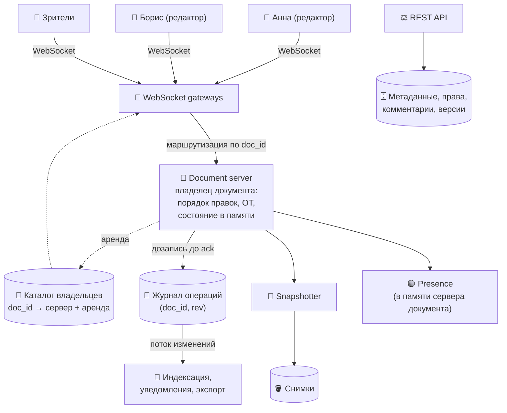
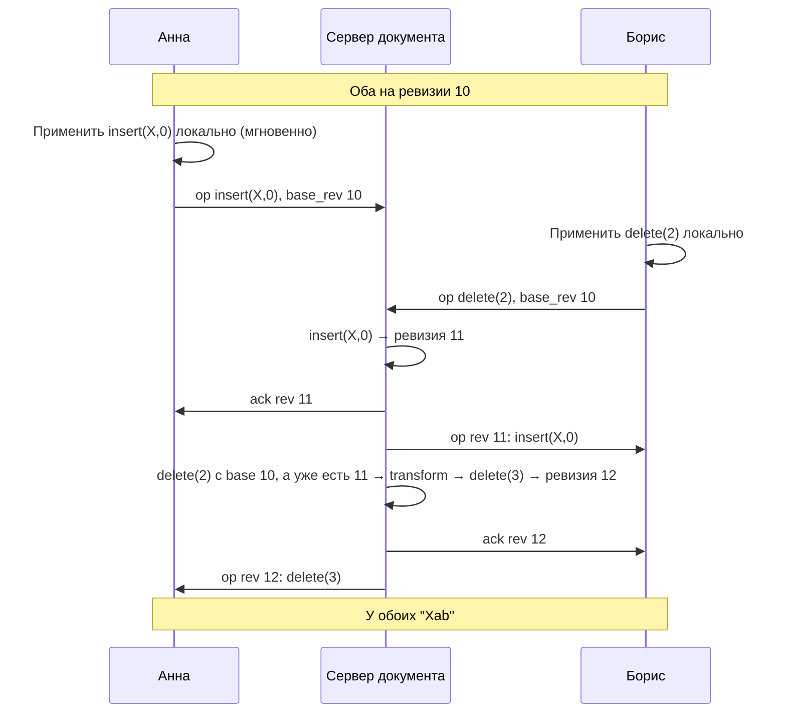
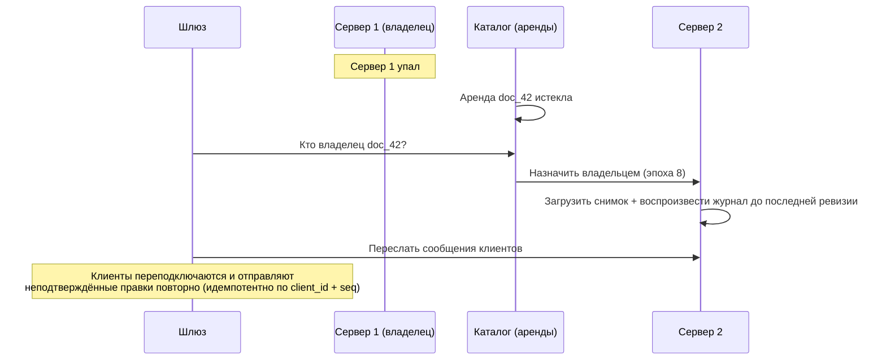
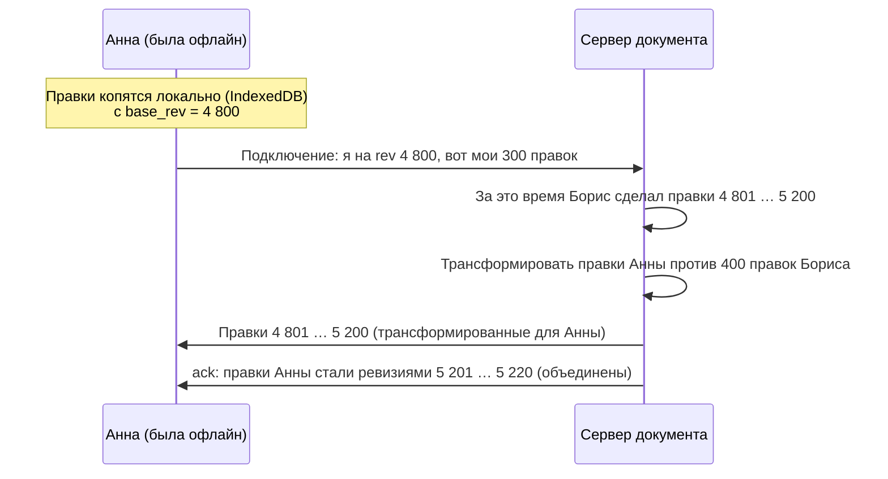

[English](README.md) | **Русский**

# Tier 2 · 4A · 01. Google Docs (совместное редактирование в реальном времени)

> **Уровень:** Advanced · **Время на интервью:** 45–60 мин · **Время на разбор:** ~6–7 ч
> **Ключевые аспекты:** почему одновременные правки расходятся, Operational Transformation (OT), CRDT (Yjs, Automerge), сервер документа как единый источник порядка, журнал операций и снимки, курсоры и presence, офлайн-правки, история версий, форматированный текст и комментарии, права доступа
> **Опирается на:** [12-communication](../../../12-communication/README_RU.md#8-масштабирование-websocket), [07-consistency-models](../../../07-consistency-models/README_RU.md), [08-consensus](../../../08-consensus/README_RU.md#9-лизы-и-выбор-лидера-для-приложений), [Tier 1 · 06 Chat](../../../tier-1/06-chat-system/README_RU.md#8-deep-dive-2-отправка-сообщения-и-порядок), [Tier 1 · 19 KV Store](../../../tier-1/19-distributed-kv-store/README_RU.md#8-deep-dive-3-версии-и-конфликты) (CRDT)

---

## 🗺️ Как читать этот разбор

Разбор построен как интервью, но в каждом шаге есть объяснения: **почему** принимается решение, **как работает** механизм и **что будет**, если сделать иначе. Блоки «📘 Объяснение» — теория прямо по ходу задачи.

| Значок | Что значит |
|:------:|:-----------|
| 🎤 | Реплика интервьюера |
| 🗣️ | Что говорю вслух я (кандидат) |
| ✏️ | Что рисую на доске |
| ⏱️ | Сколько времени тратить на шаг |
| 📘 | Подробное объяснение концепции |

Блоки **TIP** — хороший приём, **WARNING** — ловушка, **IMPORTANT** — сигнал для уровня Senior+.

---

## 📑 Содержание

0. [Чему учит эта задача](#0-чему-учит-эта-задача)
1. [Условие задачи](#1-условие-задачи)
2. [Уточняющие вопросы и требования](#2-уточняющие-вопросы-и-требования)
3. [Оценки нагрузки](#3-оценки-нагрузки)
4. [API и протокол](#4-api-и-протокол)
5. [Модель данных](#5-модель-данных)
6. [High-level дизайн](#6-high-level-дизайн)
7. [Deep dive 1: почему одновременные правки расходятся](#7-deep-dive-1-почему-одновременные-правки-расходятся)
8. [Deep dive 2: Operational Transformation](#8-deep-dive-2-operational-transformation)
9. [Deep dive 3: CRDT](#9-deep-dive-3-crdt)
10. [Deep dive 4: сервер документа и владение](#10-deep-dive-4-сервер-документа-и-владение)
11. [Deep dive 5: журнал операций, снимки и история версий](#11-deep-dive-5-журнал-операций-снимки-и-история-версий)
12. [Deep dive 6: курсоры и presence](#12-deep-dive-6-курсоры-и-presence)
13. [Deep dive 7: офлайн-правки и переподключение](#13-deep-dive-7-офлайн-правки-и-переподключение)
14. [Deep dive 8: форматирование, комментарии и права](#14-deep-dive-8-форматирование-комментарии-и-права)
15. [Узкие места и сценарии сбоев](#15-узкие-места-и-сценарии-сбоев)
16. [Что изменится при росте в 10 раз](#16-что-изменится-при-росте-в-10-раз)
17. [Ключевые концепции и новые понятия](#17-ключевые-концепции-и-новые-понятия)
18. [Варианты задачи и follow-up вопросы](#18-варианты-задачи-и-follow-up-вопросы)
19. [Типичные ошибки](#19-типичные-ошибки)
20. [Шпаргалка и самопроверка](#20-шпаргалка-и-самопроверка)

---

## 0. Чему учит эта задача

Совместное редактирование — одна из самых сложных задач уровня Advanced, потому что в ней нельзя «просто положить данные в базу». Несколько человек меняют **один и тот же текст одновременно**, каждый видит свои изменения мгновенно, а в итоге у всех должен получиться **одинаковый** документ, в котором сохранились намерения каждого.

| Что проверяют | Где это в задаче |
|:--------------|:-----------------|
| Понимание конкурентности на уровне данных | Почему правки по позициям расходятся |
| Алгоритмы согласования | OT и CRDT, их компромиссы |
| Выбор единого источника порядка | Сервер-владелец документа |
| Real-time коммуникация | WebSocket, мгновенное эхо, рассылка правок |
| Хранение как журнал | Операции + снимки, история версий |
| Эфемерное состояние | Курсоры, кто сейчас в документе |
| Офлайн и восстановление | Правки без сети и их слияние |

> [!TIP]
> Интервьюер почти всегда ждёт разговора про **OT против CRDT**. Начни с простого примера расхождения (два человека, строка «abc»), покажи, как его исправляет трансформация, и только потом обсуждай архитектуру. Без этого примера разговор о серверах и базах выглядит поверхностно.

---

## 1. Условие задачи

> 🎤 «Спроектируй Google Docs: несколько пользователей одновременно редактируют один документ, видят изменения друг друга и курсоры в реальном времени, могут работать офлайн, есть история версий и комментарии».

**Что видит пользователь:**

```
Анна и Борис открыли один документ.
Анна печатает в начале абзаца — Борис через долю секунды видит её текст и цветной курсор с подписью «Анна».
Борис одновременно удаляет слово в конце того же абзаца — у Анны оно исчезает.
У обоих итоговый текст совпадает до символа.
Анна в поезде без сети продолжает писать — при появлении сети её правки сливаются с правками Бориса.
```

**План по времени:**

| Шаг | ⏱️ |
|:----|:--:|
| Требования | 5 мин |
| Оценки | 3 мин |
| API и данные | 5 мин |
| High-level дизайн | 6 мин |
| Deep dives | 25–30 мин |
| Итоги | 3 мин |

---

## 2. Уточняющие вопросы и требования

⏱️ 5 мин

| Мой вопрос | Ответ интервьюера | Что это меняет и почему |
|:-----------|:------------------|:------------------------|
| Сколько человек редактируют один документ одновременно? | Обычно 1–5, максимум около 100 редакторов; зрителей может быть больше | Сервер документа обрабатывает правки небольшой группы; зрители — отдельная рассылка |
| Масштаб? | Сотни миллионов документов, миллионы одновременно открытых | Документы распределяются по многим серверам |
| Задержка? | Своя правка — мгновенно; правки других — до ~200 мс | Локальное применение + асинхронная синхронизация |
| Офлайн? | Да, правки сливаются при подключении | Локальный буфер операций, слияние |
| Форматирование? | Да: жирный, заголовки, списки, таблицы | Модель форматированного текста, не просто строка |
| История версий? | Да: восстановить любую версию, видеть, кто что менял | Журнал операций + снимки |
| Комментарии и предложения? | Да | Якоря, сдвигающиеся вместе с текстом |
| Права доступа? | Владелец, редактор, комментатор, читатель | Проверка на подключении и на каждой операции |

### Функциональные требования

1. Совместное редактирование текста с форматированием в реальном времени.
2. Отображение курсоров и выделений других пользователей, список присутствующих.
3. Офлайн-редактирование с последующим слиянием.
4. История версий: просмотр и восстановление.
5. Комментарии и режим предложений.
6. Права доступа и общий доступ по ссылке.

### Нефункциональные требования

| Требование | Цель | Почему |
|:-----------|:-----|:-------|
| **Сходимость** | Все участники видят одинаковый документ после обмена всеми правками | Иначе документ «разъезжается» у разных людей |
| **Сохранение намерения** | Правка применяется туда, куда её задумал автор | Вставка Анны не должна оказаться в чужом слове |
| Отзывчивость | Своё нажатие клавиши — без ожидания сети | Печать с задержкой невозможна |
| Долговечность | Подтверждённые правки не теряются | Это работа пользователя |
| Доступность | Работа продолжается при сбоях серверов (локально и после переподключения) | Документ — рабочий инструмент |
| Масштаб | Миллионы открытых документов | Горизонтальное распределение документов |

---

## 3. Оценки нагрузки

⏱️ 3 мин

```
Открытых документов одновременно:     ~5M
Активных редакторов:                   ~10M
Печатают в каждый момент:              ~10% → ~1M
Клиент группирует нажатия в пакеты:    ~5 пакетов/с при активной печати
→ ~5M сообщений с правками в секунду в пике по всему кластеру
  ~100 Б на пакет → ~500 МБ/с входящего потока правок
  + рассылка остальным участникам документа (в среднем 1–3 получателя)

Хранение:
  Документ в среднем ~50 КБ, ~1B документов → ~50 ТБ снимков
  Журнал операций растёт непрерывно → сжатие старых правок в версии
```

### Выводы

| Вывод | Следствие для дизайна |
|:------|:----------------------|
| Правок много, но каждая касается **одного** документа | Шардирование по документу: все правки документа — на одном сервере |
| В документе мало одновременных редакторов | Один сервер легко упорядочивает правки документа |
| Миллионы документов | Тысячи серверов документов, распределение по `doc_id` |
| Журнал растёт бесконечно | Снимки и сжатие истории |

---

## 4. API и протокол

⏱️ 3 мин

### REST

```http
GET  /v1/documents/{id}                 → метаданные, права, ссылка на снимок, номер ревизии
GET  /v1/documents/{id}/revisions?from=… → история версий
POST /v1/documents/{id}/restore         { "revision": 4812 }
POST /v1/documents/{id}/comments        { "anchor": {...}, "text": "…" }
```

### WebSocket (сессия редактирования)

```
Клиент → сервер
  { "type": "op",       "client_id": "c-17", "seq": 42, "base_rev": 4810,
    "ops": [ { "retain": 120 }, { "insert": "Привет", "attrs": { "bold": true } } ] }
  { "type": "presence", "cursor": 126, "selection": [120, 126] }

Сервер → клиент
  { "type": "ack",      "seq": 42, "rev": 4811 }                     ← моя правка принята как ревизия 4811
  { "type": "op",       "rev": 4812, "author": "Борис", "ops": [...] } ← чужая правка, уже трансформированная
  { "type": "presence", "user": "Борис", "cursor": 300 }
```

| Поле | Зачем |
|:-----|:------|
| `base_rev` | На какой версии документа клиент сделал правку — серверу нужно знать, какие правки клиент ещё не видел |
| `client_id` + `seq` | Идемпотентность: повтор после обрыва не применится дважды |
| `rev` | Порядковый номер правки в документе — единый для всех участников |

---

## 5. Модель данных

⏱️ 3 мин

| Данные | Ключ / схема | Хранилище | Почему |
|:-------|:-------------|:----------|:-------|
| **Документы** | doc_id → владелец, название, права, текущая ревизия, ссылка на последний снимок | Реляционная / NewSQL БД | Метаданные и права |
| **Журнал операций** | (doc_id, rev) → ops, author, client_id, seq, ts | Wide-column / Bigtable-подобное | Дозапись по документу, чтение диапазона ревизий |
| **Снимки** | (doc_id, rev) → полное состояние документа | Объектное хранилище | Быстрое открытие без воспроизведения всей истории |
| **Именованные версии** | (doc_id) → rev, название, автор | БД | «Версия для заказчика» |
| **Комментарии** | (doc_id) → comment_id, якорь, ветка ответов | БД | Привязаны к диапазону текста |
| **Presence** | doc_id → участники, курсоры | Только в памяти | Эфемерно |

---

## 6. High-level дизайн

⏱️ 6 мин



🗣️ «Ключевые решения:
- у каждого открытого документа есть **один сервер-владелец** — он определяет порядок правок и выполняет трансформацию; это сильно упрощает алгоритм;
- **WebSocket-шлюзы** держат соединения и маршрутизируют сообщения к владельцу документа по каталогу;
- правка **записывается в журнал до подтверждения** клиенту — так она не потеряется;
- **снимки** периодически фиксируют состояние, чтобы открытие документа не требовало воспроизводить всю историю;
- **presence** живёт в памяти сервера документа и рассылается без сохранения».

---

## 7. Deep dive 1: почему одновременные правки расходятся

> 🎤 «Почему нельзя просто рассылать всем правки вида “вставь символ в позицию 5”?»

### Пример расхождения

```
Исходный текст у обоих: "abc"

Анна: insert("X", позиция 0)   → у Анны "Xabc"
Борис: delete(позиция 2)       → у Бориса "ab"   (удалил "c")

Каждый получает правку другого и применяет как есть:

У Анны:   "Xabc" + delete(2)       → удаляется "b" → "Xac"   ❌
У Бориса: "ab"   + insert("X", 0)  → "Xab"

Итог: у Анны "Xac", у Бориса "Xab" — документы РАЗОШЛИСЬ.
```

📘 **В чём проблема.** Позиция 2 в правке Бориса относилась к тексту «abc». У Анны к этому моменту текст уже другой — «Xabc», и позиция 2 указывает на другой символ. Правка «потеряла» смысл, потому что выполнена в другом контексте.

### Что требуется от алгоритма

| Свойство | Что значит |
|:---------|:-----------|
| **Сходимость** | После того как все получили все правки, документы у всех одинаковые |
| **Причинность** | Правка, сделанная после того, как автор увидел другую правку, применяется после неё у всех |
| **Сохранение намерения** | Эффект правки — тот, что задумал автор: Борис хотел удалить «c», а не «b» |

Есть два семейства решений:
- **Operational Transformation (OT)** — **преобразовать** правку под текущий контекст: «delete(2)» превратить в «delete(3)», потому что до позиции 2 вставили символ;
- **CRDT** — **не использовать позиции вообще**: у каждого символа уникальный идентификатор, и правки ссылаются на идентификаторы, а не на номера позиций.

---

## 8. Deep dive 2: Operational Transformation

> 🎤 «Как работает OT?»

### Функция трансформации

📘 `transform(a, b)` берёт две правки, сделанные **на одной и той же версии**, и возвращает версию правки `a`, которую можно применить **после** `b`, сохранив её смысл.

```
Пример выше: transform(delete(2), insert("X", 0))
  Вставка была ДО позиции удаления → удаление сдвигается вправо на длину вставки
  → delete(3)

У Анны:   "Xabc" + delete(3) → удаляется "c" → "Xab"   ✅
У Бориса: "ab"   + insert("X", 0) → "Xab"             ✅
Документы сошлись.
```

### Правила для вставки и удаления

| Правка a | Применена раньше b | Результат transform(a, b) |
|:---------|:-------------------|:--------------------------|
| insert(p₁) | insert(p₂), p₂ < p₁ | insert(p₁ + длина b) |
| insert(p₁) | insert(p₂), p₂ = p₁ | Порядок по идентификатору клиента (детерминированно), один из них сдвигается |
| insert(p₁) | delete(p₂), p₂ < p₁ | insert(p₁ − 1) |
| delete(p₁) | insert(p₂), p₂ ≤ p₁ | delete(p₁ + длина b) |
| delete(p₁) | delete(p₂), p₂ < p₁ | delete(p₁ − 1) |
| delete(p₁) | delete(p₂), p₂ = p₁ | Ничего (символ уже удалён) |
| любая | правка правее позиции a | Без изменений |

### OT с центральным сервером

📘 OT между произвольными участниками без координатора сложна и исторически давала много ошибок: нужно, чтобы трансформации «сходились» при любом порядке применения. Google Docs (наследие Google Wave) использует **сервер как единый источник порядка**: сервер присваивает каждой правке номер ревизии, и все участники применяют правки **в одном порядке**.



### Состояние на клиенте

| Состояние клиента | Что это |
|:------------------|:--------|
| **Подтверждённое** | Документ на последней ревизии, которую подтвердил сервер |
| **Отправленная правка** (в ожидании ack) | Одна правка в пути; пока нет подтверждения, новые не отправляются |
| **Буфер** | Правки, сделанные после отправки; копятся и объединяются в одну |

Когда приходит чужая правка, клиент **трансформирует её против своих неподтверждённых правок** (и наоборот), чтобы применить к своему экрану, не теряя собственных изменений. Одна правка в пути одновременно — это упрощение, которое делает алгоритм надёжным: сервер всегда трансформирует правку клиента против известного набора ревизий.

| ✅ Плюсы OT с сервером | ❌ Минусы |
|:-----------------------|:---------|
| Компактные правки (позиции, а не идентификаторы каждого символа) | Нужен центральный сервер для каждого документа |
| Проверено в продакшене (Google Docs) | Длительный офлайн → много правок для трансформации при подключении |
| Нет накопления служебных данных в документе | Функции трансформации для форматированного текста, таблиц, списков — сложны и требуют тщательного тестирования |

---

## 9. Deep dive 3: CRDT

> 🎤 «А CRDT? Чем они лучше или хуже?»

### Идея

📘 **CRDT для текста** избавляется от позиций. Каждый символ получает **уникальный идентификатор** — например, (идентификатор участника, счётчик). Вставка описывается как «вставить символ с id (A, 5) **после** символа с id (B, 3)». Удаление — «пометить символ (B, 3) удалённым» (tombstone).

```
Текст "abc":   a(A,1) → b(A,2) → c(A,3)

Анна:  вставить X(анна,1) в начало (после «начала документа»)
Борис: удалить c(A,3)

У кого угодно, в любом порядке:
  применить «X после начала» → X(анна,1) a b c
  применить «удалить (A,3)»  → X a b [c удалён]
  → "Xab" у всех — без трансформаций
```

📘 **Почему порядок не важен.** Операции коммутативны: «вставить после конкретного символа» и «удалить конкретный символ» дают одинаковый результат в любом порядке, потому что ссылаются на неизменные идентификаторы, а не на сдвигающиеся позиции. Когда две вставки идут после одного и того же символа, порядок между ними определяется детерминированно (например, по идентификаторам) — у всех одинаково.

### Реализации

| Алгоритм / библиотека | Особенности |
|:----------------------|:------------|
| **RGA** (Replicated Growable Array) | Классический алгоритм последовательности на связном списке с идентификаторами |
| **Yjs** (YATA) | Быстрая и компактная библиотека: символы объединяются в блоки, используется во многих редакторах |
| **Automerge** | Документ как JSON с полной историей; удобно для приложений с офлайн-режимом |
| **Logoot / дробные индексы** | Позиция как число между соседями («между 0,5 и 0,6 → 0,55») |

### Сравнение

| | OT (с сервером) | CRDT |
|:-|:----------------|:-----|
| Нужен центральный порядок | Да | Нет: правки сходятся в любом порядке |
| Офлайн и P2P | Сложнее: долгий офлайн → много трансформаций | Естественно |
| Размер служебных данных | Малый | Идентификатор на символ (сжимается блоками), tombstones копятся |
| Сборка мусора | Не нужна | Удаление tombstones требует знать, что все участники их видели |
| Сложность | Функции трансформации для каждой пары типов правок | Сложные структуры данных, но слияние «из коробки» |
| Аномалии | — | Перемешивание текста двух авторов, вставлявших в одно место одновременно (в зависимости от алгоритма) |
| Кто использует | Google Docs | Многие современные редакторы и приложения с офлайном (Yjs, Automerge); Figma описывала свой подход как вдохновлённый CRDT, но с авторитетным сервером |

🗣️ «Для продукта вроде Google Docs выбираю **OT с сервером-владельцем документа**: у нас всё равно есть сервер (права, история, рассылка), правки компактны, а длительный офлайн — редкий случай. Если бы требованием был сильный офлайн, P2P или локальная работа без сервера — выбрал бы **CRDT** (например, Yjs). Многие современные системы используют гибрид: CRDT-структуры для слияния и сервер для порядка, хранения и прав».

> [!IMPORTANT]
> **Сигнал Senior+:** не называть один подход «правильным», а связать выбор с требованиями: **центральный сервер есть и офлайн редкий → OT**; **офлайн-first, P2P, локальные приложения → CRDT**. И знать цену каждого: сложность трансформаций против служебных данных и tombstones.

---

## 10. Deep dive 4: сервер документа и владение

> 🎤 «У вас один сервер на документ. Как распределить миллионы документов и что будет, если сервер упадёт?»

### Распределение

| Решение | Как |
|:--------|:----|
| **Владелец документа** | Каждый открытый документ обслуживается ровно одним сервером документа |
| **Каталог владельцев** | `doc_id → сервер` с арендой (lease) в координационном сервисе или consistent hashing по `doc_id` |
| **Маршрутизация** | Шлюз получает сообщение, смотрит в каталог (с кэшем) и пересылает владельцу |
| **Ленивое открытие** | Документ загружается на сервер при первом подключении: снимок + хвост журнала; выгружается, когда все отключились |

### Отказ сервера



| Механизм | Зачем |
|:---------|:------|
| Правка подтверждается **только после записи в журнал** | После падения владельца ничего подтверждённого не потеряно |
| **Эпоха аренды** в записи журнала (условная запись) | Если старый владелец «проснулся», его записи с устаревшей эпохой отклоняются — fencing (см. [08-consensus](../../../08-consensus/README_RU.md#10-split-brain-и-fencing-токены)) |
| Идемпотентность по `client_id` + `seq` | Повторная отправка неподтверждённых правок не дублирует их |

### Популярный документ

| Ситуация | Решение |
|:---------|:--------|
| 100 одновременных редакторов | Один сервер справляется: правок мало, трансформации дешёвые |
| Тысячи зрителей (например, документ транслируется на собрании) | Зрители получают поток ревизий через отдельный слой рассылки (только чтение), не нагружая владельца; лимит на число редакторов |

> [!TIP]
> Ключевое наблюдение: **шардирование по документу естественно**. Правки разных документов независимы, поэтому один сервер на документ не создаёт глобального узкого места, а внутри документа упрощает упорядочивание до тривиального.

---

## 11. Deep dive 5: журнал операций, снимки и история версий

> 🎤 «Как хранить документ, чтобы он быстро открывался и была история версий?»

### Журнал + снимки

📘 Документ хранится как **журнал операций** (event sourcing): состояние = применение всех правок по порядку. Чтобы не воспроизводить миллионы правок при каждом открытии, периодически делается **снимок**.

```
Журнал doc_42:  rev 1 … rev 4 800 … rev 4 812
Снимки:         rev 4 000, rev 4 800

Открыть документ = загрузить снимок rev 4 800 + применить правки 4 801 … 4 812
```

| Решение | Почему |
|:--------|:-------|
| Снимок каждые N правок или T минут активности | Ограничивает работу при открытии |
| Снимки — в объектном хранилище | Дёшево, документы бывают большими |
| Журнал — в хранилище с дозаписью и чтением по диапазону ключей | Паттерн «(doc_id, rev)» |
| Запись правки — пакетами (group commit) | Меньше обращений к хранилищу при быстрой печати |

### История версий

| Функция | Как |
|:--------|:----|
| «Показать версию за вчера» | Найти ближайший снимок + воспроизвести журнал до нужной ревизии |
| «Кто что изменил» | Правки в журнале содержат автора; соседние правки одного автора объединяются в блоки для отображения |
| Восстановить версию | Новая правка, которая превращает текущий документ в старую версию (история не переписывается) |
| Хранение долгой истории | Старые правки «сворачиваются» в автоматические версии (например, по часам или дням) — отдельные нажатия клавиш годичной давности не нужны |

---

## 12. Deep dive 6: курсоры и presence

> 🎤 «Как показывать курсоры других участников?»

| Решение | Почему |
|:--------|:-------|
| Курсоры передаются **отдельными эфемерными сообщениями** | Не хранятся, не попадают в журнал и историю |
| **Ограничение частоты** (~10 обновлений в секунду, только при изменении) | Курсор двигается постоянно — без ограничения это основной поток сообщений |
| Позиция курсора **трансформируется** вместе с правками | Если Борис вставил текст перед курсором Анны, её курсор у всех сдвигается — иначе он «уезжает» не туда |
| В CRDT курсор привязан к **идентификатору символа** | Автоматически остаётся на месте при чужих правках |
| Список присутствующих — heartbeat с TTL | Закрыл вкладку — исчез из списка через несколько секунд (подробно — Tier 2 4A #5) |
| Цвет и подпись | Назначаются участнику на время сессии |

> [!WARNING]
> Типичная ошибка — хранить курсоры в базе или в журнале правок. Курсоры меняются в разы чаще текста и не имеют ценности после закрытия документа.

---

## 13. Deep dive 7: офлайн-правки и переподключение

> 🎤 «Анна два часа писала в поезде без сети. Что происходит при подключении?»



| Проблема | Решение |
|:---------|:--------|
| Правки не должны потеряться при закрытии браузера | Локальное хранение (IndexedDB) до подтверждения сервером |
| Повторная отправка после обрыва | Идемпотентность по `client_id` + `seq` |
| Много правок для трансформации (OT) | Объединить локальные правки в меньшее число перед отправкой; трансформация стоит O(n × m) |
| Очень долгий офлайн и большие расхождения | Слияние всё равно выполняется, но результат может удивить пользователя → показать «ваши правки объединены с правками других», при необходимости — сравнение версий |
| Права изменились, пока был офлайн | Сервер проверяет права при подключении: если доступ на редактирование отозван — правки не принимаются, пользователю предлагается сохранить копию |

📘 Здесь заметно преимущество CRDT: офлайн-правки сливаются без трансформации, просто объединением множеств операций. Поэтому офлайн-first приложения чаще выбирают CRDT.

---

## 14. Deep dive 8: форматирование, комментарии и права

> 🎤 «Документ — это не просто строка. Как быть с форматированием, комментариями и правами?»

### Форматированный текст

📘 Распространённое представление правок — последовательность операций **retain / insert / delete с атрибутами** (так устроен формат Delta в редакторе Quill):

```
[ { "retain": 10 },                                   ← пропустить 10 символов
  { "retain": 5, "attributes": { "bold": true } },    ← сделать следующие 5 жирными
  { "insert": "новый текст", "attributes": { "italic": true } },
  { "delete": 3 } ]
```

| Особенность | Как учесть |
|:------------|:-----------|
| Форматирование — тоже правка | Трансформируется как retain с атрибутами; одновременное «жирный» и «курсив» на одном диапазоне — оба применяются |
| Структура (абзацы, списки, таблицы) | Дерево блоков; трансформации для структурных правок сложнее (разбиение и слияние абзацев, строки таблиц) |
| Встроенные объекты (картинки, таблицы) | Один «символ»-объект в тексте, данные объекта отдельно |

### Комментарии и предложения

| Функция | Как |
|:--------|:----|
| **Якорь комментария** | Диапазон текста; позиции трансформируются вместе с правками (или привязаны к идентификаторам символов в CRDT) |
| Текст под комментарием удалён | Комментарий помечается «потерявшим якорь» и остаётся в списке |
| **Режим предложений** | Правки помечаются как предложения: видны другим, но становятся частью текста только после принятия |
| Ветки ответов и уведомления | Обычный CRUD + уведомления упомянутым (см. [Tier 1 · 05](../../../tier-1/05-notification-system/README_RU.md)) |

### Права доступа

| Решение | Почему |
|:--------|:-------|
| Проверка при подключении к сессии | Без права чтения документ не открывается |
| Проверка **на каждой правке** | Комментатор не может отправить текстовую правку, даже подделав клиент |
| Отзыв прав в реальном времени | Сервер документа получает событие и переводит сессию пользователя в режим чтения или закрывает её |
| Доступ по ссылке | Токен ссылки с ролью; можно отозвать |

---

## 15. Узкие места и сценарии сбоев

| Сценарий | Что произойдёт | Как защищаемся |
|:---------|:---------------|:---------------|
| Одновременные правки по позициям | Документы расходятся | OT (трансформация) или CRDT |
| Сервер документа упал | Сессия прерывается | Аренда, новый владелец, снимок + журнал, повтор неподтверждённых правок |
| Два владельца одного документа | Два порядка правок | Аренда с эпохой, условная запись в журнал |
| Повторная отправка правки | Двойное применение | Идемпотентность по `client_id` + `seq` |
| Потеря подтверждённой правки | Потеря работы | Запись в журнал до ack |
| Долгий офлайн | Тяжёлое слияние | Объединение правок, CRDT для офлайн-сценариев, уведомление пользователя |
| Поток курсоров | Перегрузка | Ограничение частоты, эфемерность |
| Большой документ | Медленное открытие | Снимки, ленивая загрузка частей документа |
| Тысячи зрителей | Нагрузка на владельца | Отдельный слой рассылки для чтения |
| Отозванные права у активного редактора | Нежелательные правки | Проверка на каждой правке, событие отзыва |

---

## 16. Что изменится при росте в 10 раз

> 🎤 «В 10 раз больше документов и пользователей?»

| Изменение | Почему |
|:----------|:-------|
| **Больше серверов документов**, распределение по `doc_id` | Линейно: документы независимы |
| **Региональные серверы документов** | Документ обслуживается в регионе, где работает большинство его участников; переезд при смене активности |
| **Иерархическая рассылка** для очень популярных документов | Зрители через edge-узлы |
| **Более агрессивное сжатие истории** | Объём журналов |
| **CRDT-структуры для офлайна мобильных клиентов** | Больше работы без сети |

---

## 17. Ключевые концепции и новые понятия

### Что применяется

| Концепция | Где разобрана | Как применяется здесь |
|:----------|:--------------|:----------------------|
| WebSocket-шлюзы | [12-communication](../../../12-communication/README_RU.md#8-масштабирование-websocket) | Сессии редактирования |
| Аренды и fencing | [08-consensus](../../../08-consensus/README_RU.md#9-лизы-и-выбор-лидера-для-приложений) | Владелец документа |
| Порядок от владельца сущности | [Tier 1 · 06](../../../tier-1/06-chat-system/README_RU.md#8-deep-dive-2-отправка-сообщения-и-порядок) | Ревизии документа как seq чата |
| CRDT | [Tier 1 · 19](../../../tier-1/19-distributed-kv-store/README_RU.md#8-deep-dive-3-версии-и-конфликты) | Слияние без центрального порядка |
| Модели консистентности | [07-consistency-models](../../../07-consistency-models/README_RU.md) | Сходимость (strong eventual consistency) |

### Новые понятия этой задачи

| Понятие | Кратко |
|:--------|:-------|
| **Сходимость и сохранение намерения** | Одинаковый документ у всех и правка там, где её задумал автор |
| **Operational Transformation** | Преобразование правки под контекст после чужих правок |
| **Функция трансформации** | transform(a, b) — версия a, применимая после b |
| **OT с центральным сервером** | Сервер задаёт единый порядок ревизий |
| **CRDT для текста** | Символы с уникальными идентификаторами, правки ссылаются на идентификаторы |
| **Tombstone** | Метка удалённого символа в CRDT |
| **Ревизия** | Порядковый номер правки в документе |
| **Журнал операций + снимки** | Event sourcing для документа |
| **Delta (retain / insert / delete)** | Формат правок форматированного текста |
| **Якорь комментария** | Диапазон текста, сдвигающийся вместе с правками |

---

## 18. Варианты задачи и follow-up вопросы

<details>
<summary><b>Как сделать отмену действия (undo) в совместном редакторе?</b></summary>

Undo должен отменять **только свои** правки, а не последние правки документа (которые могли быть чужими). Для своей правки строится обратная операция и трансформируется против всех правок, сделанных после неё, — затем применяется как новая правка. В CRDT отмена вставки — удаление тех же идентификаторов, отмена удаления — снятие tombstone.
</details>

<details>
<summary><b>Чем Figma отличается от Google Docs?</b></summary>

Figma редактирует не текст, а дерево объектов со свойствами. Figma описывала подход, вдохновлённый CRDT: свойства объектов — как регистры «последняя запись побеждает», а порядок и разрешение конфликтов задаёт авторитетный сервер. Для текста внутри объектов нужны текстовые алгоритмы, но основной объём — свойства фигур, где конфликты проще.
</details>

<details>
<summary><b>Можно ли обойтись без сервера (P2P)?</b></summary>

Да, с CRDT: участники обмениваются операциями напрямую (WebRTC) или через простой ретранслятор, и документы сходятся без центрального порядка. Но сервер всё равно нужен для хранения, прав доступа, истории и подключения к документу, когда никого нет онлайн.
</details>

<details>
<summary><b>Что если вставить огромный текст (например, книгу)?</b></summary>

Одна правка большого размера: ограничить размер сообщения и передавать большие вставки частями или как отдельный объект; на сервере — сразу сделать снимок, чтобы не воспроизводить огромную правку при каждом открытии.
</details>

<details>
<summary><b>Как реализовать поиск по документам?</b></summary>

Асинхронно: поток ревизий из журнала → индексатор периодически берёт актуальный текст документа (из снимка + хвоста) и обновляет поисковый индекс с учётом прав доступа (см. [15-search-basics](../../../15-search-basics/README_RU.md)).
</details>

---

## 19. Типичные ошибки

| ❌ Ошибка | Почему плохо | ✅ Как правильно |
|:---------|:-------------|:----------------|
| Рассылать правки по позициям без трансформации | Документы расходятся | OT или CRDT |
| Last-write-wins для всего документа | Теряются правки других | Слияние на уровне правок |
| Блокировка абзаца для редактирования | Медленно и неудобно, не «реальное время» | Оптимистичное локальное применение |
| Ждать сервер перед отображением своей правки | Печать с задержкой | Локальное применение + асинхронная синхронизация |
| Несколько серверов принимают правки одного документа без координации | Разный порядок правок | Один владелец документа с арендой |
| Подтверждать правку до записи в журнал | Потеря при падении | Запись до ack |
| Хранить только текущее состояние | Нет истории и восстановления | Журнал операций + снимки |
| Воспроизводить весь журнал при открытии | Медленно | Снимки |
| Курсоры в журнале и базе | Лишняя нагрузка | Эфемерные сообщения с ограничением частоты |
| Права только на подключении | Отозванный редактор продолжает править | Проверка на каждой правке |

---

## 20. Шпаргалка и самопроверка

### Ответ за 30 секунд

> Одновременные правки по позициям расходятся (пример «abc»: delete(2) после вставки должен стать delete(3)). Решения — OT (трансформация правки под контекст) или CRDT (символы с уникальными идентификаторами, правки коммутативны). Для Docs — OT с сервером-владельцем документа: клиент применяет правку локально мгновенно и отправляет с base_rev (одна правка в пути, остальные в буфере); сервер трансформирует её против правок с base_rev, присваивает ревизию, пишет в журнал и только потом подтверждает и рассылает. Документы распределены по серверам по doc_id с арендой и эпохой (fencing); при падении новый владелец загружает снимок + журнал, клиенты повторяют неподтверждённые правки идемпотентно по client_id + seq. Хранение — журнал операций + снимки, история версий из журнала со сжатием старых правок. Курсоры — эфемерные, с ограничением частоты, трансформируются с правками. Офлайн — локальный буфер в IndexedDB и слияние при подключении (CRDT лучше для офлайн-first). Форматирование — Delta (retain/insert/delete с атрибутами), комментарии — якоря, права — на каждой правке.

### Самопроверка

- [ ] Могу показать пример расхождения на строке «abc»
- [ ] Могу назвать три свойства корректного совместного редактирования
- [ ] Могу объяснить функцию трансформации и применить правила вставки и удаления
- [ ] Могу нарисовать OT с центральным сервером и объяснить состояние клиента
- [ ] Могу объяснить CRDT для текста и почему порядок не важен
- [ ] Могу сравнить OT и CRDT и выбрать под требования
- [ ] Могу объяснить владение документом, аренду, эпоху и восстановление после сбоя
- [ ] Могу описать журнал операций, снимки и историю версий
- [ ] Могу спроектировать курсоры и presence
- [ ] Могу объяснить офлайн-правки и слияние при подключении
- [ ] Могу описать модель форматированного текста, якоря комментариев и проверку прав

### Что почитать

- Ellis, Gibbs, *Concurrency Control in Groupware Systems* (SIGMOD 1989) — исходная работа об OT
- Nichols et al., *High-Latency, Low-Bandwidth Windowing in the Jupiter Collaboration System* (1995) — OT с центральным сервером
- Shapiro et al., *Conflict-free Replicated Data Types* (2011)
- Nicolaescu et al., *Near Real-Time Peer-to-Peer Shared Editing on Extensible Data Types* (2016) — YATA, основа Yjs
- Kleppmann et al., *Local-First Software* (Ink & Switch, 2019)
- Figma Engineering, *How Figma's multiplayer technology works* (2019)
- Документация Yjs и Automerge; формат Delta в Quill
