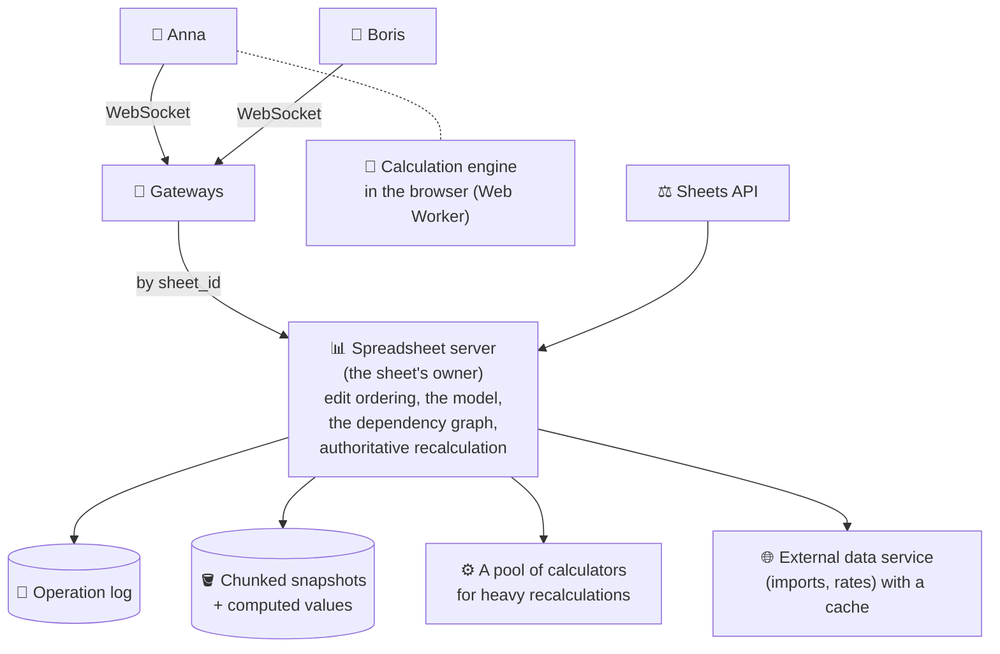
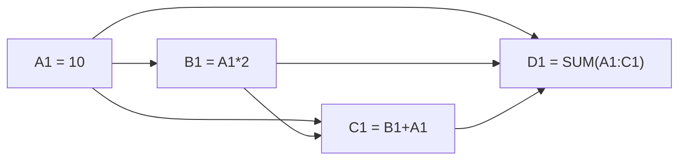

**English** | [Русский](README_RU.md)

# Tier 2 · 4A · 02. Google Sheets (Collaborative Spreadsheets)

> **Level:** Hard · **Interview time:** 45–60 min · **Study time:** ~5–6 h
> **Key aspects:** cell-level conflicts, structural operations (inserting and deleting rows and columns), stable row and column identifiers, the formula dependency graph, incremental recalculation and topological sorting, circular references, range dependencies, where to compute — in the browser or on the server, storing large sheets in chunks
> **Builds on:** [Tier 2 · 4A · 01 Google Docs](../01-google-docs/README.md) (OT, the document server, the log and snapshots), [12-communication](../../../12-communication/README.md#8-scaling-websockets), [08-consensus](../../../08-consensus/README.md#9-leases-and-leader-election-for-applications), [14-storage-types](../../../14-storage-types/README.md)

---

## 🗺️ How to Read This Walkthrough

The walkthrough follows an interview, but every step includes explanations: **why** a decision is made, **how** a mechanism works and **what happens** if you do it differently. The "📘 Explanation" blocks are theory right where you need it.

| Icon | Meaning |
|:----:|:--------|
| 🎤 | Interviewer |
| 🗣️ | What I (the candidate) say out loud |
| ✏️ | What I draw on the whiteboard |
| ⏱️ | Time budget for the step |
| 📘 | A detailed explanation of a concept |

Callouts: **TIP** — a good technique, **WARNING** — a trap, **IMPORTANT** — a Senior+ signal.

---

## 📑 Contents

0. [What This Problem Teaches](#0-what-this-problem-teaches)
1. [Problem Statement](#1-problem-statement)
2. [Clarifying Questions and Requirements](#2-clarifying-questions-and-requirements)
3. [Capacity Estimates](#3-capacity-estimates)
4. [API and Protocol](#4-api-and-protocol)
5. [Data Model](#5-data-model)
6. [High-Level Design](#6-high-level-design)
7. [Deep Dive 1: Cell-Level Conflicts](#7-deep-dive-1-cell-level-conflicts)
8. [Deep Dive 2: Structural Operations and Stable Identifiers](#8-deep-dive-2-structural-operations-and-stable-identifiers)
9. [Deep Dive 3: The Formula Dependency Graph](#9-deep-dive-3-the-formula-dependency-graph)
10. [Deep Dive 4: Incremental Recalculation](#10-deep-dive-4-incremental-recalculation)
11. [Deep Dive 5: Where to Compute — Browser or Server](#11-deep-dive-5-where-to-compute--browser-or-server)
12. [Deep Dive 6: Storing and Loading Large Sheets](#12-deep-dive-6-storing-and-loading-large-sheets)
13. [Deep Dive 7: Collaboration: Cursors, Filters, Comments](#13-deep-dive-7-collaboration-cursors-filters-comments)
14. [Deep Dive 8: External Data, APIs and Scripts](#14-deep-dive-8-external-data-apis-and-scripts)
15. [Bottlenecks and Failure Scenarios](#15-bottlenecks-and-failure-scenarios)
16. [What Changes at 10x Scale](#16-what-changes-at-10x-scale)
17. [Key Concepts and New Terms](#17-key-concepts-and-new-terms)
18. [Variations and Follow-Up Questions](#18-variations-and-follow-up-questions)
19. [Common Mistakes](#19-common-mistakes)
20. [Cheat Sheet and Self-Check](#20-cheat-sheet-and-self-check)

---

## 0. What This Problem Teaches

Spreadsheets seem simpler than a text editor: a cell is an independent value, and edits to different cells don't conflict. But spreadsheets have two difficulties of their own that Google Docs doesn't:

| Difficulty | Why it's hard |
|:-----------|:--------------|
| **Structural operations** | Inserting a row shifts the addresses of every cell below — affecting both other users' edits and references in formulas |
| **Formulas** | Changing one cell may require recalculating thousands of others in the right order |

| What's tested | Where it shows up |
|:--------------|:------------------|
| A concurrency model for structured data | Cells as registers, rows as a sequence |
| Choosing identifiers | Stable row and column IDs instead of indices |
| Graphs | A dependency graph, topological sorting, cycle detection |
| Incremental computation | Recalculating only what changed |
| Distributing computation | The browser for responsiveness, the server for the authoritative result |
| Storing large structures | Chunks, lazily loading the visible area |

> [!TIP]
> Build on the Google Docs walkthrough: the document-owning server, the operation log, snapshots, cursors — all of it is reused. Say so in a minute and spend your time on what's specific to spreadsheets: **structural operations** and **the formula graph**.

---

## 1. Problem Statement

> 🎤 "Design Google Sheets: several users edit a spreadsheet at once, cells may contain formulas that reference other cells, and changes and formula results are visible to everyone in real time."

**What the user sees:**

```
A1 = 10       B1 = =A1*2  → 20       C1 = =B1+A1 → 30       D1 = =SUM(A1:C1) → 60

Anna changes A1 to 15 → for everyone B1 = 30, C1 = 45, D1 = 90 almost instantly.
Meanwhile Boris inserts a row above row 1 — the formulas keep
referring to the same cells, which are now in row 2.
```

**Time plan:**

| Step | ⏱️ |
|:-----|:--:|
| Requirements | 5 min |
| Estimates | 3 min |
| API and data | 5 min |
| High-level design | 5 min |
| Deep dives | 25–30 min |
| Wrap-up | 3 min |

---

## 2. Clarifying Questions and Requirements

⏱️ 5 min

| My question | Interviewer's answer | What it changes and why |
|:------------|:---------------------|:------------------------|
| Sheet size? | Up to ~10 million cells | You can't load it all into the browser; chunked storage |
| How many simultaneous editors? | Usually a few, up to ~100 | One spreadsheet-owning server copes |
| Formulas? | Yes, hundreds of functions, references to cells, ranges and other sheets | A dependency graph and a calculation engine |
| How fast must results update? | Your own edit — instantly, for others — within a second | Browser-side computation + authoritative server-side computation |
| Structural operations? | Inserting, deleting, moving rows and columns, sorting | Stable identifiers |
| Offline, version history, comments? | Yes, as in Docs | Reuse the Docs approach |
| External data (import by URL, exchange rates)? | Yes | Scheduled refresh, caching, limits |
| An API for programs? | Yes | Reading formula results without a browser → server-side computation |

### Functional requirements

1. Real-time collaborative editing of cells (values, formulas, formatting).
2. Inserting, deleting, moving rows and columns, sorting ranges.
3. Formulas with automatic recalculation of dependent cells.
4. Detecting circular references.
5. Other participants' cursors and selections, comments, version history.
6. An API for reading and writing.

### Non-functional requirements

| Requirement | Target | Why |
|:------------|:-------|:----|
| Convergence | Everyone sees the same values and formula results | Spreadsheets are a source of numbers for decisions |
| Correct recalculation | Every formula is computed from current data, in the right order | A wrong total is worse than a slow one |
| Responsiveness | Your own edit and recalculation of visible cells — instant | Working with a spreadsheet is interactive |
| Large sheets | Opening and scrolling 10M cells without freezing | Real working spreadsheets can be huge |
| Durability | Acknowledged edits are never lost | As in Docs |

---

## 3. Capacity Estimates

⏱️ 3 min

```
A sheet:          up to 10M cells; a typical one — thousands to tens of thousands
A cell:           a value or formula + formatting ≈ 20–100 B
A large sheet:    10M × ~50 B ≈ 500 MB — can't be loaded into the browser whole

Edits:            single to tens per second per sheet (pasting blocks of data — more)
Recalculation:    one edit can affect anywhere from 0 to millions of formulas

Open sheets:      millions at once → thousands of servers, distributed by sheet_id
```

### Conclusions

| Conclusion | Design consequence |
|:-----------|:-------------------|
| A sheet can weigh hundreds of MB | Chunked storage, loading only the visible area |
| Recalculation can be heavy | Incremental recalculation over the graph, time limits, computation off the main thread |
| There are few edits per sheet | One owning server orders them easily |
| An API without a browser is needed | An authoritative calculation engine on the server |

---

## 4. API and Protocol

⏱️ 3 min

```
Operations (WebSocket, as in Docs: base_rev, client_id, seq):

  set_cell     { sheet, row_id, col_id, value | formula, format? }
  insert_rows  { sheet, after_row_id, count }        → the server issues new row_ids
  delete_rows  { sheet, row_ids: [...] }
  move_rows    { sheet, row_ids: [...], after_row_id }
  insert_cols / delete_cols / move_cols — likewise
  sort_range   { sheet, range, by_col_id, order }     → a new permutation of row_ids
  format_range { sheet, range, format }

Server → client:
  ack { seq, rev }
  op  { rev, author, op }                  ← someone else's edit
  computed { rev, cells: [{ row_id, col_id, value }] }   ← authoritative formula results
```

📘 **Why operations reference `row_id` and `col_id` rather than "B7".** The address "B7" changes when a row is inserted above it. A row's identifier doesn't. Details in deep dive 2.

```http
REST
GET  /v1/spreadsheets/{id}/values?range=Sheet1!A1:D100   → values (with computed formulas)
POST /v1/spreadsheets/{id}/values:batchUpdate
GET  /v1/spreadsheets/{id}/chunks?sheet=…&rows=1000-1999 → chunks for scrolling
```

---

## 5. Data Model

⏱️ 3 min

```
A sheet:
  row_order:  [r_a1, r_7f, r_02, …]      ← row order = a sequence of stable IDs
  col_order:  [c_k1, c_9x, …]            ← column order
  cells:      (row_id, col_id) → { value | formula_ast, format }   ← sparse: only non-empty cells

A formula is stored as a parsed tree with references to IDs:
  "=SUM(A1:C1)"  →  SUM( Range(from: (r_a1, c_k1), to: (r_a1, c_3m)) )
  the "A1:C1" display is computed from the current row and column order
```

| Data | Store | Why |
|:-----|:------|:----|
| Metadata, permissions | A DB | As in Docs |
| The operation log | (sheet_id, rev) in a wide-column store | As in Docs |
| Snapshots | In chunks in object storage: a chunk = a range of rows × columns | Changing one cell doesn't require rewriting the whole snapshot (deep dive 6) |
| The dependency graph | In the owning server's memory (rebuilt on load) | Derived data |
| Computed values | Cached in the snapshot + in memory | Fast opening without a full recalculation |

---

## 6. High-Level Design

⏱️ 5 min



🗣️ "The skeleton is the same as in Google Docs: **a spreadsheet-owning server** orders edits, writes them to the log before acknowledging, and broadcasts them to participants; snapshots and gateways are the same. The differences:
- edits address cells through **stable row and column IDs**;
- the server has **a formula dependency graph** and **a calculation engine** — it produces authoritative results;
- the same engine runs **in the browser**, so users see the result of their own edit instantly;
- heavy recalculations go to **a pool of calculators**, and external data to a separate service with a cache."

---

## 7. Deep Dive 1: Cell-Level Conflicts

> 🎤 "Anna and Boris changed the same cell at the same time. What remains?"

### Different cells — no conflict

📘 In text, an insertion in one place shifts every position after it. In a spreadsheet, editing cell C5 **doesn't affect** cell F20. So most concurrent edits in a spreadsheet are simply applied in the order set by the server, with no transformation at all.

### The same cell — the last write wins

```
Revision 100: A1 = 10
Anna:  set A1 = 15 (base 100)
Boris: set A1 = 20 (base 100)

The server accepted Anna's edit first → revision 101: A1 = 15
Then Boris's edit                     → revision 102: A1 = 20
For everyone: A1 = 20
```

| Decision | Why |
|:---------|:----|
| **A cell is a "last write wins" register** in server order | A cell is an atomic value; "15" and "20" can't be merged |
| The server sets the order, not client clocks | Everyone applies edits in the same order → convergence |
| Show that someone else changed the cell | Anna sees her value was overwritten by Boris; it's not a silent loss |
| A hint "Boris is editing this cell" | A soft lock: it makes simultaneous edits to one cell less likely |

> [!NOTE]
> If a cell contains long text being edited simultaneously, the text algorithms from Google Docs can be applied. But for ordinary cells (numbers, short text), "last write wins" is clear and expected behavior.

---

## 8. Deep Dive 2: Structural Operations and Stable Identifiers

> 🎤 "Anna inserted a row above row 5 while Boris edited cell B7. Where does Boris's edit end up?"

### The problem with indices

```
Anna:  insert_row(before index 5)         (base 100)
Boris: set_cell(B7 = "done")              (base 100)

The server applied Anna's insertion first. The row Boris saw as row 7
is now row 8. If Boris's edit is applied as "B7", it lands in the wrong row ❌
```

### Solution 1: transforming indices (OT)

📘 As in Google Docs: the server transforms Boris's edit against Anna's insertion — index 7 ≥ 5, so shift it by the number of inserted rows → B8. It works, but there are many transformation rules: inserting/deleting/moving rows and columns against edits to cells, ranges, formatting, sorting — and against **references in formulas**.

### Solution 2: stable identifiers ⭐

📘 Each row and column gets **an immutable identifier** when created. The row order is stored separately — as a sequence of identifiers. A cell is addressed by the pair `(row_id, col_id)`.

```
Before: row_order = [r1, r2, r3, r4, r5, r6, r7]      Boris sees r7 as "row 7"
Anna:   insert_row after r4 → a new row rN
After:  row_order = [r1, r2, r3, r4, rN, r5, r6, r7]

Boris's edit: set_cell(r7, col_B) — by identifier, not by number
→ lands in the same row, which is now displayed as row 8 ✅
```

| What it gives | Why |
|:--------------|:----|
| Cell edits **don't need transforming** when rows are inserted or deleted | The identifier doesn't change |
| **References in formulas don't need rewriting** | A formula stores `(r1, c1)`, and "A1" is just a display |
| Moving and sorting are changes to `row_order` | Cell data isn't touched |
| The row order is a sequence | Concurrent row insertions are ordered like text (OT or a sequence CRDT) |

### Deletion versus an edit

| Situation | Rule |
|:----------|:-----|
| Anna deleted row r7 while Boris edited a cell in r7 | The deletion wins: the edit in the deleted row is discarded, and Boris is notified; it can be restored from history |
| A formula referenced the deleted row | The reference becomes `#REF!` |
| A formula referenced a range that was partly deleted | The range shrinks (as in ordinary spreadsheets) |

### Sorting

📘 Sorting a range is **a permutation** of row identifiers. If someone edits a cell during the sort, the `(row_id, col_id)` edit applies to the same logical row, which has simply moved. But the sort result, computed from the old value, may be "stale" — sorts aren't recomputed automatically, just as in desktop spreadsheets.

> [!IMPORTANT]
> **Senior+ signal:** notice that the main source of conflicts in spreadsheets isn't simultaneous edits to one cell but **structural operations that shift addresses**, and propose stable row and column identifiers, which solve both the edit problem and the formula-reference problem at once.

---

## 9. Deep Dive 3: The Formula Dependency Graph

> 🎤 "How do you know which formulas to recalculate after a cell changes?"

### The graph

📘 Each formula references other cells (**precedents**). The reverse links are **dependent** cells. Together they form **a dependency graph**: an edge "A1 → B1" means "B1 uses A1".

```
A1 = 10
B1 = =A1*2
C1 = =B1+A1
D1 = =SUM(A1:C1)
```



### What to recalculate

```
A1 changed → find everything that depends on A1 (directly and indirectly):
  a graph traversal from A1 → { B1, C1, D1 }

In what order? Each formula after all its precedents.
A topological sort of the affected subgraph: B1 → C1 → D1

  B1 = 15 × 2       = 30
  C1 = 30 + 15      = 45
  D1 = 15 + 30 + 45 = 90
```

📘 **Why order matters.** If C1 were computed before B1, C1 would use B1's old value (20) and get 35 instead of 45. A topological sort guarantees that by the time a formula is computed, all its inputs are up to date.

### Circular references

```
A1 = =B1+1
B1 = =A1+1     → A1 depends on B1, B1 on A1 — a cycle
```

| Solution | How |
|:---------|:----|
| Detection | When adding a formula — check whether the new cell is reachable from its precedents (a depth-first search); during a topological sort — the vertices left uncomputed form a cycle |
| Result | The cells in the cycle show a circular reference error |
| Iterative calculation (optional) | As in Excel: recompute the cycle a set number of iterations — enabled explicitly |

### Range dependencies

📘 `=SUM(A1:A100000)` depends on 100,000 cells. Storing 100,000 separate edges for each such formula makes a huge graph. Instead, **one edge per range** is stored:

| Approach | How |
|:---------|:----|
| A range index | Formula ranges are kept in a structure for intersection lookups (an interval tree over rows and columns) |
| When a cell changes | Find every range containing it → their formulas become "dirty" |
| Whole columns (`A:A`) | A special case: a dependency on the entire column |

---

## 10. Deep Dive 4: Incremental Recalculation

> 🎤 "The spreadsheet has a million formulas. One cell changed. How do you avoid recalculating everything?"

| Technique | How | Effect |
|:----------|:----|:-------|
| **Dirty marks** | On a change — mark dependent cells "dirty"; recalculate only them | Usually only a small part of the sheet is affected |
| **Cutting off unchanged values** | If a formula's new value equals the old one, its dependents aren't recalculated | Chains end early |
| **Parallel recalculation** | Independent branches of the graph are computed in parallel | Faster on large graphs |
| **Visible-first priority** | First recalculate the cells the user sees and their precedents | The screen updates quickly, the rest follows |
| **Batching edits** | Pasting 1,000 values → one recalculation, not 1,000 | Less repeated work |
| **Time limits** | A very heavy recalculation runs in a background calculator with progress | The UI doesn't freeze |

### Volatile functions

📘 `NOW()`, `RAND()` and `TODAY()` change without their inputs changing. They're recalculated on an event (any edit in the sheet) or on a schedule (every minute, every hour — a setting), not continuously — otherwise a sheet with `NOW()` would recalculate forever.

---

## 11. Deep Dive 5: Where to Compute — Browser or Server

> 🎤 "Are formulas computed in the browser or on the server?"

| | In the browser | On the server |
|:-|:---------------|:--------------|
| Responsiveness | Instant: the result of your edit is visible right away | Network latency |
| Nobody has the sheet open | Doesn't work | Works (the API, schedules, data imports) |
| Huge sheets | Limited by the device's memory and CPU | Powerful machines |
| One result for everyone | A risk of discrepancies between devices | One authoritative result |

🗣️ "We use **both**:
- **in the browser** — the same calculation engine (on a background thread, a Web Worker), so the result of your own edit and the visible cells update instantly;
- **on the server** — authoritative recalculation: its results are broadcast to everyone, and the API, schedules and users who don't have the whole sheet loaded need them.

It matters that the engine is **the same one** (one codebase for server and browser) — otherwise results diverge. Google described moving Sheets' in-browser calculation engine to WasmGC — an example of a shared engine running fast in the browser."

| Detail | Why |
|:-------|:----|
| Deterministic functions | Same inputs → the same result everywhere (except volatile functions) |
| The server computes volatile functions | So `RAND()` doesn't produce different values for different users |
| The server fetches external data | Browsers shouldn't each hit external sites themselves (limits, security, consistency) |
| The server is the source of truth | If browser and server results diverge, the server wins |

---

## 12. Deep Dive 6: Storing and Loading Large Sheets

> 🎤 "A sheet with 10 million cells. How do you open and scroll it?"

### Chunked storage

```
A sheet is divided into chunks, e.g. 1,000 rows × 50 columns:

  Chunk (0, 0): rows 0–999,     columns 0–49
  Chunk (1, 0): rows 1000–1999, columns 0–49
  …

A snapshot = a set of chunks; when a chunk changes, only it is rewritten
```

| Decision | Why |
|:---------|:----|
| Sparse storage | Empty cells aren't stored; most sheets are partially filled |
| Chunked snapshots | Editing one cell doesn't require rewriting 500 MB |
| Computed values in the snapshot | Opening without a full recalculation |

### Lazy loading

| Decision | Why |
|:---------|:----|
| The client loads **only the visible chunks** and a little around them | Opening takes seconds even for a huge sheet |
| Loading more on scroll | Like an infinite feed |
| Virtualized rendering | Only visible cells are in the DOM, not millions |
| Formulas in unloaded chunks | Their values come from the server; the client computes locally only what it has data for |

> [!WARNING]
> If the client has loaded only part of the sheet, it **can't** recalculate a formula that references unloaded chunks itself (e.g. a `SUM` over an entire column). For such formulas the result comes from the server — another reason a server-side engine is essential.

---

## 13. Deep Dive 7: Collaboration: Cursors, Filters, Comments

| Feature | Solution |
|:--------|:---------|
| **Other participants' selections** | Ephemeral, like cursors in Docs: the selected range's `(row_id, col_id)`, rate-limited |
| **"Boris is editing this cell"** | A soft hint, not a lock: it reduces simultaneous edits to one cell |
| **Filters** | A shared filter changes the view for everyone — it's an edit to the sheet; **personal filter views** are a specific user's state and don't affect others |
| **Comments** | Tied to `(row_id, col_id)` — they don't "drift" when rows are inserted |
| **Version history and restore** | An operation log + snapshots, as in Docs |
| **Undo** | Undoing only your own edits; the inverse operation is applied as a new one |
| **Offline** | A local edit buffer; on reconnect — applied in server order; edits to deleted rows are discarded with a notification |

---

## 14. Deep Dive 8: External Data, APIs and Scripts

> 🎤 "A formula loads an exchange rate from an external site. Programs also read the sheet through an API."

| Task | Solution |
|:-----|:---------|
| **External data import functions** | Run by a server-side service, not in browsers; the result is cached and refreshed on a schedule; limits on frequency and volume; protection against requests into the internal network (SSRF) |
| **A sheet with 10,000 imports** | Per-sheet quotas, a queue, gradual refresh |
| **The API** | Reads authoritative values from the server; writes via the API are the same operations as from the browser, with revisions and broadcasting |
| **Scripts and triggers** | Run in an isolated environment with time and call quotas; they act through the same API |
| **Charts** | Recomputed on data changes with a delay (debounce), so they aren't redrawn on every keystroke |

---

## 15. Bottlenecks and Failure Scenarios

| Scenario | What happens | How we protect |
|:---------|:-------------|:---------------|
| Simultaneous edits to one cell | One edit overwrites the other | Last write in server order, showing the author, a soft hint |
| Inserting a row and editing below it | The edit lands in the wrong row | Stable row and column IDs |
| Deleting a row while editing in it | An edit to a non-existent row | Deletion wins, a notification, restore from history |
| The wrong recalculation order | Wrong results | Topological sorting |
| A circular reference | Endless recalculation | Cycle detection, an error in the cell |
| Huge ranges in formulas | A gigantic graph | One edge per range, an interval index |
| A heavy recalculation | Freezing | Incrementality, background calculators, visible-first priority |
| A sheet of hundreds of MB | Slow opening | Chunks, lazy loading, virtualized rendering |
| Browser and server diverge | Different people see different results | One engine, the server as the source of truth |
| The owning server dies | The session is interrupted | As in Docs: a lease, snapshot + log, resending edits |

---

## 16. What Changes at 10x Scale

> 🎤 "Sheets with 100 million cells?"

| Change | Why |
|:-------|:----|
| **Distributed recalculation** of the graph across several calculators | One server can't cope |
| **Columnar storage** for analytical sheets | Fast column aggregates |
| **Connecting to data warehouses** instead of copying data into the sheet | The sheet becomes an interface to external data (like Connected Sheets for BigQuery) |
| **Precomputed aggregates** for pivot tables | No recomputing from scratch |

---

## 17. Key Concepts and New Terms

### What's applied

| Concept | Where it's covered | How it applies here |
|:--------|:-------------------|:--------------------|
| The owning server, the log, snapshots, cursors | [Tier 2 · 4A · 01](../01-google-docs/README.md) | The system's skeleton |
| OT for sequences | [Tier 2 · 4A · 01](../01-google-docs/README.md#8-deep-dive-2-operational-transformation) | Row and column order |
| Leases and fencing | [08-consensus](../../../08-consensus/README.md#9-leases-and-leader-election-for-applications) | The sheet's owner |
| Object storage | [14-storage-types](../../../14-storage-types/README.md) | Snapshot chunks |

### New terms in this problem

| Term | In short |
|:-----|:---------|
| **A cell as a register** | An atomic value; "last write wins" in server order |
| **A structural operation** | Inserting, deleting, moving rows and columns, sorting |
| **Stable row and column identifiers** | Addressing cells and references independently of position |
| **A dependency graph** | Cells and "used in a formula" edges |
| **Topological sorting** | The recalculation order: each formula after its inputs |
| **A circular reference** | A cycle in the dependency graph |
| **A range index** | Finding formulas whose ranges contain the changed cell |
| **Incremental recalculation** | Recalculating only the affected formulas |
| **A volatile function** | Changes without its inputs changing (NOW, RAND) |
| **Chunked storage and lazy loading** | A sheet in parts, loading what's visible |

---

## 18. Variations and Follow-Up Questions

<details>
<summary><b>How does Google Sheets fundamentally differ from Google Docs?</b></summary>

Cell edits barely conflict with one another (cells are independent), so "last write" in server order is enough for them. The difficulty moves to structural operations (solved by stable identifiers) and formulas (a dependency graph and incremental recalculation), which a text editor doesn't have.
</details>

<details>
<summary><b>How do you make a pivot table over a million rows fast?</b></summary>

A pivot table is a grouped aggregation. When the source data changes, recalculate it incrementally: a row changed → update the aggregates of only its groups (subtract the old value, add the new one). For very large data — columnar storage and server-side computation.
</details>

<details>
<summary><b>How do you handle pasting 100,000 rows from a CSV?</b></summary>

One bulk insert operation: the server issues a range of new row identifiers, writes the data in chunks directly into the snapshot (rather than 100,000 edits into the log), runs one recalculation of dependent formulas at the end, and notifies clients "new data loaded", with the visible chunks loaded.
</details>

<details>
<summary><b>What if two formulas on different sheets reference each other?</b></summary>

The dependency graph spans the whole workbook (every sheet), so a cycle across several sheets is detected just like one within a sheet. References to other workbooks are external dependencies: refreshed asynchronously, like data imports.
</details>

<details>
<summary><b>Why not a CRDT for the whole spreadsheet?</b></summary>

You could: cells as LWW registers, row and column order as a CRDT sequence — that works well offline. But formulas need a consistent recalculation order and uniform results for volatile functions, and the API and schedules need authoritative values; so the owning server remains a convenient center even with a CRDT data model.
</details>

---

## 19. Common Mistakes

| ❌ Mistake | Why it's bad | ✅ Do this instead |
|:----------|:-------------|:------------------|
| Addressing cells by "B7" in operations | Edits land in the wrong rows after an insertion | Stable `row_id` and `col_id` |
| Rewriting references in every formula on a row insertion | Expensive and error-prone | References to identifiers, "A1" only for display |
| Recalculating the whole sheet on every edit | Slow on large sheets | Incremental recalculation over the graph |
| Recalculating in an arbitrary order | Wrong results | Topological sorting |
| Not detecting cycles | Endless recalculation | Cycle detection |
| An edge per cell of a range | A huge graph | An edge per range, an interval index |
| Computing only in the browser | No API or schedules; partial loading breaks formulas | An authoritative engine on the server |
| Different engines in the browser and on the server | Diverging results | One codebase |
| Loading the whole sheet into the browser | Freezing on large sheets | Chunks and lazy loading |
| Importing external data from each browser | Limits, inconsistency, security | A server-side service with a cache |

---

## 20. Cheat Sheet and Self-Check

### 30-second answer

> The skeleton is as in Google Docs: a sheet-owning server (a lease with an epoch) orders edits, writes them to the log before acknowledging, and broadcasts them; snapshots, cursors, offline and history are the same. Cells are independent: simultaneous edits to one cell — "last write wins" in server order, showing the author. The main difficulty is structural operations: rows and columns get stable identifiers, the order is stored as a sequence, and cells and formula references are addressed by `(row_id, col_id)` — insertions, deletions and sorts require neither transforming edits nor rewriting formulas; deleting a row wins over an edit in it. Formulas — a dependency graph (one edge per range via an interval index); on a change — dirty marks, a topological sort of the affected subgraph, cutting off unchanged values, cycle detection, visible cells first; volatile functions on a schedule. One calculation engine in the browser (instant) and on the server (authoritative, for the API and unloaded chunks). Storage — sparse chunks, chunked snapshots, lazy loading of the visible area.

### Self-check

- [ ] I can explain how spreadsheets are simpler and harder than a text editor
- [ ] I can explain how simultaneous edits to one cell are resolved
- [ ] I can show the problem of inserting a row and editing below it
- [ ] I can explain stable identifiers and why they solve both edits and formulas
- [ ] I can build a dependency graph and the recalculation order for an example
- [ ] I can detect a circular reference
- [ ] I can explain how to store dependencies on large ranges
- [ ] I can name 5 incremental recalculation techniques
- [ ] I can justify computing both in the browser and on the server
- [ ] I can describe chunked storage and lazy loading

### Further reading

- The [Tier 2 · 4A · 01 Google Docs](../01-google-docs/README.md) walkthrough
- Google Workspace Blog — articles on the Sheets calculation engine and WasmGC (2024)
- Microsoft documentation on Excel's recalculation and calculation chain
- Sestoft, *Spreadsheet Implementation Technology: Basics and Extensions* (MIT Press, 2014)
- Cormen et al., *Introduction to Algorithms* — topological sorting
