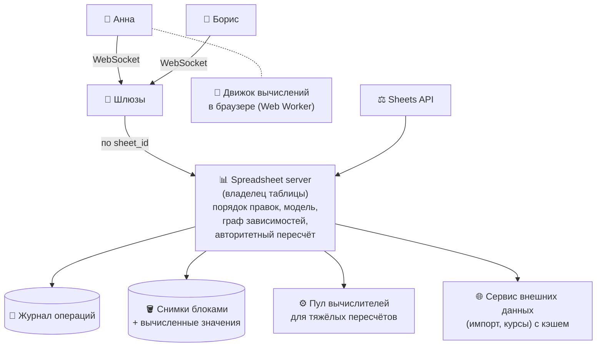
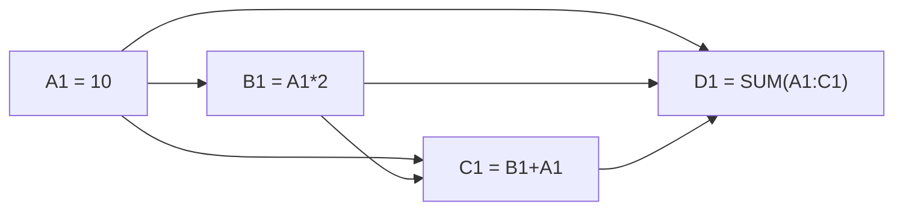

[English](README.md) | **Русский**

# Tier 2 · 4A · 02. Google Sheets (совместные таблицы)

> **Уровень:** Hard · **Время на интервью:** 45–60 мин · **Время на разбор:** ~5–6 ч
> **Ключевые аспекты:** конфликты на уровне ячеек, структурные операции (вставка и удаление строк и столбцов), стабильные идентификаторы строк и столбцов, граф зависимостей формул, инкрементальный пересчёт и топологическая сортировка, циклические ссылки, зависимости от диапазонов, где считать — в браузере или на сервере, хранение больших таблиц блоками
> **Опирается на:** [Tier 2 · 4A · 01 Google Docs](../01-google-docs/README_RU.md) (OT, сервер документа, журнал и снимки), [12-communication](../../../12-communication/README_RU.md#8-масштабирование-websocket), [08-consensus](../../../08-consensus/README_RU.md#9-лизы-и-выбор-лидера-для-приложений), [14-storage-types](../../../14-storage-types/README_RU.md)

---

## 🗺️ Как читать этот разбор

Разбор построен как интервью, но в каждом шаге есть объяснения: **почему** принимается решение, **как работает** механизм и **что будет**, если сделать иначе. Блоки «📘 Объяснение» — теория прямо по ходу задачи.

| Значок | Что значит |
|:------:|:-----------|
| 🎤 | Реплика интервьюера |
| 🗣️ | Что говорю вслух я (кандидат) |
| ✏️ | Что рисую на доске |
| ⏱️ | Сколько времени тратить на шаг |
| 📘 | Подробное объяснение концепции |

Блоки **TIP** — хороший приём, **WARNING** — ловушка, **IMPORTANT** — сигнал для уровня Senior+.

---

## 📑 Содержание

0. [Чему учит эта задача](#0-чему-учит-эта-задача)
1. [Условие задачи](#1-условие-задачи)
2. [Уточняющие вопросы и требования](#2-уточняющие-вопросы-и-требования)
3. [Оценки нагрузки](#3-оценки-нагрузки)
4. [API и протокол](#4-api-и-протокол)
5. [Модель данных](#5-модель-данных)
6. [High-level дизайн](#6-high-level-дизайн)
7. [Deep dive 1: конфликты на уровне ячеек](#7-deep-dive-1-конфликты-на-уровне-ячеек)
8. [Deep dive 2: структурные операции и стабильные идентификаторы](#8-deep-dive-2-структурные-операции-и-стабильные-идентификаторы)
9. [Deep dive 3: граф зависимостей формул](#9-deep-dive-3-граф-зависимостей-формул)
10. [Deep dive 4: инкрементальный пересчёт](#10-deep-dive-4-инкрементальный-пересчёт)
11. [Deep dive 5: где считать — браузер или сервер](#11-deep-dive-5-где-считать--браузер-или-сервер)
12. [Deep dive 6: хранение и загрузка больших таблиц](#12-deep-dive-6-хранение-и-загрузка-больших-таблиц)
13. [Deep dive 7: совместная работа: курсоры, фильтры, комментарии](#13-deep-dive-7-совместная-работа-курсоры-фильтры-комментарии)
14. [Deep dive 8: внешние данные, API и скрипты](#14-deep-dive-8-внешние-данные-api-и-скрипты)
15. [Узкие места и сценарии сбоев](#15-узкие-места-и-сценарии-сбоев)
16. [Что изменится при росте в 10 раз](#16-что-изменится-при-росте-в-10-раз)
17. [Ключевые концепции и новые понятия](#17-ключевые-концепции-и-новые-понятия)
18. [Варианты задачи и follow-up вопросы](#18-варианты-задачи-и-follow-up-вопросы)
19. [Типичные ошибки](#19-типичные-ошибки)
20. [Шпаргалка и самопроверка](#20-шпаргалка-и-самопроверка)

---

## 0. Чему учит эта задача

Таблицы кажутся проще текстового редактора: ячейка — это независимое значение, и правки разных ячеек не конфликтуют. Но у таблиц есть две свои сложности, которых нет в Google Docs:

| Сложность | Почему трудно |
|:----------|:--------------|
| **Структурные операции** | Вставка строки сдвигает адреса всех ячеек ниже — и правки других пользователей, и ссылки в формулах |
| **Формулы** | Изменение одной ячейки может потребовать пересчёта тысяч других в правильном порядке |

| Что проверяют | Где это в задаче |
|:--------------|:-----------------|
| Модель конкурентности для структурированных данных | Ячейки как регистры, строки как последовательность |
| Выбор идентификаторов | Стабильные ID строк и столбцов вместо индексов |
| Графы | Граф зависимостей, топологическая сортировка, поиск циклов |
| Инкрементальные вычисления | Пересчитывать только то, что изменилось |
| Распределение вычислений | Браузер для отзывчивости, сервер для авторитетного результата |
| Хранение больших структур | Блоки, ленивая загрузка видимой области |

> [!TIP]
> Опирайся на разбор Google Docs: сервер-владелец документа, журнал операций, снимки, курсоры — всё переиспользуется. Скажи это за минуту и потрать время на то, что специфично для таблиц: **структурные операции** и **граф формул**.

---

## 1. Условие задачи

> 🎤 «Спроектируй Google Sheets: несколько пользователей одновременно редактируют таблицу, в ячейках бывают формулы, которые ссылаются на другие ячейки; изменения и результаты формул видны всем в реальном времени».

**Что видит пользователь:**

```
A1 = 10       B1 = =A1*2  → 20       C1 = =B1+A1 → 30       D1 = =SUM(A1:C1) → 60

Анна меняет A1 на 15 → у всех B1 = 30, C1 = 45, D1 = 90 почти мгновенно.
Борис в это время вставляет строку над строкой 1 — формулы продолжают
ссылаться на те же ячейки, которые теперь находятся в строке 2.
```

**План по времени:**

| Шаг | ⏱️ |
|:----|:--:|
| Требования | 5 мин |
| Оценки | 3 мин |
| API и данные | 5 мин |
| High-level дизайн | 5 мин |
| Deep dives | 25–30 мин |
| Итоги | 3 мин |

---

## 2. Уточняющие вопросы и требования

⏱️ 5 мин

| Мой вопрос | Ответ интервьюера | Что это меняет и почему |
|:-----------|:------------------|:------------------------|
| Размер таблицы? | До ~10 миллионов ячеек | Нельзя загружать всё в браузер целиком; хранение блоками |
| Сколько одновременных редакторов? | Обычно несколько, до ~100 | Один сервер-владелец таблицы справляется |
| Формулы? | Да, сотни функций, ссылки на ячейки, диапазоны и другие листы | Граф зависимостей и движок вычислений |
| Как быстро должен обновляться результат? | Своя правка — мгновенно, у других — до секунды | Вычисления в браузере + авторитетные на сервере |
| Структурные операции? | Вставка, удаление, перемещение строк и столбцов, сортировка | Стабильные идентификаторы |
| Офлайн, история версий, комментарии? | Да, как в Docs | Переиспользуем подход Docs |
| Внешние данные (импорт по URL, курсы валют)? | Да | Обновление по расписанию, кэш, лимиты |
| API для программ? | Да | Чтение результатов формул без браузера → вычисления на сервере |

### Функциональные требования

1. Совместное редактирование ячеек (значения, формулы, форматирование) в реальном времени.
2. Вставка, удаление, перемещение строк и столбцов, сортировка диапазонов.
3. Формулы с автоматическим пересчётом зависимых ячеек.
4. Обнаружение циклических ссылок.
5. Курсоры и выделения других участников, комментарии, история версий.
6. API для чтения и записи.

### Нефункциональные требования

| Требование | Цель | Почему |
|:-----------|:-----|:-------|
| Сходимость | Все видят одинаковые значения и результаты формул | Таблицы — источник цифр для решений |
| Корректность пересчёта | Каждая формула вычислена по актуальным данным, в правильном порядке | Неверная сумма хуже, чем медленная |
| Отзывчивость | Своя правка и пересчёт видимых ячеек — мгновенно | Работа с таблицей интерактивна |
| Большие таблицы | Открытие и прокрутка 10M ячеек без зависаний | Реальные рабочие таблицы бывают огромными |
| Долговечность | Подтверждённые правки не теряются | Как в Docs |

---

## 3. Оценки нагрузки

⏱️ 3 мин

```
Таблица:          до 10M ячеек; типичная — тысячи–десятки тысяч
Ячейка:           значение или формула + форматирование ≈ 20–100 Б
Большая таблица:  10M × ~50 Б ≈ 500 МБ — в браузер целиком не загрузить

Правки:           на одну таблицу — единицы–десятки в секунду (вставка блоков данных — больше)
Пересчёт:         одна правка может затронуть от 0 до миллионов формул

Открытых таблиц:  миллионы одновременно → тысячи серверов, распределение по sheet_id
```

### Выводы

| Вывод | Следствие для дизайна |
|:------|:----------------------|
| Таблица может весить сотни МБ | Блочное хранение, загрузка только видимой области |
| Пересчёт может быть тяжёлым | Инкрементальный пересчёт по графу, ограничение времени, вычисления вне основного потока |
| Правок на таблицу немного | Один сервер-владелец упорядочивает их без труда |
| Нужен API без браузера | Авторитетный движок вычислений на сервере |

---

## 4. API и протокол

⏱️ 3 мин

```
Операции (WebSocket, как в Docs: base_rev, client_id, seq):

  set_cell     { sheet, row_id, col_id, value | formula, format? }
  insert_rows  { sheet, after_row_id, count }        → сервер выдаёт новые row_id
  delete_rows  { sheet, row_ids: [...] }
  move_rows    { sheet, row_ids: [...], after_row_id }
  insert_cols / delete_cols / move_cols — аналогично
  sort_range   { sheet, range, by_col_id, order }     → новая перестановка row_id
  format_range { sheet, range, format }

Сервер → клиент:
  ack { seq, rev }
  op  { rev, author, op }                  ← чужая правка
  computed { rev, cells: [{ row_id, col_id, value }] }   ← авторитетные результаты формул
```

📘 **Почему операции ссылаются на `row_id` и `col_id`, а не на «B7».** Адрес «B7» меняется при вставке строки выше. Идентификатор строки — нет. Подробно — в deep dive 2.

```http
REST
GET  /v1/spreadsheets/{id}/values?range=Sheet1!A1:D100   → значения (с вычисленными формулами)
POST /v1/spreadsheets/{id}/values:batchUpdate
GET  /v1/spreadsheets/{id}/chunks?sheet=…&rows=1000-1999 → блоки для прокрутки
```

---

## 5. Модель данных

⏱️ 3 мин

```
Лист:
  row_order:  [r_a1, r_7f, r_02, …]      ← порядок строк = последовательность стабильных ID
  col_order:  [c_k1, c_9x, …]            ← порядок столбцов
  cells:      (row_id, col_id) → { value | formula_ast, format }   ← разреженно: только непустые

Формула хранится как разобранное дерево со ссылками на ID:
  "=SUM(A1:C1)"  →  SUM( Range(from: (r_a1, c_k1), to: (r_a1, c_3m)) )
  отображение «A1:C1» вычисляется из текущего порядка строк и столбцов
```

| Данные | Хранилище | Почему |
|:-------|:----------|:-------|
| Метаданные, права | БД | Как в Docs |
| Журнал операций | (sheet_id, rev) в wide-column хранилище | Как в Docs |
| Снимки | Блоками в объектном хранилище: блок = диапазон строк × столбцов | Изменение одной ячейки не требует перезаписи всего снимка (deep dive 6) |
| Граф зависимостей | В памяти сервера-владельца (перестраивается при загрузке) | Производные данные |
| Вычисленные значения | Кэш в снимке + в памяти | Быстрое открытие без полного пересчёта |

---

## 6. High-level дизайн

⏱️ 5 мин



🗣️ «Каркас — как в Google Docs: **сервер-владелец таблицы** упорядочивает правки, пишет их в журнал до подтверждения и рассылает участникам; снимки и шлюзы те же. Отличия:
- правки адресуют ячейки через **стабильные ID строк и столбцов**;
- у сервера есть **граф зависимостей формул** и **движок вычислений** — он выдаёт авторитетные результаты;
- такой же движок работает **в браузере**, чтобы пользователь видел результат своей правки мгновенно;
- тяжёлые пересчёты уходят в **пул вычислителей**, внешние данные — в отдельный сервис с кэшем».

---

## 7. Deep dive 1: конфликты на уровне ячеек

> 🎤 «Анна и Борис одновременно изменили одну и ту же ячейку. Что останется?»

### Разные ячейки — конфликта нет

📘 В тексте вставка в одном месте сдвигает все позиции после неё. В таблице правка ячейки C5 **не влияет** на ячейку F20. Поэтому большинство одновременных правок в таблице просто применяются в порядке, заданном сервером, без какой-либо трансформации.

### Одна ячейка — последняя запись побеждает

```
Ревизия 100: A1 = 10
Анна:  set A1 = 15 (base 100)
Борис: set A1 = 20 (base 100)

Сервер принял правку Анны первой → ревизия 101: A1 = 15
Затем правку Бориса              → ревизия 102: A1 = 20
У всех: A1 = 20
```

| Решение | Почему |
|:--------|:-------|
| **Ячейка — регистр «последняя запись побеждает»** в порядке сервера | Ячейка — атомарное значение; слить «15» и «20» нельзя |
| Порядок задаёт сервер, а не часы клиентов | Все применяют правки в одном порядке → сходимость |
| Показать, что ячейку изменил другой | Анна видит, что её значение перезаписано Борисом; это не тихая потеря |
| Подсказка «ячейку сейчас редактирует Борис» | Мягкая блокировка: снижает вероятность одновременной правки одной ячейки |

> [!NOTE]
> Если внутри ячейки длинный текст, который редактируют одновременно, можно применить текстовые алгоритмы из Google Docs. Но для обычных ячеек (числа, короткий текст) «последняя запись побеждает» — понятное и ожидаемое поведение.

---

## 8. Deep dive 2: структурные операции и стабильные идентификаторы

> 🎤 «Анна вставила строку над строкой 5, а Борис одновременно изменил ячейку B7. Где окажется правка Бориса?»

### Проблема индексов

```
Анна:  insert_row(перед индексом 5)       (base 100)
Борис: set_cell(B7 = "готово")            (base 100)

Сервер применил вставку Анны первой. Строка, которую видел Борис как 7-ю,
теперь 8-я. Если применить правку Бориса как «B7» — она попадёт не в ту строку ❌
```

### Решение 1: трансформация индексов (OT)

📘 Как в Google Docs: сервер трансформирует правку Бориса против вставки Анны — индекс 7 ≥ 5, значит, сдвинуть на число вставленных строк → B8. Это работает, но правил трансформации много: вставка/удаление/перемещение строк и столбцов против правок ячеек, диапазонов, форматирования, сортировки — и против **ссылок в формулах**.

### Решение 2: стабильные идентификаторы ⭐

📘 Каждая строка и столбец при создании получают **неизменный идентификатор**. Порядок строк хранится отдельно — как последовательность идентификаторов. Ячейка адресуется парой `(row_id, col_id)`.

```
До:     row_order = [r1, r2, r3, r4, r5, r6, r7]      Борис видит r7 как «строку 7»
Анна:   insert_row после r4 → новая строка rN
После:  row_order = [r1, r2, r3, r4, rN, r5, r6, r7]

Правка Бориса: set_cell(r7, col_B) — по идентификатору, а не по номеру
→ попадает в ту же строку, которая теперь отображается как 8-я ✅
```

| Что даёт | Почему |
|:---------|:-------|
| Правки ячеек **не нужно трансформировать** при вставке и удалении строк | Идентификатор не меняется |
| **Ссылки в формулах не нужно переписывать** | Формула хранит `(r1, c1)`, а «A1» — лишь отображение |
| Перемещение и сортировка — изменение `row_order` | Данные ячеек не трогаются |
| Порядок строк — это последовательность | Одновременные вставки строк упорядочиваются как текст (OT или CRDT для последовательности) |

### Удаление против правки

| Ситуация | Правило |
|:---------|:--------|
| Анна удалила строку r7, Борис одновременно изменил ячейку в r7 | Удаление побеждает: правка в удалённой строке отбрасывается, Борис получает уведомление; восстановить можно из истории |
| Формула ссылалась на удалённую строку | Ссылка становится `#REF!` |
| Формула ссылалась на диапазон, часть которого удалена | Диапазон сужается (как в обычных таблицах) |

### Сортировка

📘 Сортировка диапазона — это **перестановка** идентификаторов строк. Если одновременно с сортировкой кто-то изменил ячейку, правка по `(row_id, col_id)` применится к той же логической строке, которая просто переехала. Но результат сортировки, вычисленный по старому значению, может оказаться «устаревшим» — сортировку не пересчитывают автоматически, как и в настольных таблицах.

> [!IMPORTANT]
> **Сигнал Senior+:** заметить, что главный источник конфликтов в таблицах — не одновременная правка одной ячейки, а **структурные операции, сдвигающие адреса**, и предложить стабильные идентификаторы строк и столбцов, которые одновременно решают проблему правок и ссылок в формулах.

---

## 9. Deep dive 3: граф зависимостей формул

> 🎤 «Как понять, какие формулы пересчитать после изменения ячейки?»

### Граф

📘 Каждая формула ссылается на другие ячейки (**предшественники**). Обратные связи — **зависимые** ячейки. Вместе они образуют **граф зависимостей**: ребро «A1 → B1» означает «B1 использует A1».

```
A1 = 10
B1 = =A1*2
C1 = =B1+A1
D1 = =SUM(A1:C1)
```



### Что пересчитать

```
Изменили A1 → найти всех, кто зависит от A1 (прямо и косвенно):
  обход графа от A1 → { B1, C1, D1 }

В каком порядке? Каждая формула — после всех своих предшественников.
Топологическая сортировка затронутого подграфа: B1 → C1 → D1

  B1 = 15 × 2      = 30
  C1 = 30 + 15     = 45
  D1 = 15 + 30 + 45 = 90
```

📘 **Почему порядок важен.** Если посчитать C1 раньше B1, C1 возьмёт старое значение B1 (20) и получится 35 вместо 45. Топологическая сортировка гарантирует, что к моменту вычисления формулы все её входы уже актуальны.

### Циклические ссылки

```
A1 = =B1+1
B1 = =A1+1     → A1 зависит от B1, B1 от A1 — цикл
```

| Решение | Как |
|:--------|:----|
| Обнаружение | При добавлении формулы — проверить, достижима ли новая ячейка из её предшественников (поиск в глубину); при топологической сортировке — оставшиеся непосчитанными вершины образуют цикл |
| Результат | Ячейки цикла показывают ошибку циклической ссылки |
| Итеративные вычисления (опционально) | Как в Excel: пересчитывать цикл заданное число итераций — включается явно |

### Зависимости от диапазонов

📘 `=SUM(A1:A100000)` зависит от 100 000 ячеек. Хранить 100 000 отдельных рёбер для каждой такой формулы — огромный граф. Вместо этого хранится **ребро на диапазон**:

| Подход | Как |
|:-------|:----|
| Индекс диапазонов | Диапазоны формул хранятся в структуре для поиска пересечений (дерево интервалов по строкам и столбцам) |
| При изменении ячейки | Найти все диапазоны, содержащие её, → их формулы становятся «грязными» |
| Целые столбцы (`A:A`) | Особый случай: зависимость от столбца целиком |

---

## 10. Deep dive 4: инкрементальный пересчёт

> 🎤 «В таблице миллион формул. Изменили одну ячейку. Как не пересчитывать всё?»

| Приём | Как | Эффект |
|:------|:----|:-------|
| **Грязные пометки** | При изменении — пометить зависимые ячейки «грязными»; пересчитывать только их | Обычно затрагивается малая часть таблицы |
| **Отсечение без изменений** | Если новое значение формулы совпало со старым, её зависимые не пересчитываются | Цепочки обрываются рано |
| **Параллельный пересчёт** | Независимые ветки графа считаются параллельно | Быстрее на больших графах |
| **Приоритет видимого** | Сначала пересчитать ячейки, видимые пользователю, и их предшественников | Экран обновляется быстро, остальное — следом |
| **Пакетирование правок** | Вставка 1 000 значений → один пересчёт, а не 1 000 | Меньше повторной работы |
| **Ограничение времени** | Очень тяжёлый пересчёт — в фоновом вычислителе с прогрессом | Интерфейс не зависает |

### Волатильные функции

📘 `NOW()`, `RAND()`, `TODAY()` меняются без изменения входов. Их пересчитывают по событию (любая правка в таблице) или по расписанию (раз в минуту, раз в час — настройка), а не постоянно — иначе таблица с `NOW()` пересчитывалась бы бесконечно.

---

## 11. Deep dive 5: где считать — браузер или сервер

> 🎤 «Формулы считаются в браузере или на сервере?»

| | В браузере | На сервере |
|:-|:-----------|:-----------|
| Отзывчивость | Мгновенно: результат своей правки виден сразу | Задержка сети |
| Таблица не открыта ни у кого | Не работает | Работает (API, расписание, импорт данных) |
| Огромные таблицы | Ограничено памятью и CPU устройства | Мощные машины |
| Единый результат для всех | Риск расхождений между устройствами | Один авторитетный результат |

🗣️ «Используем **оба**:
- **в браузере** — тот же движок вычислений (в фоновом потоке, Web Worker), чтобы результат своей правки и видимые ячейки обновлялись мгновенно;
- **на сервере** — авторитетный пересчёт: его результаты рассылаются всем, нужны API, расписанию и пользователям, у которых таблица не загружена целиком.

Важно, чтобы движок был **один и тот же** (одна кодовая база для сервера и браузера) — иначе результаты разойдутся. Google описывал перенос движка вычислений Sheets в браузере на WasmGC — это пример общего движка, работающего в браузере быстро».

| Деталь | Почему |
|:-------|:-------|
| Детерминированность функций | Одинаковые входы → одинаковый результат везде (кроме волатильных) |
| Волатильные функции считает сервер | Чтобы `RAND()` не давал разные значения у разных пользователей |
| Внешние данные получает сервер | Браузеры не должны каждый сам ходить на внешние сайты (лимиты, безопасность, согласованность) |
| Сервер — источник правды | Если результаты браузера и сервера разошлись, побеждает сервер |

---

## 12. Deep dive 6: хранение и загрузка больших таблиц

> 🎤 «Таблица на 10 миллионов ячеек. Как её открыть и прокручивать?»

### Блочное хранение

```
Лист делится на блоки, например 1 000 строк × 50 столбцов:

  Блок (0, 0): строки 0–999,    столбцы 0–49
  Блок (1, 0): строки 1000–1999, столбцы 0–49
  …

Снимок = набор блоков; изменился блок — перезаписывается только он
```

| Решение | Почему |
|:--------|:-------|
| Разреженное хранение | Пустые ячейки не хранятся; большинство таблиц заполнены частично |
| Снимок блоками | Правка одной ячейки не требует переписывать 500 МБ |
| Вычисленные значения — в снимке | Открытие без полного пересчёта |

### Ленивая загрузка

| Решение | Почему |
|:--------|:-------|
| Клиент загружает **только видимые блоки** и немного вокруг | Открытие за секунды даже для огромной таблицы |
| Подгрузка при прокрутке | Как бесконечная лента |
| Виртуальная отрисовка | В DOM — только видимые ячейки, а не миллионы |
| Формулы в незагруженных блоках | Их значения приходят с сервера; клиент считает локально только то, для чего у него есть данные |

> [!WARNING]
> Если клиент загрузил только часть таблицы, он **не может** сам пересчитать формулу, ссылающуюся на незагруженные блоки (например, `SUM` по всему столбцу). Для таких формул результат берётся с сервера — ещё одна причина, почему серверный движок обязателен.

---

## 13. Deep dive 7: совместная работа: курсоры, фильтры, комментарии

| Функция | Решение |
|:--------|:--------|
| **Выделения других участников** | Эфемерно, как курсоры в Docs: `(row_id, col_id)` выделенного диапазона, ограничение частоты |
| **«Ячейку редактирует Борис»** | Мягкая подсказка, а не блокировка: снижает число одновременных правок одной ячейки |
| **Фильтры** | Общий фильтр меняет вид для всех — это правка таблицы; **личные представления фильтров** (filter views) — состояние конкретного пользователя, не влияет на других |
| **Комментарии** | Привязаны к `(row_id, col_id)` — не «уезжают» при вставке строк |
| **История версий и восстановление** | Журнал операций + снимки, как в Docs |
| **Undo** | Отмена только своих правок, обратная операция применяется как новая |
| **Офлайн** | Локальный буфер правок; при подключении — применение в порядке сервера; правки удалённых строк отбрасываются с уведомлением |

---

## 14. Deep dive 8: внешние данные, API и скрипты

> 🎤 «Формула загружает курс валют с внешнего сайта. А ещё таблицу читают программы через API».

| Задача | Решение |
|:-------|:--------|
| **Функции импорта внешних данных** | Выполняются сервисом на сервере, а не в браузерах; результат кэшируется и обновляется по расписанию; лимиты на частоту и объём; защита от обращений во внутреннюю сеть (SSRF) |
| **Таблица из 10 000 импортов** | Квоты на таблицу, очередь, постепенное обновление |
| **API** | Читает авторитетные значения с сервера; запись через API — те же операции, что и из браузера, с ревизиями и рассылкой |
| **Скрипты и триггеры** | Выполняются в изолированной среде с квотами времени и вызовов; действуют через тот же API |
| **Графики** | Пересчитываются при изменении данных с задержкой (debounce), чтобы не перерисовывать на каждое нажатие |

---

## 15. Узкие места и сценарии сбоев

| Сценарий | Что произойдёт | Как защищаемся |
|:---------|:---------------|:---------------|
| Одновременная правка одной ячейки | Одна правка перезапишет другую | Последняя запись в порядке сервера, видимость автора, мягкая подсказка |
| Вставка строки и правка ниже | Правка не в той строке | Стабильные ID строк и столбцов |
| Удаление строки и правка в ней | Правка в несуществующей строке | Удаление побеждает, уведомление, восстановление из истории |
| Неправильный порядок пересчёта | Неверные результаты | Топологическая сортировка |
| Циклическая ссылка | Бесконечный пересчёт | Обнаружение цикла, ошибка в ячейке |
| Огромные диапазоны в формулах | Гигантский граф | Рёбра на диапазоны, индекс интервалов |
| Тяжёлый пересчёт | Зависание | Инкрементальность, фоновые вычислители, приоритет видимого |
| Таблица на сотни МБ | Медленное открытие | Блоки, ленивая загрузка, виртуальная отрисовка |
| Расхождение браузера и сервера | Разные результаты у разных людей | Один движок, сервер — источник правды |
| Сервер-владелец упал | Сессия прерывается | Как в Docs: аренда, снимок + журнал, повтор правок |

---

## 16. Что изменится при росте в 10 раз

> 🎤 «Таблицы на 100 миллионов ячеек?»

| Изменение | Почему |
|:----------|:-------|
| **Распределённый пересчёт** графа по нескольким вычислителям | Один сервер не справится |
| **Колоночное хранение** для аналитических таблиц | Быстрые агрегаты по столбцам |
| **Подключение к хранилищам данных** вместо копирования данных в таблицу | Таблица становится интерфейсом к внешним данным (как Connected Sheets к BigQuery) |
| **Предвычисленные агрегаты** для сводных таблиц | Не пересчитывать с нуля |

---

## 17. Ключевые концепции и новые понятия

### Что применяется

| Концепция | Где разобрана | Как применяется здесь |
|:----------|:--------------|:----------------------|
| Сервер-владелец, журнал, снимки, курсоры | [Tier 2 · 4A · 01](../01-google-docs/README_RU.md) | Каркас системы |
| OT для последовательностей | [Tier 2 · 4A · 01](../01-google-docs/README_RU.md#8-deep-dive-2-operational-transformation) | Порядок строк и столбцов |
| Аренды и fencing | [08-consensus](../../../08-consensus/README_RU.md#9-лизы-и-выбор-лидера-для-приложений) | Владелец таблицы |
| Объектное хранилище | [14-storage-types](../../../14-storage-types/README_RU.md) | Блоки снимков |

### Новые понятия этой задачи

| Понятие | Кратко |
|:--------|:-------|
| **Ячейка как регистр** | Атомарное значение, «последняя запись побеждает» в порядке сервера |
| **Структурная операция** | Вставка, удаление, перемещение строк и столбцов, сортировка |
| **Стабильные идентификаторы строк и столбцов** | Адресация ячеек и ссылок, не зависящая от позиции |
| **Граф зависимостей** | Ячейки и рёбра «используется в формуле» |
| **Топологическая сортировка** | Порядок пересчёта: каждая формула после своих входов |
| **Циклическая ссылка** | Цикл в графе зависимостей |
| **Индекс диапазонов** | Поиск формул, чьи диапазоны содержат изменённую ячейку |
| **Инкрементальный пересчёт** | Пересчёт только затронутых формул |
| **Волатильная функция** | Меняется без изменения входов (NOW, RAND) |
| **Блочное хранение и ленивая загрузка** | Таблица по частям, загрузка видимого |

---

## 18. Варианты задачи и follow-up вопросы

<details>
<summary><b>Чем Google Sheets принципиально отличается от Google Docs?</b></summary>

Правки ячеек почти не конфликтуют между собой (ячейки независимы), поэтому для них достаточно «последней записи» в порядке сервера. Сложность переезжает в структурные операции (решаются стабильными идентификаторами) и формулы (граф зависимостей и инкрементальный пересчёт), которых в текстовом редакторе нет.
</details>

<details>
<summary><b>Как сделать сводную таблицу на миллион строк быстро?</b></summary>

Сводная таблица — агрегация по группам. При изменении исходных данных пересчитывать её инкрементально: изменилась строка → обновить агрегаты только её групп (вычесть старое значение, прибавить новое). Для очень больших данных — колоночное хранение и вычисление на сервере.
</details>

<details>
<summary><b>Как обработать вставку 100 000 строк из CSV?</b></summary>

Одна операция пакетной вставки: сервер выдаёт диапазон новых идентификаторов строк, записывает данные блоками напрямую в снимок (а не 100 000 правок в журнал), один пересчёт зависимых формул в конце, клиентам — уведомление «загружены новые данные» с подгрузкой видимых блоков.
</details>

<details>
<summary><b>Что если две формулы в разных листах ссылаются друг на друга?</b></summary>

Граф зависимостей общий для всей книги (всех листов), поэтому цикл через несколько листов обнаруживается так же, как внутри одного. Ссылки на другие книги — внешние зависимости: обновляются асинхронно, как импорт данных.
</details>

<details>
<summary><b>Почему не CRDT для всей таблицы?</b></summary>

Можно: ячейки как LWW-регистры, порядок строк и столбцов как CRDT-последовательность — это хорошо работает для офлайна. Но формулам нужен согласованный порядок пересчёта и единые результаты волатильных функций, а API и расписанию — авторитетные значения; поэтому сервер-владелец остаётся удобным центром даже при CRDT-модели данных.
</details>

---

## 19. Типичные ошибки

| ❌ Ошибка | Почему плохо | ✅ Как правильно |
|:---------|:-------------|:----------------|
| Адресовать ячейки по «B7» в операциях | Правки попадают не в те строки после вставки | Стабильные `row_id` и `col_id` |
| Переписывать ссылки во всех формулах при вставке строки | Дорого и подвержено ошибкам | Ссылки на идентификаторы, «A1» — только отображение |
| Пересчитывать всю таблицу при каждой правке | Медленно на больших таблицах | Инкрементальный пересчёт по графу |
| Пересчитывать в произвольном порядке | Неверные результаты | Топологическая сортировка |
| Не искать циклы | Бесконечный пересчёт | Обнаружение циклов |
| Ребро на каждую ячейку диапазона | Огромный граф | Ребро на диапазон, индекс интервалов |
| Считать только в браузере | Нет API, расписания, частичная загрузка ломает формулы | Авторитетный движок на сервере |
| Разные движки в браузере и на сервере | Расходящиеся результаты | Одна кодовая база |
| Загружать всю таблицу в браузер | Зависание на больших таблицах | Блоки и ленивая загрузка |
| Импорт внешних данных из каждого браузера | Лимиты, рассогласование, безопасность | Серверный сервис с кэшем |

---

## 20. Шпаргалка и самопроверка

### Ответ за 30 секунд

> Каркас — как в Google Docs: сервер-владелец таблицы (аренда с эпохой) упорядочивает правки, пишет в журнал до подтверждения, рассылает; снимки, курсоры, офлайн и история — те же. Ячейки независимы: одновременная правка одной ячейки — «последняя запись побеждает» в порядке сервера с показом автора. Главная сложность — структурные операции: строки и столбцы получают стабильные идентификаторы, порядок хранится последовательностью, ячейки и ссылки в формулах адресуются `(row_id, col_id)` — вставки, удаления и сортировки не требуют трансформации правок и переписывания формул; удаление строки побеждает правку в ней. Формулы — граф зависимостей (рёбра на диапазоны через индекс интервалов), при изменении — грязные пометки, топологическая сортировка затронутого подграфа, отсечение неизменившихся значений, обнаружение циклов, приоритет видимых ячеек; волатильные функции — по расписанию. Один движок вычислений в браузере (мгновенно) и на сервере (авторитетно, для API и незагруженных блоков). Хранение — разреженные блоки, снимок блоками, ленивая загрузка видимой области.

### Самопроверка

- [ ] Могу объяснить, чем таблицы проще и чем сложнее текстового редактора
- [ ] Могу объяснить разрешение одновременной правки одной ячейки
- [ ] Могу показать проблему вставки строки и правки ниже
- [ ] Могу объяснить стабильные идентификаторы и почему они решают и правки, и формулы
- [ ] Могу построить граф зависимостей и порядок пересчёта на примере
- [ ] Могу обнаружить циклическую ссылку
- [ ] Могу объяснить, как хранить зависимости от больших диапазонов
- [ ] Могу назвать 5 приёмов инкрементального пересчёта
- [ ] Могу обосновать вычисления и в браузере, и на сервере
- [ ] Могу описать блочное хранение и ленивую загрузку

### Что почитать

- Разбор [Tier 2 · 4A · 01 Google Docs](../01-google-docs/README_RU.md)
- Google Workspace Blog — статьи о движке вычислений Sheets и WasmGC (2024)
- Microsoft Research, *Excel recalculation* и документация Excel о цепочке вычислений
- Sestoft, *Spreadsheet Implementation Technology: Basics and Extensions* (MIT Press, 2014)
- Cormen et al., *Introduction to Algorithms* — топологическая сортировка
