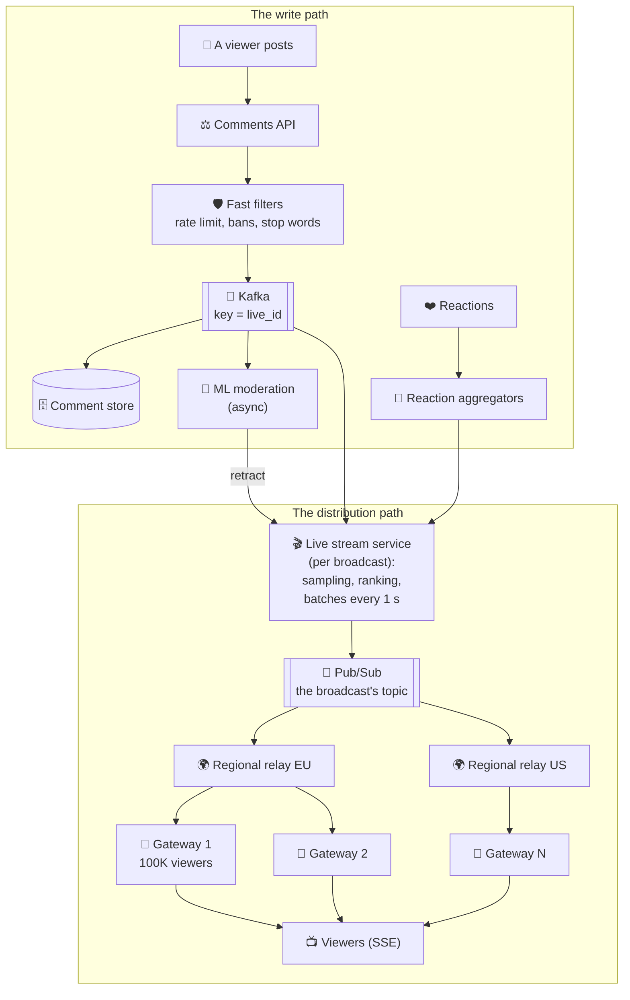
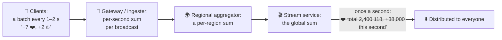
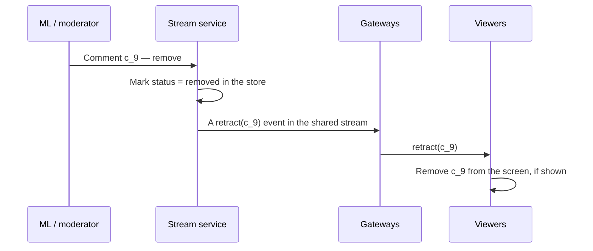

**English** | [Русский](README_RU.md)

# Tier 2 · 4A · 03. Live Comments and Reactions

> **Level:** Medium · **Interview time:** 45 min · **Study time:** ~4 h
> **Key aspects:** fan-out to millions of viewers of one broadcast, hierarchical pub/sub distribution, sampling and ranking comments, aggregating reactions, the write path and hot partitions, moderation, reply threads, SSE versus WebSocket, syncing comments to the video after the broadcast
> **Builds on:** [12-communication](../../../12-communication/README.md#7-server--client-polling-long-polling-sse-websocket), [Tier 1 · 07 News Feed](../../../tier-1/07-news-feed/README.md#7-deep-dive-1-fan-out-on-write-on-read-and-hybrid), [Tier 1 · 16 Top-K](../../../tier-1/16-top-k-leaderboard/README.md#9-deep-dive-4-hot-keys), [Tier 1 · 02 Rate Limiter](../../../tier-1/02-rate-limiter/README.md), [Tier 1 · 06 Chat](../../../tier-1/06-chat-system/README.md)

---

## 🗺️ How to Read This Walkthrough

The walkthrough follows an interview, but every step includes explanations: **why** a decision is made, **how** a mechanism works and **what happens** if you do it differently. The "📘 Explanation" blocks are theory right where you need it.

| Icon | Meaning |
|:----:|:--------|
| 🎤 | Interviewer |
| 🗣️ | What I (the candidate) say out loud |
| ✏️ | What I draw on the whiteboard |
| ⏱️ | Time budget for the step |
| 📘 | A detailed explanation of a concept |

Callouts: **TIP** — a good technique, **WARNING** — a trap, **IMPORTANT** — a Senior+ signal.

---

## 📑 Contents

0. [What This Problem Teaches](#0-what-this-problem-teaches)
1. [Problem Statement](#1-problem-statement)
2. [Clarifying Questions and Requirements](#2-clarifying-questions-and-requirements)
3. [Capacity Estimates](#3-capacity-estimates)
4. [API](#4-api)
5. [Data Model](#5-data-model)
6. [High-Level Design](#6-high-level-design)
7. [Deep Dive 1: Hierarchical Distribution](#7-deep-dive-1-hierarchical-distribution)
8. [Deep Dive 2: Sampling and Ranking Comments](#8-deep-dive-2-sampling-and-ranking-comments)
9. [Deep Dive 3: Aggregating Reactions](#9-deep-dive-3-aggregating-reactions)
10. [Deep Dive 4: The Write Path and Hot Partitions](#10-deep-dive-4-the-write-path-and-hot-partitions)
11. [Deep Dive 5: Moderation and Spam](#11-deep-dive-5-moderation-and-spam)
12. [Deep Dive 6: Reply Threads on Posts](#12-deep-dive-6-reply-threads-on-posts)
13. [Deep Dive 7: Connections, Joining Mid-Broadcast and Ordering](#13-deep-dive-7-connections-joining-mid-broadcast-and-ordering)
14. [Deep Dive 8: Comments After the Broadcast](#14-deep-dive-8-comments-after-the-broadcast)
15. [Bottlenecks and Failure Scenarios](#15-bottlenecks-and-failure-scenarios)
16. [What Changes at 10x Scale](#16-what-changes-at-10x-scale)
17. [Key Concepts and New Terms](#17-key-concepts-and-new-terms)
18. [Variations and Follow-Up Questions](#18-variations-and-follow-up-questions)
19. [Common Mistakes](#19-common-mistakes)
20. [Cheat Sheet and Self-Check](#20-cheat-sheet-and-self-check)

---

## 0. What This Problem Teaches

Live comments on a broadcast (Facebook Live, YouTube Live, Twitch) resemble a group chat — but with a group of **millions**. That changes everything: delivering every comment to every viewer is impossible both technically and in terms of meaning — nobody can read 50,000 messages per second.

| What's tested | Where it shows up |
|:--------------|:------------------|
| Fan-out at extreme scale | One source → millions of recipients |
| Hierarchical distribution | Several pub/sub tiers instead of direct sends |
| Product trade-offs | Showing a sample rather than everything — which one |
| Aggregation instead of events | Reactions as counters, not a million separate messages |
| Hot keys | One broadcast — one write hotspot |
| Real-time moderation | Removing a comment for millions of viewers |

> [!TIP]
> The key idea: **the read stream must be capped from above, rather than trying to deliver everything**. Start by showing the math for why "every comment to everyone" is impossible — and the interviewer will see that you understand the essence of the problem.

---

## 1. Problem Statement

> 🎤 "Design live comments and reactions for video broadcasts: viewers post comments and reactions, and every viewer sees new comments and floating hearts in near real time. Account for broadcasts with millions of viewers. Separately — comments with reply threads under regular posts."

**What a viewer sees:**

```
A broadcast of the championship final, 8 million viewers
  The comment feed on the right updates several times a second — at a readable pace
  Friends' comments are highlighted and always shown
  Hearts and "flames" float up, with a counter: "❤️ 2.4M"
  The host removed an offensive comment — it disappeared for everyone
```

**Time plan:**

| Step | ⏱️ |
|:-----|:--:|
| Requirements | 4 min |
| Estimates | 4 min |
| API and data | 5 min |
| High-level design | 6 min |
| Deep dives | 22 min |
| Wrap-up | 4 min |

---

## 2. Clarifying Questions and Requirements

⏱️ 4 min

| My question | Interviewer's answer | What it changes and why |
|:------------|:---------------------|:------------------------|
| How many viewers does one broadcast have? | Usually hundreds to thousands; records — 10M | A design for the long tail and for extreme peaks |
| How many comments per second? | Up to ~50,000 per second on a viral broadcast | Showing everything is impossible — sampling |
| Reactions? | Up to ~1M reactions per second | Aggregated counters only |
| Latency? | 1–2 seconds | Batching by time is fine |
| Is strict ordering needed? | No, roughly by time | No global ordering |
| Must everyone see every comment? | No, but friends' and important ones — yes | Sampling with priorities |
| Store comments? | Yes, for viewing after the broadcast | Syncing with video time |
| Moderation? | Filters, removal by the host, bans, slow mode | Retracting comments in real time |

### Functional requirements

1. Posting comments and reactions during a broadcast.
2. Delivering new comments and reaction counters to every viewer in real time.
3. Prioritizing comments from friends and important participants.
4. Moderation: filters, removal, bans, slow mode.
5. Viewing comments after the broadcast in sync with the video.
6. Under posts — reply threads, comment likes, sorting.

### Non-functional requirements

| Requirement | Target | Why |
|:------------|:-------|:----|
| Delivery latency | 1–2 s | Comments discuss what's happening right now |
| Scale | 10M viewers of one broadcast | The biggest events |
| Availability | A comments outage doesn't affect the video | The video is what matters most |
| Durability | Posted comments are stored | Viewing after the broadcast |
| Consistency | Eventual, roughly ordered | Strict ordering isn't needed |

---

## 3. Capacity Estimates

⏱️ 4 min

```
A viral broadcast:    10M viewers, 50,000 comments/s, 1M reactions/s

Naive fan-out:        50,000 comments × 10M viewers = 5 × 10^11 deliveries per second ❌

With a cap:           a viewer reads ~1–3 comments per second;
                      the server sends a batch once a second with ~10–20 comments
                      10M viewers × 1 batch/s = 10M messages/s — feasible on a hundred gateways

Gateways:             ~100,000 connections per gateway → ~100 gateways for this broadcast
                      each gateway receives the broadcast's stream ONCE and distributes it to its viewers

Reactions:            1M events/s → aggregated down to one number per type per second
```

### Conclusions

| Conclusion | Design consequence |
|:-----------|:-------------------|
| Delivering everything to everyone is impossible by a factor of 10^5 | Sampling: a viewer receives a capped stream |
| Each gateway must receive the broadcast's stream once | Hierarchical distribution |
| Reactions are a million events per second | Aggregating into counters at several tiers |
| Writing 50,000 comments/s for one broadcast | A hot partition — it must be split |

---

## 4. API

⏱️ 2 min

```http
# Posting
POST /v1/live/{live_id}/comments     { "text": "…", "client_comment_id": "…" }   → 202 { comment_id }
POST /v1/live/{live_id}/reactions    { "type": "heart" }                          → 202

# Subscribing to the stream (SSE or WebSocket)
GET  /v1/live/{live_id}/stream?last_event_id=…
→ event: comments   data: [{ id, author, text, ts, video_offset }, …]     ← a batch every ~1 s
→ event: reactions  data: { "heart": 2400118, "fire": 81022, "delta": {...} }
→ event: retract    data: { "comment_id": "…" }                            ← a removed comment

# History and posts
GET  /v1/live/{live_id}/comments?from_offset=…&to_offset=…    ← after the broadcast
GET  /v1/posts/{post_id}/comments?sort=top&cursor=…
GET  /v1/comments/{comment_id}/replies?cursor=…
```

---

## 5. Data Model

⏱️ 3 min

| Data | Key / schema | Store | Why |
|:-----|:-------------|:------|:----|
| **Broadcast comments** | ((live_id, minute_bucket, shard), comment_id) → author, text, video_offset, status | Wide-column (Cassandra) | Huge write volume, reads by time; buckets and shards against a hot partition |
| **Post comments** | ((post_id, bucket), comment_id) → author, text, parent_id, like_count, status | Wide-column | Reply threads via parent_id |
| **Reactions (counters)** | (target_id, type) → count | Sharded counters / Redis + periodic writes to the DB | High frequency |
| **A user's reaction** (for posts) | (target_id, user_id) → type | KV | You can't like twice, but you can undo |
| **Moderation** | (live_id) → bans, filters, mode | A DB + cache | Checked on every write |
| **Gateway subscriptions** | live_id → set of gateways | Redis / the router's memory | Where to send the broadcast's stream |

---

## 6. High-Level Design

⏱️ 6 min



🗣️ "Two paths:
- **writes**: a comment passes fast filters, goes into Kafka, is stored, and is checked asynchronously by an ML model; reactions go to aggregators;
- **distribution**: each active broadcast has **a stream service** that once a second builds a batch — a sample of comments and a reaction summary — and publishes it to the broadcast's topic; then comes **the hierarchy**: regional relays → gateways → viewers. Each tier receives the stream **once** and multiplies it downward."

---

## 7. Deep Dive 1: Hierarchical Distribution

> 🎤 "How do you deliver one broadcast's stream to 10 million viewers?"

### Why not directly

📘 If the stream service sends to every viewer itself, it must hold 10M connections and make 10M sends per second — one component becomes the bottleneck. The fix — **a distribution tree**: each tier multiplies the message 100–1,000×.

```
The broadcast's stream service          1 message/s
  → The broadcast's pub/sub topic
    → ~10 regional relays                10 messages/s
      → ~100 gateways                    100 messages/s
        → 10M viewers (100K per gateway) 10M messages/s
```

### Gateway subscriptions

| Mechanism | How |
|:----------|:----|
| A viewer connected to a gateway and chose a broadcast | The gateway checks whether it's already subscribed to that broadcast; if not, it subscribes at a relay |
| The broadcast's last viewer on the gateway left | The gateway unsubscribes |
| A "broadcast → gateways" registry | At the relay; only gateways with viewers receive the stream |
| Small broadcasts (hundreds of viewers) | The same scheme, just a "narrow" tree |

📘 **The key property.** Each tier's load is proportional to the number of **nodes below it**, not the number of viewers. A gateway with 100,000 viewers receives the broadcast's stream once and distributes it locally — that's cheap, because the message is the same (or nearly the same) for all its viewers.

> [!IMPORTANT]
> **Senior+ signal:** explain that sending one identical batch to millions is **a multicast problem**, and build a relay tree rather than queuing a separate message for each viewer. It's the same idea as a CDN for video, only for an event stream.

---

## 8. Deep Dive 2: Sampling and Ranking Comments

> 🎤 "50,000 comments per second. Which ones do you show a viewer?"

### How many to show

📘 A person comfortably reads 1–3 short comments per second. Show more and the feed becomes an unreadable torrent. So the stream service selects a capped number of comments per batch — e.g. 10–20 per second with smooth scrolling.

### Which ones

| Source | Priority | How |
|:-------|:---------|:----|
| **Friends' comments** | Always show | The personal part — see below |
| The host, moderators, verified authors | High | Flagged in the shared stream |
| Comments in the viewer's language | Higher | Separate streams per language/region |
| Quality | Higher for longer, meaningful ones; lower for repeats and emoji spam | A quick score on intake |
| Everything else | A random sample | Even representation |

### Personalization without a separate stream per viewer

📘 Building a separate sample for each of 10M viewers means 10M different messages at the upper tiers again. A compromise:

| Tier | What's shared | What's personal |
|:-----|:--------------|:----------------|
| The shared stream | The same sample per segment (language, region) | — |
| At the gateway | — | The gateway knows its viewers' friends (or receives a small separate stream "comments from users X, Y, Z") and mixes them in |
| Your own comment | — | The author always sees their own comment immediately (locally on the client) |

### Flow control by the host

| Tool | Effect |
|:-----|:-------|
| **Slow mode** | Each viewer may post at most once every N seconds (a per-user rate limit, see [Tier 1 · 02](../../../tier-1/02-rate-limiter/README.md)) |
| Subscribers only / verified only | Narrowing the set of authors |
| Pinning a comment | Shown to everyone outside the sample |

> [!TIP]
> A good phrasing for the interview: "We're designing not delivery of every message but **a readable experience**: a capped stream that definitely includes friends and important participants, with a representative sample of the rest."

---

## 9. Deep Dive 3: Aggregating Reactions

> 🎤 "A million hearts per second. How do you process and show them?"

### Reactions are counters, not events

📘 A viewer doesn't need to know who sent each heart. They need **the total** and **a sense of activity** (floating hearts). So reactions are aggregated as close to the source as possible.



| Tier | What it does | How many events come out |
|:-----|:-------------|:-------------------------|
| The client | Accumulates taps for 1–2 s and sends one "+N" message | Fewer requests |
| The ingester | Sums per second per broadcast and type | ~1 message/s per ingester |
| The regional aggregator | Sums the region's ingesters | ~1 message/s per region |
| The stream service | The global total | 1 message/s per broadcast |

### Floating hearts

📘 The animation shouldn't show every reaction — the screen would be flooded. The client receives **the per-second delta** ("+38,000 ❤️") and draws a number of animations proportional to it but capped (e.g. the logarithm of the delta, at most 20 per second). The "lots of people are reacting" effect is preserved.

### Storage

| Decision | Why |
|:---------|:----|
| Total counters in sharded counters or Redis, with periodic writes to the DB | Millions of increments per second on one DB row is impossible (see [Tier 1 · 07](../../../tier-1/07-news-feed/README.md#13-deep-dive-7-hot-posts-and-counters)) |
| Broadcast reactions aren't idempotent per user | You can tap as much as you like — it's "applause" |
| Post reactions (likes) — a unique (user, post) pair | One like per person, undoable |
| Accuracy | A small loss on an aggregator failure is acceptable |

---

## 10. Deep Dive 4: The Write Path and Hot Partitions

> 🎤 "Where do you write 50,000 comments per second for one broadcast?"

| Problem | Solution |
|:--------|:---------|
| One Kafka partition per broadcast (key = live_id) | For a viral broadcast — **key salting**: `live_id#0 … live_id#N`; the stream service reads every part |
| One Cassandra partition per broadcast | Partition key `(live_id, minute_bucket, shard)`: comments spread across minutes and N shards |
| The client resending | Idempotency via `client_comment_id` |
| The comment ID | A Snowflake: unique and roughly time-ordered (see [Tier 1 · 04](../../../tier-1/04-unique-id-generator/README.md)) |
| Time relative to the video | `video_offset` — the position in the video when the comment was posted, for post-broadcast viewing |

📘 **Why a `202` response.** The comment is accepted and will be stored, but it may not make it into the shared stream (sampling). The author sees their comment immediately, locally, and others see it if it's sampled.

---

## 11. Deep Dive 5: Moderation and Spam

> 🎤 "How do you keep out insults and spam — and how do you remove a comment millions have already seen?"

### Levels of checking

| Level | What | When |
|:------|:-----|:-----|
| **Synchronous fast filters** | Bans, slow mode, rate limits, the host's stop words, new accounts, repeats | Before acceptance, milliseconds |
| **Async ML moderation** | Toxicity, spam, links | Hundreds of milliseconds to seconds, in parallel with distribution |
| **Manual moderation** | The host and moderators remove and ban | At any moment |
| **Viewer reports** | A signal for ML and moderators | At any moment |

### Retracting a comment



| Decision | Why |
|:---------|:----|
| **Delaying suspicious comments** | Comments with a borderline score aren't sampled until ML decides |
| **Shadow hiding** | A spammer sees their own comment; others don't; the spammer doesn't immediately realize they've been hidden |
| Retracting through the same stream | The removal reaches everyone within 1–2 s |
| Banning a user | New comments are rejected by the fast filter; past ones are retracted in a batch |

---

## 12. Deep Dive 6: Reply Threads on Posts

> 🎤 "Under a regular post — comments with replies. How do you store and show them?"

### Storing the tree

| Approach | How | Pros and cons |
|:---------|:----|:--------------|
| **An adjacency list** ⭐ | Each comment stores `parent_id`; replies load on demand | Simple; deep threads take several queries (depth is usually capped at 1–2 levels) |
| A materialized path | `path = "c1/c7/c42"` — a whole thread in one prefix query | Handy for deep trees; moving a thread is harder |

### Display

| Decision | Why |
|:---------|:----|
| The top level — paginated, by ranking ("top") | Thousands of comments under a popular post |
| Ranking | Comment likes, replies, freshness, the author's relationship to the viewer (friends higher), quality |
| Replies — collapsed, "show 24 replies" | Loaded on demand |
| Reply and like counters | Separate counters, async |

### Real-time updates

📘 For posts, you don't need to broadcast every new comment to everyone who ever saw the post. Only those who **currently have** the post open get updates: the client subscribes to `post_id` when opening and unsubscribes when closing. For a viral post — the same distribution hierarchy and sampling as for a broadcast.

---

## 13. Deep Dive 7: Connections, Joining Mid-Broadcast and Ordering

> 🎤 "SSE or WebSocket? And what does a viewer who joins at minute 40 see?"

### SSE versus WebSocket

| | SSE ⭐ for viewers | WebSocket |
|:-|:-------------------|:----------|
| Direction | Server → client | Bidirectional |
| Simplicity | Plain HTTP, automatic reconnection with `Last-Event-ID` | Its own protocol |
| Proxies and CDNs | Works through ordinary HTTP infrastructure | Sometimes problematic |
| Posting a comment | A separate HTTP request — comments are rare compared to receiving | The same connection |

🗣️ "Viewers mostly **receive**, so **SSE** is enough for the stream, and comments and reactions are sent as ordinary HTTP requests (more on the choice in [12-communication](../../../12-communication/README.md#7-server--client-polling-long-polling-sse-websocket))."

### Joining mid-broadcast

| Step | How |
|:-----|:----|
| 1 | Load the latest ~50 sampled comments (from the stream service's cache) and the current reaction counters |
| 2 | Subscribe to the stream |
| 3 | Remove duplicates at the seam by `comment_id` |

### Reconnecting

- The client sends `Last-Event-ID` — the gateway resends missed batches from a small buffer (the last seconds to minutes).
- If the gap is large, the client simply continues from now: old comments don't matter in a live broadcast.

### Ordering

📘 Strict ordering isn't needed: comments are ordered by server timestamp (Snowflake ID) within a batch, and batches by number. Small reorderings between authors are unnoticeable and don't matter.

---

## 14. Deep Dive 8: Comments After the Broadcast

> 🎤 "The broadcast ended. How do you show comments to people watching the recording?"

| Decision | Why |
|:---------|:----|
| Each comment has a `video_offset` | The position in the video when it was posted |
| The client requests comments by video time windows | `from_offset=1200&to_offset=1260` — that minute's comments |
| The sample saved during the broadcast | Show what live viewers saw (or re-rank the best ones) |
| Seeking | Requesting a new window |
| Removed by moderation | Not shown (`status = removed`) |

---

## 15. Bottlenecks and Failure Scenarios

| Scenario | What happens | How we protect |
|:---------|:-------------|:---------------|
| A viral broadcast | Impossible fan-out | Hierarchical distribution, batches once a second, sampling |
| 50,000 comments/s | A hot write partition | Kafka key salting, buckets and shards in the store |
| A million reactions/s | Overloaded counters | Multi-tier aggregation |
| The broadcast's stream service dies | The stream stops | A standby instance, recovery from Kafka within seconds |
| A gateway dies | 100K viewers reconnect | Backoff with jitter, other gateways, SSE with `Last-Event-ID` |
| A toxic comment on air | Millions saw it | Fast filters, delaying suspicious comments, retraction through the stream |
| A spam attack | A clogged stream | Rate limits, slow mode, bans, shadow hiding |
| A comments outage | — | The video keeps working: isolated systems |

---

## 16. What Changes at 10x Scale

> 🎤 "A broadcast with 100 million viewers?"

| Change | Why |
|:-------|:----|
| **Another relay tier** (CDN edge nodes) | The tree gets one level deeper |
| **The stream as static segments on a CDN** (comment batches as files clients poll) | Using CDN infrastructure instead of persistent connections |
| **Segment-level samples only**, no personalization at gateways | Lower cost |
| **Reactions only as aggregates**, at an even coarser frequency | Load |

---

## 17. Key Concepts and New Terms

### What's applied

| Concept | Where it's covered | How it applies here |
|:--------|:-------------------|:--------------------|
| SSE, WebSocket, gateways | [12-communication](../../../12-communication/README.md) | The stream to viewers |
| Fan-out | [Tier 1 · 07](../../../tier-1/07-news-feed/README.md#7-deep-dive-1-fan-out-on-write-on-read-and-hybrid) | Distributing to millions |
| Hot keys, pre-aggregation | [Tier 1 · 16](../../../tier-1/16-top-k-leaderboard/README.md#9-deep-dive-4-hot-keys) | Writes and reactions |
| Rate limiting | [Tier 1 · 02](../../../tier-1/02-rate-limiter/README.md) | Slow mode, anti-spam |
| Snowflake IDs | [Tier 1 · 04](../../../tier-1/04-unique-id-generator/README.md) | Comment IDs |

### New terms in this problem

| Term | In short |
|:-----|:---------|
| **Hierarchical distribution** | A relay tree: each tier receives the stream once |
| **A gateway's subscription to a broadcast** | A gateway subscribes once on behalf of all its viewers |
| **Comment sampling** | A capped, prioritized sample instead of the whole stream |
| **Slow mode** | A per-user cap on comment frequency |
| **Multi-tier reaction aggregation** | Client → ingester → region → global |
| **A retract** | A removal event sent through the same stream |
| **Shadow hiding** | A comment visible only to its author |
| **video_offset** | The position in the video for showing comments in the recording |

---

## 18. Variations and Follow-Up Questions

<details>
<summary><b>How does this differ from group chat (Tier 1 #6)?</b></summary>

In chat a group has up to ~1,000 people, and each must get every message with guaranteed delivery and strict ordering. Here there are millions of viewers, and neither guaranteed delivery of each comment nor strict ordering is required — instead you need sampling, hierarchical distribution and aggregation.
</details>

<details>
<summary><b>How do you show "Anna and 3 other friends reacted"?</b></summary>

For each viewer this is personal data: their friends' reactions. For a broadcast — the gateway mixes in a small stream of "reactions from users on the friends list" (like friends' comments). For a post — on load, check the reactions of a small set of close friends against the (target_id, user_id) table.
</details>

<details>
<summary><b>How does "pin a comment" work?</b></summary>

The host marks a comment; the stream service includes it in every batch as a separate "pinned" field (outside the sample), and joining viewers receive it with the initial data.
</details>

<details>
<summary><b>How do you run a poll during a broadcast?</b></summary>

A poll is a separate object: a user's vote is a unique (poll, user) pair, and the results are aggregated counters broadcast through the same stream once a second, like reactions.
</details>

<details>
<summary><b>Why not send each comment as a separate push notification?</b></summary>

Push notifications are for events outside the app, with delays of seconds and provider limits. A stream inside an open broadcast needs a persistent channel (SSE/WebSocket) with batches once a second.
</details>

---

## 19. Common Mistakes

| ❌ Mistake | Why it's bad | ✅ Do this instead |
|:----------|:-------------|:------------------|
| Delivering every comment to every viewer | 5 × 10^11 deliveries per second | Sampling and batches once a second |
| The stream service sending to viewers directly | A bottleneck | A hierarchy of relays and gateways |
| A separate sample per viewer at the upper tiers | Millions of different messages again | Segment streams + personalization at the gateway |
| Each reaction as a separate event all the way to clients | A million messages per second per viewer | Multi-tier aggregation |
| One partition per broadcast | A write hotspot | Key salting, buckets |
| Async moderation only | Insults get shown before removal | Fast filters + delaying suspicious comments |
| Removing only in the database | The comment stays on screens | A retract event in the stream |
| WebSocket where SSE suffices | Unneeded complexity | SSE for receiving, HTTP for sending |
| Requiring strict ordering | Expensive and unnecessary | Rough ordering by Snowflake |
| A comments outage breaking the video | A poor experience | Isolated systems |

---

## 20. Cheat Sheet and Self-Check

### 30-second answer

> Delivering 50,000 comments per second to 10 million viewers is impossible (5 × 10^11 deliveries) and pointless — a person reads 1–3 per second. So: writes go through fast filters (bans, slow mode, rate limits) into Kafka with a salted broadcast key and a store bucketed by `(live_id, minute, shard)`; ML moderation runs asynchronously. For each broadcast, a stream service builds a batch once a second: a sample of comments (friends, the host, language, quality, a random share) + a reaction summary + retract events — and publishes it to a topic; then comes a hierarchy of relays and gateways, each tier receiving the stream once, with gateways mixing in friends' comments and distributing to viewers over SSE. Reactions are aggregated on the client, the ingester, the region and globally; the animation is proportional to the delta, capped. Retracting a comment is an event in the same stream. Joining mid-broadcast — the last N comments + a subscription; reconnecting via `Last-Event-ID`. After the broadcast — comments by `video_offset`. Under posts — an adjacency list, a ranked top level, replies on demand, updates only for those with the post open.

### Self-check

- [ ] I can compute why naive fan-out is impossible
- [ ] I can draw the relay tree and explain gateway subscriptions
- [ ] I can describe comment sampling and its priorities
- [ ] I can explain personalization without a separate stream per viewer
- [ ] I can design multi-tier reaction aggregation
- [ ] I can solve the hot write partition problem
- [ ] I can describe the levels of moderation and retracting a comment
- [ ] I can design reply threads under posts
- [ ] I can justify SSE and describe joining mid-broadcast
- [ ] I can explain showing comments in the recording

### Further reading

- LinkedIn Engineering articles on live video and real-time delivery (SSE, Play/Akka)
- Facebook Engineering articles on Facebook Live and scaling real-time delivery
- Twitch Engineering articles on scaling chat
- The [12-communication](../../../12-communication/README.md) topic — choosing between SSE and WebSocket
