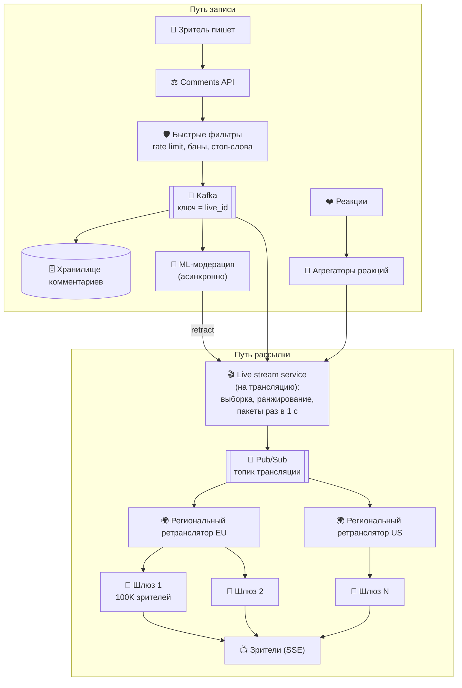
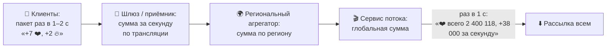
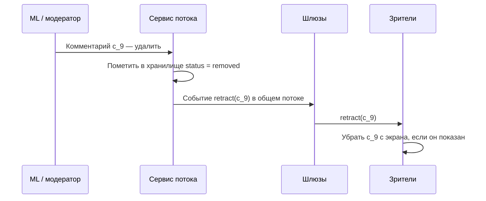

[English](README.md) | **Русский**

# Tier 2 · 4A · 03. Живые комментарии и реакции

> **Уровень:** Medium · **Время на интервью:** 45 мин · **Время на разбор:** ~4 ч
> **Ключевые аспекты:** fan-out на миллионы зрителей одной трансляции, иерархическая рассылка pub/sub, сэмплирование и ранжирование комментариев, агрегация реакций, путь записи и горячие партиции, модерация, ветки ответов, SSE против WebSocket, синхронизация комментариев с видео после эфира
> **Опирается на:** [12-communication](../../../12-communication/README_RU.md#7-сервер--клиент-polling-long-polling-sse-websocket), [Tier 1 · 07 News Feed](../../../tier-1/07-news-feed/README_RU.md#7-deep-dive-1-fan-out-на-запись-на-чтение-и-гибрид), [Tier 1 · 16 Top-K](../../../tier-1/16-top-k-leaderboard/README_RU.md#9-deep-dive-4-горячие-ключи), [Tier 1 · 02 Rate Limiter](../../../tier-1/02-rate-limiter/README_RU.md), [Tier 1 · 06 Chat](../../../tier-1/06-chat-system/README_RU.md)

---

## 🗺️ Как читать этот разбор

Разбор построен как интервью, но в каждом шаге есть объяснения: **почему** принимается решение, **как работает** механизм и **что будет**, если сделать иначе. Блоки «📘 Объяснение» — теория прямо по ходу задачи.

| Значок | Что значит |
|:------:|:-----------|
| 🎤 | Реплика интервьюера |
| 🗣️ | Что говорю вслух я (кандидат) |
| ✏️ | Что рисую на доске |
| ⏱️ | Сколько времени тратить на шаг |
| 📘 | Подробное объяснение концепции |

Блоки **TIP** — хороший приём, **WARNING** — ловушка, **IMPORTANT** — сигнал для уровня Senior+.

---

## 📑 Содержание

0. [Чему учит эта задача](#0-чему-учит-эта-задача)
1. [Условие задачи](#1-условие-задачи)
2. [Уточняющие вопросы и требования](#2-уточняющие-вопросы-и-требования)
3. [Оценки нагрузки](#3-оценки-нагрузки)
4. [API](#4-api)
5. [Модель данных](#5-модель-данных)
6. [High-level дизайн](#6-high-level-дизайн)
7. [Deep dive 1: иерархическая рассылка](#7-deep-dive-1-иерархическая-рассылка)
8. [Deep dive 2: сэмплирование и ранжирование комментариев](#8-deep-dive-2-сэмплирование-и-ранжирование-комментариев)
9. [Deep dive 3: агрегация реакций](#9-deep-dive-3-агрегация-реакций)
10. [Deep dive 4: путь записи и горячие партиции](#10-deep-dive-4-путь-записи-и-горячие-партиции)
11. [Deep dive 5: модерация и спам](#11-deep-dive-5-модерация-и-спам)
12. [Deep dive 6: ветки ответов под постами](#12-deep-dive-6-ветки-ответов-под-постами)
13. [Deep dive 7: соединения, подключение посреди эфира и порядок](#13-deep-dive-7-соединения-подключение-посреди-эфира-и-порядок)
14. [Deep dive 8: комментарии после эфира](#14-deep-dive-8-комментарии-после-эфира)
15. [Узкие места и сценарии сбоев](#15-узкие-места-и-сценарии-сбоев)
16. [Что изменится при росте в 10 раз](#16-что-изменится-при-росте-в-10-раз)
17. [Ключевые концепции и новые понятия](#17-ключевые-концепции-и-новые-понятия)
18. [Варианты задачи и follow-up вопросы](#18-варианты-задачи-и-follow-up-вопросы)
19. [Типичные ошибки](#19-типичные-ошибки)
20. [Шпаргалка и самопроверка](#20-шпаргалка-и-самопроверка)

---

## 0. Чему учит эта задача

Живые комментарии под трансляцией (Facebook Live, YouTube Live, Twitch) похожи на групповой чат — но с группой в **миллионы** человек. Это меняет всё: доставить каждый комментарий каждому зрителю невозможно ни технически, ни по смыслу — человек не прочитает 50 000 сообщений в секунду.

| Что проверяют | Где это в задаче |
|:--------------|:-----------------|
| Fan-out на экстремальном масштабе | Один источник → миллионы получателей |
| Иерархическая рассылка | Несколько уровней pub/sub вместо прямой отправки |
| Продуктовые компромиссы | Показывать не всё, а выборку — какую |
| Агрегация вместо событий | Реакции как счётчики, а не миллион отдельных сообщений |
| Горячие ключи | Одна трансляция — одна точка записи |
| Модерация в реальном времени | Удалить комментарий у миллионов зрителей |

> [!TIP]
> Главная мысль: **поток чтения нужно ограничить сверху, а не пытаться доставить всё**. Сначала покажи расчёт, почему «каждый комментарий каждому» невозможен, — и интервьюер увидит, что ты понимаешь суть задачи.

---

## 1. Условие задачи

> 🎤 «Спроектируй живые комментарии и реакции для видеотрансляций: зрители пишут комментарии и ставят реакции, и все зрители видят новые комментарии и летящие сердечки почти в реальном времени. Учти трансляции с миллионами зрителей. Отдельно — комментарии с ветками ответов под обычными постами».

**Что видит зритель:**

```
Трансляция финала чемпионата, 8 миллионов зрителей
  Лента комментариев справа обновляется каждые доли секунды — читаемым темпом
  Комментарии друзей выделены и показываются всегда
  Летят сердечки и «огоньки», счётчик: «❤️ 2,4 млн»
  Ведущий удалил оскорбительный комментарий — он исчез у всех
```

**План по времени:**

| Шаг | ⏱️ |
|:----|:--:|
| Требования | 4 мин |
| Оценки | 4 мин |
| API и данные | 5 мин |
| High-level дизайн | 6 мин |
| Deep dives | 22 мин |
| Итоги | 4 мин |

---

## 2. Уточняющие вопросы и требования

⏱️ 4 мин

| Мой вопрос | Ответ интервьюера | Что это меняет и почему |
|:-----------|:------------------|:------------------------|
| Сколько зрителей у одной трансляции? | Обычно сотни–тысячи, рекорды — 10M | Дизайн под длинный хвост и под экстремальные пики |
| Сколько комментариев в секунду? | До ~50 000 в секунду на вирусной трансляции | Показывать всё невозможно — выборка |
| Реакции? | До ~1M реакций в секунду | Только агрегированные счётчики |
| Задержка? | 1–2 секунды | Можно пакетировать по времени |
| Нужен ли строгий порядок? | Нет, примерный по времени | Без глобальной упорядоченности |
| Должен ли каждый видеть все комментарии? | Нет, но друзья и важные — да | Сэмплирование с приоритетами |
| Хранить комментарии? | Да, для просмотра после эфира | Синхронизация с временем видео |
| Модерация? | Фильтры, удаление ведущим, бан, медленный режим | Отзыв комментариев в реальном времени |

### Функциональные требования

1. Публикация комментариев и реакций во время трансляции.
2. Доставка новых комментариев и счётчиков реакций всем зрителям в реальном времени.
3. Приоритет комментариев друзей и важных участников.
4. Модерация: фильтры, удаление, бан, медленный режим.
5. Просмотр комментариев после эфира синхронно с видео.
6. Под постами — ветки ответов, лайки комментариев, сортировка.

### Нефункциональные требования

| Требование | Цель | Почему |
|:-----------|:-----|:-------|
| Задержка доставки | 1–2 с | Комментарии обсуждают то, что происходит сейчас |
| Масштаб | 10M зрителей одной трансляции | Крупнейшие события |
| Доступность | Сбой комментариев не влияет на видео | Видео — главное |
| Долговечность | Опубликованные комментарии сохраняются | Просмотр после эфира |
| Консистентность | Eventual, порядок примерный | Строгий порядок не нужен |

---

## 3. Оценки нагрузки

⏱️ 4 мин

```
Вирусная трансляция:  10M зрителей, 50 000 комментариев/с, 1M реакций/с

Наивный fan-out:      50 000 комментариев × 10M зрителей = 5 × 10^11 доставок в секунду ❌

С ограничением:       зритель читает ~1–3 комментария в секунду;
                      сервер отправляет пакет раз в секунду с ~10–20 комментариями
                      10M зрителей × 1 пакет/с = 10M сообщений/с — реально на сотне шлюзов

Шлюзы:                ~100 000 соединений на шлюз → ~100 шлюзов на эту трансляцию
                      каждый шлюз получает поток трансляции ОДИН раз и раздаёт своим зрителям

Реакции:              1M событий/с → агрегировать до одного числа на тип в секунду
```

### Выводы

| Вывод | Следствие для дизайна |
|:------|:----------------------|
| Доставить всё всем невозможно в 10^5 раз | Выборка: зритель получает ограниченный поток |
| Каждый шлюз должен получать поток трансляции один раз | Иерархическая рассылка |
| Реакции — миллион событий в секунду | Агрегация в счётчики на нескольких уровнях |
| Запись 50 000 комментариев/с в одну трансляцию | Горячая партиция — нужно дробить |

---

## 4. API

⏱️ 2 мин

```http
# Публикация
POST /v1/live/{live_id}/comments     { "text": "…", "client_comment_id": "…" }   → 202 { comment_id }
POST /v1/live/{live_id}/reactions    { "type": "heart" }                          → 202

# Подписка на поток (SSE или WebSocket)
GET  /v1/live/{live_id}/stream?last_event_id=…
→ event: comments   data: [{ id, author, text, ts, video_offset }, …]     ← пакет раз в ~1 с
→ event: reactions  data: { "heart": 2400118, "fire": 81022, "delta": {...} }
→ event: retract    data: { "comment_id": "…" }                            ← удалённый комментарий

# История и посты
GET  /v1/live/{live_id}/comments?from_offset=…&to_offset=…    ← после эфира
GET  /v1/posts/{post_id}/comments?sort=top&cursor=…
GET  /v1/comments/{comment_id}/replies?cursor=…
```

---

## 5. Модель данных

⏱️ 3 мин

| Данные | Ключ / схема | Хранилище | Почему |
|:-------|:-------------|:----------|:-------|
| **Комментарии трансляции** | ((live_id, minute_bucket, shard), comment_id) → author, text, video_offset, status | Wide-column (Cassandra) | Огромная запись, чтение по времени; бакеты и шарды против горячей партиции |
| **Комментарии постов** | ((post_id, bucket), comment_id) → author, text, parent_id, like_count, status | Wide-column | Ветки ответов по parent_id |
| **Реакции (счётчики)** | (target_id, type) → count | Шардированные счётчики / Redis + периодическая запись в БД | Высокая частота |
| **Реакция пользователя** (для постов) | (target_id, user_id) → type | KV | Нельзя лайкнуть дважды, можно отменить |
| **Модерация** | (live_id) → баны, фильтры, режим | БД + кэш | Проверка на каждой записи |
| **Подписки шлюзов** | live_id → множество шлюзов | Redis / память маршрутизатора | Куда рассылать поток трансляции |

---

## 6. High-level дизайн

⏱️ 6 мин



🗣️ «Два пути:
- **запись**: комментарий проходит быстрые фильтры, попадает в Kafka, сохраняется и асинхронно проверяется ML-моделью; реакции идут в агрегаторы;
- **рассылка**: для каждой активной трансляции есть **сервис потока**, который раз в секунду формирует пакет — выборку комментариев и сводку реакций — и публикует в топик трансляции; дальше **иерархия**: региональные ретрансляторы → шлюзы → зрители. Каждый уровень получает поток **один раз** и размножает его вниз».

---

## 7. Deep dive 1: иерархическая рассылка

> 🎤 «Как доставить поток одной трансляции 10 миллионам зрителей?»

### Почему не напрямую

📘 Если сервис потока сам отправляет каждому зрителю, ему нужно держать 10M соединений и делать 10M отправок в секунду — один компонент становится узким местом. Решение — **дерево рассылки**: каждый уровень размножает сообщение в 100–1 000 раз.

```
Сервис потока трансляции          1 сообщение/с
  → Pub/Sub-топик трансляции
    → ~10 региональных ретрансляторов      10 сообщений/с
      → ~100 шлюзов                        100 сообщений/с
        → 10M зрителей (100K на шлюз)      10M сообщений/с
```

### Подписка шлюзов

| Механизм | Как |
|:---------|:----|
| Зритель подключился к шлюзу и выбрал трансляцию | Шлюз проверяет: подписан ли он уже на эту трансляцию; если нет — подписывается у ретранслятора |
| Последний зритель трансляции на шлюзе ушёл | Шлюз отписывается |
| Реестр «трансляция → шлюзы» | У ретранслятора; рассылка только тем шлюзам, где есть зрители |
| Маленькие трансляции (сотни зрителей) | Та же схема, просто дерево «узкое» |

📘 **Ключевое свойство.** Нагрузка на каждый уровень пропорциональна числу **узлов ниже**, а не числу зрителей. Шлюз с 100 000 зрителей получает поток трансляции один раз и рассылает локально — это дёшево, потому что сообщение одинаковое (или почти одинаковое) для всех его зрителей.

> [!IMPORTANT]
> **Сигнал Senior+:** объяснить, что рассылка одного и того же пакета миллионам — это **multicast-задача**, и строить дерево ретрансляции, а не ставить в очередь отдельное сообщение для каждого зрителя. Это та же идея, что CDN для видео, только для потока событий.

---

## 8. Deep dive 2: сэмплирование и ранжирование комментариев

> 🎤 «50 000 комментариев в секунду. Какие из них показать зрителю?»

### Сколько показывать

📘 Человек комфортно читает 1–3 коротких комментария в секунду. Если показывать больше, лента превращается в нечитаемый поток. Поэтому сервис потока выбирает ограниченное число комментариев на пакет — например, 10–20 в секунду с плавной прокруткой.

### Какие

| Источник | Приоритет | Как |
|:---------|:----------|:----|
| **Комментарии друзей** | Всегда показывать | Персональная часть — см. ниже |
| Ведущий, модераторы, проверенные авторы | Высокий | Помечаются в общем потоке |
| Комментарии на языке зрителя | Выше | Отдельные потоки по языкам/регионам |
| Качество | Выше у длинных осмысленных, ниже у повторов и эмодзи-спама | Быстрая оценка при приёме |
| Остальные | Случайная выборка | Равномерное представление |

### Персонализация без отдельного потока на каждого

📘 Сделать отдельную выборку для каждого из 10M зрителей — это снова 10M разных сообщений на верхних уровнях. Компромисс:

| Уровень | Что общее | Что персональное |
|:--------|:----------|:-----------------|
| Общий поток | Одинаковая выборка для сегмента (язык, регион) | — |
| На шлюзе | — | Шлюз знает друзей своих зрителей (или получает «комментарии от пользователей X, Y, Z» отдельным маленьким потоком) и подмешивает их |
| Свой комментарий | — | Автор всегда видит свой комментарий сразу (локально на клиенте) |

### Управление потоком со стороны ведущего

| Инструмент | Эффект |
|:-----------|:-------|
| **Медленный режим** | Каждый зритель может писать не чаще раза в N секунд (rate limit на пользователя, см. [Tier 1 · 02](../../../tier-1/02-rate-limiter/README_RU.md)) |
| Только подписчики / только проверенные | Сужение круга авторов |
| Закрепить комментарий | Показывается всем вне выборки |

> [!TIP]
> Хорошая формулировка для интервью: «Мы проектируем не доставку всех сообщений, а **читаемый опыт**: ограниченный поток, где точно есть друзья и важные участники, а остальное — представительная выборка».

---

## 9. Deep dive 3: агрегация реакций

> 🎤 «Миллион сердечек в секунду. Как их обработать и показать?»

### Реакции — это счётчики, а не события

📘 Зрителю не нужно знать, кто именно поставил каждое сердечко. Ему нужны **общее число** и **ощущение активности** (летящие сердечки). Поэтому реакции агрегируются как можно ближе к источнику.



| Уровень | Что делает | Сколько событий выходит |
|:--------|:-----------|:------------------------|
| Клиент | Копит нажатия 1–2 с, отправляет одно сообщение «+N» | Меньше запросов |
| Приёмник | Суммирует за секунду по трансляции и типу | ~1 сообщение/с с приёмника |
| Региональный агрегатор | Суммирует приёмники региона | ~1 сообщение/с с региона |
| Сервис потока | Глобальный итог | 1 сообщение/с на трансляцию |

### Летящие сердечки

📘 Анимация не должна показывать каждую реакцию — иначе экран зальёт. Клиент получает **дельту за секунду** («+38 000 ❤️») и рисует число анимаций, пропорциональное, но ограниченное (например, логарифм от дельты, не больше 20 в секунду). Эффект «много людей реагируют» сохраняется.

### Хранение

| Решение | Почему |
|:--------|:-------|
| Итоговые счётчики — в шардированных счётчиках или Redis, периодическая запись в БД | Миллионы инкрементов в секунду в одну строку БД невозможны (см. [Tier 1 · 07](../../../tier-1/07-news-feed/README_RU.md#13-deep-dive-7-горячие-посты-и-счётчики)) |
| Реакции на трансляции не идемпотентны по пользователю | Можно жать сколько угодно — это «аплодисменты» |
| Реакции на посты (лайки) — уникальная пара (пользователь, пост) | Один лайк от человека, можно отменить |
| Точность | Небольшая потеря при сбое агрегатора допустима |

---

## 10. Deep dive 4: путь записи и горячие партиции

> 🎤 «Куда записывать 50 000 комментариев в секунду одной трансляции?»

| Проблема | Решение |
|:---------|:--------|
| Одна партиция Kafka на трансляцию (ключ = live_id) | Для вирусной трансляции — **соление ключа**: `live_id#0 … live_id#N`; сервис потока читает все части |
| Одна партиция Cassandra на трансляцию | Ключ партиции `(live_id, minute_bucket, shard)`: комментарии распределяются по минутам и N шардам |
| Повторная отправка клиентом | Идемпотентность по `client_comment_id` |
| ID комментария | Snowflake: уникален и примерно упорядочен по времени (см. [Tier 1 · 04](../../../tier-1/04-unique-id-generator/README_RU.md)) |
| Время относительно видео | `video_offset` — позиция в видео в момент комментария, для просмотра после эфира |

📘 **Почему ответ `202`.** Комментарий принят и будет сохранён, но в общий поток может и не попасть (выборка). Автор видит свой комментарий сразу локально, а остальные — если он попал в выборку.

---

## 11. Deep dive 5: модерация и спам

> 🎤 «Как не допустить оскорблений и спама — и как удалить комментарий, который уже увидели миллионы?»

### Уровни проверки

| Уровень | Что | Когда |
|:--------|:----|:------|
| **Синхронные быстрые фильтры** | Баны, медленный режим, rate limit, стоп-слова ведущего, новые аккаунты, повторы | До приёма, миллисекунды |
| **Асинхронная ML-модерация** | Токсичность, спам, ссылки | Сотни миллисекунд–секунды, параллельно с рассылкой |
| **Ручная модерация** | Ведущий и модераторы удаляют, банят | В любой момент |
| **Жалобы зрителей** | Сигнал для ML и модераторов | В любой момент |

### Отзыв комментария



| Решение | Почему |
|:--------|:-------|
| **Задержка показа подозрительных** | Комментарии с пограничной оценкой не попадают в выборку, пока ML не решит |
| **Теневое скрытие** | Автор спама видит свой комментарий, остальные — нет; спамер не сразу понимает, что его скрыли |
| Отзыв через тот же поток | Удаление доходит до всех за 1–2 с |
| Бан пользователя | Новые комментарии отклоняются на быстром фильтре; прошлые — отзываются пакетом |

---

## 12. Deep dive 6: ветки ответов под постами

> 🎤 «Под обычным постом — комментарии с ответами. Как хранить и показывать?»

### Хранение дерева

| Подход | Как | Плюсы и минусы |
|:-------|:----|:---------------|
| **Список смежности** ⭐ | Каждый комментарий хранит `parent_id`; ответы загружаются по запросу | Просто; глубокие ветки — несколько запросов (обычно ограничивают глубину 1–2 уровнями) |
| Материализованный путь | `path = "c1/c7/c42"` — вся ветка одним запросом по префиксу | Удобно для глубоких деревьев; перенос ветки сложнее |

### Показ

| Решение | Почему |
|:--------|:-------|
| Верхний уровень — постранично, по ранжированию («лучшие») | Тысячи комментариев под популярным постом |
| Ранжирование | Лайки комментария, ответы, свежесть, связь автора со зрителем (друзья выше), качество |
| Ответы — свёрнуты, «показать 24 ответа» | Загружаются по запросу |
| Счётчики ответов и лайков | Отдельные счётчики, асинхронно |

### Обновления в реальном времени

📘 Для постов не нужно рассылать каждый новый комментарий всем, кто когда-либо видел пост. Обновления получают только те, у кого **сейчас открыт** пост: клиент подписывается на `post_id` при открытии и отписывается при закрытии. Для вирусного поста — та же иерархия рассылки и выборка, что и для трансляции.

---

## 13. Deep dive 7: соединения, подключение посреди эфира и порядок

> 🎤 «SSE или WebSocket? И что видит зритель, подключившийся на 40-й минуте?»

### SSE против WebSocket

| | SSE ⭐ для зрителей | WebSocket |
|:-|:--------------------|:----------|
| Направление | Сервер → клиент | Двустороннее |
| Простота | Обычный HTTP, автоматическое переподключение с `Last-Event-ID` | Свой протокол |
| Прокси и CDN | Работает через обычную HTTP-инфраструктуру | Иногда проблемы |
| Отправка комментария | Отдельным HTTP-запросом — комментарии редки по сравнению с получением | Тем же соединением |

🗣️ «Зрители в основном **получают**, поэтому для потока достаточно **SSE**, а комментарии и реакции отправляются обычными HTTP-запросами (подробнее о выборе — [12-communication](../../../12-communication/README_RU.md#7-сервер--клиент-polling-long-polling-sse-websocket))».

### Подключение посреди эфира

| Шаг | Как |
|:----|:----|
| 1 | Загрузить последние ~50 комментариев выборки (из кэша сервиса потока) и текущие счётчики реакций |
| 2 | Подписаться на поток |
| 3 | Удалить дубли на стыке по `comment_id` |

### Переподключение

- Клиент передаёт `Last-Event-ID` — шлюз досылает пропущенные пакеты из небольшого буфера (последние секунды–минуты).
- Если пропуск большой — клиент просто продолжает с текущего момента: старые комментарии в живом эфире не важны.

### Порядок

📘 Строгий порядок не нужен: комментарии упорядочиваются по серверной временной метке (Snowflake ID) внутри пакета, а пакеты — по номеру. Небольшие перестановки между авторами незаметны и не важны.

---

## 14. Deep dive 8: комментарии после эфира

> 🎤 «Трансляция закончилась. Как показать комментарии тем, кто смотрит запись?»

| Решение | Почему |
|:--------|:-------|
| У каждого комментария — `video_offset` | Позиция в видео, когда он был написан |
| Клиент запрашивает комментарии по окнам времени видео | `from_offset=1200&to_offset=1260` — комментарии этой минуты |
| Выборка, сохранённая во время эфира | Показываем то же, что видели зрители эфира (или заново ранжируем лучшие) |
| Перемотка | Запрос нового окна |
| Удалённые модерацией | Не показываются (`status = removed`) |

---

## 15. Узкие места и сценарии сбоев

| Сценарий | Что произойдёт | Как защищаемся |
|:---------|:---------------|:---------------|
| Вирусная трансляция | Невозможный fan-out | Иерархическая рассылка, пакеты раз в секунду, выборка |
| 50 000 комментариев/с | Горячая партиция записи | Соление ключа Kafka, бакеты и шарды в хранилище |
| Миллион реакций/с | Перегрузка счётчиков | Многоуровневая агрегация |
| Сервис потока трансляции упал | Поток остановился | Резервный экземпляр, восстановление из Kafka за секунды |
| Шлюз упал | 100K зрителей переподключаются | Backoff с разбросом, другие шлюзы, SSE с `Last-Event-ID` |
| Токсичный комментарий в эфире | Увидели миллионы | Быстрые фильтры, задержка подозрительных, отзыв через поток |
| Спам-атака | Поток засорён | Rate limit, медленный режим, баны, теневое скрытие |
| Сбой комментариев | — | Видео продолжает работать: изоляция систем |

---

## 16. Что изменится при росте в 10 раз

> 🎤 «Трансляция на 100 миллионов зрителей?»

| Изменение | Почему |
|:----------|:-------|
| **Ещё один уровень ретрансляции** (edge-узлы CDN) | Дерево глубже на один уровень |
| **Поток как статичные сегменты на CDN** (пакеты комментариев как файлы, которые клиенты опрашивают) | Использовать CDN-инфраструктуру вместо постоянных соединений |
| **Только сегментные выборки**, без персонализации на шлюзах | Удешевление |
| **Реакции только как агрегаты** с ещё более грубой частотой | Нагрузка |

---

## 17. Ключевые концепции и новые понятия

### Что применяется

| Концепция | Где разобрана | Как применяется здесь |
|:----------|:--------------|:----------------------|
| SSE, WebSocket, шлюзы | [12-communication](../../../12-communication/README_RU.md) | Поток зрителям |
| Fan-out | [Tier 1 · 07](../../../tier-1/07-news-feed/README_RU.md#7-deep-dive-1-fan-out-на-запись-на-чтение-и-гибрид) | Рассылка на миллионы |
| Горячие ключи, предагрегация | [Tier 1 · 16](../../../tier-1/16-top-k-leaderboard/README_RU.md#9-deep-dive-4-горячие-ключи) | Запись и реакции |
| Rate limiting | [Tier 1 · 02](../../../tier-1/02-rate-limiter/README_RU.md) | Медленный режим, антиспам |
| Snowflake ID | [Tier 1 · 04](../../../tier-1/04-unique-id-generator/README_RU.md) | ID комментариев |

### Новые понятия этой задачи

| Понятие | Кратко |
|:--------|:-------|
| **Иерархическая рассылка** | Дерево ретрансляции: каждый уровень получает поток один раз |
| **Подписка шлюза на трансляцию** | Шлюз подписывается один раз за всех своих зрителей |
| **Сэмплирование комментариев** | Ограниченная выборка с приоритетами вместо всего потока |
| **Медленный режим** | Ограничение частоты комментариев на пользователя |
| **Многоуровневая агрегация реакций** | Клиент → приёмник → регион → глобально |
| **Отзыв (retract)** | Событие удаления, рассылаемое тем же потоком |
| **Теневое скрытие** | Комментарий виден только автору |
| **video_offset** | Позиция в видео для показа комментариев в записи |

---

## 18. Варианты задачи и follow-up вопросы

<details>
<summary><b>Чем это отличается от группового чата (#6 Tier 1)?</b></summary>

В чате группа до ~1 000 человек, и каждый должен получить каждое сообщение с гарантией доставки и строгим порядком. Здесь — миллионы зрителей, ни гарантии доставки каждого комментария, ни строгого порядка не требуется, зато нужны выборка, иерархическая рассылка и агрегация.
</details>

<details>
<summary><b>Как показать «Анна и ещё 3 друга отреагировали»?</b></summary>

Для каждого зрителя это персональные данные: реакции его друзей. Для трансляции — подмешивать на шлюзе небольшой поток «реакции пользователей из списка друзей» (как комментарии друзей). Для поста — при загрузке проверять реакции небольшого набора близких друзей по таблице (target_id, user_id).
</details>

<details>
<summary><b>Как работает «закрепить комментарий»?</b></summary>

Ведущий отмечает комментарий; сервис потока включает его в каждый пакет как отдельное поле «закреплённый» (вне выборки), и подключающиеся зрители получают его вместе с начальными данными.
</details>

<details>
<summary><b>Как провести опрос во время трансляции?</b></summary>

Опрос — отдельный объект: голос пользователя — уникальная пара (опрос, пользователь), итоги — агрегированные счётчики, рассылаемые тем же потоком раз в секунду, как реакции.
</details>

<details>
<summary><b>Почему не отправлять каждый комментарий как отдельное push-уведомление?</b></summary>

Push-уведомления — для событий вне приложения, с задержками в секунды и лимитами провайдеров. Для потока внутри открытой трансляции нужен постоянный канал (SSE/WebSocket) с пакетами раз в секунду.
</details>

---

## 19. Типичные ошибки

| ❌ Ошибка | Почему плохо | ✅ Как правильно |
|:---------|:-------------|:----------------|
| Доставлять каждый комментарий каждому зрителю | 5 × 10^11 доставок в секунду | Выборка и пакеты раз в секунду |
| Сервис потока отправляет зрителям напрямую | Узкое место | Иерархия ретрансляторов и шлюзов |
| Отдельная выборка для каждого зрителя на верхних уровнях | Снова миллионы разных сообщений | Сегментные потоки + персонализация на шлюзе |
| Каждая реакция — отдельное событие до клиентов | Миллион сообщений в секунду на зрителя | Многоуровневая агрегация |
| Одна партиция на трансляцию | Горячая точка записи | Соление ключа, бакеты |
| Только асинхронная модерация | Оскорбления успевают показаться | Быстрые фильтры + задержка подозрительных |
| Удаление только в базе | Комментарий остаётся на экранах | Событие retract в потоке |
| WebSocket там, где хватает SSE | Лишняя сложность | SSE для получения, HTTP для отправки |
| Требовать строгий порядок | Дорого и не нужно | Примерный порядок по Snowflake |
| Сбой комментариев ломает видео | Плохой опыт | Изоляция систем |

---

## 20. Шпаргалка и самопроверка

### Ответ за 30 секунд

> Доставить 50 000 комментариев в секунду 10 миллионам зрителей невозможно (5 × 10^11 доставок) и бессмысленно — человек читает 1–3 в секунду. Поэтому: запись через быстрые фильтры (баны, медленный режим, rate limit) в Kafka с солёным ключом трансляции и хранилище с бакетами `(live_id, minute, shard)`; ML-модерация асинхронно. Для каждой трансляции сервис потока раз в секунду формирует пакет: выборка комментариев (друзья, ведущий, язык, качество, случайная часть) + сводка реакций + события отзыва — и публикует в топик; дальше иерархия ретрансляторов и шлюзов, каждый уровень получает поток один раз, шлюзы подмешивают комментарии друзей и раздают зрителям по SSE. Реакции агрегируются на клиенте, приёмнике, в регионе и глобально; анимация — пропорционально дельте с ограничением. Отзыв комментария — событием в том же потоке. Подключение посреди эфира — последние N комментариев + подписка, переподключение по `Last-Event-ID`. После эфира — комментарии по `video_offset`. Под постами — список смежности, ранжирование верхнего уровня, ответы по запросу, обновления только для открывших пост.

### Самопроверка

- [ ] Могу посчитать, почему наивный fan-out невозможен
- [ ] Могу нарисовать дерево ретрансляции и объяснить подписку шлюзов
- [ ] Могу описать выборку комментариев и приоритеты
- [ ] Могу объяснить персонализацию без отдельного потока на зрителя
- [ ] Могу спроектировать многоуровневую агрегацию реакций
- [ ] Могу решить проблему горячей партиции записи
- [ ] Могу описать уровни модерации и отзыв комментария
- [ ] Могу спроектировать ветки ответов под постами
- [ ] Могу обосновать SSE и описать подключение посреди эфира
- [ ] Могу объяснить показ комментариев в записи

### Что почитать

- LinkedIn Engineering, статьи о live-видео и real-time доставке (SSE, Play/Akka)
- Facebook Engineering, статьи о Facebook Live и масштабировании real-time доставки
- Twitch Engineering, статьи о масштабировании чата
- Тема [12-communication](../../../12-communication/README_RU.md) — выбор SSE и WebSocket
