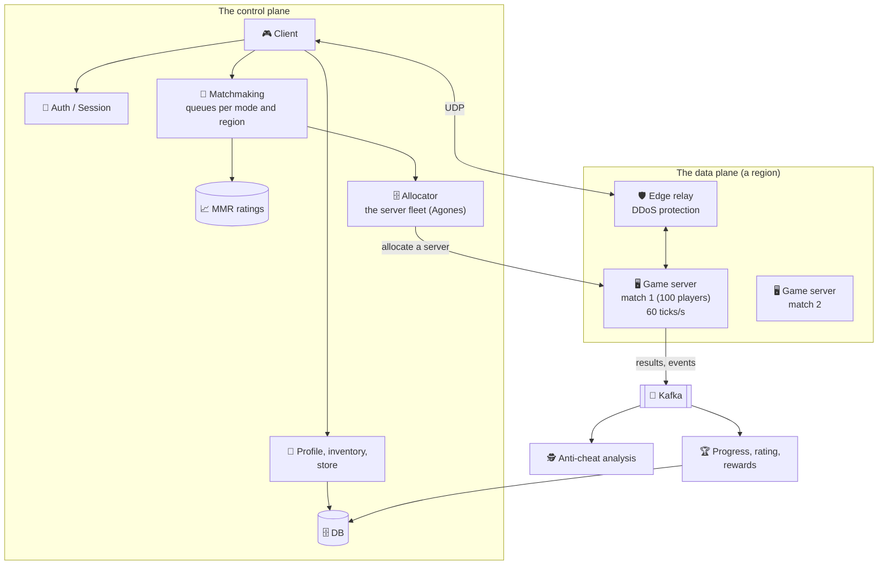
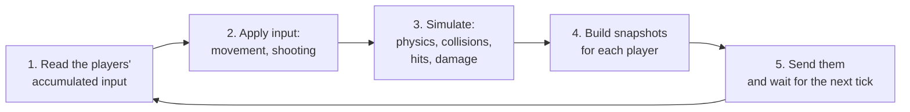
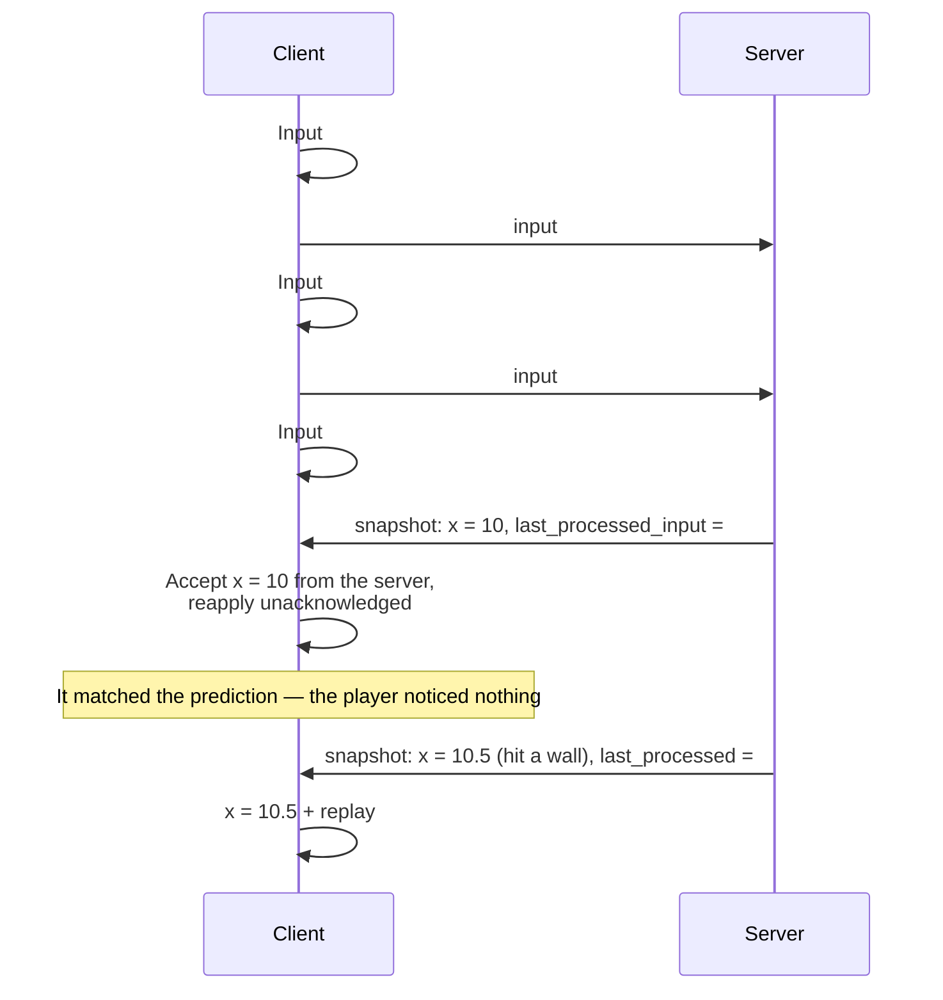
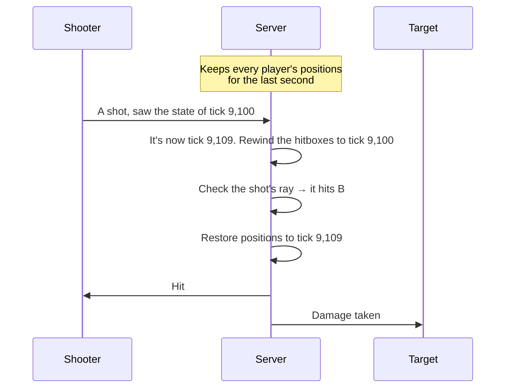
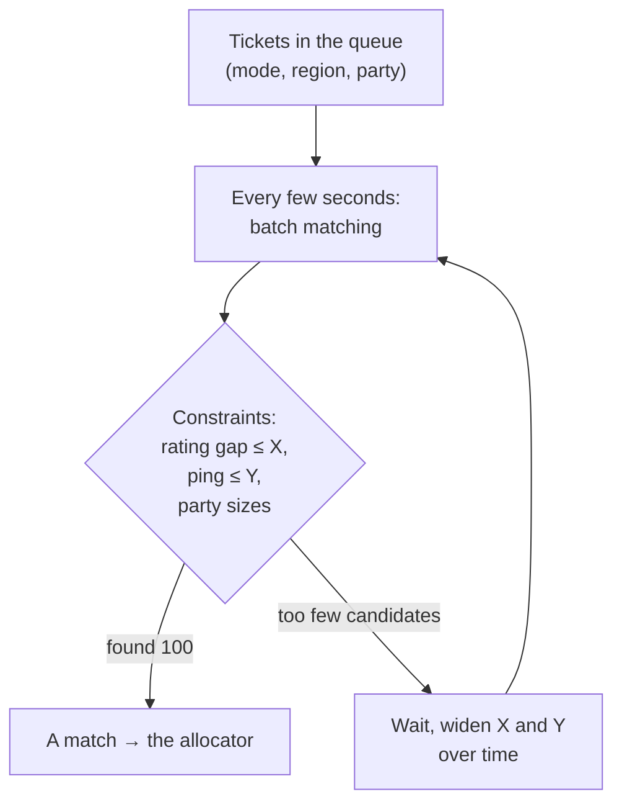

**English** | [Русский](README_RU.md)

# Tier 2 · 4A · 04. Multiplayer Game Backend

> **Level:** Hard · **Interview time:** 45–60 min · **Study time:** ~5–6 h
> **Key aspects:** an authoritative server and the tick model, UDP and state compression, client-side prediction and reconciliation, interpolating other players, lag compensation (server-side rewind), interest management, matchmaking and ratings (Elo, Glicko, TrueSkill), the game server fleet, anti-cheat, saving progress
> **Builds on:** [12-communication](../../../12-communication/README.md), [13-reliability-patterns](../../../13-reliability-patterns/README.md), [Tier 1 · 11 Uber](../../../tier-1/11-uber/README.md#10-deep-dive-4-matching-and-ride-offers) (batch matching, geo), [Tier 1 · 16 Top-K](../../../tier-1/16-top-k-leaderboard/README.md#12-deep-dive-7-a-game-leaderboard-on-redis) (leaderboards)

---

## 🗺️ How to Read This Walkthrough

The walkthrough follows an interview, but every step includes explanations: **why** a decision is made, **how** a mechanism works and **what happens** if you do it differently. The "📘 Explanation" blocks are theory right where you need it.

| Icon | Meaning |
|:----:|:--------|
| 🎤 | Interviewer |
| 🗣️ | What I (the candidate) say out loud |
| ✏️ | What I draw on the whiteboard |
| ⏱️ | Time budget for the step |
| 📘 | A detailed explanation of a concept |

Callouts: **TIP** — a good technique, **WARNING** — a trap, **IMPORTANT** — a Senior+ signal.

---

## 📑 Contents

0. [What This Problem Teaches](#0-what-this-problem-teaches)
1. [Problem Statement](#1-problem-statement)
2. [Clarifying Questions and Requirements](#2-clarifying-questions-and-requirements)
3. [Capacity Estimates](#3-capacity-estimates)
4. [Protocols](#4-protocols)
5. [Data Model](#5-data-model)
6. [High-Level Design](#6-high-level-design)
7. [Deep Dive 1: The Authoritative Server and the Tick Model](#7-deep-dive-1-the-authoritative-server-and-the-tick-model)
8. [Deep Dive 2: Networking: UDP and Sending State](#8-deep-dive-2-networking-udp-and-sending-state)
9. [Deep Dive 3: Client-Side Prediction and Reconciliation](#9-deep-dive-3-client-side-prediction-and-reconciliation)
10. [Deep Dive 4: Interpolating Other Players](#10-deep-dive-4-interpolating-other-players)
11. [Deep Dive 5: Lag Compensation](#11-deep-dive-5-lag-compensation)
12. [Deep Dive 6: Interest Management](#12-deep-dive-6-interest-management)
13. [Deep Dive 7: Matchmaking and Ratings](#13-deep-dive-7-matchmaking-and-ratings)
14. [Deep Dive 8: The Server Fleet, Anti-Cheat and Progress](#14-deep-dive-8-the-server-fleet-anti-cheat-and-progress)
15. [Bottlenecks and Failure Scenarios](#15-bottlenecks-and-failure-scenarios)
16. [What Changes at 10x Scale](#16-what-changes-at-10x-scale)
17. [Key Concepts and New Terms](#17-key-concepts-and-new-terms)
18. [Variations and Follow-Up Questions](#18-variations-and-follow-up-questions)
19. [Common Mistakes](#19-common-mistakes)
20. [Cheat Sheet and Self-Check](#20-cheat-sheet-and-self-check)

---

## 0. What This Problem Teaches

A real-time multiplayer game is a problem where **network latency can't be hidden**: light takes tens of milliseconds for a round trip from Warsaw to New York, yet the player needs their character to respond to a button instantly, and a shot to land where they aimed. The solution is a set of techniques that create the **illusion** of an instant shared world.

| What's tested | Where it shows up |
|:--------------|:------------------|
| A trust model | An authoritative server — we don't trust the client |
| Dealing with latency | Prediction, interpolation, lag compensation |
| Network protocols | UDP, custom reliability, delta compression |
| Spatial filtering | Sending a player only what's nearby |
| Matching algorithms | Matchmaking by skill and ping, ratings |
| Orchestration | A fleet of dedicated match servers |
| Security | Anti-cheat |

> [!TIP]
> This problem has **two distinct systems**: **the control plane** (login, matchmaking, profile, inventory — ordinary services, HTTP, databases) and **the data plane** (the match's game server — UDP, 60 ticks per second, everything in memory). Name that split right away — it structures the whole conversation.

---

## 1. Problem Statement

> 🎤 "Design the backend for an online battle royale shooter: 100 players per match, fast-paced gameplay, millions of players online, skill-based matchmaking, protection against cheaters."

**What the player sees:**

```
Clicks "Play" → within 30–60 seconds, a match with 99 opponents of similar skill
The character moves the instant a key is pressed, with no "sluggishness"
Shoots at an enemy — the hit counts if the crosshair was on them on the shooter's screen
At 40 ms ping the game feels instant; a cheater with an "aimbot" gets banned
```

**Time plan:**

| Step | ⏱️ |
|:-----|:--:|
| Requirements | 5 min |
| Estimates | 3 min |
| Protocols and data | 4 min |
| High-level design | 6 min |
| Deep dives | 25–30 min |
| Wrap-up | 3 min |

---

## 2. Clarifying Questions and Requirements

⏱️ 5 min

| My question | Interviewer's answer | What it changes and why |
|:------------|:---------------------|:------------------------|
| What kind of game? | A shooter, battle royale, 100 players per match | Fast reactions, precise shooting, a large map |
| How many players online? | ~10M concurrently | ~100,000 concurrent matches |
| What latency is acceptable? | Comfortable up to ~100 ms ping | Servers in regions, close to players |
| Update rate? | 30–60 ticks per second | A tick model, UDP |
| Matchmaking? | By skill, ping, party size; waits up to ~1 min | Matchmaking with widening criteria |
| Cheaters? | A big problem | An authoritative server, server-side checks, anti-cheat |
| Progress, inventory? | Saved between matches | Separate services with a DB |
| Platforms? | PC, consoles, mobile; cross-play | Different networks, mobile latency |

### Functional requirements

1. Login, profiles, friends, parties.
2. Matchmaking by mode, skill, ping and party size.
3. 100-player matches synchronized in real time.
4. Reconnecting to a match after a drop.
5. Match results: stats, rating, rewards, inventory.
6. Detecting and punishing cheaters.

### Non-functional requirements

| Requirement | Target | Why |
|:------------|:-------|:----|
| Responsiveness | Your own actions — instant, without waiting for the server | Otherwise the game is unplayable |
| Latency to the server | ≤ ~100 ms RTT | A sense of fair play |
| Fairness | Hits count based on what the shooter saw | Players' top complaint — "but I hit him" |
| Anti-cheat | The server doesn't accept impossible actions | Cheaters kill games |
| Scale | 10M concurrent, with peaks on weekends and at updates | A server fleet, autoscaling |
| Failure isolation | A match server crash doesn't affect others | One match — one process |

---

## 3. Capacity Estimates

⏱️ 3 min

```
Concurrent:          10M players / 100 per match = 100,000 matches

A match server:      1–2 cores per 100-player match at 30–60 ticks
                     → 100,000–200,000 cores across all regions

Server traffic:      a ~500 B state snapshot (delta, compressed) × 60 per second × 100 players
                     ≈ 3 MB/s per match
                     × 100,000 matches ≈ 300 GB/s ≈ 2.4 Tbit/s across all regions
Client traffic:      ~50 B of input × 60 per second — small

The control plane:   matchmaking — thousands of tickets per second; profiles, inventory — ordinary loads
```

### Conclusions

| Conclusion | Design consequence |
|:-----------|:-------------------|
| Match servers are the main load | A fleet of dedicated servers with orchestration and autoscaling |
| Traffic is terabits per second | Delta compression, interest management, servers close to players |
| Each match is independent | Horizontal scaling without coordination between matches |
| The control plane is ordinary services | Standard solutions: HTTP, databases, caches |

---

## 4. Protocols

⏱️ 2 min

### The control plane (HTTP / gRPC)

```http
POST /v1/auth/login
POST /v1/parties                 { members }
POST /v1/matchmaking/tickets     { mode: "br_squads", party_id, region_pings: { "eu-west": 32, "eu-central": 41 } }
GET  /v1/matchmaking/tickets/{id} → { status: "matched", server: "203.0.113.7:7777", token: "…" }
GET  /v1/players/{id}/profile, /inventory, /stats
```

### The data plane (UDP, a custom protocol)

```
Client → server (60 times a second):
  { seq: 18231, tick: 9120, inputs: [ the last 3 inputs: buttons, direction, aim ], ack_snapshot: 9118 }

Server → client (30–60 times a second):
  { tick: 9121, last_processed_input: 18229, baseline: 9118,
    entities: [ deltas against the baseline: positions, health, animations ] }

A reliable channel (on top of UDP, with acknowledgments): "killed", "picked up an item", chat
```

---

## 5. Data Model

⏱️ 2 min

| Data | Where | Why |
|:-----|:------|:----|
| Accounts, profiles, friends | A relational DB + cache | Ordinary data |
| Rating (MMR) per mode | A DB + a cache for matchmaking | Read on every ticket |
| Inventory, currency | A transactional DB | Money and purchases — strong consistency |
| Match results | Kafka → storage and analytics | Stats, anti-cheat, rating |
| **Match state** | **Only in the game server's memory** | 60 changes per second, valuable only during the match |
| Replays | Object storage | Recording inputs and snapshots for reviews and anti-cheat |

---

## 6. High-Level Design

⏱️ 6 min



🗣️ "Two systems:
- **the control plane**: login, matchmaking, profile and inventory — ordinary services with databases; matchmaking gathers 100 players and requests a ready game server from **the allocator**;
- **the data plane**: **a dedicated game server** per match, in a region close to the players; clients connect over UDP through an edge relay; the server simulates the world 60 times a second and at the end of the match sends results to Kafka — then come rating, rewards and anti-cheat analysis."

---

## 7. Deep Dive 1: The Authoritative Server and the Tick Model

> 🎤 "Why not let clients report their own positions and hits?"

### The authoritative server

📘 **Never trust the client**: the client is a program on the player's computer and can be modified. If the client reports "I'm here" and "I hit", a cheater will write "I teleported" and "I hit everyone". So:

| The client sends | The server decides |
|:-----------------|:-------------------|
| **Input**: buttons pressed, view direction | Where the character actually is |
| "Fired in direction X" | Whether it hit and how much damage it did |
| "I want to pick up an item" | Whether it can be picked up |

### The tick model

📘 The server runs **a simulation loop** at a fixed rate — **ticks**. At 60 ticks per second, one tick is 16.7 ms:



| Tick rate | Pros | Cons |
|:----------|:-----|:-----|
| 20–30 | Cheaper in CPU and traffic | Less precise, more noticeable reaction delay |
| 60–128 | More precise shooting, faster reactions | Several times more expensive |

### An alternative: deterministic lockstep

| | Client-server with snapshots ⭐ | Deterministic lockstep |
|:-|:--------------------------------|:-----------------------|
| What's sent | Input from clients, state from the server | Only input; each client simulates everything itself |
| Requirement | — | Fully deterministic simulation on every device |
| Latency | Determined by your own ping | Determined by the slowest player |
| Where | Shooters, battle royales | Strategy games with thousands of units (sending each unit's state is expensive) |
| Anti-cheat | The server is authoritative | Every client knows the whole state |

---

## 8. Deep Dive 2: Networking: UDP and Sending State

> 🎤 "Why UDP rather than TCP?"

### TCP versus UDP

📘 TCP guarantees **in-order** delivery: if a packet is lost, all following ones wait for its retransmission (head-of-line blocking). That's bad for a game: a state snapshot from 50 milliseconds ago is already useless — you need a fresh one. Better to lose the old packet and get the new one right away.

| | TCP | UDP + a custom protocol ⭐ |
|:-|:----|:---------------------------|
| A lost packet | Delays every following packet until retransmission | The packet is just skipped; the next one arrives immediately |
| Reliability | For everything | Only for what needs it (events); the rest is "the freshest" |
| Where in the game | The control plane, chat, downloads | Gameplay |

### Not losing what matters

| Data type | How it's sent |
|:----------|:--------------|
| **Client input** | Each packet contains **the last 3–5 inputs** — losing one packet doesn't lose input |
| **State snapshots** | Unreliably: if one is lost, the next arrives |
| **Important events** (a kill, picking up an item) | A reliable channel on top of UDP: numbering, acknowledgments, resends |

### Compressing snapshots

| Technique | Effect |
|:----------|:-------|
| **A delta against the acknowledged snapshot** | Send only changes since the last snapshot the client acknowledged (`baseline`) |
| **Quantization** | A position precise to a centimeter in 16 bits instead of a 32-bit float; angles in 8–12 bits |
| **Only what's visible** | Interest management (deep dive 6) |
| **Varying frequency** | Distant objects — less often |

📘 **Why a delta against the acknowledged snapshot.** If you compute the delta against the previously sent snapshot and it was lost, the client can't apply the next delta. A delta against a snapshot the client **acknowledged** is always applicable.

---

## 9. Deep Dive 3: Client-Side Prediction and Reconciliation

> 🎤 "Ping is 80 ms. If you wait for the server's response, the character will move with a delay. What do you do?"

### Prediction

📘 The client applies its input to its own character **immediately** — using the same movement logic as the server. The player sees an instant response. The server gets the input 40 ms later and computes the same thing — in most cases the result matches.

### Reconciliation

📘 Sometimes the prediction doesn't match the server (a collision with another player the client didn't account for, or a lost packet). Then the client must accept the server's **authoritative** state without losing the input made after it.



| Element | Why |
|:--------|:----|
| An input number | The server reports which input it processed last |
| A history of unacknowledged inputs on the client | To reapply them on top of the server's state |
| Smooth correction | Small discrepancies are fixed over a few frames rather than with a jump |

> [!IMPORTANT]
> **Senior+ signal:** explain that the client lives **in three times** at once: its own character in the "future" (prediction), other players in the "past" (interpolation, deep dive 4), and the server in the "present". Lag compensation (deep dive 5) is needed precisely because these times differ.

---

## 10. Deep Dive 4: Interpolating Other Players

> 🎤 "And how do you show other players? The client doesn't know their input."

📘 Other players' positions arrive in snapshots 30–60 times a second, with jitter. Drawing them "as they arrive" makes movement choppy. The fix — **draw other players slightly in the past** (e.g. 100 ms) and **interpolate** between two received snapshots:

```
Snapshots arrived:  tick 100 (x = 0), tick 103 (x = 3), tick 106 (x = 6) …
The client draws the moment "now − 100 ms", which falls between ticks 103 and 106
→ position = a smooth interpolation between x = 3 and x = 6
```

| Decision | Why |
|:---------|:----|
| An interpolation buffer of ~2 snapshots | A lost packet doesn't cause a jump |
| Extrapolation (dead reckoning) if snapshots stop arriving | Keep moving at the last velocity for a short time, then stop |
| The cost | The player sees others with a "ping + buffer" delay — which is what lag compensation solves |

---

## 11. Deep Dive 5: Lag Compensation

> 🎤 "A player aimed at an enemy and fired. But on the server the enemy has already moved. Does the hit count?"

### The problem

```
The shooter's delay: 50 ms to the server + a 100 ms interpolation buffer
→ the shooter sees the enemy where they were ~150 ms ago

If the server checks the hit against the enemy's CURRENT position — a miss,
even though the shooter's crosshair was right on the enemy on their screen. "But I hit him!"
```

### The fix: server-side rewind

📘 The server keeps **a history of positions** for every player over the last second (per tick). When a shot arrives, the server:

1. Computes **which moment the shooter saw**: the send time − their latency − the interpolation buffer.
2. **Rewinds** every player's hitboxes to that moment.
3. Checks for a hit.
4. Moves everyone back.



### The trade-off

| Good for | Bad for |
|:---------|:--------|
| The shooter: they hit where they aimed | The target: they may take damage after already hiding behind a wall on their screen ("I got killed around the corner") |

| Decision | Why |
|:---------|:----|
| **Cap the rewind** (e.g. at 200–250 ms) | A player with huge ping can't shoot too far "into the past" |
| Account for confidence | Less compensation at very high ping |
| Matchmaking by ping | A smaller time gap between players |

---

## 12. Deep Dive 6: Interest Management

> 🎤 "100 players on a huge map. Do you send each one the state of all 99 others?"

📘 **Interest management** means sending a player only what matters to them: objects **nearby** and **in view**.

| Decision | How |
|:---------|:----|
| A spatial grid | The map is divided into cells; a player receives objects from their cell and the neighboring ones (the same idea as the geo index in [Uber](../../../tier-1/11-uber/README.md#8-deep-dive-2-geospatial-indexes)) |
| Priority by distance | Nearby objects — every tick, distant ones — less often |
| A visibility check | An enemy behind a hill isn't sent at all |
| A per-snapshot budget | With many objects, the most important first |

| Effect | Why it matters |
|:-------|:---------------|
| **Traffic** drops several-fold | Terabits per second across the fleet |
| Less **CPU** spent building snapshots | More matches per server |
| **Anti-cheat**: a "wallhack" is useless | The client doesn't know about an enemy it shouldn't see — there's nothing to highlight |

### Worlds with thousands of players (MMOs)

For an MMO, one server can't hold the world: the world is split into **zones** with separate servers, and when a player crosses a boundary they're handed off between servers. Near a zone boundary, neighboring servers exchange state so players can see each other across it.

---

## 13. Deep Dive 7: Matchmaking and Ratings

> 🎤 "How do you find 100 players of similar skill with good ping within a minute?"

### A rating: Elo

📘 **Elo** rates skill with a single number. The expected score of player A against B:

```
E_A = 1 / (1 + 10^((R_B − R_A) / 400))

R_A = 1,600, R_B = 1,400:
  E_A = 1 / (1 + 10^(−0.5)) ≈ 0.76     (A should win 76% of the time)

A won, with K = 32:
  R_A' = 1,600 + 32 × (1 − 0.76) ≈ 1,607.7
  R_B' = 1,400 + 32 × (0 − 0.24) ≈ 1,392.3
Beating a weaker player gains few points; beating a stronger one gains many.
```

| System | Characteristic |
|:-------|:---------------|
| **Elo** | One number; for one-on-one games |
| **Glicko-2** | Adds rating **uncertainty**: large for a newcomer, so their rating moves quickly |
| **TrueSkill** (Microsoft) | Team games and games with many participants; a mean and an uncertainty of skill |

For a battle royale, the rating is updated by placement and contribution rather than "win/loss".

### Matching



| Principle | Why |
|:----------|:----|
| **Queues per mode and region** | A player in Europe doesn't play on a server in Asia |
| **Batch matching** every few seconds | A better distribution than "first fit" (like batch matching in [Uber](../../../tier-1/11-uber/README.md#10-deep-dive-4-matching-and-ride-offers)) |
| **Widening the window over time** | Strict on skill and ping at first; if the wait grows, relax the constraints |
| Parties | A party is treated as one ticket; its rating is e.g. a weighted average adjusted for the strongest member |
| The quality vs wait trade-off | A perfect match in 5 minutes is worse than a good one in 40 seconds |
| Off-the-shelf options | Google Open Match — an open-source matchmaking framework |

---

## 14. Deep Dive 8: The Server Fleet, Anti-Cheat and Progress

> 🎤 "Where do game servers come from, what happens when they crash, and how do you catch cheaters?"

### A fleet of dedicated servers

| Decision | Why |
|:---------|:----|
| **A process per match** | A crash affects one match; simple scaling |
| **A pool of "warm" servers** | Starting a process and loading the map takes seconds; a ready server is allocated instantly |
| **Orchestration** (Agones on Kubernetes, or a custom allocator) | Tracking server states: ready, allocated, in a match, shutting down |
| **Autoscaling** by queues and time of day | There are several times more players in the evenings and on weekends |
| **Placement by ping** | The region is chosen by the match's players' measured ping |
| **Edge relays** | Clients don't know the game server's real IP — protection against DDoS on a specific match |

### Failures

| Failure | Solution |
|:--------|:---------|
| A player lost connection | The character stays in the world; reconnecting to the same server by token within a window (e.g. 2 minutes) |
| A game server crashed | The match is usually lost (state lives only in memory); players get compensation, ratings don't change |
| The allocator or matchmaking is unavailable | Running matches continue (the data plane is independent); new matches are temporarily not created |

### Anti-cheat

| Level | What it does |
|:------|:-------------|
| **The authoritative server** | You can't teleport, move faster than allowed, or fire faster than the weapon |
| **Input validation** | Aim turn speed, fire rate, physically impossible sequences |
| **Information hiding** | Interest management: the client gets no data about invisible enemies |
| **Client-side anti-cheat** | Detecting modified clients and third-party programs (including at the OS kernel level) |
| **Statistical analysis** | Anomalous accuracy, faster-than-human reactions — from Kafka data and replays |
| **Delayed ban waves** | Ban in batches with a delay, so cheat developers can't tell exactly what was detected |
| **Replays for reviews** | Recording a match's inputs and snapshots |

### Progress and inventory

| Decision | Why |
|:---------|:----|
| Match results → an event in Kafka | The game server doesn't depend on database availability |
| Granting rewards idempotently by `match_id` | A repeated event doesn't grant a reward twice |
| Inventory and purchases — a transactional DB | Money; the same approach as in the [payment system](../../../tier-1/20-payment-system/README.md) |
| Leaderboards | Sorted sets (see [Tier 1 · 16](../../../tier-1/16-top-k-leaderboard/README.md#12-deep-dive-7-a-game-leaderboard-on-redis)) |

---

## 15. Bottlenecks and Failure Scenarios

| Scenario | What happens | How we protect |
|:---------|:-------------|:---------------|
| The client sends "I'm here" | Teleport cheats | An authoritative server, input only from the client |
| Network latency | Delayed character response | Prediction and reconciliation |
| Others move choppily | A poor experience | Interpolation with a buffer |
| "But I hit him" | Unhappy players | Lag compensation with a capped rewind |
| Packet loss | Missed input | The last N inputs in every packet |
| Terabits of traffic | Cost and overload | Deltas, quantization, interest management |
| A wallhack | A cheater sees through walls | Don't send invisible enemies |
| A long matchmaking wait | Players leave | Widening criteria over time |
| A game server crash | A lost match | Match isolation, compensation, no rating change |
| DDoS on a game server | The match is unreachable | Edge relays, hidden server addresses |
| A peak at an update release | Not enough servers | Autoscaling, a warm pool, a login queue |

---

## 16. What Changes at 10x Scale

> 🎤 "100 million players online?"

| Change | Why |
|:-------|:----|
| **More regions and edge points** | Ping and traffic distribution |
| **Several clouds and in-house hardware** | The cost of hundreds of thousands of cores |
| **More aggressive interest management and compression** | Traffic |
| **Sharding matchmaking** by region and mode | Queues grow |
| **Real-time ML anti-cheat** | The scale of abuse |

---

## 17. Key Concepts and New Terms

### What's applied

| Concept | Where it's covered | How it applies here |
|:--------|:-------------------|:--------------------|
| Protocols, reliability on top of transport | [12-communication](../../../12-communication/README.md) | UDP and a custom protocol |
| Failure isolation, overload | [13-reliability-patterns](../../../13-reliability-patterns/README.md) | A process per match, a login queue |
| Geo indexes, batch matching | [Tier 1 · 11](../../../tier-1/11-uber/README.md) | Interest management, matchmaking |
| Leaderboards | [Tier 1 · 16](../../../tier-1/16-top-k-leaderboard/README.md) | Ranking tables |
| Idempotency, transactions | [Tier 1 · 20](../../../tier-1/20-payment-system/README.md) | Rewards and inventory |

### New terms in this problem

| Term | In short |
|:-----|:---------|
| **An authoritative server** | The server decides what happened; the client sends only input |
| **A tick** | One simulation step at a fixed rate |
| **Deterministic lockstep** | Only input is sent; everyone simulates identically |
| **A delta against the acknowledged snapshot** | Loss-tolerant state compression |
| **Client-side prediction** | Your own input is applied immediately |
| **Reconciliation** | Accept the server's state and reapply unacknowledged input |
| **Interpolation** | Other players are drawn in the past between two snapshots |
| **Lag compensation** | The server rewinds hitboxes to the moment the shooter saw |
| **Interest management** | Sending only what's nearby and visible |
| **Elo, Glicko-2, TrueSkill** | Skill rating systems |
| **A warm server pool** | Pre-started servers for instant allocation |

---

## 18. Variations and Follow-Up Questions

<details>
<summary><b>How would you design a turn-based game (online chess)?</b></summary>

No ticks, UDP or lag compensation are needed: a move is a rare event, so WebSocket or even HTTP is enough. The server validates the move, stores the game state in a DB (a game can last days), and sends the move to the opponent and spectators. The rating is Elo or Glicko-2.
</details>

<details>
<summary><b>How do you record a match replay?</b></summary>

Record the stream of snapshots (or every player's input, with a deterministic simulation) with tick numbers into a file and store it in object storage. Playback means replaying the snapshots in the client. Replays are used to review cheating reports and for esports broadcasts.
</details>

<details>
<summary><b>How do players from different continents play in the same match?</b></summary>

Choose a server region that minimizes the group's maximum or average ping and cap the allowed difference; lag compensation with a capped rewind makes the game tolerable. But matchmaking usually avoids such matches — fairness suffers.
</details>

<details>
<summary><b>Why not peer-to-peer, as in older games?</b></summary>

P2P is cheaper (no servers), but one player becomes the host with a latency advantage, the host can cheat, and their departure breaks the match. Dedicated servers cost more but are fairer, safer and more stable.
</details>

<details>
<summary><b>How do you handle mobile networks with loss and latency spikes?</b></summary>

More input redundancy, an adaptive interpolation buffer (it grows with jitter), more tolerant prediction correction, and fast reconnection on a network change (Wi-Fi ↔ cellular) using a session token rather than the IP address.
</details>

---

## 19. Common Mistakes

| ❌ Mistake | Why it's bad | ✅ Do this instead |
|:----------|:-------------|:------------------|
| The client reports its position and hits | Cheats | An authoritative server, input only |
| TCP for gameplay | Delays from retransmitting stale data | UDP + reliability only for what matters |
| Waiting for the server before moving your character | "Sluggish" controls | Prediction and reconciliation |
| Drawing other players "as they arrive" | Jitter | Interpolation with a buffer |
| Checking hits against current positions | "But I hit him" | Lag compensation |
| Unlimited rewind | High-ping players shoot into the past | A capped rewind |
| Sending everyone the whole state | Traffic and wallhacks | Interest management |
| A delta against the last sent snapshot | A lost packet breaks the following ones | A delta against the acknowledged one |
| "First fit" matchmaking with strict criteria | Long waits or bad matches | Batch matching with widening criteria |
| Storing match state in a DB | Slow and pointless | In the game server's memory |
| Granting rewards without idempotency | Double rewards | Idempotency by match_id |

---

## 20. Cheat Sheet and Self-Check

### 30-second answer

> Two planes: the control plane (login, matchmaking, profile, inventory — HTTP and databases) and the data plane (a dedicated game server per match in a region close to the players, UDP, everything in memory). The server is authoritative: the client sends only input (the last N inputs in every packet), and the server simulates at 30–60 ticks per second and sends snapshots — deltas against the acknowledged snapshot, with quantization and interest management (only what's nearby and visible — which also defeats wallhacks). The client predicts its own movement and reconciles with the server by the number of the last processed input; it draws other players ~100 ms in the past with interpolation. Shots — lag compensation: the server rewinds hitboxes to the moment the shooter saw, with a capped rewind. Matchmaking — queues per mode and region, a rating (Elo/Glicko-2/TrueSkill), batch matching every few seconds with widening skill and ping tolerances; the allocator hands out a server from a warm pool (Agones). Edge relays against DDoS, reconnection by token. Anti-cheat — server-side validation, information hiding, client-side anti-cheat, statistics, delayed bans. Results go to Kafka, with rewards granted idempotently by match_id.

### Self-check

- [ ] I can explain the split into a control plane and a data plane
- [ ] I can explain why the server is authoritative and what the client sends
- [ ] I can describe the tick loop and compare snapshots with lockstep
- [ ] I can justify UDP and explain a delta against the acknowledged snapshot
- [ ] I can draw prediction and reconciliation
- [ ] I can explain interpolating other players
- [ ] I can explain lag compensation and its trade-off
- [ ] I can explain interest management and its role in anti-cheat
- [ ] I can compute an Elo rating update
- [ ] I can describe matchmaking with widening criteria
- [ ] I can describe the server fleet, failures and anti-cheat

### Further reading

- Gabriel Gambetta, *Fast-Paced Multiplayer* (an article series: prediction, reconciliation, interpolation, lag compensation)
- Valve Developer Community, *Source Multiplayer Networking* and *Lag Compensation*
- Glenn Fiedler, *Networked Physics* and *Game Networking* (gafferongames.com)
- Overwatch Gameplay Architecture and Netcode (GDC 2017)
- Glickman, *The Glicko-2 System*; Herbrich et al., *TrueSkill* (NIPS 2006)
- Agones and Google Open Match documentation
