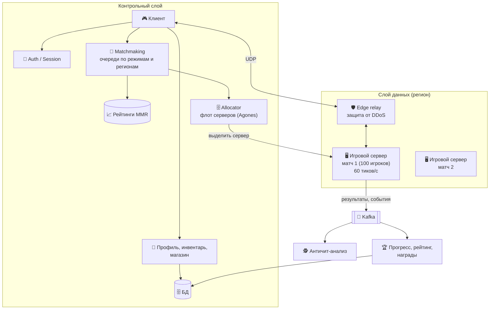
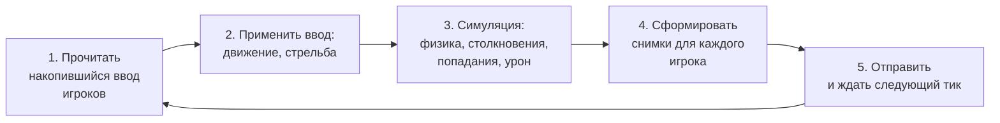
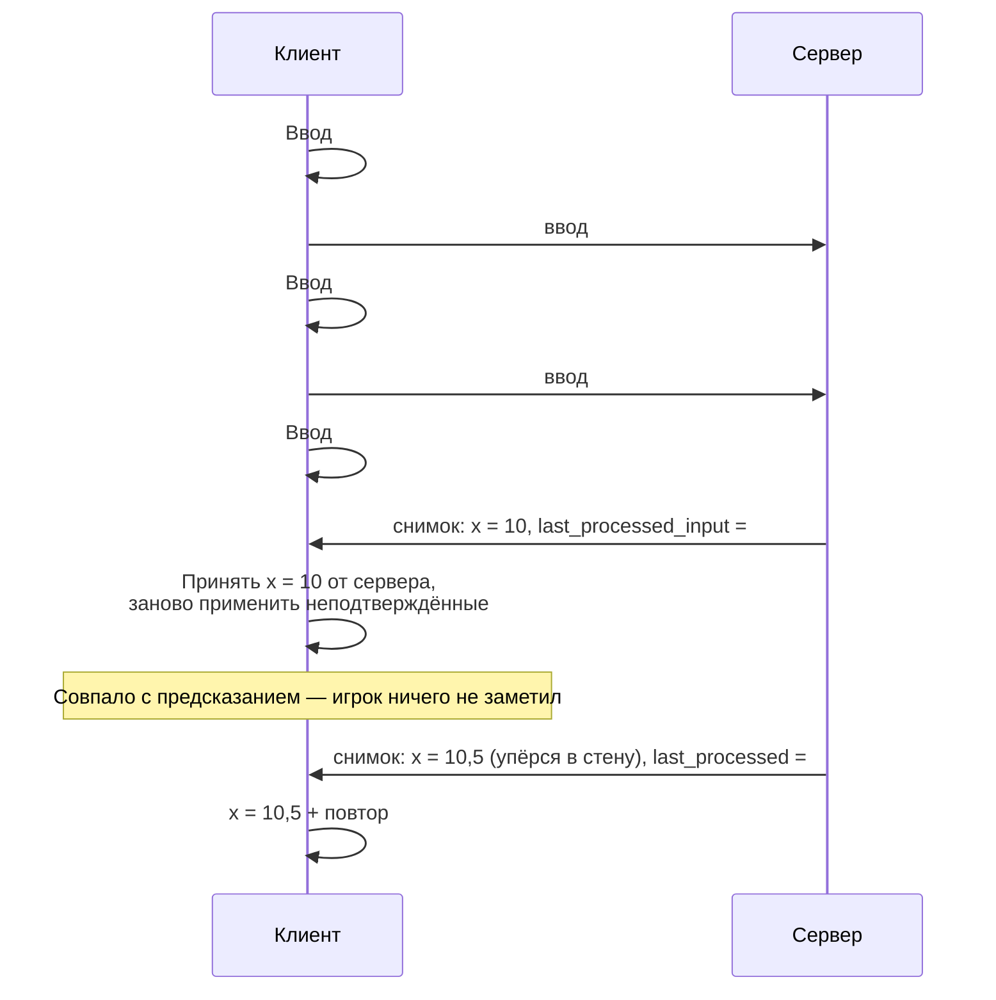
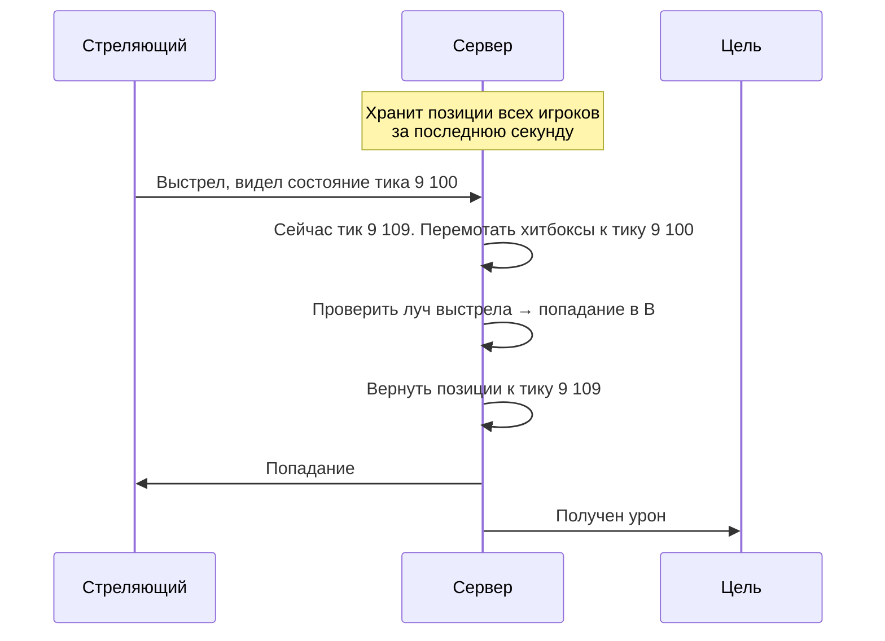
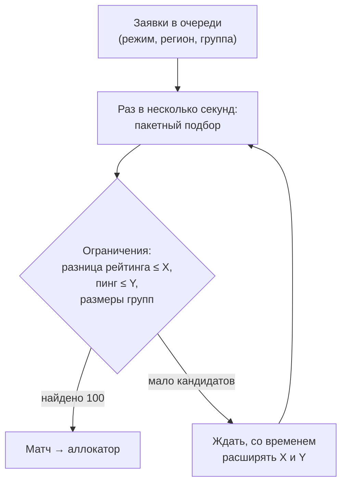

[English](README.md) | **Русский**

# Tier 2 · 4A · 04. Бэкенд мультиплеерной игры

> **Уровень:** Hard · **Время на интервью:** 45–60 мин · **Время на разбор:** ~5–6 ч
> **Ключевые аспекты:** авторитетный сервер и tick model, UDP и сжатие состояния, предсказание на клиенте и согласование, интерполяция других игроков, компенсация лага (перемотка на сервере), interest management, матчмейкинг и рейтинги (Elo, Glicko, TrueSkill), флот игровых серверов, античит, сохранение прогресса
> **Опирается на:** [12-communication](../../../12-communication/README_RU.md), [13-reliability-patterns](../../../13-reliability-patterns/README_RU.md), [Tier 1 · 11 Uber](../../../tier-1/11-uber/README_RU.md#10-deep-dive-4-матчинг-и-предложение-заказа) (пакетный матчинг, гео), [Tier 1 · 16 Top-K](../../../tier-1/16-top-k-leaderboard/README_RU.md#12-deep-dive-7-игровой-лидерборд-на-redis) (лидерборды)

---

## 🗺️ Как читать этот разбор

Разбор построен как интервью, но в каждом шаге есть объяснения: **почему** принимается решение, **как работает** механизм и **что будет**, если сделать иначе. Блоки «📘 Объяснение» — теория прямо по ходу задачи.

| Значок | Что значит |
|:------:|:-----------|
| 🎤 | Реплика интервьюера |
| 🗣️ | Что говорю вслух я (кандидат) |
| ✏️ | Что рисую на доске |
| ⏱️ | Сколько времени тратить на шаг |
| 📘 | Подробное объяснение концепции |

Блоки **TIP** — хороший приём, **WARNING** — ловушка, **IMPORTANT** — сигнал для уровня Senior+.

---

## 📑 Содержание

0. [Чему учит эта задача](#0-чему-учит-эта-задача)
1. [Условие задачи](#1-условие-задачи)
2. [Уточняющие вопросы и требования](#2-уточняющие-вопросы-и-требования)
3. [Оценки нагрузки](#3-оценки-нагрузки)
4. [Протоколы](#4-протоколы)
5. [Модель данных](#5-модель-данных)
6. [High-level дизайн](#6-high-level-дизайн)
7. [Deep dive 1: авторитетный сервер и tick model](#7-deep-dive-1-авторитетный-сервер-и-tick-model)
8. [Deep dive 2: сеть: UDP и передача состояния](#8-deep-dive-2-сеть-udp-и-передача-состояния)
9. [Deep dive 3: предсказание на клиенте и согласование](#9-deep-dive-3-предсказание-на-клиенте-и-согласование)
10. [Deep dive 4: интерполяция других игроков](#10-deep-dive-4-интерполяция-других-игроков)
11. [Deep dive 5: компенсация лага](#11-deep-dive-5-компенсация-лага)
12. [Deep dive 6: interest management](#12-deep-dive-6-interest-management)
13. [Deep dive 7: матчмейкинг и рейтинги](#13-deep-dive-7-матчмейкинг-и-рейтинги)
14. [Deep dive 8: флот серверов, античит и прогресс](#14-deep-dive-8-флот-серверов-античит-и-прогресс)
15. [Узкие места и сценарии сбоев](#15-узкие-места-и-сценарии-сбоев)
16. [Что изменится при росте в 10 раз](#16-что-изменится-при-росте-в-10-раз)
17. [Ключевые концепции и новые понятия](#17-ключевые-концепции-и-новые-понятия)
18. [Варианты задачи и follow-up вопросы](#18-варианты-задачи-и-follow-up-вопросы)
19. [Типичные ошибки](#19-типичные-ошибки)
20. [Шпаргалка и самопроверка](#20-шпаргалка-и-самопроверка)

---

## 0. Чему учит эта задача

Многопользовательская игра в реальном времени — задача, где **задержка сети нельзя спрятать**: свет из Варшавы в Нью-Йорк и обратно идёт десятки миллисекунд, а игроку нужно, чтобы персонаж реагировал на кнопку мгновенно, и чтобы выстрел попадал туда, куда он прицелился. Решение — набор приёмов, которые создают **иллюзию** мгновенного общего мира.

| Что проверяют | Где это в задаче |
|:--------------|:-----------------|
| Модель доверия | Авторитетный сервер — клиенту не доверяем |
| Работа с задержкой | Предсказание, интерполяция, компенсация лага |
| Сетевые протоколы | UDP, своя надёжность, сжатие дельтами |
| Пространственная фильтрация | Отправлять игроку только то, что рядом |
| Алгоритмы подбора | Матчмейкинг по навыку и пингу, рейтинги |
| Оркестрация | Флот выделенных серверов матчей |
| Безопасность | Античит |

> [!TIP]
> В этой задаче есть **две разные системы**: **контрольный слой** (вход, матчмейкинг, профиль, инвентарь — обычные сервисы, HTTP, базы данных) и **слой данных** (игровой сервер матча — UDP, 60 тиков в секунду, всё в памяти). Назови это разделение сразу — оно структурирует весь разговор.

---

## 1. Условие задачи

> 🎤 «Спроектируй бэкенд онлайн-шутера в жанре королевской битвы: 100 игроков на матч, быстрый геймплей, миллионы игроков онлайн, подбор соперников по уровню, защита от читеров».

**Что видит игрок:**

```
Нажимает «Играть» → через 30–60 секунд матч с 99 соперниками близкого уровня
Персонаж двигается сразу при нажатии клавиши, без «желейности»
Стреляет во врага — попадание засчитывается, если прицел был на нём на его экране
Пинг 40 мс — игра ощущается мгновенной; читер с «аимботом» получает бан
```

**План по времени:**

| Шаг | ⏱️ |
|:----|:--:|
| Требования | 5 мин |
| Оценки | 3 мин |
| Протоколы и данные | 4 мин |
| High-level дизайн | 6 мин |
| Deep dives | 25–30 мин |
| Итоги | 3 мин |

---

## 2. Уточняющие вопросы и требования

⏱️ 5 мин

| Мой вопрос | Ответ интервьюера | Что это меняет и почему |
|:-----------|:------------------|:------------------------|
| Тип игры? | Шутер, королевская битва, 100 игроков на матч | Быстрая реакция, точная стрельба, большая карта |
| Сколько игроков онлайн? | ~10M одновременно | ~100 000 матчей одновременно |
| Какая задержка допустима? | Комфортно до ~100 мс пинга | Серверы в регионах, близко к игрокам |
| Частота обновлений? | 30–60 тиков в секунду | Tick model, UDP |
| Подбор соперников? | По навыку, пингу, размеру группы; ожидание до ~1 мин | Матчмейкинг с расширением критериев |
| Читеры? | Большая проблема | Авторитетный сервер, серверные проверки, античит |
| Прогресс, инвентарь? | Сохраняется между матчами | Отдельные сервисы с БД |
| Платформы? | ПК, консоли, мобильные; кроссплей | Разные сети, мобильная задержка |

### Функциональные требования

1. Вход, профиль, друзья, группы.
2. Матчмейкинг по режиму, навыку, пингу и размеру группы.
3. Матчи на 100 игроков с синхронизацией в реальном времени.
4. Переподключение к матчу после обрыва.
5. Результаты матча: статистика, рейтинг, награды, инвентарь.
6. Обнаружение и наказание читеров.

### Нефункциональные требования

| Требование | Цель | Почему |
|:-----------|:-----|:-------|
| Отзывчивость | Свои действия — мгновенно, без ожидания сервера | Иначе играть невозможно |
| Задержка до сервера | ≤ ~100 мс RTT | Ощущение честной игры |
| Справедливость | Попадания засчитываются по тому, что видел стреляющий | Главная жалоба игроков — «я же попал» |
| Античит | Сервер не принимает невозможные действия | Читеры убивают игру |
| Масштаб | 10M одновременно, пики в выходные и при обновлениях | Флот серверов, автоскейлинг |
| Изоляция сбоев | Падение сервера матча не затрагивает других | Один матч — один процесс |

---

## 3. Оценки нагрузки

⏱️ 3 мин

```
Одновременно:       10M игроков / 100 на матч = 100 000 матчей

Сервер матча:       1–2 ядра на матч из 100 игроков при 30–60 тиках
                    → 100 000–200 000 ядер по всем регионам

Трафик от сервера:  снимок состояния ~500 Б (дельта, сжатие) × 60 раз/с × 100 игроков
                    ≈ 3 МБ/с на матч
                    × 100 000 матчей ≈ 300 ГБ/с ≈ 2,4 Тбит/с по всем регионам
Трафик от клиента:  ввод ~50 Б × 60 раз/с — мало

Контрольный слой:   матчмейкинг — тысячи заявок в секунду, профили, инвентарь — обычные нагрузки
```

### Выводы

| Вывод | Следствие для дизайна |
|:------|:----------------------|
| Основная нагрузка — серверы матчей | Флот выделенных серверов с оркестрацией и автоскейлингом |
| Трафик — терабиты в секунду | Сжатие дельтами, interest management, серверы близко к игрокам |
| Каждый матч независим | Горизонтальное масштабирование без координации между матчами |
| Контрольный слой — обычные сервисы | Стандартные решения: HTTP, базы данных, кэши |

---

## 4. Протоколы

⏱️ 2 мин

### Контрольный слой (HTTP / gRPC)

```http
POST /v1/auth/login
POST /v1/parties                 { members }
POST /v1/matchmaking/tickets     { mode: "br_squads", party_id, region_pings: { "eu-west": 32, "eu-central": 41 } }
GET  /v1/matchmaking/tickets/{id} → { status: "matched", server: "203.0.113.7:7777", token: "…" }
GET  /v1/players/{id}/profile, /inventory, /stats
```

### Слой данных (UDP, свой протокол)

```
Клиент → сервер (60 раз в секунду):
  { seq: 18231, tick: 9120, inputs: [ последние 3 ввода: кнопки, направление, прицел ], ack_snapshot: 9118 }

Сервер → клиент (30–60 раз в секунду):
  { tick: 9121, last_processed_input: 18229, baseline: 9118,
    entities: [ дельты относительно baseline: позиции, здоровье, анимации ] }

Надёжный канал (поверх UDP, с подтверждениями): события «убит», «подобрал предмет», чат
```

---

## 5. Модель данных

⏱️ 2 мин

| Данные | Где | Почему |
|:-------|:----|:-------|
| Аккаунты, профили, друзья | Реляционная БД + кэш | Обычные данные |
| Рейтинг (MMR) по режимам | БД + кэш для матчмейкинга | Читается при каждой заявке |
| Инвентарь, валюта | Транзакционная БД | Деньги и покупки — строгая консистентность |
| Результаты матчей | Kafka → хранилище и аналитика | Статистика, античит, рейтинг |
| **Состояние матча** | **Только в памяти игрового сервера** | 60 изменений в секунду, ценность — только во время матча |
| Повторы (replay) | Объектное хранилище | Запись ввода и снимков для разборов и античита |

---

## 6. High-level дизайн

⏱️ 6 мин



🗣️ «Две системы:
- **контрольный слой**: вход, матчмейкинг, профиль и инвентарь — обычные сервисы с базами данных; матчмейкинг собирает 100 игроков и запрашивает у **аллокатора** готовый игровой сервер;
- **слой данных**: **выделенный игровой сервер** на каждый матч, в регионе рядом с игроками; клиенты подключаются по UDP через edge-ретранслятор; сервер симулирует мир 60 раз в секунду и в конце матча отправляет результаты в Kafka — дальше рейтинг, награды, античит-анализ».

---

## 7. Deep dive 1: авторитетный сервер и tick model

> 🎤 «Почему не дать клиентам самим сообщать свои позиции и попадания?»

### Авторитетный сервер

📘 **Никогда не доверяй клиенту**: клиент — это программа на компьютере игрока, её можно изменить. Если клиент сообщает «я здесь» и «я попал», читер напишет «я телепортировался» и «я попал всем». Поэтому:

| Клиент отправляет | Сервер решает |
|:------------------|:--------------|
| **Ввод**: нажатые кнопки, направление взгляда | Где персонаж на самом деле |
| «Выстрелил в направлении X» | Было ли попадание и сколько урона |
| «Хочу подобрать предмет» | Можно ли его подобрать |

### Tick model

📘 Сервер выполняет **цикл симуляции** с фиксированной частотой — **тиками**. При 60 тиках в секунду один тик — 16,7 мс:



| Частота тиков | Плюсы | Минусы |
|:--------------|:------|:-------|
| 20–30 | Дешевле CPU и трафика | Менее точно, заметнее задержка реакции |
| 60–128 | Точнее стрельба, быстрее реакция | Дороже в разы |

### Альтернатива: детерминированный lockstep

| | Клиент-сервер со снимками ⭐ | Детерминированный lockstep |
|:-|:-----------------------------|:---------------------------|
| Что передаётся | Ввод от клиентов, состояние от сервера | Только ввод; каждый клиент симулирует всё сам |
| Требование | — | Полный детерминизм симуляции на всех устройствах |
| Задержка | Определяется своим пингом | Определяется самым медленным игроком |
| Где | Шутеры, королевские битвы | Стратегии с тысячами юнитов (передавать состояние каждого юнита дорого) |
| Античит | Сервер авторитетен | Все клиенты знают всё состояние |

---

## 8. Deep dive 2: сеть: UDP и передача состояния

> 🎤 «Почему UDP, а не TCP?»

### TCP против UDP

📘 TCP гарантирует доставку **по порядку**: если пакет потерян, все следующие ждут его повторной отправки (head-of-line blocking). Для игры это плохо: снимок состояния 50-миллисекундной давности уже бесполезен — нужен свежий. Лучше потерять старый пакет и сразу получить новый.

| | TCP | UDP + свой протокол ⭐ |
|:-|:----|:----------------------|
| Потеря пакета | Задержка всех следующих до повторной отправки | Пакет просто пропущен, следующий приходит сразу |
| Надёжность | Для всего | Только для того, что нужно (события), остальное — «самое свежее» |
| Где в игре | Контрольный слой, чат, загрузки | Игровой процесс |

### Как не потерять важное

| Тип данных | Как передаётся |
|:-----------|:---------------|
| **Ввод клиента** | Каждый пакет содержит **последние 3–5 вводов** — потеря одного пакета не теряет ввод |
| **Снимки состояния** | Ненадёжно: потерян — придёт следующий |
| **Важные события** (убийство, подбор предмета) | Надёжный канал поверх UDP: номера, подтверждения, повторы |

### Сжатие снимков

| Приём | Эффект |
|:------|:-------|
| **Дельта относительно подтверждённого снимка** | Отправлять только изменения с последнего снимка, который клиент подтвердил (`baseline`) |
| **Квантизация** | Позиция с точностью до сантиметра в 16 битах вместо 32-битного float, углы — в 8–12 битах |
| **Только видимое** | Interest management (deep dive 6) |
| **Разная частота** | Далёкие объекты — реже |

📘 **Почему дельта от подтверждённого.** Если считать дельту от предыдущего отправленного снимка, а он потерялся, клиент не сможет применить следующую дельту. Дельта от снимка, получение которого клиент **подтвердил**, всегда применима.

---

## 9. Deep dive 3: предсказание на клиенте и согласование

> 🎤 «Пинг 80 мс. Если ждать ответа сервера, персонаж будет двигаться с задержкой. Как быть?»

### Предсказание

📘 Клиент **сразу** применяет свой ввод к своему персонажу — используя ту же логику движения, что и сервер. Игрок видит мгновенную реакцию. Сервер получит ввод через 40 мс и вычислит то же самое — в большинстве случаев результат совпадёт.

### Согласование

📘 Иногда предсказание не совпадает с сервером (столкновение с другим игроком, которого клиент не учёл, или потеря пакета). Тогда клиент должен принять **авторитетное** состояние сервера, не потеряв ввод, сделанный после.



| Элемент | Зачем |
|:--------|:------|
| Номер ввода | Сервер сообщает, какой ввод последним учтён |
| История неподтверждённых вводов на клиенте | Чтобы переприменить их поверх серверного состояния |
| Плавная коррекция | Небольшие расхождения исправляются за несколько кадров, а не рывком |

> [!IMPORTANT]
> **Сигнал Senior+:** объяснить, что клиент одновременно живёт **в трёх временах**: свой персонаж — в «будущем» (предсказание), другие игроки — в «прошлом» (интерполяция, deep dive 4), сервер — в «настоящем». Компенсация лага (deep dive 5) нужна именно потому, что эти времена различаются.

---

## 10. Deep dive 4: интерполяция других игроков

> 🎤 «А как показывать других игроков? Их ввод клиент не знает».

📘 Позиции других игроков приходят в снимках 30–60 раз в секунду, с джиттером. Если рисовать их «как пришло», движение будет рваным. Решение — **рисовать других игроков немного в прошлом** (например, на 100 мс) и **интерполировать** между двумя полученными снимками:

```
Снимки пришли:  тик 100 (x = 0), тик 103 (x = 3), тик 106 (x = 6) …
Клиент рисует момент «сейчас − 100 мс», который лежит между тиком 103 и 106
→ позиция = плавная интерполяция между x = 3 и x = 6
```

| Решение | Почему |
|:--------|:-------|
| Буфер интерполяции ~2 снимка | Потерянный пакет не вызывает рывка |
| Экстраполяция (dead reckoning), если снимки не приходят | Продолжить движение по последней скорости короткое время, затем остановить |
| Цена | Игрок видит других с задержкой «пинг + буфер» — это и решает компенсация лага |

---

## 11. Deep dive 5: компенсация лага

> 🎤 «Игрок прицелился во врага и выстрелил. Но на сервере враг уже сместился. Засчитать попадание?»

### Проблема

```
Задержка стреляющего: 50 мс до сервера + 100 мс буфер интерполяции
→ стреляющий видит врага там, где тот был ~150 мс назад

Если сервер проверит попадание по ТЕКУЩЕЙ позиции врага — промах,
хотя на экране стреляющего прицел был точно на враге. «Я же попал!»
```

### Решение: перемотка на сервере

📘 Сервер хранит **историю позиций** всех игроков за последнюю секунду (по тикам). Когда приходит выстрел, сервер:

1. Вычисляет, **какой момент видел стреляющий**: время отправки − его задержка − буфер интерполяции.
2. **Перематывает** хитбоксы всех игроков в тот момент.
3. Проверяет попадание.
4. Возвращает всех обратно.



### Компромисс

| Кому хорошо | Кому плохо |
|:------------|:-----------|
| Стреляющему: попадает туда, куда целился | Цели: может получить урон, уже спрятавшись за стеной на своём экране («меня убили за углом») |

| Решение | Почему |
|:--------|:-------|
| **Ограничить перемотку** (например, до 200–250 мс) | Игрок с огромным пингом не может стрелять «в прошлое» слишком далеко |
| Учитывать уверенность | Для очень высокого пинга — меньше компенсации |
| Подбор матчей по пингу | Меньше разница во времени между игроками |

---

## 12. Deep dive 6: interest management

> 🎤 «100 игроков на огромной карте. Каждому отправлять состояние всех 99?»

📘 **Interest management** — отправлять игроку только то, что для него важно: объекты **рядом** и **в зоне видимости**.

| Решение | Как |
|:--------|:----|
| Пространственная сетка | Карта делится на ячейки; игроку отправляются объекты из его ячейки и соседних (та же идея, что гео-индекс в [Uber](../../../tier-1/11-uber/README_RU.md#8-deep-dive-2-геопространственные-индексы)) |
| Приоритет по расстоянию | Ближние — каждый тик, дальние — реже |
| Проверка видимости | Противник за горой не отправляется вовсе |
| Бюджет на снимок | Если объектов много, сначала самые важные |

| Эффект | Почему важно |
|:-------|:-------------|
| **Трафик** уменьшается в разы | Терабиты в секунду по всему флоту |
| **CPU** на формирование снимков меньше | Больше матчей на сервер |
| **Античит**: «wallhack» бесполезен | Клиент не знает о противнике, которого не должен видеть, — подсвечивать нечего |

### Миры на тысячи игроков (MMO)

Для MMO один сервер не вмещает мир: мир делится на **зоны** с отдельными серверами, а при переходе границы игрок передаётся между серверами (handoff). У границ зоны соседние серверы обмениваются состоянием, чтобы игроки видели друг друга через границу.

---

## 13. Deep dive 7: матчмейкинг и рейтинги

> 🎤 «Как подобрать 100 игроков близкого уровня с хорошим пингом за минуту?»

### Рейтинг: Elo

📘 **Elo** оценивает навык одним числом. Ожидаемый результат игрока A против B:

```
E_A = 1 / (1 + 10^((R_B − R_A) / 400))

R_A = 1 600, R_B = 1 400:
  E_A = 1 / (1 + 10^(−0,5)) ≈ 0,76     (A должен выигрывать в 76% случаев)

A выиграл, коэффициент K = 32:
  R_A' = 1 600 + 32 × (1 − 0,76) ≈ 1 607,7
  R_B' = 1 400 + 32 × (0 − 0,24) ≈ 1 392,3
Победа над слабым даёт мало очков; победа над сильным — много.
```

| Система | Особенность |
|:--------|:------------|
| **Elo** | Одно число; для игр один на один |
| **Glicko-2** | Добавляет **неуверенность** рейтинга: у новичка она большая, рейтинг меняется быстро |
| **TrueSkill** (Microsoft) | Командные игры и игры со многими участниками; среднее и неуверенность навыка |

Для королевской битвы рейтинг обновляется по месту в матче и вкладу, а не по «победа/поражение».

### Подбор



| Принцип | Почему |
|:--------|:-------|
| **Очереди по режиму и региону** | Игрок из Европы не играет на сервере в Азии |
| **Пакетный подбор** раз в несколько секунд | Лучше распределение, чем «первый подходящий» (как пакетный матчинг в [Uber](../../../tier-1/11-uber/README_RU.md#10-deep-dive-4-матчинг-и-предложение-заказа)) |
| **Расширение окна со временем** | Сначала строго по навыку и пингу; если ожидание растёт — ослаблять ограничения |
| Группы | Группа рассматривается как одна заявка; рейтинг группы — например, взвешенное среднее с поправкой на сильнейшего |
| Компромисс качество — ожидание | Идеальный матч через 5 минут хуже хорошего через 40 секунд |
| Готовые решения | Google Open Match — открытый фреймворк для матчмейкинга |

---

## 14. Deep dive 8: флот серверов, античит и прогресс

> 🎤 «Откуда берутся игровые серверы, что делать при их падении и как ловить читеров?»

### Флот выделенных серверов

| Решение | Почему |
|:--------|:-------|
| **Процесс на матч** | Сбой затрагивает один матч; простое масштабирование |
| **Пул «тёплых» серверов** | Запустить процесс и загрузить карту — секунды; готовый сервер выделяется мгновенно |
| **Оркестрация** (Agones на Kubernetes или собственный аллокатор) | Учёт состояний серверов: готов, выделен, идёт матч, завершается |
| **Автоскейлинг** по очередям и времени суток | Вечером и в выходные игроков в разы больше |
| **Размещение по пингу** | Регион выбирается по измеренному пингу игроков матча |
| **Edge relay** | Клиенты не знают реальный IP игрового сервера — защита от DDoS на конкретный матч |

### Сбои

| Сбой | Решение |
|:-----|:--------|
| Игрок потерял связь | Персонаж остаётся в мире; переподключение к тому же серверу по токену в течение окна (например, 2 минуты) |
| Игровой сервер упал | Матч обычно теряется (состояние только в памяти); игрокам — компенсация, рейтинг не меняется |
| Аллокатор или матчмейкинг недоступны | Идущие матчи продолжаются (слой данных независим); новые матчи временно не создаются |

### Античит

| Уровень | Что делает |
|:--------|:-----------|
| **Авторитетный сервер** | Невозможно телепортироваться, двигаться быстрее положенного, стрелять чаще оружия |
| **Валидация ввода** | Скорость поворота прицела, частота выстрелов, физически невозможные последовательности |
| **Сокрытие информации** | Interest management: клиент не получает данных о невидимых противниках |
| **Клиентский античит** | Обнаружение модифицированных клиентов и сторонних программ (в том числе на уровне ядра ОС) |
| **Статистический анализ** | Аномальная точность, реакция быстрее человеческой — по данным из Kafka и повторам |
| **Отложенные волны банов** | Банить пачками с задержкой, чтобы разработчики читов не понимали, что именно обнаружено |
| **Повторы для разборов** | Запись ввода и снимков матча |

### Прогресс и инвентарь

| Решение | Почему |
|:--------|:-------|
| Результаты матча → событие в Kafka | Игровой сервер не зависит от доступности баз данных |
| Начисление наград идемпотентно по `match_id` | Повтор события не даст награду дважды |
| Инвентарь и покупки — транзакционная БД | Деньги; подход как в [платёжной системе](../../../tier-1/20-payment-system/README_RU.md) |
| Лидерборды | Sorted sets (см. [Tier 1 · 16](../../../tier-1/16-top-k-leaderboard/README_RU.md#12-deep-dive-7-игровой-лидерборд-на-redis)) |

---

## 15. Узкие места и сценарии сбоев

| Сценарий | Что произойдёт | Как защищаемся |
|:---------|:---------------|:---------------|
| Клиент присылает «я здесь» | Телепорт-читы | Авторитетный сервер, только ввод от клиента |
| Задержка сети | Задержка реакции персонажа | Предсказание и согласование |
| Рваное движение других | Плохой опыт | Интерполяция с буфером |
| «Я же попал» | Недовольство игроков | Компенсация лага с ограничением перемотки |
| Потеря пакетов | Пропуск ввода | Последние N вводов в каждом пакете |
| Терабиты трафика | Стоимость и перегрузка | Дельты, квантизация, interest management |
| Wallhack | Читер видит сквозь стены | Не отправлять невидимых противников |
| Долгое ожидание матча | Игроки уходят | Расширение критериев со временем |
| Падение игрового сервера | Потерян матч | Изоляция матчей, компенсация, рейтинг без изменений |
| DDoS на игровой сервер | Матч недоступен | Edge relay, скрытые адреса серверов |
| Пик при выходе обновления | Нехватка серверов | Автоскейлинг, тёплый пул, очередь входа |

---

## 16. Что изменится при росте в 10 раз

> 🎤 «100 миллионов игроков онлайн?»

| Изменение | Почему |
|:----------|:-------|
| **Больше регионов и edge-точек** | Пинг и распределение трафика |
| **Несколько облаков и собственное железо** | Стоимость сотен тысяч ядер |
| **Более агрессивный interest management и сжатие** | Трафик |
| **Шардирование матчмейкинга** по регионам и режимам | Очереди растут |
| **ML-античит в реальном времени** | Масштаб злоупотреблений |

---

## 17. Ключевые концепции и новые понятия

### Что применяется

| Концепция | Где разобрана | Как применяется здесь |
|:----------|:--------------|:----------------------|
| Протоколы, надёжность поверх транспорта | [12-communication](../../../12-communication/README_RU.md) | UDP и свой протокол |
| Изоляция сбоев, перегрузка | [13-reliability-patterns](../../../13-reliability-patterns/README_RU.md) | Процесс на матч, очередь входа |
| Гео-индекс, пакетный матчинг | [Tier 1 · 11](../../../tier-1/11-uber/README_RU.md) | Interest management, матчмейкинг |
| Лидерборды | [Tier 1 · 16](../../../tier-1/16-top-k-leaderboard/README_RU.md) | Рейтинговые таблицы |
| Идемпотентность, транзакции | [Tier 1 · 20](../../../tier-1/20-payment-system/README_RU.md) | Награды и инвентарь |

### Новые понятия этой задачи

| Понятие | Кратко |
|:--------|:-------|
| **Авторитетный сервер** | Сервер решает, что произошло; клиент присылает только ввод |
| **Тик** | Один шаг симуляции с фиксированной частотой |
| **Детерминированный lockstep** | Передаётся только ввод, все симулируют одинаково |
| **Дельта от подтверждённого снимка** | Сжатие состояния, устойчивое к потерям |
| **Предсказание на клиенте** | Свой ввод применяется сразу |
| **Согласование** | Принять состояние сервера и переприменить неподтверждённый ввод |
| **Интерполяция** | Другие игроки рисуются в прошлом между двумя снимками |
| **Компенсация лага** | Сервер перематывает хитбоксы к моменту, который видел стреляющий |
| **Interest management** | Отправлять только близкое и видимое |
| **Elo, Glicko-2, TrueSkill** | Системы рейтинга навыка |
| **Тёплый пул серверов** | Заранее запущенные серверы для мгновенного выделения |

---

## 18. Варианты задачи и follow-up вопросы

<details>
<summary><b>Как спроектировать пошаговую игру (шахматы онлайн)?</b></summary>

Здесь не нужны тики, UDP и компенсация лага: ход — редкое событие, достаточно WebSocket или даже HTTP. Сервер проверяет допустимость хода, хранит состояние партии в БД (партия может длиться дни), рассылает ход сопернику и зрителям. Рейтинг — Elo или Glicko-2.
</details>

<details>
<summary><b>Как сделать повтор матча (replay)?</b></summary>

Записывать поток снимков (или ввод всех игроков при детерминированной симуляции) с номерами тиков в файл и сохранять в объектное хранилище. Воспроизведение — проигрывание снимков в клиенте. Повторы используются для разбора жалоб на читеров и киберспортивных трансляций.
</details>

<details>
<summary><b>Как играть игрокам из разных континентов в одном матче?</b></summary>

Выбрать регион сервера, минимизирующий максимальный или средний пинг группы, ограничить допустимую разницу; компенсация лага с ограничением перемотки делает игру терпимой. Но обычно матчмейкинг избегает таких матчей — честность страдает.
</details>

<details>
<summary><b>Почему не peer-to-peer, как в старых играх?</b></summary>

P2P дешевле (нет серверов), но один из игроков становится хостом с преимуществом в задержке, хост может читерить, а его уход ломает матч. Выделенные серверы дороже, но честнее, безопаснее и стабильнее.
</details>

<details>
<summary><b>Как обрабатывать мобильные сети с потерями и скачками задержки?</b></summary>

Больше избыточности ввода, адаптивный буфер интерполяции (растёт при джиттере), более терпимая коррекция предсказания, быстрое переподключение при смене сети (Wi-Fi ↔ мобильная) по токену сессии, а не по IP.
</details>

---

## 19. Типичные ошибки

| ❌ Ошибка | Почему плохо | ✅ Как правильно |
|:---------|:-------------|:----------------|
| Клиент сообщает позицию и попадания | Читы | Авторитетный сервер, только ввод |
| TCP для игрового процесса | Задержки из-за повторной отправки старых данных | UDP + надёжность только для важного |
| Ждать сервер перед движением своего персонажа | «Желейное» управление | Предсказание и согласование |
| Рисовать других игроков «как пришло» | Рывки | Интерполяция с буфером |
| Проверять попадание по текущим позициям | «Я же попал» | Компенсация лага |
| Неограниченная перемотка | Игроки с большим пингом стреляют в прошлое | Ограничение перемотки |
| Отправлять каждому всё состояние | Трафик и wallhack | Interest management |
| Дельта от последнего отправленного снимка | Потеря пакета ломает следующие | Дельта от подтверждённого |
| Матчмейкинг «первый подходящий» с жёсткими критериями | Долгое ожидание или плохие матчи | Пакетный подбор с расширением критериев |
| Хранить состояние матча в БД | Медленно и бесполезно | В памяти игрового сервера |
| Начисление наград без идемпотентности | Двойные награды | Идемпотентность по match_id |

---

## 20. Шпаргалка и самопроверка

### Ответ за 30 секунд

> Два слоя: контрольный (вход, матчмейкинг, профиль, инвентарь — HTTP и базы) и слой данных (выделенный игровой сервер на матч в регионе рядом с игроками, UDP, всё в памяти). Сервер авторитетен: клиент шлёт только ввод (последние N вводов в каждом пакете), сервер симулирует 30–60 тиков в секунду и рассылает снимки — дельты от подтверждённого снимка с квантизацией и interest management (только близкое и видимое — заодно против wallhack). Клиент предсказывает своё движение и согласует с сервером по номеру последнего учтённого ввода; других игроков рисует на ~100 мс в прошлом с интерполяцией. Выстрелы — компенсация лага: сервер перематывает хитбоксы к моменту, который видел стреляющий, с ограничением перемотки. Матчмейкинг — очереди по режиму и региону, рейтинг (Elo/Glicko-2/TrueSkill), пакетный подбор раз в несколько секунд с расширением допусков по навыку и пингу; аллокатор выдаёт сервер из тёплого пула (Agones). Edge relay против DDoS, переподключение по токену. Античит — серверная валидация, сокрытие информации, клиентский античит, статистика, отложенные баны. Результаты — в Kafka, награды идемпотентно по match_id.

### Самопроверка

- [ ] Могу объяснить разделение на контрольный слой и слой данных
- [ ] Могу объяснить, почему сервер авторитетен и что присылает клиент
- [ ] Могу описать цикл тика и сравнить снимки с lockstep
- [ ] Могу обосновать UDP и объяснить дельту от подтверждённого снимка
- [ ] Могу нарисовать предсказание и согласование
- [ ] Могу объяснить интерполяцию других игроков
- [ ] Могу объяснить компенсацию лага и её компромисс
- [ ] Могу объяснить interest management и его роль в античите
- [ ] Могу посчитать обновление рейтинга Elo
- [ ] Могу описать матчмейкинг с расширением критериев
- [ ] Могу описать флот серверов, сбои и античит

### Что почитать

- Gabriel Gambetta, *Fast-Paced Multiplayer* (серия статей: предсказание, согласование, интерполяция, компенсация лага)
- Valve Developer Community, *Source Multiplayer Networking* и *Lag Compensation*
- Glenn Fiedler, *Networked Physics* и *Game Networking* (gafferongames.com)
- Overwatch Gameplay Architecture and Netcode (GDC 2017)
- Glickman, *The Glicko-2 System*; Herbrich et al., *TrueSkill* (NIPS 2006)
- Документация Agones и Google Open Match
