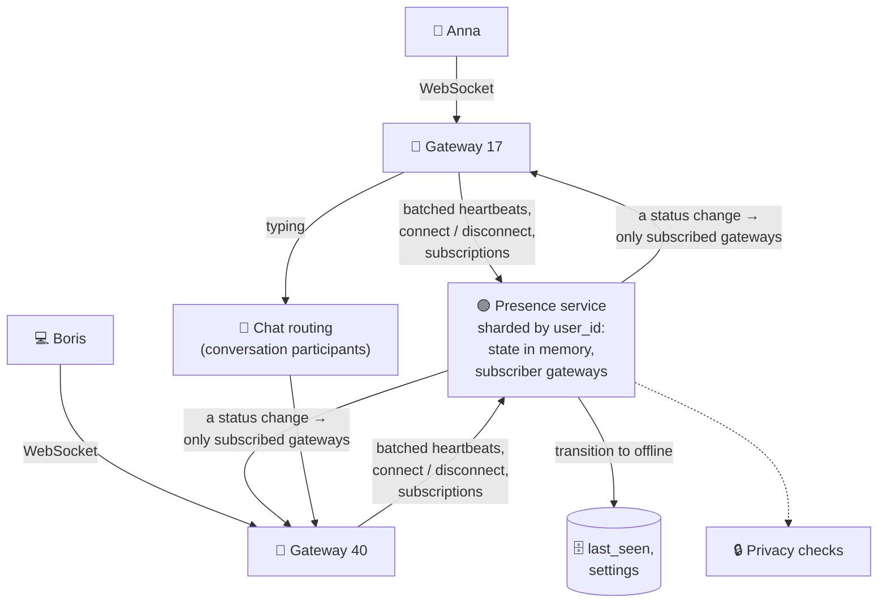
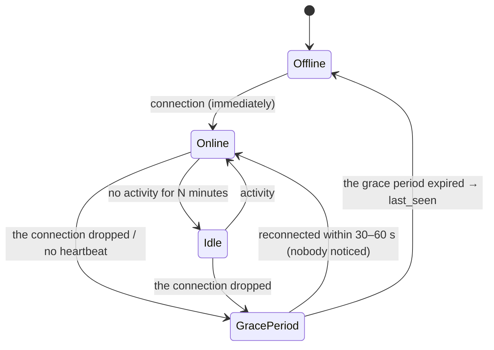
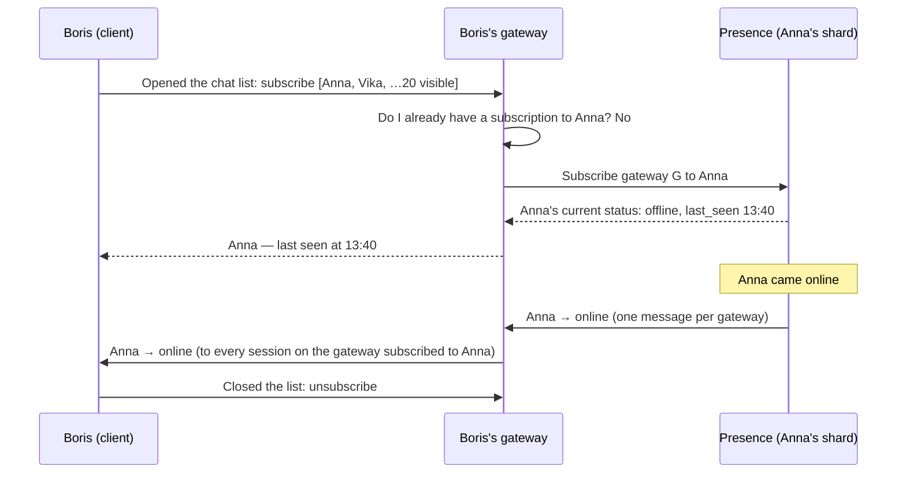
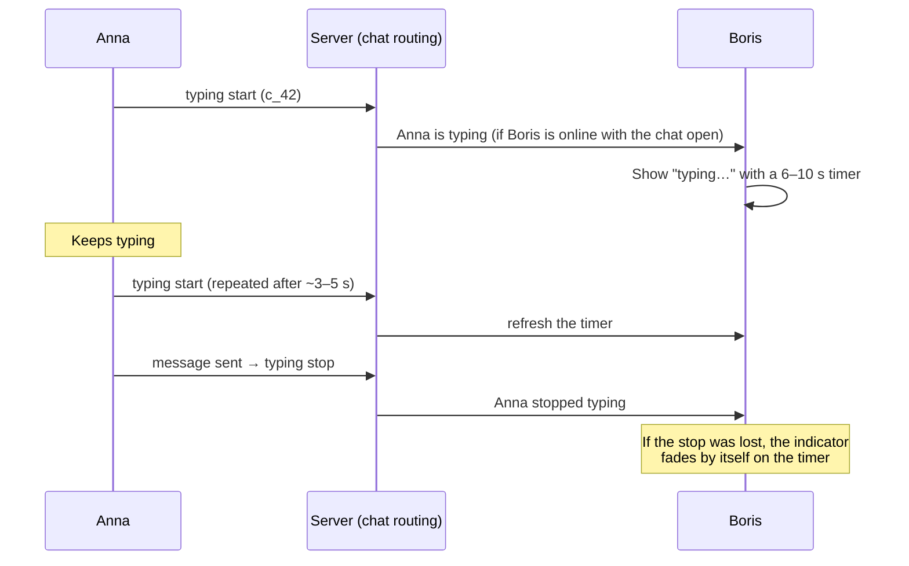

**English** | [Русский](README_RU.md)

# Tier 2 · 4A · 05. Presence and Typing Indicator Service

> **Level:** Medium · **Interview time:** 45 min · **Study time:** ~3–4 h
> **Key aspects:** detecting online and offline (connections, heartbeats, TTLs), fighting status flapping, multiple devices, a subscription model instead of broadcasting to every contact, aggregating subscriptions at gateways, in-memory storage and recovery without replication, the typing indicator as an ephemeral event, privacy, reconnection races, multiple regions
> **Builds on:** [Tier 1 · 06 Chat](../../../tier-1/06-chat-system/README.md#13-deep-dive-7-presence-and-typing), [12-communication](../../../12-communication/README.md#8-scaling-websockets), [Tier 1 · 19 KV Store](../../../tier-1/19-distributed-kv-store/README.md#11-deep-dive-6-membership-and-failure-detection) (failure detection), [Tier 2 · 4A · 03 Live Comments](../03-live-comments-reactions/README.md#7-deep-dive-1-hierarchical-distribution)

---

## 🗺️ How to Read This Walkthrough

The walkthrough follows an interview, but every step includes explanations: **why** a decision is made, **how** a mechanism works and **what happens** if you do it differently. The "📘 Explanation" blocks are theory right where you need it.

| Icon | Meaning |
|:----:|:--------|
| 🎤 | Interviewer |
| 🗣️ | What I (the candidate) say out loud |
| ✏️ | What I draw on the whiteboard |
| ⏱️ | Time budget for the step |
| 📘 | A detailed explanation of a concept |

Callouts: **TIP** — a good technique, **WARNING** — a trap, **IMPORTANT** — a Senior+ signal.

---

## 📑 Contents

0. [What This Problem Teaches](#0-what-this-problem-teaches)
1. [Problem Statement](#1-problem-statement)
2. [Clarifying Questions and Requirements](#2-clarifying-questions-and-requirements)
3. [Capacity Estimates](#3-capacity-estimates)
4. [API and Protocol](#4-api-and-protocol)
5. [Data Model](#5-data-model)
6. [High-Level Design](#6-high-level-design)
7. [Deep Dive 1: Knowing Whether a User Is Online or Offline](#7-deep-dive-1-knowing-whether-a-user-is-online-or-offline)
8. [Deep Dive 2: Multiple Devices](#8-deep-dive-2-multiple-devices)
9. [Deep Dive 3: Whom to Notify About Changes](#9-deep-dive-3-whom-to-notify-about-changes)
10. [Deep Dive 4: Storage and Recovering From Failures](#10-deep-dive-4-storage-and-recovering-from-failures)
11. [Deep Dive 5: The "Typing…" Indicator](#11-deep-dive-5-the-typing-indicator)
12. [Deep Dive 6: Privacy and Statuses](#12-deep-dive-6-privacy-and-statuses)
13. [Deep Dive 7: Races and Consistency](#13-deep-dive-7-races-and-consistency)
14. [Deep Dive 8: Multiple Regions](#14-deep-dive-8-multiple-regions)
15. [Bottlenecks and Failure Scenarios](#15-bottlenecks-and-failure-scenarios)
16. [What Changes at 10x Scale](#16-what-changes-at-10x-scale)
17. [Key Concepts and New Terms](#17-key-concepts-and-new-terms)
18. [Variations and Follow-Up Questions](#18-variations-and-follow-up-questions)
19. [Common Mistakes](#19-common-mistakes)
20. [Cheat Sheet and Self-Check](#20-cheat-sheet-and-self-check)

---

## 0. What This Problem Teaches

The green "online" dot and the "typing…" label look like small details, but they're backed by a system that constantly tracks **hundreds of millions** of connections and sends changes to whoever cares about them. What's special here: the data is **ephemeral** (valuable only right now), there's **a lot** of it, and **seconds of inaccuracy are acceptable** — so you can economize on almost everything.

| What's tested | Where it shows up |
|:--------------|:------------------|
| Failure detection | Heartbeats, TTLs, the trade-off between speed and false positives |
| Fan-out | Whom to notify about a status change, and how |
| A subscription model | Sending only to those currently looking |
| Ephemeral state | In-memory storage, recovery without replication |
| Product thinking | Status flapping, privacy, "last seen" |
| Races | Reconnecting through a different gateway |

> [!TIP]
> The key idea: **don't broadcast a status change to every contact**. Compute what that costs, and propose subscriptions from "only those who currently have this user on screen". That decision cuts the load by an order of magnitude.

---

## 1. Problem Statement

> 🎤 "Design a presence service for a messenger: show who's online, who's idle, when someone was last seen, and a 'typing…' indicator in conversations."

**What the user sees:**

```
The contact list: Anna has a green dot, Boris — "last seen 12 minutes ago"
A chat with Anna is open: "online" → Anna starts writing → "typing…"
Anna closed the app → ~30 seconds later "last seen just now"
Anna is on the subway and loses network for 5 seconds — her status does NOT flicker "offline/online"
```

**Time plan:**

| Step | ⏱️ |
|:-----|:--:|
| Requirements | 4 min |
| Estimates | 4 min |
| API and data | 5 min |
| High-level design | 5 min |
| Deep dives | 22 min |
| Wrap-up | 5 min |

---

## 2. Clarifying Questions and Requirements

⏱️ 4 min

| My question | Interviewer's answer | What it changes and why |
|:------------|:---------------------|:------------------------|
| Scale? | 500M users, ~100M online at once | Hundreds of millions of connections and presence records |
| How many contacts does a user have? | ~300 on average | Broadcasting to every contact is expensive |
| Which statuses? | Online, idle, offline, "last seen", "do not disturb" | Per-device state + aggregation |
| How fast must a transition show? | Online — within seconds; offline — up to ~30–60 s is fine | Delayed offline versus flapping |
| Multiple devices? | Yes: phone, laptop, web | Status = a combination of devices |
| "Typing"? | Yes, in one-on-one and group chats, latency < 0.5 s | Ephemeral events via chat routing |
| Privacy? | You can hide your status and "last seen" | Server-side checks |
| Is precision needed? | No, seconds of error are fine | In-memory storage, no strict consistency |

### Functional requirements

1. A user's status: online, idle, offline; "last seen" with a time.
2. Fetching statuses for a list of users and subscribing to changes.
3. A "typing…" indicator in conversations.
4. Multiple devices per user.
5. Privacy settings and manual statuses ("do not disturb", a custom status).

### Non-functional requirements

| Requirement | Target | Why |
|:------------|:-------|:----|
| Latency of the "online" change | Seconds | The user wants to know whether they'll get a reply now |
| "Typing" latency | < 500 ms | Otherwise the indicator is useless |
| Stability | No status flapping on short drops | Flapping annoys and creates extra load |
| Scale | 100M online | Drives the architecture |
| Availability | A presence outage doesn't block sending messages | Presence is an auxiliary feature |
| Precision | Eventual, seconds | Strictness isn't needed |

---

## 3. Capacity Estimates

⏱️ 4 min

```
Connections:           100M concurrent
Heartbeats:            every 30 s → ~3.3M per second
                       → handled by the gateways; only batched TTL renewals reach the presence service

Status changes:        ~10 per day per user (logins, logouts, idling)
                       500M × 10 = 5B per day → ~58,000 changes per second

Naive broadcast:       58,000 × 300 contacts ≈ 17M notifications per second ❌
With subscriptions:    send only to those who currently have a screen showing that user
                       (usually a small share of contacts) → several times to an order of magnitude less

"Typing":              ~10M users actively chatting,
                       an event every 3–5 s → ~2–3M events per second,
                       each only to one conversation's participants (one to a few recipients)
```

### Conclusions

| Conclusion | Design consequence |
|:-----------|:-------------------|
| Heartbeats are millions per second | Don't let them past the gateways; aggregate them |
| Naive fan-out is 17M per second | A subscription-by-interest model |
| The state is hundreds of millions of small records | In memory, sharded by user_id |
| "Typing" — many events, but a small fan-out | Routing via existing chat delivery, with no storage |

---

## 4. API and Protocol

⏱️ 3 min

```
WebSocket (through the messenger's gateways):

Client → server
  { "type": "heartbeat", "state": "active" | "idle" }              ← every ~30 s or on a state change
  { "type": "presence.subscribe",   "user_ids": [9, 17, 42, …] }   ← who's on my screen right now
  { "type": "presence.unsubscribe", "user_ids": [17] }
  { "type": "typing", "conv_id": "c_42", "state": "start" | "stop" }

Server → client
  { "type": "presence", "user_id": 9, "status": "online" | "idle" | "offline", "last_seen": "…" }
  { "type": "typing",   "conv_id": "c_42", "user_id": 9, "state": "start" }

REST
  GET  /v1/presence?ids=9,17,42           ← a batch request for current statuses
  PUT  /v1/me/presence-settings           { visible_to: "contacts", show_last_seen: false }
  PUT  /v1/me/status                      { mode: "dnd", until: "18:00", text: "On vacation" }
```

---

## 5. Data Model

⏱️ 3 min

```
Presence (in memory, sharded by user_id):
  user:9 → {
    devices: {
      phone:  { session: "s-81", state: "active", last_heartbeat: 14:05:31, gateway: "gw-17" },
      laptop: { session: "s-92", state: "idle",   last_heartbeat: 14:05:10, gateway: "gw-40" }
    },
    status: "online",          ← computed from the devices
    last_seen: 14:05:31,
    manual: { mode: "dnd", until: 18:00 }
  }

Subscriptions (on the presence node of the same shard):
  watched user:9 → { gw-3, gw-17, gw-88 }    ← gateways that have interested sessions

Long-term (a DB):
  last_seen (updated only on the transition to offline), privacy settings, manual statuses
```

| Data | Store | Why |
|:-----|:------|:----|
| Current presence | In the presence nodes' memory (or Redis with TTLs) | Changes constantly, rebuilds itself |
| Subscriptions | In memory | Re-created by the gateways |
| "Last seen" | A DB, written on going offline | Must survive restarts; written rarely |
| Privacy settings | A DB + cache | Change rarely, read often |

---

## 6. High-Level Design

⏱️ 5 min



🗣️ "Key decisions:
- **gateways** hold connections and handle heartbeats themselves; only events reach the presence service: connected, disconnected, changed state, plus batched renewals;
- **the presence service** is sharded by `user_id`: it keeps state in memory and **a list of subscriber gateways** for each user;
- a status change is sent **only to subscribed gateways**, which pass it to their sessions;
- **'typing'** doesn't go through the presence service at all: it's an ephemeral event delivered to the conversation's participants via chat routing."

---

## 7. Deep Dive 1: Knowing Whether a User Is Online or Offline

> 🎤 "How do you determine that a user left? A connection can break without being closed."

### Signals

| Signal | When | Reliability |
|:-------|:-----|:------------|
| A WebSocket connection | Immediately | Reliable → "online" |
| An explicit exit (logout, closing the app with a message) | Immediately | Reliable → "offline" |
| The TCP connection closing | Usually immediately | Not always: when the network disappears, the close may never arrive |
| **No heartbeat** | After a timeout | The only way to detect a "silent" drop |

### The timeout trade-off

📘 It's the same problem as failure detection in distributed systems (see [Tier 1 · 19](../../../tier-1/19-distributed-kv-store/README.md#11-deep-dive-6-membership-and-failure-detection)): the shorter the timeout, the faster we notice someone left, but the more often we get false positives.

| A short TTL (5 s) | A long TTL (2 min) |
|:------------------|:-------------------|
| "Offline" shows quickly | "Online" lingers long after the user leaves |
| Flapping on every short network drop | Stable |
| Frequent heartbeats → more load and battery drain | Less load |

### The asymmetry: online immediately, offline with a delay ⭐



| Rule | Why |
|:-----|:----|
| **Going online — immediately** | It matters to see quickly that the other person has appeared |
| **Going offline — after a grace period** (30–60 s) | A short drop on the subway doesn't cause "offline → online" for every contact |
| "Last seen" = the time of last activity, not when the timeout expired | More accurate for the user |
| The mobile app went to the background | The OS suspends the connection → "idle" shortly after, then "offline" |

> [!IMPORTANT]
> **Senior+ signal:** name the **flapping** problem and propose the asymmetry "online immediately, offline with a delay". LinkedIn described exactly this approach in its presence platform: a delayed timer for the transition to offline, cancelled if the user reconnects in time.

### Heartbeats without loading the presence service

| Decision | Why |
|:---------|:----|
| The **gateway** handles heartbeats: it updates the time in the connection's memory | 3.3M per second never reach the presence service |
| Every N seconds the gateway sends **a batched renewal** "these 100,000 sessions are alive" | One message instead of 100,000 |
| The presence service receives individual events only on **changes** | Connecting, disconnecting, switching active/idle |

---

## 8. Deep Dive 2: Multiple Devices

> 🎤 "Anna is online on her laptop, with her phone in her pocket. What status do you show?"

📘 Presence is stored **per device**, and the user's status is **computed** from them:

```
Priority: active > idle > offline

phone:  idle    (the app is in the background)
laptop: active  (typing)
web:    —       (not connected)

Anna's status = active → "online"
last_seen = the maximum last activity across devices
```

| Decision | Why |
|:---------|:----|
| An entry per device with its own TTL | Devices connect and leave independently |
| The user's status changes only if **the result** changed | The laptop went offline while the phone is active → nothing changed for contacts, no broadcast |
| "Do not disturb" overrides everything | A manual status beats the computed one |

---

## 9. Deep Dive 3: Whom to Notify About Changes

> 🎤 "Anna came online. She has 300 contacts. Whom do you notify?"

### Options

| Approach | How | Problem |
|:---------|:----|:--------|
| **Push to every contact** | On a change — notify every contact | ~17M notifications per second; most contacts aren't looking at Anna right now |
| **Pull on demand** | The client requests statuses when it opens a screen | No real-time updates; frequent polling is expensive |
| **Subscription by interest** ⭐ | The client subscribes to the statuses of those it currently has on screen | Sending only to the genuinely interested |

### Subscription by interest



| Decision | Why |
|:---------|:----|
| Subscribing only to those **visible** on screen | A list of 300 contacts shows 15–20 on screen |
| **Aggregation at the gateway** | If 500 sessions on a gateway are watching Anna, the gateway subscribes once — the same idea as in [live comments](../03-live-comments-reactions/README.md#7-deep-dive-1-hierarchical-distribution) |
| Subscriptions with a TTL | If a gateway died without unsubscribing, the subscription expires on its own |
| The initial status on subscribing | No separate request needed |

### Large lists and popular users

| Situation | Solution |
|:----------|:---------|
| A workspace with 100,000 members (Slack) | Subscribe only to those visible in the list; updates for large lists in batches every few seconds |
| A celebrity watched by millions | Don't broadcast every change: clients get the status on open plus rare updates (or the status isn't shown at all) |
| Frequent changes by one user | Coalesce changes over a short window (the last one wins) |

> [!TIP]
> A good phrasing: "Presence is needed **only by those currently looking**. So we turn the problem 'send to every contact' into 'send to current viewers' — usually several times fewer."

---

## 10. Deep Dive 4: Storage and Recovering From Failures

> 🎤 "Where do you store presence for 100 million users, and what happens if a node dies?"

### Storage

| Decision | Why |
|:---------|:----|
| In memory, sharded by `user_id` (consistent hashing) | Hundreds of millions of small records, constant changes |
| Redis with TTLs or a custom service | A TTL on a device's entry — an automatic transition to offline |
| ~200 B per user × 100M | ~20 GB — easily spread across a cluster |

### Recovery without replication

📘 Presence is **derived data**: the source of truth is the clients' live connections. If a presence node dies and loses its state:

1. Gateways notice it's unavailable and switch to a new node for that shard.
2. On the next batched renewal (a few seconds later), gateways report which sessions are alive — the state is rebuilt.
3. Gateways re-create their sessions' subscriptions (they know who's subscribed to what).

It's the same idea as the geo index in [Uber](../../../tier-1/11-uber/README.md#14-deep-dive-8-geo-sharding-and-resilience): ephemeral data needn't be stored durably — it rebuilds from the stream.

| Decision | Why |
|:---------|:----|
| An in-memory replica (optional) | Speeds up failover, but isn't required |
| During recovery — show the last known status or "unknown" | Better than a false "offline" for everyone |
| "Last seen" — in a DB | The only thing that must survive a failure |

---

## 11. Deep Dive 5: The "Typing…" Indicator

> 🎤 "How do you implement 'typing…'?"

### The protocol



| Rule | Why |
|:-----|:----|
| **Don't store it** | The event only means something in this second |
| **Don't deliver it offline** | "Anna was typing an hour ago" is useless |
| **Rate limiting**: start at most once every 3–5 s | Otherwise an event per keystroke |
| **A timer at the recipient** (6–10 s) | If the stop was lost or Anna's app closed, the indicator doesn't "hang" |
| Delivery via **chat routing** | The conversation's participants and their gateways are already known (see [Tier 1 · 06](../../../tier-1/06-chat-system/README.md#13-deep-dive-7-presence-and-typing)) |
| Only to those with **the chat open** | "Typing" can be shown in the chat list too, but at a lower priority |
| Large groups | "Several people are typing", and a cap on the number of events sent |

---

## 12. Deep Dive 6: Privacy and Statuses

> 🎤 "A user doesn't want people to see when they were last online. How do you handle that?"

| Setting | Implementation |
|:--------|:---------------|
| **Who can see my status**: everyone, contacts, nobody | Checked on subscription and on batch requests — **on the server** |
| **Hide "last seen"** | Return only "online" or nothing; many messengers apply reciprocity: hide yours and you can't see others' |
| **Invisible mode** | The user is online but appears offline to others; they can still see others' statuses (if the rules allow) |
| **"Do not disturb"** with an end time | A manual status with a TTL; notifications are muted |
| **A custom status** ("On vacation") | Text and an emoji with an end time |
| Blocking | A blocked user can't see the status |

> [!WARNING]
> Privacy must be checked **on the server** when serving a status. If the server sent the status to everyone and the client "hid" it, the data could be intercepted with a modified client.

---

## 13. Deep Dive 7: Races and Consistency

> 🎤 "Anna's phone switched from Wi-Fi to cellular and connected to another gateway before the old gateway noticed the drop. What happens?"

### The reconnection race

```
14:05:00  New gateway G2: Anna (phone) connected, session s-2 → online
14:05:20  Old gateway G1: finally noticed session s-1 dropped → disconnect(Anna, phone)

Treating that disconnect as "Anna's phone is offline" would be wrong: the phone is already connected via G2 ❌
```

| Solution | How |
|:---------|:----|
| **A session identifier** per connection | The disconnect refers to the specific session `s-1`; if the device already has a newer session `s-2`, the disconnect is ignored |
| A monotonic session number, or the connection time per the server | To tell which session is newer |
| Server time | Client clocks aren't used for decisions |

### Consistency

| Property | Why it's enough |
|:---------|:----------------|
| Eventual consistency, seconds of delay | A status is a hint, not precise data |
| Different viewers may see a change a fraction of a second apart | Unnoticeable |
| "Last seen 2 minutes ago" | The client computes the relative time from the absolute `last_seen` |

---

## 14. Deep Dive 8: Multiple Regions

> 🎤 "Anna is in Europe, her friend is in the US. How does he see her status?"

| Decision | How |
|:---------|:----|
| A user's presence lives in the region where they're connected | Heartbeats and changes stay local |
| A subscription from another region | The US gateway subscribes via **a regional relay**, which is subscribed to Anna's shard in Europe |
| Distribution | Anna's change → the US relay (once) → US gateways → viewers |
| A user moved (connected in another region) | The new region becomes the home for their presence; the old record expires by TTL |
| Latency | Cross-region — hundreds of milliseconds, acceptable for presence |

---

## 15. Bottlenecks and Failure Scenarios

| Scenario | What happens | How we protect |
|:---------|:-------------|:---------------|
| Heartbeats in the millions per second | The presence service is overloaded | Handling at gateways, batched renewals |
| Broadcasting to every contact | 17M notifications per second | Subscriptions by interest, aggregation at gateways |
| Status flapping | Noise for contacts and load | A grace period before offline |
| A "silent" connection drop | "Online" lingers | TTLs on heartbeats |
| A presence node dies | The shard's state is lost | Recovery from batched renewals and gateway resubscriptions |
| A reconnection race | A false offline | Session identifiers |
| A celebrity | Millions of subscribers | No change broadcasts; status on request |
| "Typing" doesn't clear | A false indicator | A timer at the recipient |
| A presence outage | No green dots | Messaging works independently |
| Bypassing privacy | A "last seen" leak | Server-side checks |

---

## 16. What Changes at 10x Scale

> 🎤 "1 billion users online?"

| Change | Why |
|:-------|:----|
| **Even coarser updates** for large lists | Subscription volume |
| **An adaptive heartbeat interval** (less often for idle users, especially on mobile) | Battery and load |
| **A hierarchy of relays** between regions and gateways | As in live comments |
| **Selective presence**: shown only for recent conversation partners | A product simplification that reduces load |

---

## 17. Key Concepts and New Terms

### What's applied

| Concept | Where it's covered | How it applies here |
|:--------|:-------------------|:--------------------|
| Presence and "typing" in chat | [Tier 1 · 06](../../../tier-1/06-chat-system/README.md#13-deep-dive-7-presence-and-typing) | The basic ideas |
| WebSocket gateways, a session registry | [12-communication](../../../12-communication/README.md#8-scaling-websockets) | Connections |
| Failure detection, gossip | [Tier 1 · 19](../../../tier-1/19-distributed-kv-store/README.md#11-deep-dive-6-membership-and-failure-detection) | Heartbeats and TTLs |
| Aggregating subscriptions at gateways | [Tier 2 · 4A · 03](../03-live-comments-reactions/README.md#7-deep-dive-1-hierarchical-distribution) | Distributing changes |
| Recovering ephemeral data | [Tier 1 · 11](../../../tier-1/11-uber/README.md#14-deep-dive-8-geo-sharding-and-resilience) | Presence without replication |

### New terms in this problem

| Term | In short |
|:-----|:---------|
| **A heartbeat and a TTL** | A periodic "alive" signal and the time after which a record expires |
| **Flapping** | Frequent online/offline changes caused by short drops |
| **A grace period before offline** | A delay before declaring offline, cancelled by reconnecting |
| **Per-device presence** | A user's status is a combination of their devices' statuses |
| **Subscription by interest** | Receiving changes only for those currently on screen |
| **A batched renewal** | A gateway confirms many sessions are alive in one message |
| **A session identifier** | Protection against reconnection races |
| **An ephemeral event** | "Typing" — no storage and no offline delivery |

---

## 18. Variations and Follow-Up Questions

<details>
<summary><b>How do you show "last seen 5 minutes ago" without constant updates?</b></summary>

The server sends the absolute `last_seen` time once (on subscription or on the transition to offline), and the client computes "5 minutes ago" itself and refreshes the label locally on a timer. No network messages are needed.
</details>

<details>
<summary><b>How is presence related to "read" receipts?</b></summary>

They're different mechanisms: "read" is a durable event that's stored (watermarks in chat), while presence is ephemeral state. But both use the same connections and gateways.
</details>

<details>
<summary><b>How do you implement an "in a call" or "in a meeting" status?</b></summary>

As a manual or automatic status with a TTL: the calls service or the calendar sets the user's status for the duration of the event; it takes priority over the computed status and is cleared at the end or when the TTL expires.
</details>

<details>
<summary><b>Why not store presence in an ordinary database?</b></summary>

Millions of changes and renewals per second, while the data is valuable for seconds. A database with a log and replication would spend resources on durability that isn't needed. An in-memory store with TTLs is cheaper and naturally supports expiring records.
</details>

<details>
<summary><b>How does presence work if the user doesn't hold a connection (a mobile app in the background)?</b></summary>

While the app is in the background, the OS suspends the connection. The user becomes "idle", then "offline" with `last_seen` = the last activity. Message push notifications go separately, through the notification system, and don't change the status.
</details>

---

## 19. Common Mistakes

| ❌ Mistake | Why it's bad | ✅ Do this instead |
|:----------|:-------------|:------------------|
| Broadcasting changes to every contact | A huge fan-out | Subscriptions by interest |
| Sending every heartbeat to the presence service | Millions of requests per second | Handling at gateways, batched renewals |
| Going offline immediately on a connection drop | Flapping | A grace period |
| Relying only on the connection closing | "Forever online" after a silent drop | Heartbeats and TTLs |
| One status per user with no devices | The laptop leaves and the user is "offline" though the phone is active | Per-device presence |
| Storing presence in a replicated DB | Expensive and unnecessary | Memory with TTLs, recovery from the stream |
| Storing "typing" | Extra load | Ephemeral |
| No recipient-side timer for "typing" | A stuck indicator | Automatic fading |
| Privacy on the client | Data leaks | Server-side checks |
| Handling a disconnect without a session identifier | A false offline on reconnect | Numbered sessions |

---

## 20. Cheat Sheet and Self-Check

### 30-second answer

> 100M connections: gateways handle heartbeats themselves (every ~30 s) and renew sessions in the presence service in batches; individual events are only connects, disconnects and active/idle changes. The presence service is sharded by user_id and keeps per-device records with TTLs in memory; a user's status = the maximum across devices (active > idle > offline), with manual statuses taking priority. Online — immediately; offline — after a 30–60 s grace period (against flapping); `last_seen` = the last activity and is written to the DB only on going offline. Changes are sent only along subscriptions: the client subscribes to those visible on screen, the gateway subscribes once for all its sessions, subscriptions have a TTL; for huge lists and celebrities — batches or status on request. When a node dies, the state rebuilds from renewals and gateway resubscriptions. Reconnection races — session identifiers. "Typing" is ephemeral via chat routing: a start every 3–5 s, a stop on send, a fade timer at the recipient, no storage and no offline delivery. Privacy — on the server.

### Self-check

- [ ] I can compute the heartbeat load and the naive fan-out
- [ ] I can name the online and offline signals and the role of heartbeats
- [ ] I can explain the timeout trade-off and the asymmetry "online immediately, offline with a delay"
- [ ] I can explain computing a status from several devices
- [ ] I can compare push to everyone, pull and subscriptions by interest
- [ ] I can explain aggregating subscriptions at a gateway
- [ ] I can explain recovering presence without replication
- [ ] I can design "typing…" with all its rules
- [ ] I can describe privacy settings and where they're enforced
- [ ] I can explain the reconnection race and its solution

### Further reading

- LinkedIn Engineering, *Now You See Me, Now You Don't: LinkedIn's Real-Time Presence Platform* (2018)
- Slack Engineering articles on scaling real-time messaging and presence
- Discord Engineering articles on scaling Elixir services and presence
- The [Tier 1 · 06 Chat](../../../tier-1/06-chat-system/README.md) and [Tier 2 · 4A · 03](../03-live-comments-reactions/README.md) walkthroughs
