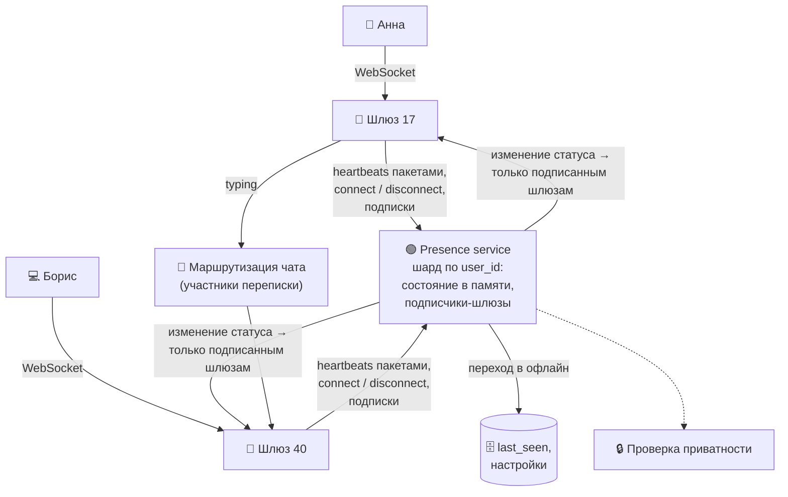
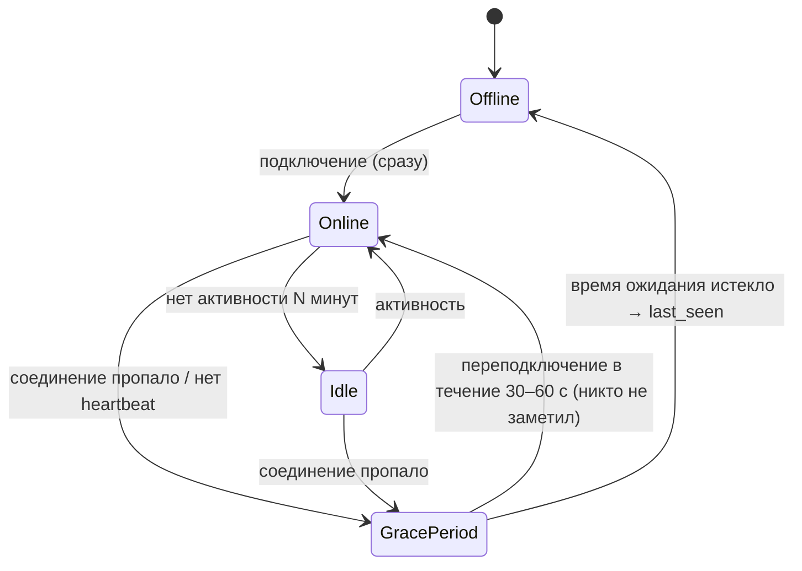
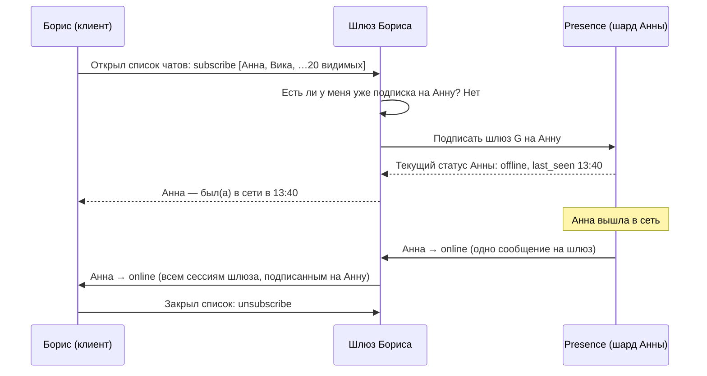
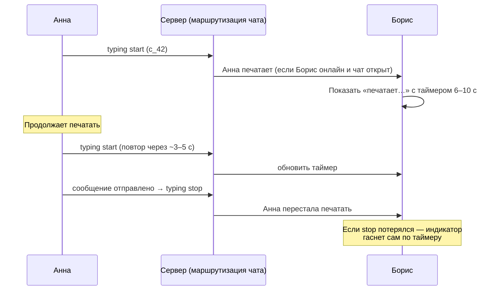

[English](README.md) | **Русский**

# Tier 2 · 4A · 05. Сервис presence и индикатор «печатает…»

> **Уровень:** Medium · **Время на интервью:** 45 мин · **Время на разбор:** ~3–4 ч
> **Ключевые аспекты:** определение онлайн и офлайн (соединения, heartbeats, TTL), борьба с мерцанием статуса, несколько устройств, модель подписок вместо рассылки всем контактам, агрегация подписок на шлюзах, хранение в памяти и восстановление без репликации, индикатор «печатает» как эфемерное событие, приватность, гонки переподключения, несколько регионов
> **Опирается на:** [Tier 1 · 06 Chat](../../../tier-1/06-chat-system/README_RU.md#13-deep-dive-7-присутствие-и-печатает), [12-communication](../../../12-communication/README_RU.md#8-масштабирование-websocket), [Tier 1 · 19 KV Store](../../../tier-1/19-distributed-kv-store/README_RU.md#11-deep-dive-6-членство-и-обнаружение-отказов) (обнаружение отказов), [Tier 2 · 4A · 03 Live Comments](../03-live-comments-reactions/README_RU.md#7-deep-dive-1-иерархическая-рассылка)

---

## 🗺️ Как читать этот разбор

Разбор построен как интервью, но в каждом шаге есть объяснения: **почему** принимается решение, **как работает** механизм и **что будет**, если сделать иначе. Блоки «📘 Объяснение» — теория прямо по ходу задачи.

| Значок | Что значит |
|:------:|:-----------|
| 🎤 | Реплика интервьюера |
| 🗣️ | Что говорю вслух я (кандидат) |
| ✏️ | Что рисую на доске |
| ⏱️ | Сколько времени тратить на шаг |
| 📘 | Подробное объяснение концепции |

Блоки **TIP** — хороший приём, **WARNING** — ловушка, **IMPORTANT** — сигнал для уровня Senior+.

---

## 📑 Содержание

0. [Чему учит эта задача](#0-чему-учит-эта-задача)
1. [Условие задачи](#1-условие-задачи)
2. [Уточняющие вопросы и требования](#2-уточняющие-вопросы-и-требования)
3. [Оценки нагрузки](#3-оценки-нагрузки)
4. [API и протокол](#4-api-и-протокол)
5. [Модель данных](#5-модель-данных)
6. [High-level дизайн](#6-high-level-дизайн)
7. [Deep dive 1: как понять, что пользователь онлайн или офлайн](#7-deep-dive-1-как-понять-что-пользователь-онлайн-или-офлайн)
8. [Deep dive 2: несколько устройств](#8-deep-dive-2-несколько-устройств)
9. [Deep dive 3: кому сообщать об изменениях](#9-deep-dive-3-кому-сообщать-об-изменениях)
10. [Deep dive 4: хранение и восстановление после сбоев](#10-deep-dive-4-хранение-и-восстановление-после-сбоев)
11. [Deep dive 5: индикатор «печатает…»](#11-deep-dive-5-индикатор-печатает)
12. [Deep dive 6: приватность и статусы](#12-deep-dive-6-приватность-и-статусы)
13. [Deep dive 7: гонки и консистентность](#13-deep-dive-7-гонки-и-консистентность)
14. [Deep dive 8: несколько регионов](#14-deep-dive-8-несколько-регионов)
15. [Узкие места и сценарии сбоев](#15-узкие-места-и-сценарии-сбоев)
16. [Что изменится при росте в 10 раз](#16-что-изменится-при-росте-в-10-раз)
17. [Ключевые концепции и новые понятия](#17-ключевые-концепции-и-новые-понятия)
18. [Варианты задачи и follow-up вопросы](#18-варианты-задачи-и-follow-up-вопросы)
19. [Типичные ошибки](#19-типичные-ошибки)
20. [Шпаргалка и самопроверка](#20-шпаргалка-и-самопроверка)

---

## 0. Чему учит эта задача

Зелёная точка «в сети» и надпись «печатает…» выглядят как мелочь, но это система, которая постоянно отслеживает **сотни миллионов** соединений и рассылает изменения тем, кому они интересны. Особенность задачи: данные **эфемерные** (ценность имеют только сейчас), их **очень много**, и **неточность в секунды допустима** — а значит, можно экономить почти на всём.

| Что проверяют | Где это в задаче |
|:--------------|:-----------------|
| Обнаружение отказов | Heartbeats, TTL, компромисс скорости и ложных срабатываний |
| Fan-out | Кому и как сообщать об изменении статуса |
| Модель подписок | Рассылать только тем, кто сейчас смотрит |
| Эфемерное состояние | Хранение в памяти, восстановление без репликации |
| Продуктовое мышление | Мерцание статуса, приватность, «был в сети» |
| Гонки | Переподключение к другому шлюзу |

> [!TIP]
> Главная мысль: **не рассылать изменение статуса всем контактам**. Посчитай, во что это обходится, и предложи подписку «только тех, у кого сейчас на экране этот пользователь». Это решение снижает нагрузку на порядок.

---

## 1. Условие задачи

> 🎤 «Спроектируй сервис присутствия для мессенджера: показывать, кто в сети, кто неактивен, когда был в сети последний раз, и индикатор “печатает…” в переписках».

**Что видит пользователь:**

```
Список контактов: у Анны зелёная точка, Борис — «был(а) в сети 12 минут назад»
Открыт чат с Анной: «в сети» → Анна начинает писать → «печатает…»
Анна закрыла приложение → через ~30 секунд «был(а) в сети только что»
Анна в метро, сеть пропадает на 5 секунд — статус НЕ мигает «офлайн/онлайн»
```

**План по времени:**

| Шаг | ⏱️ |
|:----|:--:|
| Требования | 4 мин |
| Оценки | 4 мин |
| API и данные | 5 мин |
| High-level дизайн | 5 мин |
| Deep dives | 22 мин |
| Итоги | 5 мин |

---

## 2. Уточняющие вопросы и требования

⏱️ 4 мин

| Мой вопрос | Ответ интервьюера | Что это меняет и почему |
|:-----------|:------------------|:------------------------|
| Масштаб? | 500M пользователей, ~100M одновременно онлайн | Сотни миллионов соединений и записей присутствия |
| Сколько контактов у пользователя? | В среднем ~300 | Рассылка всем контактам дорога |
| Какие статусы? | Онлайн, неактивен (idle), офлайн, «был в сети», «не беспокоить» | Состояние на устройство + агрегация |
| Как быстро виден переход? | Онлайн — за секунды; офлайн — допустимо до ~30–60 с | Отложенный офлайн против мерцания |
| Несколько устройств? | Да: телефон, ноутбук, веб | Статус = объединение устройств |
| «Печатает»? | Да, в личных и групповых чатах, задержка < 0,5 с | Эфемерные события через маршрутизацию чата |
| Приватность? | Можно скрыть статус и «был в сети» | Проверка на сервере |
| Нужна ли точность? | Нет, ошибка в секунды допустима | Хранение в памяти, без строгой консистентности |

### Функциональные требования

1. Статус пользователя: онлайн, неактивен, офлайн; «был в сети» с временем.
2. Получение статусов списка пользователей и подписка на изменения.
3. Индикатор «печатает…» в переписках.
4. Несколько устройств на пользователя.
5. Настройки приватности и ручные статусы («не беспокоить», свой статус).

### Нефункциональные требования

| Требование | Цель | Почему |
|:-----------|:-----|:-------|
| Задержка изменения «в сети» | Секунды | Пользователь хочет знать, ответят ли ему сейчас |
| Задержка «печатает» | < 500 мс | Иначе индикатор бесполезен |
| Стабильность | Без мерцания статуса при коротких обрывах | Мерцание раздражает и создаёт лишнюю нагрузку |
| Масштаб | 100M онлайн | Определяет архитектуру |
| Доступность | Сбой присутствия не мешает отправке сообщений | Присутствие — вспомогательная функция |
| Точность | Eventual, секунды | Строгость не нужна |

---

## 3. Оценки нагрузки

⏱️ 4 мин

```
Соединения:            100M одновременно
Heartbeats:            раз в 30 с → ~3,3M в секунду
                       → обрабатываются шлюзами, в сервис присутствия — только продления TTL пакетами

Изменения статуса:     ~10 в сутки на пользователя (входы, выходы, неактивность)
                       500M × 10 = 5B в сутки → ~58 000 изменений в секунду

Наивная рассылка:      58 000 × 300 контактов ≈ 17M уведомлений в секунду ❌
С подписками:          рассылать только тем, у кого сейчас открыт экран с этим пользователем
                       (обычно малая доля контактов) → в разы и на порядок меньше

«Печатает»:            ~10M пользователей активно переписываются,
                       событие раз в 3–5 с → ~2–3M событий в секунду,
                       каждое — только участникам одной переписки (1–несколько получателей)
```

### Выводы

| Вывод | Следствие для дизайна |
|:------|:----------------------|
| Heartbeats — миллионы в секунду | Не пускать их глубже шлюзов; агрегировать |
| Наивный fan-out — 17M в секунду | Модель подписок по интересу |
| Состояние — сотни миллионов маленьких записей | В памяти, шардирование по user_id |
| «Печатает» — много событий, но маленький fan-out | Маршрутизация через существующую доставку чата, без хранения |

---

## 4. API и протокол

⏱️ 3 мин

```
WebSocket (через шлюзы мессенджера):

Клиент → сервер
  { "type": "heartbeat", "state": "active" | "idle" }              ← раз в ~30 с или при смене состояния
  { "type": "presence.subscribe",   "user_ids": [9, 17, 42, …] }   ← кого я сейчас вижу на экране
  { "type": "presence.unsubscribe", "user_ids": [17] }
  { "type": "typing", "conv_id": "c_42", "state": "start" | "stop" }

Сервер → клиент
  { "type": "presence", "user_id": 9, "status": "online" | "idle" | "offline", "last_seen": "…" }
  { "type": "typing",   "conv_id": "c_42", "user_id": 9, "state": "start" }

REST
  GET  /v1/presence?ids=9,17,42           ← пакетный запрос текущих статусов
  PUT  /v1/me/presence-settings           { visible_to: "contacts", show_last_seen: false }
  PUT  /v1/me/status                      { mode: "dnd", until: "18:00", text: "В отпуске" }
```

---

## 5. Модель данных

⏱️ 3 мин

```
Присутствие (в памяти, шард по user_id):
  user:9 → {
    devices: {
      phone:  { session: "s-81", state: "active", last_heartbeat: 14:05:31, gateway: "gw-17" },
      laptop: { session: "s-92", state: "idle",   last_heartbeat: 14:05:10, gateway: "gw-40" }
    },
    status: "online",          ← вычисляется из устройств
    last_seen: 14:05:31,
    manual: { mode: "dnd", until: 18:00 }
  }

Подписки (на узле присутствия того же шарда):
  watched user:9 → { gw-3, gw-17, gw-88 }    ← шлюзы, у которых есть заинтересованные сессии

Долговременное (БД):
  last_seen (обновляется только при переходе в офлайн), настройки приватности, ручные статусы
```

| Данные | Хранилище | Почему |
|:-------|:----------|:-------|
| Текущее присутствие | В памяти узлов присутствия (или Redis с TTL) | Меняется постоянно, восстанавливается само |
| Подписки | В памяти | Пересоздаются шлюзами |
| «Был в сети» | БД, запись при уходе в офлайн | Должно переживать перезапуски; пишется редко |
| Настройки приватности | БД + кэш | Редко меняются, читаются часто |

---

## 6. High-level дизайн

⏱️ 5 мин



🗣️ «Ключевые решения:
- **шлюзы** держат соединения и сами обрабатывают heartbeats; в сервис присутствия уходят только события: подключился, отключился, сменил состояние, а также пакетные продления;
- **сервис присутствия** шардирован по `user_id`: хранит состояние в памяти и **список шлюзов-подписчиков** для каждого пользователя;
- изменение статуса рассылается **только подписанным шлюзам**, а они — своим сессиям;
- **«печатает»** вообще не проходит через сервис присутствия: это эфемерное событие, которое доставляется участникам переписки через маршрутизацию чата».

---

## 7. Deep dive 1: как понять, что пользователь онлайн или офлайн

> 🎤 «Как определить, что пользователь ушёл? Соединение может оборваться без закрытия».

### Сигналы

| Сигнал | Когда | Надёжность |
|:-------|:------|:-----------|
| Подключение WebSocket | Сразу | Надёжно → «онлайн» |
| Явный выход (logout, закрытие приложения с сообщением) | Сразу | Надёжно → «офлайн» |
| Закрытие TCP-соединения | Обычно сразу | Не всегда: при пропаже сети закрытие может не дойти |
| **Отсутствие heartbeat** | Через таймаут | Единственный способ обнаружить «тихий» обрыв |

### Компромисс таймаута

📘 Это та же задача, что обнаружение отказов в распределённых системах (см. [Tier 1 · 19](../../../tier-1/19-distributed-kv-store/README_RU.md#11-deep-dive-6-членство-и-обнаружение-отказов)): чем короче таймаут, тем быстрее замечаем уход, но тем чаще ложные срабатывания.

| Короткий TTL (5 с) | Длинный TTL (2 мин) |
|:-------------------|:--------------------|
| Быстро показываем «офлайн» | Статус «в сети» долго висит после ухода |
| Мерцание при каждом коротком обрыве сети | Стабильно |
| Частые heartbeats → больше нагрузки и расход батареи | Меньше нагрузки |

### Асимметрия: онлайн сразу, офлайн с задержкой ⭐



| Правило | Почему |
|:--------|:-------|
| **Переход в онлайн — сразу** | Пользователю важно быстро увидеть, что собеседник появился |
| **Переход в офлайн — после периода ожидания** (30–60 с) | Короткий обрыв в метро не вызывает «офлайн → онлайн» у всех контактов |
| «Был в сети» = время последней активности, а не время, когда истёк таймаут | Точнее для пользователя |
| Мобильное приложение ушло в фон | ОС приостанавливает соединение → через короткое время «неактивен», затем «офлайн» |

> [!IMPORTANT]
> **Сигнал Senior+:** назвать проблему **мерцания** и предложить асимметрию «онлайн сразу, офлайн с задержкой». LinkedIn описывал именно такой подход в своей платформе присутствия: отложенный таймер на переход в офлайн, который отменяется, если пользователь успел переподключиться.

### Heartbeats без нагрузки на сервис присутствия

| Решение | Почему |
|:--------|:-------|
| Heartbeat обрабатывает **шлюз**: обновляет время в памяти соединения | 3,3M в секунду не доходят до сервиса присутствия |
| Шлюз раз в N секунд отправляет **пакетное продление** «эти 100 000 сессий живы» | Одно сообщение вместо 100 000 |
| Сервис присутствия получает индивидуальные события только при **изменениях** | Подключение, отключение, смена active/idle |

---

## 8. Deep dive 2: несколько устройств

> 🎤 «Анна в сети с ноутбука, телефон у неё в кармане. Какой статус показывать?»

📘 Присутствие хранится **по устройствам**, а статус пользователя **вычисляется** из них:

```
Приоритет: active > idle > offline

phone:  idle    (приложение в фоне)
laptop: active  (печатает)
web:    —       (не подключена)

Статус Анны = active → «в сети»
last_seen = максимум последней активности по устройствам
```

| Решение | Почему |
|:--------|:-------|
| Запись на каждое устройство со своим TTL | Устройства подключаются и уходят независимо |
| Статус пользователя меняется, только если изменился **итог** | Ноутбук ушёл в офлайн, телефон активен → для контактов ничего не изменилось, рассылки нет |
| «Не беспокоить» перекрывает всё | Ручной статус приоритетнее вычисленного |

---

## 9. Deep dive 3: кому сообщать об изменениях

> 🎤 «Анна вышла в сеть. У неё 300 контактов. Кому отправить уведомление?»

### Варианты

| Подход | Как | Проблема |
|:-------|:----|:---------|
| **Push всем контактам** | При изменении — уведомить всех контактов | ~17M уведомлений в секунду; большинство контактов не смотрят на Анну прямо сейчас |
| **Pull по запросу** | Клиент запрашивает статусы, когда открывает экран | Нет обновлений в реальном времени; частый опрос дорог |
| **Подписка по интересу** ⭐ | Клиент подписывается на статусы тех, кого сейчас видит на экране | Рассылка только реально заинтересованным |

### Подписка по интересу



| Решение | Почему |
|:--------|:-------|
| Подписка только на **видимых** на экране | Список из 300 контактов на экране показывает 15–20 |
| **Агрегация на шлюзе** | Если 500 сессий на шлюзе смотрят на Анну, шлюз подписан один раз — та же идея, что в [живых комментариях](../03-live-comments-reactions/README_RU.md#7-deep-dive-1-иерархическая-рассылка) |
| Подписка с TTL | Если шлюз упал и не отписался — подписка истечёт сама |
| Начальный статус при подписке | Не нужен отдельный запрос |

### Большие списки и популярные пользователи

| Ситуация | Решение |
|:---------|:--------|
| Рабочее пространство на 100 000 участников (Slack) | Подписка только на видимых в списке; обновления для больших списков — пакетами раз в несколько секунд |
| Знаменитость, на которую смотрят миллионы | Не рассылать каждое изменение: клиенты получают статус при открытии и редкие обновления (или статус не показывается вовсе) |
| Частые изменения одного пользователя | Объединять изменения за короткое окно (последнее побеждает) |

> [!TIP]
> Хорошая формулировка: «Присутствие нужно **только тем, кто сейчас смотрит**. Поэтому мы превращаем задачу “разослать всем контактам” в задачу “разослать текущим зрителям” — их обычно в разы меньше».

---

## 10. Deep dive 4: хранение и восстановление после сбоев

> 🎤 «Где хранить присутствие 100 миллионов пользователей и что будет, если узел упадёт?»

### Хранение

| Решение | Почему |
|:--------|:-------|
| В памяти, шардирование по `user_id` (consistent hashing) | Сотни миллионов маленьких записей, постоянные изменения |
| Redis с TTL или собственный сервис | TTL на запись устройства — автоматический переход в офлайн |
| ~200 Б на пользователя × 100M | ~20 ГБ — легко распределяется по кластеру |

### Восстановление без репликации

📘 Присутствие — **производные данные**: источник правды — живые соединения клиентов. Если узел присутствия упал и потерял состояние:

1. Шлюзы замечают недоступность и переключаются на новый узел для этого шарда.
2. При следующем пакетном продлении (через несколько секунд) шлюзы сообщают, какие сессии живы, — состояние восстанавливается.
3. Шлюзы заново оформляют подписки своих сессий (они знают, кто на что подписан).

Это та же идея, что с геоиндексом в [Uber](../../../tier-1/11-uber/README_RU.md#14-deep-dive-8-гео-шардирование-и-отказоустойчивость): эфемерные данные не нужно сохранять долговечно, они восстанавливаются из потока.

| Решение | Почему |
|:--------|:-------|
| Реплика в памяти (опционально) | Ускоряет переключение, но не обязательна |
| На время восстановления — показывать последнее известное или «неизвестно» | Лучше, чем ложный «офлайн» у всех |
| «Был в сети» — в БД | Единственное, что должно пережить сбой |

---

## 11. Deep dive 5: индикатор «печатает…»

> 🎤 «Как реализовать “печатает…”?»

### Протокол



| Правило | Почему |
|:--------|:-------|
| **Не хранить** | Событие имеет смысл только в эту секунду |
| **Не доставлять офлайн** | «Анна печатала час назад» никому не нужно |
| **Ограничение частоты**: start не чаще раза в 3–5 с | Иначе событие на каждое нажатие клавиши |
| **Таймер у получателя** (6–10 с) | Если stop потерялся или приложение Анны закрылось — индикатор не «зависает» |
| Доставка через **маршрутизацию чата** | Участники переписки и их шлюзы уже известны (см. [Tier 1 · 06](../../../tier-1/06-chat-system/README_RU.md#13-deep-dive-7-присутствие-и-печатает)) |
| Только тем, у кого **открыт чат** | В списке чатов «печатает» можно показывать, но с меньшим приоритетом |
| Большие группы | «Несколько человек печатают» и ограничение на число рассылаемых событий |

---

## 12. Deep dive 6: приватность и статусы

> 🎤 «Пользователь не хочет, чтобы видели, когда он был в сети. Как это учесть?»

| Настройка | Реализация |
|:----------|:-----------|
| **Кто видит мой статус**: все, контакты, никто | Проверка при подписке и при пакетном запросе — **на сервере** |
| **Скрыть «был в сети»** | Возвращать только «в сети» или ничего; во многих мессенджерах правило взаимности: скрыл своё — не видишь чужое |
| **Невидимка** | Пользователь онлайн, но для остальных — офлайн; сам видит статусы других (если правила позволяют) |
| **«Не беспокоить»** с временем окончания | Ручной статус с TTL; уведомления приглушаются |
| **Свой статус** («В отпуске») | Текст и эмодзи с временем окончания |
| Блокировка | Заблокированный не видит статус |

> [!WARNING]
> Проверять приватность нужно **на сервере** при выдаче статуса. Если сервер отправит статус всем, а клиент «спрячет» его, данные можно перехватить модифицированным клиентом.

---

## 13. Deep dive 7: гонки и консистентность

> 🎤 «Телефон Анны переключился с Wi-Fi на мобильную сеть и подключился к другому шлюзу раньше, чем старый шлюз заметил разрыв. Что будет?»

### Гонка переподключения

```
14:05:00  Новый шлюз G2: Анна (phone) подключилась, session s-2 → online
14:05:20  Старый шлюз G1: наконец заметил разрыв сессии s-1 → disconnect(Анна, phone)

Если обработать disconnect как «телефон Анны офлайн» — неверно: телефон уже подключён через G2 ❌
```

| Решение | Как |
|:--------|:----|
| **Идентификатор сессии** на каждое подключение | Отключение относится к конкретной сессии `s-1`; если для устройства уже есть более новая сессия `s-2` — отключение игнорируется |
| Монотонный номер сессии или время подключения по серверу | Определить, какая сессия новее |
| Серверное время | Время клиентов не используется для решений |

### Консистентность

| Свойство | Почему достаточно |
|:---------|:------------------|
| Eventual consistency, задержка секунды | Статус — подсказка, а не точные данные |
| Разные зрители могут увидеть изменение с разницей в доли секунды | Незаметно |
| «Был в сети 2 минуты назад» | Клиент вычисляет относительное время из абсолютного `last_seen` |

---

## 14. Deep dive 8: несколько регионов

> 🎤 «Анна в Европе, её друг — в США. Как он видит её статус?»

| Решение | Как |
|:--------|:----|
| Присутствие пользователя хранится в регионе, где он подключён | Heartbeats и изменения — локально |
| Подписка из другого региона | Шлюз в США подписывается через **региональный ретранслятор**, который подписан на шард Анны в Европе |
| Рассылка | Изменение Анны → ретранслятор США (один раз) → шлюзы США → зрители |
| Пользователь переехал (подключился в другом регионе) | Новый регион становится домашним для его присутствия; старая запись истекает по TTL |
| Задержка | Межрегиональная — сотни миллисекунд, для присутствия приемлемо |

---

## 15. Узкие места и сценарии сбоев

| Сценарий | Что произойдёт | Как защищаемся |
|:---------|:---------------|:---------------|
| Heartbeats в миллионах в секунду | Перегрузка сервиса присутствия | Обработка на шлюзах, пакетные продления |
| Рассылка всем контактам | 17M уведомлений в секунду | Подписки по интересу, агрегация на шлюзах |
| Мерцание статуса | Шум у контактов и нагрузка | Период ожидания перед офлайн |
| «Тихий» обрыв соединения | Статус «в сети» висит | TTL по heartbeats |
| Узел присутствия упал | Потеряно состояние шарда | Восстановление из пакетных продлений и переподписки шлюзов |
| Гонка переподключения | Ложный офлайн | Идентификаторы сессий |
| Знаменитость | Миллионы подписчиков | Без рассылки изменений, статус по запросу |
| «Печатает» не погас | Ложный индикатор | Таймер у получателя |
| Сбой присутствия | Нет зелёных точек | Сообщения работают независимо |
| Обход приватности | Утечка «был в сети» | Проверка на сервере |

---

## 16. Что изменится при росте в 10 раз

> 🎤 «1 миллиард пользователей онлайн?»

| Изменение | Почему |
|:----------|:-------|
| **Ещё более грубые обновления** для больших списков | Объём подписок |
| **Адаптивный интервал heartbeat** (реже для неактивных, особенно на мобильных) | Батарея и нагрузка |
| **Иерархия ретрансляторов** между регионами и шлюзами | Как в живых комментариях |
| **Выборочное присутствие**: показывать только для недавних собеседников | Продуктовое упрощение, которое снижает нагрузку |

---

## 17. Ключевые концепции и новые понятия

### Что применяется

| Концепция | Где разобрана | Как применяется здесь |
|:----------|:--------------|:----------------------|
| Присутствие и «печатает» в чате | [Tier 1 · 06](../../../tier-1/06-chat-system/README_RU.md#13-deep-dive-7-присутствие-и-печатает) | Базовые идеи |
| WebSocket-шлюзы, реестр сессий | [12-communication](../../../12-communication/README_RU.md#8-масштабирование-websocket) | Соединения |
| Обнаружение отказов, gossip | [Tier 1 · 19](../../../tier-1/19-distributed-kv-store/README_RU.md#11-deep-dive-6-членство-и-обнаружение-отказов) | Heartbeats и TTL |
| Агрегация подписок на шлюзах | [Tier 2 · 4A · 03](../03-live-comments-reactions/README_RU.md#7-deep-dive-1-иерархическая-рассылка) | Рассылка изменений |
| Восстановление эфемерных данных | [Tier 1 · 11](../../../tier-1/11-uber/README_RU.md#14-deep-dive-8-гео-шардирование-и-отказоустойчивость) | Присутствие без репликации |

### Новые понятия этой задачи

| Понятие | Кратко |
|:--------|:-------|
| **Heartbeat и TTL** | Периодический сигнал «жив» и срок, после которого запись истекает |
| **Мерцание (flapping)** | Частая смена онлайн/офлайн при коротких обрывах |
| **Период ожидания перед офлайн** | Задержка объявления офлайн, отменяемая переподключением |
| **Присутствие по устройствам** | Статус пользователя — объединение статусов устройств |
| **Подписка по интересу** | Получать изменения только тех, кто сейчас на экране |
| **Пакетное продление** | Шлюз подтверждает живость многих сессий одним сообщением |
| **Идентификатор сессии** | Защита от гонок переподключения |
| **Эфемерное событие** | «Печатает» — без хранения и без доставки офлайн |

---

## 18. Варианты задачи и follow-up вопросы

<details>
<summary><b>Как показать «был в сети 5 минут назад» без постоянных обновлений?</b></summary>

Сервер присылает абсолютное время `last_seen` один раз (при подписке или переходе в офлайн), а клиент сам вычисляет «5 минут назад» и обновляет надпись локально по таймеру. Сетевых сообщений не нужно.
</details>

<details>
<summary><b>Как присутствие связано с отметками «прочитано»?</b></summary>

Это разные механизмы: «прочитано» — долговечное событие, которое сохраняется (водяные знаки в чате), а присутствие — эфемерное состояние. Но оба используют одни и те же соединения и шлюзы.
</details>

<details>
<summary><b>Как реализовать статус «в звонке» или «на встрече»?</b></summary>

Как ручной или автоматический статус с TTL: сервис звонков или календарь устанавливает статус пользователю на время события; он приоритетнее вычисленного и снимается по окончании или по истечении TTL.
</details>

<details>
<summary><b>Почему бы не хранить присутствие в обычной базе данных?</b></summary>

Миллионы изменений и продлений в секунду, а ценность данных — секунды. База с журналом и репликацией тратила бы ресурсы на долговечность, которая не нужна. Хранилище в памяти с TTL дешевле и естественно поддерживает истечение записей.
</details>

<details>
<summary><b>Как работает присутствие, если пользователь не держит соединение (мобильное приложение в фоне)?</b></summary>

Пока приложение в фоне, ОС приостанавливает соединение. Пользователь становится «неактивен», затем «офлайн» с `last_seen` = последняя активность. Push-уведомления о сообщениях идут отдельно, через систему уведомлений, и не меняют статус.
</details>

---

## 19. Типичные ошибки

| ❌ Ошибка | Почему плохо | ✅ Как правильно |
|:---------|:-----[English](README.md) | **Русский**

# Tier 2 · 4A · 05. Сервис presence и индикатор «печатает…»

> **Уровень:** Medium · **Время на интервью:** 45 мин · **Время на разбор:** ~3–4 ч
> **Ключевые аспекты:** определение онлайн и офлайн (соединения, heartbeats, TTL), борьба с мерцанием статуса, несколько устройств, модель подписок вместо рассылки всем контактам, агрегация подписок на шлюзах, хранение в памяти и восстановление без репликации, индикатор «печатает» как эфемерное событие, приватность, гонки переподключения, несколько регионов
> **Опирается на:** [Tier 1 · 06 Chat](../../../tier-1/06-chat-system/README_RU.md#13-deep-dive-7-присутствие-и-печатает), [12-communication](../../../12-communication/README_RU.md#8-масштабирование-websocket), [Tier 1 · 19 KV Store](../../../tier-1/19-distributed-kv-store/README_RU.md#11-deep-dive-6-членство-и-обнаружение-отказов) (обнаружение отказов), [Tier 2 · 4A · 03 Live Comments](../03-live-comments-reactions/README_RU.md#7-deep-dive-1-иерархическая-рассылка)

---

## 🗺️ Как читать этот разбор

Разбор построен как интервью, но в каждом шаге есть объяснения: **почему** принимается решение, **как работает** механизм и **что будет**, если сделать иначе. Блоки «📘 Объяснение» — теория прямо по ходу задачи.

| Значок | Что значит |
|:------:|:-----------|
| 🎤 | Реплика интервьюера |
| 🗣️ | Что говорю вслух я (кандидат) |
| ✏️ | Что рисую на доске |
| ⏱️ | Сколько времени тратить на шаг |
| 📘 | Подробное объяснение концепции |

Блоки **TIP** — хороший приём, **WARNING** — ловушка, **IMPORTANT** — сигнал для уровня Senior+.

---

## 📑 Содержание

0. [Чему учит эта задача](#0-чему-учит-эта-задача)
1. [Условие задачи](#1-условие-задачи)
2. [Уточняющие вопросы и требования](#2-уточняющие-вопросы-и-требования)
3. [Оценки нагрузки](#3-оценки-нагрузки)
4. [API и протокол](#4-api-и-протокол)
5. [Модель данных](#5-модель-данных)
6. [High-level дизайн](#6-high-level-дизайн)
7. [Deep dive 1: как понять, что пользователь онлайн или офлайн](#7-deep-dive-1-как-понять-что-пользователь-онлайн-или-офлайн)
8. [Deep dive 2: несколько устройств](#8-deep-dive-2-несколько-устройств)
9. [Deep dive 3: кому сообщать об изменениях](#9-deep-dive-3-кому-сообщать-об-изменениях)
10. [Deep dive 4: хранение и восстановление после сбоев](#10-deep-dive-4-хранение-и-восстановление-после-сбоев)
11. [Deep dive 5: индикатор «печатает…»](#11-deep-dive-5-индикатор-печатает)
12. [Deep dive 6: приватность и статусы](#12-deep-dive-6-приватность-и-статусы)
13. [Deep dive 7: гонки и консистентность](#13-deep-dive-7-гонки-и-консистентность)
14. [Deep dive 8: несколько регионов](#14-deep-dive-8-несколько-регионов)
15. [Узкие места и сценарии сбоев](#15-узкие-места-и-сценарии-сбоев)
16. [Что изменится при росте в 10 раз](#16-что-изменится-при-росте-в-10-раз)
17. [Ключевые концепции и новые понятия](#17-ключевые-концепции-и-новые-понятия)
18. [Варианты задачи и follow-up вопросы](#18-варианты-задачи-и-follow-up-вопросы)
19. [Типичные ошибки](#19-типичные-ошибки)
20. [Шпаргалка и самопроверка](#20-шпаргалка-и-самопроверка)

---

## 0. Чему учит эта задача

Зелёная точка «в сети» и надпись «печатает…» выглядят как мелочь, но это система, которая постоянно отслеживает **сотни миллионов** соединений и рассылает изменения тем, кому они интересны. Особенность задачи: данные **эфемерные** (ценность имеют только сейчас), их **очень много**, и **неточность в секунды допустима** — а значит, можно экономить почти на всём.

| Что проверяют | Где это в задаче |
|:--------------|:-----------------|
| Обнаружение отказов | Heartbeats, TTL, компромисс скорости и ложных срабатываний |
| Fan-out | Кому и как сообщать об изменении статуса |
| Модель подписок | Рассылать только тем, кто сейчас смотрит |
| Эфемерное состояние | Хранение в памяти, восстановление без репликации |
| Продуктовое мышление | Мерцание статуса, приватность, «был в сети» |
| Гонки | Переподключение к другому шлюзу |

> [!TIP]
> Главная мысль: **не рассылать изменение статуса всем контактам**. Посчитай, во что это обходится, и предложи подписку «только тех, у кого сейчас на экране этот пользователь». Это решение снижает нагрузку на порядок.

---

## 1. Условие задачи

> 🎤 «Спроектируй сервис присутствия для мессенджера: показывать, кто в сети, кто неактивен, когда был в сети последний раз, и индикатор “печатает…” в переписках».

**Что видит пользователь:**

```
Список контактов: у Анны зелёная точка, Борис — «был(а) в сети 12 минут назад»
Открыт чат с Анной: «в сети» → Анна начинает писать → «печатает…»
Анна закрыла приложение → через ~30 секунд «был(а) в сети только что»
Анна в метро, сеть пропадает на 5 секунд — статус НЕ мигает «офлайн/онлайн»
```

**План по времени:**

| Шаг | ⏱️ |
|:----|:--:|
| Требования | 4 мин |
| Оценки | 4 мин |
| API и данные | 5 мин |
| High-level дизайн | 5 мин |
| Deep dives | 22 мин |
| Итоги | 5 мин |

---

## 2. Уточняющие вопросы и требования

⏱️ 4 мин

| Мой вопрос | Ответ интервьюера | Что это меняет и почему |
|:-----------|:------------------|:------------------------|
| Масштаб? | 500M пользователей, ~100M одновременно онлайн | Сотни миллионов соединений и записей присутствия |
| Сколько контактов у пользователя? | В среднем ~300 | Рассылка всем контактам дорога |
| Какие статусы? | Онлайн, неактивен (idle), офлайн, «был в сети», «не беспокоить» | Состояние на устройство + агрегация |
| Как быстро виден переход? | Онлайн — за секунды; офлайн — допустимо до ~30–60 с | Отложенный офлайн против мерцания |
| Несколько устройств? | Да: телефон, ноутбук, веб | Статус = объединение устройств |
| «Печатает»? | Да, в личных и групповых чатах, задержка < 0,5 с | Эфемерные события через маршрутизацию чата |
| Приватность? | Можно скрыть статус и «был в сети» | Проверка на сервере |
| Нужна ли точность? | Нет, ошибка в секунды допустима | Хранение в памяти, без строгой консистентности |

### Функциональные требования

1. Статус пользователя: онлайн, неактивен, офлайн; «был в сети» с временем.
2. Получение статусов списка пользователей и подписка на изменения.
3. Индикатор «печатает…» в переписках.
4. Несколько устройств на пользователя.
5. Настройки приватности и ручные статусы («не беспокоить», свой статус).

### Нефункциональные требования

| Требование | Цель | Почему |
|:-----------|:-----|:-------|
| Задержка изменения «в сети» | Секунды | Пользователь хочет знать, ответят ли ему сейчас |
| Задержка «печатает» | < 500 мс | Иначе индикатор бесполезен |
| Стабильность | Без мерцания статуса при коротких обрывах | Мерцание раздражает и создаёт лишнюю нагрузку |
| Масштаб | 100M онлайн | Определяет архитектуру |
| Доступность | Сбой присутствия не мешает отправке сообщений | Присутствие — вспомогательная функция |
| Точность | Eventual, секунды | Строгость не нужна |

---

## 3. Оценки нагрузки

⏱️ 4 мин

```
Соединения:            100M одновременно
Heartbeats:            раз в 30 с → ~3,3M в секунду
                       → обрабатываются шлюзами, в сервис присутствия — только продления TTL пакетами

Изменения статуса:     ~10 в сутки на пользователя (входы, выходы, неактивность)
                       500M × 10 = 5B в сутки → ~58 000 изменений в секунду

Наивная рассылка:      58 000 × 300 контактов ≈ 17M уведомлений в секунду ❌
С подписками:          рассылать только тем, у кого сейчас открыт экран с этим пользователем
                       (обычно малая доля контактов) → в разы и на порядок меньше

«Печатает»:            ~10M пользователей активно переписываются,
                       событие раз в 3–5 с → ~2–3M событий в секунду,
                       каждое — только участникам одной переписки (1–несколько получателей)
```

### Выводы

| Вывод | Следствие для дизайна |
|:------|:----------------------|
| Heartbeats — миллионы в секунду | Не пускать их глубже шлюзов; агрегировать |
| Наивный fan-out — 17M в секунду | Модель подписок по интересу |
| Состояние — сотни миллионов маленьких записей | В памяти, шардирование по user_id |
| «Печатает» — много событий, но маленький fan-out | Маршрутизация через существующую доставку чата, без хранения |

---

## 4. API и протокол

⏱️ 3 мин

```
WebSocket (через шлюзы мессенджера):

Клиент → сервер
  { "type": "heartbeat", "state": "active" | "idle" }              ← раз в ~30 с или при смене состояния
  { "type": "presence.subscribe",   "user_ids": [9, 17, 42, …] }   ← кого я сейчас вижу на экране
  { "type": "presence.unsubscribe", "user_ids": [17] }
  { "type": "typing", "conv_id": "c_42", "state": "start" | "stop" }

Сервер → клиент
  { "type": "presence", "user_id": 9, "status": "online" | "idle" | "offline", "last_seen": "…" }
  { "type": "typing",   "conv_id": "c_42", "user_id": 9, "state": "start" }

REST
  GET  /v1/presence?ids=9,17,42           ← пакетный запрос текущих статусов
  PUT  /v1/me/presence-settings           { visible_to: "contacts", show_last_seen: false }
  PUT  /v1/me/status                      { mode: "dnd", until: "18:00", text: "В отпуске" }
```

---

## 5. Модель данных

⏱️ 3 мин

```
Присутствие (в памяти, шард по user_id):
  user:9 → {
    devices: {
      phone:  { session: "s-81", state: "active", last_heartbeat: 14:05:31, gateway: "gw-17" },
      laptop: { session: "s-92", state: "idle",   last_heartbeat: 14:05:10, gateway: "gw-40" }
    },
    status: "online",          ← вычисляется из устройств
    last_seen: 14:05:31,
    manual: { mode: "dnd", until: 18:00 }
  }

Подписки (на узле присутствия того же шарда):
  watched user:9 → { gw-3, gw-17, gw-88 }    ← шлюзы, у которых есть заинтересованные сессии

Долговременное (БД):
  last_seen (обновляется только при переходе в офлайн), настройки приватности, ручные статусы
```

| Данные | Хранилище | Почему |
|:-------|:----------|:-------|
| Текущее присутствие | В памяти узлов присутствия (или Redis с TTL) | Меняется постоянно, восстанавливается само |
| Подписки | В памяти | Пересоздаются шлюзами |
| «Был в сети» | БД, запись при уходе в офлайн | Должно переживать перезапуски; пишется редко |
| Настройки приватности | БД + кэш | Редко меняются, читаются часто |

---

## 6. High-level дизайн

⏱️ 5 мин


🗣️ «Ключевые решения:
- **шлюзы** держат соединения и сами обрабатывают heartbeats; в сервис присутствия уходят только события: подключился, отключился, сменил состояние, а также пакетные продления;
- **сервис присутствия** шардирован по `user_id`: хранит состояние в памяти и **список шлюзов-подписчиков** для каждого пользователя;
- изменение статуса рассылается **только подписанным шлюзам**, а они — своим сессиям;
- **«печатает»** вообще не проходит через сервис присутствия: это эфемерное событие, которое доставляется участникам переписки через маршрутизацию чата».

---

## 7. Deep dive 1: как понять, что пользователь онлайн или офлайн

> 🎤 «Как определить, что пользователь ушёл? Соединение может оборваться без закрытия».

### Сигналы

| Сигнал | Когда | Надёжность |
|:-------|:------|:-----------|
| Подключение WebSocket | Сразу | Надёжно → «онлайн» |
| Явный выход (logout, закрытие приложения с сообщением) | Сразу | Надёжно → «офлайн» |
| Закрытие TCP-соединения | Обычно сразу | Не всегда: при пропаже сети закрытие может не дойти |
| **Отсутствие heartbeat** | Через таймаут | Единственный способ обнаружить «тихий» обрыв |

### Компромисс таймаута

📘 Это та же задача, что обнаружение отказов в распределённых системах (см. [Tier 1 · 19](../../../tier-1/19-distributed-kv-store/README_RU.md#11-deep-dive-6-членство-и-обнаружение-отказов)): чем короче таймаут, тем быстрее замечаем уход, но тем чаще ложные срабатывания.

| Короткий TTL (5 с) | Длинный TTL (2 мин) |
|:-------------------|:--------------------|
| Быстро показываем «офлайн» | Статус «в сети» долго висит после ухода |
| Мерцание при каждом коротком обрыве сети | Стабильно |
| Частые heartbeats → больше нагрузки и расход батареи | Меньше нагрузки |

### Асимметрия: онлайн сразу, офлайн с задержкой ⭐


| Правило | Почему |
|:--------|:-------|
| **Переход в онлайн — сразу** | Пользователю важно быстро увидеть, что собеседник появился |
| **Переход в офлайн — после периода ожидания** (30–60 с) | Короткий обрыв в метро не вызывает «офлайн → онлайн» у всех контактов |
| «Был в сети» = время последней активности, а не время, когда истёк таймаут | Точнее для пользователя |
| Мобильное приложение ушло в фон | ОС приостанавливает соединение → через короткое время «неактивен», затем «офлайн» |

> [!IMPORTANT]
> **Сигнал Senior+:** назвать проблему **мерцания** и предложить асимметрию «онлайн сразу, офлайн с задержкой». LinkedIn описывал именно такой подход в своей платформе присутствия: отложенный таймер на переход в офлайн, который отменяется, если пользователь успел переподключиться.

### Heartbeats без нагрузки на сервис присутствия

| Решение | Почему |
|:--------|:-------|
| Heartbeat обрабатывает **шлюз**: обновляет время в памяти соединения | 3,3M в секунду не доходят до сервиса присутствия |
| Шлюз раз в N секунд отправляет **пакетное продление** «эти 100 000 сессий живы» | Одно сообщение вместо 100 000 |
| Сервис присутствия получает индивидуальные события только при **изменениях** | Подключение, отключение, смена active/idle |

---

## 8. Deep dive 2: несколько устройств

> 🎤 «Анна в сети с ноутбука, телефон у неё в кармане. Какой статус показывать?»

📘 Присутствие хранится **по устройствам**, а статус пользователя **вычисляется** из них:

```
Приоритет: active > idle > offline

phone:  idle    (приложение в фоне)
laptop: active  (печатает)
web:    —       (не подключена)

Статус Анны = active → «в сети»
last_seen = максимум последней активности по устройствам
```

| Решение | Почему |
|:--------|:-------|
| Запись на каждое устройство со своим TTL | Устройства подключаются и уходят независимо |
| Статус пользователя меняется, только если изменился **итог** | Ноутбук ушёл в офлайн, телефон активен → для контактов ничего не изменилось, рассылки нет |
| «Не беспокоить» перекрывает всё | Ручной статус приоритетнее вычисленного |

---

## 9. Deep dive 3: кому сообщать об изменениях

> 🎤 «Анна вышла в сеть. У неё 300 контактов. Кому отправить уведомление?»

### Варианты

| Подход | Как | Проблема |
|:-------|:----|:---------|
| **Push всем контактам** | При изменении — уведомить всех контактов | ~17M уведомлений в секунду; большинство контактов не смотрят на Анну прямо сейчас |
| **Pull по запросу** | Клиент запрашивает статусы, когда открывает экран | Нет обновлений в реальном времени; частый опрос дорог |
| **Подписка по интересу** ⭐ | Клиент подписывается на статусы тех, кого сейчас видит на экране | Рассылка только реально заинтересованным |

### Подписка по интересу


| Решение | Почему |
|:--------|:-------|
| Подписка только на **видимых** на экране | Список из 300 контактов на экране показывает 15–20 |
| **Агрегация на шлюзе** | Если 500 сессий на шлюзе смотрят на Анну, шлюз подписан один раз — та же идея, что в [живых комментариях](../03-live-comments-reactions/README_RU.md#7-deep-dive-1-иерархическая-рассылка) |
| Подписка с TTL | Если шлюз упал и не отписался — подписка истечёт сама |
| Начальный статус при подписке | Не нужен отдельный запрос |

### Большие списки и популярные пользователи

| Ситуация | Решение |
|:---------|:--------|
| Рабочее пространство на 100 000 участников (Slack) | Подписка только на видимых в списке; обновления для больших списков — пакетами раз в несколько секунд |
| Знаменитость, на которую смотрят миллионы | Не рассылать каждое изменение: клиенты получают статус при открытии и редкие обновления (или статус не показывается вовсе) |
| Частые изменения одного пользователя | Объединять изменения за короткое окно (последнее побеждает) |

> [!TIP]
> Хорошая формулировка: «Присутствие нужно **только тем, кто сейчас смотрит**. Поэтому мы превращаем задачу “разослать всем контактам” в задачу “разослать текущим зрителям” — их обычно в разы меньше».

---

## 10. Deep dive 4: хранение и восстановление после сбоев

> 🎤 «Где хранить присутствие 100 миллионов пользователей и что будет, если узел упадёт?»

### Хранение

| Решение | Почему |
|:--------|:-------|
| В памяти, шардирование по `user_id` (consistent hashing) | Сотни миллионов маленьких записей, постоянные изменения |
| Redis с TTL или собственный сервис | TTL на запись устройства — автоматический переход в офлайн |
| ~200 Б на пользователя × 100M | ~20 ГБ — легко распределяется по кластеру |

### Восстановление без репликации

📘 Присутствие — **производные данные**: источник правды — живые соединения клиентов. Если узел присутствия упал и потерял состояние:

1. Шлюзы замечают недоступность и переключаются на новый узел для этого шарда.
2. При следующем пакетном продлении (через несколько секунд) шлюзы сообщают, какие сессии живы, — состояние восстанавливается.
3. Шлюзы заново оформляют подписки своих сессий (они знают, кто на что подписан).

Это та же идея, что с геоиндексом в [Uber](../../../tier-1/11-uber/README_RU.md#14-deep-dive-8-гео-шардирование-и-отказоустойчивость): эфемерные данные не нужно сохранять долговечно, они восстанавливаются из потока.

| Решение | Почему |
|:--------|:-------|
| Реплика в памяти (опционально) | Ускоряет переключение, но не обязательна |
| На время восстановления — показывать последнее известное или «неизвестно» | Лучше, чем ложный «офлайн» у всех |
| «Был в сети» — в БД | Единственное, что должно пережить сбой |

---

## 11. Deep dive 5: индикатор «печатает…»

> 🎤 «Как реализовать “печатает…”?»

### Протокол


| Правило | Почему |
|:--------|:-------|
| **Не хранить** | Событие имеет смысл только в эту секунду |
| **Не доставлять офлайн** | «Анна печатала час назад» никому не нужно |
| **Ограничение частоты**: start не чаще раза в 3–5 с | Иначе событие на каждое нажатие клавиши |
| **Таймер у получателя** (6–10 с) | Если stop потерялся или приложение Анны закрылось — индикатор не «зависает» |
| Доставка через **маршрутизацию чата** | Участники переписки и их шлюзы уже известны (см. [Tier 1 · 06](../../../tier-1/06-chat-system/README_RU.md#13-deep-dive-7-присутствие-и-печатает)) |
| Только тем, у кого **открыт чат** | В списке чатов «печатает» можно показывать, но с меньшим приоритетом |
| Большие группы | «Несколько человек печатают» и ограничение на число рассылаемых событий |

---

## 12. Deep dive 6: приватность и статусы

> 🎤 «Пользователь не хочет, чтобы видели, когда он был в сети. Как это учесть?»

| Настройка | Реализация |
|:----------|:-----------|
| **Кто видит мой статус**: все, контакты, никто | Проверка при подписке и при пакетном запросе — **на сервере** |
| **Скрыть «был в сети»** | Возвращать только «в сети» или ничего; во многих мессенджерах правило взаимности: скрыл своё — не видишь чужое |
| **Невидимка** | Пользователь онлайн, но для остальных — офлайн; сам видит статусы других (если правила позволяют) |
| **«Не беспокоить»** с временем окончания | Ручной статус с TTL; уведомления приглушаются |
| **Свой статус** («В отпуске») | Текст и эмодзи с временем окончания |
| Блокировка | Заблокированный не видит статус |

> [!WARNING]
> Проверять приватность нужно **на сервере** при выдаче статуса. Если сервер отправит статус всем, а клиент «спрячет» его, данные можно перехватить модифицированным клиентом.

---

## 13. Deep dive 7: гонки и консистентность

> 🎤 «Телефон Анны переключился с Wi-Fi на мобильную сеть и подключился к другому шлюзу раньше, чем старый шлюз заметил разрыв. Что будет?»

### Гонка переподключения

```
14:05:00  Новый шлюз G2: Анна (phone) подключилась, session s-2 → online
14:05:20  Старый шлюз G1: наконец заметил разрыв сессии s-1 → disconnect(Анна, phone)

Если обработать disconnect как «телефон Анны офлайн» — неверно: телефон уже подключён через G2 ❌
```

| Решение | Как |
|:--------|:----|
| **Идентификатор сессии** на каждое подключение | Отключение относится к конкретной сессии `s-1`; если для устройства уже есть более новая сессия `s-2` — отключение игнорируется |
| Монотонный номер сессии или время подключения по серверу | Определить, какая сессия новее |
| Серверное время | Время клиентов не используется для решений |

### Консистентность

| Свойство | Почему достаточно |
|:---------|:------------------|
| Eventual consistency, задержка секунды | Статус — подсказка, а не точные данные |
| Разные зрители могут увидеть изменение с разницей в доли секунды | Незаметно |
| «Был в сети 2 минуты назад» | Клиент вычисляет относительное время из абсолютного `last_seen` |

---

## 14. Deep dive 8: несколько регионов

> 🎤 «Анна в Европе, её друг — в США. Как он видит её статус?»

| Решение | Как |
|:--------|:----|
| Присутствие пользователя хранится в регионе, где он подключён | Heartbeats и изменения — локально |
| Подписка из другого региона | Шлюз в США подписывается через **региональный ретранслятор**, который подписан на шард Анны в Европе |
| Рассылка | Изменение Анны → ретранслятор США (один раз) → шлюзы США → зрители |
| Пользователь переехал (подключился в другом регионе) | Новый регион становится домашним для его присутствия; старая запись истекает по TTL |
| Задержка | Межрегиональная — сотни миллисекунд, для присутствия приемлемо |

---

## 15. Узкие места и сценарии сбоев

| Сценарий | Что произойдёт | Как защищаемся |
|:---------|:---------------|:---------------|
| Heartbeats в миллионах в секунду | Перегрузка сервиса присутствия | Обработка на шлюзах, пакетные продления |
| Рассылка всем контактам | 17M уведомлений в секунду | Подписки по интересу, агрегация на шлюзах |
| Мерцание статуса | Шум у контактов и нагрузка | Период ожидания перед офлайн |
| «Тихий» обрыв соединения | Статус «в сети» висит | TTL по heartbeats |
| Узел присутствия упал | Потеряно состояние шарда | Восстановление из пакетных продлений и переподписки шлюзов |
| Гонка переподключения | Ложный офлайн | Идентификаторы сессий |
| Знаменитость | Миллионы подписчиков | Без рассылки изменений, статус по запросу |
| «Печатает» не погас | Ложный индикатор | Таймер у получателя |
| Сбой присутствия | Нет зелёных точек | Сообщения работают независимо |
| Обход приватности | Утечка «был в сети» | Проверка на сервере |

---

## 16. Что изменится при росте в 10 раз

> 🎤 «1 миллиард пользователей онлайн?»

| Изменение | Почему |
|:----------|:-------|
| **Ещё более грубые обновления** для больших списков | Объём подписок |
| **Адаптивный интервал heartbeat** (реже для неактивных, особенно на мобильных) | Батарея и нагрузка |
| **Иерархия ретрансляторов** между регионами и шлюзами | Как в живых комментариях |
| **Выборочное присутствие**: показывать только для недавних собеседников | Продуктовое упрощение, которое снижает нагрузку |

---

## 17. Ключевые концепции и новые понятия

### Что применяется

| Концепция | Где разобрана | Как применяется здесь |
|:----------|:--------------|:----------------------|
| Присутствие и «печатает» в чате | [Tier 1 · 06](../../../tier-1/06-chat-system/README_RU.md#13-deep-dive-7-присутствие-и-печатает) | Базовые идеи |
| WebSocket-шлюзы, реестр сессий | [12-communication](../../../12-communication/README_RU.md#8-масштабирование-websocket) | Соединения |
| Обнаружение отказов, gossip | [Tier 1 · 19](../../../tier-1/19-distributed-kv-store/README_RU.md#11-deep-dive-6-членство-и-обнаружение-отказов) | Heartbeats и TTL |
| Агрегация подписок на шлюзах | [Tier 2 · 4A · 03](../03-live-comments-reactions/README_RU.md#7-deep-dive-1-иерархическая-рассылка) | Рассылка изменений |
| Восстановление эфемерных данных | [Tier 1 · 11](../../../tier-1/11-uber/README_RU.md#14-deep-dive-8-гео-шардирование-и-отказоустойчивость) | Присутствие без репликации |

### Новые понятия этой задачи

| Понятие | Кратко |
|:--------|:-------|
| **Heartbeat и TTL** | Периодический сигнал «жив» и срок, после которого запись истекает |
| **Мерцание (flapping)** | Частая смена онлайн/офлайн при коротких обрывах |
| **Период ожидания перед офлайн** | Задержка объявления офлайн, отменяемая переподключением |
| **Присутствие по устройствам** | Статус пользователя — объединение статусов устройств |
| **Подписка по интересу** | Получать изменения только тех, кто сейчас на экране |
| **Пакетное продление** | Шлюз подтверждает живость многих сессий одним сообщением |
| **Идентификатор сессии** | Защита от гонок переподключения |
| **Эфемерное событие** | «Печатает» — без хранения и без доставки офлайн |

---

## 18. Варианты задачи и follow-up вопросы

<details>
<summary><b>Как показать «был в сети 5 минут назад» без постоянных обновлений?</b></summary>

Сервер присылает абсолютное время `last_seen` один раз (при подписке или переходе в офлайн), а клиент сам вычисляет «5 минут назад» и обновляет надпись локально по таймеру. Сетевых сообщений не нужно.
</details>

<details>
<summary><b>Как присутствие связано с отметками «прочитано»?</b></summary>

Это разные механизмы: «прочитано» — долговечное событие, которое сохраняется (водяные знаки в чате), а присутствие — эфемерное состояние. Но оба используют одни и те же соединения и шлюзы.
</details>

<details>
<summary><b>Как реализовать статус «в звонке» или «на встрече»?</b></summary>

Как ручной или автоматический статус с TTL: сервис звонков или календарь устанавливает статус пользователю на время события; он приоритетнее вычисленного и снимается по окончании или по истечении TTL.
</details>

<details>
<summary><b>Почему бы не хранить присутствие в обычной базе данных?</b></summary>

Миллионы изменений и продлений в секунду, а ценность данных — секунды. База с журналом и репликацией тратила бы ресурсы на долговечность, которая не нужна. Хранилище в памяти с TTL дешевле и естественно поддерживает истечение записей.
</details>

<details>
<summary><b>Как работает присутствие, если пользователь не держит соединение (мобильное приложение в фоне)?</b></summary>

Пока приложение в фоне, ОС приостанавливает соединение. Пользователь становится «неактивен», затем «офлайн» с `last_seen` = последняя активность. Push-уведомления о сообщениях идут отдельно, через систему уведомлений, и не меняют статус.
</details>

---

## 19. Типичные ошибки

| ❌ Ошибка | Почему плохо | ✅ Как правильно |
|:---------|:-------------|:----------------|
| Рассылать изменения всем контактам | Огромный fan-out | Подписки по интересу |
| Каждый heartbeat — в сервис присутствия | Миллионы запросов в секунду | Обработка на шлюзах, пакетные продления |
| Офлайн сразу при обрыве соединения | Мерцание | Период ожидания |
| Полагаться только на закрытие соединения | «Вечный онлайн» при тихом обрыве | Heartbeats и TTL |
| Один статус на пользователя без устройств | Ноутбук ушёл — пользователь «офлайн», хотя телефон активен | Присутствие по устройствам |
| Хранить присутствие в БД с репликацией | Дорого и не нужно | Память с TTL, восстановление из потока |
| Хранить «печатает» | Лишняя нагрузка | Эфемерно |
| Без таймера у получателя «печатает» | Зависший индикатор | Автоматическое гашение |
| Приватность на клиенте | Утечка данных | Проверка на сервере |
| Обрабатывать disconnect без идентификатора сессии | Ложный офлайн при переподключении | Сессии с номерами |

---

## 20. Шпаргалка и самопроверка

### Ответ за 30 секунд

> 100M соединений: шлюзы сами обрабатывают heartbeats (раз в ~30 с) и пакетно продлевают сессии в сервисе присутствия; индивидуальные события — только подключение, отключение, смена active/idle. Сервис присутствия шардирован по user_id, хранит в памяти записи по устройствам с TTL; статус пользователя = максимум по устройствам (active > idle > offline), ручные статусы приоритетнее. Онлайн — сразу, офлайн — после периода ожидания 30–60 с (против мерцания), `last_seen` = последняя активность и пишется в БД только при уходе. Изменения рассылаются только по подпискам: клиент подписывается на видимых на экране, шлюз — один раз за все свои сессии, подписки с TTL; для огромных списков и знаменитостей — пакеты или статус по запросу. При падении узла состояние восстанавливается из продлений и переподписки шлюзов. Гонки переподключения — идентификаторы сессий. «Печатает» — эфемерно через маршрутизацию чата: start раз в 3–5 с, stop при отправке, таймер гашения у получателя, без хранения и без офлайн-доставки. Приватность — на сервере.

### Самопроверка

- [ ] Могу посчитать нагрузку heartbeats и наивного fan-out
- [ ] Могу назвать сигналы онлайн и офлайн и роль heartbeats
- [ ] Могу объяснить компромисс таймаута и асимметрию «онлайн сразу, офлайн с задержкой»
- [ ] Могу объяснить вычисление статуса из нескольких устройств
- [ ] Могу сравнить push всем, pull и подписки по интересу
- [ ] Могу объяснить агрегацию подписок на шлюзе
- [ ] Могу объяснить восстановление присутствия без репликации
- [ ] Могу спроектировать «печатает…» со всеми правилами
- [ ] Могу описать настройки приватности и где их проверять
- [ ] Могу объяснить гонку переподключения и её решение

### Что почитать

- LinkedIn Engineering, *Now You See Me, Now You Don't: LinkedIn's Real-Time Presence Platform* (2018)
- Slack Engineering, статьи о масштабировании real-time сообщений и присутствия
- Discord Engineering, статьи о масштабировании Elixir-сервисов и присутствия
- Разборы [Tier 1 · 06 Chat](../../../tier-1/06-chat-system/README_RU.md) и [Tier 2 · 4A · 03](../03-live-comments-reactions/README_RU.md)--------|:----------------|
| Рассылать изменения всем контактам | Огромный fan-out | Подписки по интересу |
| Каждый heartbeat — в сервис присутствия | Миллионы запросов в секунду | Обработка на шлюзах, пакетные продления |
| Офлайн сразу при обрыве соединения | Мерцание | Период ожидания |
| Полагаться только на закрытие соединения | «Вечный онлайн» при тихом обрыве | Heartbeats и TTL |
| Один статус на пользователя без устройств | Ноутбук ушёл — пользователь «офлайн», хотя телефон активен | Присутствие по устройствам |
| Хранить присутствие в БД с репликацией | Дорого и не нужно | Память с TTL, восстановление из потока |
| Хранить «печатает» | Лишняя нагрузка | Эфемерно |
| Без таймера у получателя «печатает» | Зависший индикатор | Автоматическое гашение |
| Приватность на клиенте | Утечка данных | Проверка на сервере |
| Обрабатывать disconnect без идентификатора сессии | Ложный офлайн при переподключении | Сессии с номерами |

---

## 20. Шпаргалка и самопроверка

### Ответ за 30 секунд

> 100M соединений: шлюзы сами обрабатывают heartbeats (раз в ~30 с) и пакетно продлевают сессии в сервисе присутствия; индивидуальные события — только подключение, отключение, смена active/idle. Сервис присутствия шардирован по user_id, хранит в памяти записи по устройствам с TTL; статус пользователя = максимум по устройствам (active > idle > offline), ручные статусы приоритетнее. Онлайн — сразу, офлайн — после периода ожидания 30–60 с (против мерцания), `last_seen` = последняя активность и пишется в БД только при уходе. Изменения рассылаются только по подпискам: клиент подписывается на видимых на экране, шлюз — один раз за все свои сессии, подписки с TTL; для огромных списков и знаменитостей — пакеты или статус по запросу. При падении узла состояние восстанавливается из продлений и переподписки шлюзов. Гонки переподключения — идентификаторы сессий. «Печатает» — эфемерно через маршрутизацию чата: start раз в 3–5 с, stop при отправке, таймер гашения у получателя, без хранения и без офлайн-доставки. Приватность — на сервере.

### Самопроверка

- [ ] Могу посчитать нагрузку heartbeats и наивного fan-out
- [ ] Могу назвать сигналы онлайн и офлайн и роль heartbeats
- [ ] Могу объяснить компромисс таймаута и асимметрию «онлайн сразу, офлайн с задержкой»
- [ ] Могу объяснить вычисление статуса из нескольких устройств
- [ ] Могу сравнить push всем, pull и подписки по интересу
- [ ] Могу объяснить агрегацию подписок на шлюзе
- [ ] Могу объяснить восстановление присутствия без репликации
- [ ] Могу спроектировать «печатает…» со всеми правилами
- [ ] Могу описать настройки приватности и где их проверять
- [ ] Могу объяснить гонку переподключения и её решение

### Что почитать

- LinkedIn Engineering, *Now You See Me, Now You Don't: LinkedIn's Real-Time Presence Platform* (2018)
- Slack Engineering, статьи о масштабировании real-time сообщений и присутствия
- Discord Engineering, статьи о масштабировании Elixir-сервисов и присутствия
- Разборы [Tier 1 · 06 Chat](../../../tier-1/06-chat-system/README_RU.md) и [Tier 2 · 4A · 03](../03-live-comments-reactions/README_RU.md)
