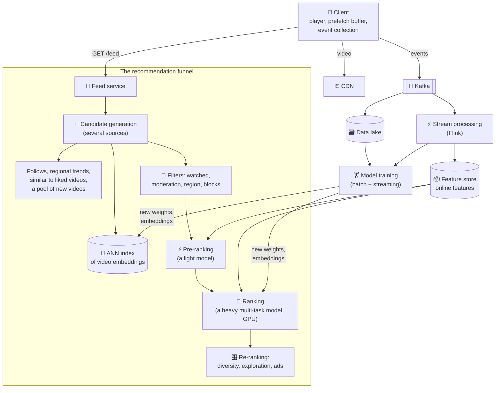
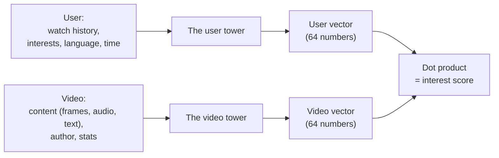
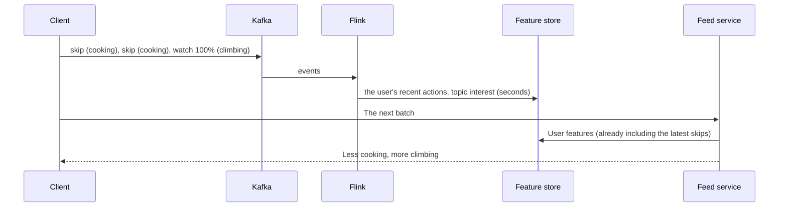
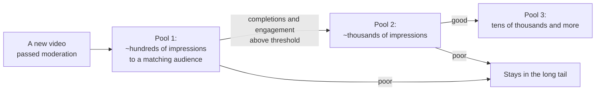

**English** | [Русский](README_RU.md)

# Tier 2 · 4B · 01. A TikTok-Style Video Feed

> **Level:** Hard · **Interview time:** 45–60 min · **Study time:** ~5–6 h
> **Key aspects:** an interest graph instead of a social graph, implicit signals, candidate generation (two-tower models, ANN), multi-stage ranking, real-time personalization and online learning, cold start for users and videos, exploration and diversity, prefetching and instant playback, watch history
> **Builds on:** [15-search-basics](../../../15-search-basics/README.md#11-vector-search) (ANN, multi-stage ranking), [Tier 1 · 07 News Feed](../../../tier-1/07-news-feed/README.md#10-deep-dive-4-ranking), [Tier 1 · 09 YouTube](../../../tier-1/09-youtube-netflix/README.md#12-deep-dive-6-metadata-search-and-recommendations), [Tier 1 · 08 Instagram](../../../tier-1/08-instagram/README.md#8-deep-dive-2-delivering-media), [09-messaging](../../../09-messaging/README.md)

---

## 🗺️ How to Read This Walkthrough

The walkthrough follows an interview, but every step includes explanations: **why** a decision is made, **how** a mechanism works and **what happens** if you do it differently. The "📘 Explanation" blocks are theory right where you need it.

| Icon | Meaning |
|:----:|:--------|
| 🎤 | Interviewer |
| 🗣️ | What I (the candidate) say out loud |
| ✏️ | What I draw on the whiteboard |
| ⏱️ | Time budget for the step |
| 📘 | A detailed explanation of a concept |

Callouts: **TIP** — a good technique, **WARNING** — a trap, **IMPORTANT** — a Senior+ signal.

---

## 📑 Contents

0. [What This Problem Teaches](#0-what-this-problem-teaches)
1. [Problem Statement](#1-problem-statement)
2. [Clarifying Questions and Requirements](#2-clarifying-questions-and-requirements)
3. [Capacity Estimates](#3-capacity-estimates)
4. [API](#4-api)
5. [Data Model](#5-data-model)
6. [High-Level Design](#6-high-level-design)
7. [Deep Dive 1: Signals — Every Swipe Is a Training Example](#7-deep-dive-1-signals--every-swipe-is-a-training-example)
8. [Deep Dive 2: Candidate Generation](#8-deep-dive-2-candidate-generation)
9. [Deep Dive 3: Multi-Stage Ranking](#9-deep-dive-3-multi-stage-ranking)
10. [Deep Dive 4: Real-Time Personalization](#10-deep-dive-4-real-time-personalization)
11. [Deep Dive 5: Cold Start](#11-deep-dive-5-cold-start)
12. [Deep Dive 6: Exploration, Diversity and the Filter Bubble](#12-deep-dive-6-exploration-diversity-and-the-filter-bubble)
13. [Deep Dive 7: Instant Playback and Prefetching](#13-deep-dive-7-instant-playback-and-prefetching)
14. [Deep Dive 8: Watch History, the Data Pipeline and Experiments](#14-deep-dive-8-watch-history-the-data-pipeline-and-experiments)
15. [Bottlenecks and Failure Scenarios](#15-bottlenecks-and-failure-scenarios)
16. [What Changes at 10x Scale](#16-what-changes-at-10x-scale)
17. [Key Concepts and New Terms](#17-key-concepts-and-new-terms)
18. [Variations and Follow-Up Questions](#18-variations-and-follow-up-questions)
19. [Common Mistakes](#19-common-mistakes)
20. [Cheat Sheet and Self-Check](#20-cheat-sheet-and-self-check)

---

## 0. What This Problem Teaches

The TikTok feed is fundamentally different from the Facebook feed in [Tier 1 · 07](../../../tier-1/07-news-feed/README.md): it's built not from the posts of **people you follow** but from **the entire catalog** — based on what, judging by your behavior, interests you. It's a feed that is a recommender system, where every flick of a finger is a signal and the model adapts to the user during the session itself.

| | A following-based feed (Tier 1 · 07) | The TikTok feed |
|:-|:-------------------------------------|:----------------|
| Content source | Posts from follows | The whole catalog (billions of videos) |
| The core graph | Social (who follows whom) | **An interest graph** (what the user watches) |
| The main difficulty | Fan-out at publish time | Finding the best videos among billions in tens of ms |
| Signals | Explicit (likes, comments) | Mostly **implicit** (watch time, skips) |
| Adaptation speed | Days | **Minutes** — within a single session |

| What's tested | Where it shows up |
|:--------------|:------------------|
| Recommender systems | Candidate generation, ranking, exploration |
| Vector search | ANN over video embeddings |
| Stream processing | Real-time features and training |
| Cold start | New users and new videos |
| Media delivery | Instant playback on swipe |
| Data scale | A million events per second |

> [!TIP]
> In the interview, say it up front: "this isn't a fan-out feed, it's **a recommendation funnel**: out of billions of videos, we pick ~10 in ~100 ms". And draw the funnel with the numbers at each stage.

---

## 1. Problem Statement

> 🎤 "Design a TikTok-style 'For You' feed: an infinite vertical feed of short videos, each one personally selected and starting instantly on swipe."

**What the user sees:**

```
Opens the app → a video is already playing, no waiting
Swipes up → the next video starts instantly
Skipped three cooking videos within a second → a couple of swipes later, no more cooking
Watched a climbing video to the end and rewatched it → more climbing soon
A new user — after 10–20 swipes the feed already "gets" them
```

**Time plan:**

| Step | ⏱️ |
|:-----|:--:|
| Requirements | 5 min |
| Estimates | 4 min |
| API and data | 4 min |
| High-level design | 7 min |
| Deep dives | 25–30 min |
| Wrap-up | 3 min |

---

## 2. Clarifying Questions and Requirements

⏱️ 5 min

| My question | Interviewer's answer | What it changes and why |
|:------------|:---------------------|:------------------------|
| Scale? | 500M daily users, ~60 minutes in the app on average | Tens of billions of views per day |
| Catalog size? | Billions of videos, tens of millions new per day | You can't rank the whole catalog — candidate generation is needed |
| Latency? | Feed response < 200 ms; a video starts on swipe with no visible pause | Prefetching, fast models |
| How fast must behavior count? | Within the session: skips and completions affect the next videos | Real-time features, small feed batches |
| Account for follows? | Yes, as one source, but not the main one | Several candidate sources |
| New videos? | Every new video should get a chance | Exploration traffic for new videos |
| Repeats? | Don't show what's been watched | Watch history |
| Moderation? | Before wide distribution | Staged distribution |

### Functional requirements

1. A personal infinite feed of short videos.
2. Instant video start on swipe.
3. Accounting for behavior in real time (watch, skip, completion, rewatch, like, "not interested").
4. New users get a good feed within a few swipes.
5. New videos get an audience to be tested on.
6. No repeats of watched videos.

### Non-functional requirements

| Requirement | Target | Why |
|:------------|:-------|:----|
| Feed API latency | p99 < 200 ms | Batches are requested ahead, but mustn't lag |
| Time to first frame | Practically instant on swipe | Any pause means leaving the app |
| Adaptation speed | Minutes | The product's key advantage |
| Availability | High; a fallback feed if ranking fails | An empty feed is unacceptable |
| Scale | ~1M views per second | Drives the data pipeline |

---

## 3. Capacity Estimates

⏱️ 4 min

```
Users:             500M per day × ~150 videos per day
Views:             ~75B per day → ~870,000 per second
Feed requests:     in batches of ~10 videos → ~87,000 requests/s, peak ~250,000/s

Events:            views + likes + skips + completions + rewatches
                   → on the order of 1M events per second into stream processing

Video embeddings:  1B active videos × 64 dimensions × 4 B ≈ 256 GB (float32)
                   compressed (quantized) — single to tens of GB per index

Video traffic:     75B views × ~2 MB (a 20-second clip) ≈ 150 PB per day → CDN
```

### Conclusions

| Conclusion | Design consequence |
|:-----------|:-------------------|
| The catalog is billions | Candidate generation via ANN, not ranking everything |
| ~250,000 requests/s, each ranking hundreds of videos with a heavy model | GPU inference, batching, a multi-stage funnel |
| ~1M events/s | Kafka + stream processing for real-time features |
| 150 PB of video per day | A CDN, prefetching only the start of videos |

---

## 4. API

⏱️ 2 min

```http
GET /v1/feed?session_id=s_9&count=8
→ 200 {
    "items": [
      { "video_id": "v_71", "manifest": "https://cdn…/v_71/master.m3u8",
        "preload": "https://cdn…/v_71/360p/seg_0.m4s",       ← what to load in advance
        "author": {...}, "caption": "…", "music": {...}, "request_id": "r_1" },
      …
    ],
    "next": "cursor…"
  }

POST /v1/events   (batched every few seconds)
[ { "video_id": "v_71", "request_id": "r_1", "type": "play",     "ts": … },
  { "video_id": "v_71", "type": "watch",  "watch_ms": 18400, "duration_ms": 21000, "loops": 1 },
  { "video_id": "v_72", "type": "skip",   "watch_ms": 900 },
  { "video_id": "v_73", "type": "like" },
  { "video_id": "v_74", "type": "not_interested" } ]
```

📘 **Why `request_id`.** It links an impression to a specific feed response and model version. That's needed for training (which candidates the model showed, and how it turned out) and for A/B tests.

---

## 5. Data Model

⏱️ 3 min

| Data | Where | Why |
|:-----|:------|:----|
| Video metadata (author, duration, language, music, tags, moderation status) | A sharded DB + cache | Hydrating the response |
| **Video embeddings** | An ANN index (HNSW / ScaNN / IVF-PQ), sharded | Searching for similar vectors |
| **The user's embedding and features** | A feature store: online (Redis-like) + offline (a data lake) | Model inputs |
| **The user's recent actions** (the last ~100 events) | An online store updated by the stream | Reacting within the session |
| **Real-time video counters** (impressions, completions in the last hour) | Stream aggregates | Popularity and trend features |
| Watch history | Online: recent IDs + a Bloom filter; offline: the data lake | Avoiding repeats |
| The event log | Kafka → a data lake | Model training, analytics |

---

## 6. High-Level Design

⏱️ 7 min



🗣️ "Three loops:
- **the serving funnel**: several candidate sources (ANN over embeddings, follows, trends, similar videos, a pool of new ones) → filters → a light model → a heavy model → re-ranking with diversity and exploration;
- **the data loop**: every client event goes to Kafka; stream processing updates user and video features within seconds;
- **the training loop**: models are retrained continuously on fresh data, and updated weights and embeddings roll out to serving.

A CDN serves the videos, and the client prefetches the start of upcoming clips."

---

## 7. Deep Dive 1: Signals — Every Swipe Is a Training Example

> 🎤 "The user barely likes anything. How do you know what they enjoy?"

📘 In a short-video feed, almost every action is **an implicit signal** of interest. In an hour-long session a user produces hundreds of labeled examples: "here's a video — here's how long I watched it".

| Signal | What it means | Strength |
|:-------|:--------------|:---------|
| **Watch fraction** (watch_ms / duration) | How well it held attention | The primary signal |
| **Watching to the end** | The video was interesting | Strongly positive |
| **Rewatching** (looping) | Very interesting | Very strongly positive |
| **A quick skip** (< 1–2 s) | Not interesting | Strongly negative |
| A like, a comment | Explicit approval | Strong, but rare |
| **A share, a save** | Value to the user | Very strong |
| Following the author | Interest in the author | Strong, long-term |
| "Not interested" | An explicit rejection | Very strongly negative |
| Visiting the author's profile, the sound | Interest in the topic | Medium |

> [!WARNING]
> **The duration trap.** Absolute watch time is higher for long videos — the model will start promoting long ones. So **normalized** signals are used: the watch fraction, completion, and comparison with the typical watch time for videos of that length.

---

## 8. Deep Dive 2: Candidate Generation

> 🎤 "How do you pick a couple of thousand suitable videos out of billions in tens of milliseconds?"

### A two-tower model

📘 Two neural networks ("towers") map users and videos into vectors in the same space so that their **dot product** predicts interest:



| Step | How |
|:-----|:----|
| Video vectors | Computed in advance (on upload and periodically) and put into **an ANN index** |
| The user vector | Computed at request time (or cached and updated on events) |
| Search | ANN finds ~500–1,000 videos with the nearest vectors in milliseconds (see [15-search-basics](../../../15-search-basics/README.md#11-vector-search): HNSW, IVF, PQ) |

📘 **Why two towers rather than one model.** A model that looks at a "user + video" pair together is more accurate, but it has to run for every video in the catalog — billions of times per request. With two towers, video vectors are precomputed, and the task reduces to a nearest-neighbor search — which is fast. Precision is recovered in later stages.

### Several sources

| Source | What it provides | Share of candidates (example) |
|:-------|:-----------------|:------------------------------|
| ANN on the user vector | The main personal stream | ~50% |
| Similar to recently liked (item-to-item) | Reacting to recent actions | ~20% |
| Followed creators | A link to follows | ~10% |
| Regional and language trends | General, popular right now | ~10% |
| **A pool of new videos** | Exploration, a chance for new content | ~10% |

📘 Source quotas prevent any one source from dominating and guarantee room for exploration. After merging — deduplication and filters (watched, moderation, region, blocks).

---

## 9. Deep Dive 3: Multi-Stage Ranking

> 🎤 "There are 2,000 candidates. How do you choose 8?"

### The funnel

```
Catalog:                    ~1,000,000,000 videos
Candidate generation:       ~2,000           (ANN + sources, ~20–30 ms)
Filters:                    ~1,500
Pre-ranking:                ~300             (a light model, ~10 ms)
Ranking:                    ~50              (a heavy model on GPUs, ~30–50 ms)
Re-ranking:                 8 in the response (diversity, exploration, ads)
```

### A multi-task model

📘 The heavy model predicts **several** probabilities at once (multi-task):

```
For each candidate:
  p(completion), E[watch fraction], p(rewatch), p(like), p(share), p(follow), p(quick skip)

The final score is a weighted sum:
  score = w1·p(completion) + w2·E[watch fraction] + w3·p(like) + w4·p(share)
        + w5·p(follow) − w6·p(quick skip)
```

| Decision | Why |
|:---------|:----|
| The weights are a product decision, tuned with A/B tests | They define what the feed optimizes: time, engagement, satisfaction |
| Features: user, video, crosses, context, real-time counters | The richer, the more accurate |
| GPU inference with batching | 50–300 candidates × hundreds of thousands of requests per second |
| A latency budget per stage | The total fits within ~150 ms |

📘 It's the same multi-stage scheme as in search ([15-search-basics](../../../15-search-basics/README.md#6-multi-stage-ranking-and-quality-metrics)) and the news feed ([Tier 1 · 07](../../../tier-1/07-news-feed/README.md#10-deep-dive-4-ranking)), only the candidate source is the whole catalog.

---

## 10. Deep Dive 4: Real-Time Personalization

> 🎤 "The user skipped three cooking videos in a row. How do you make sure there isn't a fourth?"

### Small batches

📘 If you request a feed 100 videos ahead, it can't account for what the user is doing now. So the feed is requested **in batches of 6–10 videos**: the next batch is built taking reactions to the previous ones into account.

### Real-time features



| Decision | Why |
|:---------|:----|
| The user's last ~100 actions in an online store | The model sees the current session |
| Video counters for the last hour | Fast-growing videos rise |
| The client sends events in batches every few seconds | A balance of freshness and load |

### Online learning

📘 One more level: update **the models themselves**, not just the features. ByteDance described the Monolith system, in which the recommendation model keeps training on the event stream and updated parameters roll out to serving within minutes. That way the model quickly picks up new trends and new videos.

| Level | Speed | What changes |
|:------|:------|:-------------|
| Real-time features | Seconds | The model's inputs |
| Online learning | Minutes | Model parameters, new videos' embeddings |
| Batch retraining | Hours to days | The whole model on full history |

> [!WARNING]
> **Training-serving skew.** If a feature is computed by one program for training (batch) and another for serving (streaming), the values diverge and the model performs worse than in tests. The fix — **a feature store** with a single feature definition for both paths, and logging the features used at impression time.

---

## 11. Deep Dive 5: Cold Start

> 🎤 "A new user — nothing is known about them. A new video — nobody has watched it. What do you do?"

### A new user

| Step | How |
|:-----|:----|
| Context | Language, country, device, time of day, install source |
| Picking interests at sign-up (optional) | A few topics as a starting vector |
| **An exploratory first batch** | Popular and **diverse** videos from different topics — to learn preferences quickly |
| Fast learning | The first 10–20 swipes provide enough signals; the user vector is built from what was watched |
| Bandits | Topics as "arms": show topics with good response more often, but keep trying the rest |

### A new video

📘 A new video has no stats, but it does have **content**: frames, audio, text, hashtags. A multimodal model builds the video's embedding **from its content** — so it can immediately enter ANN search for people with matching interests.



| Decision | Why |
|:---------|:----|
| **Staged distribution** ("traffic pools") | Every video gets a chance; good ones gain an audience quickly, bad ones don't waste impressions |
| A content-based embedding | Works before the first views |
| Moderation before wide distribution | Violations don't get the chance to rack up millions of views |
| Comparison with similar videos | "Completions above those of similar new videos" — a fair assessment |

---

## 12. Deep Dive 6: Exploration, Diversity and the Filter Bubble

> 🎤 "If you only show what the model thinks is best, the feed becomes monotonous. How do you avoid that?"

| Mechanism | How |
|:----------|:----|
| **Exploration slots** | Some positions in a batch (e.g. 1 of 8) — videos from topics the user hasn't tried or hasn't seen in a while |
| **Bandits** (ε-greedy, Thompson sampling) | Balancing "show the best known" with "try something new" |
| **Diversity rules** | Not two videos by the same creator in a row, at most N from one topic per batch, varied formats |
| **"Not interested"** | Strongly demotes the topic and the creator |
| Well-being rules | Limits on sensitive content, screen-time reminders |

📘 **Why exploration matters to the system, not just the user.** If you only show what the model already considers good, it'll never learn the user might have liked something else: the training data is shaped by the recommendations themselves (a feedback loop). Exploration gives the model data beyond its current preferences.

---

## 13. Deep Dive 7: Instant Playback and Prefetching

> 🎤 "How do you make a video start playing instantly on swipe?"

### Prefetching

```
The client keeps a buffer of the next 3–5 videos in the batch:
  the next video:          its beginning is loaded (the first 1–2 segments)
  the second and third:    the first segment is loaded
  the rest:                metadata only

On swipe the first frame is already in memory → playback with no pause
```

| Decision | Why |
|:---------|:----|
| Load **only the beginning** | Most videos are skipped in the first seconds — loading them whole is wasteful |
| Buffer depth depends on the network and battery | Deeper on Wi-Fi, shallower on a slow network |
| The first segment — small and in low quality | A fast start; then adaptive bitrate raises the quality (see [Tier 1 · 09](../../../tier-1/09-youtube-netflix/README.md#9-deep-dive-3-adaptive-streaming)) |
| Pre-established CDN connections (HTTP/2, HTTP/3) | No handshakes on swipe |
| The feed batch is requested in advance | A new batch arrives while the user watches the current ones |

### The trade-off

| More prefetching | Less prefetching |
|:-----------------|:-----------------|
| An instant start every time | Pauses on fast swipes |
| Wasted traffic on skipped videos | Saving traffic and battery |

### CDN

- Popular videos are almost always in the edge cache (short clips concentrate views heavily).
- Videos gaining popularity in traffic pools are pushed into caches in advance.
- The long tail comes from deeper cache tiers (as in [Tier 1 · 09](../../../tier-1/09-youtube-netflix/README.md#10-deep-dive-4-delivery-via-cdn)).

---

## 14. Deep Dive 8: Watch History, the Data Pipeline and Experiments

### Watch history

| Decision | Why |
|:---------|:----|
| Recent watched IDs (thousands) in an online store | An exact filter for fresh history |
| **A Bloom filter** for longer history | Compact; a false positive merely filters out one unwatched video — acceptable |
| Filtering after candidate generation | Cheaper than excluding inside the ANN search |

### The data pipeline

| Stage | How |
|:------|:----|
| Collection | Client → events API → Kafka (~1M events/s) |
| Streaming | Flink: user and video features, counters, anti-fraud (bots, manipulation) |
| Storage | A data lake for training and analytics |
| Impression logging | What was shown, with which features and model version — for unbiased training |

### Experiments

- Every model or weight change is validated with **an A/B test**: metrics for time in the app, retention, satisfaction (surveys), reports.
- Guardrail metrics: the "not interested" rate, reports, diversity — so you don't optimize watch time alone.

---

## 15. Bottlenecks and Failure Scenarios

| Scenario | What happens | How we protect |
|:---------|:-------------|:---------------|
| The ranking service is down | No personal feed | A fallback feed: the user's cached candidates or what's popular in the region |
| The feature store lags | The feed doesn't react to the session | Lag monitoring, degrading to the last known features |
| A stale ANN index | New videos aren't found | Regular refreshes, a separate source for new videos |
| Training-serving skew | The model is worse than in tests | A shared feature store, logging impression features |
| A load peak | Ranking delays | GPU autoscaling, trimming the candidate count under overload |
| A cold user | A poor first feed | An exploratory batch, context, fast learning |
| A new video with no stats | It never reaches feeds | A content-based embedding, traffic pools |
| A monotonous feed | Boredom, churn | Exploration, diversity rules |
| View manipulation | Bad videos in trends | Stream anti-fraud |
| A slow network | Pauses on swipe | Adaptive prefetching, a low-quality first segment |

---

## 16. What Changes at 10x Scale

> 🎤 "5 billion daily users?"

| Change | Why |
|:-------|:----|
| **Regional indexes and models** | Latency and local interests |
| **Model distillation** (a big model teaches a small one) | The cost of GPU inference |
| **Session-level candidate caching** | Fewer ANN calls |
| **On-device processing** (local re-ranking) | Reacting without a network request |

---

## 17. Key Concepts and New Terms

### What's applied

| Concept | Where it's covered | How it applies here |
|:--------|:-------------------|:--------------------|
| ANN, multi-stage ranking | [15-search-basics](../../../15-search-basics/README.md) | Candidate generation and the funnel |
| Feed ranking | [Tier 1 · 07](../../../tier-1/07-news-feed/README.md#10-deep-dive-4-ranking) | A similar funnel |
| YouTube recommendations | [Tier 1 · 09](../../../tier-1/09-youtube-netflix/README.md#12-deep-dive-6-metadata-search-and-recommendations) | The two-stage scheme |
| Media delivery, ABR | [Tier 1 · 08](../../../tier-1/08-instagram/README.md), [Tier 1 · 09](../../../tier-1/09-youtube-netflix/README.md) | Prefetching and the CDN |
| Kafka and stream processing | [09-messaging](../../../09-messaging/README.md) | Events and features |

### New terms in this problem

| Term | In short |
|:-----|:---------|
| **An interest graph** | Recommending by behavior rather than follows |
| **Implicit signals** | Watch fraction, completion, rewatch, skip |
| **A two-tower model** | Separate user and video vectors; interest = their dot product |
| **Candidate generation** | Quickly selecting thousands of candidates out of billions |
| **A multi-task model** | Predicting several actions at once |
| **A feature store** | A single store of features for training and serving |
| **Training-serving skew** | Diverging features between training and serving |
| **Online learning** | Updating a model on the event stream within minutes |
| **Traffic pools** | Staged distribution of a new video |
| **Exploration and bandits** | Balancing the best known with the new |
| **A feedback loop** | Recommendations shape the data they learn from |

---

## 18. Variations and Follow-Up Questions

<details>
<summary><b>How do you insert ads into the feed?</b></summary>

Ads are a separate candidate source with their own ranking (bid × predicted engagement), and re-ranking inserts them at certain positions with a frequency cap. Ad metrics mustn't degrade the experience beyond set limits — that's verified with A/B tests.
</details>

<details>
<summary><b>How does the "Following" feed differ architecturally from "For You"?</b></summary>

"Following" is the classic feed from [Tier 1 · 07](../../../tier-1/07-news-feed/README.md): fan-out of creators' videos into followers' feeds, chronological or lightly ranked. "For You" is a recommendation funnel over the whole catalog. Follows are still one of the candidate sources for "For You".
</details>

<details>
<summary><b>How do you update the embeddings of a billion videos?</b></summary>

New videos get an embedding on upload and are added to the index right away (incrementally). When the video tower is updated, embeddings are recomputed in batch and the index is rebuilt next to the old one with an atomic switch; the user and video model versions must match.
</details>

<details>
<summary><b>How do you fight the "virality" of harmful content?</b></summary>

Moderation before the first traffic pool, stricter checks before each next pool, reports and quick skips as negative signals, limits for sensitive topics, and the ability to "freeze" a video's distribution.
</details>

<details>
<summary><b>Why not recommend via collaborative filtering ("similar users watched")?</b></summary>

It's one of the signals, and the two-tower model essentially generalizes it through watch history. But pure collaborative filtering works poorly for new videos and users (no history) — so it's complemented with content and context features.
</details>

---

## 19. Common Mistakes

| ❌ Mistake | Why it's bad | ✅ Do this instead |
|:----------|:-------------|:------------------|
| Designing it like a following feed with fan-out | The wrong problem | A recommendation funnel over the catalog |
| Ranking the whole catalog with a heavy model | Impossible within the time | Candidate generation → the funnel |
| Optimizing absolute watch time | Promoting long videos | Normalized signals |
| Long feed batches | No reaction to the current session | Batches of 6–10 videos |
| Features only from batch computations | Adaptation takes days | Real-time stream features |
| Different feature computations for training and serving | Model degradation | A feature store |
| No mechanism for new videos | They never get an audience | A content embedding, traffic pools |
| Exploitation only | Monotony, a feedback loop | Exploration, diversity |
| Loading upcoming videos in full | Huge wasted traffic | Prefetching only the beginning |
| No fallback feed | A blank screen on failure | Regional popular content, a candidate cache |

---

## 20. Cheat Sheet and Self-Check

### 30-second answer

> The feed is a recommendation funnel over the whole catalog, on an interest graph. Signals are mostly implicit: watch fraction, completion, rewatch, quick skip, plus likes, shares, "not interested". Candidate generation: a two-tower model (the user vector × video vectors in an ANN index) + item-to-item from recent likes + follows + trends + a pool of new videos, with quotas → ~2,000 → filters (watched via recent IDs + a Bloom filter, moderation, region) → a light model ~300 → a heavy multi-task GPU model (p(completion), watch fraction, p(like/share/follow), p(skip)) ~50 → re-ranking (diversity, exploration, ads) → 8. Batches of 6–10 videos; events → Kafka → Flink → the feature store within seconds; online learning within minutes (like Monolith), batch within hours; a shared feature store against training-serving skew. Cold start: context, an exploratory batch, bandits; new videos — a content-based embedding and staged traffic pools after moderation. The client prefetches the start of the next 3–5 videos, served by a CDN. On failure — a fallback feed.

### Self-check

- [ ] I can explain the difference from a following feed
- [ ] I can list the implicit signals and the duration trap
- [ ] I can explain the two-tower model and why it's fast
- [ ] I can list the candidate sources and why quotas are needed
- [ ] I can draw the funnel with numbers and a latency budget
- [ ] I can describe the multi-task model and the final score
- [ ] I can explain personalization within a session
- [ ] I can explain training-serving skew and the feature store
- [ ] I can solve cold start for a user and for a video
- [ ] I can explain exploration and the feedback loop
- [ ] I can design instant playback with prefetching

### Further reading

- Liu et al., *Monolith: Real Time Recommendation System With Collisionless Embedding Table* (ByteDance, 2022)
- Covington, Adams, Sargin, *Deep Neural Networks for YouTube Recommendations* (RecSys 2016)
- Yi et al., *Sampling-Bias-Corrected Neural Modeling for Large Corpus Item Recommendations* (RecSys 2019) — two-tower
- Zhao et al., *Recommending What Video to Watch Next: A Multitask Ranking System* (RecSys 2019)
- The [15-search-basics](../../../15-search-basics/README.md) topic — ANN and multi-stage ranking
