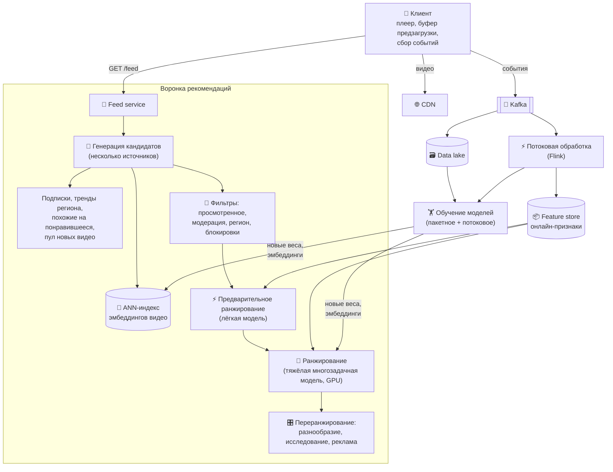
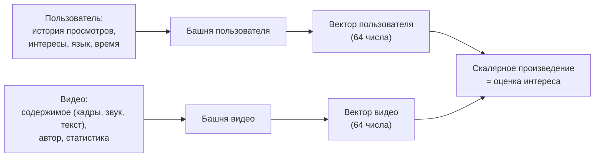
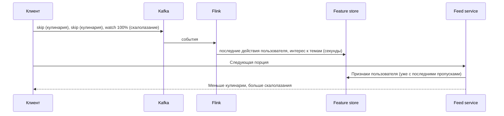
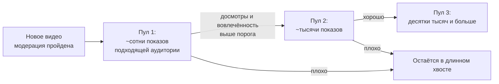

[English](README.md) | **Русский**

# Tier 2 · 4B · 01. Видеолента в стиле TikTok

> **Уровень:** Hard · **Время на интервью:** 45–60 мин · **Время на разбор:** ~5–6 ч
> **Ключевые аспекты:** граф интересов вместо социального графа, неявные сигналы, генерация кандидатов (two-tower модели, ANN), многоэтапное ранжирование, персонализация в реальном времени и онлайн-обучение, cold start для пользователей и видео, исследование и разнообразие, предзагрузка и мгновенное воспроизведение, история просмотров
> **Опирается на:** [15-search-basics](../../../15-search-basics/README_RU.md#11-векторный-поиск) (ANN, многоэтапное ранжирование), [Tier 1 · 07 News Feed](../../../tier-1/07-news-feed/README_RU.md#10-deep-dive-4-ранжирование), [Tier 1 · 09 YouTube](../../../tier-1/09-youtube-netflix/README_RU.md#12-deep-dive-6-метаданные-поиск-и-рекомендации), [Tier 1 · 08 Instagram](../../../tier-1/08-instagram/README_RU.md#8-deep-dive-2-доставка-медиа), [09-messaging](../../../09-messaging/README_RU.md)

---

## 🗺️ Как читать этот разбор

Разбор построен как интервью, но в каждом шаге есть объяснения: **почему** принимается решение, **как работает** механизм и **что будет**, если сделать иначе. Блоки «📘 Объяснение» — теория прямо по ходу задачи.

| Значок | Что значит |
|:------:|:-----------|
| 🎤 | Реплика интервьюера |
| 🗣️ | Что говорю вслух я (кандидат) |
| ✏️ | Что рисую на доске |
| ⏱️ | Сколько времени тратить на шаг |
| 📘 | Подробное объяснение концепции |

Блоки **TIP** — хороший приём, **WARNING** — ловушка, **IMPORTANT** — сигнал для уровня Senior+.

---

## 📑 Содержание

0. [Чему учит эта задача](#0-чему-учит-эта-задача)
1. [Условие задачи](#1-условие-задачи)
2. [Уточняющие вопросы и требования](#2-уточняющие-вопросы-и-требования)
3. [Оценки нагрузки](#3-оценки-нагрузки)
4. [API](#4-api)
5. [Модель данных](#5-модель-данных)
6. [High-level дизайн](#6-high-level-дизайн)
7. [Deep dive 1: сигналы — каждый свайп как обучающий пример](#7-deep-dive-1-сигналы--каждый-свайп-как-обучающий-пример)
8. [Deep dive 2: генерация кандидатов](#8-deep-dive-2-генерация-кандидатов)
9. [Deep dive 3: многоэтапное ранжирование](#9-deep-dive-3-многоэтапное-ранжирование)
10. [Deep dive 4: персонализация в реальном времени](#10-deep-dive-4-персонализация-в-реальном-времени)
11. [Deep dive 5: cold start](#11-deep-dive-5-cold-start)
12. [Deep dive 6: исследование, разнообразие и пузырь фильтров](#12-deep-dive-6-исследование-разнообразие-и-пузырь-фильтров)
13. [Deep dive 7: мгновенное воспроизведение и предзагрузка](#13-deep-dive-7-мгновенное-воспроизведение-и-предзагрузка)
14. [Deep dive 8: история просмотров, конвейер данных и эксперименты](#14-deep-dive-8-история-просмотров-конвейер-данных-и-эксперименты)
15. [Узкие места и сценарии сбоев](#15-узкие-места-и-сценарии-сбоев)
16. [Что изменится при росте в 10 раз](#16-что-изменится-при-росте-в-10-раз)
17. [Ключевые концепции и новые понятия](#17-ключевые-концепции-и-новые-понятия)
18. [Варианты задачи и follow-up вопросы](#18-варианты-задачи-и-follow-up-вопросы)
19. [Типичные ошибки](#19-типичные-ошибки)
20. [Шпаргалка и самопроверка](#20-шпаргалка-и-самопроверка)

---

## 0. Чему учит эта задача

Лента TikTok принципиально отличается от ленты Facebook из [Tier 1 · 07](../../../tier-1/07-news-feed/README_RU.md): она строится не из постов **тех, на кого ты подписан**, а из **всего каталога** — по тому, что тебе, судя по поведению, интересно. Это лента-рекомендательная система, где каждое движение пальца — сигнал, а модель подстраивается под пользователя прямо во время сессии.

| | Лента из подписок (Tier 1 · 07) | Лента TikTok |
|:-|:--------------------------------|:-------------|
| Источник контента | Посты подписок | Весь каталог (миллиарды видео) |
| Основной граф | Социальный (кто на кого подписан) | **Граф интересов** (что смотрит пользователь) |
| Главная сложность | Fan-out при публикации | Найти лучшие видео среди миллиардов за десятки мс |
| Сигналы | Явные (лайки, комментарии) | В основном **неявные** (время просмотра, пропуск) |
| Скорость адаптации | Дни | **Минуты** — в пределах одной сессии |

| Что проверяют | Где это в задаче |
|:--------------|:-----------------|
| Рекомендательные системы | Генерация кандидатов, ранжирование, исследование |
| Векторный поиск | ANN по эмбеддингам видео |
| Потоковая обработка | Признаки и обучение в реальном времени |
| Холодный старт | Новые пользователи и новые видео |
| Доставка медиа | Мгновенное воспроизведение при свайпе |
| Масштаб данных | Миллиард событий в секунду |

> [!TIP]
> На интервью стоит сказать сразу: «это не fan-out-лента, а **рекомендательная воронка**: из миллиардов видео за ~100 мс отбираем ~10». И нарисовать воронку с числами на каждом этапе.

---

## 1. Условие задачи

> 🎤 «Спроектируй ленту “Для вас” в стиле TikTok: бесконечная вертикальная лента коротких видео, каждое следующее подобрано персонально и начинает играть мгновенно при свайпе».

**Что видит пользователь:**

```
Открывает приложение → видео уже играет, без ожидания
Свайп вверх → следующее видео стартует мгновенно
Пропустил три кулинарных видео за секунду → через пару свайпов кулинарии больше нет
Досмотрел до конца и пересмотрел видео о скалолазании → скоро ещё скалолазание
Новый пользователь — через 10–20 свайпов лента уже «угадывает»
```

**План по времени:**

| Шаг | ⏱️ |
|:----|:--:|
| Требования | 5 мин |
| Оценки | 4 мин |
| API и данные | 4 мин |
| High-level дизайн | 7 мин |
| Deep dives | 25–30 мин |
| Итоги | 3 мин |

---

## 2. Уточняющие вопросы и требования

⏱️ 5 мин

| Мой вопрос | Ответ интервьюера | Что это меняет и почему |
|:-----------|:------------------|:------------------------|
| Масштаб? | 500M пользователей в день, в среднем ~60 минут в приложении | Десятки миллиардов просмотров в сутки |
| Размер каталога? | Миллиарды видео, десятки миллионов новых в день | Нельзя ранжировать весь каталог — нужна генерация кандидатов |
| Задержка? | Ответ ленты < 200 мс; видео начинает играть при свайпе без видимой паузы | Предзагрузка, быстрые модели |
| Как быстро учитывать поведение? | В пределах сессии: пропуски и досмотры влияют на ближайшие видео | Признаки в реальном времени, маленькие порции ленты |
| Подписки учитывать? | Да, как один из источников, но не основной | Несколько источников кандидатов |
| Новые видео? | Каждое новое видео должно получить шанс | Исследовательский трафик для новых видео |
| Повторы? | Не показывать уже просмотренное | История просмотров |
| Модерация? | До широкого распространения | Поэтапное распространение |

### Функциональные требования

1. Персональная бесконечная лента коротких видео.
2. Мгновенный старт видео при свайпе.
3. Учёт поведения в реальном времени (просмотр, пропуск, досмотр, повтор, лайк, «не интересно»).
4. Новые пользователи получают хорошую ленту за несколько свайпов.
5. Новые видео получают аудиторию для проверки.
6. Без повторов просмотренного.

### Нефункциональные требования

| Требование | Цель | Почему |
|:-----------|:-----|:-------|
| Задержка API ленты | p99 < 200 мс | Порции запрашиваются заранее, но не должны тормозить |
| Время до первого кадра | Практически мгновенно при свайпе | Любая пауза — уход из приложения |
| Скорость адаптации | Минуты | Ключевое преимущество продукта |
| Доступность | Высокая; при сбое ранжирования — запасная лента | Пустая лента недопустима |
| Масштаб | ~1M просмотров в секунду | Определяет конвейер данных |

---

## 3. Оценки нагрузки

⏱️ 4 мин

```
Пользователи:      500M в день × ~150 видео в день
Просмотры:         ~75B в сутки → ~870 000 в секунду
Запросы ленты:     порциями по ~10 видео → ~87 000 запросов/с, пик ~250 000/с

События:           просмотры + лайки + пропуски + досмотры + повторы
                   → порядка 1M событий в секунду в поток обработки

Эмбеддинги видео:  1B активных видео × 64 измерения × 4 Б ≈ 256 ГБ (float32)
                   со сжатием (квантизация) — единицы–десятки ГБ на индекс

Трафик видео:      75B просмотров × ~2 МБ (20-секундный ролик) ≈ 150 ПБ в сутки → CDN
```

### Выводы

| Вывод | Следствие для дизайна |
|:------|:----------------------|
| Каталог — миллиарды | Генерация кандидатов через ANN, а не ранжирование всего |
| ~250 000 запросов/с, каждый ранжирует сотни видео тяжёлой моделью | GPU-инференс, батчинг, многоэтапная воронка |
| ~1M событий/с | Kafka + потоковая обработка для признаков в реальном времени |
| 150 ПБ видео в сутки | CDN, предзагрузка только начала видео |

---

## 4. API

⏱️ 2 мин

```http
GET /v1/feed?session_id=s_9&count=8
→ 200 {
    "items": [
      { "video_id": "v_71", "manifest": "https://cdn…/v_71/master.m3u8",
        "preload": "https://cdn…/v_71/360p/seg_0.m4s",       ← что загрузить заранее
        "author": {...}, "caption": "…", "music": {...}, "request_id": "r_1" },
      …
    ],
    "next": "cursor…"
  }

POST /v1/events   (пакетами раз в несколько секунд)
[ { "video_id": "v_71", "request_id": "r_1", "type": "play",     "ts": … },
  { "video_id": "v_71", "type": "watch",  "watch_ms": 18400, "duration_ms": 21000, "loops": 1 },
  { "video_id": "v_72", "type": "skip",   "watch_ms": 900 },
  { "video_id": "v_73", "type": "like" },
  { "video_id": "v_74", "type": "not_interested" } ]
```

📘 **Зачем `request_id`.** Он связывает показ с конкретным ответом ленты и версией модели. Это нужно для обучения (какие кандидаты модель показала и что из этого вышло) и для A/B-тестов.

---

## 5. Модель данных

⏱️ 3 мин

| Данные | Где | Почему |
|:-------|:----|:-------|
| Метаданные видео (автор, длительность, язык, музыка, теги, статус модерации) | Шардированная БД + кэш | Гидратация ответа |
| **Эмбеддинги видео** | ANN-индекс (HNSW / ScaNN / IVF-PQ), шардированный | Поиск похожих по вектору |
| **Эмбеддинг и признаки пользователя** | Feature store: онлайн (Redis-подобный) + офлайн (data lake) | Вход моделей |
| **Последние действия пользователя** (последние ~100 событий) | Онлайн-хранилище, обновляется потоком | Реакция в пределах сессии |
| **Счётчики видео в реальном времени** (показы, досмотры за час) | Потоковые агрегаты | Признаки популярности и тренды |
| История просмотров | Онлайн: недавние ID + Bloom filter; офлайн: data lake | Не повторять |
| Журнал событий | Kafka → data lake | Обучение моделей, аналитика |

---

## 6. High-level дизайн

⏱️ 7 мин



🗣️ «Три контура:
- **воронка обслуживания**: несколько источников кандидатов (ANN по эмбеддингам, подписки, тренды, похожие видео, пул новых) → фильтры → лёгкая модель → тяжёлая модель → переранжирование с разнообразием и исследованием;
- **контур данных**: каждое событие клиента — в Kafka; потоковая обработка обновляет признаки пользователя и видео за секунды;
- **контур обучения**: модели переобучаются на свежих данных постоянно, обновлённые веса и эмбеддинги выкатываются в обслуживание.

Видео раздаёт CDN, клиент заранее загружает начало следующих роликов».

---

## 7. Deep dive 1: сигналы — каждый свайп как обучающий пример

> 🎤 «Пользователь почти ничего не лайкает. Как понять, что ему нравится?»

📘 В короткой видеоленте почти каждое действие — **неявный сигнал** интереса. За сессию в час пользователь даёт сотни размеченных примеров: «вот видео — вот как долго смотрел».

| Сигнал | Что значит | Сила |
|:-------|:-----------|:-----|
| **Доля просмотра** (watch_ms / duration) | Насколько удержало | Основной сигнал |
| **Досмотр до конца** | Видео интересно | Сильный позитивный |
| **Повтор** (зацикливание) | Очень интересно | Очень сильный позитивный |
| **Быстрый пропуск** (< 1–2 с) | Не интересно | Сильный негативный |
| Лайк, комментарий | Явное одобрение | Сильный, но редкий |
| **Репост, сохранение** | Ценность для пользователя | Очень сильный |
| Подписка на автора | Интерес к автору | Сильный долгосрочный |
| «Не интересно» | Явный отказ | Очень сильный негативный |
| Переход в профиль автора, на звук | Интерес к теме | Средний |

> [!WARNING]
> **Ловушка длительности.** Абсолютное время просмотра выше у длинных видео — модель начнёт продвигать длинные. Поэтому используют **нормированные** сигналы: долю просмотра, досмотр, сравнение с типичным временем просмотра видео такой длины.

---

## 8. Deep dive 2: генерация кандидатов

> 🎤 «Как из миллиардов видео за десятки миллисекунд выбрать пару тысяч подходящих?»

### Two-tower модель

📘 Две нейросети («башни») переводят пользователя и видео в векторы одного пространства так, что **скалярное произведение** векторов предсказывает интерес:



| Шаг | Как |
|:----|:----|
| Векторы видео | Вычисляются заранее (при загрузке и периодически) и кладутся в **ANN-индекс** |
| Вектор пользователя | Вычисляется при запросе (или кэшируется и обновляется по событиям) |
| Поиск | ANN находит ~500–1 000 видео с ближайшими векторами за миллисекунды (см. [15-search-basics](../../../15-search-basics/README_RU.md#11-векторный-поиск): HNSW, IVF, PQ) |

📘 **Почему две башни, а не одна модель.** Модель, которая смотрит на пару «пользователь + видео» вместе, точнее, но её нужно запускать для каждого видео каталога — миллиарды раз на запрос. В two-tower векторы видео посчитаны заранее, и задача сводится к поиску ближайших соседей — это быстро. Точность добирается на следующих этапах.

### Несколько источников

| Источник | Что даёт | Доля кандидатов (пример) |
|:---------|:---------|:-------------------------|
| ANN по вектору пользователя | Основной персональный поток | ~50% |
| Похожие на недавно понравившиеся (item-to-item) | Реакция на последние действия | ~20% |
| Авторы, на которых подписан | Связь с подписками | ~10% |
| Тренды региона и языка | Общее, популярное сейчас | ~10% |
| **Пул новых видео** | Исследование, шанс новому контенту | ~10% |

📘 Квоты источников защищают от доминирования одного из них и гарантируют место для исследования. После объединения — дедупликация и фильтры (просмотренное, модерация, регион, блокировки).

---

## 9. Deep dive 3: многоэтапное ранжирование

> 🎤 «Есть 2 000 кандидатов. Как выбрать 8?»

### Воронка

```
Каталог:                    ~1 000 000 000 видео
Генерация кандидатов:       ~2 000           (ANN + источники, ~20–30 мс)
Фильтры:                    ~1 500
Предварительное ранжирование: ~300           (лёгкая модель, ~10 мс)
Ранжирование:               ~50              (тяжёлая модель на GPU, ~30–50 мс)
Переранжирование:           8 в ответ        (разнообразие, исследование, реклама)
```

### Многозадачная модель

📘 Тяжёлая модель предсказывает **несколько** вероятностей сразу (multi-task):

```
Для каждого кандидата:
  p(досмотр), E[доля просмотра], p(повтор), p(лайк), p(репост), p(подписка), p(быстрый пропуск)

Итоговая оценка — взвешенная сумма:
  score = w1·p(досмотр) + w2·E[доля просмотра] + w3·p(лайк) + w4·p(репост)
        + w5·p(подписка) − w6·p(быстрый пропуск)
```

| Решение | Почему |
|:--------|:-------|
| Веса — продуктовое решение, подбираются A/B-тестами | Определяют, что оптимизирует лента: время, вовлечённость, удовлетворённость |
| Признаки: пользователь, видео, пересечения, контекст, счётчики реального времени | Чем богаче, тем точнее |
| GPU-инференс с батчингом | 50–300 кандидатов × сотни тысяч запросов в секунду |
| Бюджет задержки на каждый этап | Сумма укладывается в ~150 мс |

📘 Это та же многоэтапная схема, что в поиске ([15-search-basics](../../../15-search-basics/README_RU.md#6-многоэтапное-ранжирование-и-метрики-качества)) и ленте новостей ([Tier 1 · 07](../../../tier-1/07-news-feed/README_RU.md#10-deep-dive-4-ранжирование)), только источник кандидатов — весь каталог.

---

## 10. Deep dive 4: персонализация в реальном времени

> 🎤 «Пользователь пропустил три кулинарных видео подряд. Как сделать, чтобы четвёртого не было?»

### Маленькие порции

📘 Если запрашивать ленту на 100 видео вперёд, она не сможет учесть то, что пользователь делает сейчас. Поэтому лента запрашивается **порциями по 6–10 видео**: следующая порция строится уже с учётом реакций на предыдущие.

### Признаки в реальном времени



| Решение | Почему |
|:--------|:-------|
| Последние ~100 действий пользователя в онлайн-хранилище | Модель видит текущую сессию |
| Счётчики видео за последний час | Быстро растущие видео поднимаются |
| Клиент отправляет события пакетами раз в несколько секунд | Баланс свежести и нагрузки |

### Онлайн-обучение

📘 Ещё один уровень: обновлять **сами модели**, а не только признаки. ByteDance описывал систему Monolith, в которой модель рекомендаций дообучается на потоке событий и обновлённые параметры выкатываются в обслуживание с задержкой в минуты. Так модель быстро учитывает новые тренды и новые видео.

| Уровень | Скорость | Что меняется |
|:--------|:---------|:-------------|
| Признаки в реальном времени | Секунды | Входы модели |
| Онлайн-обучение | Минуты | Параметры модели, эмбеддинги новых видео |
| Пакетное переобучение | Часы–дни | Вся модель на полной истории |

> [!WARNING]
> **Расхождение обучения и обслуживания (training-serving skew).** Если признак при обучении считается одной программой (пакетной), а при обслуживании — другой (потоковой), значения расходятся, и модель работает хуже, чем на тестах. Решение — **feature store** с единым определением признака для обоих путей и логирование признаков, использованных при показе.

---

## 11. Deep dive 5: cold start

> 🎤 «Новый пользователь — о нём ничего не известно. Новое видео — его никто не смотрел. Что делать?»

### Новый пользователь

| Шаг | Как |
|:----|:----|
| Контекст | Язык, страна, устройство, время суток, источник установки |
| Выбор интересов при регистрации (опционально) | Несколько тем как стартовый вектор |
| **Исследовательская первая порция** | Популярные и **разнообразные** видео из разных тем — чтобы быстро понять предпочтения |
| Быстрое обучение | Первые 10–20 свайпов дают достаточно сигналов; вектор пользователя строится из просмотренного |
| Бандиты | Темы как «рукоятки»: чаще показывать темы с хорошим откликом, но продолжать пробовать остальные |

### Новое видео

📘 У нового видео нет статистики, но есть **содержимое**: кадры, звук, текст, хэштеги. Мультимодальная модель строит эмбеддинг видео **по содержимому** — оно сразу может попасть в ANN-поиск к людям с подходящими интересами.



| Решение | Почему |
|:--------|:-------|
| **Поэтапное распространение** («пулы трафика») | Каждое видео получает шанс; хорошее быстро набирает аудиторию, плохое не тратит показы |
| Эмбеддинг по содержимому | Работает до первых просмотров |
| Модерация до широкого распространения | Нарушения не успевают набрать миллионы просмотров |
| Сравнение с похожими видео | «Досмотры выше, чем у похожих новых» — справедливая оценка |

---

## 12. Deep dive 6: исследование, разнообразие и пузырь фильтров

> 🎤 «Если показывать только то, что модель считает лучшим, лента станет однообразной. Как этого избежать?»

| Механизм | Как |
|:---------|:----|
| **Исследовательские места** | Часть позиций в порции (например, 1 из 8) — видео из тем, которые пользователь ещё не пробовал или давно не видел |
| **Бандиты** (ε-greedy, Thompson sampling) | Баланс «показать лучшее известное» и «попробовать новое» |
| **Правила разнообразия** | Не два видео одного автора подряд, не больше N из одной темы в порции, разные форматы |
| **«Не интересно»** | Сильно понижает тему и автора |
| Правила благополучия | Ограничения на чувствительный контент, напоминания о времени |

📘 **Почему исследование важно для системы, а не только для пользователя.** Если показывать только то, что модель уже считает хорошим, она никогда не узнает, что пользователю могло понравиться что-то другое: данные для обучения формируются самими рекомендациями (петля обратной связи). Исследование даёт модели данные за пределами её текущих предпочтений.

---

## 13. Deep dive 7: мгновенное воспроизведение и предзагрузка

> 🎤 «Как сделать, чтобы видео начинало играть мгновенно при свайпе?»

### Предзагрузка

```
Клиент держит буфер следующих 3–5 видео из порции:
  следующее видео:   загружено начало (первые 1–2 сегмента)
  второе и третье:   загружен первый сегмент
  остальные:         только метаданные

При свайпе первый кадр уже в памяти → воспроизведение без паузы
```

| Решение | Почему |
|:--------|:-------|
| Загружать **только начало** | Большинство видео пропускают в первые секунды — грузить их целиком расточительно |
| Глубина буфера — по сети и батарее | На Wi-Fi больше, на медленной сети меньше |
| Первый сегмент — маленький и в низком качестве | Быстрый старт, затем адаптивный битрейт поднимает качество (см. [Tier 1 · 09](../../../tier-1/09-youtube-netflix/README_RU.md#9-deep-dive-3-адаптивный-стриминг)) |
| Заранее установленные соединения с CDN (HTTP/2, HTTP/3) | Нет рукопожатий при свайпе |
| Порция ленты запрашивается заранее | Новая порция приходит, пока пользователь смотрит текущие |

### Компромисс

| Больше предзагрузки | Меньше предзагрузки |
|:--------------------|:--------------------|
| Мгновенный старт всегда | Паузы при быстрых свайпах |
| Лишний трафик за пропущенные видео | Экономия трафика и батареи |

### CDN

- Популярные видео — почти всегда в кэше edge (короткие ролики сильно концентрируют просмотры).
- Видео, набирающие популярность в пулах трафика, заранее распространяются по кэшам.
- Длинный хвост — из глубоких уровней кэша (как в [Tier 1 · 09](../../../tier-1/09-youtube-netflix/README_RU.md#10-deep-dive-4-доставка-через-cdn)).

---

## 14. Deep dive 8: история просмотров, конвейер данных и эксперименты

### История просмотров

| Решение | Почему |
|:--------|:-------|
| Недавние ID просмотренных (тысячи) в онлайн-хранилище | Точный фильтр для свежей истории |
| **Bloom filter** на более длинную историю | Компактно; ложное срабатывание лишь отсеет одно непросмотренное видео — допустимо |
| Фильтр после генерации кандидатов | Дешевле, чем исключать в ANN |

### Конвейер данных

| Этап | Как |
|:-----|:----|
| Сбор | Клиент → API событий → Kafka (~1M событий/с) |
| Поток | Flink: признаки пользователя и видео, счётчики, антифрод (боты, накрутки) |
| Хранение | Data lake для обучения и аналитики |
| Логирование показов | Что показали, с какими признаками и версией модели — для обучения без смещения |

### Эксперименты

- Каждое изменение модели или весов проверяется **A/B-тестом**: метрики времени в приложении, удержания, удовлетворённости (опросы), жалоб.
- Метрики-ограничители: доля «не интересно», жалобы, разнообразие — чтобы не оптимизировать только время просмотра.

---

## 15. Узкие места и сценарии сбоев

| Сценарий | Что произойдёт | Как защищаемся |
|:---------|:---------------|:---------------|
| Сервис ранжирования недоступен | Нет персональной ленты | Запасная лента: кэшированные кандидаты пользователя или популярное в регионе |
| Feature store отстаёт | Лента не реагирует на сессию | Мониторинг задержки, деградация до последних известных признаков |
| ANN-индекс устарел | Новые видео не находятся | Регулярное обновление, отдельный источник новых видео |
| Расхождение обучения и обслуживания | Модель хуже, чем в тестах | Единый feature store, логирование признаков показа |
| Пиковая нагрузка | Задержки ранжирования | Автоскейлинг GPU, урезание числа кандидатов при перегрузке |
| Холодный пользователь | Плохая первая лента | Исследовательская порция, контекст, быстрое обучение |
| Новое видео без статистики | Не попадает в ленты | Эмбеддинг по содержимому, пулы трафика |
| Однообразная лента | Скука, уход | Исследование, правила разнообразия |
| Накрутка просмотров | Плохие видео в трендах | Антифрод в потоке |
| Медленная сеть | Паузы при свайпе | Адаптивная предзагрузка, низкое качество первого сегмента |

---

## 16. Что изменится при росте в 10 раз

> 🎤 «5 миллиардов пользователей в день?»

| Изменение | Почему |
|:----------|:-------|
| **Региональные индексы и модели** | Задержка и локальные интересы |
| **Дистилляция моделей** (большая модель учит маленькую) | Стоимость GPU-инференса |
| **Кэширование кандидатов** на уровне сессии | Меньше обращений к ANN |
| **Обработка на устройстве** (переранжирование локально) | Реакция без сетевого запроса |

---

## 17. Ключевые концепции и новые понятия

### Что применяется

| Концепция | Где разобрана | Как применяется здесь |
|:----------|:--------------|:----------------------|
| ANN, многоэтапное ранжирование | [15-search-basics](../../../15-search-basics/README_RU.md) | Генерация кандидатов и воронка |
| Ранжирование ленты | [Tier 1 · 07](../../../tier-1/07-news-feed/README_RU.md#10-deep-dive-4-ранжирование) | Похожая воронка |
| Рекомендации YouTube | [Tier 1 · 09](../../../tier-1/09-youtube-netflix/README_RU.md#12-deep-dive-6-метаданные-поиск-и-рекомендации) | Двухэтапная схема |
| Доставка медиа, ABR | [Tier 1 · 08](../../../tier-1/08-instagram/README_RU.md), [Tier 1 · 09](../../../tier-1/09-youtube-netflix/README_RU.md) | Предзагрузка и CDN |
| Kafka и потоковая обработка | [09-messaging](../../../09-messaging/README_RU.md) | События и признаки |

### Новые понятия этой задачи

| Понятие | Кратко |
|:--------|:-------|
| **Граф интересов** | Рекомендации по поведению, а не по подпискам |
| **Неявные сигналы** | Доля просмотра, досмотр, повтор, пропуск |
| **Two-tower модель** | Отдельные векторы пользователя и видео, интерес = скалярное произведение |
| **Генерация кандидатов** | Быстрый отбор тысяч кандидатов из миллиардов |
| **Многозадачная модель** | Одновременное предсказание нескольких действий |
| **Feature store** | Единое хранилище признаков для обучения и обслуживания |
| **Training-serving skew** | Расхождение признаков при обучении и обслуживании |
| **Онлайн-обучение** | Дообучение модели на потоке событий за минуты |
| **Пулы трафика** | Поэтапное распространение нового видео |
| **Исследование и бандиты** | Баланс лучшего известного и нового |
| **Петля обратной связи** | Рекомендации формируют данные, на которых учатся |

---

## 18. Варианты задачи и follow-up вопросы

<details>
<summary><b>Как вставлять рекламу в ленту?</b></summary>

Реклама — отдельный источник кандидатов со своим ранжированием (ставка × предсказанная вовлечённость), а переранжирование вставляет её на определённые позиции с ограничением частоты. Метрики рекламы не должны ухудшать опыт сверх заданных ограничений — это проверяется A/B-тестами.
</details>

<details>
<summary><b>Чем лента «Подписки» отличается от «Для вас» архитектурно?</b></summary>

«Подписки» — классическая лента из [Tier 1 · 07](../../../tier-1/07-news-feed/README_RU.md): fan-out видео авторов в ленты подписчиков, хронология или лёгкое ранжирование. «Для вас» — рекомендательная воронка по всему каталогу. Подписки при этом — один из источников кандидатов для «Для вас».
</details>

<details>
<summary><b>Как обновлять эмбеддинги миллиарда видео?</b></summary>

Новые видео получают эмбеддинг при загрузке и сразу добавляются в индекс (инкрементально). При обновлении модели башни видео эмбеддинги пересчитываются пакетно, и индекс перестраивается рядом со старым с атомарным переключением; версии модели пользователя и видео должны совпадать.
</details>

<details>
<summary><b>Как бороться с «вирусностью» вредного контента?</b></summary>

Модерация до пула трафика, более строгие проверки перед каждым следующим пулом, сигналы жалоб и быстрого пропуска как негативные, ограничения для чувствительных тем, возможность «заморозить» распространение видео.
</details>

<details>
<summary><b>Почему не рекомендовать по коллаборативной фильтрации («похожие пользователи смотрели»)?</b></summary>

Это один из сигналов, и two-tower модель по сути её обобщает через историю просмотров. Но чистая коллаборативная фильтрация плохо работает для новых видео и пользователей (нет истории) — поэтому её дополняют признаками содержимого и контекста.
</details>

---

## 19. Типичные ошибки

| ❌ Ошибка | Почему плохо | ✅ Как правильно |
|:---------|:-------------|:----------------|
| Проектировать как ленту подписок с fan-out | Не та задача | Рекомендательная воронка по каталогу |
| Ранжировать тяжёлой моделью весь каталог | Невозможно по времени | Генерация кандидатов → воронка |
| Оптимизировать абсолютное время просмотра | Продвижение длинных видео | Нормированные сигналы |
| Длинные порции ленты | Нет реакции на текущую сессию | Порции по 6–10 видео |
| Признаки только из пакетных расчётов | Адаптация за дни | Потоковые признаки в реальном времени |
| Разные расчёты признаков при обучении и обслуживании | Деградация модели | Feature store |
| Никаких механизмов для новых видео | Они никогда не получат аудиторию | Эмбеддинг по содержимому, пулы трафика |
| Только эксплуатация | Однообразие, петля обратной связи | Исследование, разнообразие |
| Загружать следующие видео целиком | Огромный лишний трафик | Предзагрузка только начала |
| Нет запасной ленты | Пустой экран при сбое | Популярное в регионе, кэш кандидатов |

---

## 20. Шпаргалка и самопроверка

### Ответ за 30 секунд

> Лента — рекомендательная воронка по всему каталогу на графе интересов. Сигналы — в основном неявные: доля просмотра, досмотр, повтор, быстрый пропуск, плюс лайки, репосты, «не интересно». Генерация кандидатов: two-tower модель (вектор пользователя × векторы видео в ANN-индексе) + item-to-item по недавним лайкам + подписки + тренды + пул новых видео с квотами → ~2 000 → фильтры (просмотренное через недавние ID + Bloom filter, модерация, регион) → лёгкая модель ~300 → тяжёлая многозадачная модель на GPU (p(досмотр), доля просмотра, p(лайк/репост/подписка), p(пропуск)) ~50 → переранжирование (разнообразие, исследование, реклама) → 8. Порции по 6–10 видео, события → Kafka → Flink → feature store за секунды; онлайн-обучение за минуты (как Monolith), пакетное — за часы; единый feature store против training-serving skew. Cold start: контекст, исследовательская порция, бандиты; новые видео — эмбеддинг по содержимому и поэтапные пулы трафика после модерации. Клиент предзагружает начало 3–5 следующих видео, CDN раздаёт. При сбое — запасная лента.

### Самопроверка

- [ ] Могу объяснить отличие от ленты подписок
- [ ] Могу перечислить неявные сигналы и ловушку длительности
- [ ] Могу объяснить two-tower модель и почему она быстрая
- [ ] Могу перечислить источники кандидатов и зачем квоты
- [ ] Могу нарисовать воронку с числами и бюджетом задержки
- [ ] Могу описать многозадачную модель и итоговую оценку
- [ ] Могу объяснить персонализацию в пределах сессии
- [ ] Могу объяснить training-serving skew и feature store
- [ ] Могу решить cold start для пользователя и для видео
- [ ] Могу объяснить исследование и петлю обратной связи
- [ ] Могу спроектировать мгновенное воспроизведение с предзагрузкой

### Что почитать

- Liu et al., *Monolith: Real Time Recommendation System With Collisionless Embedding Table* (ByteDance, 2022)
- Covington, Adams, Sargin, *Deep Neural Networks for YouTube Recommendations* (RecSys 2016)
- Yi et al., *Sampling-Bias-Corrected Neural Modeling for Large Corpus Item Recommendations* (RecSys 2019) — two-tower
- Zhao et al., *Recommending What Video to Watch Next: A Multitask Ranking System* (RecSys 2019)
- Тема [15-search-basics](../../../15-search-basics/README_RU.md) — ANN и многоэтапное ранжирование
