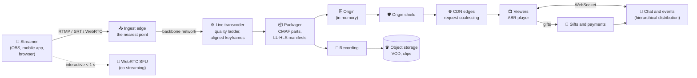
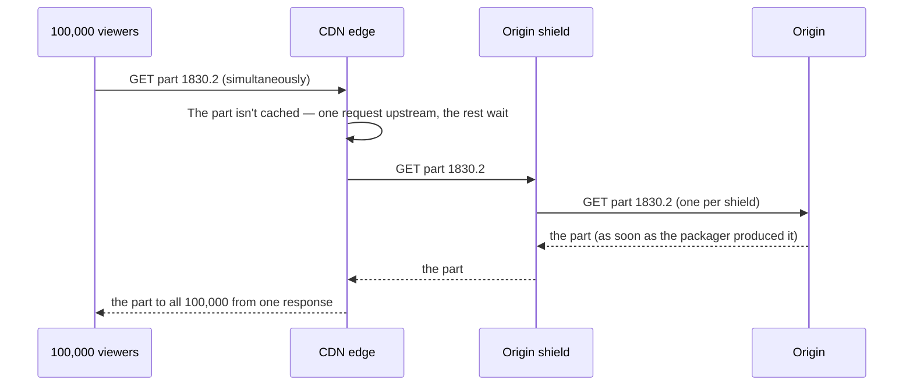

**English** | [Русский](README_RU.md)

# Tier 2 · 4B · 02. Live Streaming With Real-Time Reactions (Twitch / TikTok Live)

> **Level:** Hard · **Interview time:** 45–60 min · **Study time:** ~5–6 h
> **Key aspects:** ingesting the stream (RTMP, SRT, WebRTC), real-time transcoding, the glass-to-glass latency budget, low-latency HLS and chunked CMAF, WebRTC for interactivity, delivering live video via CDN and request coalescing, chat for millions of viewers and backpressure, gifts and interactivity, recording and clips, broadcast reliability
> **Builds on:** [Tier 1 · 09 YouTube](../../../tier-1/09-youtube-netflix/README.md#9-deep-dive-3-adaptive-streaming) (ABR, HLS/DASH, CDN), [Tier 2 · 4A · 03 Live Comments](../../4a-realtime-collaboration/03-live-comments-reactions/README.md#7-deep-dive-1-hierarchical-distribution), [03-cdn](../../../03-cdn/README.md), [13-reliability-patterns](../../../13-reliability-patterns/README.md), [Tier 1 · 20 Payments](../../../tier-1/20-payment-system/README.md)

---

## 🗺️ How to Read This Walkthrough

The walkthrough follows an interview, but every step includes explanations: **why** a decision is made, **how** a mechanism works and **what happens** if you do it differently. The "📘 Explanation" blocks are theory right where you need it.

| Icon | Meaning |
|:----:|:--------|
| 🎤 | Interviewer |
| 🗣️ | What I (the candidate) say out loud |
| ✏️ | What I draw on the whiteboard |
| ⏱️ | Time budget for the step |
| 📘 | A detailed explanation of a concept |

Callouts: **TIP** — a good technique, **WARNING** — a trap, **IMPORTANT** — a Senior+ signal.

---

## 📑 Contents

0. [What This Problem Teaches](#0-what-this-problem-teaches)
1. [Problem Statement](#1-problem-statement)
2. [Clarifying Questions and Requirements](#2-clarifying-questions-and-requirements)
3. [Capacity Estimates](#3-capacity-estimates)
4. [API and Protocols](#4-api-and-protocols)
5. [Data Model](#5-data-model)
6. [High-Level Design](#6-high-level-design)
7. [Deep Dive 1: Ingesting the Stream](#7-deep-dive-1-ingesting-the-stream)
8. [Deep Dive 2: Real-Time Transcoding](#8-deep-dive-2-real-time-transcoding)
9. [Deep Dive 3: The Latency Budget and Low-Latency Delivery](#9-deep-dive-3-the-latency-budget-and-low-latency-delivery)
10. [Deep Dive 4: Delivering Live Video via CDN](#10-deep-dive-4-delivering-live-video-via-cdn)
11. [Deep Dive 5: Chat for Millions of Viewers and Backpressure](#11-deep-dive-5-chat-for-millions-of-viewers-and-backpressure)
12. [Deep Dive 6: Gifts and Interactivity](#12-deep-dive-6-gifts-and-interactivity)
13. [Deep Dive 7: Recording, Replay and Clips](#13-deep-dive-7-recording-replay-and-clips)
14. [Deep Dive 8: Broadcast Reliability](#14-deep-dive-8-broadcast-reliability)
15. [Bottlenecks and Failure Scenarios](#15-bottlenecks-and-failure-scenarios)
16. [What Changes at 10x Scale](#16-what-changes-at-10x-scale)
17. [Key Concepts and New Terms](#17-key-concepts-and-new-terms)
18. [Variations and Follow-Up Questions](#18-variations-and-follow-up-questions)
19. [Common Mistakes](#19-common-mistakes)
20. [Cheat Sheet and Self-Check](#20-cheat-sheet-and-self-check)

---

## 0. What This Problem Teaches

In [Tier 1 · 09](../../../tier-1/09-youtube-netflix/README.md) we served **finished** videos: they could be processed at leisure, cut into chunks and spread across caches. A live broadcast is different: the video **doesn't exist yet** — it's being created right now, and the viewer wants to see it within a second or two — and also to write in chat and send the streamer a gift they'll respond to on air.

| | Video on demand (Tier 1 · 09) | A live broadcast |
|:-|:------------------------------|:-----------------|
| When content appears | In advance | Right now |
| Transcoding | In parallel by chunk, minutes | In real time, with no "future" frames |
| Latency | Doesn't matter | Seconds — the key metric |
| CDN load | A long tail, popular content cached | Every viewer wants **the same newest** chunk at once |
| Interactivity | None | Chat, gifts, the streamer responding |

| What's tested | Where it shows up |
|:--------------|:------------------|
| A real-time media pipeline | Ingest → transcoding → packaging → delivery |
| Understanding the sources of latency | The glass-to-glass budget |
| Protocols | RTMP, SRT, LL-HLS, WebRTC |
| A CDN for live content | Request coalescing, short TTLs |
| Fan-out and backpressure | Chat for millions of viewers |
| Reliability | Streamer reconnection, a standby transcoder |

> [!TIP]
> The key thing to show: **breaking latency down by stage**, and understanding why classic HLS gives 20–30 seconds while low-latency HLS gives 2–5 — and when WebRTC is needed.

---

## 1. Problem Statement

> 🎤 "Design a live streaming platform like Twitch or TikTok Live: a streamer goes live, millions of viewers watch with a couple of seconds of delay, write in chat and send gifts; the broadcast can be rewatched afterwards."

**What the user sees:**

```
A streamer starts OBS → within seconds the channel is "live"
A viewer opens the stream → video starts in a second, ~2–3 s behind reality
They write "hi from Warsaw" in chat → the streamer reads it and replies out loud a few seconds later
They send a gift → an animation for every viewer; the streamer thanks them on air
After the broadcast — the recording is available immediately, and clips are cut from it
```

**Time plan:**

| Step | ⏱️ |
|:-----|:--:|
| Requirements | 5 min |
| Estimates | 4 min |
| API and data | 4 min |
| High-level design | 6 min |
| Deep dives | 25–30 min |
| Wrap-up | 3 min |

---

## 2. Clarifying Questions and Requirements

⏱️ 5 min

| My question | Interviewer's answer | What it changes and why |
|:------------|:---------------------|:------------------------|
| How many concurrent broadcasts? | ~100,000 | Hundreds of Gbit/s of inbound video, thousands of transcoders |
| How many viewers? | ~10M concurrent; the largest broadcast — up to 5M | Tens of Tbit/s of outbound traffic |
| What latency? | Normal mode — 2–5 s; interactive (co-streaming, auctions) — under 1 s | LL-HLS for mass delivery, WebRTC for interactivity |
| Quality? | Up to 1080p60, adaptive | A real-time bitrate ladder |
| Chat and gifts? | Yes; big broadcasts' chat — tens of thousands of messages per second | Hierarchical distribution, sampling, backpressure |
| Recording? | Yes, right after the broadcast; rewinding during the broadcast | Writing segments to object storage |
| Where do people stream from? | PCs (OBS), mobile apps, the browser | RTMP, SRT, WebRTC |

### Functional requirements

1. Ingesting the streamer's stream.
2. Transcoding into several qualities in real time.
3. Delivery to viewers with low latency and adaptive quality.
4. Chat, reactions, gifts, polls.
5. Recording the broadcast, rewinding during it, clips.
6. Moderation: bans, slow mode, filters; blocking a broadcast.

### Non-functional requirements

| Requirement | Target | Why |
|:------------|:-------|:----|
| Glass-to-glass latency | 2–5 s (normal mode), < 1 s (interactive) | Otherwise chat and gifts aren't connected to what's happening |
| Time to start playback | ~1 s | Viewers flip between channels |
| Buffering | Minimal | Stalls are worse than lower quality |
| Scale | 5M viewers on one broadcast | Big events |
| Reliability | A brief drop on the streamer's side doesn't end the broadcast | Mobile streamers, poor internet |

---

## 3. Capacity Estimates

⏱️ 4 min

```
Ingest:             100,000 broadcasts × ~6 Mbit/s ≈ 600 Gbit/s of inbound video
Transcoding:        each broadcast → 4–5 qualities in real time
                    → thousands of GPUs or dedicated encoders
Egress:             10M viewers × ~3 Mbit/s ≈ 30 Tbit/s → CDN only
Edge requests:      with ~1 s parts, each viewer requests a new part
                    once a second → ~10M requests/s to the CDN
Chat:               a big broadcast — tens of thousands of messages/s (see Tier 2 · 4A · 03)
Recording storage:  100,000 × 6 Mbit/s × hours of broadcasting → petabytes per month
```

### Conclusions

| Conclusion | Design consequence |
|:-----------|:-------------------|
| 30 Tbit/s of egress | A CDN; several CDNs for big events |
| Every viewer of a broadcast requests the same new part | Request coalescing at the edge, an origin shield |
| Transcoding is thousands of accelerators | Fully transcode only popular broadcasts |
| Latency is the main metric | Short parts, LL-HLS, minimal buffers |

---

## 4. API and Protocols

⏱️ 2 min

```
Streamer
  POST /v1/streams                 → { stream_key, ingest_urls: [rtmp://…, srt://…] }
  RTMP / SRT / WHIP (WebRTC)       → the video stream to the nearest ingest point

Viewer
  GET  {cdn}/live/{channel}/master.m3u8                     ← the list of qualities
  GET  {cdn}/live/{channel}/720p/playlist.m3u8?_HLS_msn=1830&_HLS_part=2
       ← a "blocking" request: return once part 2 of segment 1830 exists
  GET  {cdn}/live/{channel}/720p/seg_1830.part2.m4s          ← a segment part (~0.5–1 s)

Interactivity
  WS   /v1/chat/{channel}          ← chat and gift events
  POST /v1/gifts                   { channel, gift_id, count }   Idempotency-Key
```

---

## 5. Data Model

⏱️ 2 min

| Data | Where | Why |
|:-----|:------|:----|
| Channels, settings, stream keys | A DB | Metadata; the key is a secret for authenticating the streamer |
| Broadcast sessions (start, end, ingest points, quality) | A DB | "Live" status, analytics |
| Segments and manifests (live) | Origin memory + CDN cache | They live for seconds to minutes |
| Recordings (VOD) | Object storage | Saving and replay |
| Chat | Kafka → storage | As in live comments |
| Gifts, balances, payouts | A transactional DB, a double-entry ledger | Money |

---

## 6. High-Level Design

⏱️ 6 min



🗣️ "The video pipeline:
- **ingest** — at the point nearest the streamer, then over the backbone network to a processing region;
- **the transcoder** produces a quality ladder with aligned keyframes in real time;
- **the packager** cuts the stream into short **parts** (CMAF) and publishes them immediately, updating LL-HLS manifests;
- **origin → shield → CDN edges** serve the parts; edges coalesce concurrent requests;
- in parallel, **recording** into object storage.

Separately — **chat and gifts** (hierarchical distribution, as in live comments) and **a WebRTC SFU** for modes with sub-second latency."

---

## 7. Deep Dive 1: Ingesting the Stream

> 🎤 "How does a streamer send video, and what happens on a poor connection?"

### Ingest protocols

| Protocol | Transport | Pros | Cons |
|:---------|:----------|:-----|:-----|
| **RTMP** | TCP | Supported by every streaming program | Legacy; on a poor network TCP retransmissions cause delays and stutter |
| **SRT** | UDP + its own loss recovery | Resilient to loss and latency spikes, encrypted | Not in every program |
| **WebRTC (WHIP)** | UDP | Streaming straight from the browser, latency < 1 s | More complex on the server |
| RIST and others | UDP | Professional broadcasting | Niche |

### The nearest ingest point

📘 The streamer sends the stream to **the nearest point of presence** (DNS or Anycast). From there, the video travels over the platform's **own backbone network** to the transcoding region — more stable than the public internet. That keeps the "bad" part of the path (the streamer's internet) as short as possible.

| Decision | Why |
|:---------|:----|
| **Authentication by stream key** | The key is a secret; a leaked key can be reset |
| **Health metrics** | Bitrate, dropped frames, keyframe interval — shown to the streamer and used for alerts |
| **A reconnection window** | A 10–30 s drop doesn't end the broadcast: viewers see a "reconnecting" slate, then the stream resumes |
| **Parameter validation** | Resolution, bitrate and codec within allowed limits |
| **Redundant ingest** for big events | Two encoders send to two ingest points; failover with no interruption |

---

## 8. Deep Dive 2: Real-Time Transcoding

> 🎤 "In Tier 1 we encoded video in parallel by chunk. Why can't we do that here?"

📘 For video on demand, the whole file sits on disk and can be cut up and encoded by a hundred machines. In a live broadcast **future frames don't exist yet**: the transcoder must keep up with the stream **in real time**, frame by frame, with minimal delay.

| Decision | Why |
|:---------|:----|
| **One pipeline per broadcast** (or per quality) | The stream is processed continuously |
| **A quality ladder** (1080p60, 720p, 480p, 360p, 160p) | Adaptive bitrate for viewers (see [Tier 1 · 09](../../../tier-1/09-youtube-netflix/README.md#8-deep-dive-2-the-transcoding-pipeline)) |
| **Aligned keyframes** across every quality (every 1–2 s) | The player can switch quality at a part boundary without artifacts |
| Accelerators (GPUs, hardware encoders) | Hundreds of thousands of broadcasts — CPU is too expensive |
| Fast encoder presets | Latency matters more than maximum compression |

### Saving money: don't transcode everyone

📘 Most broadcasts have a handful of viewers. A full quality ladder for them is wasted accelerator time.

| Audience | What we do |
|:---------|:-----------|
| A handful of viewers | **Pass through without re-encoding** (transmux): the source quality is packaged into HLS as is |
| A growing audience | Add qualities as viewers grow |
| Partners, popular channels | The full ladder always |

Twitch historically offered guaranteed transcoding not to every channel but primarily to partners — an example of exactly this trade-off.

---

## 9. Deep Dive 3: The Latency Budget and Low-Latency Delivery

> 🎤 "Where does latency come from, and how do you get to 2–3 seconds?"

### Breaking latency down

```
                                    Classic HLS           Low-latency HLS
Capture and encoding at the streamer   0.5–1 s               0.5–1 s
Network to ingest and the backbone     0.1–0.3 s             0.1–0.3 s
Transcoding                            0.5–1 s               0.3–0.5 s
Packaging: waiting for a whole segment 6 s                   parts of 0.3–1 s
CDN                                    0.1–0.5 s             0.1–0.3 s
The player buffer                      3 segments ≈ 18 s     2–3 parts ≈ 1–2 s
────────────────────────────────────────────────────────────────────────────
Total                                  ≈ 20–30 s             ≈ 2–5 s
```

📘 **The main source of latency is segments.** In classic HLS the player learns about a segment only once it's **fully** written (6 s), and keeps several segments buffered for robustness. Latency adds up from segment durations.

### Low-latency HLS

| Mechanism | How it works |
|:----------|:-------------|
| **Partial segments** | A 2–4 s segment is published in parts of 0.3–1 s **as it's encoded** |
| **Preload hints** | The manifest announces the next part's address in advance — the player requests it before it's ready |
| **Blocking playlist reloads** | A request "give me the manifest once part N exists" — the server holds it until the part appears, with no frequent polling |
| **A short player buffer** | 2–3 parts instead of 3 segments |

📘 **Chunked CMAF** in DASH works similarly: a segment is sent in chunks via HTTP chunked transfer as it's encoded, and the player starts playing it without waiting for the end.

### WebRTC — when you need sub-second latency

| | LL-HLS / chunked CMAF ⭐ for mass delivery | WebRTC |
|:-|:-------------------------------------------|:-------|
| Latency | 2–5 s | < 0.5–1 s |
| Scale | Millions via ordinary CDNs (HTTP, caching) | Each connection is state on a media server (SFU); there's nothing to cache |
| Cost | Low | High |
| Where | Ordinary broadcasts | Co-streaming, on-air guests, auctions, betting |

> [!IMPORTANT]
> **Senior+ signal:** show the latency breakdown by stage and explain that LL-HLS wins by **eliminating the wait for whole segments**, not by "faster internet". And choose the protocol by requirement: millions of viewers at 2–5 s — LL-HLS through a CDN; dozens of participants at < 1 s — WebRTC.

### The latency vs robustness trade-off

| A smaller buffer | A larger buffer |
|:-----------------|:----------------|
| Lower latency | Higher latency |
| More buffering on an unstable network | More robust |

The player can **adapt** its buffer: grow it on frequent stalls, and play slightly faster (e.g. by 5%) to "catch up" to live when the network is stable.

---

## 10. Deep Dive 4: Delivering Live Video via CDN

> 🎤 "5 million viewers simultaneously request a part that just appeared. What happens to the CDN?"

### The problem

📘 In video on demand, viewers watch different parts of different videos. In a live broadcast **every** viewer requests **the same** newest part — in the same second. If it isn't in the edge cache yet, thousands of requests hit the origin at once.

### Solutions

| Solution | How |
|:---------|:----|
| **Request coalescing** | An edge receiving thousands of requests for one missing part sends **one** request upstream, and the rest wait for its response |
| **An origin shield** | An intermediate tier: misses from hundreds of edges collapse into a few requests to the origin |
| **Blocking requests** | A request for a part that doesn't exist yet is held until it appears — instead of a flood of retries |
| **TTLs** | The manifest — fractions of a second, or with blocking reloads; parts — long (they're immutable) |
| **Several CDNs** | Big events are spread across providers; failover on degradation |
| **Pre-warming** before big events | Capacity is planned in advance |



---

## 11. Deep Dive 5: Chat for Millions of Viewers and Backpressure

> 🎤 "Chat on a big broadcast. How does it differ from live comments, and what do you do about slow clients?"

The basis is the same as in [live comments](../../4a-realtime-collaboration/03-live-comments-reactions/README.md#7-deep-dive-1-hierarchical-distribution): hierarchical distribution through relays and gateways, batches once a second, sampling for huge streams, slow mode and moderation. Twitch historically built its chat on the IRC protocol — an example of how distribution to millions can be built on top of a classic protocol.

### Backpressure

📘 **Backpressure** means handling a receiver that can't keep up. For a viewer on a mobile network, the send buffer can grow: chat messages arrive faster than they go out.

| Decision | Why |
|:---------|:----|
| **A bounded send queue** per connection | A slow client doesn't eat the gateway's memory |
| **Drop old chat messages** rather than block | Chat isn't critical data; fresh messages matter more |
| **Priorities**: gift and moderation events above ordinary messages | What matters gets through even under overload |
| **Disconnect a very slow client** | If the queue stays full for long — reconnect from the current moment |
| **Video and chat are separate channels** | Chat overload never slows down video |

### Syncing chat with video

📘 Chat arrives almost instantly, while video lags 2–5 s. A viewer may read "GOOOAL!" in chat before seeing the goal. The fix: the client knows its video latency (from the manifest — each part's creation time) and **delays displaying chat** by that amount. Messages the viewer sends themselves are shown immediately.

---

## 12. Deep Dive 6: Gifts and Interactivity

> 🎤 "A viewer sends the streamer a gift. How does that work?"

| Step | Solution |
|:-----|:---------|
| Buying in-app currency | A payment system with idempotency (see [Tier 1 · 20](../../../tier-1/20-payment-system/README.md)) |
| Sending a gift | Debiting the viewer's balance and crediting the streamer — one ledger transaction; an `Idempotency-Key` against sending twice |
| The gift event | Into the broadcast's chat stream at high priority: an animation for every viewer |
| A flood of gifts | Aggregation: "Anna sent 50 roses" instead of 50 events; big gifts as separate events |
| The top gifters | A sorted set per broadcast (see [Tier 1 · 16](../../../tier-1/16-top-k-leaderboard/README.md)) |
| Streamer payouts | Periodic, with a hold for refunds and fraud |

### Interactivity and latency

| Feature | Latency requirement | Protocol |
|:--------|:--------------------|:---------|
| Gift → the streamer's thanks | 2–5 s is fine | LL-HLS |
| Polls and predictions | Voting closes by server time | LL-HLS + chat |
| An on-air guest (co-streaming) | < 0.5 s between participants | A WebRTC SFU between participants, with a mix delivered to viewers via LL-HLS |
| Auctions, real-time bidding | < 1 s | WebRTC for participating viewers |

---

## 13. Deep Dive 7: Recording, Replay and Clips

> 🎤 "How do you make the recording available right after the broadcast, and rewinding possible during it?"

| Feature | How |
|:--------|:----|
| **Recording** | The packager writes every quality's segments to object storage **as the broadcast goes** |
| The recording after the broadcast | A VOD manifest over the segments already written — available immediately, with no re-encoding |
| **Rewinding during the broadcast** (DVR) | A manifest with a window of the last N hours: the player can go back and return "to live" |
| **Clips** | Selecting a range of segments → a new manifest over the existing segments (no re-encoding); if needed — a quick re-encode for a precise cut |
| Music and copyright | Detecting protected music → muting segments in the recording |
| Retention | By policy: recordings are kept N days, then deleted or moved to cold storage |

---

## 14. Deep Dive 8: Broadcast Reliability

> 🎤 "What happens if the streamer's internet drops, or a transcoder crashes?"

| Failure | What viewers see | Solution |
|:--------|:-----------------|:---------|
| The streamer drops | A "reconnecting" slate | The session is held for 30–60 s; on reconnect the stream continues in the same manifests |
| The streamer's unstable network | Lower quality | SRT with loss recovery; the streamer gets a hint to lower the bitrate |
| A transcoder crashes | A pause | The pipeline restarts on another machine within seconds; for big broadcasts — **a hot standby** processing the same stream in parallel |
| An ingest point dies | The ingest drops | The streamer reconnects to another point (DNS/Anycast); redundant ingest for big events |
| The origin dies | No new parts appear | An origin replica in another zone, shield failover |
| A CDN provider degrades | Buffering in a region | Several CDNs, switching by quality metrics |

### Quality metrics

| Metric | What it shows |
|:-------|:--------------|
| Glass-to-glass latency | Measured from timestamps in the parts |
| Time to start | How long until the first frame |
| Rebuffering ratio | How often playback stalls |
| Average bitrate | What quality viewers actually see |
| Ingest health | Dropped frames, the streamer's bitrate |

---

## 15. Bottlenecks and Failure Scenarios

| Scenario | What happens | How we protect |
|:---------|:-------------|:---------------|
| Classic HLS | 20–30 s of latency | LL-HLS: parts, preload hints, blocking requests |
| Every viewer requests the new part | A flood of requests to the origin | Request coalescing at the edge, an origin shield |
| The streamer's poor internet | Stutter, drops | SRT, the nearest ingest point, a reconnection window |
| Hundreds of thousands of broadcasts with the full ladder | Huge cost | Transmux for small ones, qualities added as audiences grow |
| A transcoder crashes | A pause in the broadcast | Restart, a hot standby for big ones |
| A slow chat client | Growing gateway memory | A bounded queue, dropping old messages, priorities |
| Chat spoilers | Chat runs ahead of video | Delaying chat display |
| A flood of gifts | Event overload | Aggregation, priorities |
| A gift sent twice | A double charge | Idempotency |
| A big event | Not enough CDN capacity | Planning, pre-warming, several CDNs |

---

## 16. What Changes at 10x Scale

> 🎤 "A broadcast with 50 million viewers?"

| Change | Why |
|:-------|:----|
| **Several CDNs and in-house caches inside ISPs** | Tens of Tbit/s for a single event |
| **Multicast-like delivery within the backbone** | One copy of the stream to each region |
| **Dedicated encoders** | Transcoding cost |
| **Even more aggressive chat sampling** | Message volume |

---

## 17. Key Concepts and New Terms

### What's applied

| Concept | Where it's covered | How it applies here |
|:--------|:-------------------|:--------------------|
| ABR, HLS/DASH, CMAF, CDN | [Tier 1 · 09](../../../tier-1/09-youtube-netflix/README.md) | The basis of delivery |
| Hierarchical distribution, sampling | [Tier 2 · 4A · 03](../../4a-realtime-collaboration/03-live-comments-reactions/README.md) | Chat |
| Request coalescing, origin shield | [03-cdn](../../../03-cdn/README.md) | Live delivery |
| Redundancy, failover | [13-reliability-patterns](../../../13-reliability-patterns/README.md) | Broadcast reliability |
| Idempotent payments | [Tier 1 · 20](../../../tier-1/20-payment-system/README.md) | Gifts |

### New terms in this problem

| Term | In short |
|:-----|:---------|
| **Glass-to-glass latency** | The time from an event in front of the camera to it being shown to a viewer |
| **RTMP, SRT, WHIP** | Stream ingest protocols |
| **Real-time transcoding** | Encoding without access to future frames |
| **Transmux** | Repackaging without re-encoding |
| **Aligned keyframes** | Identical boundaries across every quality, for switching |
| **LL-HLS** | Partial segments, preload hints, blocking playlist reloads |
| **Chunked CMAF** | Sending a segment in chunks as it's encoded |
| **SFU** | A WebRTC media server that forwards streams to participants |
| **Request coalescing** | One request to the origin for thousands of identical misses |
| **Backpressure** | Handling a receiver that can't keep up |
| **A DVR window** | Rewinding during a broadcast |

---

## 18. Variations and Follow-Up Questions

<details>
<summary><b>Why not WebRTC for every viewer?</b></summary>

WebRTC gives sub-second latency, but every connection needs state on a media server (SFU), and the data can't be cached on ordinary CDNs. For millions of viewers that's many times more expensive and complex than HTTP delivery. So WebRTC is used for interactive participants, while the mass audience is served via LL-HLS.
</details>

<details>
<summary><b>How do you show "who's live now" thumbnails on the home page?</b></summary>

Every few seconds the transcoder outputs a preview frame to object storage; the home page shows the preview and the viewer count (an aggregated counter), and on hover — a short low-quality stream.
</details>

<details>
<summary><b>How do you count a broadcast's viewers?</b></summary>

Player heartbeats (every 30–60 s) are aggregated per broadcast at gateways and in regions, and the total is refreshed every few seconds. Single-viewer precision isn't needed; for unique viewers over a broadcast — HyperLogLog.
</details>

<details>
<summary><b>How do you block a violating broadcast?</b></summary>

Moderation (automatic and manual) flags the broadcast → the ingest service drops the streamer's connection and blocks the key → the origin stops producing new parts → players receive a "broadcast unavailable" event; the recording is flagged and not published.
</details>

<details>
<summary><b>How does mobile streaming differ from streaming from a PC?</b></summary>

An unstable network and battery limits: adaptive bitrate on the streamer's side (lowering quality on loss), SRT or WebRTC instead of RTMP, a longer reconnection window, hardware encoding on the phone.
</details>

---

## 19. Common Mistakes

| ❌ Mistake | Why it's bad | ✅ Do this instead |
|:----------|:-------------|:------------------|
| Classic HLS with 6-second segments | 20–30 s of latency | LL-HLS or chunked CMAF |
| WebRTC for millions of viewers | Expensive and scales poorly | LL-HLS through a CDN, WebRTC only for interactivity |
| Transcoding chunks in parallel, as for VOD | Future frames don't exist yet | Real-time transcoding |
| A full quality ladder for every broadcast | Huge cost | Transmux for small broadcasts |
| Unaligned keyframes | Artifacts on quality switches | Alignment across every quality |
| No request coalescing at the edge | A flood to the origin | Request coalescing, a shield |
| A streamer drop ends the broadcast | A poor experience | A reconnection window |
| Chat blocking on a slow client | Growing memory, delays | A bounded queue, dropping messages |
| Chat running ahead of video | Spoilers | Delaying chat display |
| Gifts without idempotency | A double charge | An Idempotency-Key, a ledger |

---

## 20. Cheat Sheet and Self-Check

### 30-second answer

> The streamer sends the stream over RTMP, SRT or WebRTC (WHIP) to the nearest ingest point, authenticated by stream key; then over the backbone to a transcoding region, with a 30–60 s reconnection window. A real-time transcoder produces a quality ladder with aligned keyframes (small broadcasts — transmux, no re-encoding). The packager emits 0.3–1 s CMAF parts and updates LL-HLS manifests with preload hints and blocking requests — 2–5 s instead of classic HLS's 20–30 s; for interactivity (on-air guests, auctions) — a WebRTC SFU at sub-second latency. Origin → shield → CDN edges with request coalescing: thousands of identical misses produce one upstream request; several CDNs for big events. Chat — hierarchical distribution with sampling, bounded send queues, dropping old messages and prioritizing gifts; chat display is delayed by the video latency. Gifts — idempotent debits in a ledger, aggregating floods. Recording — segments into object storage as the broadcast goes: VOD immediately, a DVR window, clips without re-encoding. Reliability — a hot standby transcoder, redundant ingest, QoE metrics.

### Self-check

- [ ] I can explain how live differs from video on demand
- [ ] I can compare RTMP, SRT and WebRTC for ingest
- [ ] I can explain why live transcoding can't be parallelized by chunk
- [ ] I can break latency down by stage for classic HLS and LL-HLS
- [ ] I can explain parts, preload hints and blocking requests
- [ ] I can choose between LL-HLS and WebRTC
- [ ] I can explain request coalescing on a CDN for live content
- [ ] I can describe backpressure in chat
- [ ] I can explain syncing chat with video
- [ ] I can design gifts, recording and clips
- [ ] I can describe broadcast reliability

### Further reading

- Apple, *Low-Latency HLS* — the specification and documentation
- Twitch Engineering articles on transcoding, stream ingest and chat
- SRT Alliance documentation and the WHIP (WebRTC-HTTP Ingestion Protocol) specification
- Akamai, Cloudflare — material on live delivery and request coalescing
- The [Tier 1 · 09](../../../tier-1/09-youtube-netflix/README.md) and [Tier 2 · 4A · 03](../../4a-realtime-collaboration/03-live-comments-reactions/README.md) walkthroughs
