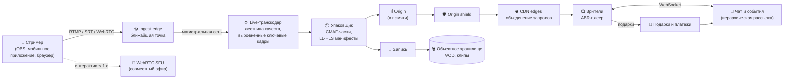
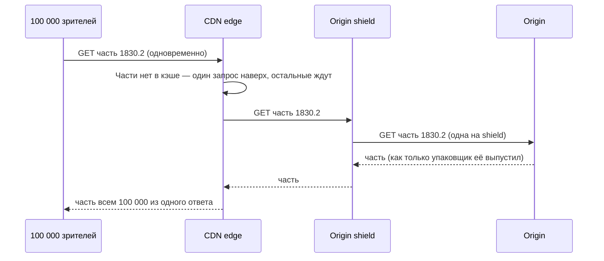

[English](README.md) | **Русский**

# Tier 2 · 4B · 02. Стриминг с реакциями в реальном времени (Twitch / TikTok Live)

> **Уровень:** Hard · **Время на интервью:** 45–60 мин · **Время на разбор:** ~5–6 ч
> **Ключевые аспекты:** приём потока (RTMP, SRT, WebRTC), транскодирование в реальном времени, бюджет задержки «от камеры до экрана», low-latency HLS и chunked CMAF, WebRTC для интерактива, доставка live через CDN и объединение запросов, чат на миллионы зрителей и backpressure, подарки и интерактив, запись и клипы, надёжность трансляции
> **Опирается на:** [Tier 1 · 09 YouTube](../../../tier-1/09-youtube-netflix/README_RU.md#9-deep-dive-3-адаптивный-стриминг) (ABR, HLS/DASH, CDN), [Tier 2 · 4A · 03 Live Comments](../../4a-realtime-collaboration/03-live-comments-reactions/README_RU.md#7-deep-dive-1-иерархическая-рассылка), [03-cdn](../../../03-cdn/README_RU.md), [13-reliability-patterns](../../../13-reliability-patterns/README_RU.md), [Tier 1 · 20 Payments](../../../tier-1/20-payment-system/README_RU.md)

---

## 🗺️ Как читать этот разбор

Разбор построен как интервью, но в каждом шаге есть объяснения: **почему** принимается решение, **как работает** механизм и **что будет**, если сделать иначе. Блоки «📘 Объяснение» — теория прямо по ходу задачи.

| Значок | Что значит |
|:------:|:-----------|
| 🎤 | Реплика интервьюера |
| 🗣️ | Что говорю вслух я (кандидат) |
| ✏️ | Что рисую на доске |
| ⏱️ | Сколько времени тратить на шаг |
| 📘 | Подробное объяснение концепции |

Блоки **TIP** — хороший приём, **WARNING** — ловушка, **IMPORTANT** — сигнал для уровня Senior+.

---

## 📑 Содержание

0. [Чему учит эта задача](#0-чему-учит-эта-задача)
1. [Условие задачи](#1-условие-задачи)
2. [Уточняющие вопросы и требования](#2-уточняющие-вопросы-и-требования)
3. [Оценки нагрузки](#3-оценки-нагрузки)
4. [API и протоколы](#4-api-и-протоколы)
5. [Модель данных](#5-модель-данных)
6. [High-level дизайн](#6-high-level-дизайн)
7. [Deep dive 1: приём потока](#7-deep-dive-1-приём-потока)
8. [Deep dive 2: транскодирование в реальном времени](#8-deep-dive-2-транскодирование-в-реальном-времени)
9. [Deep dive 3: бюджет задержки и low-latency доставка](#9-deep-dive-3-бюджет-задержки-и-low-latency-доставка)
10. [Deep dive 4: доставка live через CDN](#10-deep-dive-4-доставка-live-через-cdn)
11. [Deep dive 5: чат на миллионы зрителей и backpressure](#11-deep-dive-5-чат-на-миллионы-зрителей-и-backpressure)
12. [Deep dive 6: подарки и интерактив](#12-deep-dive-6-подарки-и-интерактив)
13. [Deep dive 7: запись, повтор и клипы](#13-deep-dive-7-запись-повтор-и-клипы)
14. [Deep dive 8: надёжность трансляции](#14-deep-dive-8-надёжность-трансляции)
15. [Узкие места и сценарии сбоев](#15-узкие-места-и-сценарии-сбоев)
16. [Что изменится при росте в 10 раз](#16-что-изменится-при-росте-в-10-раз)
17. [Ключевые концепции и новые понятия](#17-ключевые-концепции-и-новые-понятия)
18. [Варианты задачи и follow-up вопросы](#18-варианты-задачи-и-follow-up-вопросы)
19. [Типичные ошибки](#19-типичные-ошибки)
20. [Шпаргалка и самопроверка](#20-шпаргалка-и-самопроверка)

---

## 0. Чему учит эта задача

В [Tier 1 · 09](../../../tier-1/09-youtube-netflix/README_RU.md) мы раздавали **готовые** видео: их можно спокойно обработать, разрезать на фрагменты и разложить по кэшам. Живая трансляция другая: видео **ещё не существует**, оно появляется прямо сейчас, и зритель хочет увидеть его через секунду-две — а ещё написать в чат и отправить стримеру подарок, на который тот ответит в эфире.

| | Видео по запросу (Tier 1 · 09) | Живая трансляция |
|:-|:-------------------------------|:-----------------|
| Когда появляется контент | Заранее | Прямо сейчас |
| Транскодирование | Параллельно по фрагментам, минуты | В реальном времени, без «будущих» кадров |
| Задержка | Не важна | Секунды — ключевая метрика |
| Нагрузка на CDN | Длинный хвост, популярное в кэше | Все зрители хотят **один и тот же самый новый** фрагмент одновременно |
| Интерактив | Нет | Чат, подарки, ответы стримера |

| Что проверяют | Где это в задаче |
|:--------------|:-----------------|
| Медиа-конвейер в реальном времени | Приём → транскодирование → упаковка → доставка |
| Понимание источников задержки | Бюджет «от камеры до экрана» |
| Протоколы | RTMP, SRT, LL-HLS, WebRTC |
| CDN для живого контента | Объединение запросов, короткие TTL |
| Fan-out и backpressure | Чат на миллионы зрителей |
| Надёжность | Переподключение стримера, резерв транскодера |

> [!TIP]
> Главное, что нужно показать: **разложение задержки по этапам** и понимание, почему классический HLS даёт 20–30 секунд, а low-latency HLS — 2–5, и когда нужен WebRTC.

---

## 1. Условие задачи

> 🎤 «Спроектируй платформу живых трансляций вроде Twitch или TikTok Live: стример выходит в эфир, миллионы зрителей смотрят с задержкой в пару секунд, пишут в чат и отправляют подарки; трансляцию можно пересмотреть после эфира».

**Что видит пользователь:**

```
Стример запускает OBS → через секунды канал «в эфире»
Зритель открывает трансляцию → видео стартует за секунду, отставание от реальности ~2–3 с
Пишет в чат «привет из Варшавы» → стример читает и отвечает голосом через несколько секунд
Отправляет подарок → анимация у всех зрителей, стример благодарит в эфире
После эфира — запись доступна сразу, из неё нарезают клипы
```

**План по времени:**

| Шаг | ⏱️ |
|:----|:--:|
| Требования | 5 мин |
| Оценки | 4 мин |
| API и данные | 4 мин |
| High-level дизайн | 6 мин |
| Deep dives | 25–30 мин |
| Итоги | 3 мин |

---

## 2. Уточняющие вопросы и требования

⏱️ 5 мин

| Мой вопрос | Ответ интервьюера | Что это меняет и почему |
|:-----------|:------------------|:------------------------|
| Сколько трансляций одновременно? | ~100 000 | Сотни Гбит/с входящего видео, тысячи транскодеров |
| Сколько зрителей? | ~10M одновременно, крупнейшая трансляция — до 5M | Десятки Тбит/с исходящего трафика |
| Какая задержка? | Обычный режим — 2–5 с; интерактивный (совместный эфир, аукционы) — меньше 1 с | LL-HLS для массовой доставки, WebRTC для интерактива |
| Качество? | До 1080p60, адаптивное | Лестница битрейтов в реальном времени |
| Чат и подарки? | Да; чат крупных трансляций — десятки тысяч сообщений в секунду | Иерархическая рассылка, выборка, backpressure |
| Запись? | Да, сразу после эфира; перемотка назад во время эфира | Запись сегментов в объектное хранилище |
| Откуда стримят? | ПК (OBS), мобильные приложения, браузер | RTMP, SRT, WebRTC |

### Функциональные требования

1. Приём потока от стримера.
2. Транскодирование в несколько качеств в реальном времени.
3. Доставка зрителям с низкой задержкой и адаптивным качеством.
4. Чат, реакции, подарки, опросы.
5. Запись трансляции, перемотка во время эфира, клипы.
6. Модерация: бан, медленный режим, фильтры; блокировка трансляции.

### Нефункциональные требования

| Требование | Цель | Почему |
|:-----------|:-----|:-------|
| Задержка «от камеры до экрана» | 2–5 с (обычный режим), < 1 с (интерактив) | Иначе чат и подарки не связаны с происходящим |
| Время старта воспроизведения | ~1 с | Зритель листает каналы |
| Буферизация | Минимальная | Остановки хуже снижения качества |
| Масштаб | 5M зрителей одной трансляции | Крупные события |
| Надёжность | Кратковременный обрыв у стримера не завершает трансляцию | Мобильные стримеры, плохой интернет |

---

## 3. Оценки нагрузки

⏱️ 4 мин

```
Приём:              100 000 трансляций × ~6 Мбит/с ≈ 600 Гбит/с входящего видео
Транскодирование:   каждая трансляция → 4–5 качеств в реальном времени
                    → тысячи GPU или специализированных кодировщиков
Отдача:             10M зрителей × ~3 Мбит/с ≈ 30 Тбит/с → только CDN
Запросы к edge:     при фрагментах по ~1 с каждый зритель запрашивает новый фрагмент
                    раз в секунду → ~10M запросов/с к CDN
Чат:                крупная трансляция — десятки тысяч сообщений/с (см. Tier 2 · 4A · 03)
Хранение записей:   100 000 × 6 Мбит/с × часы эфира → петабайты в месяц
```

### Выводы

| Вывод | Следствие для дизайна |
|:------|:----------------------|
| 30 Тбит/с отдачи | CDN, несколько CDN для крупных событий |
| Все зрители трансляции запрашивают один и тот же новый фрагмент | Объединение запросов на edge, origin shield |
| Транскодирование — тысячи ускорителей | Транскодировать полностью только популярные трансляции |
| Задержка — главная метрика | Короткие фрагменты, LL-HLS, минимальные буферы |

---

## 4. API и протоколы

⏱️ 2 мин

```
Стример
  POST /v1/streams                 → { stream_key, ingest_urls: [rtmp://…, srt://…] }
  RTMP / SRT / WHIP (WebRTC)       → поток видео на ближайшую точку приёма

Зритель
  GET  {cdn}/live/{channel}/master.m3u8                     ← список качеств
  GET  {cdn}/live/{channel}/720p/playlist.m3u8?_HLS_msn=1830&_HLS_part=2
       ← «блокирующий» запрос: вернуть, когда появится часть 2 сегмента 1830
  GET  {cdn}/live/{channel}/720p/seg_1830.part2.m4s          ← часть сегмента (~0,5–1 с)

Интерактив
  WS   /v1/chat/{channel}          ← чат и события подарков
  POST /v1/gifts                   { channel, gift_id, count }   Idempotency-Key
```

---

## 5. Модель данных

⏱️ 2 мин

| Данные | Где | Почему |
|:-------|:----|:-------|
| Каналы, настройки, ключи трансляций | БД | Метаданные; ключ — секрет для авторизации стримера |
| Сессии трансляций (начало, конец, точки приёма, качество) | БД | Статус «в эфире», аналитика |
| Сегменты и манифесты (live) | Память origin + кэш CDN | Живут секунды–минуты |
| Записи (VOD) | Объектное хранилище | Сохранение и повтор |
| Чат | Kafka → хранилище | Как в живых комментариях |
| Подарки, баланс, выплаты | Транзакционная БД, реестр двойной записи | Деньги |

---

## 6. High-level дизайн

⏱️ 6 мин



🗣️ «Конвейер видео:
- **приём** — на ближайшей к стримеру точке, дальше по магистральной сети в регион обработки;
- **транскодер** в реальном времени делает лестницу качеств с выровненными ключевыми кадрами;
- **упаковщик** режет поток на короткие **части** (CMAF) и публикует их сразу, обновляя манифесты LL-HLS;
- **origin → shield → edges CDN** раздают части; edges объединяют одновременные запросы;
- параллельно **запись** в объектное хранилище.

Отдельно — **чат и подарки** (иерархическая рассылка, как в живых комментариях) и **WebRTC SFU** для режимов с задержкой меньше секунды».

---

## 7. Deep dive 1: приём потока

> 🎤 «Как стример отправляет видео и что происходит при плохом интернете?»

### Протоколы приёма

| Протокол | Транспорт | Плюсы | Минусы |
|:---------|:----------|:------|:-------|
| **RTMP** | TCP | Поддерживается всеми программами для стриминга | Устаревший; на плохой сети TCP-повторы дают задержку и рывки |
| **SRT** | UDP + собственное восстановление потерь | Устойчив к потерям и скачкам задержки, шифрование | Не во всех программах |
| **WebRTC (WHIP)** | UDP | Стрим прямо из браузера, задержка < 1 с | Сложнее на сервере |
| RIST и другие | UDP | Профессиональное вещание | Нишевые |

### Ближайшая точка приёма

📘 Стример отправляет поток на **ближайшую точку присутствия** (DNS или Anycast). Дальше видео идёт по **собственной магистральной сети** платформы в регион транскодирования — она стабильнее публичного интернета. Так «плохая» часть пути (интернет стримера) максимально короткая.

| Решение | Почему |
|:--------|:-------|
| **Авторизация по ключу трансляции** | Ключ — секрет; утёкший ключ можно сбросить |
| **Метрики здоровья** | Битрейт, потерянные кадры, интервал ключевых кадров — показываются стримеру и используются для алертов |
| **Окно переподключения** | Обрыв на 10–30 с не завершает трансляцию: зрители видят заставку «переподключение», затем поток продолжается |
| **Проверка параметров** | Разрешение, битрейт, кодек в допустимых пределах |
| **Резервный приём** для крупных событий | Два кодировщика отправляют в две точки приёма; переключение без прерывания |

---

## 8. Deep dive 2: транскодирование в реальном времени

> 🎤 «В Tier 1 мы кодировали видео параллельно по фрагментам. Почему здесь так нельзя?»

📘 Для видео по запросу файл целиком лежит на диске, и его можно разрезать и кодировать сотней машин. В живой трансляции **будущих кадров ещё нет**: транскодер должен успевать обрабатывать поток **в реальном времени**, кадр за кадром, с минимальной задержкой.

| Решение | Почему |
|:--------|:-------|
| **Один конвейер на трансляцию** (или на качество) | Поток обрабатывается непрерывно |
| **Лестница качеств** (1080p60, 720p, 480p, 360p, 160p) | Адаптивный битрейт у зрителей (см. [Tier 1 · 09](../../../tier-1/09-youtube-netflix/README_RU.md#8-deep-dive-2-конвейер-транскодирования)) |
| **Выровненные ключевые кадры** во всех качествах (каждые 1–2 с) | Плеер может переключить качество на границе фрагмента без артефактов |
| Ускорители (GPU, аппаратные кодировщики) | Сотни тысяч трансляций — CPU слишком дорог |
| Быстрые настройки кодирования | Задержка важнее максимального сжатия |

### Экономия: транскодировать не всех

📘 Большинство трансляций смотрят единицы зрителей. Полная лестница качеств для них — пустая трата ускорителей.

| Аудитория | Что делаем |
|:----------|:-----------|
| Единицы зрителей | **Передача без перекодирования** (transmux): исходное качество упаковывается в HLS как есть |
| Растущая аудитория | Добавляем качества по мере роста зрителей |
| Партнёры, популярные каналы | Полная лестница всегда |

Twitch исторически предоставлял гарантированное транскодирование не всем каналам, а в первую очередь партнёрам — это пример такого компромисса.

---

## 9. Deep dive 3: бюджет задержки и low-latency доставка

> 🎤 «Откуда берётся задержка и как получить 2–3 секунды?»

### Разложение задержки

```
                                Классический HLS       Low-latency HLS
Захват и кодирование у стримера     0,5–1 с               0,5–1 с
Сеть до точки приёма и магистраль   0,1–0,3 с             0,1–0,3 с
Транскодирование                    0,5–1 с               0,3–0,5 с
Упаковка: ждём целый сегмент        6 с                   части по 0,3–1 с
CDN                                 0,1–0,5 с             0,1–0,3 с
Буфер плеера                        3 сегмента ≈ 18 с     2–3 части ≈ 1–2 с
────────────────────────────────────────────────────────────────────────────
Итого                               ≈ 20–30 с             ≈ 2–5 с
```

📘 **Главный источник задержки — сегменты.** В классическом HLS плеер узнаёт о сегменте только когда тот **полностью** записан (6 с), и держит в буфере несколько сегментов для устойчивости. Задержка складывается из длительности сегментов.

### Low-latency HLS

| Механизм | Как работает |
|:---------|:-------------|
| **Части сегмента** (partial segments) | Сегмент 2–4 с публикуется частями по 0,3–1 с **по мере кодирования** |
| **Preload hint** | Манифест подсказывает адрес следующей части заранее — плеер запрашивает её до того, как она готова |
| **Блокирующий запрос манифеста** | Запрос «дай манифест, когда появится часть N» — сервер держит его до появления части, без частого опроса |
| **Короткий буфер плеера** | 2–3 части вместо 3 сегментов |

📘 **Chunked CMAF** в DASH работает похоже: сегмент передаётся кусками через HTTP chunked transfer по мере кодирования, и плеер начинает его воспроизводить, не дожидаясь конца.

### WebRTC — когда нужна задержка меньше секунды

| | LL-HLS / chunked CMAF ⭐ для массовой доставки | WebRTC |
|:-|:-----------------------------------------------|:-------|
| Задержка | 2–5 с | < 0,5–1 с |
| Масштаб | Миллионы через обычные CDN (HTTP, кэширование) | Каждое соединение — состояние на медиа-сервере (SFU), кэшировать нечего |
| Стоимость | Низкая | Высокая |
| Где | Обычные трансляции | Совместный эфир, гость в эфире, аукционы, ставки |

> [!IMPORTANT]
> **Сигнал Senior+:** показать разложение задержки по этапам и объяснить, что выигрыш LL-HLS — в **устранении ожидания целых сегментов**, а не в «более быстром интернете». И выбирать протокол по требованию: миллионы зрителей с 2–5 с — LL-HLS через CDN; десятки участников с < 1 с — WebRTC.

### Компромисс задержки и устойчивости

| Меньше буфер | Больше буфер |
|:-------------|:-------------|
| Меньше задержка | Больше задержка |
| Чаще буферизация на нестабильной сети | Устойчивее |

Плеер может **адаптировать** буфер: увеличивать при частых паузах и немного ускорять воспроизведение (например, на 5%), чтобы «догнать» эфир, когда сеть стабильна.

---

## 10. Deep dive 4: доставка live через CDN

> 🎤 «5 миллионов зрителей одновременно запрашивают только что появившуюся часть. Что происходит с CDN?»

### Проблема

📘 В видео по запросу зрители смотрят разные места разных видео. В эфире **все** зрители трансляции запрашивают **одну и ту же** самую новую часть — в одну и ту же секунду. Если её ещё нет в кэше edge, тысячи запросов одновременно уйдут к origin.

### Решения

| Решение | Как |
|:--------|:----|
| **Объединение запросов** (request coalescing) | Edge, получив тысячи запросов на одну отсутствующую часть, отправляет к origin **один** запрос, остальные ждут его ответа |
| **Origin shield** | Промежуточный уровень: промахи сотен edge сводятся к нескольким запросам к origin |
| **Блокирующие запросы** | Запрос части, которой ещё нет, удерживается до её появления — вместо шквала повторов |
| **TTL** | Манифест — доли секунды или с блокирующей перезагрузкой; части — долго (они неизменны) |
| **Несколько CDN** | Крупные события распределяются между провайдерами; переключение при сбое |
| **Прогрев** перед крупными событиями | Ёмкость планируется заранее |



---

## 11. Deep dive 5: чат на миллионы зрителей и backpressure

> 🎤 «Чат крупной трансляции. Чем он отличается от живых комментариев и что делать с медленными клиентами?»

Основа — та же, что в [живых комментариях](../../4a-realtime-collaboration/03-live-comments-reactions/README_RU.md#7-deep-dive-1-иерархическая-рассылка): иерархическая рассылка через ретрансляторы и шлюзы, пакеты раз в секунду, выборка при огромном потоке, медленный режим и модерация. Twitch исторически построил чат на протоколе IRC — пример того, что поверх классического протокола можно построить рассылку на миллионы.

### Backpressure

📘 **Backpressure** — что делать, если получатель не успевает принимать. У зрителя на мобильной сети буфер отправки может расти: сообщения чата поступают быстрее, чем уходят.

| Решение | Почему |
|:--------|:-------|
| **Ограниченная очередь отправки** на каждое соединение | Медленный клиент не съедает память шлюза |
| **Отбрасывать старые сообщения чата**, а не блокировать | Чат — не критичные данные; свежие важнее |
| **Приоритеты**: события подарков и модерации выше обычных сообщений | Важное доходит даже при перегрузке |
| **Отключить совсем медленный клиент** | Если очередь переполнена долго — переподключение с текущего момента |
| **Видео и чат — разные каналы** | Перегрузка чата никогда не тормозит видео |

### Синхронизация чата с видео

📘 Чат приходит почти мгновенно, а видео — с задержкой 2–5 с. Зритель может прочитать в чате «ГООООЛ!» раньше, чем увидит гол. Решение: клиент знает свою задержку видео (из манифеста — время создания части) и **задерживает показ чата** на эту величину. Сообщения, отправленные самим зрителем, показываются сразу.

---

## 12. Deep dive 6: подарки и интерактив

> 🎤 «Зритель отправляет подарок стримеру. Как это устроено?»

| Шаг | Решение |
|:----|:--------|
| Покупка внутренней валюты | Платёжная система с идемпотентностью (см. [Tier 1 · 20](../../../tier-1/20-payment-system/README_RU.md)) |
| Отправка подарка | Списание с баланса зрителя и зачисление стримеру — одна транзакция в реестре; `Idempotency-Key` против двойной отправки |
| Событие подарка | В поток чата трансляции с высоким приоритетом: анимация у всех зрителей |
| Шквал подарков | Агрегация: «Анна отправила 50 роз» вместо 50 событий; крупные подарки — отдельными событиями |
| Рейтинг дарителей | Sorted set по трансляции (см. [Tier 1 · 16](../../../tier-1/16-top-k-leaderboard/README_RU.md)) |
| Выплаты стримерам | Периодически, с удержанием на возвраты и мошенничество |

### Интерактив и задержка

| Функция | Требование к задержке | Протокол |
|:--------|:---------------------|:---------|
| Подарок → благодарность стримера | 2–5 с приемлемо | LL-HLS |
| Опросы и прогнозы | Голосование закрывается по времени сервера | LL-HLS + чат |
| Гость в эфире (совместная трансляция) | < 0,5 с между участниками | WebRTC SFU между участниками, а зрителям — микс через LL-HLS |
| Аукционы, ставки в реальном времени | < 1 с | WebRTC для зрителей-участников |

---

## 13. Deep dive 7: запись, повтор и клипы

> 🎤 «Как сделать запись доступной сразу после эфира и перемотку назад во время эфира?»

| Функция | Как |
|:--------|:----|
| **Запись** | Упаковщик параллельно пишет сегменты всех качеств в объектное хранилище **по мере эфира** |
| Запись после эфира | Манифест VOD из уже записанных сегментов — доступен сразу, без перекодирования |
| **Перемотка во время эфира** (DVR) | Манифест с окном в последние N часов: плеер может уйти назад и вернуться «в эфир» |
| **Клипы** | Выбор диапазона сегментов → новый манифест по существующим сегментам (без перекодирования); при необходимости — быстрое перекодирование для точной обрезки |
| Музыка и авторские права | Обнаружение защищённой музыки → заглушение сегментов в записи |
| Хранение | По правилам: записи хранятся N дней, затем удаляются или переводятся в холодное хранилище |

---

## 14. Deep dive 8: надёжность трансляции

> 🎤 «Что будет, если у стримера пропал интернет или упал транскодер?»

| Сбой | Что видят зрители | Решение |
|:-----|:------------------|:--------|
| Обрыв у стримера | Заставка «переподключение» | Сессия держится 30–60 с; при переподключении поток продолжается в тех же манифестах |
| Нестабильная сеть стримера | Потеря качества | SRT с восстановлением потерь; стример получает подсказку снизить битрейт |
| Транскодер упал | Пауза | Перезапуск конвейера на другой машине за секунды; для крупных трансляций — **горячий резерв**, обрабатывающий тот же поток параллельно |
| Точка приёма упала | Обрыв приёма | Стример переподключается к другой точке (DNS/Anycast); резервный приём для крупных событий |
| Origin упал | Новые части не появляются | Реплика origin в другой зоне, переключение shield |
| CDN-провайдер деградировал | Буферизация в регионе | Несколько CDN, переключение по метрикам качества |

### Метрики качества

| Метрика | Что показывает |
|:--------|:---------------|
| Задержка «от камеры до экрана» | Измеряется по меткам времени в частях |
| Время старта | Сколько ждать первого кадра |
| Доля буферизации | Насколько часто останавливается |
| Средний битрейт | Какое качество реально видят |
| Здоровье приёма | Потерянные кадры, битрейт стримера |

---

## 15. Узкие места и сценарии сбоев

| Сценарий | Что произойдёт | Как защищаемся |
|:---------|:---------------|:---------------|
| Классический HLS | Задержка 20–30 с | LL-HLS: части, preload hints, блокирующие запросы |
| Все зрители запрашивают новую часть | Шквал запросов к origin | Объединение запросов на edge, origin shield |
| Плохой интернет стримера | Рывки, обрывы | SRT, ближайшая точка приёма, окно переподключения |
| Сотни тысяч трансляций с полной лестницей | Огромная стоимость | Transmux для малых, качества по мере роста аудитории |
| Падение транскодера | Пауза в эфире | Перезапуск, горячий резерв для крупных |
| Медленный клиент чата | Растущая память шлюза | Ограниченная очередь, отбрасывание старого, приоритеты |
| Спойлеры в чате | Чат опережает видео | Задержка показа чата на величину задержки видео |
| Шквал подарков | Перегрузка событий | Агрегация, приоритеты |
| Двойная отправка подарка | Двойное списание | Идемпотентность |
| Крупное событие | Нехватка ёмкости CDN | Планирование, прогрев, несколько CDN |

---

## 16. Что изменится при росте в 10 раз

> 🎤 «Трансляция на 50 миллионов зрителей?»

| Изменение | Почему |
|:----------|:-------|
| **Несколько CDN и собственные кэши у провайдеров** | Десятки Тбит/с на одно событие |
| **Мультикаст-подобная доставка внутри магистрали** | Одна копия потока до каждого региона |
| **Специализированные кодировщики** | Стоимость транскодирования |
| **Ещё более агрессивная выборка чата** | Поток сообщений |

---

## 17. Ключевые концепции и новые понятия

### Что применяется

| Концепция | Где разобрана | Как применяется здесь |
|:----------|:--------------|:----------------------|
| ABR, HLS/DASH, CMAF, CDN | [Tier 1 · 09](../../../tier-1/09-youtube-netflix/README_RU.md) | Основа доставки |
| Иерархическая рассылка, выборка | [Tier 2 · 4A · 03](../../4a-realtime-collaboration/03-live-comments-reactions/README_RU.md) | Чат |
| Объединение запросов, origin shield | [03-cdn](../../../03-cdn/README_RU.md) | Доставка live |
| Резервирование, переключение | [13-reliability-patterns](../../../13-reliability-patterns/README_RU.md) | Надёжность трансляции |
| Идемпотентные платежи | [Tier 1 · 20](../../../tier-1/20-payment-system/README_RU.md) | Подарки |

### Новые понятия этой задачи

| Понятие | Кратко |
|:--------|:-------|
| **Задержка «от камеры до экрана»** | Время от события перед камерой до показа зрителю |
| **RTMP, SRT, WHIP** | Протоколы приёма потока |
| **Транскодирование в реальном времени** | Кодирование без доступа к будущим кадрам |
| **Transmux** | Переупаковка без перекодирования |
| **Выровненные ключевые кадры** | Одинаковые границы во всех качествах для переключения |
| **LL-HLS** | Части сегментов, preload hints, блокирующие запросы манифеста |
| **Chunked CMAF** | Передача сегмента кусками по мере кодирования |
| **SFU** | Медиа-сервер WebRTC, пересылающий потоки участникам |
| **Объединение запросов** | Один запрос к origin на тысячи одинаковых промахов |
| **Backpressure** | Обработка ситуации, когда получатель не успевает |
| **DVR-окно** | Перемотка назад во время эфира |

---

## 18. Варианты задачи и follow-up вопросы

<details>
<summary><b>Почему не WebRTC для всех зрителей?</b></summary>

WebRTC даёт задержку меньше секунды, но каждое соединение требует состояния на медиа-сервере (SFU), а данные нельзя кэшировать на обычных CDN. Для миллионов зрителей это в разы дороже и сложнее HTTP-доставки. Поэтому WebRTC используют для участников интерактива, а массовую аудиторию обслуживают через LL-HLS.
</details>

<details>
<summary><b>Как показать миниатюры «кто сейчас в эфире» на главной странице?</b></summary>

Транскодер раз в несколько секунд выдаёт кадр-превью в объектное хранилище; главная страница показывает превью и число зрителей (агрегированный счётчик), а при наведении — короткий поток низкого качества.
</details>

<details>
<summary><b>Как считать число зрителей трансляции?</b></summary>

Heartbeats плееров (раз в 30–60 с) агрегируются по трансляции на шлюзах и в регионах, итог обновляется раз в несколько секунд. Точность до единицы не нужна; для уникальных зрителей за эфир — HyperLogLog.
</details>

<details>
<summary><b>Как блокировать нарушающую трансляцию?</b></summary>

Модерация (автоматическая и ручная) помечает трансляцию → сервис приёма разрывает соединение стримера и запрещает ключ → origin перестаёт выпускать новые части → плееры получают событие «трансляция недоступна»; запись помечается и не публикуется.
</details>

<details>
<summary><b>Чем мобильный стриминг отличается от стриминга с ПК?</b></summary>

Нестабильная сеть и ограничения батареи: адаптивный битрейт на стороне стримера (снижать качество при потерях), SRT или WebRTC вместо RTMP, более длинное окно переподключения, аппаратное кодирование на телефоне.
</details>

---

## 19. Типичные ошибки

| ❌ Ошибка | Почему плохо | ✅ Как правильно |
|:---------|:-------------|:----------------|
| Классический HLS с 6-секундными сегментами | Задержка 20–30 с | LL-HLS или chunked CMAF |
| WebRTC для миллионов зрителей | Дорого и плохо масштабируется | LL-HLS через CDN, WebRTC только для интерактива |
| Параллельное транскодирование фрагментов, как для VOD | Будущих кадров ещё нет | Транскодирование в реальном времени |
| Полная лестница качеств для каждой трансляции | Огромная стоимость | Transmux для малых трансляций |
| Ключевые кадры не выровнены | Артефакты при смене качества | Выравнивание во всех качествах |
| Без объединения запросов на edge | Шквал к origin | Request coalescing, shield |
| Обрыв у стримера завершает эфир | Плохой опыт | Окно переподключения |
| Чат блокирует отправку при медленном клиенте | Рост памяти, задержки | Ограниченная очередь, отбрасывание |
| Чат опережает видео | Спойлеры | Задержка показа чата |
| Подарки без идемпотентности | Двойное списание | Idempotency-Key, реестр |

---

## 20. Шпаргалка и самопроверка

### Ответ за 30 секунд

> Стример отправляет поток по RTMP, SRT или WebRTC (WHIP) на ближайшую точку приёма с авторизацией по ключу; дальше — по магистральной сети в регион транскодирования, окно переподключения 30–60 с. Транскодер в реальном времени делает лестницу качеств с выровненными ключевыми кадрами (малые трансляции — transmux без перекодирования). Упаковщик выпускает CMAF-части по 0,3–1 с и обновляет LL-HLS манифесты с preload hints и блокирующими запросами — вместо 20–30 с классического HLS получаем 2–5 с; для интерактива (гость в эфире, аукционы) — WebRTC SFU с задержкой меньше секунды. Origin → shield → CDN edges с объединением запросов: тысячи одинаковых промахов дают один запрос наверх; несколько CDN для крупных событий. Чат — иерархическая рассылка с выборкой, ограниченными очередями отправки, отбрасыванием старого и приоритетом подарков; показ чата задерживается на задержку видео. Подарки — идемпотентные списания в реестре, агрегация шквала. Запись — сегменты в объектное хранилище по ходу эфира: VOD сразу, DVR-окно, клипы без перекодирования. Надёжность — горячий резерв транскодера, резервный приём, метрики QoE.

### Самопроверка

- [ ] Могу объяснить отличия live от видео по запросу
- [ ] Могу сравнить RTMP, SRT и WebRTC для приёма
- [ ] Могу объяснить, почему транскодирование live нельзя распараллелить по фрагментам
- [ ] Могу разложить задержку по этапам для классического HLS и LL-HLS
- [ ] Могу объяснить части, preload hints и блокирующие запросы
- [ ] Могу выбрать между LL-HLS и WebRTC
- [ ] Могу объяснить объединение запросов на CDN для live
- [ ] Могу описать backpressure в чате
- [ ] Могу объяснить синхронизацию чата с видео
- [ ] Могу спроектировать подарки, запись и клипы
- [ ] Могу описать надёжность трансляции

### Что почитать

- Apple, *Low-Latency HLS* — спецификация и документация
- Twitch Engineering, статьи о транскодировании, приёме потоков и чате
- Документация SRT Alliance и спецификация WHIP (WebRTC-HTTP Ingestion Protocol)
- Akamai, Cloudflare — материалы о доставке live и объединении запросов
- Разборы [Tier 1 · 09](../../../tier-1/09-youtube-netflix/README_RU.md) и [Tier 2 · 4A · 03](../../4a-realtime-collaboration/03-live-comments-reactions/README_RU.md)
