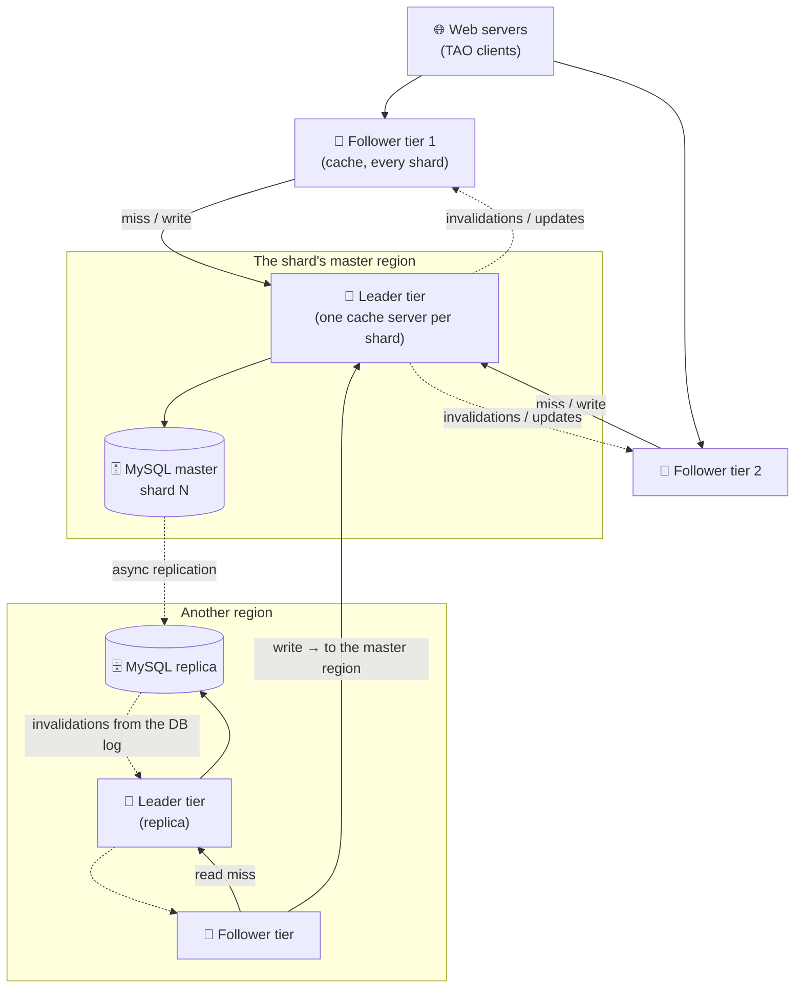
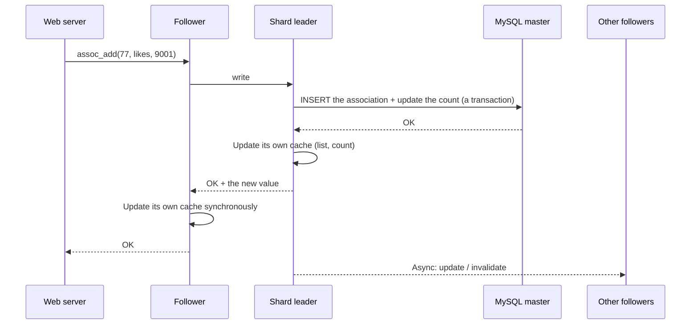

**English** | [Русский](README_RU.md)

# Tier 2 · 4B · 03. A Social Graph Store (like Meta TAO)

> **Level:** Hard · **Interview time:** 45–60 min · **Study time:** ~5 h
> **Key aspects:** objects and associations as the data model, sharding by object and storing association lists alongside their source, inverse associations, a two-tier cache (follower and leader), consistency and read-after-write, multi-region with a master region per shard, hot objects and vertices with enormous degree, friends-of-friends queries, non-atomic writes of edge pairs
> **Builds on:** [02-caching](../../../02-caching/README.md), [Tier 1 · 03 Distributed Cache](../../../tier-1/03-distributed-cache/README.md#10-deep-dive-5-consistency-with-the-database), [06-partitioning](../../../06-partitioning/README.md), [05-replication](../../../05-replication/README.md), [Tier 1 · 04 ID Generator](../../../tier-1/04-unique-id-generator/README.md), [Tier 1 · 07 News Feed](../../../tier-1/07-news-feed/README.md)

---

## 🗺️ How to Read This Walkthrough

The walkthrough follows an interview, but every step includes explanations: **why** a decision is made, **how** a mechanism works and **what happens** if you do it differently. The "📘 Explanation" blocks are theory right where you need it.

| Icon | Meaning |
|:----:|:--------|
| 🎤 | Interviewer |
| 🗣️ | What I (the candidate) say out loud |
| ✏️ | What I draw on the whiteboard |
| ⏱️ | Time budget for the step |
| 📘 | A detailed explanation of a concept |

Callouts: **TIP** — a good technique, **WARNING** — a trap, **IMPORTANT** — a Senior+ signal.

---

## 📑 Contents

0. [What This Problem Teaches](#0-what-this-problem-teaches)
1. [Problem Statement](#1-problem-statement)
2. [Clarifying Questions and Requirements](#2-clarifying-questions-and-requirements)
3. [Capacity Estimates](#3-capacity-estimates)
4. [API](#4-api)
5. [Data Model](#5-data-model)
6. [High-Level Design](#6-high-level-design)
7. [Deep Dive 1: Why Not Just a Cache in Front of a Database](#7-deep-dive-1-why-not-just-a-cache-in-front-of-a-database)
8. [Deep Dive 2: Sharding and Association Lists](#8-deep-dive-2-sharding-and-association-lists)
9. [Deep Dive 3: The Two-Tier Cache](#9-deep-dive-3-the-two-tier-cache)
10. [Deep Dive 4: Consistency and Multiple Regions](#10-deep-dive-4-consistency-and-multiple-regions)
11. [Deep Dive 5: Hot Objects and Vertices With Enormous Degree](#11-deep-dive-5-hot-objects-and-vertices-with-enormous-degree)
12. [Deep Dive 6: Queries Beyond One Hop](#12-deep-dive-6-queries-beyond-one-hop)
13. [Deep Dive 7: Writing Edge Pairs and Atomicity](#13-deep-dive-7-writing-edge-pairs-and-atomicity)
14. [Deep Dive 8: Failures and Invalidation](#14-deep-dive-8-failures-and-invalidation)
15. [Bottlenecks and Failure Scenarios](#15-bottlenecks-and-failure-scenarios)
16. [What Changes at 10x Scale](#16-what-changes-at-10x-scale)
17. [Key Concepts and New Terms](#17-key-concepts-and-new-terms)
18. [Variations and Follow-Up Questions](#18-variations-and-follow-up-questions)
19. [Common Mistakes](#19-common-mistakes)
20. [Cheat Sheet and Self-Check](#20-cheat-sheet-and-self-check)

---

## 0. What This Problem Teaches

A social network is a graph: people, posts, photos, comments are **vertices**; "is friends with", "liked", "wrote", "is tagged in" are **edges**. Almost every page is several dozen graph reads: who's the author, how many likes, did friends like it, which comments. Meta described a system called **TAO** (The Associations and Objects) that serves such queries at a scale of billions of reads per second.

| What's tested | Where it shows up |
|:--------------|:------------------|
| Modeling data around queries | Objects and association lists, inverse associations |
| Sharding a graph | How to make a typical query single-shard |
| Caching at extreme scale | A two-tier cache, serializing misses |
| Cache and database consistency | Read-after-write, async invalidation |
| Multi-region | A master region per shard, local reads |
| Skew | Celebrities, viral posts |
| Graph traversal | Friends of friends, mutual friends |

> [!TIP]
> State right away that the load is **almost entirely reads** — in the TAO paper, reads make up around 99.8%. So the whole architecture is first and foremost **a cache**, with the database as durable storage behind it.

---

## 1. Problem Statement

> 🎤 "Design a social graph store like Meta's TAO: users, posts, likes, friendships, comments; billions of users and reads per second. Typical queries: get an object, get the latest associations of a given type, count associations."

**Queries made when a post is opened:**

```
obj_get(post 9001)                                     ← the text, author, time
obj_get(user 42)                                       ← the author's name and avatar
assoc_count(post 9001, "liked_by")                     ← "12,345 likes"
assoc_get(post 9001, "liked_by", [my friends])         ← which friends liked it
assoc_range(post 9001, "comment", 0, 10)               ← the last 10 comments
assoc_get(user me, "likes", [post 9001])               ← did I like it
```

**Time plan:**

| Step | ⏱️ |
|:-----|:--:|
| Requirements | 5 min |
| Estimates | 3 min |
| API and model | 6 min |
| High-level design | 6 min |
| Deep dives | 25 min |
| Wrap-up | 3 min |

---

## 2. Clarifying Questions and Requirements

⏱️ 5 min

| My question | Interviewer's answer | What it changes and why |
|:------------|:---------------------|:------------------------|
| Scale? | ~2B users with ~300 friends on average; posts, photos, likes, comments | Trillions of edges, petabytes |
| The read/write ratio? | The vast majority are reads | The cache is the center of the architecture |
| Latency? | Single-digit milliseconds per query; a page makes dozens of queries | Almost everything from memory |
| Consistency? | Eventual is fine; the author must see their changes immediately | Read-after-write within the client's cache |
| Regions? | Several regions worldwide | Reads locally, writes via a master region |
| Query types? | An object by ID, an association list by time, counts, checking whether an association exists | A specialized API, not arbitrary queries |
| Multi-hop traversal? | Friends of friends, mutual friends — needed, but less often | Separate mechanisms |

### Functional requirements

1. Objects: create, read, update, delete.
2. Associations: add, delete, check existence, get the latest N by time, count.
3. Inverse associations are maintained automatically (like ↔ "liked by").
4. Supporting friends-of-friends and mutual-friend queries.

### Non-functional requirements

| Requirement | Target | Why |
|:------------|:-------|:----|
| Read throughput | Billions per second | Each page is dozens of queries |
| Latency | Single-digit ms | A page is assembled from many queries |
| Availability | Very high | Almost nothing works without the graph |
| Consistency | Eventual; read-after-write for the author | A user must see their own like immediately |
| Efficiency | Don't overload the databases | The cache absorbs the overwhelming majority of reads |

---

## 3. Capacity Estimates

⏱️ 3 min

```
Friendships:     2B users × ~300 friends = ~600B directed edges
                 (each friendship is stored twice — one edge in each direction)
                 × ~100 B per edge ≈ 60 TB for friendships alone
Other edges:     likes, comments, tags, follows — several times more → petabytes

Reads:           ~1B queries per second at peak
Writes:          ~1M per second (likes, comments, posts)

DB shards:       thousands of MySQL shards (logical shards on fewer servers)
Cache:           hundreds of TB of memory across several regions
```

### Conclusions

| Conclusion | Design consequence |
|:-----------|:-------------------|
| Reads outnumber writes ~1,000× | A multi-tier cache; the database only gets misses and writes |
| Petabytes of data | Sharding by object ID |
| A page is dozens of queries | Each query must hit one shard and one cache server |
| Celebrities have millions of edges | Special handling for vertices with enormous degree |

---

## 4. API

⏱️ 3 min

📘 TAO deliberately offers **a narrow API** tailored to typical social graph queries, rather than an arbitrary query language.

```
Objects
  obj_add(otype, data)                → id
  obj_get(id)                         → { otype, data }
  obj_update(id, data)
  obj_delete(id)

Associations: (id1, atype, id2, time, data)
  assoc_add(id1, atype, id2, time, data)      ← also adds the inverse association, if the type has one
  assoc_delete(id1, atype, id2)
  assoc_get(id1, atype, id2_set)              → which of id2 are associated with id1
  assoc_count(id1, atype)                     → the number of associations
  assoc_range(id1, atype, pos, limit)         → associations sorted by time (newest first)
  assoc_time_range(id1, atype, high, low, limit)
```

| Example | Call |
|:--------|:-----|
| A post's last 10 comments | `assoc_range(post, "comment", 0, 10)` |
| The number of likes | `assoc_count(post, "liked_by")` |
| Which of my friends liked it | `assoc_get(post, "liked_by", my_friend_ids)` |
| My friends | `assoc_range(me, "friend", 0, 5000)` |

---

## 5. Data Model

⏱️ 3 min

```
An object:       id → (otype, data: key-value)
                   user 42:   { name: "Anna", avatar: … }
                   post 9001: { text: "…", created: … }

An association:  (id1, atype, id2) → (time, data)
                   (42, "authored", 9001)      ← Anna wrote the post
                   (9001, "authored_by", 42)   ← the inverse association
                   (77, "likes", 9001)         ← Boris liked it
                   (9001, "liked_by", 77)      ← the inverse association

A count:         (id1, atype) → count
```

| Table (in a MySQL shard) | Key | Why |
|:-------------------------|:----|:----|
| `objects` | id | Object data |
| `associations` | (id1, atype, id2), indexed on (id1, atype, time) | Association lists by time |
| `assoc_counts` | (id1, atype) | Counts without `COUNT(*)` |

📘 **Inverse associations.** Associations are **directed**. To answer both "what did Boris like" and "who liked the post", both directions are needed. An association type declares its pair: `likes` ↔ `liked_by`, `friend` ↔ `friend`. When an association is added, the system writes the inverse too.

---

## 6. High-Level Design

⏱️ 6 min



🗣️ "Key decisions:
- **objects and association lists are sharded by ID**; an ID contains its shard number, and associations live in the shard of `id1` — a typical query hits one shard;
- **a two-tier cache**: many **follower** tiers receive web servers' queries; each shard has a single **leader** server, the only one that goes to the database, which orders writes;
- **a master region per shard**: writes go to the master region and reads come from the local region; changes propagate via async replication and invalidations."

---

## 7. Deep Dive 1: Why Not Just a Cache in Front of a Database

> 🎤 "Why not put memcache in front of MySQL, as usual?"

📘 That's exactly how Facebook worked before TAO: web servers read from memcache, on a miss read from MySQL, and then put the result into the cache (lookaside). TAO appeared because that approach had problems for a graph:

| A lookaside cache's problem | Example | How TAO solves it |
|:----------------------------|:--------|:------------------|
| **Lists are cached whole** | A new like → the whole "who liked it" list must be invalidated and reread from the database | The cache understands association list structure: adding an edge **updates** the cached list rather than invalidating it |
| **Caching logic in every web server** | Thousands of servers handle the cache differently — consistency bugs | The logic lives inside TAO; web servers use a simple API |
| **A flood of misses** | A popular key expired — thousands of requests to the database | The shard's leader coalesces misses (see leases in [Tier 1 · 03](../../../tier-1/03-distributed-cache/README.md#10-deep-dive-5-consistency-with-the-database)) |
| **Consistency across regions** | Stale data lingers in another region's cache | Invalidations from the database's replication log |

> [!IMPORTANT]
> **Senior+ signal:** explain that a specialized graph API gives the cache **knowledge of the data's structure** (lists, counts, inverse associations) — so the cache can update precisely instead of invalidating wholesale. That's the main reason a graph is built as a separate service rather than "memcache + SQL".

---

## 8. Deep Dive 2: Sharding and Association Lists

> 🎤 "How do you spread trillions of edges across shards?"

### The ID contains the shard

📘 On creation an object gets an ID that encodes its **logical shard** number (as in [Instagram](../../../tier-1/08-instagram/README.md#13-deep-dive-7-sharding-and-ids) and the [ID generator](../../../tier-1/04-unique-id-generator/README.md)). The ID immediately tells you where the object lives — with no lookup.

### Associations live in the source's shard

```
An association (id1, atype, id2) is stored in the shard of object id1

assoc_range(post 9001, "comment", 0, 10):
  shard(9001) → one query to one shard and one cache server
```

| Decision | Why |
|:---------|:----|
| The whole `(id1, atype)` association list in one shard | The most frequent queries are single-shard |
| Logical shards on physical servers | Rebalancing by moving whole shards |
| An index on `(id1, atype, time)` | The latest N associations — one index read |
| Counts alongside | `assoc_count` without scanning |

### The inverse association lives in another shard

📘 `(77, "likes", 9001)` lives in user 77's shard, while `(9001, "liked_by", 77)` lives in post 9001's shard. They're different shards, and writing both associations **isn't atomic** (deep dive 7).

### Long lists

| Decision | Why |
|:---------|:----|
| The cache holds only **the latest N** associations of a list (e.g. thousands) | Most queries look at the start of a list: the latest comments, recent likes |
| Beyond that — page by page from the database | Deep pages are rarely requested |
| The count is cached separately | "12.4M likes" without loading the list |

---

## 9. Deep Dive 3: The Two-Tier Cache

> 🎤 "Why two cache tiers — follower and leader?"

### Roles

| Tier | How many | What it does |
|:-----|:---------|:-------------|
| **A follower tier** | Many tiers per region; each tier covers **every** shard (shards are spread across the tier's servers by consistent hashing) | Receives web servers' queries; answers itself on a hit; goes to the leader on a miss or write |
| **The leader** | One cache server per shard | The only one that accesses the shard's database; serializes writes; sends updates and invalidations to followers |

### Why

| Property | Explanation |
|:---------|:------------|
| **Scaling reads without loading the database** | Need more reads — add a follower tier. Database load doesn't grow: every miss from every tier passes through one leader |
| **Protecting the database from a flood of misses** | The leader coalesces concurrent misses on one key into one database read |
| **Ordering writes** | All of a shard's writes pass through the leader — no races between cache and database |
| **Failure isolation** | A follower tier dies — web servers move to another tier |

### A write



📘 **Why the client's follower updates synchronously.** That way the like's author, reading through the same follower tier, sees their like **immediately** (read-after-write). Other tiers learn of the change asynchronously — within a fraction of a second.

---

## 10. Deep Dive 4: Consistency and Multiple Regions

> 🎤 "Regions all over the world. How do reads and writes work, and what about consistency?"

### A master region per shard

| Operation | Where it runs |
|:----------|:--------------|
| **A read** | Locally: follower → its region's leader → its region's database replica |
| **A write** | Always in **the shard's master region**: follower → its region's leader → the master region's leader → the database master |
| Replication | Async: master → replicas in other regions |
| Invalidation in other regions | From the replication log: a change applied to the replica → its leader and followers are updated |

📘 **Why not write in any region.** Writing to several regions at once (active-active) requires conflict resolution, which is hard for a graph (counts, lists). One master region per shard gives a simple write order. Different shards can have masters in different regions, so the load is spread.

### Guarantees

| Guarantee | How it's provided |
|:----------|:------------------|
| **Eventual consistency** | Replicas and caches catch up within fractions of a second to seconds |
| **Read-after-write for the author** | The author's follower updates its cache synchronously after a successful write |
| **Fresh data for critical reads** | A query can be marked critical — it's proxied to the master region (more expensive) |
| **Protection from stale overwrites** | Object versions: a cache update with an older version is ignored |

> [!WARNING]
> The author sees their like immediately, but their friend in another region sees it a fraction of a second later. That's a deliberate trade-off: a social network doesn't need strong consistency, and a round trip to the master region on every read would make pages several times slower (see [07-consistency-models](../../../07-consistency-models/README.md)).

---

## 11. Deep Dive 5: Hot Objects and Vertices With Enormous Degree

> 🎤 "A celebrity's post is read by millions at once, and their profile has 300 million followers. What breaks?"

### Hot objects

| Problem | Solution |
|:--------|:---------|
| One key — one server in a follower tier | **Many tiers** share the load: each tier has its own copy |
| Too hot even for that | **Client-side caching of hot objects** (on the web server) for a short time |
| A hot leader | The leader only receives misses and writes — few compared to reads |
| A flood of writes (millions of likes) | The count is updated in batches; the "who liked it" list keeps only recent entries in the cache |

### Vertices with enormous degree

📘 A celebrity has hundreds of millions of "follower" associations. Loading such a list whole is impossible, yet queries against it still arrive.

| Query | How it's served |
|:------|:----------------|
| "How many followers" | The count — one key |
| "Do I follow them" | `assoc_get(celebrity, "followed_by", [me])` — checking a specific pair rather than loading the list; more reliably, ask in the other direction — `assoc_get(me, "follows", [celebrity])` against the user's small list |
| "Recent followers" | The start of the list from the cache |
| A full traversal | Offline only (batch graph processing) |

> [!TIP]
> A trick for vertices with enormous degree: **ask the question from the small list's side**. "Does Boris follow the celebrity?" — check Boris's follows list (hundreds), not the celebrity's followers list (hundreds of millions).

---

## 12. Deep Dive 6: Queries Beyond One Hop

> 🎤 "How do you show friends of friends and the number of mutual friends?"

### The cost of traversal

```
My friends:               ~300
Each of their friends:    ~300
Friends of friends:       ~90,000 vertices (with repeats)
```

📘 TAO is optimized for **one-hop** queries. A two-hop traversal means hundreds of queries to different shards; doing it on every page load is expensive.

| Task | Solution |
|:-----|:---------|
| **Mutual friends** (me and Boris) | Two friend lists (~300 each) → **an intersection of sorted lists**, O(n + m); the result is cached |
| **"People you may know"** | Precomputed **offline**: batch graph processing (counting mutual friends, shared groups, workplaces) → ready recommendations per user |
| **Graph search** ("friends who live in Warsaw") | A separate graph search system — Meta described **Unicorn**: inverted indexes over associations ("friend of user X", "lives in Y"), intersected at query time |
| **Real-time traversal** (when needed) | Batched parallel multigets grouped by shard; capping the number of vertices, sampling |

---

## 13. Deep Dive 7: Writing Edge Pairs and Atomicity

> 🎤 "Anna and Boris become friends. That's two associations in two shards. What if one is written and the other isn't?"

### The problem

```
assoc_add(Anna, friend, Boris)   → Anna's shard   ✅
assoc_add(Boris, friend, Anna)   → Boris's shard  ❌ (a failure)

Anna sees Boris among her friends, but Boris doesn't see Anna
```

📘 A distributed transaction across two shards (2PC) would reduce availability and speed. TAO chooses **non-atomic writes with repair**:

| Mechanism | How |
|:----------|:----|
| Write order | The forward association first, then the inverse |
| Retries | The inverse association is written with retries (the operation is idempotent: the same `(id1, atype, id2)` pair is overwritten) |
| **Background repair** | A periodic job finds associations without their pair and writes the missing one |
| Deletion | The same: both sides, retries, repair; delete markers in the cache |

### Counts

📘 An association count is updated **in the same local shard transaction** as the association itself: in the shard of `id1`, the association write and the count increment happen together. So the count and the list within one shard are always consistent, even if the inverse association in another shard lags.

> [!NOTE]
> It's an example of a deliberate trade-off: **brief asymmetry** ("Anna sees the friendship, Boris doesn't yet") is acceptable and repairs itself, while 2PC on every friendship would be expensive for everyone.

---

## 14. Deep Dive 8: Failures and Invalidation

> 🎤 "What happens when cache servers or the database fail? And how do other regions' caches learn about changes?"

### Failures

| Failure | Solution |
|:--------|:---------|
| A follower server dies | Web servers query the same shard in another tier |
| A shard's leader dies | Followers temporarily read straight from the database (with limits) or switch to a standby leader |
| The database master dies | A replica is promoted to master (in the same or another region); the shard's writes are briefly unavailable or moved to another region |
| A region is unavailable | Shards' master regions fail over; reads are served by other regions |

### Invalidation from the database log

📘 How do caches in other regions learn that data changed? The reliable source is **the database's replication log**: each applied change generates an invalidation or update message for the caches. Facebook described a similar approach for memcache (the McSqueal system read MySQL's commit log and sent invalidations).

| Why the log, not the application | Explanation |
|:---------------------------------|:------------|
| The application may crash between the write and the invalidation | The database log contains **every** committed change |
| Order | Changes in the log are ordered — and so are the invalidations |
| The replica's region | The invalidation applies once the change **has reached the local replica** — the cache won't reread the old value |

---

## 15. Bottlenecks and Failure Scenarios

| Scenario | What happens | How we protect |
|:---------|:-------------|:---------------|
| A billion reads per second | The database is overloaded | A multi-tier cache; the database only gets misses |
| A flood of misses on a hot key | A flood of database queries | The leader coalesces misses |
| A new like on a long list | Invalidating the whole list | The cache updates the list precisely |
| A celebrity's post | A hot key | Many tiers, client-side caching |
| A list of hundreds of millions of associations | Impossible to load | A count, the list's start, pair checks, asking from the small list's side |
| The inverse association wasn't written | Asymmetry | Retries, background repair |
| Stale data in another region | A user sees the old value | Invalidations from the log, critical reads to the master region |
| The author doesn't see their like | A poor experience | Synchronously updating the author's follower |
| Friends of friends on every page | Hundreds of queries | List intersection, offline precomputation, Unicorn |
| A shard's master region fails | Writes are unavailable | Failing over the master region |

---

## 16. What Changes at 10x Scale

> 🎤 "20 billion vertices and 10 billion reads per second?"

| Change | Why |
|:-------|:----|
| **More follower tiers** and regions | Reads scale with tiers |
| **Specialized stores** for particular association types | Different patterns (likes versus friendships) |
| **More aggressive client-side caching** of hot data | Load on the tiers |
| **Offline graph computation** (recommendations, communities) in separate systems | Traversals don't load the online store |

---

## 17. Key Concepts and New Terms

### What's applied

| Concept | Where it's covered | How it applies here |
|:--------|:-------------------|:--------------------|
| Caching, lookaside, leases | [02-caching](../../../02-caching/README.md), [Tier 1 · 03](../../../tier-1/03-distributed-cache/README.md) | The two-tier cache |
| Sharding, logical shards | [06-partitioning](../../../06-partitioning/README.md) | The shard in an object's ID |
| Leader-follower replication | [05-replication](../../../05-replication/README.md) | The master region, replicas |
| Eventual consistency, read-your-writes | [07-consistency-models](../../../07-consistency-models/README.md) | The graph's guarantees |
| IDs with an embedded shard | [Tier 1 · 04](../../../tier-1/04-unique-id-generator/README.md), [Tier 1 · 08](../../../tier-1/08-instagram/README.md) | Routing without a lookup |

### New terms in this problem

| Term | In short |
|:-----|:---------|
| **An object and an association** | Vertices with data, and directed edges with a type and a time |
| **An inverse association** | The paired edge in the opposite direction |
| **An association list** | The associations of `(id1, atype)` by time, stored in the shard of `id1` |
| **A follower tier** | A cache that receives client queries and covers every shard |
| **The leader** | A shard's cache server, the only one that accesses the database |
| **A shard's master region** | The region where the shard's writes run |
| **A vertex with enormous degree** | An object with millions of associations |
| **Intersecting sorted lists** | Mutual friends in O(n + m) |
| **Background repair of inverse associations** | Fixing asymmetry without 2PC |
| **Invalidation from the DB log** | Reliably notifying caches of changes |

---

## 18. Variations and Follow-Up Questions

<details>
<summary><b>Why not a graph database like Neo4j?</b></summary>

Graph databases are convenient for complex traversals, but scaling to trillions of edges, billions of reads per second and several regions is hard for them. A social network's load is mostly simple one-hop queries, which fit sharded relational databases with a powerful cache very well. Complex traversals move offline and into specialized systems.
</details>

<details>
<summary><b>How do you check access permissions on graph objects?</b></summary>

Permissions are part of the graph too: "the post is visible to the author's friends" is checked with `assoc_get(author, "friend", [viewer])`. Checks run at the application level on top of TAO and lean heavily on the cache. It's important to check access on every read, not just at creation.
</details>

<details>
<summary><b>How do you delete a user along with all their associations?</b></summary>

Deletion is an async process: the object is marked deleted (it stops being shown immediately), then a background job walks every association type of the user, deletes them and the inverse associations in other shards, and updates the counts. The process is idempotent and resumable — it can take a long time for active users.
</details>

<details>
<summary><b>How do you build a news feed on top of such a graph?</b></summary>

The graph answers "whom does the user follow" and "the author's latest posts" (`assoc_range(author, "authored", …)`). The feed (see [Tier 1 · 07](../../../tier-1/07-news-feed/README.md)) gathers candidates with these queries and ranks them; Facebook described a separate system (Multifeed) for aggregating feeds.
</details>

<details>
<summary><b>How does LinkedIn's graph differ?</b></summary>

LinkedIn also built its own graph services, emphasizing 2–3-hop queries ("second- and third-degree connections"), which need distributed traversals with neighbor caching. The overall principle is the same: a specialized service on top of sharded storage and memory.
</details>

---

## 19. Common Mistakes

| ❌ Mistake | Why it's bad | ✅ Do this instead |
|:----------|:-------------|:------------------|
| A lookaside cache with whole lists | Full invalidation on every edge | A cache that understands list structure |
| Associations distributed by the hash of the pair | An object's association list spread across shards | Associations in the shard of `id1` |
| `COUNT(*)` for the number of likes | Scanning millions of rows | A separate count |
| One cache tier, straight to the database | A flood of misses; database load grows with reads | Follower tiers + a leader per shard |
| 2PC for an edge pair | Slow, lower availability | Non-atomic writes, retries, background repair |
| Writing in any region | Count and list conflicts | A master region per shard |
| Invalidations from the application | Lost invalidations on failures | From the DB replication log |
| Loading a celebrity's followers list | Impossible | Pair checks, asking from the small list's side |
| Online friends-of-friends traversal on every page | Hundreds of queries | List intersection, offline work, a graph search index |
| The author reads through a different tier | Doesn't see their own change | Synchronously updating the author's tier |

---

## 20. Cheat Sheet and Self-Check

### 30-second answer

> The load is almost entirely reads, so the architecture is a cache with a database behind it. The model: objects and directed associations `(id1, atype, id2, time, data)` with automatic inverse associations; a narrow API — obj_get, assoc_range (the latest N by time), assoc_count, assoc_get (pair checks). An ID contains its logical shard; associations live in the shard of `id1` together with counts — a typical query is single-shard. The cache is two-tier: many follower tiers per region serve reads, and one leader per shard is the only path to the database, coalescing misses and ordering writes; the cache knows list structure and updates it precisely. Writes go to the shard's master region, reads stay local; async replication and invalidations from the DB log; the author's tier is updated synchronously (read-after-write), and critical reads go to the master region. An edge pair is written non-atomically with retries and background repair. Hot objects — many tiers and client-side caching; vertices with enormous degree — a count, the list's start, asking from the small list's side. Two-hop traversals — intersecting sorted lists, offline precomputation, a graph search index (Unicorn).

### Self-check

- [ ] I can describe the object-and-association model and the API
- [ ] I can explain a lookaside cache's problems for a graph
- [ ] I can explain why associations are stored in the shard of `id1`
- [ ] I can describe the roles of follower and leader, and why there are two tiers
- [ ] I can draw the write path and explain read-after-write
- [ ] I can explain a master region per shard
- [ ] I can solve the problem of hot objects and vertices with enormous degree
- [ ] I can explain how to count mutual friends and "people you may know"
- [ ] I can explain non-atomic writes of an edge pair and repair
- [ ] I can explain invalidation from the database log

### Further reading

- Bronson et al., *TAO: Facebook's Distributed Data Store for the Social Graph* (USENIX ATC 2013)
- Nishtala et al., *Scaling Memcache at Facebook* (NSDI 2013)
- Curtiss et al., *Unicorn: A System for Searching the Social Graph* (VLDB 2013)
- Meta Engineering articles on TAO and cache consistency
- Fundamentals topics: [02-caching](../../../02-caching/README.md), [07-consistency-models](../../../07-consistency-models/README.md)
