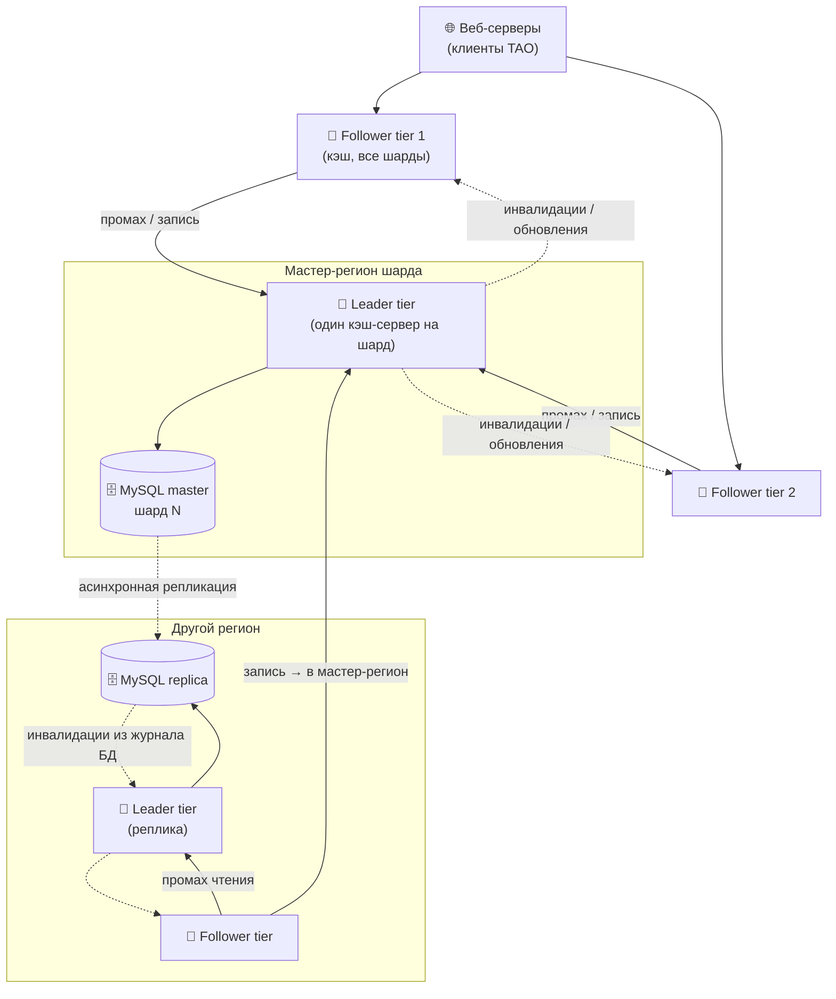
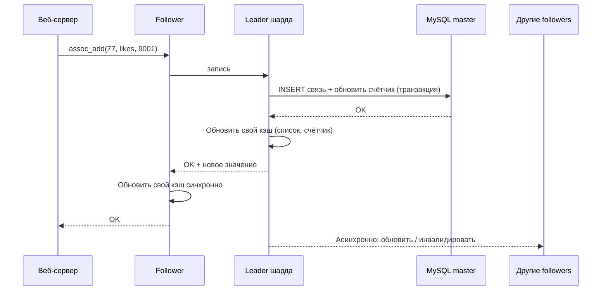

[English](README.md) | **Русский**

# Tier 2 · 4B · 03. Хранилище социального графа (как Meta TAO)

> **Уровень:** Hard · **Время на интервью:** 45–60 мин · **Время на разбор:** ~5 ч
> **Ключевые аспекты:** объекты и связи как модель данных, шардирование по объекту и хранение списков связей рядом с источником, обратные связи, двухуровневый кэш (follower и leader), консистентность и read-after-write, мульти-регион с мастер-регионом на шард, горячие объекты и вершины с огромной степенью, запросы «друзья друзей», неатомарная запись пары рёбер
> **Опирается на:** [02-caching](../../../02-caching/README_RU.md), [Tier 1 · 03 Distributed Cache](../../../tier-1/03-distributed-cache/README_RU.md#10-deep-dive-5-консистентность-с-базой-данных), [06-partitioning](../../../06-partitioning/README_RU.md), [05-replication](../../../05-replication/README_RU.md), [Tier 1 · 04 ID Generator](../../../tier-1/04-unique-id-generator/README_RU.md), [Tier 1 · 07 News Feed](../../../tier-1/07-news-feed/README_RU.md)

---

## 🗺️ Как читать этот разбор

Разбор построен как интервью, но в каждом шаге есть объяснения: **почему** принимается решение, **как работает** механизм и **что будет**, если сделать иначе. Блоки «📘 Объяснение» — теория прямо по ходу задачи.

| Значок | Что значит |
|:------:|:-----------|
| 🎤 | Реплика интервьюера |
| 🗣️ | Что говорю вслух я (кандидат) |
| ✏️ | Что рисую на доске |
| ⏱️ | Сколько времени тратить на шаг |
| 📘 | Подробное объяснение концепции |

Блоки **TIP** — хороший приём, **WARNING** — ловушка, **IMPORTANT** — сигнал для уровня Senior+.

---

## 📑 Содержание

0. [Чему учит эта задача](#0-чему-учит-эта-задача)
1. [Условие задачи](#1-условие-задачи)
2. [Уточняющие вопросы и требования](#2-уточняющие-вопросы-и-требования)
3. [Оценки нагрузки](#3-оценки-нагрузки)
4. [API](#4-api)
5. [Модель данных](#5-модель-данных)
6. [High-level дизайн](#6-high-level-дизайн)
7. [Deep dive 1: почему не просто кэш перед базой](#7-deep-dive-1-почему-не-просто-кэш-перед-базой)
8. [Deep dive 2: шардирование и списки связей](#8-deep-dive-2-шардирование-и-списки-связей)
9. [Deep dive 3: двухуровневый кэш](#9-deep-dive-3-двухуровневый-кэш)
10. [Deep dive 4: консистентность и несколько регионов](#10-deep-dive-4-консистентность-и-несколько-регионов)
11. [Deep dive 5: горячие объекты и вершины с огромной степенью](#11-deep-dive-5-горячие-объекты-и-вершины-с-огромной-степенью)
12. [Deep dive 6: запросы дальше одного шага](#12-deep-dive-6-запросы-дальше-одного-шага)
13. [Deep dive 7: запись пары рёбер и атомарность](#13-deep-dive-7-запись-пары-рёбер-и-атомарность)
14. [Deep dive 8: сбои и инвалидация](#14-deep-dive-8-сбои-и-инвалидация)
15. [Узкие места и сценарии сбоев](#15-узкие-места-и-сценарии-сбоев)
16. [Что изменится при росте в 10 раз](#16-что-изменится-при-росте-в-10-раз)
17. [Ключевые концепции и новые понятия](#17-ключевые-концепции-и-новые-понятия)
18. [Варианты задачи и follow-up вопросы](#18-варианты-задачи-и-follow-up-вопросы)
19. [Типичные ошибки](#19-типичные-ошибки)
20. [Шпаргалка и самопроверка](#20-шпаргалка-и-самопроверка)

---

## 0. Чему учит эта задача

Социальная сеть — это граф: люди, посты, фото, комментарии — **вершины**; «дружит с», «лайкнул», «написал», «отмечен на фото» — **рёбра**. Почти каждая страница — это несколько десятков чтений графа: кто автор, сколько лайков, лайкнули ли друзья, какие комментарии. Meta описала систему **TAO** (The Associations and Objects), которая обслуживает такие запросы на масштабе миллиардов чтений в секунду.

| Что проверяют | Где это в задаче |
|:--------------|:-----------------|
| Моделирование данных под запросы | Объекты и списки связей, обратные связи |
| Шардирование графа | Как сделать типичный запрос одношардовым |
| Кэширование на экстремальном масштабе | Двухуровневый кэш, сериализация промахов |
| Консистентность кэша и базы | Read-after-write, асинхронная инвалидация |
| Мульти-регион | Мастер-регион на шард, чтение локально |
| Перекос | Знаменитости, вирусные посты |
| Обход графа | «Друзья друзей», общие друзья |

> [!TIP]
> Сразу скажи, что нагрузка **почти полностью на чтение** — в статье TAO доля чтений порядка 99,8%. Поэтому вся архитектура — это прежде всего **кэш**, а база данных — долговечное хранилище за ним.

---

## 1. Условие задачи

> 🎤 «Спроектируй хранилище социального графа, как TAO в Meta: пользователи, посты, лайки, дружба, комментарии; миллиарды пользователей и чтений в секунду. Типичные запросы — получить объект, получить последние связи определённого типа, посчитать связи».

**Какие запросы приходят при открытии поста:**

```
obj_get(post 9001)                                     ← текст, автор, время
obj_get(user 42)                                       ← имя и аватар автора
assoc_count(post 9001, "liked_by")                     ← «12 345 отметок»
assoc_get(post 9001, "liked_by", [мои друзья])         ← кто из друзей лайкнул
assoc_range(post 9001, "comment", 0, 10)               ← последние 10 комментариев
assoc_get(user me, "likes", [post 9001])               ← лайкнул ли я
```

**План по времени:**

| Шаг | ⏱️ |
|:----|:--:|
| Требования | 5 мин |
| Оценки | 3 мин |
| API и модель | 6 мин |
| High-level дизайн | 6 мин |
| Deep dives | 25 мин |
| Итоги | 3 мин |

---

## 2. Уточняющие вопросы и требования

⏱️ 5 мин

| Мой вопрос | Ответ интервьюера | Что это меняет и почему |
|:-----------|:------------------|:------------------------|
| Масштаб? | ~2B пользователей, в среднем ~300 друзей; посты, фото, лайки, комментарии | Триллионы рёбер, петабайты |
| Соотношение чтения и записи? | Подавляющее большинство — чтения | Кэш — центр архитектуры |
| Задержка? | Единицы миллисекунд на запрос; страница делает десятки запросов | Почти всё из памяти |
| Консистентность? | Eventual допустима; автор должен видеть свои изменения сразу | Read-after-write в пределах кэша клиента |
| Регионы? | Несколько регионов по всему миру | Чтения локально, записи — через мастер-регион |
| Типы запросов? | Объект по ID, список связей по времени, счётчики, проверка наличия связи | Специализированный API, а не произвольные запросы |
| Обход на несколько шагов? | «Друзья друзей», общие друзья — нужны, но реже | Отдельные механизмы |

### Функциональные требования

1. Объекты: создать, прочитать, изменить, удалить.
2. Связи: добавить, удалить, проверить наличие, получить последние N по времени, посчитать.
3. Обратные связи поддерживаются автоматически (лайк ↔ «лайкнуто кем»).
4. Поддержка запросов «друзья друзей» и общих друзей.

### Нефункциональные требования

| Требование | Цель | Почему |
|:-----------|:-----|:-------|
| Пропускная способность чтения | Миллиарды в секунду | Каждая страница — десятки запросов |
| Задержка | Единицы мс | Страница собирается из многих запросов |
| Доступность | Очень высокая | Без графа не работает почти ничего |
| Консистентность | Eventual; read-after-write для автора | Пользователь должен видеть свой лайк сразу |
| Эффективность | Не перегружать базы данных | Кэш поглощает подавляющую часть чтений |

---

## 3. Оценки нагрузки

⏱️ 3 мин

```
Дружба:        2B пользователей × ~300 друзей = ~600B направленных рёбер
               (каждая дружба хранится дважды — по ребру в обе стороны)
               × ~100 Б на ребро ≈ 60 ТБ только на дружбу
Прочие связи:  лайки, комментарии, отметки, подписки — в разы больше → петабайты

Чтения:        ~1B запросов в секунду в пике
Записи:        ~1M в секунду (лайки, комментарии, посты)

Шарды БД:      тысячи MySQL-шардов (логические шарды на меньшем числе серверов)
Кэш:           сотни ТБ памяти в нескольких регионах
```

### Выводы

| Вывод | Следствие для дизайна |
|:------|:----------------------|
| Чтений в ~1 000 раз больше, чем записей | Многоуровневый кэш; база получает только промахи и записи |
| Петабайты данных | Шардирование по ID объекта |
| Страница — десятки запросов | Каждый запрос должен попадать в один шард и один кэш-сервер |
| Знаменитости — миллионы связей | Особая обработка вершин с огромной степенью |

---

## 4. API

⏱️ 3 мин

📘 TAO намеренно предоставляет **узкий API**, заточенный под типичные запросы социального графа, а не произвольный язык запросов.

```
Объекты
  obj_add(otype, data)                → id
  obj_get(id)                         → { otype, data }
  obj_update(id, data)
  obj_delete(id)

Связи (ассоциации): (id1, atype, id2, time, data)
  assoc_add(id1, atype, id2, time, data)      ← также добавляет обратную связь, если тип её имеет
  assoc_delete(id1, atype, id2)
  assoc_get(id1, atype, id2_set)              → какие из id2 связаны с id1
  assoc_count(id1, atype)                     → число связей
  assoc_range(id1, atype, pos, limit)         → связи, отсортированные по времени (новые первыми)
  assoc_time_range(id1, atype, high, low, limit)
```

| Пример | Вызов |
|:-------|:------|
| Последние 10 комментариев поста | `assoc_range(post, "comment", 0, 10)` |
| Число лайков | `assoc_count(post, "liked_by")` |
| Кто из моих друзей лайкнул | `assoc_get(post, "liked_by", my_friend_ids)` |
| Мои друзья | `assoc_range(me, "friend", 0, 5000)` |

---

## 5. Модель данных

⏱️ 3 мин

```
Объект:        id → (otype, data: ключ-значение)
                 user 42:   { name: "Анна", avatar: … }
                 post 9001: { text: "…", created: … }

Связь:         (id1, atype, id2) → (time, data)
                 (42, "authored", 9001)      ← Анна написала пост
                 (9001, "authored_by", 42)   ← обратная связь
                 (77, "likes", 9001)         ← Борис лайкнул
                 (9001, "liked_by", 77)      ← обратная связь

Счётчик:       (id1, atype) → count
```

| Таблица (в шарде MySQL) | Ключ | Зачем |
|:------------------------|:-----|:------|
| `objects` | id | Данные объекта |
| `associations` | (id1, atype, id2), индекс по (id1, atype, time) | Списки связей по времени |
| `assoc_counts` | (id1, atype) | Счётчики без `COUNT(*)` |

📘 **Обратные связи.** Связи **направленные**. Чтобы ответить и на «что лайкнул Борис», и на «кто лайкнул пост», нужны оба направления. Тип связи описывает свою пару: `likes` ↔ `liked_by`, `friend` ↔ `friend`. При добавлении связи система записывает и обратную.

---

## 6. High-level дизайн

⏱️ 6 мин



🗣️ «Ключевые решения:
- **объекты и списки связей шардируются по ID**; ID содержит номер шарда, связи хранятся в шарде `id1` — типичный запрос попадает в один шард;
- **двухуровневый кэш**: много **follower**-ярусов принимают запросы веб-серверов; на каждый шард — один **leader**-сервер, который единственный ходит в базу и упорядочивает записи;
- **мастер-регион на шард**: записи идут в мастер-регион, чтения — из локального региона; изменения распространяются асинхронной репликацией и инвалидациями».

---

## 7. Deep dive 1: почему не просто кэш перед базой

> 🎤 «Почему бы не поставить memcache перед MySQL, как обычно?»

📘 Facebook так и работал до TAO: веб-серверы читали из memcache, при промахе — из MySQL, а затем клали результат в кэш (lookaside). TAO появился, потому что для графа у этого подхода были проблемы:

| Проблема lookaside-кэша | Пример | Как решает TAO |
|:------------------------|:-------|:---------------|
| **Списки кэшируются целиком** | Новый лайк → нужно инвалидировать весь список «кто лайкнул» и прочитать заново из базы | Кэш понимает структуру списка связей: добавление ребра **обновляет** список в кэше, а не инвалидирует его |
| **Логика кэширования в каждом веб-сервере** | Тысячи серверов по-разному работают с кэшем, ошибки консистентности | Логика внутри TAO, веб-серверы используют простой API |
| **Шквал промахов** | Популярный ключ истёк — тысячи запросов в базу | Leader-сервер шарда объединяет промахи (см. leases в [Tier 1 · 03](../../../tier-1/03-distributed-cache/README_RU.md#10-deep-dive-5-консистентность-с-базой-данных)) |
| **Консистентность между регионами** | Устаревшие данные остаются в кэше другого региона | Инвалидации из журнала репликации базы |

> [!IMPORTANT]
> **Сигнал Senior+:** объяснить, что специализированный API графа даёт кэшу **знание структуры данных** (списки, счётчики, обратные связи) — и поэтому кэш может обновляться точечно вместо полной инвалидации. Это главная причина, почему граф строят как отдельный сервис, а не как «memcache + SQL».

---

## 8. Deep dive 2: шардирование и списки связей

> 🎤 «Как разложить триллионы рёбер по шардам?»

### ID содержит шард

📘 При создании объект получает ID, в котором закодирован номер **логического шарда** (как в [Instagram](../../../tier-1/08-instagram/README_RU.md#13-deep-dive-7-шардирование-и-id) и [генераторе ID](../../../tier-1/04-unique-id-generator/README_RU.md)). По ID сразу понятно, где лежит объект — без справочника.

### Связи — в шарде источника

```
Связь (id1, atype, id2) хранится в шарде объекта id1

assoc_range(post 9001, "comment", 0, 10):
  шард(9001) → один запрос к одному шарду и одному кэш-серверу
```

| Решение | Почему |
|:--------|:-------|
| Список связей `(id1, atype)` целиком в одном шарде | Самые частые запросы — одношардовые |
| Логические шарды на физических серверах | Перебалансировка переносом целых шардов |
| Индекс по `(id1, atype, time)` | Последние N связей — одно чтение по индексу |
| Счётчики рядом | `assoc_count` без сканирования |

### Обратная связь — в другом шарде

📘 `(77, "likes", 9001)` лежит в шарде пользователя 77, а `(9001, "liked_by", 77)` — в шарде поста 9001. Это разные шарды, и запись обеих связей **не атомарна** (deep dive 7).

### Длинные списки

| Решение | Почему |
|:--------|:-------|
| В кэше — только **последние N** связей списка (например, тысячи) | Большинство запросов смотрят начало списка: последние комментарии, недавние лайки |
| Дальше — постранично из базы | Глубокие страницы запрашиваются редко |
| Счётчик кэшируется отдельно | «12,4 млн отметок» без загрузки списка |

---

## 9. Deep dive 3: двухуровневый кэш

> 🎤 «Зачем два уровня кэша — follower и leader?»

### Роли

| Уровень | Сколько | Что делает |
|:--------|:--------|:-----------|
| **Follower-ярус** | Много ярусов в каждом регионе; каждый ярус покрывает **все** шарды (шарды распределены по серверам яруса consistent hashing) | Принимает запросы веб-серверов; при попадании отвечает сам; при промахе или записи — к leader |
| **Leader** | Один кэш-сервер на шард | Единственный, кто обращается к базе шарда; сериализует записи; рассылает обновления и инвалидации follower'ам |

### Почему так

| Свойство | Объяснение |
|:---------|:-----------|
| **Масштабирование чтения без нагрузки на базу** | Нужно больше чтений — добавляем follower-ярус. Нагрузка на базу не растёт: все промахи всех ярусов проходят через одного leader |
| **Защита базы от шквала промахов** | Leader объединяет одновременные промахи на один ключ в одно чтение из базы |
| **Упорядочивание записей** | Все записи шарда проходят через leader — нет гонок между кэшем и базой |
| **Изоляция отказов** | Падение follower-яруса — веб-серверы переходят на другой ярус |

### Запись



📘 **Почему follower клиента обновляется синхронно.** Так автор лайка, читая через тот же follower-ярус, **сразу** видит свой лайк (read-after-write). Остальные ярусы узнают об изменении асинхронно — через доли секунды.

---

## 10. Deep dive 4: консистентность и несколько регионов

> 🎤 «Регионы по всему миру. Как работают чтения и записи и что с консистентностью?»

### Мастер-регион на шард

| Операция | Где выполняется |
|:---------|:----------------|
| **Чтение** | Локально: follower → leader своего региона → реплика базы своего региона |
| **Запись** | Всегда в **мастер-регион шарда**: follower → leader своего региона → leader мастер-региона → master базы |
| Репликация | Асинхронная: master → реплики в других регионах |
| Инвалидация в других регионах | Из журнала репликации: применилось изменение в реплике → её leader и followers обновляются |

📘 **Почему не писать в любой регион.** Запись в несколько регионов одновременно (active-active) требует разрешения конфликтов, а для графа (счётчики, списки) это сложно. Один мастер-регион на шард даёт простой порядок записей. Разные шарды могут иметь мастеров в разных регионах, чтобы нагрузка была распределена.

### Гарантии

| Гарантия | Как обеспечивается |
|:---------|:-------------------|
| **Eventual consistency** | Реплики и кэши догоняют за доли секунды–секунды |
| **Read-after-write для автора** | Follower автора обновляет свой кэш синхронно после успешной записи |
| **Свежие данные для критичных чтений** | Запрос можно пометить как критичный — он проксируется в мастер-регион (дороже) |
| **Защита от устаревших перезаписей** | Версии объектов: обновление кэша с более старой версией игнорируется |

> [!WARNING]
> Автор видит свой лайк сразу, но его друг в другом регионе — через доли секунды. Это осознанный компромисс: социальная сеть не требует строгой консистентности, а задержка в мастер-регион для каждого чтения сделала бы страницы в разы медленнее (см. [07-consistency-models](../../../07-consistency-models/README_RU.md)).

---

## 11. Deep dive 5: горячие объекты и вершины с огромной степенью

> 🎤 «Пост знаменитости читают миллионы людей одновременно, а у её профиля 300 миллионов подписчиков. Что сломается?»

### Горячие объекты

| Проблема | Решение |
|:---------|:--------|
| Один ключ — один сервер в follower-ярусе | Нагрузку распределяют **многие ярусы**: каждый ярус имеет свою копию |
| Слишком горячий даже для этого | **Кэширование горячих объектов на стороне клиента** (веб-сервера) на короткое время |
| Горячий leader | Leader получает только промахи и записи — их мало по сравнению с чтениями |
| Шквал записей (миллионы лайков) | Счётчик обновляется пачками; список «кто лайкнул» — только недавние в кэше |

### Вершины с огромной степенью

📘 У знаменитости — сотни миллионов связей «подписчик». Загрузить такой список целиком невозможно, а запросы к нему всё равно приходят.

| Запрос | Как обслуживается |
|:-------|:------------------|
| «Сколько подписчиков» | Счётчик — один ключ |
| «Подписан ли я» | `assoc_get(celebrity, "followed_by", [me])` — проверка конкретной пары, а не загрузка списка; надёжнее спрашивать в обратную сторону — `assoc_get(me, "follows", [celebrity])` из маленького списка пользователя |
| «Последние подписчики» | Начало списка из кэша |
| Полный обход | Только офлайн (пакетная обработка графа) |

> [!TIP]
> Приём для вершин с огромной степенью: **задавать вопрос со стороны маленького списка**. «Подписан ли Борис на знаменитость?» — проверить в списке подписок Бориса (сотни), а не в списке подписчиков знаменитости (сотни миллионов).

---

## 12. Deep dive 6: запросы дальше одного шага

> 🎤 «Как показать “друзья друзей” и число общих друзей?»

### Стоимость обхода

```
Мои друзья:              ~300
Друзья каждого из них:   ~300
Друзья друзей:           ~90 000 вершин (с повторами)
```

📘 TAO оптимизирован под запросы **в один шаг**. Обход на два шага — это сотни запросов к разным шардам; делать это при каждом открытии страницы дорого.

| Задача | Решение |
|:-------|:--------|
| **Общие друзья** (я и Борис) | Два списка друзей (по ~300) → **пересечение отсортированных списков**, O(n + m); результат кэшируется |
| **«Возможно, вы знакомы»** | Предвычисляется **офлайн**: пакетная обработка графа (подсчёт общих друзей, совместных групп, мест работы) → готовые рекомендации на пользователя |
| **Поиск по графу** («друзья, живущие в Варшаве») | Отдельная поисковая система по графу — Meta описывала систему **Unicorn**: инвертированные индексы по связям («друг пользователя X», «живёт в Y»), пересекаемые при запросе |
| **Обход в реальном времени** (при необходимости) | Пакетные параллельные multiget, сгруппированные по шардам; ограничение числа вершин, выборка |

---

## 13. Deep dive 7: запись пары рёбер и атомарность

> 🎤 «Анна и Борис становятся друзьями. Это две связи в двух шардах. Что если одна запишется, а другая — нет?»

### Проблема

```
assoc_add(Анна, friend, Борис)   → шард Анны   ✅
assoc_add(Борис, friend, Анна)   → шард Бориса ❌ (сбой)

Анна видит Бориса в друзьях, а Борис Анну — нет
```

📘 Распределённая транзакция между двумя шардами (2PC) снизила бы доступность и скорость. TAO выбирает **неатомарную запись с восстановлением**:

| Механизм | Как |
|:---------|:----|
| Порядок записи | Сначала прямая связь, затем обратная |
| Повторы | Обратная связь записывается с повторами (операция идемпотентна: та же пара `(id1, atype, id2)` перезаписывается) |
| **Фоновое восстановление** | Периодическая задача находит связи без пары и дописывает недостающую |
| Удаление | Так же: обе стороны, повторы, восстановление; в кэше — метки удаления |

### Счётчики

📘 Счётчик связей обновляется **в той же локальной транзакции шарда**, что и сама связь: в шарде `id1` — запись связи и инкремент счётчика вместе. Поэтому счётчик и список в одном шарде всегда согласованы, даже если обратная связь в другом шарде отстаёт.

> [!NOTE]
> Это пример осознанного компромисса: **кратковременная асимметрия** («Анна видит дружбу, Борис ещё нет») допустима и исправляется сама, а 2PC на каждую дружбу стоила бы дорого для всех.

---

## 14. Deep dive 8: сбои и инвалидация

> 🎤 «Что будет при сбое кэш-серверов или базы? И как кэши других регионов узнают об изменениях?»

### Сбои

| Сбой | Решение |
|:-----|:--------|
| Follower-сервер упал | Веб-серверы обращаются к тому же шарду в другом ярусе |
| Leader шарда упал | Followers временно читают напрямую из базы (с ограничением) или переключаются на резервный leader |
| Master базы упал | Повышение реплики до master (в том же или другом регионе); записи шарда временно недоступны или переводятся в другой регион |
| Регион недоступен | Мастер-регион шардов переключается; чтения обслуживаются другими регионами |

### Инвалидация из журнала базы

📘 Как кэши в других регионах узнают, что данные изменились? Надёжный источник — **журнал репликации базы**: каждое применённое изменение порождает сообщение об инвалидации или обновлении для кэшей. Facebook описывал похожий подход для memcache (система McSqueal читала журнал фиксаций MySQL и рассылала инвалидации).

| Почему журнал, а не приложение | Объяснение |
|:-------------------------------|:-----------|
| Приложение может упасть между записью и инвалидацией | Журнал базы содержит **все** зафиксированные изменения |
| Порядок | Изменения в журнале упорядочены — инвалидации тоже |
| Регион реплики | Инвалидация применяется, когда изменение **дошло до локальной реплики** — кэш не перечитает старое значение |

---

## 15. Узкие места и сценарии сбоев

| Сценарий | Что произойдёт | Как защищаемся |
|:---------|:---------------|:---------------|
| Миллиард чтений в секунду | Перегрузка базы | Многоуровневый кэш, база получает только промахи |
| Шквал промахов на горячий ключ | Шквал запросов в базу | Leader объединяет промахи |
| Новый лайк в длинном списке | Полная инвалидация списка | Кэш обновляет список точечно |
| Пост знаменитости | Горячий ключ | Многие ярусы, кэш на клиенте |
| Список на сотни миллионов связей | Невозможно загрузить | Счётчик, начало списка, проверка пары, вопрос со стороны маленького списка |
| Обратная связь не записалась | Асимметрия | Повторы, фоновое восстановление |
| Устаревшие данные в другом регионе | Пользователь видит старое | Инвалидации из журнала, критичные чтения в мастер-регион |
| Автор не видит свой лайк | Плохой опыт | Синхронное обновление follower'а автора |
| «Друзья друзей» на каждой странице | Сотни запросов | Пересечение списков, офлайн-предвычисление, Unicorn |
| Падение мастер-региона шарда | Записи недоступны | Переключение мастер-региона |

---

## 16. Что изменится при росте в 10 раз

> 🎤 «20 миллиардов вершин и 10 миллиардов чтений в секунду?»

| Изменение | Почему |
|:----------|:-------|
| **Больше follower-ярусов** и регионов | Чтения масштабируются ярусами |
| **Специализированные хранилища** для отдельных типов связей | Разные паттерны (лайки против дружбы) |
| **Более агрессивное кэширование на клиенте** для горячего | Нагрузка на ярусы |
| **Офлайн-вычисления на графе** (рекомендации, сообщества) в отдельных системах | Обходы не нагружают онлайн-хранилище |

---

## 17. Ключевые концепции и новые понятия

### Что применяется

| Концепция | Где разобрана | Как применяется здесь |
|:----------|:--------------|:----------------------|
| Кэширование, lookaside, leases | [02-caching](../../../02-caching/README_RU.md), [Tier 1 · 03](../../../tier-1/03-distributed-cache/README_RU.md) | Двухуровневый кэш |
| Шардирование, логические шарды | [06-partitioning](../../../06-partitioning/README_RU.md) | Шард в ID объекта |
| Репликация лидер-последователь | [05-replication](../../../05-replication/README_RU.md) | Мастер-регион, реплики |
| Eventual consistency, read-your-writes | [07-consistency-models](../../../07-consistency-models/README_RU.md) | Гарантии графа |
| ID со встроенным шардом | [Tier 1 · 04](../../../tier-1/04-unique-id-generator/README_RU.md), [Tier 1 · 08](../../../tier-1/08-instagram/README_RU.md) | Маршрутизация без справочника |

### Новые понятия этой задачи

| Понятие | Кратко |
|:--------|:-------|
| **Объект и связь (ассоциация)** | Вершины с данными и направленные рёбра с типом и временем |
| **Обратная связь** | Парное ребро в обратном направлении |
| **Список связей** | Связи `(id1, atype)` по времени, хранятся в шарде `id1` |
| **Follower-ярус** | Кэш, принимающий запросы клиентов, покрывающий все шарды |
| **Leader** | Кэш-сервер шарда, единственный обращающийся к базе |
| **Мастер-регион шарда** | Регион, где выполняются записи шарда |
| **Вершина с огромной степенью** | Объект с миллионами связей |
| **Пересечение отсортированных списков** | Общие друзья за O(n + m) |
| **Фоновое восстановление обратных связей** | Исправление асимметрии без 2PC |
| **Инвалидация из журнала БД** | Надёжное оповещение кэшей об изменениях |

---

## 18. Варианты задачи и follow-up вопросы

<details>
<summary><b>Почему не графовая база данных вроде Neo4j?</b></summary>

Графовые базы удобны для сложных обходов, но масштабирование на триллионы рёбер, миллиарды чтений в секунду и несколько регионов — сложная задача для них. Нагрузка социальной сети — в основном простые запросы на один шаг, которые отлично ложатся на шардированные реляционные базы с мощным кэшем. Сложные обходы выносятся в офлайн и специализированные системы.
</details>

<details>
<summary><b>Как проверять права доступа к объектам графа?</b></summary>

Права — тоже часть графа: «пост виден друзьям автора» проверяется запросом `assoc_get(author, "friend", [viewer])`. Проверки выполняются на уровне приложения поверх TAO и активно используют кэш. Важно проверять доступ при каждом чтении, а не только при создании.
</details>

<details>
<summary><b>Как удалить пользователя со всеми связями?</b></summary>

Удаление — асинхронный процесс: объект помечается удалённым (перестаёт отображаться сразу), затем фоновая задача обходит все типы связей пользователя, удаляет их и обратные связи в других шардах, обновляет счётчики. Процесс идемпотентен и возобновляем — он может длиться долго для активных пользователей.
</details>

<details>
<summary><b>Как построить ленту новостей поверх такого графа?</b></summary>

Граф отвечает на вопросы «на кого подписан пользователь» и «последние посты автора» (`assoc_range(author, "authored", …)`). Лента (см. [Tier 1 · 07](../../../tier-1/07-news-feed/README_RU.md)) собирает кандидатов этими запросами и ранжирует их, а Facebook описывал отдельную систему (Multifeed) для агрегации лент.
</details>

<details>
<summary><b>Чем отличается граф LinkedIn?</b></summary>

LinkedIn тоже строил собственные графовые сервисы, акцентируя запросы на 2–3 шага («контакты второго и третьего уровня»), для которых нужны распределённые обходы с кэшированием соседей. Общий принцип тот же: специализированный сервис поверх шардированного хранения и памяти.
</details>

---

## 19. Типичные ошибки

| ❌ Ошибка | Почему плохо | ✅ Как правильно |
|:---------|:-------------|:----------------|
| Lookaside-кэш со списками целиком | Полная инвалидация на каждое ребро | Кэш, понимающий структуру списков |
| Связи распределены по хэшу пары | Список связей объекта в разных шардах | Связи в шарде `id1` |
| `COUNT(*)` для числа лайков | Сканирование миллионов строк | Отдельный счётчик |
| Один уровень кэша, напрямую в базу | Шквал промахов, рост нагрузки на базу с ростом чтений | Follower-ярусы + leader на шард |
| 2PC для пары рёбер | Медленно, ниже доступность | Неатомарная запись, повторы, фоновое восстановление |
| Запись в любой регион | Конфликты счётчиков и списков | Мастер-регион на шард |
| Инвалидации из приложения | Потерянные инвалидации при сбоях | Из журнала репликации БД |
| Загружать список подписчиков знаменитости | Невозможно | Проверка пары, вопрос со стороны маленького списка |
| «Друзья друзей» онлайн-обходом на каждой странице | Сотни запросов | Пересечение списков, офлайн, поисковый индекс графа |
| Автор читает через другой ярус | Не видит своё изменение | Синхронное обновление яруса автора |

---

## 20. Шпаргалка и самопроверка

### Ответ за 30 секунд

> Нагрузка — почти целиком чтение, поэтому архитектура — это кэш с базой позади. Модель: объекты и направленные связи `(id1, atype, id2, time, data)` с автоматическими обратными связями; узкий API — obj_get, assoc_range (последние N по времени), assoc_count, assoc_get (проверка пар). ID содержит логический шард; связи хранятся в шарде `id1` вместе со счётчиками — типичный запрос одношардовый. Кэш двухуровневый: много follower-ярусов в каждом регионе обслуживают чтения, по одному leader на шард — единственный путь в базу, объединяет промахи и упорядочивает записи; кэш знает структуру списков и обновляет их точечно. Записи идут в мастер-регион шарда, чтения — локально; асинхронная репликация и инвалидации из журнала БД; ярус автора обновляется синхронно (read-after-write), критичные чтения — в мастер-регион. Пара рёбер пишется неатомарно с повторами и фоновым восстановлением. Горячие объекты — многие ярусы и кэш на клиенте; вершины с огромной степенью — счётчик, начало списка, вопрос со стороны маленького списка. Обходы на 2 шага — пересечение отсортированных списков, офлайн-предвычисление, поисковый индекс графа (Unicorn).

### Самопроверка

- [ ] Могу описать модель объектов и связей и API
- [ ] Могу объяснить проблемы lookaside-кэша для графа
- [ ] Могу объяснить, почему связи хранятся в шарде `id1`
- [ ] Могу описать роли follower и leader и почему их два уровня
- [ ] Могу нарисовать путь записи и объяснить read-after-write
- [ ] Могу объяснить мастер-регион на шард
- [ ] Могу решить проблему горячих объектов и вершин с огромной степенью
- [ ] Могу объяснить, как считать общих друзей и «возможно, вы знакомы»
- [ ] Могу объяснить неатомарную запись пары рёбер и восстановление
- [ ] Могу объяснить инвалидацию из журнала базы

### Что почитать

- Bronson et al., *TAO: Facebook's Distributed Data Store for the Social Graph* (USENIX ATC 2013)
- Nishtala et al., *Scaling Memcache at Facebook* (NSDI 2013)
- Curtiss et al., *Unicorn: A System for Searching the Social Graph* (VLDB 2013)
- Meta Engineering, статьи о TAO и консистентности кэша
- Темы Fundamentals: [02-caching](../../../02-caching/README_RU.md), [07-consistency-models](../../../07-consistency-models/README_RU.md)
