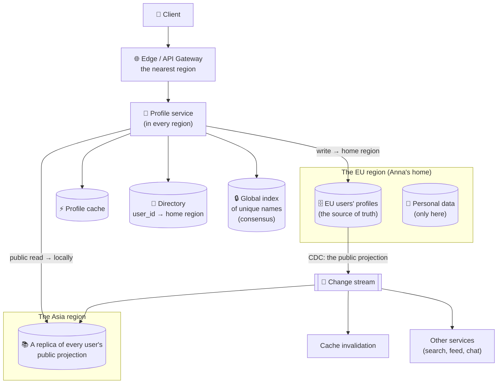
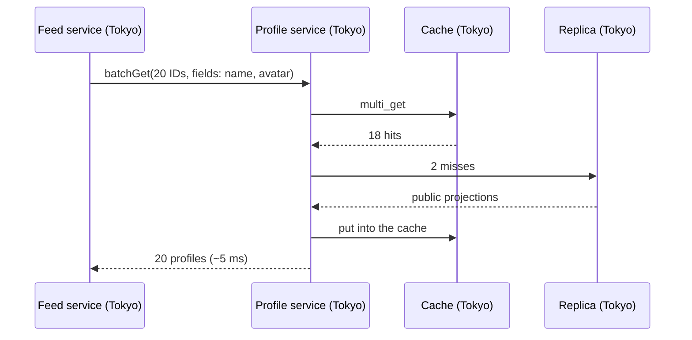
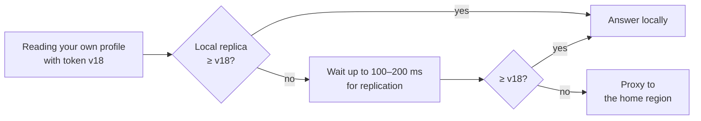
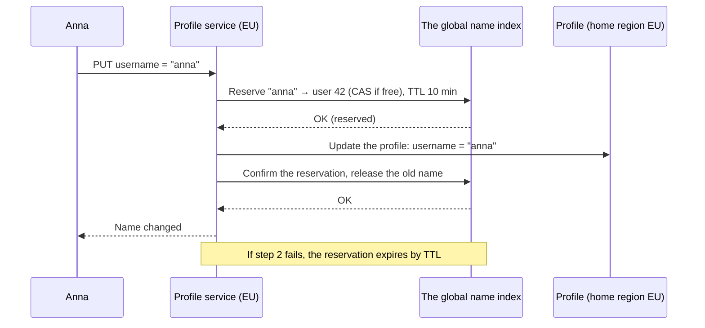

**English** | [Русский](README_RU.md)

# Tier 2 · 4B · 04. A Global User Profile Service

> **Level:** Medium · **Interview time:** 45 min · **Study time:** ~4 h
> **Key aspects:** a user's home region, a single writer for a user's data, global reads via replicas and caches, read-your-writes across regions, data residency and field classification, globally unique usernames, change events and denormalized copies, moving a user between regions, a region failure
> **Builds on:** [05-replication](../../../05-replication/README.md), [07-consistency-models](../../../07-consistency-models/README.md#7-session-guarantees), [08-consensus](../../../08-consensus/README.md), [11-distributed-transactions](../../../11-distributed-transactions/README.md#12-cdc-change-data-capture), [02-caching](../../../02-caching/README.md), [Tier 2 · 4B · 03 TAO](../03-social-graph-tao/README.md#10-deep-dive-4-consistency-and-multiple-regions)

---

## 🗺️ How to Read This Walkthrough

The walkthrough follows an interview, but every step includes explanations: **why** a decision is made, **how** a mechanism works and **what happens** if you do it differently. The "📘 Explanation" blocks are theory right where you need it.

| Icon | Meaning |
|:----:|:--------|
| 🎤 | Interviewer |
| 🗣️ | What I (the candidate) say out loud |
| ✏️ | What I draw on the whiteboard |
| ⏱️ | Time budget for the step |
| 📘 | A detailed explanation of a concept |

Callouts: **TIP** — a good technique, **WARNING** — a trap, **IMPORTANT** — a Senior+ signal.

---

## 📑 Contents

0. [What This Problem Teaches](#0-what-this-problem-teaches)
1. [Problem Statement](#1-problem-statement)
2. [Clarifying Questions and Requirements](#2-clarifying-questions-and-requirements)
3. [Capacity Estimates](#3-capacity-estimates)
4. [API](#4-api)
5. [Data Model](#5-data-model)
6. [High-Level Design](#6-high-level-design)
7. [Deep Dive 1: Where a User's Data Lives](#7-deep-dive-1-where-a-users-data-lives)
8. [Deep Dive 2: Fast Reads Worldwide](#8-deep-dive-2-fast-reads-worldwide)
9. [Deep Dive 3: Read-Your-Writes Across Regions](#9-deep-dive-3-read-your-writes-across-regions)
10. [Deep Dive 4: Data Residency and Privacy](#10-deep-dive-4-data-residency-and-privacy)
11. [Deep Dive 5: Globally Unique Usernames](#11-deep-dive-5-globally-unique-usernames)
12. [Deep Dive 6: Change Events and Copies in Other Services](#12-deep-dive-6-change-events-and-copies-in-other-services)
13. [Deep Dive 7: Moving a User to Another Region](#13-deep-dive-7-moving-a-user-to-another-region)
14. [Deep Dive 8: Region Failure and Operations](#14-deep-dive-8-region-failure-and-operations)
15. [Bottlenecks and Failure Scenarios](#15-bottlenecks-and-failure-scenarios)
16. [What Changes at 10x Scale](#16-what-changes-at-10x-scale)
17. [Key Concepts and New Terms](#17-key-concepts-and-new-terms)
18. [Variations and Follow-Up Questions](#18-variations-and-follow-up-questions)
19. [Common Mistakes](#19-common-mistakes)
20. [Cheat Sheet and Self-Check](#20-cheat-sheet-and-self-check)

---

## 0. What This Problem Teaches

A user profile is small data (a name, an avatar, settings), but **everyone** reads it: the feed, comments, chat, search. Meanwhile users live all over the world, laws require personal data to be stored in specific countries, and a person who changed their name expects to see the new one immediately — even while on a business trip on another continent.

| What's tested | Where it shows up |
|:--------------|:------------------|
| Placing data across several regions | A user's home region |
| Consistency models | Eventual for reading others, read-your-writes for your own |
| Regulatory requirements | Data residency, GDPR, field classification |
| Global constraints | A username unique worldwide |
| Propagating changes | Events, denormalized copies, caches |
| Operations | Moving a user, a region failure |

> [!TIP]
> The key idea to open with: **each user has one home region, where their writes are accepted**, while their public data is replicated to every region for reads. That immediately removes the write-conflict problem.

---

## 1. Problem Statement

> 🎤 "Design a global profile service: the names, avatars, bios, settings and contact details of billions of users. Every other service uses it. Users are all over the world, and some countries' data must be stored in those countries."

**What the user sees:**

```
Anna in Warsaw changes her name → the new name shows in her app immediately
Her friend in Tokyo sees the new name in his feed a few seconds later
Anna flies to New York and opens her profile → sees her new name, not the old one
Boris tries to take the username "anna" — it's taken, even though Boris is in another region
Anna's personal data (phone, email) is stored only in the EU
```

**Time plan:**

| Step | ⏱️ |
|:-----|:--:|
| Requirements | 5 min |
| Estimates | 3 min |
| API and data | 5 min |
| High-level design | 5 min |
| Deep dives | 22 min |
| Wrap-up | 5 min |

---

## 2. Clarifying Questions and Requirements

⏱️ 5 min

| My question | Interviewer's answer | What it changes and why |
|:------------|:---------------------|:------------------------|
| How many users? | ~2B worldwide | Terabytes of data, billions of rows |
| How many reads? | Every post or comment shown pulls the author's profile → ~1M reads/s | A cache and local replicas |
| How many writes? | Rarely: ~10,000 changes per second | A user's writes can be routed to one region |
| Read latency? | p99 < 20 ms from any region | Reads only locally |
| Must your own change show immediately? | Yes, even from another region | Read-your-writes |
| Regulatory requirements? | EU citizens' personal data stays in the EU; some countries are stricter still | Field classification, a home region by jurisdiction |
| Uniqueness? | Usernames and emails are globally unique | A global, strongly consistent constraint |
| Deleting and exporting data? | On the user's request (GDPR) | Deletion across every copy, export |

### Functional requirements

1. Reading a profile by ID (single and batched) and by username.
2. Editing a profile, changing the username.
3. Field visibility per privacy settings.
4. Deleting and exporting data on the user's request.
5. Notifying other services about changes.

### Non-functional requirements

| Requirement | Target | Why |
|:------------|:-------|:----|
| Read latency | p99 < 20 ms in any region | Profiles are pulled in every feed |
| Read availability | 99.99% | Almost nothing can be shown without profiles |
| Consistency | Eventual (seconds) for reading others' profiles; read-your-writes for your own | Balancing speed with user expectations |
| Legal compliance | Personal data in a permitted jurisdiction | Fines and bans |
| Uniqueness | Strict for usernames and emails | Two "anna"s are unacceptable |

---

## 3. Capacity Estimates

⏱️ 3 min

```
Profiles:       2B × ~2 KB (public fields, settings) ≈ 4 TB
                + personal data (email, phone, date of birth) — separately, smaller
Reads:          5B feed opens × ~20 author profiles ≈ 100B reads per day
                ≈ 1.2M per second; with a cache the database gets a small share
Writes:         ~10,000 per second
Regions:        5–10 regions worldwide
```

### Conclusions

| Conclusion | Design consequence |
|:-----------|:-------------------|
| There isn't much data (terabytes) | The public part can be kept in every region in full |
| Reads outnumber writes hundreds of times | Local replicas and a cache in every region |
| Writes are few, and each concerns one user | One writer per user — the home region |
| Unique names are orders of magnitude fewer than reads | A global, strongly consistent name index is acceptable |

---

## 4. API

⏱️ 2 min

```http
GET   /v1/profiles/{user_id}?fields=name,avatar,bio      ← respects the viewer's permissions
POST  /v1/profiles:batchGet   { ids: [...], fields: [...] }   ← for hydrating feeds
GET   /v1/profiles/by-username/{username}
PATCH /v1/profiles/{user_id}  If-Match: "v17"   { display_name, bio, avatar_ref, … }
      → 200 { version: "v18" }
PUT   /v1/profiles/{user_id}/username   { username: "anna" }
GET   /v1/profiles/{user_id}/private    ← email, phone: only the owner and trusted services
POST  /v1/privacy/export    |    POST /v1/privacy/delete
```

📘 **Why `If-Match` with a version.** A user edits their profile from a phone and a laptop at once. If both send changes based on the same version, the second gets a `412` and rereads the profile — instead of silently overwriting the first (optimistic locking).

---

## 5. Data Model

⏱️ 3 min

| Profile part | Fields | Where it's stored |
|:-------------|:-------|:------------------|
| **The public projection** | user_id, username, display_name, avatar_ref, bio, verified, version | In the home region (the source of truth) + **replicas in every region** |
| **Settings** | language, privacy, notifications | In the home region + a cache |
| **Personal data** | email, phone, date of birth, address | **Only in the home region**, encrypted with the region's key |
| **The directory** | user_id → home_region | Globally replicated, small |
| **The uniqueness index** | username → user_id, email_hash → user_id | A global, strongly consistent store |

---

## 6. High-Level Design

⏱️ 5 min



🗣️ "Key decisions:
- each user has **a home region** (by jurisdiction and sign-up location) — the only place their writes are accepted and their personal data is stored;
- **the public projection** of the profile is replicated to every region via CDC — reads are always local;
- **a cache** in every region absorbs most reads;
- **a global uniqueness index** on consensus — for usernames and emails;
- **a change stream** updates replicas, caches and copies in other services."

---

## 7. Deep Dive 1: Where a User's Data Lives

> 🎤 "How do you place users' data across several regions?"

### Options

| Option | How | Pros | Cons |
|:-------|:----|:-----|:-----|
| **One global primary** | All writes to one region, replicas everywhere | Simple, no conflicts | Slow writes for distant users; the region is a single point of failure for writes; doesn't meet data residency |
| **A user's home region** ⭐ | A user's writes go to their region; public data is replicated everywhere | Local writes for most users, no conflicts (one writer per user), natural residency | A traveling user writes through a distant region |
| **Multi-master (active-active)** | Writes to any region | Minimal write latency | Conflicts on concurrent changes (per-field LWW, losses) and complex residency |

🗣️ "I choose **a home region**: a profile essentially has one author — the user themselves — so one writer per user removes conflicts almost for free. Write latency while traveling — hundreds of milliseconds — is acceptable for editing a profile."

### How the home region is determined

| Method | Pros | Cons |
|:-------|:-----|:-----|
| **The region encoded in user_id** | Routing without a directory lookup | Moving a user changes their ID — practically impossible |
| **A user_id → region directory** ⭐ | Users can be moved | An extra lookup (solved by a cache: the directory is small and almost never changes) |

📘 The directory is tiny (2B entries of ~16 B — tens of GB) and almost never changes, so it's replicated in full to every region and kept in every service instance's cache.

---

## 8. Deep Dive 2: Fast Reads Worldwide

> 🎤 "A user in Tokyo views a feed with posts from people in Europe, America and Asia. How do you return 20 profiles in milliseconds?"

| Tier | What it does |
|:-----|:-------------|
| **A regional cache** | Popular profiles; a very high hit rate |
| **A local replica of public projections** | Every user in the world, updated asynchronously within seconds |
| **A batch request** | `batchGet` for 20 IDs — one operation, not 20 |
| **Field projection** | The feed requests only the name and avatar, not the whole profile |



| Decision | Why |
|:---------|:----|
| Reads of others' profiles **never go to another region** | Cross-region latency is tens to hundreds of ms |
| Seconds of staleness are fine | A friend's new name appearing in the feed a bit later isn't a problem |
| The viewer's permissions are applied on read | Fields hidden by privacy settings aren't returned |

---

## 9. Deep Dive 3: Read-Your-Writes Across Regions

> 🎤 "Anna changed her name in Warsaw and immediately flew to New York. There her app reads her profile from the US replica, which hasn't updated yet. What does she see?"

### The problem

```
14:00:00    Anna (EU) changes her name to "Anna K." → home region EU, version v18
14:00:01    The change replicates to the US asynchronously (usually seconds)
14:00:00.5  Anna opens her profile in the US region
            → the US replica is still at v17 → "Anna" (the old name) ❌
```

### Solutions

| Approach | How | Trade-off |
|:---------|:----|:----------|
| **Your own reads go to the home region** | A "my profile" request is routed to the user's home region | Always fresh; the cross-region latency applies only to your own data |
| **A version token** ⭐ | After a write the client remembers `version = v18`; on read it passes it; the region answers if its local replica is ≥ v18, otherwise waits briefly or proxies to the home region | Usually local and fast; to the home region only right after a change |
| **Optimistic display** | The client shows what it just wrote | Fixes the author's screen, but not their other devices |



📘 This is the **read-your-writes** session guarantee (see [07-consistency-models](../../../07-consistency-models/README.md#7-session-guarantees)): a user always sees their own changes, while everyone else sees them with a small delay.

> [!IMPORTANT]
> **Senior+ signal:** split the guarantees by **who is reading**: others' profiles — eventual consistency, always local; your own profile — read-your-writes via a version token. Strong consistency for every read would make the system slow for no benefit.

---

## 10. Deep Dive 4: Data Residency and Privacy

> 🎤 "EU citizens' personal data must stay in the EU, and some countries are stricter still. How do you account for that?"

### Field classification

| Class | Examples | Where it may be stored |
|:------|:---------|:-----------------------|
| **Public** | Username, display name, avatar, bio | Replicas worldwide (unless the jurisdiction's law forbids it) |
| **Internal** | Settings, language | The home region + caches |
| **Personal (PII)** | Email, phone, date of birth, address | **Only the home region**, encrypted with the region's key |
| **Sensitive** | Documents, payment data | A separate store with stronger access control |

### Different jurisdictions' requirements

| Jurisdiction | An example requirement | How it shows up in the design |
|:-------------|:-----------------------|:------------------------------|
| EU (GDPR) | Restrictions on transferring personal data outside the EU; the rights to deletion and export | A home region in the EU, deletion across every copy, export |
| Russia (the data localization law, 242-FZ) | Citizens' personal data must initially be recorded and stored within the country | A separate region, with citizens' home region there |
| China (PIPL and other laws) | Strict restrictions on cross-border transfer | Often an entirely separate deployment |

> [!WARNING]
> Specific legal requirements change and depend on lawyers' interpretation. In an interview it's important to show **architectural readiness**: field classification, a home region by jurisdiction, and the ability to not replicate certain fields or entire users and to proxy access through the home region.

### Access to personal data

| Decision | Why |
|:---------|:----|
| PII is served only through the home region's API | The data never leaves the region; requests are audited |
| Field encryption with region keys (KMS) | A leaked replica or backup doesn't expose the data |
| Least-privilege access | Only the owner and trusted services (e.g. sending email) |

### Deletion and export (GDPR)

| Operation | How |
|:----------|:----|
| **Export** | An async job gathers the user's data from every service and returns an archive |
| **Deletion** | A `user.deleted` event → every service deletes its copies; replicas receive the deletion via the change stream; backups — **crypto-shredding**: the user's data encryption key is destroyed, making copies in old backups unreadable |
| Confirmation | Each service reports completion; the process is tracked to the end |

---

## 11. Deep Dive 5: Globally Unique Usernames

> 🎤 "Anna in the EU and Boris in the US simultaneously try to take the username 'anna'. How do you guarantee only one gets it?"

📘 It's **a global constraint**: it can't be checked in each region independently — two regions would both decide the name is free. You need a **strongly consistent** source of truth.

| Option | How | Trade-off |
|:-------|:----|:----------|
| **A global index on consensus** ⭐ | A small `username → user_id` store replicated across regions via Raft/Paxos (or a Spanner-like DB) | A write is a cross-region consensus round (hundreds of ms); but changing a name is rare |
| One region holds the index | Every check goes there | Simpler, but the region is a point of failure for sign-ups |
| Shard the index by name hash, each shard mastered in some region | Scales | More complex; each name still has a single master owner |

### The name-change flow



| Detail | Why |
|:-------|:----|
| **A reservation with a TTL**, then confirmation | A failure between steps doesn't leave the name taken forever |
| Normalization | Case, look-alike characters (Latin "a" and Cyrillic "а") — so nobody can create a visual copy of someone else's name |
| Quarantining released names | An old name isn't immediately available to others (protection against impersonation) |
| Email — the same mechanism | The index stores a hash of the normalized email rather than the email itself, if the index is global (data residency) |

---

## 12. Deep Dive 6: Change Events and Copies in Other Services

> 🎤 "Dozens of services display names and avatars. How do they learn about a change?"

### A reference, not a copy

📘 The best option is **not to copy** the author's name into every post, but to store `author_id` and pull the profile at display time (hydration, see [Tier 1 · 07](../../../tier-1/07-news-feed/README.md#9-deep-dive-3-reading-the-feed-and-hydration)). Then a name change shows everywhere as soon as the profile cache updates.

### Where copies are still needed

| Consumer | Why a copy | How it's updated |
|:---------|:-----------|:-----------------|
| People search | An index of names | A `profile.updated` event → reindexing |
| Chat (the contact list on the device) | Offline access | An event → syncing clients |
| Analytics | Reports | The change stream into the data warehouse |
| Services' caches | Speed | Invalidation by event |

```
A profile.updated event:
  { user_id: 42, version: 18, changed: ["display_name", "avatar_ref"], ts: … }

A consumer applies the event only if version > its stored version
→ a late old event doesn't overwrite a newer value
```

| Decision | Why |
|:---------|:----|
| Events from **CDC** (the database log), not from application code | They aren't lost on failures (see [11-distributed-transactions](../../../11-distributed-transactions/README.md#12-cdc-change-data-capture)) |
| **A version number** in the event | Protection against applying an old event after a new one |
| The avatar — **an immutable URL** with a version | A new avatar — a new URL; the CDN needn't be invalidated (see [Tier 1 · 08](../../../tier-1/08-instagram/README.md#8-deep-dive-2-delivering-media)) |

---

## 13. Deep Dive 7: Moving a User to Another Region

> 🎤 "Anna moved from Poland to the US. Do you need to move her data, and how?"

📘 A move is needed when the jurisdiction changes, or for write latency. It's a rare operation, but it must be **safe and resumable**.

| Step | How |
|:-----|:----|
| 1 | Copy the user's data to the new region (profile, personal data — re-encrypted with the new region's key) |
| 2 | Briefly **freeze the user's writes** (seconds), or write to both places with versions |
| 3 | Catch up on changes made during the copy |
| 4 | **Atomically switch** the directory `user_id → new region` |
| 5 | Lift the freeze; writes go to the new region |
| 6 | Delete the data from the old region (if residency requires it) |

| Detail | Why |
|:-------|:----|
| Each step is idempotent | The process can be restarted after a failure |
| A directory, not the region in user_id | Otherwise a move would require changing the ID everywhere |
| A directory cache with a short TTL or invalidation | Every instance learns the new region quickly |

---

## 14. Deep Dive 8: Region Failure and Operations

> 🎤 "The EU region is completely down. What about EU users?"

| What | Consequence | Solution |
|:-----|:------------|:---------|
| **Reads** of EU users' public profiles | They work — replicas exist in every region | Nothing to do |
| **Writes** by EU users | Unavailable | Option A: accept it — profile edits can wait; option B: fail the home region over to a standby EU region |
| Personal data | Unavailable | A standby region in the same jurisdiction (e.g. a second EU region) with sync or async replication |
| Failing over to an async replica | The last few seconds of changes may be lost | An RPO trade-off; usually acceptable for profiles |

> [!TIP]
> A good phrasing: "For profiles, **read availability matters more than write availability**. A home region failure temporarily blocks profile edits but breaks nothing else in the product — everyone keeps seeing profiles."

### Other

| Topic | Solution |
|:------|:---------|
| Hot profiles (a celebrity) | A cache in every region; the profile rarely changes |
| Schema evolution | Backward-compatible changes; new fields are optional; consumers ignore unknown fields |
| Monitoring | Cross-region replication lag, the share of proxied reads (read-your-writes), uniqueness errors |

---

## 15. Bottlenecks and Failure Scenarios

| Scenario | What happens | How we protect |
|:---------|:-------------|:---------------|
| A million reads per second | The database is overloaded | A cache and local replicas in every region |
| Cross-region reads | High latency | The public projection is replicated everywhere |
| The author doesn't see their change in another region | Confusion | A version token, proxying to the home region |
| Changing a name simultaneously in two regions | Two identical names | A global index on consensus with CAS |
| A failure mid-rename | The name is taken forever | A reservation with a TTL |
| An old event after a new one | Stale copies | Versions in events |
| PII in another jurisdiction | Breaking the law | Field classification, PII only at home |
| A GDPR deletion | Copies remain | A deletion event, tracking, crypto-shredding |
| The home region fails | Writes are unavailable | A standby region in the same jurisdiction, or waiting |
| Simultaneous edits from two devices | A lost change | `If-Match` with a version |

---

## 16. What Changes at 10x Scale

> 🎤 "20 billion profiles and more jurisdictions?"

| Change | Why |
|:-------|:----|
| **More regions and "sovereign" deployments** | New data localization laws |
| **Partial replication**: a region gets only the profiles read there | Volume and legal requirements |
| **Sharding the global name index** | Sign-up load |
| **Data policies as code** | The rule "which field may be replicated where" is checked automatically |

---

## 17. Key Concepts and New Terms

### What's applied

| Concept | Where it's covered | How it applies here |
|:--------|:-------------------|:--------------------|
| Replication, replication lag | [05-replication](../../../05-replication/README.md) | Replicas of public projections |
| Read-your-writes | [07-consistency-models](../../../07-consistency-models/README.md#7-session-guarantees) | Your own reads from another region |
| Consensus | [08-consensus](../../../08-consensus/README.md) | The global name index |
| CDC | [11-distributed-transactions](../../../11-distributed-transactions/README.md#12-cdc-change-data-capture) | The change stream |
| A master region per entity | [Tier 2 · 4B · 03](../03-social-graph-tao/README.md#10-deep-dive-4-consistency-and-multiple-regions) | A user's home region |

### New terms in this problem

| Term | In short |
|:-----|:---------|
| **A home region** | The region where a user's writes are accepted and their personal data is stored |
| **The public projection** | The part of the profile replicated to every region |
| **A placement directory** | user_id → home region |
| **A version token** | The minimum version a client must see on read |
| **Data residency** | A requirement to store data in a specific jurisdiction |
| **Field classification** | Public, internal, personal, sensitive |
| **Crypto-shredding** | Deleting the encryption key instead of the data in backups |
| **A name reservation with a TTL** | A two-step rename with no permanent lock on failure |

---

## 18. Variations and Follow-Up Questions

<details>
<summary><b>Why not multi-master, given how rare profile writes are?</b></summary>

Multi-master gives local writes, but leads to conflicts on simultaneous changes from different devices in different regions (needing per-field LWW, with a risk of losses) and complicates data residency. Since a profile has one author, a home region gives almost the same benefits without conflicts.
</details>

<details>
<summary><b>How do you handle an avatar change?</b></summary>

Uploading the new image to object storage via a presigned URL → a pipeline produces sizes → the profile gets a new `avatar_ref` with a version → a `profile.updated` event → caches update; old URLs keep working until caches expire, and the new one is served at the new address.
</details>

<details>
<summary><b>How do you implement "show my profile only to friends"?</b></summary>

The privacy setting is stored in the profile; on read, the profile service checks the viewer's relationship to the owner (via the graph, see [TAO](../03-social-graph-tao/README.md)) and returns only the permitted fields. Cache the full profile, and filter at serving time.
</details>

<details>
<summary><b>What if someone wants a username to impersonate someone else?</b></summary>

Normalizing look-alike characters, forbidding names too similar to verified accounts' names, quarantining released names, and manual review for well-known brands.
</details>

<details>
<summary><b>How do you serve "find a user by email" under data residency?</b></summary>

The global index stores a hash of the normalized email → user_id (without the email itself); it identifies the user and their home region, and details are returned only through the home region's API with permission checks.
</details>

---

## 19. Common Mistakes

| ❌ Mistake | Why it's bad | ✅ Do this instead |
|:----------|:-------------|:------------------|
| One global primary | Slow writes, breaks data residency | A user's home region |
| Multi-master without need | Conflicts and losses | One writer per user |
| Reading others' profiles from their home region | Cross-region latency | Local replicas of public projections |
| Strong consistency for every read | Slow | Eventual for others, read-your-writes for your own |
| Checking username uniqueness in each region | Duplicates | A global index on consensus |
| Renaming without a TTL reservation | A permanent lock on failure | Reserve → update → confirm |
| Replicating PII to every region | Breaking the law | Field classification, PII only at home |
| Copying the author's name into every post | Stale copies | A reference to user_id and hydration |
| Events without versions | Old values overwrite new ones | Versions in events |
| The region in user_id with no directory | Moving users is impossible | A placement directory |

---

## 20. Cheat Sheet and Self-Check

### 30-second answer

> Each user has a home region (by jurisdiction and sign-up location) — the single writer of their data and the only place their personal data is stored; a `user_id → region` directory is small and cached everywhere, which lets users be moved. The profile's public projection is replicated to every region via CDC — reads of others' profiles are always local (a cache + a replica, batchGet with field projection), and seconds of staleness are fine. Your own reads — read-your-writes via a version token: locally if the replica has caught up, otherwise a brief wait or a proxy to the home region. Fields are classified: public ones go everywhere, PII stays at home, encrypted with region keys and accessed through the home region's API; a GDPR deletion is an event to every service plus crypto-shredding in backups. Username and email uniqueness — a global index on consensus: a TTL reservation → a profile update → confirmation, with look-alike normalization. Changes are versioned events; other services keep references, not copies. When the home region fails, reads keep working, while writes wait or fail over to a standby region in the same jurisdiction.

### Self-check

- [ ] I can compare the three data placement options and justify a home region
- [ ] I can explain a placement directory versus the region in the ID
- [ ] I can design fast reads worldwide
- [ ] I can explain read-your-writes via a version token
- [ ] I can classify fields and explain data residency requirements
- [ ] I can describe a GDPR deletion and crypto-shredding
- [ ] I can design global username uniqueness with a reservation
- [ ] I can explain versioned events and why references beat copies
- [ ] I can describe moving a user between regions
- [ ] I can explain the behavior when the home region fails

### Further reading

- Corbett et al., *Spanner: Google's Globally-Distributed Database* (OSDI 2012)
- Meta Engineering articles on multi-region infrastructure and data residency
- The GDPR (Regulation (EU) 2016/679) — the chapters on data transfers and data subject rights
- Martin Kleppmann, *Designing Data-Intensive Applications* — chapters 5 and 9
- Fundamentals topics: [05-replication](../../../05-replication/README.md), [07-consistency-models](../../../07-consistency-models/README.md)
