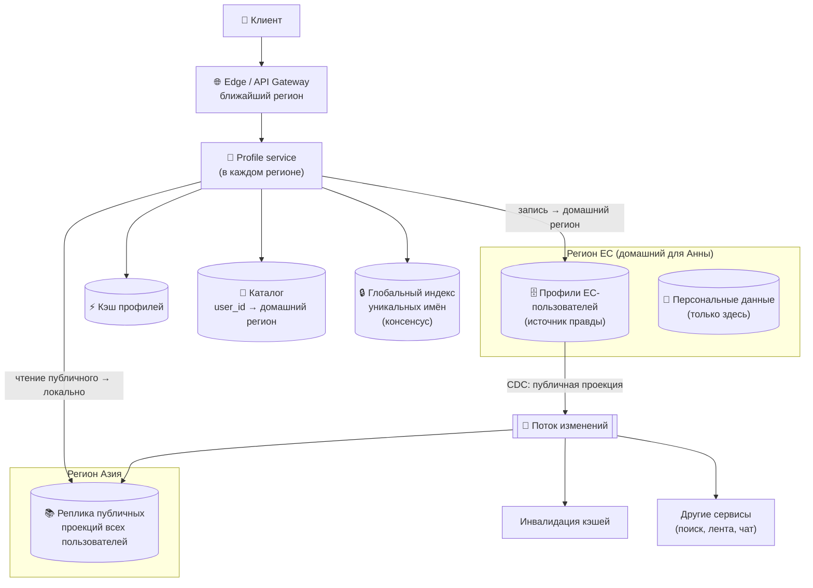
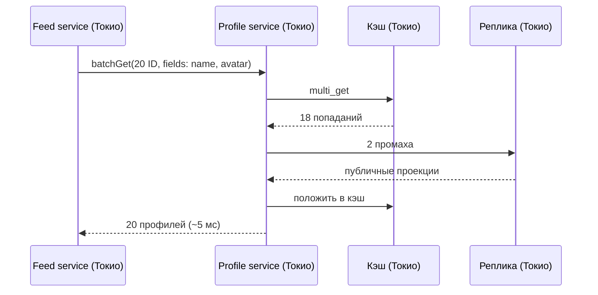
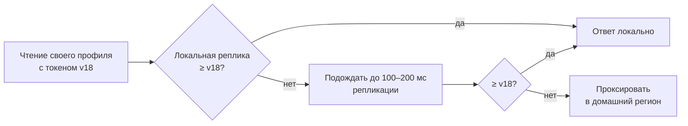
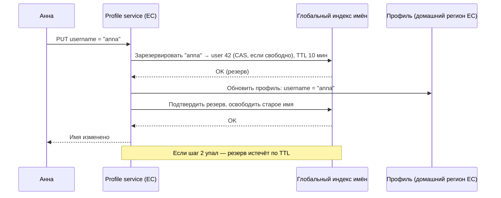

[English](README.md) | **Русский**

# Tier 2 · 4B · 04. Глобальный сервис профилей пользователей

> **Уровень:** Medium · **Время на интервью:** 45 мин · **Время на разбор:** ~4 ч
> **Ключевые аспекты:** домашний регион пользователя, единственный писатель для данных пользователя, глобальные чтения через реплики и кэши, read-your-writes между регионами, локализация данных и классификация полей, глобальная уникальность имени пользователя, события изменений и денормализованные копии, перенос пользователя между регионами, отказ региона
> **Опирается на:** [05-replication](../../../05-replication/README_RU.md), [07-consistency-models](../../../07-consistency-models/README_RU.md#7-сессионные-гарантии), [08-consensus](../../../08-consensus/README_RU.md), [11-distributed-transactions](../../../11-distributed-transactions/README_RU.md#12-cdc-change-data-capture), [02-caching](../../../02-caching/README_RU.md), [Tier 2 · 4B · 03 TAO](../03-social-graph-tao/README_RU.md#10-deep-dive-4-консистентность-и-несколько-регионов)

---

## 🗺️ Как читать этот разбор

Разбор построен как интервью, но в каждом шаге есть объяснения: **почему** принимается решение, **как работает** механизм и **что будет**, если сделать иначе. Блоки «📘 Объяснение» — теория прямо по ходу задачи.

| Значок | Что значит |
|:------:|:-----------|
| 🎤 | Реплика интервьюера |
| 🗣️ | Что говорю вслух я (кандидат) |
| ✏️ | Что рисую на доске |
| ⏱️ | Сколько времени тратить на шаг |
| 📘 | Подробное объяснение концепции |

Блоки **TIP** — хороший приём, **WARNING** — ловушка, **IMPORTANT** — сигнал для уровня Senior+.

---

## 📑 Содержание

0. [Чему учит эта задача](#0-чему-учит-эта-задача)
1. [Условие задачи](#1-условие-задачи)
2. [Уточняющие вопросы и требования](#2-уточняющие-вопросы-и-требования)
3. [Оценки нагрузки](#3-оценки-нагрузки)
4. [API](#4-api)
5. [Модель данных](#5-модель-данных)
6. [High-level дизайн](#6-high-level-дизайн)
7. [Deep dive 1: где живут данные пользователя](#7-deep-dive-1-где-живут-данные-пользователя)
8. [Deep dive 2: быстрые чтения по всему миру](#8-deep-dive-2-быстрые-чтения-по-всему-миру)
9. [Deep dive 3: read-your-writes между регионами](#9-deep-dive-3-read-your-writes-между-регионами)
10. [Deep dive 4: локализация данных и приватность](#10-deep-dive-4-локализация-данных-и-приватность)
11. [Deep dive 5: глобальная уникальность имени пользователя](#11-deep-dive-5-глобальная-уникальность-имени-пользователя)
12. [Deep dive 6: события изменений и копии в других сервисах](#12-deep-dive-6-события-изменений-и-копии-в-других-сервисах)
13. [Deep dive 7: перенос пользователя в другой регион](#13-deep-dive-7-перенос-пользователя-в-другой-регион)
14. [Deep dive 8: отказ региона и эксплуатация](#14-deep-dive-8-отказ-региона-и-эксплуатация)
15. [Узкие места и сценарии сбоев](#15-узкие-места-и-сценарии-сбоев)
16. [Что изменится при росте в 10 раз](#16-что-изменится-при-росте-в-10-раз)
17. [Ключевые концепции и новые понятия](#17-ключевые-концепции-и-новые-понятия)
18. [Варианты задачи и follow-up вопросы](#18-варианты-задачи-и-follow-up-вопросы)
19. [Типичные ошибки](#19-типичные-ошибки)
20. [Шпаргалка и самопроверка](#20-шпаргалка-и-самопроверка)

---

## 0. Чему учит эта задача

Профиль пользователя — небольшие данные (имя, аватар, настройки), но их читают **все**: лента, комментарии, чат, поиск. При этом пользователи живут по всему миру, законы требуют хранить персональные данные в определённых странах, а человек, изменивший имя, ожидает сразу увидеть новое — даже если он в командировке на другом континенте.

| Что проверяют | Где это в задаче |
|:--------------|:-----------------|
| Размещение данных в нескольких регионах | Домашний регион пользователя |
| Модели консистентности | Eventual для чужих чтений, read-your-writes для своих |
| Требования регуляторов | Локализация данных, GDPR, классификация полей |
| Глобальные ограничения | Уникальное имя пользователя во всём мире |
| Распространение изменений | События, денормализованные копии, кэши |
| Эксплуатация | Перенос пользователя, отказ региона |

> [!TIP]
> Главная идея, с которой стоит начать: **у каждого пользователя один домашний регион, где принимаются его записи**, а для чтений его публичные данные реплицируются во все регионы. Это сразу снимает проблему конфликтов записи.

---

## 1. Условие задачи

> 🎤 «Спроектируй глобальный сервис профилей: имя, аватар, описание, настройки и контактные данные миллиардов пользователей. Его используют все остальные сервисы. Пользователи по всему миру, данные некоторых стран должны храниться в этих странах».

**Что видит пользователь:**

```
Анна из Варшавы меняет имя → в её приложении новое имя видно сразу
Её друг в Токио видит новое имя в ленте через несколько секунд
Анна летит в Нью-Йорк, открывает профиль → видит своё новое имя, не старое
Борис пытается занять имя «anna» — оно уже занято, даже если Борис в другом регионе
Персональные данные Анны (телефон, email) хранятся только в ЕС
```

**План по времени:**

| Шаг | ⏱️ |
|:----|:--:|
| Требования | 5 мин |
| Оценки | 3 мин |
| API и данные | 5 мин |
| High-level дизайн | 5 мин |
| Deep dives | 22 мин |
| Итоги | 5 мин |

---

## 2. Уточняющие вопросы и требования

⏱️ 5 мин

| Мой вопрос | Ответ интервьюера | Что это меняет и почему |
|:-----------|:------------------|:------------------------|
| Сколько пользователей? | ~2B по всему миру | Терабайты данных, миллиарды строк |
| Сколько чтений? | Каждый показ поста или комментария подтягивает профиль автора → ~1M чтений/с | Кэш и локальные реплики |
| Сколько записей? | Редко: ~10 000 изменений в секунду | Записи можно направлять в один регион на пользователя |
| Задержка чтения? | p99 < 20 мс из любого региона | Чтения только локально |
| Своё изменение видно сразу? | Да, даже из другого региона | Read-your-writes |
| Регуляторные требования? | Персональные данные граждан ЕС — в ЕС; есть страны с ещё более строгими правилами | Классификация полей, домашний регион по юрисдикции |
| Уникальность? | Имя пользователя и email уникальны глобально | Глобальное строго консистентное ограничение |
| Удаление и выгрузка данных? | По запросу пользователя (GDPR) | Удаление во всех копиях, выгрузка |

### Функциональные требования

1. Чтение профиля по ID (одного и пакетом), по имени пользователя.
2. Изменение профиля, смена имени пользователя.
3. Видимость полей по настройкам приватности.
4. Удаление и выгрузка данных по запросу пользователя.
5. Уведомление других сервисов об изменениях.

### Нефункциональные требования

| Требование | Цель | Почему |
|:-----------|:-----|:-------|
| Задержка чтения | p99 < 20 мс в любом регионе | Профили подтягиваются в каждой ленте |
| Доступность чтения | 99,99% | Без профилей не показывается почти ничего |
| Консистентность | Eventual (секунды) для чтения чужого профиля; read-your-writes — для своего | Баланс скорости и ожиданий пользователя |
| Соответствие законам | Персональные данные — в разрешённой юрисдикции | Штрафы и запреты |
| Уникальность | Строгая для имени пользователя и email | Два «anna» — недопустимо |

---

## 3. Оценки нагрузки

⏱️ 3 мин

```
Профили:        2B × ~2 КБ (публичные поля, настройки) ≈ 4 ТБ
                + персональные данные (email, телефон, дата рождения) — отдельно, меньше
Чтения:         5B открытий лент × ~20 профилей авторов ≈ 100B чтений в сутки
                ≈ 1,2M в секунду; с кэшем база получает малую долю
Записи:         ~10 000 в секунду
Регионы:        5–10 регионов по всему миру
```

### Выводы

| Вывод | Следствие для дизайна |
|:------|:----------------------|
| Данных немного (терабайты) | Публичную часть можно иметь в каждом регионе целиком |
| Чтений в сотни раз больше записей | Локальные реплики и кэш в каждом регионе |
| Записей мало и каждая — про одного пользователя | Один писатель на пользователя — домашний регион |
| Уникальных имён меньше, чем чтений, на порядки | Глобальный строго консистентный индекс имён допустим |

---

## 4. API

⏱️ 2 мин

```http
GET   /v1/profiles/{user_id}?fields=name,avatar,bio      ← учитывает права зрителя
POST  /v1/profiles:batchGet   { ids: [...], fields: [...] }   ← для гидратации лент
GET   /v1/profiles/by-username/{username}
PATCH /v1/profiles/{user_id}  If-Match: "v17"   { display_name, bio, avatar_ref, … }
      → 200 { version: "v18" }
PUT   /v1/profiles/{user_id}/username   { username: "anna" }
GET   /v1/profiles/{user_id}/private    ← email, телефон: только владелец и доверенные сервисы
POST  /v1/privacy/export    |    POST /v1/privacy/delete
```

📘 **Зачем `If-Match` с версией.** Пользователь меняет профиль одновременно с телефона и ноутбука. Если оба отправят изменения от одной версии, второе получит `412` и перечитает профиль, — вместо того чтобы молча затереть первое (оптимистичная блокировка).

---

## 5. Модель данных

⏱️ 3 мин

| Часть профиля | Поля | Где хранится |
|:--------------|:-----|:-------------|
| **Публичная проекция** | user_id, username, display_name, avatar_ref, bio, verified, version | В домашнем регионе (источник правды) + **реплики во всех регионах** |
| **Настройки** | язык, приватность, уведомления | В домашнем регионе + кэш |
| **Персональные данные** | email, телефон, дата рождения, адрес | **Только в домашнем регионе**, зашифровано ключом региона |
| **Каталог** | user_id → home_region | Глобально реплицируемый, маленький |
| **Индекс уникальности** | username → user_id, email_hash → user_id | Глобальное строго консистентное хранилище |

---

## 6. High-level дизайн

⏱️ 5 мин



🗣️ «Ключевые решения:
- у каждого пользователя **домашний регион** (по юрисдикции и месту регистрации) — единственное место, где принимаются его записи и хранятся персональные данные;
- **публичная проекция** профиля через CDC реплицируется во все регионы — чтения всегда локальные;
- **кэш** в каждом регионе поглощает основную часть чтений;
- **глобальный индекс уникальности** на консенсусе — для имён пользователя и email;
- **поток изменений** обновляет реплики, кэши и копии в других сервисах».

---

## 7. Deep dive 1: где живут данные пользователя

> 🎤 «Как разместить данные пользователей в нескольких регионах?»

### Варианты

| Вариант | Как | Плюсы | Минусы |
|:--------|:----|:------|:-------|
| **Один глобальный primary** | Все записи — в один регион, реплики везде | Просто, нет конфликтов | Медленная запись для далёких пользователей; регион — единая точка отказа записи; не соответствует локализации данных |
| **Домашний регион пользователя** ⭐ | Записи пользователя — в его регион; публичные данные реплицируются везде | Локальные записи для большинства, нет конфликтов (один писатель на пользователя), естественная локализация | Пользователь в поездке пишет через далёкий регион |
| **Мульти-мастер (active-active)** | Записи в любой регион | Минимальная задержка записи | Конфликты одновременных изменений (LWW по полям, потери) и сложная локализация |

🗣️ «Выбираю **домашний регион**: у профиля по сути один автор — сам пользователь, поэтому один писатель на пользователя убирает конфликты почти бесплатно. Задержка записи из поездки — сотни миллисекунд — для изменения профиля приемлема».

### Как определить домашний регион

| Способ | Плюсы | Минусы |
|:-------|:------|:-------|
| **Регион закодирован в user_id** | Маршрутизация без запроса к каталогу | Перенос пользователя меняет ID — практически невозможен |
| **Каталог user_id → регион** ⭐ | Можно переносить пользователей | Дополнительный запрос (решается кэшем: каталог маленький и почти не меняется) |

📘 Каталог крошечный (2B записей по ~16 Б — десятки ГБ) и почти не меняется, поэтому его целиком реплицируют во все регионы и держат в кэше каждого экземпляра сервиса.

---

## 8. Deep dive 2: быстрые чтения по всему миру

> 🎤 «Пользователь в Токио смотрит ленту с постами людей из Европы, Америки и Азии. Как отдать 20 профилей за миллисекунды?»

| Уровень | Что делает |
|:--------|:-----------|
| **Кэш в регионе** | Популярные профили; доля попаданий очень высокая |
| **Локальная реплика публичных проекций** | Все пользователи мира, обновляются асинхронно за секунды |
| **Пакетный запрос** | `batchGet` на 20 ID — одна операция, а не 20 |
| **Проекция полей** | Лента запрашивает только имя и аватар, а не весь профиль |



| Решение | Почему |
|:--------|:-------|
| Чтения чужих профилей **никогда не идут в другой регион** | Межрегиональная задержка — десятки–сотни мс |
| Устаревание на секунды допустимо | Новое имя друга появится в ленте чуть позже — это не проблема |
| Права зрителя применяются при чтении | Поля, скрытые настройками приватности, не отдаются |

---

## 9. Deep dive 3: read-your-writes между регионами

> 🎤 «Анна сменила имя в Варшаве и сразу полетела в Нью-Йорк. Там её приложение читает профиль из американской реплики, которая ещё не обновилась. Что она увидит?»

### Проблема

```
14:00:00  Анна (ЕС) меняет имя на «Анна К.» → домашний регион ЕС, версия v18
14:00:01  Изменение реплицируется в США асинхронно (обычно секунды)
14:00:00,5  Анна в американском регионе открывает профиль
            → американская реплика ещё v17 → «Анна» (старое) ❌
```

### Решения

| Подход | Как | Компромисс |
|:-------|:----|:-----------|
| **Свои чтения — в домашний регион** | Запрос «мой профиль» маршрутизируется в домашний регион пользователя | Всегда свежо; задержка межрегионального запроса — только для собственных данных |
| **Токен версии** ⭐ | После записи клиент запоминает `version = v18`; при чтении передаёт его; регион отвечает, если локальная реплика ≥ v18, иначе ждёт короткое время или проксирует в домашний регион | Обычно локально и быстро; в домашний регион — только сразу после изменения |
| **Оптимистичное отображение** | Клиент показывает то, что сам только что записал | Решает экран автора, но не другие его устройства |



📘 Это сессионная гарантия **read-your-writes** (см. [07-consistency-models](../../../07-consistency-models/README_RU.md#7-сессионные-гарантии)): пользователь всегда видит свои изменения, а остальные — с небольшой задержкой.

> [!IMPORTANT]
> **Сигнал Senior+:** разделить гарантии по тому, **кто читает**: чужие профили — eventual consistency и всегда локально; свой профиль — read-your-writes через токен версии. Строгая консистентность для всех чтений сделала бы систему медленной без пользы.

---

## 10. Deep dive 4: локализация данных и приватность

> 🎤 «Персональные данные граждан ЕС должны храниться в ЕС, а в некоторых странах правила ещё строже. Как это учесть?»

### Классификация полей

| Класс | Примеры | Где может храниться |
|:------|:--------|:--------------------|
| **Публичные** | Имя пользователя, отображаемое имя, аватар, описание | Реплики по всему миру (если законодательство юрисдикции не запрещает) |
| **Внутренние** | Настройки, язык | Домашний регион + кэши |
| **Персональные (PII)** | Email, телефон, дата рождения, адрес | **Только домашний регион**, шифрование ключом региона |
| **Чувствительные** | Документы, платёжные данные | Отдельное хранилище с усиленным контролем доступа |

### Требования разных юрисдикций

| Юрисдикция | Пример требования | Как отражается в дизайне |
|:-----------|:------------------|:-------------------------|
| ЕС (GDPR) | Ограничения передачи персональных данных за пределы ЕС, право на удаление и выгрузку | Домашний регион в ЕС, удаление во всех копиях, выгрузка |
| Россия (закон о локализации, 242-ФЗ) | Первичная запись и хранение персональных данных граждан — на территории страны | Отдельный регион, данные граждан — с домашним регионом там |
| Китай (PIPL и другие законы) | Строгие ограничения на трансграничную передачу | Часто полностью отдельная инсталляция |

> [!WARNING]
> Конкретные требования законов меняются и зависят от толкования юристов. На интервью важно показать **архитектурную готовность**: классификацию полей, домашний регион по юрисдикции, возможность не реплицировать отдельные поля или целых пользователей и проксировать доступ через домашний регион.

### Доступ к персональным данным

| Решение | Почему |
|:--------|:-------|
| PII отдаётся только через API домашнего региона | Данные не покидают регион; запросы аудируются |
| Шифрование полей ключами региона (KMS) | Утечка реплики или резервной копии не раскрывает данные |
| Доступ по принципу минимальных прав | Только владелец и доверенные сервисы (например, отправка email) |

### Удаление и выгрузка (GDPR)

| Операция | Как |
|:---------|:----|
| **Выгрузка** | Асинхронная задача собирает данные пользователя из всех сервисов и отдаёт архив |
| **Удаление** | Событие `user.deleted` → все сервисы удаляют копии; реплики получают удаление через поток изменений; резервные копии — **криптоудаление**: уничтожается ключ шифрования данных пользователя, и копии в старых бэкапах становятся нечитаемыми |
| Подтверждение | Каждый сервис отчитывается о завершении; процесс отслеживается до конца |

---

## 11. Deep dive 5: глобальная уникальность имени пользователя

> 🎤 «Анна в ЕС и Борис в США одновременно пытаются занять имя “anna”. Как гарантировать, что получит только один?»

📘 Это **глобальное ограничение**: его нельзя проверить в каждом регионе независимо — два региона одновременно решат, что имя свободно. Нужен **строго консистентный** источник правды.

| Вариант | Как | Компромисс |
|:--------|:----|:-----------|
| **Глобальный индекс на консенсусе** ⭐ | Небольшое хранилище `username → user_id`, реплицированное по регионам через Raft/Paxos (или Spanner-подобная БД) | Запись — межрегиональный консенсус (сотни мс); но смена имени — редкая операция |
| Один регион хранит индекс | Все проверки — туда | Проще, но регион — точка отказа для регистраций |
| Шардировать индекс по хэшу имени, каждый шард с мастером в каком-то регионе | Масштабируется | Сложнее; каждое имя всё равно имеет одного владельца-мастера |

### Процесс смены имени



| Деталь | Почему |
|:-------|:-------|
| **Резерв с TTL**, затем подтверждение | Сбой между шагами не оставляет имя занятым навсегда |
| Нормализация | Регистр, похожие символы (латинская «a» и кириллическая «а») — чтобы нельзя было создать визуальную копию чужого имени |
| Освобождённые имена — карантин | Старое имя не сразу доступно другим (защита от подмены личности) |
| Email — тот же механизм | Хранится хэш нормализованного email, а не сам email, если индекс глобальный (локализация данных) |

---

## 12. Deep dive 6: события изменений и копии в других сервисах

> 🎤 «Имя и аватар показывают десятки сервисов. Как они узнают об изменении?»

### Ссылка, а не копия

📘 Лучший вариант — **не копировать** имя автора в каждый пост, а хранить `author_id` и подтягивать профиль при показе (гидратация, см. [Tier 1 · 07](../../../tier-1/07-news-feed/README_RU.md#9-deep-dive-3-чтение-ленты-и-гидратация)). Тогда изменение имени видно везде сразу, как только обновится кэш профилей.

### Где копии всё же нужны

| Потребитель | Зачем копия | Как обновляется |
|:------------|:------------|:----------------|
| Поиск людей | Индекс по именам | Событие `profile.updated` → переиндексация |
| Чат (список контактов на устройстве) | Офлайн-доступ | Событие → синхронизация клиентов |
| Аналитика | Отчёты | Поток изменений в хранилище данных |
| Кэши сервисов | Скорость | Инвалидация по событию |

```
Событие profile.updated:
  { user_id: 42, version: 18, changed: ["display_name", "avatar_ref"], ts: … }

Потребитель применяет событие, только если version > сохранённой версии
→ запоздавшее старое событие не перезапишет новое значение
```

| Решение | Почему |
|:--------|:-------|
| События из **CDC** (журнала базы), а не из кода приложения | Не теряются при сбоях (см. [11-distributed-transactions](../../../11-distributed-transactions/README_RU.md#12-cdc-change-data-capture)) |
| **Номер версии** в событии | Защита от применения старого события после нового |
| Аватар — **неизменяемый URL** с версией | Новый аватар — новый URL; CDN не нужно инвалидировать (см. [Tier 1 · 08](../../../tier-1/08-instagram/README_RU.md#8-deep-dive-2-доставка-медиа)) |

---

## 13. Deep dive 7: перенос пользователя в другой регион

> 🎤 «Анна переехала из Польши в США. Нужно ли переносить её данные и как?»

📘 Перенос нужен, если меняется юрисдикция или для задержки записи. Это редкая операция, но она должна быть **безопасной и возобновляемой**.

| Шаг | Как |
|:----|:----|
| 1 | Скопировать данные пользователя в новый регион (профиль, персональные данные — с перешифрованием ключом нового региона) |
| 2 | Кратко **заморозить записи** пользователя (секунды) или писать в оба места с версиями |
| 3 | Догнать изменения, сделанные во время копирования |
| 4 | **Атомарно переключить** каталог `user_id → новый регион` |
| 5 | Снять заморозку; записи идут в новый регион |
| 6 | Удалить данные из старого региона (если этого требует локализация) |

| Деталь | Почему |
|:-------|:-------|
| Каждый шаг идемпотентен | Процесс можно перезапустить после сбоя |
| Каталог, а не регион в user_id | Иначе перенос потребовал бы смены ID везде |
| Кэш каталога с коротким TTL или инвалидацией | Все экземпляры быстро узнают о новом регионе |

---

## 14. Deep dive 8: отказ региона и эксплуатация

> 🎤 «Регион ЕС полностью недоступен. Что с пользователями ЕС?»

| Что | Последствие | Решение |
|:----|:------------|:--------|
| **Чтения** публичных профилей пользователей ЕС | Работают — реплики есть во всех регионах | Ничего делать не нужно |
| **Записи** пользователей ЕС | Недоступны | Вариант А: принять — изменение профиля может подождать; вариант Б: переключить домашний регион на резервный регион ЕС |
| Персональные данные | Недоступны | Резервный регион в той же юрисдикции (например, второй регион ЕС) с синхронной или асинхронной репликацией |
| Переключение на асинхронную реплику | Возможна потеря последних секунд изменений | Компромисс RPO; для профилей обычно приемлем |

> [!TIP]
> Хорошая формулировка: «Для профилей **доступность чтения важнее доступности записи**. Отказ домашнего региона делает изменение профиля временно недоступным, но ничего не ломает в остальном продукте — все продолжают видеть профили».

### Прочее

| Тема | Решение |
|:-----|:--------|
| Горячие профили (знаменитость) | Кэш в каждом регионе; профиль меняется редко |
| Эволюция схемы | Обратно совместимые изменения, новые поля необязательны, потребители игнорируют неизвестные поля |
| Мониторинг | Задержка репликации между регионами, доля проксированных чтений (read-your-writes), ошибки уникальности |

---

## 15. Узкие места и сценарии сбоев

| Сценарий | Что произойдёт | Как защищаемся |
|:---------|:---------------|:---------------|
| Миллион чтений в секунду | Перегрузка базы | Кэш и локальные реплики в каждом регионе |
| Межрегиональные чтения | Высокая задержка | Публичная проекция реплицирована везде |
| Автор не видит своё изменение в другом регионе | Путаница | Токен версии, проксирование в домашний регион |
| Одновременная смена имени в двух регионах | Два одинаковых имени | Глобальный индекс на консенсусе с CAS |
| Сбой посреди смены имени | Имя занято навсегда | Резерв с TTL |
| Старое событие после нового | Устаревшие копии | Версии в событиях |
| PII в чужой юрисдикции | Нарушение закона | Классификация полей, PII только в домашнем регионе |
| Удаление по GDPR | Копии остаются | Событие удаления, отслеживание, криптоудаление |
| Отказ домашнего региона | Записи недоступны | Резервный регион в той же юрисдикции или ожидание |
| Одновременные правки с двух устройств | Потеря изменения | `If-Match` с версией |

---

## 16. Что изменится при росте в 10 раз

> 🎤 «20 миллиардов профилей и больше юрисдикций?»

| Изменение | Почему |
|:----------|:-------|
| **Больше регионов и «суверенных» инсталляций** | Новые законы о локализации |
| **Частичная репликация**: в регион только профили, которые там читают | Объём и требования законов |
| **Шардирование глобального индекса имён** | Нагрузка на регистрации |
| **Политики данных как код** | Правило «какое поле куда можно реплицировать» проверяется автоматически |

---

## 17. Ключевые концепции и новые понятия

### Что применяется

| Концепция | Где разобрана | Как применяется здесь |
|:----------|:--------------|:----------------------|
| Репликация, задержка репликации | [05-replication](../../../05-replication/README_RU.md) | Реплики публичных проекций |
| Read-your-writes | [07-consistency-models](../../../07-consistency-models/README_RU.md#7-сессионные-гарантии) | Свои чтения из другого региона |
| Консенсус | [08-consensus](../../../08-consensus/README_RU.md) | Глобальный индекс имён |
| CDC | [11-distributed-transactions](../../../11-distributed-transactions/README_RU.md#12-cdc-change-data-capture) | Поток изменений |
| Мастер-регион на сущность | [Tier 2 · 4B · 03](../03-social-graph-tao/README_RU.md#10-deep-dive-4-консистентность-и-несколько-регионов) | Домашний регион пользователя |

### Новые понятия этой задачи

| Понятие | Кратко |
|:--------|:-------|
| **Домашний регион** | Регион, где принимаются записи пользователя и хранятся его персональные данные |
| **Публичная проекция** | Часть профиля, реплицируемая во все регионы |
| **Каталог размещения** | user_id → домашний регион |
| **Токен версии** | Минимальная версия, которую клиент должен увидеть при чтении |
| **Локализация данных** | Требование хранить данные в определённой юрисдикции |
| **Классификация полей** | Публичные, внутренние, персональные, чувствительные |
| **Криптоудаление** | Удаление ключа шифрования вместо данных в бэкапах |
| **Резерв имени с TTL** | Двухшаговая смена имени без вечной блокировки при сбоях |

---

## 18. Варианты задачи и follow-up вопросы

<details>
<summary><b>Почему не мульти-мастер, раз записи профиля так редки?</b></summary>

Мульти-мастер даёт локальные записи, но приводит к конфликтам при одновременных изменениях с разных устройств в разных регионах (нужен LWW по полям с риском потерь) и усложняет локализацию данных. Поскольку у профиля один автор, домашний регион даёт почти те же преимущества без конфликтов.
</details>

<details>
<summary><b>Как обработать смену аватара?</b></summary>

Загрузка нового изображения в объектное хранилище по presigned URL → конвейер делает размеры → профиль получает новый `avatar_ref` с версией → событие `profile.updated` → кэши обновляются; старые URL продолжают работать до истечения кэшей, новый показывается по новому адресу.
</details>

<details>
<summary><b>Как реализовать «показывать мой профиль только друзьям»?</b></summary>

Настройка приватности хранится в профиле; при чтении сервис профилей проверяет отношение зрителя к владельцу (через граф, см. [TAO](../03-social-graph-tao/README_RU.md)) и отдаёт только разрешённые поля. Кэшировать нужно полный профиль, а фильтрацию выполнять при выдаче.
</details>

<details>
<summary><b>Что делать, если имя пользователя хотят занять ради подмены личности?</b></summary>

Нормализация похожих символов, запрет на имена, слишком похожие на имена проверенных аккаунтов, карантин освобождённых имён, ручная проверка для известных брендов.
</details>

<details>
<summary><b>Как обслужить запрос «найти пользователя по email» при локализации?</b></summary>

Глобальный индекс хранит хэш нормализованного email → user_id (без самого email); по нему определяется пользователь и его домашний регион, а детали отдаются только через API домашнего региона с проверкой прав.
</details>

---

## 19. Типичные ошибки

| ❌ Ошибка | Почему плохо | ✅ Как правильно |
|:---------|:-------------|:----------------|
| Один глобальный primary | Медленные записи, нарушение локализации | Домашний регион пользователя |
| Мульти-мастер без нужды | Конфликты и потери | Один писатель на пользователя |
| Чтение чужих профилей из домашнего региона | Межрегиональная задержка | Локальные реплики публичных проекций |
| Строгая консистентность для всех чтений | Медленно | Eventual для чужих, read-your-writes для своих |
| Проверка уникальности имени в каждом регионе | Дубликаты | Глобальный индекс на консенсусе |
| Смена имени без резерва с TTL | Вечная блокировка при сбое | Резерв → обновление → подтверждение |
| Реплицировать PII во все регионы | Нарушение законов | Классификация полей, PII только дома |
| Копировать имя автора в каждый пост | Устаревшие копии | Ссылка на user_id и гидратация |
| События без версий | Старые значения перезаписывают новые | Версии в событиях |
| Регион в user_id без каталога | Перенос невозможен | Каталог размещения |

---

## 20. Шпаргалка и самопроверка

### Ответ за 30 секунд

> У каждого пользователя домашний регион (по юрисдикции и месту регистрации) — единственный писатель его данных и единственное место хранения персональных данных; каталог `user_id → регион` маленький и закэширован везде, что позволяет переносить пользователей. Публичная проекция профиля через CDC реплицируется во все регионы — чтения чужих профилей всегда локальные (кэш + реплика, batchGet с проекцией полей), устаревание на секунды допустимо. Свои чтения — read-your-writes через токен версии: локально, если реплика догнала, иначе короткое ожидание или проксирование в домашний регион. Поля классифицированы: публичные — везде, PII — только дома, шифрование ключами региона, доступ через API домашнего региона; удаление по GDPR — событием во все сервисы и криптоудалением в бэкапах. Уникальность имени и email — глобальный индекс на консенсусе: резерв с TTL → обновление профиля → подтверждение, нормализация похожих символов. Изменения — события с версиями, другие сервисы хранят ссылки, а не копии. Отказ домашнего региона — чтения работают, записи ждут или переключаются на резервный регион той же юрисдикции.

### Самопроверка

- [ ] Могу сравнить три варианта размещения данных и обосновать домашний регион
- [ ] Могу объяснить каталог размещения против региона в ID
- [ ] Могу спроектировать быстрые чтения по всему миру
- [ ] Могу объяснить read-your-writes через токен версии
- [ ] Могу классифицировать поля и объяснить требования локализации
- [ ] Могу описать удаление по GDPR и криптоудаление
- [ ] Могу спроектировать глобальную уникальность имени с резервом
- [ ] Могу объяснить события с версиями и почему лучше ссылки, а не копии
- [ ] Могу описать перенос пользователя между регионами
- [ ] Могу объяснить поведение при отказе домашнего региона

### Что почитать

- Corbett et al., *Spanner: Google's Globally-Distributed Database* (OSDI 2012)
- Meta Engineering, статьи о многорегиональной инфраструктуре и локализации данных
- Регламент GDPR (Regulation (EU) 2016/679) — главы о передаче данных и правах субъектов
- Martin Kleppmann, *Designing Data-Intensive Applications* — главы 5 и 9
- Темы Fundamentals: [05-replication](../../../05-replication/README_RU.md), [07-consistency-models](../../../07-consistency-models/README_RU.md)
