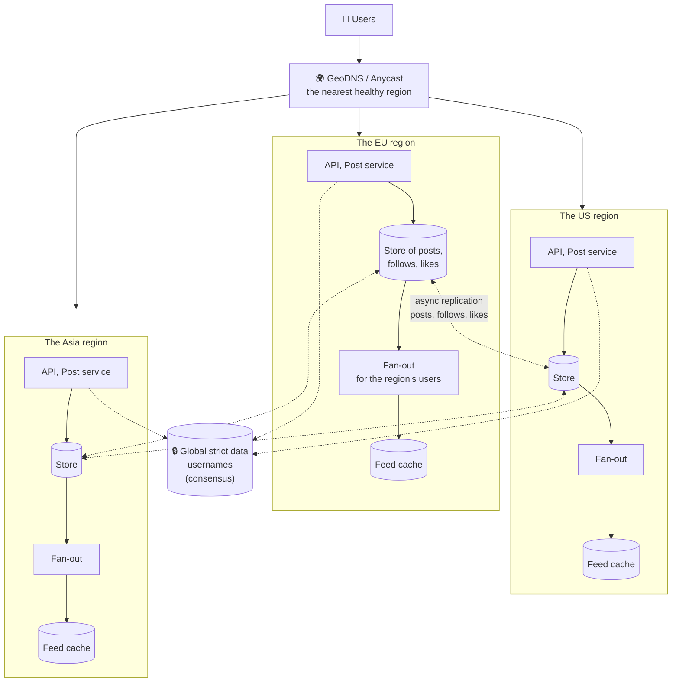
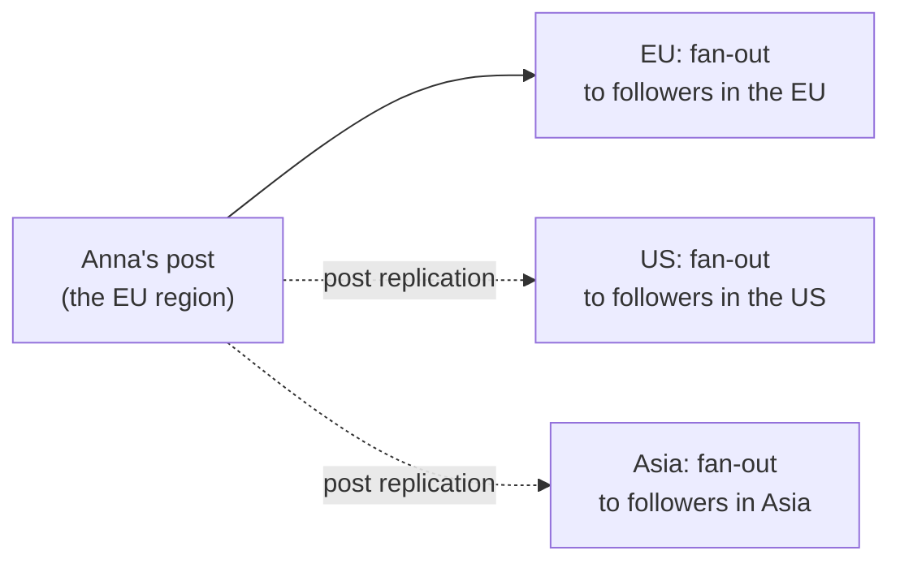
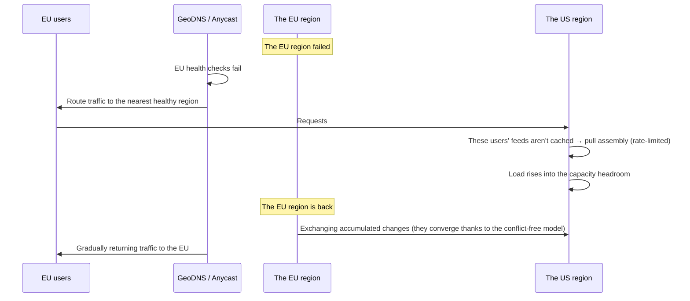

**English** | [Русский](README_RU.md)

# Tier 2 · 4B · 05. An Active-Active Multi-Region News Feed

> **Level:** Advanced · **Interview time:** 45–60 min · **Study time:** ~5–6 h
> **Key aspects:** active-passive versus active-active, designing data without conflicts (immutable events, CRDTs, LWW with hybrid clocks), cross-region replication, fan-out in every region, read-your-writes on failover, conflict resolution, failover and traffic shifting, N+1 capacity headroom, region evacuation drills, what must not be active-active
> **Builds on:** [Tier 1 · 07 News Feed](../../../tier-1/07-news-feed/README.md), [05-replication](../../../05-replication/README.md), [07-consistency-models](../../../07-consistency-models/README.md), [Tier 1 · 19 KV Store](../../../tier-1/19-distributed-kv-store/README.md#8-deep-dive-3-versions-and-conflicts) (LWW, CRDTs), [13-reliability-patterns](../../../13-reliability-patterns/README.md), [Tier 2 · 4B · 04 Profiles](../04-global-profile-service/README.md#7-deep-dive-1-where-a-users-data-lives)

---

## 🗺️ How to Read This Walkthrough

The walkthrough follows an interview, but every step includes explanations: **why** a decision is made, **how** a mechanism works and **what happens** if you do it differently. The "📘 Explanation" blocks are theory right where you need it.

| Icon | Meaning |
|:----:|:--------|
| 🎤 | Interviewer |
| 🗣️ | What I (the candidate) say out loud |
| ✏️ | What I draw on the whiteboard |
| ⏱️ | Time budget for the step |
| 📘 | A detailed explanation of a concept |

Callouts: **TIP** — a good technique, **WARNING** — a trap, **IMPORTANT** — a Senior+ signal.

---

## 📑 Contents

0. [What This Problem Teaches](#0-what-this-problem-teaches)
1. [Problem Statement](#1-problem-statement)
2. [Clarifying Questions and Requirements](#2-clarifying-questions-and-requirements)
3. [Load and Capacity Estimates](#3-load-and-capacity-estimates)
4. [How Each Kind of Data Is Written](#4-how-each-kind-of-data-is-written)
5. [High-Level Design](#5-high-level-design)
6. [Deep Dive 1: Active-Passive Versus Active-Active](#6-deep-dive-1-active-passive-versus-active-active)
7. [Deep Dive 2: Data Without Conflicts](#7-deep-dive-2-data-without-conflicts)
8. [Deep Dive 3: The Mechanics of Cross-Region Replication](#8-deep-dive-3-the-mechanics-of-cross-region-replication)
9. [Deep Dive 4: Fan-Out Across Regions](#9-deep-dive-4-fan-out-across-regions)
10. [Deep Dive 5: Read-Your-Writes and Region Affinity](#10-deep-dive-5-read-your-writes-and-region-affinity)
11. [Deep Dive 6: Conflicts and Their Resolution](#11-deep-dive-6-conflicts-and-their-resolution)
12. [Deep Dive 7: Region Failure and Traffic Shifting](#12-deep-dive-7-region-failure-and-traffic-shifting)
13. [Deep Dive 8: Drills, Checks and Operations](#13-deep-dive-8-drills-checks-and-operations)
14. [What Must Not Be Active-Active](#14-what-must-not-be-active-active)
15. [Bottlenecks and Failure Scenarios](#15-bottlenecks-and-failure-scenarios)
16. [What Changes at 10x Scale](#16-what-changes-at-10x-scale)
17. [Key Concepts and New Terms](#17-key-concepts-and-new-terms)
18. [Variations and Follow-Up Questions](#18-variations-and-follow-up-questions)
19. [Common Mistakes](#19-common-mistakes)
20. [Cheat Sheet and Self-Check](#20-cheat-sheet-and-self-check)

---

## 0. What This Problem Teaches

In [Tier 1 · 07](../../../tier-1/07-news-feed/README.md) we designed a news feed. Here the same feed must run in **several regions at once**, with **every region accepting both reads and writes**, and the failure of any region must not stop the product.

The key idea: active-active isn't a database setting — it's **a way of designing data**. Each kind of data must be designed so that concurrent writes in different regions either don't conflict at all or converge automatically.

| What's tested | Where it shows up |
|:--------------|:------------------|
| Multi-region trade-offs | Active-passive versus active-active |
| Designing conflict-free data | Immutable posts, CRDT counters, LWW sets |
| Time in distributed systems | Hybrid logical clocks for LWW |
| Replication | Async across regions, idempotent application |
| Feed architecture | Where to do fan-out |
| Fault tolerance | Traffic shifting, capacity headroom, data loss on failure |
| The approach's limits | What must have a single master |

> [!TIP]
> Start with **a table of data kinds**: posts, likes, follows, feeds, profiles, usernames — and for each, say how it's written in active-active. That immediately shows the interviewer you understand there's no universal solution.

---

## 1. Problem Statement

> 🎤 "Take the news feed from Tier 1 and make it active-active across 3–5 regions: users write and read through the nearest region, and the failure of an entire region neither stops the service nor loses more than a little data."

**What the user sees:**

```
Anna in Warsaw publishes a post → it's written in the European region within milliseconds
Her friend in San Francisco sees the post in his feed a second or two later
The European region fails → Anna keeps using the app through another region,
                            noticing at most a slight delay
Her post, published 2 seconds before the failure, isn't lost (or the loss is minimal and explainable)
```

**Time plan:**

| Step | ⏱️ |
|:-----|:--:|
| Requirements | 5 min |
| Estimates and capacity | 4 min |
| The data kinds table | 6 min |
| High-level design | 5 min |
| Deep dives | 25 min |
| Wrap-up | 3 min |

---

## 2. Clarifying Questions and Requirements

⏱️ 5 min

| My question | Interviewer's answer | What it changes and why |
|:------------|:---------------------|:------------------------|
| How many regions? | 3–5 | Cross-region latency of 70–200 ms |
| Writes in every region? | Yes, through the nearest region | Active-active for writes |
| Acceptable data loss on a region failure (RPO)? | Seconds | Async replication is acceptable |
| Recovery time (RTO)? | Seconds to minutes | Automatic traffic shifting |
| How fast must a post appear in another region? | Seconds | Async replication with low lag |
| Must your own post show immediately? | Yes, even after a region switch | Read-your-writes |
| Scale? | As in Tier 1: 500M posts per day, 5B feed opens | Fan-out in every region |
| Which data must be strongly consistent? | Usernames, payments | Not active-active — handled separately |

### Functional requirements

1. All the feed functionality from Tier 1: posting, following, the feed, likes, comments, deletion.
2. Every region accepts reads and writes.
3. Changes propagate to every region.
4. A region failure — users are moved to other regions automatically.

### Non-functional requirements

| Requirement | Target | Why |
|:------------|:-------|:----|
| Write latency | Local (milliseconds) | The user doesn't wait for cross-region acknowledgment |
| Visibility lag in other regions | Seconds | A feed isn't a real-time system |
| RPO | Seconds | Async replication |
| RTO | Seconds to minutes | Traffic shifting |
| Convergence | Every region reaches the same state | Otherwise users in different regions see different things forever |

---

## 3. Load and Capacity Estimates

⏱️ 4 min

```
Load (as in Tier 1):
  Posts:              ~6,000/s, peak ~20,000/s
  Feed opens:         ~58,000/s, peak ~175,000/s
  Likes:              ~100,000/s

Cross-region replication:
  Posts:              6,000/s × ~1 KB × (N − 1) regions — megabytes per second, not much
  Likes:              as events or aggregated counters — also not much

Capacity headroom (N+1):
  To survive the failure of one of N regions, each must run at no more than (N − 1) / N
  3 regions → each loaded at no more than ~66%
  5 regions → no more than ~80%
```

### Conclusions

| Conclusion | Design consequence |
|:-----------|:-------------------|
| Posts are a small stream | Replicate **posts**, not ready-made feeds |
| Each region must be able to absorb another's share | Capacity headroom, autoscaling, limits |
| More regions means less headroom per region | 5 regions are more economical than 3 in headroom, but harder to operate |

---

## 4. How Each Kind of Data Is Written

⏱️ 6 min

📘 The problem's key table: each kind of data has its own strategy.

| Data | Property | Strategy in active-active |
|:-----|:---------|:--------------------------|
| **Posts** | Created once, rarely edited | Written in the author's region; **a globally unique ID** (a Snowflake with region bits) → no creation conflicts; edits — LWW by hybrid clocks; deletion wins |
| **Likes** (who liked) | A (user, post) pair | **An LWW register per pair**: "liked / not liked" with a timestamp |
| **Like counters** | A sum | **A CRDT counter**: each region has its own counter; the total is the sum |
| **Follows** | A set of edges | **An LWW set** (or OR-Set): additions and removals with timestamps |
| **Comments** | Created once | Like posts: a unique ID, no creation conflicts |
| **Feeds (timelines)** | Derived data | **Not replicated**: each region builds them itself from replicated posts and follows |
| **Profiles** | One author | A home region (see [Tier 2 · 4B · 04](../04-global-profile-service/README.md)) or per-field LWW |
| **Usernames** | Global uniqueness | **Not active-active**: a global index on consensus |

> [!IMPORTANT]
> **Senior+ signal:** say that active-active is achieved by **designing the data**, not by enabling multi-master replication: immutable events with unique IDs, commutative operations (CRDTs), and an explicit conflict-resolution rule for mutable data. And whatever can't be made commutative (uniqueness, money) stays with a single master.

---

## 5. High-Level Design

⏱️ 5 min



🗣️ "Each region is a full stack: API, store, fan-out, feed cache.
- A user writes to the nearest region; the write is **local**.
- Posts, follows and likes are **replicated asynchronously** to every region.
- **Each region builds its own users' feeds** from the replicated data — feeds aren't copied between regions.
- Data with strict requirements (unique names) lives in a separate global store on consensus."

---

## 6. Deep Dive 1: Active-Passive Versus Active-Active

> 🎤 "Why not keep it simpler: one active region, with the rest as hot standbys?"

| | Active-passive | Active-active ⭐ |
|:-|:---------------|:-----------------|
| Writes | Only in the active region | In any region |
| Latency for distant users | High (writes cross an ocean) | Local |
| Capacity use | The standby sits idle | Every region works |
| Failover on failure | A rare, "scary" event; the standby may turn out not to be ready | Shifting traffic is a routine operation, exercised constantly |
| Write conflicts | None | Data must be designed without conflicts |
| Complexity | Lower | Higher |

🗣️ "Active-passive is simpler, but it has two weaknesses: distant users write slowly, and a standby region that never takes real traffic easily turns out not to be ready exactly when disaster strikes. Active-active solves both — at the cost of designing conflict-free data."

📘 **A middle ground — "active-active for reads"**: every region serves reads, while writes go to one region (or the user's home region, as in [Tier 2 · 4B · 04](../04-global-profile-service/README.md)). It's a good choice when writes are few or hard to make conflict-free.

---

## 7. Deep Dive 2: Data Without Conflicts

> 🎤 "How do you make concurrent writes in different regions not conflict?"

### Technique 1: immutable events with unique IDs

📘 A post is created once. If its ID is globally unique (a Snowflake with region bits, see [Tier 1 · 04](../../../tier-1/04-unique-id-generator/README.md)), two regions can't create "the same" post. Creating posts and comments is **conflict-free by definition** — it's just adding to a shared set.

### Technique 2: commutative operations (CRDTs)

📘 A like counter that each region increments independently is the classic **G-Counter**:

```
Post 9001's like counter:
  EU:    1,200    ← only the EU region increments this
  US:      800    ← only the US region
  Asia:    450    ← only the Asia region

Total = 1,200 + 800 + 450 = 2,450

Merging replicas: for each region, take the maximum of its value
→ the result doesn't depend on the order updates arrive in
```

For decrements (removing a like) — **a PN-Counter**: two G-Counters, for increments and decrements (see [Tier 1 · 19](../../../tier-1/19-distributed-kv-store/README.md#8-deep-dive-3-versions-and-conflicts)).

### Technique 3: "last write wins" on a small key

📘 For mutable data — LWW, but on **the smallest possible key**:

| Bad: LWW on a large object | Good: LWW on a small key |
|:---------------------------|:-------------------------|
| A user's whole follow list is one object; adding two follows concurrently in different regions → one is lost | Each (follower, followee) edge is its own "following / not following" register; concurrent follows of different people don't conflict at all |

### Technique 4: don't replicate derived data

📘 Feeds (timelines) are derived from posts and follows. There's no need to replicate them or resolve conflicts in them: each region builds them itself. If a region's feeds are lost, they're rebuilt from the source data.

---

## 8. Deep Dive 3: The Mechanics of Cross-Region Replication

> 🎤 "How exactly does data reach other regions, and in what order?"

### Options

| Option | How |
|:-------|:----|
| **A multi-DC store** | Cassandra/ScyllaDB with cross-datacenter replication: writes at `LOCAL_QUORUM`, async to the other DCs (see [Tier 1 · 19](../../../tier-1/19-distributed-kv-store/README.md#13-deep-dive-8-tunable-consistency-and-multiple-data-centers)) |
| **A cross-region change stream** | Each region writes to its own database; CDC → Kafka → replicating topics to other regions → applying them there |

### Order and time

📘 There's no shared order of events across regions, and servers' physical clocks differ by milliseconds. LWW needs timestamps that:
- grow monotonically within each region;
- stay close to real time;
- respect causality: an event made after a region saw another event gets a larger timestamp.

These are **hybrid logical clocks (HLC)**: a timestamp = (physical time, a logical counter). A node takes the maximum of its own time and the time of the last event it saw; if the physical time didn't advance, it increments the counter. HLCs are used by CockroachDB and other distributed databases.

```
The EU region at 10:00:00.100 creates an event        → HLC (100, 0)
The US region receives it at 10:00:00.090 by its own clock (the clock lags)
              and creates the next event               → HLC (100, 1), not (90, 0)
→ the causally later event gets the larger timestamp, despite the lagging clock
```

### Application

| Rule | Why |
|:-----|:----|
| **Idempotency**: every event has a unique ID; reapplying it is a no-op | Replication is at-least-once |
| Apply LWW by HLC | Convergence for any delivery order |
| Deletes are **tombstones** with a timestamp | Otherwise deleted data "resurrects" from another region |
| Monitor **replication lag** | It determines how much data is lost on a failure |

---

## 9. Deep Dive 4: Fan-Out Across Regions

> 🎤 "Where do you fan a post out into followers' feeds, if the followers are in different regions?"

| Option | How | Problem |
|:-------|:----|:--------|
| **Fan-out in the author's region, replicate the feeds** | The EU region places the post into every follower's feed and replicates those feeds | ~1M feed inserts per second × N of cross-region traffic |
| **Replicate posts, fan out in every region** ⭐ | The post (1 KB) is replicated to every region; each region places it into **its own** users' feeds | Each region processes every post, but only for its own users |



| Detail | Solution |
|:-------|:---------|
| How a region knows its "own" users | A user is pinned to a region (by location); fan-out covers that region's active users |
| Celebrities | The pull path (as in Tier 1) works locally, since posts are replicated everywhere |
| A user moved, or their region failed | Their feed is missing in the new region → assembled by pull on first open, then maintained by fan-out |

> [!TIP]
> The general rule: **replicate the source events between regions, not the derived data**. Source data is compact, and derived data can be recomputed on the spot.

---

## 10. Deep Dive 5: Read-Your-Writes and Region Affinity

> 🎤 "Anna published a post through the EU, and right after that was switched to the US region, where the post hasn't replicated yet. Doesn't she see her own post?"

| Mechanism | How |
|:----------|:----|
| **Region affinity** | In normal operation a user is always served by one region (sticky); their writes and reads happen there |
| Your own post goes synchronously into your own feed | In the region of publication (as in Tier 1) |
| **The client keeps its recent writes** | The app shows its own posts from a local cache until the server returns them itself |
| **A version token** | As with [profiles](../04-global-profile-service/README.md#9-deep-dive-3-read-your-writes-across-regions): a new region seeing a token newer than its replica waits for replication or proxies the request |
| Region switches are rare | Only on a failure or a move — so these situations are rare and brief |

---

## 11. Deep Dive 6: Conflicts and Their Resolution

> 🎤 "Give examples of real conflicts and how they're resolved."

| Situation | What happened | Resolution |
|:----------|:--------------|:-----------|
| **Follow and unfollow** at once from two devices in different regions | EU: following (HLC 100); US: unfollowed (HLC 105) | LWW: 105 wins — unfollowed, identically in every region |
| **Editing and deleting** a post at once | EU: an edit; US: a deletion | **Deletion wins** regardless of time (the tombstone takes priority) — otherwise the deleted post "resurrects" with new text |
| **Liking and unliking** | Like a follow | LWW on the (user, post) pair |
| **The like counter** | Regions increment independently | A CRDT sum, no conflict |
| **Two edits** of one post | The author edits from two devices | LWW by HLC; the earlier edit is lost — acceptable for a rare situation; edit history can be kept |
| **A comment on a deleted post** | The comment arrived before the tombstone | The comment is kept but not shown (the post is deleted); background cleanup |

📘 **The "deletion wins" rule** is an example of **semantic** conflict resolution: the decision is made by what the operations mean, not just by time. For a user, deletion is a strong intent, and it mustn't be "overridden" by a randomly delayed edit.

---

## 12. Deep Dive 7: Region Failure and Traffic Shifting

> 🎤 "The EU region failed. What happens, step by step?"



| Aspect | Solution |
|:-------|:---------|
| **Detection** | Region-level health checks, automatic and manual decisions |
| **Rerouting** | GeoDNS (subject to DNS cache TTLs) or Anycast (faster) |
| **Capacity** | N+1 headroom: each region is ready in advance to absorb another's share; autoscaling; on shortage — turning off secondary features |
| **Cold caches** | EU users' feeds are missing in the US region → pull assembly with rate limiting, so as not to overload the store |
| **Lost data** | EU writes that hadn't replicated (the last few seconds) are unavailable until the region returns; thanks to the conflict-free model they **merge** after recovery rather than being lost forever (if the data on disk survived) |
| **Returning traffic** | Gradually, after the region has caught up on changes |

> [!WARNING]
> **The failover stampede.** Millions of users reconnect to the new region at once, with cold caches. Without rate limiting, pull assembly of feeds can overload the store — turning one region's failure into two. You need limits, priorities and degradation (e.g. a temporarily simplified feed).

---

## 13. Deep Dive 8: Drills, Checks and Operations

> 🎤 "How do you make sure failover will work in a real disaster?"

| Practice | How |
|:---------|:----|
| **Region evacuation drills** | Regularly and deliberately drain traffic from an entire region during working hours; Meta described such drills (Storm), and Netflix — Chaos Kong |
| **Consistency checks** | Background jobs compare data across regions (by sampling, or by hashing key ranges, like Merkle trees) and flag discrepancies |
| **An SLO on replication lag** | An alert if the lag exceeds a threshold — it's a direct risk of data loss |
| **Deploying region by region** | A new version rolls out to one region, then the rest — a bug doesn't hit every region at once |
| **Schema changes** | Backward-compatible; every region must understand the others' data during the transition |
| **Capacity headroom** | Constant monitoring: each region must withstand a failed region's load |

---

## 14. What Must Not Be Active-Active

> 🎤 "Can everything be made active-active?"

🗣️ "No. Active-active suits data where concurrent writes can be made commutative or resolved automatically. For data with **invariants** that mustn't be violated even briefly, you need a single master or consensus."

| Data | Invariant | Solution |
|:-----|:----------|:---------|
| Unique usernames | At most one owner per name | A global index on consensus |
| Payments, balances | You can't spend more than you have | A single master per account, or consensus (see [Tier 1 · 20](../../../tier-1/20-payment-system/README.md)) |
| Inventory, tickets | You can't sell more than you have | A single master per item or event (see [Tier 1 · 13](../../../tier-1/13-ticketmaster/README.md)) |
| Admin permissions | Security | Strong consistency |

📘 You can mix: the product overall is active-active, while specific operations (renaming, payment) call a global strict service, accepting cross-region latency **only for them**.

---

## 15. Bottlenecks and Failure Scenarios

| Scenario | What happens | How we protect |
|:---------|:-------------|:---------------|
| Concurrent writes to one key in different regions | A conflict | Conflict-free design: unique IDs, CRDTs, LWW on small keys |
| Clock skew | The wrong LWW order | Hybrid logical clocks |
| Redelivered events | Double application | Idempotency by event ID |
| An edit versus a deletion | Deleted data "resurrects" | Deletion wins |
| Replicating feeds | Huge traffic | Replicate posts, fan out locally |
| A region failure | Users without service | GeoDNS/Anycast, N+1 headroom |
| The failover stampede | Overloading the second region | Rate limiting, degradation |
| A failed region's unreplicated writes | Temporary unavailability or loss | Replication lag monitoring, merging after recovery |
| Your own post isn't visible after a switch | Confusion | A client-side cache, a version token |
| Invariants in active-active | Duplicate names, overspending | A single master or consensus for such data |

---

## 16. What Changes at 10x Scale

> 🎤 "10 regions and 10× the traffic?"

| Change | Why |
|:-------|:----|
| **Not replicating everything to every region** | Posts are replicated to where the author's followers are |
| **A hierarchy of regions** (continental groups) | Fewer cross-region connections |
| **Less headroom per region** | With 10 regions, ~10% is enough |
| **Automatic evacuation by SLO** | Faster than a manual decision |

---

## 17. Key Concepts and New Terms

### What's applied

| Concept | Where it's covered | How it applies here |
|:--------|:-------------------|:--------------------|
| The news feed, fan-out | [Tier 1 · 07](../../../tier-1/07-news-feed/README.md) | The basis of the system |
| Async replication, multi-master | [05-replication](../../../05-replication/README.md) | Cross-region replication |
| LWW, CRDTs, tombstones | [Tier 1 · 19](../../../tier-1/19-distributed-kv-store/README.md) | Conflict-free data |
| Read-your-writes, a version token | [Tier 2 · 4B · 04](../04-global-profile-service/README.md) | Your own writes after a switch |
| Chaos engineering, capacity headroom | [13-reliability-patterns](../../../13-reliability-patterns/README.md) | Evacuation drills |

### New terms in this problem

| Term | In short |
|:-----|:---------|
| **Active-active** | Every region accepts reads and writes |
| **Active-passive** | Writes go to one region; the rest are standbys |
| **Conflict-free data** | Unique IDs, commutative operations, LWW on small keys |
| **G-Counter / PN-Counter** | CRDT counters that converge regardless of update order |
| **An LWW set** | A set with timestamps on additions and removals |
| **Hybrid logical clocks (HLC)** | Timestamps close to physical time that respect causality |
| **Deletion wins** | A semantic conflict-resolution rule |
| **N+1 capacity headroom** | Each region withstands a failed region's share |
| **Region evacuation drills** | Regularly draining traffic from a region to test failover |
| **RPO / RTO** | Acceptable data loss / recovery time |

---

## 18. Variations and Follow-Up Questions

<details>
<summary><b>Why is GeoDNS worse than Anycast for failover?</b></summary>

DNS answers are cached by clients and ISPs for the TTL (and sometimes longer), so failing over via DNS takes minutes. Anycast shifts routing at the network level within seconds, but requires your own network infrastructure. Often both are used: Anycast at the edge, with regional routing behind it.
</details>

<details>
<summary><b>Why not use a database with built-in multi-region strong consistency (Spanner)?</b></summary>

Spanner provides strong consistency via cross-region consensus, but every write pays cross-region latency (tens to hundreds of ms). For a feed, with many writes and no need for strictness, that's an unnecessary cost. For data with invariants (names, money), such a database is a good choice.
</details>

<details>
<summary><b>How do you keep a post's comments in order across every region?</b></summary>

There's no global order, but comments are ordered by HLC timestamp or Snowflake ID at display time — identically in every region once all comments have replicated. For a short time different regions may see different sets, but the display order converges.
</details>

<details>
<summary><b>How do you verify that regions have actually converged?</b></summary>

Background jobs compute hashes of key ranges in each region and compare them (like anti-entropy with Merkle trees); discrepancies lasting beyond a threshold trigger an alert and automatic resync.
</details>

<details>
<summary><b>What if it's not the whole region that failed, but only its store?</b></summary>

A partial failure is more dangerous than a total one: the region is "alive" for health checks but can't serve. Health checks must exercise real user scenarios (e.g. publishing and reading a test post), not just server availability.
</details>

---

## 19. Common Mistakes

| ❌ Mistake | Why it's bad | ✅ Do this instead |
|:----------|:-------------|:------------------|
| "Enable multi-master replication" without designing the data | Conflicts and losses | A strategy table by data kind |
| LWW on large objects (a whole follow list) | Losing concurrent changes | LWW on small keys (each edge) |
| Physical clocks for LWW | The wrong order under clock skew | Hybrid logical clocks |
| Replicating feeds | Huge traffic | Replicate posts, fan out locally |
| Deletion without priority | Deleted data "resurrects" | Deletion wins |
| Non-idempotent event application | Double effects on retries | Event IDs and dedup |
| No capacity headroom | One region's failure takes down the next | N+1, autoscaling, degradation |
| No drills | Failover doesn't work in a real disaster | Regular region evacuations |
| Active-active for names and money | Violated invariants | A single master or consensus |
| No replication lag monitoring | An unknown amount of loss on failure | An SLO on lag |

---

## 20. Cheat Sheet and Self-Check

### 30-second answer

> Active-active is data design, not a database setting. Each region is a full stack: it writes locally and asynchronously replicates source data to the others. Posts and comments are immutable events with globally unique IDs (a Snowflake with region bits), with no conflicts; like counters are CRDTs (a sum over regions); likes and follows are LWW on small keys (each pair) by hybrid logical clocks; deletion beats an edit; events are applied idempotently, with deletes as tombstones. Feeds aren't replicated: each region fans replicated posts out to its own users, with celebrities pulled locally. A user is pinned to a region; their own writes — a client-side cache and a version token. On a region failure: GeoDNS/Anycast shifts traffic, with N+1 headroom (3 regions at ~66% each), rate-limited pull assembly of cold feeds, and data merging after recovery. Regular evacuation drills, consistency checks, an SLO on replication lag. Usernames and money aren't active-active: consensus or a single master.

### Self-check

- [ ] I can compare active-passive and active-active
- [ ] I can fill in the strategy table for posts, likes, follows, feeds, profiles and names
- [ ] I can explain a G-Counter with an example
- [ ] I can explain why LWW belongs on small keys
- [ ] I can explain hybrid logical clocks
- [ ] I can justify fan-out in every region instead of replicating feeds
- [ ] I can ensure read-your-writes across a region switch
- [ ] I can walk through conflicts, including "deletion wins"
- [ ] I can describe a region failure step by step and N+1 headroom
- [ ] I can explain what must not be active-active

### Further reading

- Shapiro et al., *Conflict-free Replicated Data Types* (2011)
- Kulkarni et al., *Logical Physical Clocks and Consistent Snapshots in Globally Distributed Databases* (2014) — hybrid logical clocks
- Meta Engineering articles on the Storm drills and multi-region infrastructure
- Netflix Tech Blog, *Chaos Kong* and articles on active-active
- Martin Kleppmann, *Designing Data-Intensive Applications* — chapter 5 (multi-leader replication)
