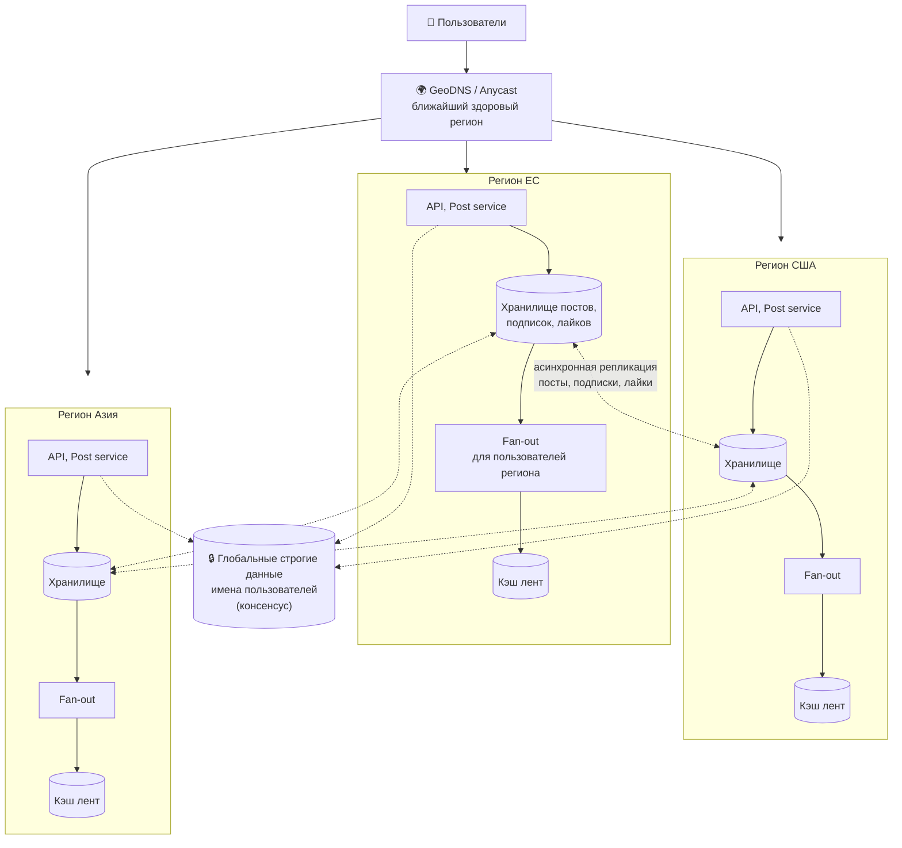
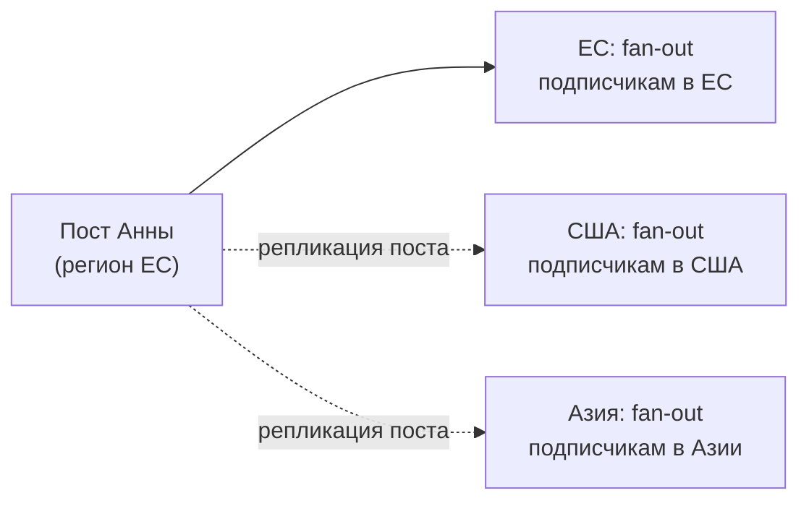
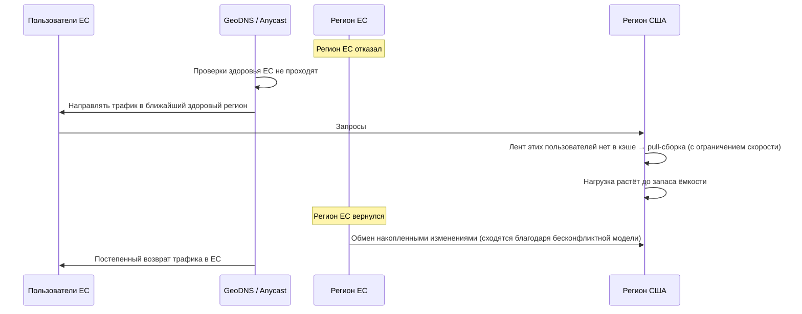

[English](README.md) | **Русский**

# Tier 2 · 4B · 05. Active-active лента новостей в нескольких регионах

> **Уровень:** Advanced · **Время на интервью:** 45–60 мин · **Время на разбор:** ~5–6 ч
> **Ключевые аспекты:** active-passive против active-active, проектирование данных без конфликтов (неизменяемые события, CRDT, LWW с гибридными часами), межрегиональная репликация, fan-out в каждом регионе, read-your-writes при переключении, разрешение конфликтов, failover и перераспределение трафика, запас ёмкости N+1, учения по эвакуации региона, что не должно быть active-active
> **Опирается на:** [Tier 1 · 07 News Feed](../../../tier-1/07-news-feed/README_RU.md), [05-replication](../../../05-replication/README_RU.md), [07-consistency-models](../../../07-consistency-models/README_RU.md), [Tier 1 · 19 KV Store](../../../tier-1/19-distributed-kv-store/README_RU.md#8-deep-dive-3-версии-и-конфликты) (LWW, CRDT), [13-reliability-patterns](../../../13-reliability-patterns/README_RU.md), [Tier 2 · 4B · 04 Profiles](../04-global-profile-service/README_RU.md#7-deep-dive-1-где-живут-данные-пользователя)

---

## 🗺️ Как читать этот разбор

Разбор построен как интервью, но в каждом шаге есть объяснения: **почему** принимается решение, **как работает** механизм и **что будет**, если сделать иначе. Блоки «📘 Объяснение» — теория прямо по ходу задачи.

| Значок | Что значит |
|:------:|:-----------|
| 🎤 | Реплика интервьюера |
| 🗣️ | Что говорю вслух я (кандидат) |
| ✏️ | Что рисую на доске |
| ⏱️ | Сколько времени тратить на шаг |
| 📘 | Подробное объяснение концепции |

Блоки **TIP** — хороший приём, **WARNING** — ловушка, **IMPORTANT** — сигнал для уровня Senior+.

---

## 📑 Содержание

0. [Чему учит эта задача](#0-чему-учит-эта-задача)
1. [Условие задачи](#1-условие-задачи)
2. [Уточняющие вопросы и требования](#2-уточняющие-вопросы-и-требования)
3. [Оценки нагрузки и ёмкости](#3-оценки-нагрузки-и-ёмкости)
4. [Какие данные как записываются](#4-какие-данные-как-записываются)
5. [High-level дизайн](#5-high-level-дизайн)
6. [Deep dive 1: active-passive против active-active](#6-deep-dive-1-active-passive-против-active-active)
7. [Deep dive 2: данные без конфликтов](#7-deep-dive-2-данные-без-конфликтов)
8. [Deep dive 3: механика межрегиональной репликации](#8-deep-dive-3-механика-межрегиональной-репликации)
9. [Deep dive 4: fan-out в нескольких регионах](#9-deep-dive-4-fan-out-в-нескольких-регионах)
10. [Deep dive 5: read-your-writes и привязка к региону](#10-deep-dive-5-read-your-writes-и-привязка-к-региону)
11. [Deep dive 6: конфликты и их разрешение](#11-deep-dive-6-конфликты-и-их-разрешение)
12. [Deep dive 7: отказ региона и перераспределение трафика](#12-deep-dive-7-отказ-региона-и-перераспределение-трафика)
13. [Deep dive 8: учения, проверки и эксплуатация](#13-deep-dive-8-учения-проверки-и-эксплуатация)
14. [Что не должно быть active-active](#14-что-не-должно-быть-active-active)
15. [Узкие места и сценарии сбоев](#15-узкие-места-и-сценарии-сбоев)
16. [Что изменится при росте в 10 раз](#16-что-изменится-при-росте-в-10-раз)
17. [Ключевые концепции и новые понятия](#17-ключевые-концепции-и-новые-понятия)
18. [Варианты задачи и follow-up вопросы](#18-варианты-задачи-и-follow-up-вопросы)
19. [Типичные ошибки](#19-типичные-ошибки)
20. [Шпаргалка и самопроверка](#20-шпаргалка-и-самопроверка)

---

## 0. Чему учит эта задача

В [Tier 1 · 07](../../../tier-1/07-news-feed/README_RU.md) мы спроектировали ленту новостей. Здесь та же лента должна работать в **нескольких регионах одновременно**, причём **каждый регион принимает и чтения, и записи**, а отказ любого региона не должен останавливать продукт.

Главная мысль задачи: active-active — это не настройка базы данных, а **способ проектировать данные**. Каждый тип данных нужно спроектировать так, чтобы одновременные записи в разных регионах либо не конфликтовали вовсе, либо сходились автоматически.

| Что проверяют | Где это в задаче |
|:--------------|:-----------------|
| Компромиссы мульти-региона | Active-passive против active-active |
| Проектирование данных без конфликтов | Неизменяемые посты, CRDT-счётчики, LWW-множества |
| Время в распределённых системах | Гибридные логические часы для LWW |
| Репликация | Асинхронная между регионами, идемпотентное применение |
| Архитектура ленты | Где делать fan-out |
| Отказоустойчивость | Перераспределение трафика, запас ёмкости, потеря данных при отказе |
| Границы подхода | Что обязано иметь одного мастера |

> [!TIP]
> Начни с **таблицы типов данных**: посты, лайки, подписки, ленты, профили, имена пользователей — и для каждого скажи, как он записывается в active-active. Это сразу показывает интервьюеру, что ты понимаешь: универсального решения нет.

---

## 1. Условие задачи

> 🎤 «Возьми ленту новостей из Tier 1 и сделай её active-active в 3–5 регионах: пользователи пишут и читают через ближайший регион, а отказ целого региона не останавливает сервис и почти не теряет данные».

**Что видит пользователь:**

```
Анна в Варшаве публикует пост → он записан в европейском регионе за миллисекунды
Её друг в Сан-Франциско видит пост в ленте через секунду-две
Европейский регион отказал → Анна продолжает пользоваться приложением через другой регион,
                               замечая разве что небольшую задержку
Её пост, опубликованный за 2 секунды до отказа, не потерялся (или потеря минимальна и объяснима)
```

**План по времени:**

| Шаг | ⏱️ |
|:----|:--:|
| Требования | 5 мин |
| Оценки и ёмкость | 4 мин |
| Таблица типов данных | 6 мин |
| High-level дизайн | 5 мин |
| Deep dives | 25 мин |
| Итоги | 3 мин |

---

## 2. Уточняющие вопросы и требования

⏱️ 5 мин

| Мой вопрос | Ответ интервьюера | Что это меняет и почему |
|:-----------|:------------------|:------------------------|
| Сколько регионов? | 3–5 | Межрегиональная задержка 70–200 мс |
| Записи в каждом регионе? | Да, через ближайший регион | Active-active для записи |
| Допустимая потеря данных при отказе региона (RPO)? | Секунды | Асинхронная репликация допустима |
| Время восстановления (RTO)? | Секунды–минуты | Автоматическое перераспределение трафика |
| Как быстро пост виден в другом регионе? | Секунды | Асинхронная репликация с малой задержкой |
| Свой пост виден сразу? | Да, даже после переключения региона | Read-your-writes |
| Масштаб? | Как в Tier 1: 500M постов в сутки, 5B открытий лент | Fan-out в каждом регионе |
| Какие данные должны быть строго консистентными? | Имена пользователей, платежи | Не active-active — отдельно |

### Функциональные требования

1. Все функции ленты из Tier 1: публикация, подписка, лента, лайки, комментарии, удаление.
2. Каждый регион принимает чтения и записи.
3. Изменения распространяются во все регионы.
4. Отказ региона — пользователи переводятся в другие регионы автоматически.

### Нефункциональные требования

| Требование | Цель | Почему |
|:-----------|:-----|:-------|
| Задержка записи | Локальная (миллисекунды) | Пользователь не ждёт межрегионального подтверждения |
| Задержка видимости в других регионах | Секунды | Лента — не система реального времени |
| RPO | Секунды | Асинхронная репликация |
| RTO | Секунды–минуты | Переключение трафика |
| Сходимость | Все регионы приходят к одному состоянию | Иначе пользователи в разных регионах видят разное навсегда |

---

## 3. Оценки нагрузки и ёмкости

⏱️ 4 мин

```
Нагрузка (как в Tier 1):
  Посты:              ~6 000/с, пик ~20 000/с
  Открытия лент:      ~58 000/с, пик ~175 000/с
  Лайки:              ~100 000/с

Межрегиональная репликация:
  Посты:              6 000/с × ~1 КБ × (N − 1) регионов — мегабайты в секунду, немного
  Лайки:              как события или агрегированные счётчики — тоже немного

Запас ёмкости (N+1):
  Чтобы пережить отказ одного из N регионов, каждый должен работать не выше (N − 1) / N
  3 региона → каждый загружен не больше чем на ~66%
  5 регионов → не больше чем на ~80%
```

### Выводы

| Вывод | Следствие для дизайна |
|:------|:----------------------|
| Посты — маленький поток | Реплицировать **посты**, а не готовые ленты |
| Каждый регион должен уметь принять чужую долю | Запас ёмкости, автоскейлинг, лимиты |
| Чем больше регионов, тем меньше запас на каждый | 5 регионов экономичнее 3 по запасу, но сложнее в эксплуатации |

---

## 4. Какие данные как записываются

⏱️ 6 мин

📘 Ключевая таблица задачи: для каждого типа данных — своя стратегия.

| Данные | Свойство | Стратегия в active-active |
|:-------|:---------|:--------------------------|
| **Посты** | Создаются один раз, правятся редко | Запись в регионе автора; **глобально уникальный ID** (Snowflake с битами региона) → нет конфликтов создания; правки — LWW по гибридным часам; удаление побеждает |
| **Лайки** (кто лайкнул) | Пара (пользователь, пост) | **LWW-регистр на пару**: «лайк/не лайк» с меткой времени |
| **Счётчики лайков** | Сумма | **CRDT-счётчик**: у каждого региона свой счётчик, итог — сумма |
| **Подписки** | Множество рёбер | **LWW-множество** (или OR-Set): добавление и удаление с метками времени |
| **Комментарии** | Создаются один раз | Как посты: уникальный ID, без конфликтов создания |
| **Ленты (timelines)** | Производные данные | **Не реплицируются**: каждый регион строит ленты сам из реплицированных постов и подписок |
| **Профили** | Один автор | Домашний регион (см. [Tier 2 · 4B · 04](../04-global-profile-service/README_RU.md)) или LWW по полям |
| **Имена пользователей** | Глобальная уникальность | **Не active-active**: глобальный индекс на консенсусе |

> [!IMPORTANT]
> **Сигнал Senior+:** сказать, что active-active достигается **проектированием данных**, а не включением мульти-мастер репликации: неизменяемые события с уникальными ID, коммутативные операции (CRDT) и явное правило разрешения конфликтов для изменяемых данных. А то, что нельзя сделать коммутативным (уникальность, деньги), остаётся с одним мастером.

---

## 5. High-level дизайн

⏱️ 5 мин



🗣️ «Каждый регион — полный стек: API, хранилище, fan-out, кэш лент.
- Пользователь пишет в ближайший регион; запись **локальная**.
- Посты, подписки и лайки **асинхронно реплицируются** во все регионы.
- **Каждый регион сам строит ленты** своих пользователей из реплицированных данных — ленты между регионами не копируются.
- Данные со строгими требованиями (уникальные имена) — в отдельном глобальном хранилище на консенсусе».

---

## 6. Deep dive 1: active-passive против active-active

> 🎤 «Почему не проще: один активный регион, остальные — горячий резерв?»

| | Active-passive | Active-active ⭐ |
|:-|:---------------|:-----------------|
| Записи | Только в активный регион | В любой регион |
| Задержка для далёких пользователей | Высокая (запись через океан) | Локальная |
| Использование мощностей | Резерв простаивает | Все регионы работают |
| Переключение при отказе | Редкое, «страшное» событие; резерв может оказаться неготовым | Перераспределение трафика — обычная операция, проверяется постоянно |
| Конфликты записей | Нет | Нужно проектировать данные без конфликтов |
| Сложность | Ниже | Выше |

🗣️ «Active-passive проще, но у него две слабости: далёкие пользователи пишут медленно, а резервный регион, который никогда не принимает реальный трафик, легко оказывается неготовым именно в момент аварии. Active-active решает обе — ценой проектирования данных без конфликтов».

📘 **Промежуточный вариант — «active-active для чтения»**: все регионы отдают чтения, а записи идут в один регион (или в домашний регион пользователя, как в [Tier 2 · 4B · 04](../04-global-profile-service/README_RU.md)). Это хороший выбор, когда записей мало или их сложно сделать бесконфликтными.

---

## 7. Deep dive 2: данные без конфликтов

> 🎤 «Как сделать, чтобы одновременные записи в разных регионах не конфликтовали?»

### Приём 1: неизменяемые события с уникальными ID

📘 Пост создаётся один раз. Если ID глобально уникален (Snowflake с битами региона, см. [Tier 1 · 04](../../../tier-1/04-unique-id-generator/README_RU.md)), два региона не могут создать «один и тот же» пост. Создание постов и комментариев **по определению бесконфликтно** — это просто добавление в общее множество.

### Приём 2: коммутативные операции (CRDT)

📘 Счётчик лайков, который каждый регион увеличивает независимо, — классический **G-Counter**:

```
Счётчик лайков поста 9001:
  ЕС:   1 200    ← увеличивает только регион ЕС
  США:    800    ← только регион США
  Азия:   450    ← только регион Азия

Итог = 1 200 + 800 + 450 = 2 450

Слияние реплик: для каждого региона взять максимум его значения
→ результат не зависит от порядка доставки обновлений
```

Для уменьшения (снятие лайка) — **PN-Counter**: два G-Counter, прибавления и вычитания (см. [Tier 1 · 19](../../../tier-1/19-distributed-kv-store/README_RU.md#8-deep-dive-3-версии-и-конфликты)).

### Приём 3: «последняя запись побеждает» на маленьком ключе

📘 Для изменяемых данных — LWW, но на **как можно меньшем ключе**:

| Плохо: LWW на большом объекте | Хорошо: LWW на маленьком ключе |
|:------------------------------|:-------------------------------|
| Весь список подписок пользователя — один объект; одновременное добавление двух подписок в разных регионах → одна потеряется | Каждое ребро (подписчик, автор) — отдельный регистр «подписан/не подписан»; одновременные подписки на разных авторов не конфликтуют вообще |

### Приём 4: производные данные не реплицировать

📘 Ленты (timelines) — производные от постов и подписок. Их не нужно реплицировать и разрешать в них конфликты: каждый регион строит их сам. Если ленты региона потеряны — они перестраиваются из исходных данных.

---

## 8. Deep dive 3: механика межрегиональной репликации

> 🎤 «Как именно данные попадают в другие регионы и в каком порядке?»

### Варианты

| Вариант | Как |
|:--------|:----|
| **Мульти-ДЦ хранилище** | Cassandra/ScyllaDB с репликацией между дата-центрами: запись с `LOCAL_QUORUM`, асинхронно в другие ДЦ (см. [Tier 1 · 19](../../../tier-1/19-distributed-kv-store/README_RU.md#13-deep-dive-8-настраиваемая-консистентность-и-несколько-дата-центров)) |
| **Поток изменений между регионами** | Каждый регион пишет в свою базу; CDC → Kafka → репликация топиков в другие регионы → применение там |

### Порядок и время

📘 Между регионами нет общего порядка событий, а физические часы серверов расходятся на миллисекунды. Для LWW нужны метки времени, которые:
- монотонно растут в каждом регионе;
- близки к реальному времени;
- учитывают причинность: событие, сделанное после того, как регион увидел другое событие, получает метку больше.

Это **гибридные логические часы (HLC)**: метка = (физическое время, логический счётчик). Узел берёт максимум из своего времени и времени последнего увиденного события; если физическое время не выросло — увеличивает счётчик. HLC используют, например, CockroachDB и другие распределённые базы.

```
Регион ЕС  в 10:00:00.100 создаёт событие      → HLC (100, 0)
Регион США получает его в 10:00:00.090 по своим часам (часы отстают)
           и создаёт следующее событие          → HLC (100, 1), а не (90, 0)
→ причинно последующее событие получает большую метку, несмотря на отставание часов
```

### Применение

| Правило | Почему |
|:--------|:-------|
| **Идемпотентность**: каждое событие с уникальным ID; повторное применение — no-op | Репликация at-least-once |
| Применять LWW по HLC | Сходимость при любом порядке доставки |
| Удаления — **tombstones** с меткой времени | Иначе удалённое «воскреснет» из другого региона |
| Мониторинг **задержки репликации** | Определяет, сколько данных потеряется при отказе |

---

## 9. Deep dive 4: fan-out в нескольких регионах

> 🎤 «Где делать fan-out поста в ленты подписчиков, если подписчики в разных регионах?»

| Вариант | Как | Проблема |
|:--------|:----|:---------|
| **Fan-out в регионе автора, реплицировать ленты** | Регион ЕС раскладывает пост по лентам всех подписчиков и реплицирует эти ленты | ~1M вставок в ленты в секунду × N регионов межрегионального трафика |
| **Реплицировать посты, fan-out в каждом регионе** ⭐ | Пост (1 КБ) реплицируется во все регионы; каждый регион раскладывает его по лентам **своих** пользователей | Каждый регион обрабатывает все посты, но только для своих пользователей |



| Деталь | Решение |
|:-------|:--------|
| Как регион знает «своих» пользователей | Пользователь закреплён за регионом (по местоположению); fan-out — для активных пользователей этого региона |
| Знаменитости | Pull-путь (как в Tier 1) работает локально, ведь посты реплицированы везде |
| Пользователь переехал или регион отказал | Его лента в новом регионе отсутствует → собирается pull'ом при первом открытии, затем поддерживается fan-out'ом |

> [!TIP]
> Общее правило: **реплицировать между регионами исходные события, а не производные данные**. Исходные данные компактны, а производные можно пересчитать на месте.

---

## 10. Deep dive 5: read-your-writes и привязка к региону

> 🎤 «Анна опубликовала пост через ЕС, и сразу после этого её переключило на регион США, где пост ещё не реплицирован. Она не видит свой пост?»

| Механизм | Как |
|:---------|:----|
| **Привязка к региону** | В обычной работе пользователь всегда обслуживается одним регионом (sticky); его записи и чтения — там же |
| Свой пост — синхронно в свою ленту | В регионе публикации (как в Tier 1) |
| **Клиент хранит свои недавние записи** | Приложение показывает собственные посты из локального кэша, пока сервер не вернёт их сам |
| **Токен версии** | Как в [профилях](../04-global-profile-service/README_RU.md#9-deep-dive-3-read-your-writes-между-регионами): новый регион, увидев токен новее своей реплики, ждёт репликации или проксирует запрос |
| Переключение регионов редко | Только при отказе или переезде — значит, такие ситуации редки и коротки |

---

## 11. Deep dive 6: конфликты и их разрешение

> 🎤 «Приведи примеры реальных конфликтов и как они разрешаются».

| Ситуация | Что произошло | Разрешение |
|:---------|:--------------|:-----------|
| **Подписка и отписка** одновременно с двух устройств в разных регионах | ЕС: подписан (HLC 100); США: отписан (HLC 105) | LWW: побеждает 105 — отписан; во всех регионах одинаково |
| **Правка и удаление** поста одновременно | ЕС: правка; США: удаление | **Удаление побеждает** независимо от времени (tombstone имеет приоритет) — иначе удалённый пост «воскреснет» с новым текстом |
| **Лайк и снятие лайка** | Как подписка | LWW на пару (пользователь, пост) |
| **Счётчик лайков** | Регионы увеличивают независимо | CRDT-сумма, конфликта нет |
| **Две правки** одного поста | Автор правит с двух устройств | LWW по HLC; более ранняя правка теряется — допустимо для редкой ситуации; можно сохранять историю правок |
| **Комментарий к удалённому посту** | Комментарий пришёл раньше tombstone | Комментарий сохраняется, но не показывается (пост удалён); фоновая очистка |

📘 **Правило «удаление побеждает»** — пример **семантического** разрешения конфликтов: решение принимается по смыслу операций, а не только по времени. Для пользователя удаление — сильное намерение, и его нельзя «перебить» случайно запоздавшей правкой.

---

## 12. Deep dive 7: отказ региона и перераспределение трафика

> 🎤 «Регион ЕС отказал. Что происходит по шагам?»



| Аспект | Решение |
|:-------|:--------|
| **Обнаружение** | Проверки здоровья на уровне регионов, автоматическое и ручное решение |
| **Перенаправление** | GeoDNS (с учётом TTL кэшей DNS) или Anycast (быстрее) |
| **Ёмкость** | Запас N+1: каждый регион заранее готов принять чужую долю; автоскейлинг; при нехватке — отключение второстепенных функций |
| **Холодные кэши** | Ленты пользователей ЕС в регионе США отсутствуют → pull-сборка с ограничением скорости, чтобы не перегрузить хранилище |
| **Потерянные данные** | Записи ЕС, не успевшие реплицироваться (последние секунды), недоступны до возвращения региона; благодаря бесконфликтной модели они **сливаются** после восстановления, а не теряются навсегда (если данные на дисках уцелели) |
| **Возврат трафика** | Постепенно, после того как регион догнал изменения |

> [!WARNING]
> **Шквал при переключении.** Миллионы пользователей одновременно переподключаются к новому региону, а их кэши холодные. Без ограничения скорости pull-сборка лент может перегрузить хранилище — и отказ одного региона превратится в отказ двух. Нужны ограничения, приоритеты и деградация (например, временно упрощённая лента).

---

## 13. Deep dive 8: учения, проверки и эксплуатация

> 🎤 «Как убедиться, что переключение сработает в настоящей аварии?»

| Практика | Как |
|:---------|:----|
| **Учения по эвакуации региона** | Регулярно и намеренно выводить трафик из целого региона в рабочее время; Meta описывала такие учения (Storm), Netflix — Chaos Kong |
| **Проверки консистентности** | Фоновые задачи сравнивают данные между регионами (выборочно или по хэшам диапазонов, как деревья Меркла) и сигнализируют о расхождениях |
| **SLO на задержку репликации** | Алерт, если отставание превышает порог — это прямой риск потери данных |
| **Развёртывание по регионам** | Новая версия выкатывается в один регион, затем в остальные — ошибка не затрагивает все регионы сразу |
| **Изменения схемы** | Обратно совместимые; все регионы должны понимать данные друг друга в переходный период |
| **Запас ёмкости** | Постоянный контроль: каждый регион должен выдержать нагрузку отказавшего |

---

## 14. Что не должно быть active-active

> 🎤 «Можно ли всё сделать active-active?»

🗣️ «Нет. Active-active подходит для данных, где одновременные записи можно сделать коммутативными или разрешить автоматически. Для данных с **инвариантами**, которые нельзя нарушить даже временно, нужен один мастер или консенсус».

| Данные | Инвариант | Решение |
|:-------|:----------|:--------|
| Уникальные имена пользователей | Не больше одного владельца имени | Глобальный индекс на консенсусе |
| Платежи, балансы | Нельзя списать больше, чем есть | Один мастер на счёт или консенсус (см. [Tier 1 · 20](../../../tier-1/20-payment-system/README_RU.md)) |
| Остатки товаров, билеты | Нельзя продать больше, чем есть | Один мастер на товар или событие (см. [Tier 1 · 13](../../../tier-1/13-ticketmaster/README_RU.md)) |
| Права администратора | Безопасность | Строгая консистентность |

📘 Можно смешивать: продукт в целом active-active, а отдельные операции (смена имени, оплата) обращаются к глобальному строгому сервису, принимая межрегиональную задержку **только для них**.

---

## 15. Узкие места и сценарии сбоев

| Сценарий | Что произойдёт | Как защищаемся |
|:---------|:---------------|:---------------|
| Одновременные записи одного ключа в разных регионах | Конфликт | Проектирование без конфликтов: уникальные ID, CRDT, LWW на маленьких ключах |
| Расхождение часов | Неверный порядок LWW | Гибридные логические часы |
| Повторная доставка событий | Двойное применение | Идемпотентность по ID события |
| Правка против удаления | Удалённое «воскресает» | Удаление побеждает |
| Репликация лент | Огромный трафик | Реплицировать посты, fan-out в каждом регионе |
| Отказ региона | Пользователи без сервиса | GeoDNS/Anycast, запас N+1 |
| Шквал при переключении | Перегрузка второго региона | Ограничение скорости, деградация |
| Нереплицированные записи отказавшего региона | Временная недоступность или потеря | Мониторинг задержки репликации, слияние после восстановления |
| Свой пост не виден после переключения | Путаница | Локальный кэш клиента, токен версии |
| Инварианты в active-active | Двойные имена, перерасход | Один мастер или консенсус для таких данных |

---

## 16. Что изменится при росте в 10 раз

> 🎤 «10 регионов и в 10 раз больше трафика?»

| Изменение | Почему |
|:----------|:-------|
| **Не реплицировать всё во все регионы** | Посты реплицируются туда, где есть подписчики автора |
| **Иерархия регионов** (континентальные группы) | Меньше межрегиональных соединений |
| **Меньший запас на регион** | При 10 регионах достаточно ~10% |
| **Автоматическая эвакуация по SLO** | Быстрее ручного решения |

---

## 17. Ключевые концепции и новые понятия

### Что применяется

| Концепция | Где разобрана | Как применяется здесь |
|:----------|:--------------|:----------------------|
| Лента новостей, fan-out | [Tier 1 · 07](../../../tier-1/07-news-feed/README_RU.md) | Основа системы |
| Асинхронная репликация, мульти-мастер | [05-replication](../../../05-replication/README_RU.md) | Межрегиональная репликация |
| LWW, CRDT, tombstones | [Tier 1 · 19](../../../tier-1/19-distributed-kv-store/README_RU.md) | Данные без конфликтов |
| Read-your-writes, токен версии | [Tier 2 · 4B · 04](../04-global-profile-service/README_RU.md) | Свои записи после переключения |
| Хаос-инжиниринг, запас ёмкости | [13-reliability-patterns](../../../13-reliability-patterns/README_RU.md) | Учения по эвакуации |

### Новые понятия этой задачи

| Понятие | Кратко |
|:--------|:-------|
| **Active-active** | Все регионы принимают чтения и записи |
| **Active-passive** | Записи в один регион, остальные — резерв |
| **Данные без конфликтов** | Уникальные ID, коммутативные операции, LWW на маленьких ключах |
| **G-Counter / PN-Counter** | CRDT-счётчики, сходящиеся при любом порядке обновлений |
| **LWW-множество** | Множество с метками времени на добавление и удаление |
| **Гибридные логические часы (HLC)** | Метки времени, близкие к физическим и учитывающие причинность |
| **Удаление побеждает** | Семантическое правило разрешения конфликта |
| **Запас ёмкости N+1** | Каждый регион выдерживает долю отказавшего |
| **Учения по эвакуации региона** | Регулярный вывод трафика из региона для проверки |
| **RPO / RTO** | Допустимая потеря данных / время восстановления |

---

## 18. Варианты задачи и follow-up вопросы

<details>
<summary><b>Чем GeoDNS хуже Anycast для переключения?</b></summary>

DNS-ответы кэшируются клиентами и провайдерами на время TTL (и иногда дольше), поэтому переключение через DNS занимает минуты. Anycast переключает маршрут на сетевом уровне за секунды, но требует собственной сетевой инфраструктуры. Часто используют оба: Anycast на edge и маршрутизацию по регионам за ним.
</details>

<details>
<summary><b>Почему бы не использовать базу со встроенным мульти-регионом и сильной консистентностью (Spanner)?</b></summary>

Spanner даёт строгую консистентность через консенсус между регионами, но каждая запись платит межрегиональной задержкой (десятки–сотни мс). Для ленты, где записей много и строгость не нужна, это лишняя цена. Для данных с инвариантами (имена, деньги) такая база — хороший выбор.
</details>

<details>
<summary><b>Как обеспечить, чтобы комментарии к посту шли по порядку во всех регионах?</b></summary>

Глобального порядка нет, но комментарии упорядочиваются по HLC-метке или Snowflake ID при показе — во всех регионах одинаково, после того как все комментарии реплицированы. Короткое время разные регионы могут видеть разный набор, но порядок показа сходится.
</details>

<details>
<summary><b>Как проверить, что регионы действительно сошлись?</b></summary>

Фоновые задачи вычисляют хэши диапазонов ключей в каждом регионе и сравнивают (как anti-entropy с деревьями Меркла); расхождения дольше порога — алерт и автоматическая досинхронизация.
</details>

<details>
<summary><b>Что если отказал не весь регион, а только хранилище в нём?</b></summary>

Частичный отказ опаснее полного: регион «жив» для проверок, но не может обслуживать. Проверки здоровья должны проверять реальные пользовательские сценарии (например, публикацию и чтение тестового поста), а не только доступность серверов.
</details>

---

## 19. Типичные ошибки

| ❌ Ошибка | Почему плохо | ✅ Как правильно |
|:---------|:-------------|:----------------|
| «Включить мульти-мастер репликацию» без проектирования данных | Конфликты и потери | Таблица стратегий по типам данных |
| LWW на больших объектах (весь список подписок) | Потеря одновременных изменений | LWW на маленьких ключах (каждое ребро) |
| Физические часы для LWW | Неверный порядок при расхождении часов | Гибридные логические часы |
| Реплицировать ленты | Огромный трафик | Реплицировать посты, fan-out локально |
| Удаление без приоритета | Удалённое «воскресает» | Удаление побеждает |
| Неидемпотентное применение событий | Двойные эффекты при повторах | ID событий и дедупликация |
| Нет запаса ёмкости | Отказ одного региона роняет следующий | N+1, автоскейлинг, деградация |
| Не проводить учения | Переключение не работает в настоящей аварии | Регулярная эвакуация регионов |
| Active-active для имён и денег | Нарушение инвариантов | Один мастер или консенсус |
| Нет мониторинга задержки репликации | Неизвестный объём потерь при отказе | SLO на задержку |

---

## 20. Шпаргалка и самопроверка

### Ответ за 30 секунд

> Active-active — это проектирование данных, а не настройка базы. Каждый регион — полный стек: пишет локально, асинхронно реплицирует исходные данные в остальные регионы. Посты и комментарии — неизменяемые события с глобально уникальными ID (Snowflake с битами региона), без конфликтов; счётчики лайков — CRDT (сумма по регионам); лайки и подписки — LWW на маленьких ключах (каждая пара) по гибридным логическим часам; удаление побеждает правку; события применяются идемпотентно, удаления — tombstones. Ленты не реплицируются: каждый регион делает fan-out реплицированных постов для своих пользователей, знаменитости — pull локально. Пользователь привязан к региону; свои записи — локальный кэш клиента и токен версии. Отказ региона: GeoDNS/Anycast переводят трафик, запас N+1 (3 региона — по ~66%), pull-сборка холодных лент с ограничением скорости, после восстановления данные сливаются. Регулярные учения по эвакуации, проверки консистентности, SLO на задержку репликации. Имена пользователей и деньги — не active-active: консенсус или один мастер.

### Самопроверка

- [ ] Могу сравнить active-passive и active-active
- [ ] Могу заполнить таблицу стратегий для постов, лайков, подписок, лент, профилей, имён
- [ ] Могу объяснить G-Counter на примере
- [ ] Могу объяснить, почему LWW нужен на маленьких ключах
- [ ] Могу объяснить гибридные логические часы
- [ ] Могу обосновать fan-out в каждом регионе вместо репликации лент
- [ ] Могу обеспечить read-your-writes при переключении
- [ ] Могу разобрать конфликты, включая «удаление побеждает»
- [ ] Могу описать отказ региона по шагам и запас N+1
- [ ] Могу объяснить, что не должно быть active-active

### Что почитать

- Shapiro et al., *Conflict-free Replicated Data Types* (2011)
- Kulkarni et al., *Logical Physical Clocks and Consistent Snapshots in Globally Distributed Databases* (2014) — гибридные логические часы
- Meta Engineering, статьи об учениях Storm и многорегиональной инфраструктуре
- Netflix Tech Blog, *Chaos Kong* и статьи об active-active
- Martin Kleppmann, *Designing Data-Intensive Applications* — глава 5 (мульти-лидерная репликация)
