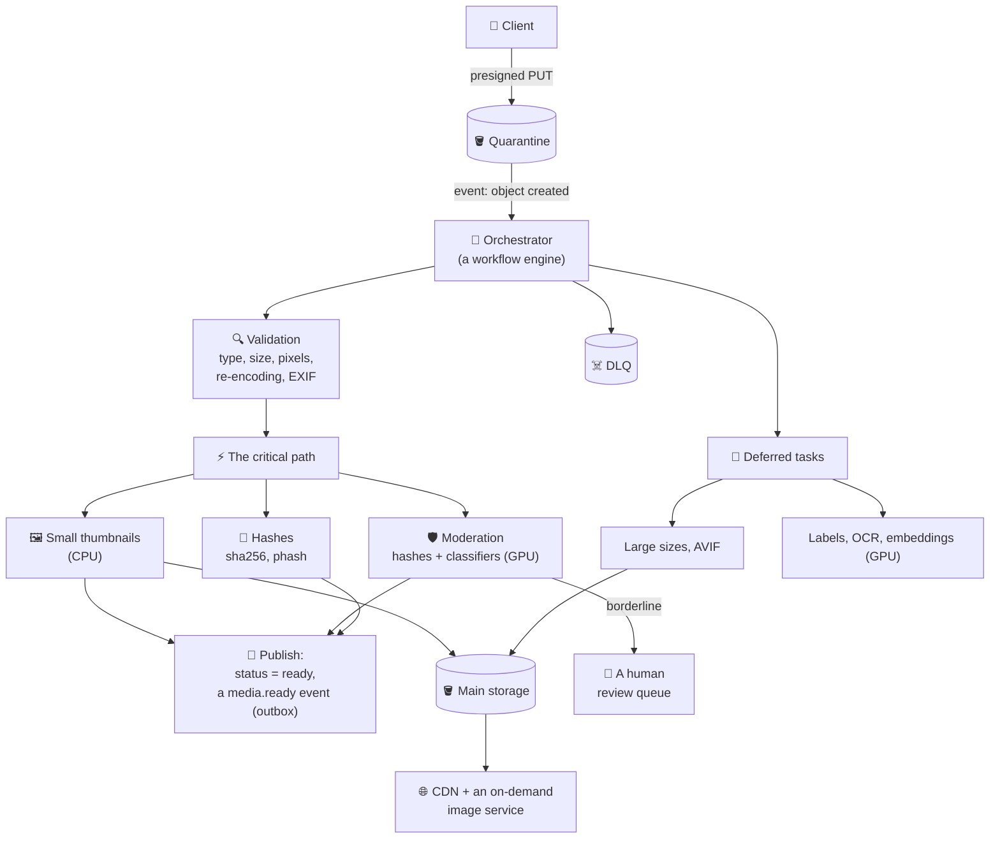
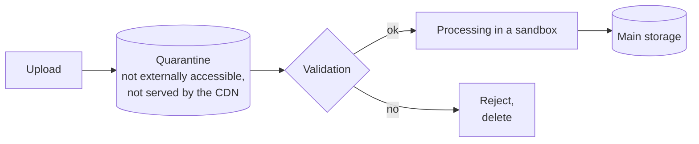
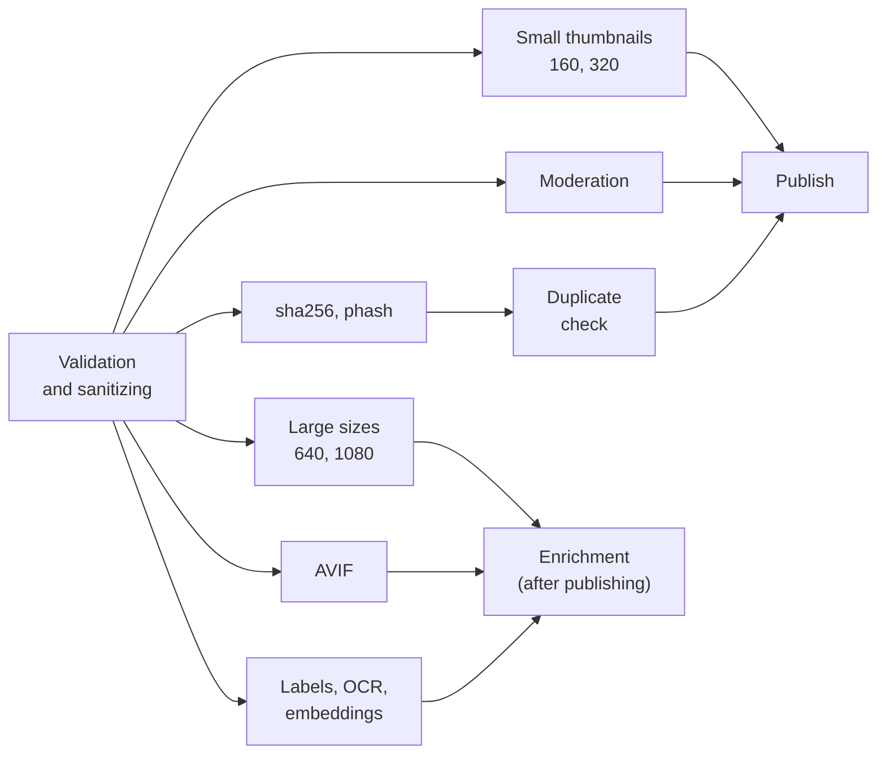
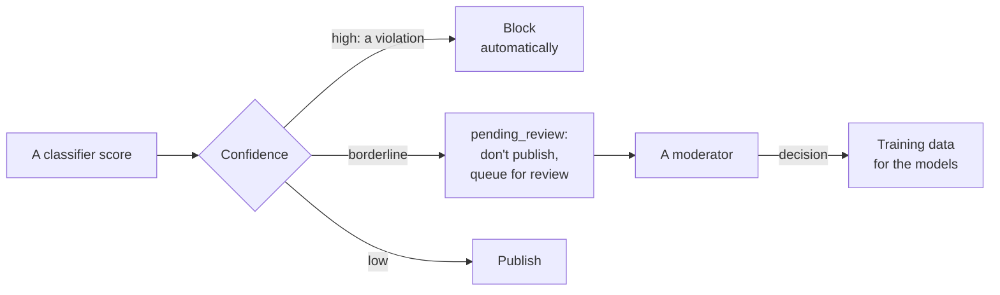

**English** | [Русский](README_RU.md)

# Tier 2 · 4B · 06. A Photo and Media Processing Pipeline

> **Level:** Medium · **Interview time:** 45 min · **Study time:** ~4 h
> **Key aspects:** uploading into quarantine and validating files, security (decompression bombs, library vulnerabilities, EXIF), orchestrating the pipeline as a DAG, the critical path and deferred tasks, reliability (idempotency, retries, a DLQ), image variants ahead of time or on demand, content moderation, dedup (exact and perceptual), scaling CPUs and GPUs, reprocessing billions of files
> **Builds on:** [14-storage-types](../../../14-storage-types/README.md#8-the-pattern-blobs-separate-from-metadata), [Tier 1 · 08 Instagram](../../../tier-1/08-instagram/README.md#7-deep-dive-1-publishing-a-post-from-phone-to-feed), [09-messaging](../../../09-messaging/README.md), [11-distributed-transactions](../../../11-distributed-transactions/README.md#13-workflow-engines), [10-idempotency](../../../10-idempotency/README.md), [Tier 1 · 14 Web Crawler](../../../tier-1/14-web-crawler/README.md#10-deep-dive-5-content-dedup) (SimHash)

---

## 🗺️ How to Read This Walkthrough

The walkthrough follows an interview, but every step includes explanations: **why** a decision is made, **how** a mechanism works and **what happens** if you do it differently. The "📘 Explanation" blocks are theory right where you need it.

| Icon | Meaning |
|:----:|:--------|
| 🎤 | Interviewer |
| 🗣️ | What I (the candidate) say out loud |
| ✏️ | What I draw on the whiteboard |
| ⏱️ | Time budget for the step |
| 📘 | A detailed explanation of a concept |

Callouts: **TIP** — a good technique, **WARNING** — a trap, **IMPORTANT** — a Senior+ signal.

---

## 📑 Contents

0. [What This Problem Teaches](#0-what-this-problem-teaches)
1. [Problem Statement](#1-problem-statement)
2. [Clarifying Questions and Requirements](#2-clarifying-questions-and-requirements)
3. [Capacity Estimates](#3-capacity-estimates)
4. [API](#4-api)
5. [Data Model](#5-data-model)
6. [High-Level Design](#6-high-level-design)
7. [Deep Dive 1: Upload, Validation and Security](#7-deep-dive-1-upload-validation-and-security)
8. [Deep Dive 2: Orchestrating the Pipeline](#8-deep-dive-2-orchestrating-the-pipeline)
9. [Deep Dive 3: Processing Reliability](#9-deep-dive-3-processing-reliability)
10. [Deep Dive 4: Image Variants — Ahead of Time or on Demand](#10-deep-dive-4-image-variants--ahead-of-time-or-on-demand)
11. [Deep Dive 5: Content Moderation](#11-deep-dive-5-content-moderation)
12. [Deep Dive 6: Dedup](#12-deep-dive-6-dedup)
13. [Deep Dive 7: Scaling and Cost](#13-deep-dive-7-scaling-and-cost)
14. [Deep Dive 8: Reprocessing and Observability](#14-deep-dive-8-reprocessing-and-observability)
15. [Bottlenecks and Failure Scenarios](#15-bottlenecks-and-failure-scenarios)
16. [What Changes at 10x Scale](#16-what-changes-at-10x-scale)
17. [Key Concepts and New Terms](#17-key-concepts-and-new-terms)
18. [Variations and Follow-Up Questions](#18-variations-and-follow-up-questions)
19. [Common Mistakes](#19-common-mistakes)
20. [Cheat Sheet and Self-Check](#20-cheat-sheet-and-self-check)

---

## 0. What This Problem Teaches

In [Instagram](../../../tier-1/08-instagram/README.md) the processing pipeline was one box on the diagram. Here it's **the whole problem**: how to accept hundreds of millions of files a day from untrusted users, process them safely, check them for prohibited content, find duplicates and make them available within seconds — while being able to reprocess billions of old files when a new format comes along.

| What's tested | Where it shows up |
|:--------------|:------------------|
| Async processing | An upload event → a pipeline of tasks |
| Handling untrusted data | Validation, sandboxed processing, decompression bombs |
| Orchestration | A DAG of tasks, the critical path |
| Reliability | Idempotency, retries, a DLQ, partial failures |
| The storage vs compute trade-off | Variants ahead of time or on demand |
| Moderation | Layers of checks, human review |
| Algorithms | Perceptual hashes, Hamming distance |
| Operations | Autoscaling by queue, priorities, reprocessing |

> [!TIP]
> Split the pipeline into **the critical path** (what's required before a photo can be shown: validation, a small thumbnail, moderation) and **deferred tasks** (labels, embeddings, expensive formats). That's the main trick for fast publishing despite heavy processing.

---

## 1. Problem Statement

> 🎤 "Design a photo (and short video) processing pipeline for a social network: users upload files, the system creates variants in the required sizes and formats, checks them for prohibited content, finds duplicates and extracts metadata. A photo must become available within seconds."

**What the user sees:**

```
Uploads a 12 MB photo from a phone → 2–3 seconds later the post with the photo is published
In the feed the photo opens instantly in a suitable size and format
The photo's geolocation isn't visible to others
Re-uploading a previously removed prohibited image is blocked, even if it was cropped
```

**Time plan:**

| Step | ⏱️ |
|:-----|:--:|
| Requirements | 4 min |
| Estimates | 3 min |
| API and data | 5 min |
| High-level design | 6 min |
| Deep dives | 22 min |
| Wrap-up | 5 min |

---

## 2. Clarifying Questions and Requirements

⏱️ 4 min

| My question | Interviewer's answer | What it changes and why |
|:------------|:---------------------|:------------------------|
| How many uploads? | ~200M per day, several times more at holiday peaks | Thousands of tasks per second, autoscaling |
| File sizes? | Photos up to ~50 MB; videos are short | Size limits, streaming processing |
| How fast must the first thumbnail be ready? | p95 < 2–5 s | A short critical path |
| Moderation before publishing? | Yes, for public content | Moderation on the critical path |
| Which variants? | Several sizes, WebP/AVIF, JPEG as a fallback | A trade-off: ahead of time or on demand |
| Metadata? | Dimensions, EXIF (remove geolocation), content labels, embeddings for search and recommendations | Deferred ML tasks |
| Duplicates? | Saving storage and protecting against re-uploads of removed content | Exact and perceptual hashes |
| Reprocessing? | Yes, e.g. when adding a new format for every old photo | Low-priority batch reprocessing |

### Functional requirements

1. Uploading a file and validating it (type, size, integrity).
2. Creating variants (sizes, formats), removing sensitive metadata.
3. Moderation: blocking prohibited content, sending borderline cases to human review.
4. Dedup: exact copies and near-identical images.
5. Extracting metadata: labels, text in the image, embeddings.
6. A "media ready" event for other services.
7. Reprocessing existing files with a new pipeline.

### Non-functional requirements

| Requirement | Target | Why |
|:------------|:-------|:----|
| Time to ready | p95 < 2–5 s for publishing | The user is waiting after the upload |
| Reliability | No uploaded file is lost; every file is processed | It's the user's photo |
| Security | A malicious file can't harm the system | Files come from untrusted users |
| Scale | Thousands of uploads per second, peaks several times higher | Autoscaling |
| Cost | Minimal compute and storage per file | Billions of files |

---

## 3. Capacity Estimates

⏱️ 3 min

```
Uploads:         200M per day → ~2,300/s on average, peak ~10,000/s
Size:            after client-side compression ~1 MB → ~200 TB of originals per day
                 variants add another ~30% → ~260 TB per day

CPU per photo:   decoding + 4 sizes + 2 formats ≈ 0.2–0.5 s of CPU time
                 at a 10,000/s peak × 0.5 s ≈ 5,000 cores for the main variants alone
GPU per photo:   moderation and labeling classifiers — batched inference, milliseconds per photo in a batch
AVIF:            encoding is several times more expensive than WebP → not for every photo right away
```

### Conclusions

| Conclusion | Design consequence |
|:-----------|:-------------------|
| Thousands of cores at peak | Autoscaling worker pools by queue depth |
| Different kinds of compute (CPU and GPU) | Separate pools and queues |
| Hundreds of TB per day | Object storage, storage classes, dedup |
| Expensive formats | Deferred, and only for popular content |

---

## 4. API

⏱️ 2 min

```http
POST /v1/media/uploads    { type: "image", size: 1048576, content_type: "image/jpeg", sha256: "…" }
→ 201 { media_id: "m_7f", upload_url: "<a presigned URL into quarantine storage>" }
      or { media_id: "m_2a", duplicate: true }          ← the user already has an exact duplicate

PUT  {upload_url}                                         ← straight into object storage

GET  /v1/media/{id}       → { status: "processing" | "ready" | "rejected" | "pending_review",
                              variants: { "320.webp": "https://cdn…", … }, width, height }

Event: media.ready { media_id, variants, moderation: "approved", labels: [...] }

On-demand variants (a CDN + an image service):
GET https://img.cdn…/m_7f/w_640,f_auto?sig=…              ← only allowed sizes, with a signature
```

---

## 5. Data Model

⏱️ 3 min

```
media (
  media_id, owner_id, type, status,               -- uploaded → processing → ready | rejected | pending_review
  original_key,                                   -- in object storage
  sha256, phash,                                  -- for dedup
  width, height, mime, size,
  moderation_status, moderation_scores,
  labels, ocr_text_ref, embedding_ref,
  variants: { "160.webp": key, "320.webp": key, "1080.jpg": key, … },
  pipeline_version, created_at
)

tasks (media_id, task_type, status, attempts, last_error, updated_at)   -- if there's no workflow engine
```

| Store | What | Why |
|:------|:-----|:----|
| Object storage: **the quarantine zone** | Freshly uploaded files | Isolating unverified files; a lifecycle rule deletes abandoned uploads |
| Object storage: **the main zone** | Originals and variants | Immutable keys, a CDN |
| A metadata DB | The `media` record | Status, variants, labels |
| A hash index | sha256 → media_id; phash → media_id | Dedup |

---

## 6. High-Level Design

⏱️ 6 min



🗣️ "Key decisions:
- the file is uploaded **straight into quarantine storage** via a presigned URL;
- the upload event starts **a workflow** in an orchestration engine;
- **the critical path**: validating and sanitizing the file, small thumbnails, moderation, hashes — after it, the file is published;
- **deferred tasks** (large sizes, AVIF, labels, embeddings) run in parallel without delaying publication;
- tasks are idempotent, with retries and a DLQ; CPUs and GPUs are separate worker pools;
- a CDN serves the variants, and an image service generates rare sizes on demand."

---

## 7. Deep Dive 1: Upload, Validation and Security

> 🎤 "Files are sent by untrusted users. What can go wrong?"

### Threats

| Threat | Example | Protection |
|:-------|:--------|:-----------|
| **Type spoofing** | An executable with a `.jpg` extension | Determine the type by **the content signature** (magic bytes), not by the name or `Content-Type` |
| **A decompression bomb** | A 100 KB PNG that decodes into a 50,000 × 50,000 pixel image = **10 GB** of memory | Check dimensions in the header **before** decoding; a pixel limit (e.g. 100 megapixels) |
| **Library vulnerabilities** | Known vulnerabilities in image processing libraries (e.g. ImageTragick in ImageMagick, 2016) allowed code execution via a crafted file | Processing in **an isolated sandbox** (a container with restricted system calls), least privilege, timely updates, disabling dangerous decoders |
| **Private data leaks** | EXIF holds the GPS coordinates of a home and the phone model | **Strip EXIF**, applying the orientation to the pixels |
| **Malicious data inside the file** | Hidden data after the end of the image | **Re-encoding**: only freshly re-encoded pixels are published, not the original file |

### Quarantine



| Decision | Why |
|:---------|:----|
| Unverified files are physically separated | Even a permissions bug won't serve them publicly |
| A lifecycle rule in quarantine | Abandoned uploads (cancelled posts) are deleted after a day |
| A checksum from the client (`sha256` when creating the upload) | Integrity checking and early dedup |

> [!IMPORTANT]
> **Senior+ signal:** name **the decompression bomb** and **sandboxed processing**. Image decoding libraries are complex code parsing untrusted data; a vulnerability in them is a path to executing code on your servers. So processing runs in a sandbox, and a re-encoded file is published rather than the original.

---

## 8. Deep Dive 2: Orchestrating the Pipeline

> 🎤 "How do you organize a dozen processing steps with dependencies between them?"

### A DAG of tasks



### A chain of queues or a workflow engine

| | A chain of queues | A workflow engine ⭐ |
|:-|:------------------|:---------------------|
| How | Each step reads its queue and writes to the next | A declared graph of steps; the engine invokes tasks and stores state (Temporal, AWS Step Functions and the like) |
| Dependencies and parallelism | Hard (waiting on several branches) | Built in |
| A specific file's status | Must be pieced together from queues | Visible in the engine |
| Retries and timeouts | Implemented in every step | Engine-level policies |
| Where | Simple linear pipelines | Branching graphs with waits |

📘 More on workflow engines in [11-distributed-transactions](../../../11-distributed-transactions/README.md#13-workflow-engines).

### The critical path

| On the critical path | Deferred |
|:---------------------|:---------|
| Validation, sanitizing, stripping EXIF | Large sizes (640, 1080) |
| Small thumbnails (160, 320) — enough for the feed | AVIF (expensive encoding) |
| Moderation | Labels, OCR, embeddings |
| Hashes and checking against known prohibited content | Detailed metadata |

🗣️ "Publishing waits only on the critical path — seconds. Large sizes are usually ready by the time the user opens the photo in full; if not, the nearest ready size is shown."

---

## 9. Deep Dive 3: Processing Reliability

> 🎤 "A worker crashed mid-processing. What happens?"

| Mechanism | How | Why |
|:----------|:----|:----|
| **At-least-once** | A task is acknowledged only after it succeeds | A worker crash → another worker picks up the task |
| **Idempotent outputs** | A deterministic key: `media/{id}/v{pipeline}/320.webp`; a retry overwrites the same object | Retries are safe (see [10-idempotency](../../../10-idempotency/README.md)) |
| **Retries with exponential backoff** | Transient errors (network, overload) | Self-healing |
| **Timeouts and heartbeats** | A stuck task is released | No waiting forever |
| **A DLQ** | After N failures the task goes to a dead-letter queue | A "poison" file doesn't loop forever or block others |
| **Partial success** | AVIF failed — the photo is still published with WebP/JPEG | A failure in a secondary step doesn't break the main one |
| **An outbox for the ready event** | The `ready` status and the `media.ready` event — in one transaction | Subscribers don't miss the event (see [09-messaging](../../../09-messaging/README.md#7-the-producer-side-the-dual-write-problem-and-the-outbox)) |

> [!WARNING]
> **"Poison" messages.** A corrupted file can reliably crash a worker. Without an attempt limit and a DLQ, such a task loops back into the queue forever, tying up workers — and if the whole worker crashes, it takes other tasks down with it. Hence: an attempt limit, task isolation, and a DLQ with an alert and manual triage.

---

## 10. Deep Dive 4: Image Variants — Ahead of Time or on Demand

> 🎤 "You need 6 sizes and 3 formats. Do you generate all 18 variants for every photo?"

| | Ahead of time | On demand (an image service) |
|:-|:--------------|:-----------------------------|
| How | Every variant is created at upload | A variant is created on first request, then served from the CDN cache |
| First delivery | Instant | A delay for the first generation |
| Storage | Every variant of every photo (most never requested) | Only requested ones |
| Compute | For every photo | Only for what's needed |
| A new size or format | Reprocessing the whole archive | Available immediately |

🗣️ "**A hybrid**: generate a few of the most common variants ahead of time (feed and grid sizes in WebP and JPEG); everything else on demand through an image service behind the CDN. The service accepts only **an allowed set** of parameters and signed URLs — otherwise an attacker could force generation of millions of unique sizes, flooding the cache and the CPUs."

### Formats

| Format | Compression | Encoding cost | Support |
|:-------|:------------|:--------------|:--------|
| JPEG | Baseline | Cheap | Everywhere — the fallback |
| WebP | ~25–35% better than JPEG | Moderate | Almost everywhere |
| AVIF | Better still | Expensive | Growing |

| Decision | Why |
|:---------|:----|
| **Choosing the format by the `Accept` header** | The browser says what it supports; the CDN serves the best supported format |
| The format in **the CDN cache key** | Otherwise a browser without AVIF support would get AVIF |
| AVIF — for popular photos | Expensive encoding pays off only with frequent views (like expensive codecs for video in [Tier 1 · 09](../../../tier-1/09-youtube-netflix/README.md#8-deep-dive-2-the-transcoding-pipeline)) |

---

## 11. Deep Dive 5: Content Moderation

> 🎤 "How do you prevent prohibited content from being published?"

### Layers

| Layer | What | When |
|:------|:-----|:-----|
| **Matching against databases of known prohibited content** | The image's perceptual hash is compared with industry hash databases (for child sexual abuse material, specialized hash-matching systems such as PhotoDNA are used; matches are blocked and reported to the designated organizations as the law requires) | The critical path, milliseconds |
| **The platform's own removal list** | Perceptual hashes of images the platform previously removed | The critical path |
| **ML classifiers** | Nudity, violence, weapons, spam, text in the image (OCR → text filters) | The critical path, GPUs |
| **Human review** | Borderline cases | Async |
| **User reports** | A signal after publication | Async |

### Thresholds



| Decision | Why |
|:---------|:----|
| Thresholds are tuned per category | Stricter for the most severe categories, even at the cost of false positives |
| Moderators' decisions feed training | The models improve |
| Appeals | Automatic moderation errors are inevitable |
| Moderator well-being | Blurring, limits on time spent with severe content |
| Removed → its hash goes into the platform's own list | Re-uploading the same image (even slightly altered) is blocked |

> [!NOTE]
> Moderation on the critical path adds latency and cost, but publishing first and checking later means showing violations to people. A compromise for low-risk content (e.g. private accounts with a small audience) — publishing with a fast check immediately afterwards.

---

## 12. Deep Dive 6: Dedup

> 🎤 "The same photos are uploaded thousands of times. How do you find duplicates — both exact and slightly altered?"

### Exact duplicates

📘 **SHA-256** of the file's bytes → an index lookup. A match means the file already exists: you needn't store it again (content-addressed storage, see [14-storage-types](../../../14-storage-types/README.md#8-the-pattern-blobs-separate-from-metadata)).

| Scope | Trade-off |
|:------|:----------|
| Within a user | Safe; smaller savings |
| Global | Larger savings, but a risk of information leakage ("someone already has this file") — as in [Dropbox](../../../tier-1/10-dropbox-google-drive/README.md#8-deep-dive-2-dedup-and-the-block-store) |

### Near-identical: a perceptual hash

📘 An exact hash changes completely with any change: recompression, a one-pixel crop, a watermark. **A perceptual hash** describes **the visual content** and changes little under small changes.

**dHash (a difference hash) — an example computation:**

```
1. Downscale the image to 9 × 8 pixels and convert it to grayscale
2. In each of the 8 rows, compare neighboring pixels: left brighter than right → 1, otherwise 0
   9 pixels per row → 8 comparisons; 8 rows → 64 bits
3. The result is a 64-bit hash

Two images are similar if the Hamming distance between their hashes is small (e.g. ≤ 5–10 bits of 64)
```

| Use | Why |
|:----|:----|
| Re-uploads of removed prohibited content | Block them even if cropped or recompressed |
| Copyright protection | Find copies of others' images |
| Spam | One picture sent by thousands of accounts |
| Grouping duplicates in search | Don't show the same thing many times |

### Searching among billions

📘 Finding every hash within Hamming distance ≤ k among billions uses the same trick as SimHash in the [web crawler](../../../tier-1/14-web-crawler/README.md#10-deep-dive-5-content-dedup): split the 64 bits into blocks; if two hashes differ in at most k bits, at least one block matches exactly; look up candidates by matching blocks and verify the exact distance.

---

## 13. Deep Dive 7: Scaling and Cost

> 🎤 "A holiday evening — 5× the usual uploads. How do you avoid drowning?"

| Decision | Why |
|:---------|:----|
| **Separate pools** of CPU workers (sizes, formats) and GPU workers (ML) | Different resources, different scaling |
| **Autoscaling by queue depth and age**, not by CPU load | The age of the oldest task is a direct metric of user-facing latency |
| **Priority queues** | Interactive uploads > bulk imports > archive reprocessing |
| **Batched GPU inference** | A batch of dozens of images is processed almost as fast as one |
| **Preemptible (spot) machines** for reprocessing | Tasks are short and idempotent — losing a machine = a retry |
| **Degradation under overload** | Deferred tasks are deferred further; the critical path is protected |
| A **cost per file** metric | Shows which step is getting more expensive |

### Backpressure

📘 If ML moderation can't keep up (the queue is growing), there's a choice:
- **wait** — publishing is delayed, but safe;
- **publish with a deferred check** for trusted users with a good history — faster, but riskier;
- **temporarily limit** uploads from new accounts.

The choice is a product decision; what matters is that it's defined in advance, not made in the middle of an incident.

---

## 14. Deep Dive 8: Reprocessing and Observability

> 🎤 "You decided to add AVIF for all 50 billion existing photos. How do you do it?"

### Reprocessing (a backfill)

| Decision | Why |
|:---------|:----|
| **The lowest priority**, a separate queue | Doesn't interfere with interactive processing |
| **Rate limiting** | Doesn't overload storage with reads of originals |
| **Idempotency and checkpoints** | Resuming where it stopped; retries are safe |
| **Popular content first** | The new format's benefit comes primarily from frequently shown photos |
| **The pipeline version in the key** | `v{pipeline}` in the variant path: old and new variants coexist, and switching is atomic in the metadata |
| Preemptible machines | Cheap |
| An alternative | Generate the new format **on demand** rather than reprocessing the whole archive |

### Observability

| Metric | Why |
|:-------|:----|
| Time from upload to `ready` (p50, p95, p99) | The main user-facing metric |
| Each step's time and error rate | Where the bottleneck is |
| Queue depth and age | A signal for autoscaling and alerts |
| DLQ size | New kinds of "poison" files |
| The moderation rejection rate by category | Model changes or attacks |
| Tracing by `media_id` | Investigating a specific "my photo didn't upload" complaint |

---

## 15. Bottlenecks and Failure Scenarios

| Scenario | What happens | How we protect |
|:---------|:-------------|:---------------|
| A decompression bomb | A worker dies from running out of memory | Checking dimensions before decoding, a pixel limit |
| A malicious file | Code execution via a vulnerability | A sandbox, updates, re-encoding |
| A geolocation leak | A privacy violation | Stripping EXIF |
| A worker crashed | The task didn't finish | At-least-once, a retry, idempotent keys |
| A "poison" file | Endless retries | An attempt limit, a DLQ |
| A secondary variant failed | — | Partial success, a fallback format |
| An upload peak | Rising latency | Autoscaling by queue age, priorities |
| Moderation falls behind | Publishing is delayed | A degradation policy defined in advance |
| An attack with unique on-demand sizes | Overloaded CPUs and cache | An allowed parameter set, signatures |
| A re-upload of removed content | A violation is published again | A perceptual hash, the platform's removal list |
| Reprocessing interferes with uploads | Rising latency | A separate queue, low priority, rate limiting |

---

## 16. What Changes at 10x Scale

> 🎤 "2 billion uploads a day?"

| Change | Why |
|:-------|:----|
| **More on-device processing** (compression, sizes, part of moderation) | Saving servers and traffic |
| **Specialized accelerators** for encoding and ML | Cost |
| **Variants mostly on demand** | Storage grows faster than the benefit of pre-generation |
| **Regional pipelines** | Uploads and processing closer to users, data residency requirements |

---

## 17. Key Concepts and New Terms

### What's applied

| Concept | Where it's covered | How it applies here |
|:--------|:-------------------|:--------------------|
| Blobs + metadata, presigned URLs, content addressing | [14-storage-types](../../../14-storage-types/README.md) | Uploading and storage |
| Publishing media | [Tier 1 · 08](../../../tier-1/08-instagram/README.md) | The pipeline as part of the product |
| Workflow engines | [11-distributed-transactions](../../../11-distributed-transactions/README.md#13-workflow-engines) | Orchestrating the DAG |
| Queues, a DLQ, the outbox | [09-messaging](../../../09-messaging/README.md) | Reliable tasks and events |
| Idempotency | [10-idempotency](../../../10-idempotency/README.md) | Deterministic output keys |
| Perceptual hashes and block-based lookup | [Tier 1 · 14](../../../tier-1/14-web-crawler/README.md) | Near-duplicates |

### New terms in this problem

| Term | In short |
|:-----|:---------|
| **Quarantine storage** | A zone for unverified files |
| **A decompression bomb** | A small file that decodes into an enormous image |
| **A processing sandbox** | Isolating code that parses untrusted files |
| **Re-encoding** | Publishing freshly encoded pixels instead of the original file |
| **The critical path and deferred tasks** | What's needed before publishing, and what comes after |
| **A "poison" message** | A task that reliably causes a failure |
| **On-demand variants** | Generation on first request through an image service |
| **A perceptual hash (dHash, pHash)** | A hash of the visual content |
| **Matching against hash databases** | Detecting known prohibited content |
| **Reprocessing (a backfill)** | Processing the archive with a new pipeline |

---

## 18. Variations and Follow-Up Questions

<details>
<summary><b>What changes for video?</b></summary>

The same principles, but heavier: transcoding instead of resizing (see [Tier 1 · 09](../../../tier-1/09-youtube-netflix/README.md#8-deep-dive-2-the-transcoding-pipeline)), moderation over keyframes and audio, a preview frame and a short animated preview, and parallel processing by chunk for long videos.
</details>

<details>
<summary><b>How do you handle HEIC from iPhones and Live Photos?</b></summary>

HEIC is decoded on the server (or converted on the client at upload) into standard web formats. A Live Photo is a photo plus a short video: two linked media records, each processed by its own pipeline and displayed together.
</details>

<details>
<summary><b>How do you delete all derived data on a GDPR request?</b></summary>

Deleting the `media` record triggers a task: delete the original and every variant by key prefix, purge the CDN, and remove embeddings and labels from indexes. Hashes used for blocking prohibited content may be kept longer if the law requires — that's for lawyers to decide.
</details>

<details>
<summary><b>How do you add watermarks?</b></summary>

As another on-demand variant: the image service applies the mark when generating a variant for certain contexts (e.g. a public link), without changing the original.
</details>

<details>
<summary><b>Why not process everything synchronously in the upload API request?</b></summary>

Processing takes seconds and needs lots of memory and CPU, and ML needs GPUs; holding the HTTP connection and API servers for that load is expensive and fragile. An async pipeline isolates the heavy work, scales independently and survives worker failures.
</details>

---

## 19. Common Mistakes

| ❌ Mistake | Why it's bad | ✅ Do this instead |
|:----------|:-------------|:------------------|
| Determining the type by extension | File spoofing | The content signature |
| Decoding without checking dimensions | A decompression bomb | A pixel limit before decoding |
| Processing without isolation | Library vulnerabilities → code execution | A sandbox, updates |
| Publishing the original file | Hidden data, EXIF with GPS | Re-encoding, stripping EXIF |
| Every task on the critical path | Slow publishing | The critical path + deferred tasks |
| Non-idempotent outputs | Junk and duplicates on retries | Deterministic keys |
| Endless retries | "Poison" files tie up workers | An attempt limit, a DLQ |
| Every variant ahead of time for every photo | Storage grows pointlessly | A hybrid: common ahead of time, rare on demand |
| Arbitrary on-demand sizes | An attack on CPUs and cache | An allowed set, signatures |
| Only an exact hash | Removed content gets re-uploaded with changes | A perceptual hash |
| Autoscaling by CPU | Doesn't reflect user-facing latency | By queue age |

---

## 20. Cheat Sheet and Self-Check

### 30-second answer

> The client uploads straight into quarantine storage via a presigned URL (with sha256 for early dedup); the event starts a workflow in an orchestration engine. Validation: the type by signature, a pixel limit before decoding (decompression bombs), processing in a sandbox, re-encoding, stripping EXIF while applying orientation. The critical path: small thumbnails, hashes (sha256 + perceptual), moderation (matching against databases of known prohibited content and the platform's removal list, ML classifiers with thresholds, borderline cases to humans) → the ready status and an event via the outbox. Deferred: large sizes, AVIF for popular content, labels, OCR, embeddings. Tasks are at-least-once with deterministic keys, retries, timeouts, a DLQ, partial success. Variants: common ones ahead of time, rare ones from an on-demand image service behind the CDN with an allowed parameter set and signatures, format by `Accept`. Near-duplicates — dHash/pHash and block-based lookup. CPU and GPU pools, autoscaling by queue age, priorities, batched GPU inference. Reprocessing — low priority, rate limiting, checkpoints, the pipeline version in the key, popular content first.

### Self-check

- [ ] I can list the threats from untrusted files and the protections
- [ ] I can explain a decompression bomb with numbers
- [ ] I can draw the pipeline DAG and identify the critical path
- [ ] I can compare a chain of queues with a workflow engine
- [ ] I can describe reliability: idempotency, retries, a DLQ, partial success
- [ ] I can choose between ahead-of-time and on-demand variants
- [ ] I can describe the layers of moderation and thresholds
- [ ] I can explain computing a dHash and finding similar images
- [ ] I can describe scaling and backpressure
- [ ] I can plan reprocessing billions of files

### Further reading

- Cloudflare Images, imgix and Thumbor documentation — on-demand image services
- Neal Krawetz, *Looks Like It* and *Kind of Like That* (Hacker Factor) — aHash and dHash
- Material on PhotoDNA (Microsoft) and industry hash databases for fighting prohibited content
- ImageTragick (CVE-2016-3714) — an example of vulnerabilities in image processing libraries
- Temporal / AWS Step Functions documentation
- The [Tier 1 · 08 Instagram](../../../tier-1/08-instagram/README.md) and [14-storage-types](../../../14-storage-types/README.md) walkthroughs
