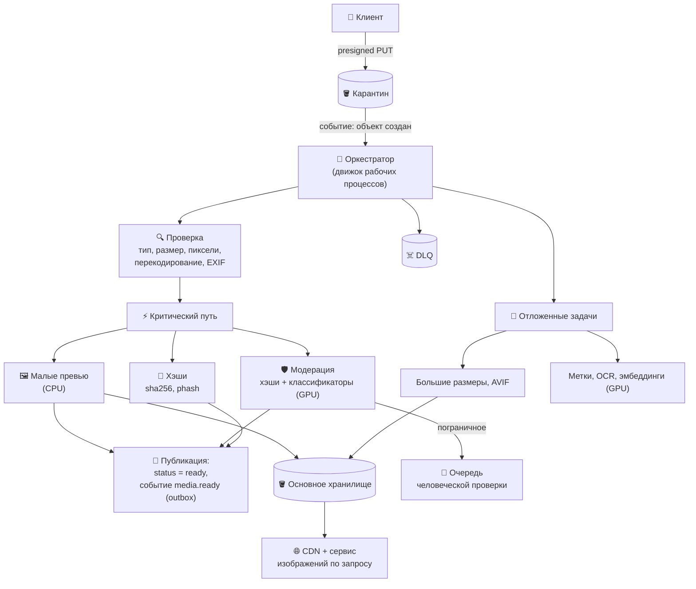
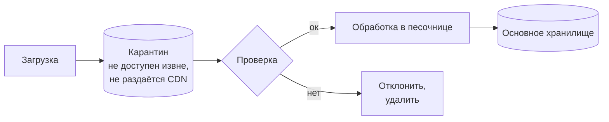
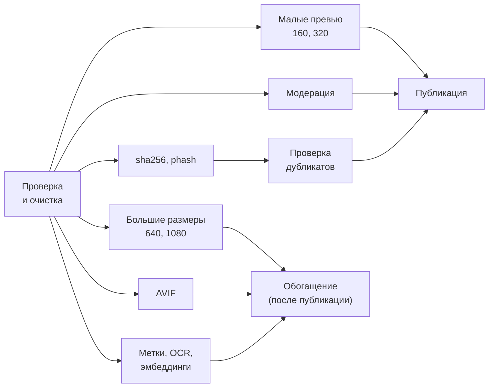
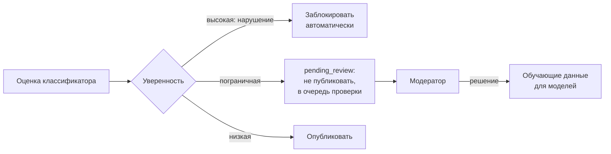

[English](README.md) | **Русский**

# Tier 2 · 4B · 06. Пайплайн обработки фото и медиа

> **Уровень:** Medium · **Время на интервью:** 45 мин · **Время на разбор:** ~4 ч
> **Ключевые аспекты:** загрузка в карантин и проверка файлов, безопасность (бомбы декомпрессии, уязвимости библиотек, EXIF), оркестрация конвейера как DAG, критический путь и отложенные задачи, надёжность (идемпотентность, ретраи, DLQ), варианты изображений заранее или по запросу, модерация контента, дедупликация (точная и перцептивная), масштабирование CPU и GPU, переобработка миллиардов файлов
> **Опирается на:** [14-storage-types](../../../14-storage-types/README_RU.md#8-паттерн-blob-отдельно-метаданные-отдельно), [Tier 1 · 08 Instagram](../../../tier-1/08-instagram/README_RU.md#7-deep-dive-1-публикация-поста-от-телефона-до-ленты), [09-messaging](../../../09-messaging/README_RU.md), [11-distributed-transactions](../../../11-distributed-transactions/README_RU.md#13-движки-рабочих-процессов), [10-idempotency](../../../10-idempotency/README_RU.md), [Tier 1 · 14 Web Crawler](../../../tier-1/14-web-crawler/README_RU.md#10-deep-dive-5-дедупликация-содержимого) (SimHash)

---

## 🗺️ Как читать этот разбор

Разбор построен как интервью, но в каждом шаге есть объяснения: **почему** принимается решение, **как работает** механизм и **что будет**, если сделать иначе. Блоки «📘 Объяснение» — теория прямо по ходу задачи.

| Значок | Что значит |
|:------:|:-----------|
| 🎤 | Реплика интервьюера |
| 🗣️ | Что говорю вслух я (кандидат) |
| ✏️ | Что рисую на доске |
| ⏱️ | Сколько времени тратить на шаг |
| 📘 | Подробное объяснение концепции |

Блоки **TIP** — хороший приём, **WARNING** — ловушка, **IMPORTANT** — сигнал для уровня Senior+.

---

## 📑 Содержание

0. [Чему учит эта задача](#0-чему-учит-эта-задача)
1. [Условие задачи](#1-условие-задачи)
2. [Уточняющие вопросы и требования](#2-уточняющие-вопросы-и-требования)
3. [Оценки нагрузки](#3-оценки-нагрузки)
4. [API](#4-api)
5. [Модель данных](#5-модель-данных)
6. [High-level дизайн](#6-high-level-дизайн)
7. [Deep dive 1: загрузка, проверка и безопасность](#7-deep-dive-1-загрузка-проверка-и-безопасность)
8. [Deep dive 2: оркестрация конвейера](#8-deep-dive-2-оркестрация-конвейера)
9. [Deep dive 3: надёжность обработки](#9-deep-dive-3-надёжность-обработки)
10. [Deep dive 4: варианты изображений — заранее или по запросу](#10-deep-dive-4-варианты-изображений--заранее-или-по-запросу)
11. [Deep dive 5: модерация контента](#11-deep-dive-5-модерация-контента)
12. [Deep dive 6: дедупликация](#12-deep-dive-6-дедупликация)
13. [Deep dive 7: масштабирование и стоимость](#13-deep-dive-7-масштабирование-и-стоимость)
14. [Deep dive 8: переобработка и наблюдаемость](#14-deep-dive-8-переобработка-и-наблюдаемость)
15. [Узкие места и сценарии сбоев](#15-узкие-места-и-сценарии-сбоев)
16. [Что изменится при росте в 10 раз](#16-что-изменится-при-росте-в-10-раз)
17. [Ключевые концепции и новые понятия](#17-ключевые-концепции-и-новые-понятия)
18. [Варианты задачи и follow-up вопросы](#18-варианты-задачи-и-follow-up-вопросы)
19. [Типичные ошибки](#19-типичные-ошибки)
20. [Шпаргалка и самопроверка](#20-шпаргалка-и-самопроверка)

---

## 0. Чему учит эта задача

В [Instagram](../../../tier-1/08-instagram/README_RU.md) конвейер обработки был одним блоком на схеме. Здесь он — **вся задача**: как принять сотни миллионов файлов в сутки от недоверенных пользователей, безопасно их обработать, проверить на запрещённый контент, найти дубликаты и сделать доступными за секунды — и при этом уметь переобработать миллиарды старых файлов, когда появится новый формат.

| Что проверяют | Где это в задаче |
|:--------------|:-----------------|
| Асинхронная обработка | Событие о загрузке → конвейер задач |
| Работа с недоверенными данными | Проверка, изоляция обработки, бомбы декомпрессии |
| Оркестрация | DAG задач, критический путь |
| Надёжность | Идемпотентность, ретраи, DLQ, частичные сбои |
| Компромисс хранение — вычисления | Варианты заранее или по запросу |
| Модерация | Слои проверок, человеческая проверка |
| Алгоритмы | Перцептивные хэши, расстояние Хэмминга |
| Эксплуатация | Автоскейлинг по очередям, приоритеты, переобработка |

> [!TIP]
> Разделить конвейер на **критический путь** (то, без чего фото нельзя показать: проверка, маленькое превью, модерация) и **отложенные задачи** (метки, эмбеддинги, дорогие форматы). Это главный приём для быстрой публикации при тяжёлой обработке.

---

## 1. Условие задачи

> 🎤 «Спроектируй пайплайн обработки фото (и коротких видео) для социальной сети: пользователи загружают файлы, система создаёт варианты нужных размеров и форматов, проверяет на запрещённый контент, находит дубликаты, извлекает метаданные. Фото должно стать доступным за секунды».

**Что видит пользователь:**

```
Загружает фото 12 МБ с телефона → через 2–3 секунды пост с фото опубликован
В ленте фото открывается мгновенно в подходящем размере и формате
Геолокация из фото не видна другим
Повторная загрузка ранее удалённого запрещённого изображения блокируется, даже если его обрезали
```

**План по времени:**

| Шаг | ⏱️ |
|:----|:--:|
| Требования | 4 мин |
| Оценки | 3 мин |
| API и данные | 5 мин |
| High-level дизайн | 6 мин |
| Deep dives | 22 мин |
| Итоги | 5 мин |

---

## 2. Уточняющие вопросы и требования

⏱️ 4 мин

| Мой вопрос | Ответ интервьюера | Что это меняет и почему |
|:-----------|:------------------|:------------------------|
| Сколько загрузок? | ~200M в сутки, пики в праздники в разы выше | Тысячи задач в секунду, автоскейлинг |
| Размер файлов? | Фото до ~50 МБ, видео — короткие | Ограничения размера, потоковая обработка |
| Как быстро нужно первое превью? | p95 < 2–5 с | Критический путь короткий |
| Модерация до публикации? | Да, для публичного контента | Модерация на критическом пути |
| Какие варианты? | Несколько размеров, WebP/AVIF, JPEG как запасной | Компромисс: заранее или по запросу |
| Метаданные? | Размеры, EXIF (удалить геолокацию), метки содержимого, эмбеддинги для поиска и рекомендаций | Отложенные ML-задачи |
| Дубликаты? | Экономия хранения и защита от повторной загрузки удалённого | Точные и перцептивные хэши |
| Переобработка? | Да, например, при добавлении нового формата для всех старых фото | Пакетные переобработки с низким приоритетом |

### Функциональные требования

1. Загрузка файла и проверка (тип, размер, целостность).
2. Создание вариантов (размеры, форматы), удаление чувствительных метаданных.
3. Модерация: блокировка запрещённого, отправка пограничного на проверку людьми.
4. Дедупликация: точные копии и почти одинаковые изображения.
5. Извлечение метаданных: метки, текст на изображении, эмбеддинги.
6. Событие «медиа готово» для других сервисов.
7. Переобработка существующих файлов новым конвейером.

### Нефункциональные требования

| Требование | Цель | Почему |
|:-----------|:-----|:-------|
| Время до готовности | p95 < 2–5 с для публикации | Пользователь ждёт после загрузки |
| Надёжность | Ни один загруженный файл не потерян, каждый обработан | Это фото пользователя |
| Безопасность | Вредоносный файл не может навредить системе | Файлы от недоверенных пользователей |
| Масштаб | Тысячи загрузок в секунду, пики в разы выше | Автоскейлинг |
| Стоимость | Минимум вычислений и хранения на файл | Миллиарды файлов |

---

## 3. Оценки нагрузки

⏱️ 3 мин

```
Загрузки:        200M в сутки → ~2 300/с в среднем, пик ~10 000/с
Размер:          после сжатия на клиенте ~1 МБ → ~200 ТБ оригиналов в сутки
                 варианты — ещё ~30% → ~260 ТБ в сутки

CPU на фото:     декодирование + 4 размера + 2 формата ≈ 0,2–0,5 с процессорного времени
                 пик 10 000/с × 0,5 с ≈ 5 000 ядер только на основные варианты
GPU на фото:     классификаторы модерации и меток — пакетный инференс, миллисекунды на фото в пакете
AVIF:            кодирование в разы дороже WebP → не для каждого фото сразу
```

### Выводы

| Вывод | Следствие для дизайна |
|:------|:----------------------|
| Тысячи ядер в пике | Автоскейлинг пулов воркеров по глубине очередей |
| Разные виды вычислений (CPU и GPU) | Отдельные пулы и очереди |
| Сотни ТБ в сутки | Объектное хранилище, классы хранения, дедупликация |
| Дорогие форматы | Отложенно и только для популярного |

---

## 4. API

⏱️ 2 мин

```http
POST /v1/media/uploads    { type: "image", size: 1048576, content_type: "image/jpeg", sha256: "…" }
→ 201 { media_id: "m_7f", upload_url: "<presigned URL в карантинное хранилище>" }
      или { media_id: "m_2a", duplicate: true }          ← точный дубликат уже есть у пользователя

PUT  {upload_url}                                         ← напрямую в объектное хранилище

GET  /v1/media/{id}       → { status: "processing" | "ready" | "rejected" | "pending_review",
                              variants: { "320.webp": "https://cdn…", … }, width, height }

Событие: media.ready { media_id, variants, moderation: "approved", labels: [...] }

Варианты по запросу (CDN + сервис изображений):
GET https://img.cdn…/m_7f/w_640,f_auto?sig=…              ← только разрешённые размеры, подпись
```

---

## 5. Модель данных

⏱️ 3 мин

```
media (
  media_id, owner_id, type, status,               -- uploaded → processing → ready | rejected | pending_review
  original_key,                                   -- в объектном хранилище
  sha256, phash,                                  -- для дедупликации
  width, height, mime, size,
  moderation_status, moderation_scores,
  labels, ocr_text_ref, embedding_ref,
  variants: { "160.webp": key, "320.webp": key, "1080.jpg": key, … },
  pipeline_version, created_at
)

tasks (media_id, task_type, status, attempts, last_error, updated_at)   -- если нет движка рабочих процессов
```

| Хранилище | Что | Почему |
|:----------|:----|:-------|
| Объектное хранилище: **карантинная зона** | Только что загруженные файлы | Изоляция непроверенного; правило жизненного цикла удаляет брошенные загрузки |
| Объектное хранилище: **основная зона** | Оригиналы и варианты | Неизменяемые ключи, CDN |
| БД метаданных | Запись `media` | Статус, варианты, метки |
| Индекс хэшей | sha256 → media_id; phash → media_id | Дедупликация |

---

## 6. High-level дизайн

⏱️ 6 мин



🗣️ «Ключевые решения:
- файл загружается **напрямую в карантинное хранилище** по presigned URL;
- событие о загрузке запускает **рабочий процесс** в движке оркестрации;
- **критический путь**: проверка и очистка файла, малые превью, модерация, хэши — после него файл публикуется;
- **отложенные задачи** (большие размеры, AVIF, метки, эмбеддинги) идут параллельно и не задерживают публикацию;
- задачи идемпотентны, с ретраями и DLQ; CPU и GPU — отдельные пулы воркеров;
- варианты раздаёт CDN, редкие размеры генерирует сервис изображений по запросу».

---

## 7. Deep dive 1: загрузка, проверка и безопасность

> 🎤 «Файлы присылают недоверенные пользователи. Что может пойти не так?»

### Угрозы

| Угроза | Пример | Защита |
|:-------|:-------|:-------|
| **Подмена типа** | Исполняемый файл с расширением `.jpg` | Определять тип по **сигнатуре содержимого** (magic bytes), а не по имени и `Content-Type` |
| **Бомба декомпрессии** | PNG на 100 КБ, который при декодировании становится изображением 50 000 × 50 000 пикселей = **10 ГБ** памяти | Проверять размеры в заголовке **до** декодирования; лимит пикселей (например, 100 мегапикселей) |
| **Уязвимости библиотек** | Известные уязвимости в библиотеках обработки изображений (пример — ImageTragick в ImageMagick, 2016) позволяли выполнять код через специально созданный файл | Обработка в **изолированной песочнице** (контейнер с ограничениями системных вызовов), минимальные права, своевременные обновления, отключение опасных декодеров |
| **Утечка приватных данных** | EXIF содержит GPS-координаты дома, модель телефона | **Удалять EXIF**, применив ориентацию к пикселям |
| **Злонамеренные данные внутри файла** | Скрытые данные после конца изображения | **Перекодирование**: публикуются только пиксели, перекодированные заново, а не исходный файл |

### Карантин



| Решение | Почему |
|:--------|:-------|
| Непроверенные файлы физически отделены | Даже ошибка в правах не раздаст их наружу |
| Правило жизненного цикла в карантине | Брошенные загрузки (отменённые посты) удаляются через сутки |
| Контрольная сумма от клиента (`sha256` при создании загрузки) | Проверка целостности и ранняя дедупликация |

> [!IMPORTANT]
> **Сигнал Senior+:** назвать **бомбу декомпрессии** и **изоляцию обработки**. Библиотеки декодирования изображений — сложный код, разбирающий недоверенные данные; уязвимость в них — путь к выполнению кода на ваших серверах. Поэтому обработка — в песочнице, а публикуется перекодированный файл, а не исходный.

---

## 8. Deep dive 2: оркестрация конвейера

> 🎤 «Как организовать десяток шагов обработки с зависимостями между ними?»

### DAG задач



### Цепочка очередей или движок рабочих процессов

| | Цепочка очередей | Движок рабочих процессов ⭐ |
|:-|:-----------------|:---------------------------|
| Как | Каждый шаг читает свою очередь и пишет в следующую | Описанный граф шагов; движок вызывает задачи и хранит состояние (Temporal, AWS Step Functions и подобные) |
| Зависимости и параллельность | Сложно (ожидание нескольких веток) | Встроены |
| Статус конкретного файла | Нужно собирать по очередям | Видно в движке |
| Ретраи и таймауты | Реализовать в каждом шаге | Политики на уровне движка |
| Где | Простые линейные конвейеры | Ветвящиеся графы с ожиданием |

📘 Подробнее о движках рабочих процессов — в [11-distributed-transactions](../../../11-distributed-transactions/README_RU.md#13-движки-рабочих-процессов).

### Критический путь

| На критическом пути | Отложенно |
|:--------------------|:----------|
| Проверка, очистка, удаление EXIF | Большие размеры (640, 1080) |
| Малые превью (160, 320) — для ленты достаточно | AVIF (дорогое кодирование) |
| Модерация | Метки, OCR, эмбеддинги |
| Хэши и проверка известных запрещённых | Подробные метаданные |

🗣️ «Публикация ждёт только критический путь — секунды. Большие размеры обычно успевают к моменту, когда пользователь открывает фото целиком; если нет — показывается ближайший готовый размер».

---

## 9. Deep dive 3: надёжность обработки

> 🎤 «Воркер упал посреди обработки. Что будет?»

| Механизм | Как | Зачем |
|:---------|:----|:------|
| **At-least-once** | Задача подтверждается только после успешного завершения | Падение воркера → задачу возьмёт другой |
| **Идемпотентные результаты** | Детерминированный ключ: `media/{id}/v{pipeline}/320.webp`; повтор перезаписывает тот же объект | Повтор безопасен (см. [10-idempotency](../../../10-idempotency/README_RU.md)) |
| **Ретраи с экспоненциальной задержкой** | Временные ошибки (сеть, перегрузка) | Самовосстановление |
| **Таймауты и heartbeats** | Зависшая задача освобождается | Не ждём вечно |
| **DLQ** | После N неудач задача уходит в очередь «мёртвых» сообщений | «Ядовитый» файл не крутится бесконечно, не блокирует других |
| **Частичный успех** | Не создался AVIF — фото всё равно публикуется с WebP/JPEG | Сбой второстепенного шага не ломает главное |
| **Outbox для события готовности** | Статус `ready` и событие `media.ready` — в одной транзакции | Подписчики не пропустят событие (см. [09-messaging](../../../09-messaging/README_RU.md#7-сторона-продюсера-проблема-двойной-записи-и-outbox)) |

> [!WARNING]
> **«Ядовитые» сообщения.** Повреждённый файл может стабильно ронять воркер. Без лимита попыток и DLQ такая задача будет бесконечно возвращаться в очередь и занимать воркеры, а если воркер падает целиком — уносить с собой и другие задачи. Отсюда: лимит попыток, изоляция задач, DLQ с алертом и ручным разбором.

---

## 10. Deep dive 4: варианты изображений — заранее или по запросу

> 🎤 «Нужно 6 размеров и 3 формата. Генерировать все 18 вариантов для каждого фото?»

| | Заранее | По запросу (сервис изображений) |
|:-|:--------|:--------------------------------|
| Как | При загрузке создаются все варианты | Вариант создаётся при первом запросе, дальше — из кэша CDN |
| Первая выдача | Мгновенно | Задержка на первую генерацию |
| Хранение | Все варианты всех фото (большая часть никогда не запрашивается) | Только запрошенные |
| Вычисления | Для каждого фото | Только для нужного |
| Новый размер или формат | Переобработка всего архива | Появляется сразу |

🗣️ «**Гибрид**: заранее — несколько самых частых вариантов (размеры для ленты и сетки в WebP и JPEG); остальное — по запросу через сервис изображений за CDN. Сервис принимает только **разрешённый набор** параметров и подписанные URL — иначе злоумышленник заставит генерировать миллионы уникальных размеров и забьёт кэш и CPU».

### Форматы

| Формат | Сжатие | Стоимость кодирования | Поддержка |
|:-------|:-------|:----------------------|:----------|
| JPEG | Базовое | Дёшево | Везде — запасной вариант |
| WebP | На ~25–35% лучше JPEG | Умеренно | Почти везде |
| AVIF | Ещё лучше | Дорого | Растущая |

| Решение | Почему |
|:--------|:-------|
| **Выбор формата по заголовку `Accept`** | Браузер сообщает, что умеет; CDN отдаёт лучший поддерживаемый |
| Формат в **ключе кэша CDN** | Иначе браузер без поддержки AVIF получит AVIF |
| AVIF — для популярных фото | Дорогое кодирование окупается только частыми показами (как дорогие кодеки для видео в [Tier 1 · 09](../../../tier-1/09-youtube-netflix/README_RU.md#8-deep-dive-2-конвейер-транскодирования)) |

---

## 11. Deep dive 5: модерация контента

> 🎤 «Как не допустить публикации запрещённого контента?»

### Слои

| Слой | Что | Когда |
|:-----|:----|:------|
| **Сопоставление с базами известного запрещённого контента** | Перцептивный хэш изображения сравнивается с отраслевыми базами хэшей (для материалов сексуального насилия над детьми используются специализированные системы хэш-сопоставления, например PhotoDNA; найденное блокируется и сообщается в уполномоченные организации, как того требует закон) | Критический путь, миллисекунды |
| **Собственный список удалённого** | Перцептивные хэши ранее удалённых платформой изображений | Критический путь |
| **ML-классификаторы** | Обнажённость, насилие, оружие, спам, текст на изображении (OCR → текстовые фильтры) | Критический путь, GPU |
| **Человеческая проверка** | Пограничные случаи | Асинхронно |
| **Жалобы пользователей** | Сигнал после публикации | Асинхронно |

### Пороги



| Решение | Почему |
|:--------|:-------|
| Пороги настраиваются по категории | Для самых тяжёлых категорий — строже, даже ценой ложных срабатываний |
| Решения модераторов — в обучение | Модели улучшаются |
| Апелляции | Ошибки автоматической модерации неизбежны |
| Благополучие модераторов | Размытие, ограничение времени работы с тяжёлым контентом |
| Удалённое → хэш в собственный список | Повторная загрузка того же (даже слегка изменённого) блокируется |

> [!NOTE]
> Модерация на критическом пути добавляет задержку и стоимость, но публиковать сначала, а проверять потом — значит показывать нарушения людям. Компромисс для низкорискового контента (например, закрытые аккаунты с малой аудиторией) — публикация с быстрой проверкой сразу после.

---

## 12. Deep dive 6: дедупликация

> 🎤 «Одинаковые фото загружают тысячи раз. Как находить дубликаты — и точные, и слегка изменённые?»

### Точные дубликаты

📘 **SHA-256** байтов файла → поиск в индексе. Совпало — файл уже есть: можно не хранить повторно (хранение по содержимому, см. [14-storage-types](../../../14-storage-types/README_RU.md#8-паттерн-blob-отдельно-метаданные-отдельно)).

| Область | Компромисс |
|:--------|:-----------|
| В пределах пользователя | Безопасно; экономия меньше |
| Глобально | Больше экономии, но риск утечки информации («такой файл у кого-то уже есть») — как в [Dropbox](../../../tier-1/10-dropbox-google-drive/README_RU.md#8-deep-dive-2-дедупликация-и-хранилище-блоков) |

### Почти одинаковые: перцептивный хэш

📘 Точный хэш меняется полностью от любого изменения: пересжатия, обрезки на пиксель, водяного знака. **Перцептивный хэш** описывает **визуальное содержание** и мало меняется при небольших изменениях.

**dHash (разностный хэш) — пример вычисления:**

```
1. Уменьшить изображение до 9 × 8 пикселей и перевести в оттенки серого
2. В каждой из 8 строк сравнить соседние пиксели: левый ярче правого → 1, иначе 0
   9 пикселей в строке → 8 сравнений; 8 строк → 64 бита
3. Результат — 64-битный хэш

Два изображения похожи, если расстояние Хэмминга между хэшами мало (например, ≤ 5–10 бит из 64)
```

| Применение | Зачем |
|:-----------|:------|
| Повторная загрузка удалённого запрещённого | Блокировать, даже если обрезали или пересжали |
| Защита авторских прав | Находить копии чужих изображений |
| Спам | Одна картинка, разосланная тысячами аккаунтов |
| Группировка дубликатов в поиске | Не показывать одно и то же много раз |

### Поиск среди миллиардов

📘 Найти все хэши с расстоянием Хэмминга ≤ k среди миллиардов — тот же приём, что для SimHash в [веб-краулере](../../../tier-1/14-web-crawler/README_RU.md#10-deep-dive-5-дедупликация-содержимого): разбить 64 бита на блоки; если хэши различаются не больше чем в k битах, хотя бы один блок совпадает полностью; искать кандидатов по совпадающим блокам и проверять точное расстояние.

---

## 13. Deep dive 7: масштабирование и стоимость

> 🎤 «Праздничный вечер — загрузок в 5 раз больше. Как не утонуть?»

| Решение | Почему |
|:--------|:-------|
| **Отдельные пулы** CPU-воркеров (размеры, форматы) и GPU-воркеров (ML) | Разные ресурсы, разное масштабирование |
| **Автоскейлинг по глубине и возрасту очереди**, а не по загрузке CPU | Возраст самой старой задачи — прямая метрика задержки пользователя |
| **Приоритетные очереди** | Интерактивные загрузки > массовый импорт > переобработка архива |
| **Пакетный инференс на GPU** | Пакет из десятков изображений обрабатывается почти так же быстро, как одно |
| **Прерываемые (spot) машины** для переобработки | Задачи короткие и идемпотентные — потеря машины = повтор |
| **Деградация при перегрузке** | Отложенные задачи откладываются ещё дальше; критический путь защищён |
| Метрика **стоимости на файл** | Видно, какой шаг дорожает |

### Backpressure

📘 Если ML-модерация не успевает (очередь растёт), есть выбор:
- **ждать** — публикация задерживается, но безопасно;
- **публиковать с отложенной проверкой** для доверенных пользователей с хорошей историей — быстрее, но с риском;
- **временно ограничить** загрузки для новых аккаунтов.

Выбор — продуктовое решение; важно, чтобы он был заранее определён, а не принимался в момент аварии.

---

## 14. Deep dive 8: переобработка и наблюдаемость

> 🎤 «Решили добавить AVIF для всех 50 миллиардов существующих фото. Как это сделать?»

### Переобработка (backfill)

| Решение | Почему |
|:--------|:-------|
| **Низший приоритет**, отдельная очередь | Не мешать интерактивной обработке |
| **Ограничение скорости** | Не перегрузить хранилище чтением оригиналов |
| **Идемпотентность и чекпоинты** | Возобновление с места остановки; повтор безопасен |
| **Сначала популярное** | Выгода от нового формата — в первую очередь на часто показываемых фото |
| **Версия конвейера в ключе** | `v{pipeline}` в пути варианта: старые и новые варианты сосуществуют, переключение атомарно в метаданных |
| Прерываемые машины | Дёшево |
| Альтернатива | Генерировать новый формат **по запросу** и не переобрабатывать архив целиком |

### Наблюдаемость

| Метрика | Зачем |
|:--------|:------|
| Время от загрузки до `ready` (p50, p95, p99) | Главная пользовательская метрика |
| Время и доля ошибок каждого шага | Где узкое место |
| Глубина и возраст очередей | Сигнал для автоскейлинга и алертов |
| Размер DLQ | Новые типы «ядовитых» файлов |
| Доля отклонённых модерацией по категориям | Изменения в моделях или атаки |
| Трассировка по `media_id` | Разбор конкретной жалобы «фото не загрузилось» |

---

## 15. Узкие места и сценарии сбоев

| Сценарий | Что произойдёт | Как защищаемся |
|:---------|:---------------|:---------------|
| Бомба декомпрессии | Воркер падает от нехватки памяти | Проверка размеров до декодирования, лимит пикселей |
| Вредоносный файл | Выполнение кода через уязвимость | Песочница, обновления, перекодирование |
| Утечка геолокации | Нарушение приватности | Удаление EXIF |
| Воркер упал | Задача не завершена | At-least-once, повтор, идемпотентные ключи |
| «Ядовитый» файл | Бесконечные повторы | Лимит попыток, DLQ |
| Не создался второстепенный вариант | — | Частичный успех, запасной формат |
| Пик загрузок | Рост задержки | Автоскейлинг по возрасту очереди, приоритеты |
| Модерация отстаёт | Публикация задерживается | Заранее определённая политика деградации |
| Атака уникальными размерами по запросу | Перегрузка CPU и кэша | Разрешённый набор параметров, подписи |
| Повторная загрузка удалённого | Нарушение снова опубликовано | Перцептивный хэш, собственный список удалённого |
| Переобработка мешает загрузкам | Рост задержки | Отдельная очередь, низкий приоритет, ограничение скорости |

---

## 16. Что изменится при росте в 10 раз

> 🎤 «2 миллиарда загрузок в сутки?»

| Изменение | Почему |
|:----------|:-------|
| **Больше обработки на устройстве** (сжатие, размеры, часть модерации) | Экономия серверов и трафика |
| **Специализированные ускорители** для кодирования и ML | Стоимость |
| **Варианты в основном по запросу** | Хранение растёт быстрее, чем выгода от предгенерации |
| **Региональные конвейеры** | Загрузка и обработка ближе к пользователю, требования локализации |

---

## 17. Ключевые концепции и новые понятия

### Что применяется

| Концепция | Где разобрана | Как применяется здесь |
|:----------|:--------------|:----------------------|
| Blob + метаданные, presigned URL, хранение по содержимому | [14-storage-types](../../../14-storage-types/README_RU.md) | Загрузка и хранение |
| Публикация медиа | [Tier 1 · 08](../../../tier-1/08-instagram/README_RU.md) | Конвейер как часть продукта |
| Движки рабочих процессов | [11-distributed-transactions](../../../11-distributed-transactions/README_RU.md#13-движки-рабочих-процессов) | Оркестрация DAG |
| Очереди, DLQ, outbox | [09-messaging](../../../09-messaging/README_RU.md) | Надёжность задач и событий |
| Идемпотентность | [10-idempotency](../../../10-idempotency/README_RU.md) | Детерминированные ключи результатов |
| Перцептивные хэши и поиск по блокам | [Tier 1 · 14](../../../tier-1/14-web-crawler/README_RU.md) | Почти-дубликаты |

### Новые понятия этой задачи

| Понятие | Кратко |
|:--------|:-------|
| **Карантинное хранилище** | Зона для непроверенных файлов |
| **Бомба декомпрессии** | Маленький файл, распаковывающийся в огромное изображение |
| **Песочница для обработки** | Изоляция кода, разбирающего недоверенные файлы |
| **Перекодирование** | Публикация заново закодированных пикселей вместо исходного файла |
| **Критический путь и отложенные задачи** | Что нужно до публикации, а что — после |
| **«Ядовитое» сообщение** | Задача, стабильно вызывающая сбой |
| **Варианты по запросу** | Генерация при первом запросе через сервис изображений |
| **Перцептивный хэш (dHash, pHash)** | Хэш визуального содержания |
| **Сопоставление с базами хэшей** | Обнаружение известного запрещённого контента |
| **Переобработка (backfill)** | Обработка архива новым конвейером |

---

## 18. Варианты задачи и follow-up вопросы

<details>
<summary><b>Что меняется для видео?</b></summary>

Те же принципы, но тяжелее: транскодирование вместо изменения размера (см. [Tier 1 · 09](../../../tier-1/09-youtube-netflix/README_RU.md#8-deep-dive-2-конвейер-транскодирования)), модерация по ключевым кадрам и звуку, превью-кадр и короткое анимированное превью, параллельная обработка по фрагментам для длинных видео.
</details>

<details>
<summary><b>Как обрабатывать HEIC с iPhone и Live Photos?</b></summary>

HEIC декодируется на сервере (или конвертируется на клиенте при загрузке) в стандартные форматы для веба. Live Photo — это фото плюс короткое видео: две связанные записи медиа, обрабатываемые своими конвейерами и отображаемые вместе.
</details>

<details>
<summary><b>Как удалить все производные данные по запросу GDPR?</b></summary>

Удаление записи `media` запускает задачу: удалить оригинал и все варианты по префиксу ключа, очистить CDN, удалить эмбеддинги и метки из индексов. Хэши для блокировки запрещённого контента могут храниться дольше, если этого требует закон — это решают юристы.
</details>

<details>
<summary><b>Как добавлять водяные знаки?</b></summary>

Как ещё один вариант по запросу: сервис изображений накладывает знак при генерации варианта для определённых контекстов (например, публичная ссылка), исходный оригинал не изменяется.
</details>

<details>
<summary><b>Почему не обрабатывать всё синхронно в API-запросе загрузки?</b></summary>

Обработка занимает секунды, требует много памяти и CPU, а ML — GPU; держать HTTP-соединение и API-серверы под такую нагрузку дорого и хрупко. Асинхронный конвейер изолирует тяжёлую работу, масштабируется отдельно и переживает сбои воркеров.
</details>

---

## 19. Типичные ошибки

| ❌ Ошибка | Почему плохо | ✅ Как правильно |
|:---------|:-------------|:----------------|
| Определять тип по расширению | Подмена файла | Сигнатура содержимого |
| Декодировать без проверки размеров | Бомба декомпрессии | Лимит пикселей до декодирования |
| Обработка без изоляции | Уязвимости библиотек → выполнение кода | Песочница, обновления |
| Публиковать исходный файл | Скрытые данные, EXIF с GPS | Перекодирование, удаление EXIF |
| Все задачи на критическом пути | Медленная публикация | Критический путь + отложенные задачи |
| Неидемпотентные результаты | Мусор и дубли при повторах | Детерминированные ключи |
| Бесконечные ретраи | «Ядовитые» файлы занимают воркеры | Лимит попыток, DLQ |
| Все варианты заранее для всех фото | Хранение растёт бессмысленно | Гибрид: частое заранее, редкое по запросу |
| Произвольные размеры по запросу | Атака на CPU и кэш | Разрешённый набор, подписи |
| Только точный хэш | Удалённое загружают снова с изменениями | Перцептивный хэш |
| Автоскейлинг по CPU | Не отражает задержку пользователя | По возрасту очереди |

---

## 20. Шпаргалка и самопроверка

### Ответ за 30 секунд

> Клиент загружает напрямую в карантинное хранилище по presigned URL (с sha256 для ранней дедупликации); событие запускает рабочий процесс в движке оркестрации. Проверка: тип по сигнатуре, лимит пикселей до декодирования (бомбы декомпрессии), обработка в песочнице, перекодирование, удаление EXIF с применением ориентации. Критический путь: малые превью, хэши (sha256 + перцептивный), модерация (сопоставление с базами известного запрещённого и собственным списком удалённого, ML-классификаторы с порогами, пограничное — людям) → статус ready и событие через outbox. Отложенно: большие размеры, AVIF для популярного, метки, OCR, эмбеддинги. Задачи at-least-once с детерминированными ключами, ретраи, таймауты, DLQ, частичный успех. Варианты: частые заранее, редкие — сервис изображений по запросу за CDN с разрешённым набором параметров и подписями, формат по `Accept`. Почти-дубликаты — dHash/pHash и поиск по блокам. Пулы CPU и GPU, автоскейлинг по возрасту очереди, приоритеты, пакетный GPU-инференс. Переобработка — низкий приоритет, ограничение скорости, чекпоинты, версия конвейера в ключе, сначала популярное.

### Самопроверка

- [ ] Могу перечислить угрозы от недоверенных файлов и защиты
- [ ] Могу объяснить бомбу декомпрессии на числах
- [ ] Могу нарисовать DAG конвейера и выделить критический путь
- [ ] Могу сравнить цепочку очередей и движок рабочих процессов
- [ ] Могу описать надёжность: идемпотентность, ретраи, DLQ, частичный успех
- [ ] Могу выбрать между вариантами заранее и по запросу
- [ ] Могу описать слои модерации и пороги
- [ ] Могу объяснить вычисление dHash и поиск похожих
- [ ] Могу описать масштабирование и backpressure
- [ ] Могу спланировать переобработку миллиардов файлов

### Что почитать

- Документация Cloudflare Images, imgix, Thumbor — сервисы изображений по запросу
- Neal Krawetz, *Looks Like It* и *Kind of Like That* (Hacker Factor) — aHash и dHash
- Материалы о PhotoDNA (Microsoft) и отраслевых базах хэшей для борьбы с запрещённым контентом
- ImageTragick (CVE-2016-3714) — пример уязвимостей в библиотеках обработки изображений
- Документация Temporal / AWS Step Functions
- Разборы [Tier 1 · 08 Instagram](../../../tier-1/08-instagram/README_RU.md) и [14-storage-types](../../../14-storage-types/README_RU.md)
