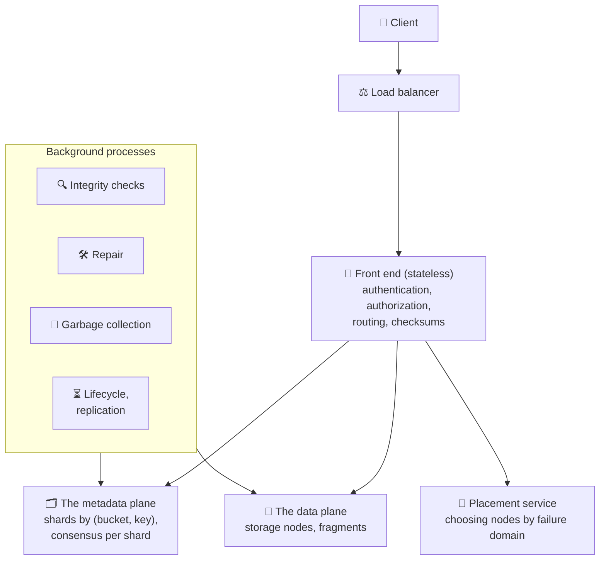
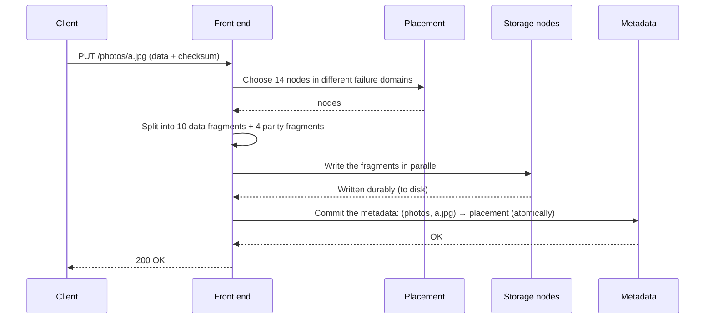
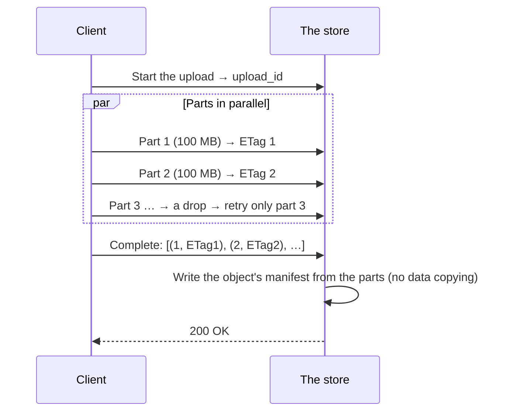
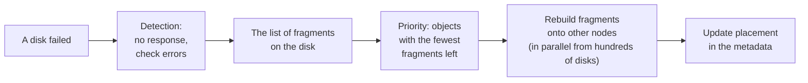

**English** | [Русский](README_RU.md)

# Tier 2 · 4C · 01. Object Storage (like S3)

> **Level:** Hard · **Interview time:** 45–60 min · **Study time:** ~5–6 h
> **Key aspects:** separating the metadata plane from the data plane, the write and read paths, erasure coding versus replication, the "11 nines" durability math and correlated failures, strong read-after-write consistency, metadata at scale and prefix listing, multipart upload, small objects, integrity and repair, storage classes, cross-region replication, security
> **Builds on:** [14-storage-types](../../../14-storage-types/README.md), [06-partitioning](../../../06-partitioning/README.md#3-strategies-range-hash-directory-geo), [08-consensus](../../../08-consensus/README.md), [Tier 1 · 10 Dropbox](../../../tier-1/10-dropbox-google-drive/README.md#8-deep-dive-2-dedup-and-the-block-store), [Tier 1 · 19 KV Store](../../../tier-1/19-distributed-kv-store/README.md)

---

## 🗺️ How to Read This Walkthrough

The walkthrough follows an interview, but every step includes explanations: **why** a decision is made, **how** a mechanism works and **what happens** if you do it differently. The "📘 Explanation" blocks are theory right where you need it.

| Icon | Meaning |
|:----:|:--------|
| 🎤 | Interviewer |
| 🗣️ | What I (the candidate) say out loud |
| ✏️ | What I draw on the whiteboard |
| ⏱️ | Time budget for the step |
| 📘 | A detailed explanation of a concept |

Callouts: **TIP** — a good technique, **WARNING** — a trap, **IMPORTANT** — a Senior+ signal.

---

## 📑 Contents

0. [What This Problem Teaches](#0-what-this-problem-teaches)
1. [Problem Statement](#1-problem-statement)
2. [Clarifying Questions and Requirements](#2-clarifying-questions-and-requirements)
3. [Capacity Estimates](#3-capacity-estimates)
4. [API](#4-api)
5. [Data Model](#5-data-model)
6. [High-Level Design](#6-high-level-design)
7. [Deep Dive 1: Metadata Separate From Data](#7-deep-dive-1-metadata-separate-from-data)
8. [Deep Dive 2: Durability — Erasure Coding and Placement](#8-deep-dive-2-durability--erasure-coding-and-placement)
9. [Deep Dive 3: Strong Consistency](#9-deep-dive-3-strong-consistency)
10. [Deep Dive 4: Metadata at Scale and Listing](#10-deep-dive-4-metadata-at-scale-and-listing)
11. [Deep Dive 5: Large Objects and Multipart Upload](#11-deep-dive-5-large-objects-and-multipart-upload)
12. [Deep Dive 6: Small Objects](#12-deep-dive-6-small-objects)
13. [Deep Dive 7: Integrity, Repair and Garbage Collection](#13-deep-dive-7-integrity-repair-and-garbage-collection)
14. [Deep Dive 8: Storage Classes, Replication and Security](#14-deep-dive-8-storage-classes-replication-and-security)
15. [Bottlenecks and Failure Scenarios](#15-bottlenecks-and-failure-scenarios)
16. [What Changes at 10x Scale](#16-what-changes-at-10x-scale)
17. [Key Concepts and New Terms](#17-key-concepts-and-new-terms)
18. [Variations and Follow-Up Questions](#18-variations-and-follow-up-questions)
19. [Common Mistakes](#19-common-mistakes)
20. [Cheat Sheet and Self-Check](#20-cheat-sheet-and-self-check)

---

## 0. What This Problem Teaches

Object storage underpins almost every system from the previous problems: it holds Instagram's photos, YouTube's videos, Dropbox's blocks, the crawler's archives. Here you have to **build it yourself**: store exabytes, never lose data, and serve millions of requests per second.

| What's tested | Where it shows up |
|:--------------|:------------------|
| Separation of concerns | The metadata plane and the data plane |
| Storage durability | Erasure coding, failure domains, repair speed |
| Probabilistic thinking | Where "11 nines" comes from, and why the math is misleading |
| Consistency | Strong read-after-write for objects and listing |
| Sharding | Metadata by key range, hot prefixes |
| Handling large and small data | Multipart upload, packing small objects |
| Background processes | Integrity checks, repair, garbage collection |

> [!TIP]
> The key idea to open with: **metadata and data are two different systems**. Metadata is small and needs fast lookups, listing and strong consistency. Data is huge and immutable and needs only durable storage. Nearly every decision in the problem follows from that split.

---

## 1. Problem Statement

> 🎤 "Design an object store like Amazon S3: users create buckets, put and read objects by key ranging from bytes to terabytes, and list objects by prefix. Durability — 11 nines, availability — high, scale — exabytes."

**How it's used:**

```
PUT  s3://photos/2026/11/30/IMG_4821.jpg      ← upload a photo
GET  s3://photos/2026/11/30/IMG_4821.jpg      ← read it right after writing — the new version
LIST s3://photos/2026/11/                     ← every object with this prefix
PUT  s3://backups/db-2026-11-30.tar (2 TB)    ← a multipart upload
```

**Time plan:**

| Step | ⏱️ |
|:-----|:--:|
| Requirements | 5 min |
| Estimates | 4 min |
| API and data | 5 min |
| High-level design | 6 min |
| Deep dives | 25–30 min |
| Wrap-up | 3 min |

---

## 2. Clarifying Questions and Requirements

⏱️ 5 min

| My question | Interviewer's answer | What it changes and why |
|:------------|:---------------------|:------------------------|
| Scale? | Trillions of objects, exabytes of data | Hundreds of thousands of disks, petabytes of metadata |
| Object size? | From bytes to 5 TB | Multipart upload and packing small objects |
| Load? | Millions of requests per second | Scaling the front end and metadata horizontally |
| Durability? | 99.999999999% (11 nines) per year | Erasure coding, cross-zone placement, fast repair |
| Availability? | 99.99% | Serving through a zone failure |
| Consistency? | Strong: after a successful PUT, every GET and LIST sees the new object | Linearizable per-key metadata |
| Modifying objects? | Whole objects only (overwrite), no partial edits | Data is immutable — which simplifies everything |
| Listing? | By prefix, sorted | Metadata ordered by key |

### Functional requirements

1. Buckets: create, delete, configure policies.
2. Objects: PUT, GET (including byte ranges), HEAD, DELETE.
3. LIST by prefix and delimiter, with pagination.
4. Multipart upload of large objects.
5. Versioning, lifecycle rules, storage classes.
6. Cross-region replication, encryption, access control.

### Non-functional requirements

| Requirement | Target | Why |
|:------------|:-------|:----|
| Durability | 11 nines per year | Losing customer data is unacceptable |
| Availability | 99.99% | The store is a dependency of thousands of systems |
| Consistency | Strong read-after-write | Clients needn't account for a visibility delay |
| Throughput | Scales linearly | Analytics reads petabytes |
| Cost | Minimal per byte | Exabytes |

---

## 3. Capacity Estimates

⏱️ 4 min

```
Objects:         ~10 trillion, average size ~1 MB (the distribution is very uneven)
Data:            ~10 EB logical
With erasure coding (10+4, a 1.4× overhead): ~14 EB on disk
Disks:           14 EB / 20 TB per disk ≈ 700,000 disks

Metadata:        ~1 KB per object (key, size, checksum, placement, ACL)
                 10 trillion × 1 KB ≈ 10 PB of metadata — a huge distributed DB in its own right

Requests:        ~10M per second (GETs dominate)
Disk failures:   at a ~2% annual failure rate → 700,000 × 0.02 ≈ 14,000 disks per year ≈ 40 per day
```

### Conclusions

| Conclusion | Design consequence |
|:-----------|:-------------------|
| Dozens of disks fail every day | Repair is a constant background process, not an emergency |
| Metadata is petabytes | A separate sharded, strongly consistent system |
| Durability overhead multiplies cost | Erasure coding instead of triple replication |
| Millions of requests | A stateless front end, sharded metadata, distributed data |

---

## 4. API

⏱️ 3 min

```http
PUT    /{bucket}/{key}                     Content-MD5 / x-checksum-crc32c
       If-None-Match: *                    ← write only if the object doesn't exist yet
GET    /{bucket}/{key}                     Range: bytes=0-1048575
HEAD   /{bucket}/{key}
DELETE /{bucket}/{key}
GET    /{bucket}?list-type=2&prefix=2026/11/&delimiter=/&continuation-token=…

# Multipart upload
POST   /{bucket}/{key}?uploads                         → upload_id
PUT    /{bucket}/{key}?partNumber=7&uploadId=…         → the part's ETag
POST   /{bucket}/{key}?uploadId=…   [list of parts]    ← assemble the object
DELETE /{bucket}/{key}?uploadId=…                      ← abort

# A presigned URL — temporary access without credentials
GET    /{bucket}/{key}?X-Signature=…&X-Expires=…
```

---

## 5. Data Model

⏱️ 3 min

```
A bucket:   bucket_name (globally unique) → region, owner, policies, versioning, rules

Object metadata (in the metadata plane):
  (bucket, key, version_id) → {
     size, checksum, content_type, user_metadata,
     storage_class, created_at,
     placement: [ { extent_id, fragments: [node_1 … node_14] } … ]
  }

Data (in the data plane):
  extent_id → fragments on storage nodes' disks (immutable)
```

| Data | Store | Why |
|:-----|:------|:----|
| Buckets | A small global, strongly consistent DB | Globally unique names |
| Object metadata | A KV store sharded by key range, with consensus per shard | Strong consistency and sorting for listing |
| Data | Storage nodes with disks; erasure-coded fragments | Exabytes, cheap and durable |

---

## 6. High-Level Design

⏱️ 6 min



🗣️ "Three main parts:
- **a stateless front end**: checks permissions, computes checksums, orchestrates requests;
- **the metadata plane**: a store sharded by key range with consensus per shard — it knows which objects exist and where their data lives;
- **the data plane**: hundreds of thousands of disks holding erasure-coded fragments.

Plus constant **background processes**: integrity checks, repair after disk failures, garbage collection, lifecycle and replication."

---

## 7. Deep Dive 1: Metadata Separate From Data

> 🎤 "Why not store metadata alongside the data on the same nodes?"

| | Metadata | Data |
|:-|:---------|:-----|
| Record size | ~1 KB | From bytes to terabytes |
| Volume | Petabytes | Exabytes |
| Mutability | Changes (a new version, deletion) | **Immutable** once written |
| Access | Point lookups, ordered listing | Sequential reads and writes |
| Consistency | Strong | Immutability plus checksums is enough |
| Store | A sharded DB with consensus | Disks with erasure coding |

### The write path



### The read path

1. The front end looks up the object's metadata → the list of fragments and nodes.
2. It reads **any 10 of the 14** fragments (the fastest responders first).
3. It reconstructs the data, verifies the checksum and returns it to the client.

| Property | Why it matters |
|:---------|:---------------|
| **Data is written before metadata** | Metadata never points to nonexistent data |
| **Committing metadata is an atomic pointer swap** | Overwriting an object: new data is written separately, then the pointer flips; a reader sees either the old or the new version in full |
| Data without metadata (a failure between steps) | "Orphans" — removed by the garbage collector |

> [!IMPORTANT]
> **Senior+ signal:** explain that **immutable data + an atomic pointer swap in metadata** gives atomic overwrites of objects of any size, without locks: nobody ever sees "half of a new object".

---

## 8. Deep Dive 2: Durability — Erasure Coding and Placement

> 🎤 "How do you guarantee 11 nines when disks fail every day?"

### Replication versus erasure coding

📘 **Erasure coding** (a Reed–Solomon code): an object is split into **k** data fragments, and **m** parity fragments are computed from them. The object can be reconstructed from **any k** of the **k + m** fragments.

```
RS(10, 4): 10 data fragments + 4 parity fragments = 14 fragments
  Overhead: 14 / 10 = 1.4× (versus 3× for triple replication)
  Survives the loss of ANY 4 fragments (versus 2 of 3 copies for replication)
```

| | Triple replication | RS(10, 4) ⭐ |
|:-|:-------------------|:------------|
| Overhead | 3× | 1.4× |
| Losses survived | 2 | 4 |
| Reads | From one copy — fast | From 10 fragments + decoding |
| Repair after a loss | Copy 1 replica | Read 10 fragments, compute 1 — more network traffic |
| Small objects | Simple | The overhead of 14 fragments for 1 KB is inefficient |

📘 **Local Reconstruction Codes (LRC)**, used by Azure Storage, reduce repair traffic: extra "local" parities let you rebuild one lost fragment from a small group rather than from all k.

### Placement across failure domains

```
The 14 fragments are placed so that:
  - no two are on the same disk
  - no two are on the same server
  - no more than a few are in one rack
  - they're spread across 3 availability zones (e.g. 5 + 5 + 4)

A whole zone fails (up to 5 fragments) — is the object still readable? No: 14 − 5 = 9 < 10
→ surviving a zone failure needs a scheme with no more than m fragments in any zone,
  e.g. RS(6, 3) across 3 zones: 3 + 3 + 3; losing a zone leaves 6 — enough
```

> [!WARNING]
> Code parameters and placement must be chosen **together**: a scheme that survives losing 4 disks may not survive losing a zone if that zone holds more than 4 fragments. The requirement "survive a zone failure" dictates how many fragments may sit in one zone.

### Where "11 nines" comes from, and why the math is misleading

```
Assume a 2% annual disk failure rate and ~6 hours to repair.
The probability that a given disk fails during the repair window ≈ 0.02 / 8,760 × 6 ≈ 1.4 × 10⁻⁵
Losing an RS(10, 4) object = 5 of its 14 disks failing within one window:
  ≈ C(14, 5) × (1.4 × 10⁻⁵)⁵ ≈ 1 × 10⁻²¹ per window
  × ~1,460 windows per year ≈ 1.4 × 10⁻¹⁸ per object per year

On paper — far beyond 11 nines.
```

📘 **Why real durability is lower than the math.** The model assumes **independent** failures. In practice the danger is **correlated** failures: a batch of disks with the same defect, a rack losing power, a fire in a zone — and above all **software and operator errors** (a garbage collection bug deleting needed data, a wrong configuration). So the advertised 11 nines are delivered not just by the code but also by:

| Measure | Against what |
|:--------|:-------------|
| Placement across zones and different hardware batches | Correlated hardware failures |
| **Fast repair** with high parallelism | The shorter the window, the lower the chance of accumulating failures |
| A delay before physical deletion, invariant checks | Software errors |
| Gradual rollouts, formal verification of key code | Bugs in the storage code (AWS described applying formal methods, e.g. TLA+, to critical parts of S3) |
| Independent integrity checking (scrubbing) | Silent data corruption |

---

## 9. Deep Dive 3: Strong Consistency

> 🎤 "A client wrote an object and immediately reads it. Do you guarantee it sees the new version?"

📘 For a long time S3 offered only eventual consistency for overwrites. In December 2020 AWS announced **strong read-after-write consistency** for every operation, including listing. For clients that's a huge simplification: no "invisibility window" to account for.

### How to provide it

| Requirement | Solution |
|:------------|:---------|
| A GET after a PUT sees the new version | A key's metadata lives in a shard with **consensus** (Raft/Paxos): a write is acknowledged once a majority commits it, and reads go through the shard leader or verify freshness |
| Metadata caches don't serve stale data | A cache invalidated on writes, or one that checks the version with the source |
| A LIST after a PUT sees the object | The listing index is the same ordered metadata structure, updated in the same operation |
| Two concurrent PUTs of one key | Whichever metadata commit lands last wins; the result is one of the versions in full |

### Conditional writes

```http
PUT /bucket/lock-file   If-None-Match: *      ← write only if the object doesn't exist
PUT /bucket/config.json If-Match: "etag-17"   ← write only if the version hasn't changed
```

📘 Conditional writes turn the store into a simple coordination mechanism: e.g. "whoever creates the file first owns the task" — with no external locking system.

---

## 10. Deep Dive 4: Metadata at Scale and Listing

> 🎤 "10 trillion metadata records and prefix listing. How do you shard that?"

### Sharding by range

📘 Prefix listing requires keys to be **ordered**. So metadata is sharded **by `(bucket, key)` range**, not by hash (see [06-partitioning](../../../06-partitioning/README.md#3-strategies-range-hash-directory-geo)):

```
Shard 1:  photos/ … photos/2026/06/
Shard 2:  photos/2026/06/ … photos/2026/11/
Shard 3:  photos/2026/11/ … videos/

LIST photos/2026/11/ → shard 2 and the start of shard 3, read sequentially in order
```

### Hot prefixes

| Problem | Solution |
|:--------|:---------|
| Every write goes to the "end" of a range (date-based keys: `logs/2026-11-30-…`) | The shard holding the current date is hot |
| Automatic **shard splitting** as load grows | The hot range is split into parts on different nodes |
| Guidance for clients | Vary the start of keys; S3 documents per-prefix throughput (on the order of 3,500 PUTs and 5,500 GETs per second) and scales by adding prefixes |

### Listing

| Decision | Why |
|:---------|:----|
| **A continuation token** (the last key returned) | Pagination without offsets |
| **A delimiter** (`/`) | Emulating "folders": common prefixes collapse into one row |
| Listing is an expensive operation | For analytics over billions of objects — a separate periodic **inventory report** instead of LIST |

---

## 11. Deep Dive 5: Large Objects and Multipart Upload

> 🎤 "How do you upload a 2 TB object over an unstable network?"

### Multipart upload



| Decision | Why |
|:---------|:----|
| Parts are uploaded **independently and in parallel** | Speed and resilience: a failure means retrying one part |
| Completion writes **a manifest** | The object is assembled from already-written parts without copying terabytes |
| Limits (in S3: parts from 5 MB to 5 GB, up to 10,000 parts, objects up to 5 TB) | Manageable metadata and part sizes |
| Incomplete uploads | Take up space — a lifecycle rule removes them after N days |
| **Range reads** | Parallel download of large objects in parts |

---

## 12. Deep Dive 6: Small Objects

> 🎤 "Billions of 1 KB objects. What's wrong?"

| Problem | Why |
|:--------|:----|
| Erasure coding on 1 KB | 14 fragments of ~100 B — the overhead of metadata and operations exceeds the data itself |
| A separate file on disk per object | File system metadata and random access on HDDs |
| Metadata | ~1 KB per object — as much as the data |

### Packing

📘 Small objects are **packed into large extents** (e.g. hundreds of MB), and erasure coding is applied to the whole extent. An object's metadata stores `(extent_id, offset, length)`. Facebook described a similar system, **Haystack**, for photos: "needles" inside large volume files, so a photo is found in one disk access instead of several file system operations.

| Decision | Why |
|:---------|:----|
| Writes: append to an open extent | Sequential writes |
| An extent fills up → "seal" it and apply erasure coding | Durability with an efficient scheme |
| Deleting small objects → "holes" in the extent | **Compaction**: periodically rewrite extents with lots of deleted data |
| A minimum billable size in some classes | The economics of small objects |

---

## 13. Deep Dive 7: Integrity, Repair and Garbage Collection

> 🎤 "How do you know data has been corrupted, and how do you repair after disk failures?"

### Integrity

| Mechanism | How |
|:----------|:----|
| **Checksums from the client** | The client sends an MD5 or CRC; the front end verifies on receipt |
| A checksum per fragment | Verified on every read |
| **Background checking (scrubbing)** | Regularly read every fragment and verify its checksum — catches "silent corruption" (bit rot) before it accumulates |
| Checks on transfer between nodes | Corruption in memory or on the network doesn't reach the disk |

### Repair



| Decision | Why |
|:---------|:----|
| **Priority by risk** | An object that has already lost 3 of 14 fragments is repaired before one that has lost 1 |
| **Wide parallelism** | A failed disk's fragments belong to many objects spread across many disks → repair draws on hundreds of disks at once → a short window |
| Rate-limiting repair | Don't disrupt production traffic, but don't stretch the window either |

### Garbage collection

| Source of garbage | Solution |
|:------------------|:---------|
| Data without metadata (a failure between writing data and committing) | Periodic reconciliation: unreferenced data older than N hours is deleted |
| Overwritten and deleted objects (without versioning) | Data deleted after **a delay** — protection against errors |
| Versioning | DELETE creates **a delete marker**, and old versions are kept until a lifecycle rule applies |

---

## 14. Deep Dive 8: Storage Classes, Replication and Security

> 🎤 "How do you make storing rarely used data cheaper, and how do you protect customers' data?"

### Storage classes and lifecycle

| Class | Characteristics | For |
|:------|:----------------|:----|
| Standard | Fast access, higher storage price | Active data |
| Infrequent access | Cheaper storage, a fee per read | Backups, old media |
| Archive | Very cheap; retrieval takes minutes to hours | Long-term retention, compliance |

| Mechanism | How |
|:----------|:----|
| Lifecycle rules | "After 30 days — infrequent access, after 1 year — archive, after 7 years — delete" |
| Archive on different media | Dense HDDs that spin down, tape; a more economical coding scheme |
| Automatic tiering | By actual access frequency |

### Cross-region replication

| Decision | Why |
|:---------|:----|
| Async replication to another region | Protection against losing a region, proximity to users |
| RPO is the replication lag | It's measured and can be guaranteed (an optional, paid replication-time guarantee) |
| Versions and delete markers are replicated per the rules | Controlled deletion behavior |

### Security

| Measure | How |
|:--------|:----|
| Authenticating every request | Signing the request with a key (HMAC) |
| Access policies | IAM, bucket policies, blocking public access by default |
| **Presigned URLs** | Temporary access to one object without handing over credentials |
| **Server-side encryption** | Envelope encryption: data is encrypted with a data key, which is encrypted with a master key in a KMS |
| **Immutability (object lock, WORM)** | An object can't be deleted or changed until a date — protection against errors and ransomware |
| An access log | Auditing |

---

## 15. Bottlenecks and Failure Scenarios

| Scenario | What happens | How we protect |
|:---------|:-------------|:---------------|
| A disk failure (dozens per day) | Lost fragments | Erasure coding, repair prioritized by risk |
| A zone failure | Every object loses some fragments | Placement: no more than m fragments per zone |
| A correlated failure of a disk batch | Many losses at once | Different hardware batches within a placement group |
| A garbage collection bug | Deleting needed data | A deletion delay, reconciliation, gradual rollouts |
| Silent data corruption | A corrupted object | Checksums, scrubbing |
| A failure between writing data and metadata | Orphans | The garbage collector |
| A hot prefix | An overloaded metadata shard | Automatic shard splitting |
| Reading right after writing | Stale data | Consensus per shard, cache invalidation |
| A drop while uploading 2 TB | Retrying everything | Multipart upload |
| Billions of small objects | Inefficient storage | Packing into extents, compaction |
| Leaked credentials or a misconfiguration | Public access to data | Blocking public access by default, presigned URLs |

---

## 16. What Changes at 10x Scale

> 🎤 "100 exabytes?"

| Change | Why |
|:-------|:----|
| **Wider codes** (larger k) for cold data | Lower overhead |
| **Custom hardware** (dense servers, specialized disks) | Cost per byte |
| **A metadata hierarchy** (bucket → shards → caches) | Petabytes of metadata |
| **Automatic tiering** | Most data cools down quickly |

---

## 17. Key Concepts and New Terms

### What's applied

| Concept | Where it's covered | How it applies here |
|:--------|:-------------------|:--------------------|
| Blobs + metadata, erasure coding, storage classes | [14-storage-types](../../../14-storage-types/README.md) | The basis of the store |
| Range sharding | [06-partitioning](../../../06-partitioning/README.md#3-strategies-range-hash-directory-geo) | Metadata and listing |
| Consensus | [08-consensus](../../../08-consensus/README.md) | Strongly consistent metadata |
| Content addressing and garbage collection | [Tier 1 · 10](../../../tier-1/10-dropbox-google-drive/README.md) | Blocks and reference counts |
| Merkle trees, replica repair | [Tier 1 · 19](../../../tier-1/19-distributed-kv-store/README.md) | Reconciliation and repair |

### New terms in this problem

| Term | In short |
|:-----|:---------|
| **The metadata plane and the data plane** | Two systems with different requirements |
| **An atomic pointer swap** | Overwriting an object with no "half-written" state |
| **Erasure coding RS(k, m)** | k data fragments + m parity fragments, reconstructable from any k |
| **LRC** | Codes with local parities for cheap repair |
| **Failure domains** | Disk, server, rack, zone — levels of placement |
| **Correlated failures** | Simultaneous failures from a common cause — the main threat to durability |
| **Scrubbing** | Background integrity checking of all data |
| **Multipart upload and a manifest** | An object assembled from independently uploaded parts |
| **Packing into extents** | Small objects inside large containers |
| **Conditional writes** | A PUT conditioned on the object's absence or version |
| **Object lock (WORM)** | Forbidding changes and deletion until a date |

---

## 18. Variations and Follow-Up Questions

<details>
<summary><b>Why not a file system like HDFS?</b></summary>

A file system supports a directory hierarchy, renames, appends and partial changes — which requires complex metadata and locking. Object storage is deliberately simplified: a flat key space, immutable objects, whole-object operations only. That lets it scale to trillions of objects and exabytes. A distributed file system is a separate problem (4C #5).
</details>

<details>
<summary><b>How do you implement "renaming a folder" with a million objects?</b></summary>

Object storage has no folders — only prefixes. A "rename" means copying a million objects under a new prefix and deleting the old ones; it's expensive and not atomic. So applications design keys so renames aren't needed, or keep a "logical path → key" mapping in the application's metadata.
</details>

<details>
<summary><b>How do you serve popular objects with low latency?</b></summary>

Through a CDN in front of the store: objects are immutable (or versioned), so they're easy to cache at the edge. The store stays the origin, and the CDN absorbs most of the read load.
</details>

<details>
<summary><b>How do you delete a bucket with billions of objects?</b></summary>

Asynchronously: the bucket is marked for deletion and becomes inaccessible; a background process deletes the metadata range by range and hands the data to the garbage collector. The bucket name is freed once it finishes.
</details>

<details>
<summary><b>Can object storage be used as a database?</b></summary>

For analytics — yes: table formats (Apache Iceberg, Delta Lake) keep data in Parquet files in object storage, and conditional writes plus table metadata give snapshot-level transactionality. For a transactional workload with frequent small changes — no: the latency and cost per operation are too high.
</details>

---

## 19. Common Mistakes

| ❌ Mistake | Why it's bad | ✅ Do this instead |
|:----------|:-------------|:------------------|
| Metadata and data in one system | Different requirements interfere | Two planes |
| Committing metadata before writing data | A reference to nonexistent data | Data first, then metadata |
| Triple replication for everything | 3× the cost | Erasure coding |
| Code parameters chosen without regard to zones | A zone failure loses data | No more than m fragments per zone |
| Trusting the "11 nines" math | Correlated failures and bugs aren't accounted for | Different batches, fast repair, protection against software errors |
| Sharding metadata by hash | Prefix listing is impossible | By key range |
| Erasure coding every small object | The overhead exceeds the data | Packing into extents |
| Repairing in order of discovery | The highest-risk object waits | Prioritizing by fragments remaining |
| No background integrity checks | Silent corruption accumulates | Scrubbing |
| Immediate physical deletion | A mistake means irreversible loss | A delay, versioning |
| Public access by default | Data leaks | Blocking public access, presigned URLs |

---

## 20. Cheat Sheet and Self-Check

### 30-second answer

> Two planes: metadata (petabytes of small records, sharded by `(bucket, key)` range for listing, consensus per shard — strong read-after-write, automatic splitting of hot ranges) and data (immutable fragments on hundreds of thousands of disks). A write: the front end picks 14 nodes in different failure domains, encodes RS(10, 4) (1.4× instead of 3×, surviving the loss of any 4), writes the fragments, and only then atomically commits the metadata — overwrites with no "half" objects, with the garbage collector removing orphans. A read — any 10 of 14. Placement across zones so a zone failure takes no more than m fragments. The math under independent failures gives far more than 11 nines; real durability is set by correlated failures and software errors — hence different hardware batches, fast parallel repair prioritized by risk, scrubbing, a deletion delay and careful rollouts. Large objects — multipart upload with a manifest; small ones — packing into extents with compaction. Storage classes and lifecycle, async cross-region replication, conditional writes, KMS encryption, object lock, blocking public access.

### Self-check

- [ ] I can explain why metadata and data are different systems
- [ ] I can draw the write path and explain the "data, then metadata" order
- [ ] I can compare replication and RS(10, 4) on cost and durability
- [ ] I can choose code parameters with zone failures in mind
- [ ] I can compute the probability of loss and explain why the math is misleading
- [ ] I can explain strong consistency and conditional writes
- [ ] I can design metadata sharding for prefix listing
- [ ] I can describe multipart upload
- [ ] I can solve the small-objects problem
- [ ] I can describe scrubbing, repair and garbage collection
- [ ] I can list storage classes, replication and security measures

### Further reading

- Amazon S3 documentation: consistency, multipart upload, per-prefix performance, conditional writes
- Huang et al., *Erasure Coding in Windows Azure Storage* (USENIX ATC 2012) — LRC
- Beaver et al., *Finding a Needle in Haystack: Facebook's Photo Storage* (OSDI 2010)
- Newcombe et al., *How Amazon Web Services Uses Formal Methods* (CACM 2015)
- Calder et al., *Windows Azure Storage: A Highly Available Cloud Storage Service with Strong Consistency* (SOSP 2011)
- The [14-storage-types](../../../14-storage-types/README.md) topic
