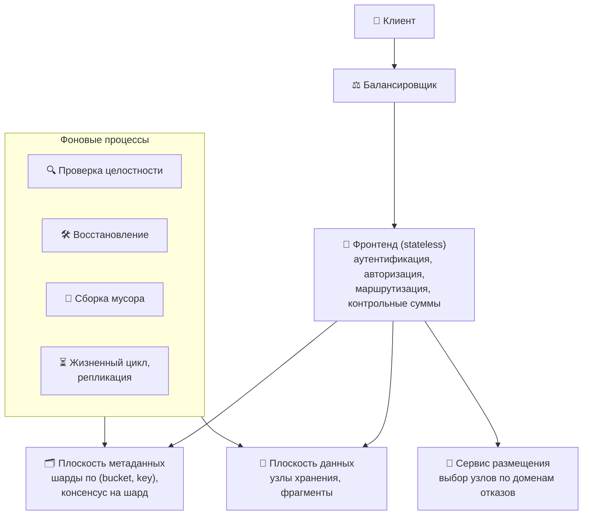
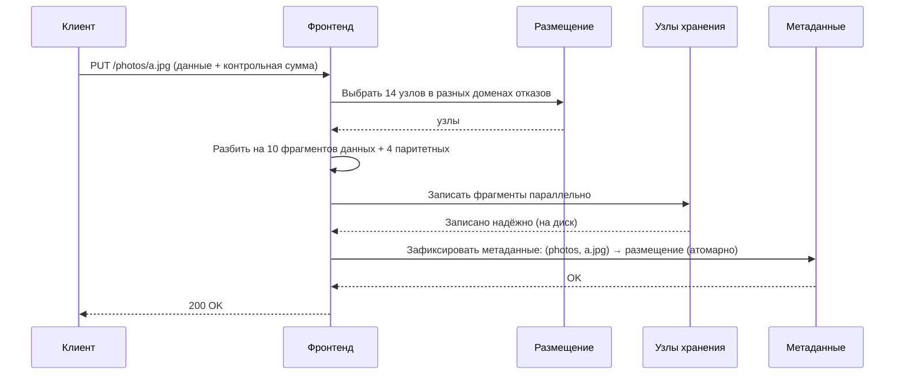
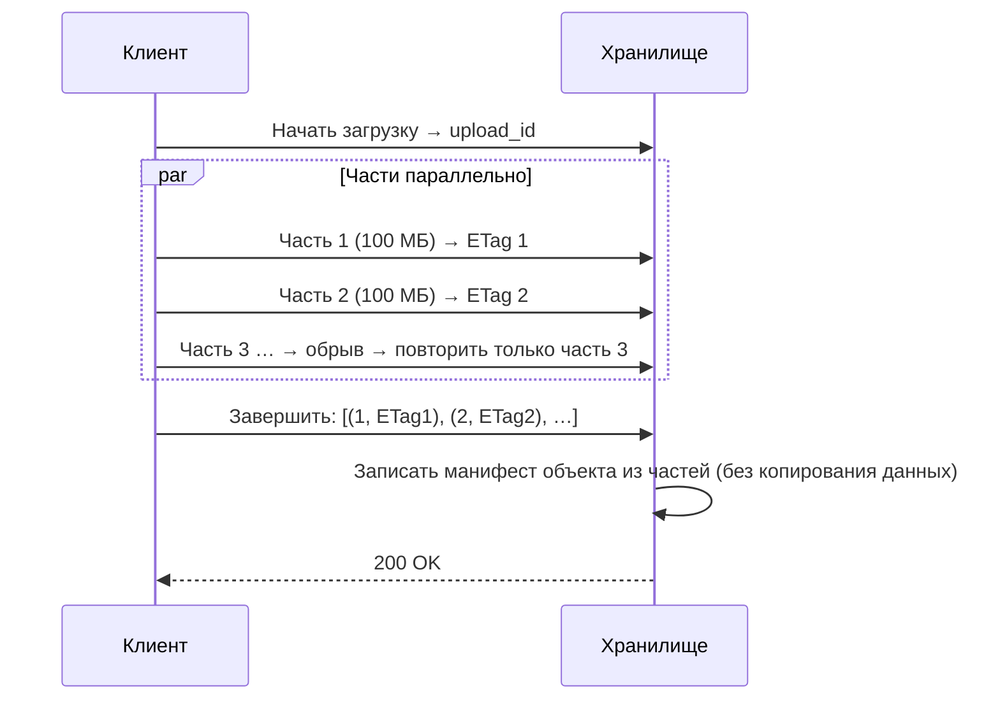

[English](README.md) | **Русский**

# Tier 2 · 4C · 01. Объектное хранилище (как S3)

> **Уровень:** Hard · **Время на интервью:** 45–60 мин · **Время на разбор:** ~5–6 ч
> **Ключевые аспекты:** разделение плоскости метаданных и плоскости данных, путь записи и чтения, erasure coding против репликации, математика надёжности «11 девяток» и коррелированные отказы, строгая консистентность read-after-write, метаданные на масштабе и листинг по префиксу, многочастная загрузка, маленькие объекты, целостность и восстановление, классы хранения, межрегиональная репликация, безопасность
> **Опирается на:** [14-storage-types](../../../14-storage-types/README_RU.md), [06-partitioning](../../../06-partitioning/README_RU.md#3-стратегии-range-hash-directory-гео), [08-consensus](../../../08-consensus/README_RU.md), [Tier 1 · 10 Dropbox](../../../tier-1/10-dropbox-google-drive/README_RU.md#8-deep-dive-2-дедупликация-и-хранилище-блоков), [Tier 1 · 19 KV Store](../../../tier-1/19-distributed-kv-store/README_RU.md)

---

## 🗺️ Как читать этот разбор

Разбор построен как интервью, но в каждом шаге есть объяснения: **почему** принимается решение, **как работает** механизм и **что будет**, если сделать иначе. Блоки «📘 Объяснение» — теория прямо по ходу задачи.

| Значок | Что значит |
|:------:|:-----------|
| 🎤 | Реплика интервьюера |
| 🗣️ | Что говорю вслух я (кандидат) |
| ✏️ | Что рисую на доске |
| ⏱️ | Сколько времени тратить на шаг |
| 📘 | Подробное объяснение концепции |

Блоки **TIP** — хороший приём, **WARNING** — ловушка, **IMPORTANT** — сигнал для уровня Senior+.

---

## 📑 Содержание

0. [Чему учит эта задача](#0-чему-учит-эта-задача)
1. [Условие задачи](#1-условие-задачи)
2. [Уточняющие вопросы и требования](#2-уточняющие-вопросы-и-требования)
3. [Оценки нагрузки](#3-оценки-нагрузки)
4. [API](#4-api)
5. [Модель данных](#5-модель-данных)
6. [High-level дизайн](#6-high-level-дизайн)
7. [Deep dive 1: метаданные отдельно, данные отдельно](#7-deep-dive-1-метаданные-отдельно-данные-отдельно)
8. [Deep dive 2: надёжность — erasure coding и размещение](#8-deep-dive-2-надёжность--erasure-coding-и-размещение)
9. [Deep dive 3: строгая консистентность](#9-deep-dive-3-строгая-консистентность)
10. [Deep dive 4: метаданные на масштабе и листинг](#10-deep-dive-4-метаданные-на-масштабе-и-листинг)
11. [Deep dive 5: большие объекты и многочастная загрузка](#11-deep-dive-5-большие-объекты-и-многочастная-загрузка)
12. [Deep dive 6: маленькие объекты](#12-deep-dive-6-маленькие-объекты)
13. [Deep dive 7: целостность, восстановление и сборка мусора](#13-deep-dive-7-целостность-восстановление-и-сборка-мусора)
14. [Deep dive 8: классы хранения, репликация и безопасность](#14-deep-dive-8-классы-хранения-репликация-и-безопасность)
15. [Узкие места и сценарии сбоев](#15-узкие-места-и-сценарии-сбоев)
16. [Что изменится при росте в 10 раз](#16-что-изменится-при-росте-в-10-раз)
17. [Ключевые концепции и новые понятия](#17-ключевые-концепции-и-новые-понятия)
18. [Варианты задачи и follow-up вопросы](#18-варианты-задачи-и-follow-up-вопросы)
19. [Типичные ошибки](#19-типичные-ошибки)
20. [Шпаргалка и самопроверка](#20-шпаргалка-и-самопроверка)

---

## 0. Чему учит эта задача

Объектное хранилище — фундамент почти всех систем из предыдущих задач: в нём лежат фото Instagram, видео YouTube, блоки Dropbox, архивы краулера. Здесь нужно **построить его самому**: хранить эксабайты, никогда не терять данные и обслуживать миллионы запросов в секунду.

| Что проверяют | Где это в задаче |
|:--------------|:-----------------|
| Разделение ответственности | Плоскость метаданных и плоскость данных |
| Надёжность хранения | Erasure coding, домены отказов, скорость восстановления |
| Вероятностное мышление | Откуда берутся «11 девяток» и почему расчёт обманчив |
| Консистентность | Строгое read-after-write для объектов и листинга |
| Шардирование | Метаданные по диапазонам ключей, горячие префиксы |
| Работа с большими и маленькими данными | Многочастная загрузка, упаковка мелких объектов |
| Фоновые процессы | Проверка целостности, восстановление, сборка мусора |

> [!TIP]
> Главная мысль, с которой стоит начать: **метаданные и данные — две разные системы**. Метаданные маленькие, их нужно быстро искать, листать и строго согласовывать. Данные огромные, неизменяемые и требуют только надёжного хранения. Почти все решения задачи следуют из этого разделения.

---

## 1. Условие задачи

> 🎤 «Спроектируй объектное хранилище вроде Amazon S3: пользователи создают бакеты, кладут и читают объекты по ключу размером от байтов до терабайтов, листают объекты по префиксу. Надёжность — 11 девяток, доступность — высокая, масштаб — эксабайты».

**Как им пользуются:**

```
PUT  s3://photos/2026/11/30/IMG_4821.jpg      ← загрузить фото
GET  s3://photos/2026/11/30/IMG_4821.jpg      ← прочитать сразу после записи — новая версия
LIST s3://photos/2026/11/                     ← все объекты с этим префиксом
PUT  s3://backups/db-2026-11-30.tar (2 ТБ)    ← многочастная загрузка
```

**План по времени:**

| Шаг | ⏱️ |
|:----|:--:|
| Требования | 5 мин |
| Оценки | 4 мин |
| API и данные | 5 мин |
| High-level дизайн | 6 мин |
| Deep dives | 25–30 мин |
| Итоги | 3 мин |

---

## 2. Уточняющие вопросы и требования

⏱️ 5 мин

| Мой вопрос | Ответ интервьюера | Что это меняет и почему |
|:-----------|:------------------|:------------------------|
| Масштаб? | Триллионы объектов, эксабайты данных | Сотни тысяч дисков, петабайты метаданных |
| Размер объектов? | От байтов до 5 ТБ | Многочастная загрузка и упаковка мелких |
| Нагрузка? | Миллионы запросов в секунду | Горизонтальное масштабирование фронтенда и метаданных |
| Надёжность? | 99,999999999% (11 девяток) в год | Erasure coding, размещение по зонам, быстрое восстановление |
| Доступность? | 99,99% | Обслуживание при отказе зоны |
| Консистентность? | Строгая: после успешного PUT любой GET и LIST видит новый объект | Линеаризуемые метаданные на ключ |
| Изменение объектов? | Только целиком (перезапись), без частичной правки | Данные неизменяемы — упрощает всё |
| Листинг? | По префиксу, отсортированно | Метаданные упорядочены по ключу |

### Функциональные требования

1. Бакеты: создать, удалить, настроить политики.
2. Объекты: PUT, GET (в том числе по диапазону байтов), HEAD, DELETE.
3. LIST по префиксу и разделителю с постраничной выдачей.
4. Многочастная загрузка больших объектов.
5. Версионирование, правила жизненного цикла, классы хранения.
6. Межрегиональная репликация, шифрование, контроль доступа.

### Нефункциональные требования

| Требование | Цель | Почему |
|:-----------|:-----|:-------|
| Надёжность | 11 девяток в год | Потеря данных клиента недопустима |
| Доступность | 99,99% | Хранилище — зависимость тысяч систем |
| Консистентность | Strong read-after-write | Клиентам не нужно учитывать задержку видимости |
| Пропускная способность | Масштабируется линейно | Аналитика читает петабайты |
| Стоимость | Минимальная на байт | Эксабайты |

---

## 3. Оценки нагрузки

⏱️ 4 мин

```
Объекты:         ~10 трлн, средний размер ~1 МБ (распределение очень неравномерное)
Данные:          ~10 ЭБ логически
С erasure coding (10+4, накладные расходы ×1,4): ~14 ЭБ на дисках
Диски:           14 ЭБ / 20 ТБ на диск ≈ 700 000 дисков

Метаданные:      ~1 КБ на объект (ключ, размер, контрольная сумма, размещение, ACL)
                 10 трлн × 1 КБ ≈ 10 ПБ метаданных — сами по себе огромная распределённая БД

Запросы:         ~10M в секунду (GET преобладают)
Отказы дисков:   при годовой доле отказов ~2% → 700 000 × 0,02 ≈ 14 000 дисков в год ≈ 40 в день
```

### Выводы

| Вывод | Следствие для дизайна |
|:------|:----------------------|
| Диски отказывают каждый день десятками | Восстановление — постоянный фоновый процесс, а не авария |
| Метаданные — петабайты | Отдельная шардированная строго консистентная система |
| Накладные расходы на надёжность умножают стоимость | Erasure coding вместо тройной репликации |
| Миллионы запросов | Stateless фронтенд, шардированные метаданные, распределённые данные |

---

## 4. API

⏱️ 3 мин

```http
PUT    /{bucket}/{key}                     Content-MD5 / x-checksum-crc32c
       If-None-Match: *                    ← записать, только если объекта ещё нет
GET    /{bucket}/{key}                     Range: bytes=0-1048575
HEAD   /{bucket}/{key}
DELETE /{bucket}/{key}
GET    /{bucket}?list-type=2&prefix=2026/11/&delimiter=/&continuation-token=…

# Многочастная загрузка
POST   /{bucket}/{key}?uploads                         → upload_id
PUT    /{bucket}/{key}?partNumber=7&uploadId=…         → ETag части
POST   /{bucket}/{key}?uploadId=…   [список частей]    ← собрать объект
DELETE /{bucket}/{key}?uploadId=…                      ← отменить

# Предподписанный URL — временный доступ без учётных данных
GET    /{bucket}/{key}?X-Signature=…&X-Expires=…
```

---

## 5. Модель данных

⏱️ 3 мин

```
Бакет:   bucket_name (глобально уникально) → регион, владелец, политики, версионирование, правила

Метаданные объекта (в плоскости метаданных):
  (bucket, key, version_id) → {
     size, checksum, content_type, user_metadata,
     storage_class, created_at,
     placement: [ { extent_id, fragments: [узел_1 … узел_14] } … ]
  }

Данные (в плоскости данных):
  extent_id → фрагменты на дисках узлов хранения (неизменяемые)
```

| Данные | Хранилище | Почему |
|:-------|:----------|:-------|
| Бакеты | Небольшая глобальная строго консистентная БД | Глобальная уникальность имён |
| Метаданные объектов | Шардированное по диапазону ключей KV-хранилище с консенсусом на шард | Строгая консистентность и сортировка для листинга |
| Данные | Узлы хранения с дисками; фрагменты erasure coding | Эксабайты, дёшево и надёжно |

---

## 6. High-level дизайн

⏱️ 6 мин



🗣️ «Три основные части:
- **фронтенд** без состояния: проверяет права, считает контрольные суммы, оркестрирует запросы;
- **плоскость метаданных**: шардированное по диапазонам ключей хранилище с консенсусом на шард — знает, какие объекты есть и где лежат их данные;
- **плоскость данных**: сотни тысяч дисков, на которых хранятся фрагменты erasure coding.

Плюс постоянные **фоновые процессы**: проверка целостности, восстановление после отказов дисков, сборка мусора, жизненный цикл и репликация».

---

## 7. Deep dive 1: метаданные отдельно, данные отдельно

> 🎤 «Почему не хранить метаданные рядом с данными на тех же узлах?»

| | Метаданные | Данные |
|:-|:-----------|:-------|
| Размер записи | ~1 КБ | От байтов до терабайтов |
| Объём | Петабайты | Эксабайты |
| Изменяемость | Меняются (новая версия, удаление) | **Неизменяемы** после записи |
| Доступ | Точечный поиск, упорядоченный листинг | Последовательное чтение и запись |
| Консистентность | Строгая | Достаточно неизменяемости и контрольных сумм |
| Хранилище | Шардированная БД с консенсусом | Диски с erasure coding |

### Путь записи



### Путь чтения

1. Фронтенд находит метаданные объекта → список фрагментов и узлов.
2. Читает **любые 10 из 14** фрагментов (самые быстрые отвечают первыми).
3. Восстанавливает данные, проверяет контрольную сумму, отдаёт клиенту.

| Свойство | Почему важно |
|:---------|:-------------|
| **Данные записываются до метаданных** | Метаданные никогда не ссылаются на несуществующие данные |
| **Фиксация метаданных — атомарная замена указателя** | Перезапись объекта: новые данные пишутся отдельно, затем указатель переключается; читатель видит либо старую, либо новую версию целиком |
| Данные без метаданных (сбой между шагами) | «Сироты» — удаляются сборщиком мусора |

> [!IMPORTANT]
> **Сигнал Senior+:** объяснить, что **неизменяемость данных + атомарная замена указателя в метаданных** даёт атомарную перезапись объектов любого размера без блокировок: никто не увидит «половину нового объекта».

---

## 8. Deep dive 2: надёжность — erasure coding и размещение

> 🎤 «Как гарантировать 11 девяток, если диски отказывают каждый день?»

### Репликация против erasure coding

📘 **Erasure coding** (код Рида — Соломона): объект делится на **k** фрагментов данных, к ним вычисляются **m** паритетных фрагментов. Восстановить объект можно из **любых k** из **k + m** фрагментов.

```
RS(10, 4): 10 фрагментов данных + 4 паритетных = 14 фрагментов
  Накладные расходы: 14 / 10 = 1,4× (против 3× у тройной репликации)
  Переживает потерю ЛЮБЫХ 4 фрагментов (против 2 копий из 3 у репликации)
```

| | Тройная репликация | RS(10, 4) ⭐ |
|:-|:-------------------|:------------|
| Накладные расходы | 3× | 1,4× |
| Переживает потерь | 2 | 4 |
| Чтение | Из одной копии — быстро | Из 10 фрагментов + декодирование |
| Восстановление после потери | Скопировать 1 копию | Прочитать 10 фрагментов, вычислить 1 — больше сетевого трафика |
| Маленькие объекты | Просто | Накладные расходы на 14 фрагментов для 1 КБ — неэффективно |

📘 **Local Reconstruction Codes (LRC)**, которые использует Azure Storage, уменьшают трафик восстановления: дополнительные «локальные» паритеты позволяют восстановить один потерянный фрагмент из небольшой группы, а не из всех k.

### Размещение по доменам отказов

```
14 фрагментов размещаются так, чтобы:
  - никакие два не были на одном диске
  - никакие два не были на одном сервере
  - не больше нескольких в одной стойке
  - распределение по 3 зонам доступности (например, 5 + 5 + 4)

Отказ целой зоны (до 5 фрагментов) — объект всё ещё читается? Нет: 14 − 5 = 9 < 10
→ для переживания отказа зоны нужна схема, где в одной зоне не больше m фрагментов,
  например RS(6, 3) по 3 зонам: 3 + 3 + 3, отказ зоны оставляет 6 — достаточно
```

> [!WARNING]
> Параметры кода и размещение надо выбирать **вместе**: схема, переживающая потерю 4 дисков, может не пережить потерю зоны, если в зоне оказалось больше 4 фрагментов. Требование «пережить отказ зоны» диктует, сколько фрагментов может быть в одной зоне.

### Откуда «11 девяток» и почему расчёт обманчив

```
Пусть годовая доля отказов диска 2%, восстановление занимает ~6 часов.
Вероятность отказа конкретного диска за окно восстановления ≈ 0,02 / 8 760 × 6 ≈ 1,4 × 10⁻⁵
Потеря объекта RS(10, 4) = отказ 5 из 14 дисков в одном окне:
  ≈ C(14, 5) × (1,4 × 10⁻⁵)⁵ ≈ 1 × 10⁻²¹ за окно
  × ~1 460 окон в год ≈ 1,4 × 10⁻¹⁸ в год на объект

Формально — далеко за 11 девятками.
```

📘 **Почему реальная надёжность ниже расчёта.** Модель предполагает **независимые** отказы. На практике опасны **коррелированные** отказы: партия дисков с одинаковым дефектом, отключение питания стойки, пожар в зоне, а главное — **ошибки программного обеспечения и операторов** (баг в сборке мусора, удаливший нужные данные, неверная конфигурация). Поэтому заявленные 11 девяток обеспечиваются не только кодом, но и:

| Мера | Против чего |
|:-----|:------------|
| Размещение по зонам и разным партиям оборудования | Коррелированные отказы железа |
| **Быстрое восстановление** с высоким параллелизмом | Чем короче окно, тем меньше шанс накопить отказы |
| Задержка перед физическим удалением, проверки инвариантов | Ошибки ПО |
| Постепенные развёртывания, формальная проверка ключевого кода | Баги в коде хранения (AWS описывал применение формальных методов, например TLA+, для критичных частей S3) |
| Независимая проверка целостности (scrubbing) | Тихая порча данных |

---

## 9. Deep dive 3: строгая консистентность

> 🎤 «Клиент записал объект и сразу его читает. Гарантируете ли вы, что он увидит новую версию?»

📘 Долгое время S3 давал для перезаписи только eventual consistency. С декабря 2020 года AWS объявил **строгую консистентность read-after-write** для всех операций, включая листинг. Для клиентов это огромное упрощение: не нужно учитывать «окно невидимости».

### Как это обеспечить

| Требование | Решение |
|:-----------|:--------|
| GET после PUT видит новую версию | Метаданные ключа хранятся в шарде с **консенсусом** (Raft/Paxos): запись подтверждается после фиксации большинством, чтение идёт через лидера шарда или с проверкой актуальности |
| Кэши метаданных не отдают старое | Кэш с инвалидацией при записи или проверкой версии у источника |
| LIST после PUT видит объект | Индекс листинга — та же упорядоченная структура метаданных, обновляемая в той же операции |
| Два одновременных PUT одного ключа | Побеждает тот, чья фиксация метаданных прошла последней; результат — одна из версий целиком |

### Условные записи

```http
PUT /bucket/lock-file   If-None-Match: *      ← записать, только если объекта нет
PUT /bucket/config.json If-Match: "etag-17"   ← записать, только если версия не изменилась
```

📘 Условные записи превращают хранилище в простой механизм координации: например, «кто первым создал файл, тот и владелец задачи» — без внешней системы блокировок.

---

## 10. Deep dive 4: метаданные на масштабе и листинг

> 🎤 «10 триллионов записей метаданных и листинг по префиксу. Как это шардировать?»

### Шардирование по диапазону

📘 Листинг по префиксу требует **упорядоченности** ключей. Поэтому метаданные шардируются **по диапазонам** `(bucket, key)`, а не по хэшу (см. [06-partitioning](../../../06-partitioning/README_RU.md#3-стратегии-range-hash-directory-гео)):

```
Шард 1:  photos/ … photos/2026/06/
Шард 2:  photos/2026/06/ … photos/2026/11/
Шард 3:  photos/2026/11/ … videos/

LIST photos/2026/11/ → шард 2 и начало шарда 3, последовательное чтение по порядку
```

### Горячие префиксы

| Проблема | Решение |
|:---------|:--------|
| Все записи в «конец» диапазона (ключи с датой: `logs/2026-11-30-…`) | Шард с текущей датой — горячий |
| Автоматическое **разделение шарда** при росте нагрузки | Горячий диапазон делится на части на разных узлах |
| Рекомендации клиентам | Разнообразить начало ключей; S3 документирует пропускную способность на префикс (порядка 3 500 PUT и 5 500 GET в секунду) и масштабирует, добавляя префиксы |

### Листинг

| Решение | Почему |
|:--------|:-------|
| **Токен продолжения** (последний выданный ключ) | Постраничная выдача без смещений |
| **Разделитель** (`/`) | Эмуляция «папок»: общие префиксы сворачиваются в одну строку |
| Листинг — дорогая операция | Для аналитики по миллиардам объектов — отдельный периодический **отчёт-инвентаризация** вместо LIST |

---

## 11. Deep dive 5: большие объекты и многочастная загрузка

> 🎤 «Как загрузить объект на 2 ТБ по нестабильной сети?»

### Многочастная загрузка



| Решение | Почему |
|:--------|:-------|
| Части загружаются **независимо и параллельно** | Скорость и устойчивость: сбой — повтор одной части |
| Завершение — запись **манифеста** | Объект собирается из уже записанных частей без копирования терабайтов |
| Ограничения (у S3: части от 5 МБ до 5 ГБ, до 10 000 частей, объект до 5 ТБ) | Управляемые размеры метаданных и частей |
| Незавершённые загрузки | Занимают место — правило жизненного цикла удаляет их через N дней |
| **Чтение по диапазону** (Range) | Параллельное скачивание больших объектов частями |

---

## 12. Deep dive 6: маленькие объекты

> 🎤 «Миллиарды объектов по 1 КБ. Что не так?»

| Проблема | Почему |
|:---------|:-------|
| Erasure coding на 1 КБ | 14 фрагментов по ~100 Б — накладные расходы на служебные данные и операции превышают сами данные |
| Отдельный файл на диске на каждый объект | Метаданные файловой системы и случайный доступ на HDD |
| Метаданные | ~1 КБ на объект — столько же, сколько данные |

### Упаковка

📘 Маленькие объекты **упаковываются в большие экстенты** (например, по сотни МБ), и erasure coding применяется к экстенту целиком. Метаданные объекта хранят `(extent_id, смещение, длина)`. Facebook описывал похожую систему **Haystack** для фото: «иголки» внутри больших файлов-томов, чтобы найти фото за одно обращение к диску вместо нескольких операций файловой системы.

| Решение | Почему |
|:--------|:-------|
| Запись: дописывание в открытый экстент | Последовательная запись |
| Экстент заполнен → «запечатать» и применить erasure coding | Надёжность по выгодной схеме |
| Удаление маленьких объектов → «дыры» в экстенте | **Уплотнение**: периодически переписывать экстенты, где много удалённого |
| Минимальный оплачиваемый размер в некоторых классах | Экономика мелких объектов |

---

## 13. Deep dive 7: целостность, восстановление и сборка мусора

> 🎤 «Как узнать, что данные испортились, и как восстанавливать после отказа дисков?»

### Целостность

| Механизм | Как |
|:---------|:----|
| **Контрольные суммы от клиента** | Клиент передаёт MD5 или CRC; фронтенд проверяет при приёме |
| Контрольная сумма каждого фрагмента | Проверяется при каждом чтении |
| **Фоновая проверка (scrubbing)** | Регулярно читать все фрагменты и сверять контрольные суммы — ловит «тихую порчу» (bit rot) до того, как она накопится |
| Проверка при передаче между узлами | Порча в памяти или сети не попадает на диск |

### Восстановление


| Решение | Почему |
|:--------|:-------|
| **Приоритет по риску** | Объект, потерявший уже 3 фрагмента из 14, восстанавливается раньше потерявшего 1 |
| **Широкий параллелизм** | Фрагменты отказавшего диска разбросаны по многим объектам на многих дисках → восстановление идёт с сотен дисков одновременно → окно короткое |
| Ограничение скорости восстановления | Не мешать рабочему трафику, но не растягивать окно |

### Сборка мусора

| Источник мусора | Решение |
|:----------------|:--------|
| Данные без метаданных (сбой между записью данных и фиксацией) | Периодическая сверка: данные, на которые нет ссылок старше N часов, удаляются |
| Перезаписанные и удалённые объекты (без версионирования) | Удаление данных после **задержки** — защита от ошибок |
| Версионирование | DELETE создаёт **маркер удаления**, а старые версии сохраняются до правила жизненного цикла |

---

## 14. Deep dive 8: классы хранения, репликация и безопасность

> 🎤 «Как удешевить хранение редко используемых данных и защитить данные клиентов?»

### Классы хранения и жизненный цикл

| Класс | Особенности | Для чего |
|:------|:------------|:---------|
| Стандартный | Быстрый доступ, выше цена хранения | Активные данные |
| Редкий доступ | Дешевле хранение, плата за чтение | Резервные копии, старые медиа |
| Архив | Очень дёшево, извлечение — минуты–часы | Долгосрочное хранение, соответствие нормативам |

| Механизм | Как |
|:---------|:----|
| Правила жизненного цикла | «Через 30 дней — в редкий доступ, через 1 год — в архив, через 7 лет — удалить» |
| Архив на другом носителе | Плотные HDD с выключением, ленты; более экономная схема кодирования |
| Автоматическое распределение по классам | По фактической частоте доступа |

### Межрегиональная репликация

| Решение | Почему |
|:--------|:-------|
| Асинхронная репликация в другой регион | Защита от потери региона, близость к пользователям |
| RPO — задержка репликации | Измеряется и может иметь гарантию (опциональная платная гарантия времени репликации) |
| Реплицируются версии и маркеры удаления по правилам | Управляемое поведение удалений |

### Безопасность

| Мера | Как |
|:-----|:----|
| Аутентификация каждого запроса | Подпись запроса ключом (HMAC) |
| Политики доступа | IAM, политики бакета, запрет публичного доступа по умолчанию |
| **Предподписанные URL** | Временный доступ к одному объекту без передачи учётных данных |
| **Шифрование на сервере** | Envelope encryption: данные шифруются ключом данных, он — главным ключом в KMS |
| **Неизменяемость (object lock, WORM)** | Объект нельзя удалить или изменить до срока — защита от ошибок и программ-вымогателей |
| Журнал доступа | Аудит |

---

## 15. Узкие места и сценарии сбоев

| Сценарий | Что произойдёт | Как защищаемся |
|:---------|:---------------|:---------------|
| Отказ диска (десятки в день) | Потеря фрагментов | Erasure coding, восстановление с приоритетом по риску |
| Отказ зоны | Потеря части фрагментов всех объектов | Размещение: в одной зоне не больше m фрагментов |
| Коррелированный отказ партии дисков | Много потерь одновременно | Разные партии оборудования в группе размещения |
| Баг в сборке мусора | Удаление нужных данных | Задержка удаления, сверка, постепенные развёртывания |
| Тихая порча данных | Испорченный объект | Контрольные суммы, scrubbing |
| Сбой между записью данных и метаданных | Сироты | Сборщик мусора |
| Горячий префикс | Перегрузка шарда метаданных | Автоматическое разделение шардов |
| Чтение сразу после записи | Старые данные | Консенсус на шард, инвалидация кэшей |
| Обрыв при загрузке 2 ТБ | Повтор всего | Многочастная загрузка |
| Миллиарды мелких объектов | Неэффективное хранение | Упаковка в экстенты, уплотнение |
| Утечка учётных данных или ошибка конфигурации | Публичный доступ к данным | Запрет публичного доступа по умолчанию, предподписанные URL |

---

## 16. Что изменится при росте в 10 раз

> 🎤 «100 эксабайт?»

| Изменение | Почему |
|:----------|:-------|
| **Более широкие коды** (больше k) для холодных данных | Ниже накладные расходы |
| **Собственное железо** (плотные серверы, специальные диски) | Стоимость на байт |
| **Иерархия метаданных** (бакет → шарды → кэши) | Петабайты метаданных |
| **Автоматическое распределение по классам** | Большинство данных быстро остывает |

---

## 17. Ключевые концепции и новые понятия

### Что применяется

| Концепция | Где разобрана | Как применяется здесь |
|:----------|:--------------|:----------------------|
| Blob + метаданные, erasure coding, классы хранения | [14-storage-types](../../../14-storage-types/README_RU.md) | Основа хранилища |
| Шардирование по диапазону | [06-partitioning](../../../06-partitioning/README_RU.md#3-стратегии-range-hash-directory-гео) | Метаданные и листинг |
| Консенсус | [08-consensus](../../../08-consensus/README_RU.md) | Строгая консистентность метаданных |
| Хранение по хэшу и сборка мусора | [Tier 1 · 10](../../../tier-1/10-dropbox-google-drive/README_RU.md) | Блоки и счётчики ссылок |
| Деревья Меркла, восстановление реплик | [Tier 1 · 19](../../../tier-1/19-distributed-kv-store/README_RU.md) | Сверка и восстановление |

### Новые понятия этой задачи

| Понятие | Кратко |
|:--------|:-------|
| **Плоскость метаданных и плоскость данных** | Две системы с разными требованиями |
| **Атомарная замена указателя** | Перезапись объекта без «половинного» состояния |
| **Erasure coding RS(k, m)** | k фрагментов данных + m паритетных, восстановление из любых k |
| **LRC** | Коды с локальными паритетами для дешёвого восстановления |
| **Домены отказов** | Диск, сервер, стойка, зона — уровни размещения |
| **Коррелированные отказы** | Одновременные отказы по общей причине — главная угроза надёжности |
| **Scrubbing** | Фоновая проверка целостности всех данных |
| **Многочастная загрузка и манифест** | Объект из независимо загруженных частей |
| **Упаковка в экстенты** | Маленькие объекты внутри больших контейнеров |
| **Условные записи** | PUT при условии отсутствия или версии объекта |
| **Object lock (WORM)** | Запрет изменения и удаления до срока |

---

## 18. Варианты задачи и follow-up вопросы

<details>
<summary><b>Почему не файловая система вроде HDFS?</b></summary>

Файловая система поддерживает иерархию каталогов, переименования, дозапись и частичные изменения — это требует сложных метаданных и блокировок. Объектное хранилище намеренно упрощено: плоское пространство ключей, неизменяемые объекты, только целиком. Это позволяет масштабироваться до триллионов объектов и эксабайтов. Распределённая файловая система — отдельная задача (4C #5).
</details>

<details>
<summary><b>Как реализовать «переименование папки» с миллионом объектов?</b></summary>

В объектном хранилище папок нет — есть префиксы. «Переименование» — это копирование миллиона объектов под новый префикс и удаление старых; дорого и не атомарно. Поэтому приложения проектируют ключи так, чтобы переименования не требовались, или хранят в метаданных приложения отображение «логический путь → ключ».
</details>

<details>
<summary><b>Как раздавать популярные объекты с низкой задержкой?</b></summary>

Через CDN перед хранилищем: объекты неизменяемы (или версионированы), их легко кэшировать на edge. Хранилище остаётся origin, CDN снимает основную нагрузку чтения.
</details>

<details>
<summary><b>Как удалить бакет с миллиардами объектов?</b></summary>

Асинхронно: бакет помечается удаляемым и становится недоступным; фоновый процесс удаляет метаданные диапазонами и отдаёт данные сборщику мусора. Имя бакета освобождается после завершения.
</details>

<details>
<summary><b>Можно ли использовать объектное хранилище как базу данных?</b></summary>

Для аналитики — да: табличные форматы (Apache Iceberg, Delta Lake) хранят данные в файлах Parquet в объектном хранилище, а условные записи и метаданные таблицы дают транзакционность на уровне снимков. Для транзакционной нагрузки с частыми мелкими изменениями — нет: задержка и цена на операцию слишком высоки.
</details>

---

## 19. Типичные ошибки

| ❌ Ошибка | Почему плохо | ✅ Как правильно |
|:---------|:-------------|:----------------|
| Метаданные и данные в одной системе | Разные требования мешают друг другу | Две плоскости |
| Фиксация метаданных до записи данных | Ссылка на несуществующие данные | Сначала данные, потом метаданные |
| Тройная репликация для всего | 3× стоимость | Erasure coding |
| Параметры кода без учёта зон | Отказ зоны теряет данные | Не больше m фрагментов в зоне |
| Верить расчёту «11 девяток» | Коррелированные отказы и баги не учтены | Разные партии, быстрое восстановление, защита от ошибок ПО |
| Шардирование метаданных по хэшу | Листинг по префиксу невозможен | По диапазону ключей |
| Erasure coding для каждого маленького объекта | Накладные расходы больше данных | Упаковка в экстенты |
| Восстановление в порядке обнаружения | Объект с наибольшим риском ждёт | Приоритет по числу оставшихся фрагментов |
| Нет фоновой проверки целостности | Тихая порча накапливается | Scrubbing |
| Немедленное физическое удаление | Ошибка = безвозвратная потеря | Задержка, версионирование |
| Публичный доступ по умолчанию | Утечки данных | Запрет публичного доступа, предподписанные URL |

---

## 20. Шпаргалка и самопроверка

### Ответ за 30 секунд

> Две плоскости: метаданные (петабайты маленьких записей, шардирование по диапазонам `(bucket, key)` для листинга, консенсус на шард — строгое read-after-write, автоматическое разделение горячих диапазонов) и данные (неизменяемые фрагменты на сотнях тысяч дисков). Запись: фронтенд выбирает 14 узлов в разных доменах отказов, кодирует RS(10, 4) (1,4× вместо 3×, переживает потерю любых 4), пишет фрагменты, и только потом атомарно фиксирует метаданные — перезапись без «половинных» объектов, сироты убирает сборщик мусора. Чтение — любые 10 из 14. Размещение по зонам так, чтобы отказ зоны не забирал больше m фрагментов. Расчёт при независимых отказах даёт далеко за 11 девятками; реальная надёжность определяется коррелированными отказами и ошибками ПО — отсюда разные партии железа, быстрое параллельное восстановление с приоритетом по риску, scrubbing, задержка удаления, осторожные развёртывания. Большие объекты — многочастная загрузка с манифестом; маленькие — упаковка в экстенты с уплотнением. Классы хранения и жизненный цикл, асинхронная межрегиональная репликация, условные записи, шифрование через KMS, object lock, запрет публичного доступа.

### Самопроверка

- [ ] Могу объяснить, почему метаданные и данные — разные системы
- [ ] Могу нарисовать путь записи и объяснить порядок «данные, потом метаданные»
- [ ] Могу сравнить репликацию и RS(10, 4) по стоимости и надёжности
- [ ] Могу выбрать параметры кода с учётом отказа зоны
- [ ] Могу посчитать вероятность потери и объяснить, почему расчёт обманчив
- [ ] Могу объяснить строгую консистентность и условные записи
- [ ] Могу спроектировать шардирование метаданных для листинга по префиксу
- [ ] Могу описать многочастную загрузку
- [ ] Могу решить проблему маленьких объектов
- [ ] Могу описать scrubbing, восстановление и сборку мусора
- [ ] Могу перечислить классы хранения, репликацию и меры безопасности

### Что почитать

- Amazon S3 документация: консистентность, многочастная загрузка, производительность по префиксам, условные записи
- Huang et al., *Erasure Coding in Windows Azure Storage* (USENIX ATC 2012) — LRC
- Beaver et al., *Finding a Needle in Haystack: Facebook's Photo Storage* (OSDI 2010)
- Newcombe et al., *How Amazon Web Services Uses Formal Methods* (CACM 2015)
- Calder et al., *Windows Azure Storage: A Highly Available Cloud Storage Service with Strong Consistency* (SOSP 2011)
- Тема [14-storage-types](../../../14-storage-types/README_RU.md)
