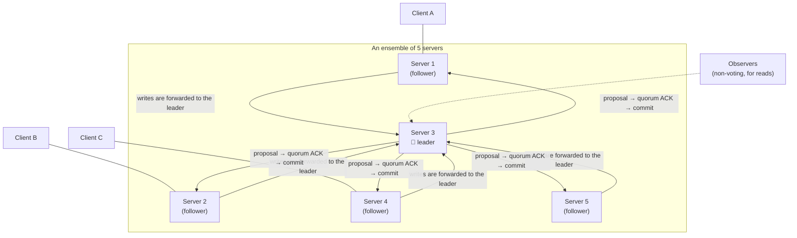
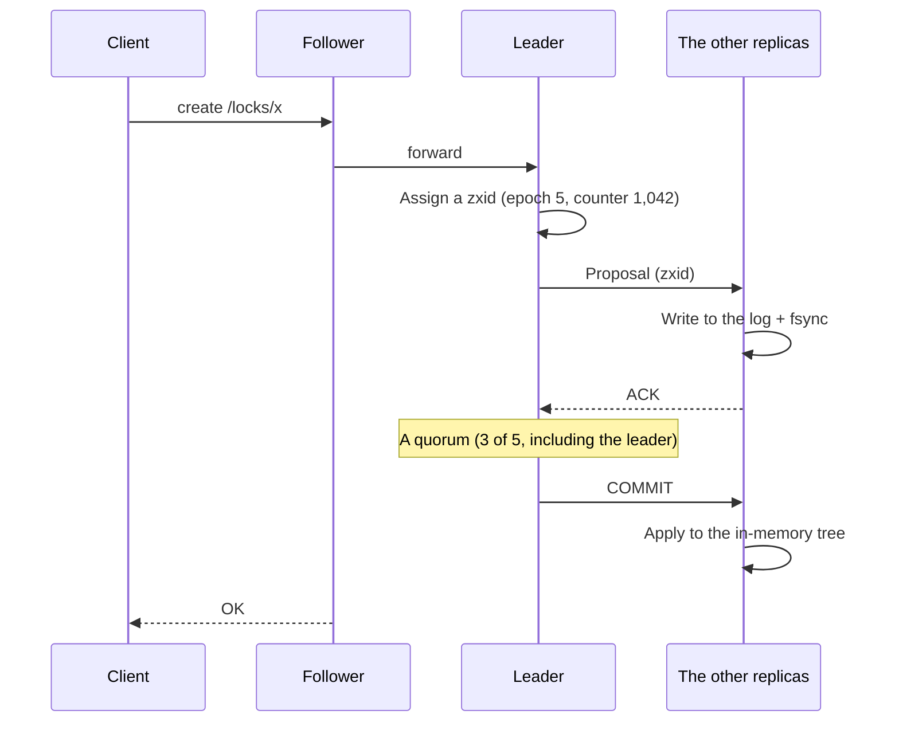
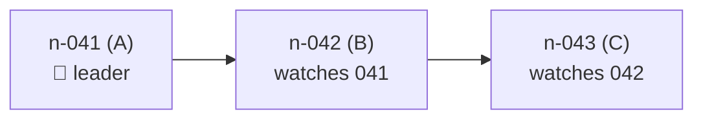
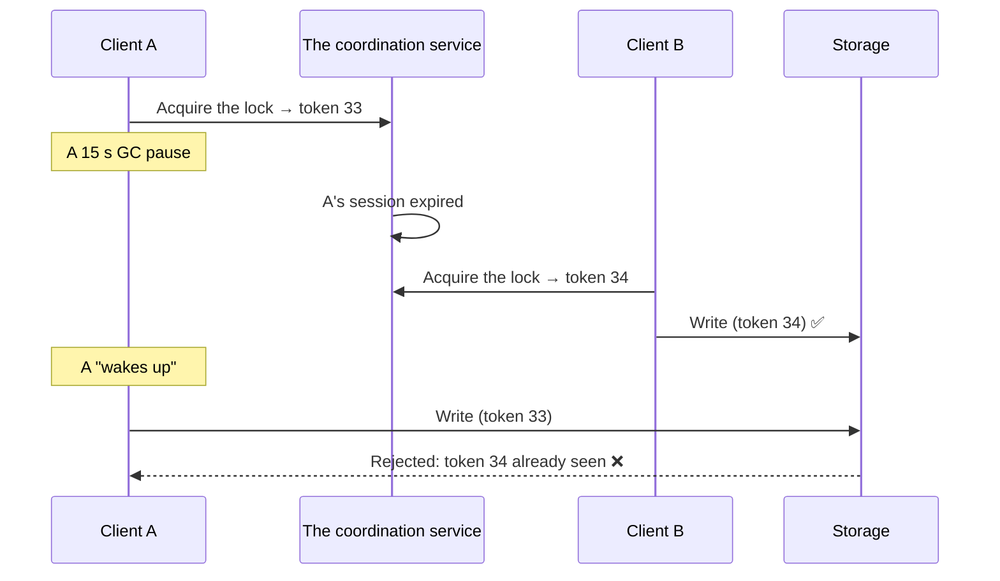

**English** | [Русский](README_RU.md)

# Tier 2 · 4C · 02. A Distributed Lock and Coordination Service (Chubby / ZooKeeper)

> **Level:** Hard · **Interview time:** 45–60 min · **Study time:** ~5 h
> **Key aspects:** a replicated state machine on consensus, a hierarchical namespace, read consistency guarantees, sessions and ephemeral nodes, watches, recipes (leader election, locks, service discovery, configuration), fencing tokens, scaling reads and client-side caching, operations, and what the service shouldn't be
> **Builds on:** [08-consensus](../../../08-consensus/README.md) (Raft, quorums, [leases](../../../08-consensus/README.md#9-leases-and-leader-election-for-applications), [fencing](../../../08-consensus/README.md#10-split-brain-and-fencing-tokens), [the ZooKeeper and etcd overview](../../../08-consensus/README.md#11-coordination-services-zookeeper-etcd-consul)), [07-consistency-models](../../../07-consistency-models/README.md), [Tier 1 · 19 KV Store](../../../tier-1/19-distributed-kv-store/README.md#11-deep-dive-6-membership-and-failure-detection)

---

## 🗺️ How to Read This Walkthrough

The walkthrough follows an interview, but every step includes explanations: **why** a decision is made, **how** a mechanism works and **what happens** if you do it differently. The "📘 Explanation" blocks are theory right where you need it.

| Icon | Meaning |
|:----:|:--------|
| 🎤 | Interviewer |
| 🗣️ | What I (the candidate) say out loud |
| ✏️ | What I draw on the whiteboard |
| ⏱️ | Time budget for the step |
| 📘 | A detailed explanation of a concept |

Callouts: **TIP** — a good technique, **WARNING** — a trap, **IMPORTANT** — a Senior+ signal.

---

## 📑 Contents

0. [What This Problem Teaches](#0-what-this-problem-teaches)
1. [Problem Statement](#1-problem-statement)
2. [Clarifying Questions and Requirements](#2-clarifying-questions-and-requirements)
3. [Capacity Estimates](#3-capacity-estimates)
4. [API](#4-api)
5. [Data Model](#5-data-model)
6. [High-Level Design](#6-high-level-design)
7. [Deep Dive 1: The Replicated State Machine](#7-deep-dive-1-the-replicated-state-machine)
8. [Deep Dive 2: Consistency Guarantees](#8-deep-dive-2-consistency-guarantees)
9. [Deep Dive 3: Sessions, Ephemeral Nodes and Failure Detection](#9-deep-dive-3-sessions-ephemeral-nodes-and-failure-detection)
10. [Deep Dive 4: Watches](#10-deep-dive-4-watches)
11. [Deep Dive 5: Recipes](#11-deep-dive-5-recipes)
12. [Deep Dive 6: Fencing Tokens](#12-deep-dive-6-fencing-tokens)
13. [Deep Dive 7: Scaling Reads and Client-Side Caching](#13-deep-dive-7-scaling-reads-and-client-side-caching)
14. [Deep Dive 8: Operations and Limits of Use](#14-deep-dive-8-operations-and-limits-of-use)
15. [Bottlenecks and Failure Scenarios](#15-bottlenecks-and-failure-scenarios)
16. [What Changes at 10x Scale](#16-what-changes-at-10x-scale)
17. [Key Concepts and New Terms](#17-key-concepts-and-new-terms)
18. [Variations and Follow-Up Questions](#18-variations-and-follow-up-questions)
19. [Common Mistakes](#19-common-mistakes)
20. [Cheat Sheet and Self-Check](#20-cheat-sheet-and-self-check)

---

## 0. What This Problem Teaches

In [08-consensus](../../../08-consensus/README.md) we covered consensus algorithms and how to **use** ZooKeeper and etcd. Here you have to **design such a service**: a small but ultra-reliable store on which other systems build leader election, locks, configuration and service discovery.

What's special about it: it's a **CP system** — consistency matters more than availability. If a coordination service told two clients "you're the leader", the consequences for every system relying on it would be worse than if it were briefly unavailable.

| What's tested | Where it shows up |
|:--------------|:------------------|
| Consensus in practice | A replicated state machine, quorums, leader election |
| Consistency models | Linearizable writes versus possibly stale reads |
| Failure detection | Sessions, timeouts, ephemeral nodes |
| Notifications | Watches and their pitfalls |
| Distributed primitives | Locks and leader election on top of a simple API |
| Safety under process pauses | Fencing tokens |
| The tool's limits | Why it's not a database or a queue |

> [!TIP]
> A strong move in the interview: say the coordination service **doesn't implement locks directly** but offers a small set of primitives (nodes, ephemerality, sequential numbers, watches) from which clients assemble **recipes**. That's how ZooKeeper is designed — and it's what makes it universal.

---

## 1. Problem Statement

> 🎤 "Design a coordination service like Chubby or ZooKeeper: other systems use it for leader election, distributed locks, storing configuration and service discovery. It must be very reliable and strongly consistent."

**How it's used:**

```
A Kafka-like cluster:     elects a controller via the ephemeral node /cluster/controller
The payments service:     takes the lock /locks/payout-batch before starting a payout batch
Every service instance:   registers at /services/search/instance-17 (ephemeral)
                          and is notified when the list of instances changes
Configuration:            /config/feature-flags — clients watch for changes
```

**Time plan:**

| Step | ⏱️ |
|:-----|:--:|
| Requirements | 5 min |
| Estimates | 3 min |
| API and data | 6 min |
| High-level design | 5 min |
| Deep dives | 25–30 min |
| Wrap-up | 3 min |

---

## 2. Clarifying Questions and Requirements

⏱️ 5 min

| My question | Interviewer's answer | What it changes and why |
|:------------|:---------------------|:------------------------|
| Data volume? | Small: kilobytes per node, gigabytes in total | The whole state in each replica's memory |
| Load? | Far more reads than writes; writes — thousands per second | Reads scale with replicas; writes are bounded by consensus |
| Clients? | Tens to hundreds of thousands of sessions | Lots of heartbeats and watches |
| Consistency? | Writes must be strictly linearizable | Consensus on every write |
| Availability? | Survive the failure of 1–2 servers | 3 or 5 replicas |
| What's built on top? | Leader election, locks, configuration, service discovery | A minimal set of universal primitives |
| Fine-grained locks (per request)? | No, coarse-grained: leadership held for minutes and hours | No need for millions of locks per second |

### Functional requirements

1. A hierarchical namespace of nodes with small data.
2. Create, read, update (with a version check), delete; atomic batches of operations.
3. Ephemeral nodes that exist as long as the client's session is alive.
4. Sequential nodes with a monotonically increasing number.
5. Notifications (watches) about changes to nodes and their children.

### Non-functional requirements

| Requirement | Target | Why |
|:------------|:-------|:----|
| Write consistency | Linearizability | Locks and leader election are built on it |
| Availability | Keeps working when a minority of replicas fails | A dependency of many systems |
| Write latency | Milliseconds to tens of ms | Consensus + fsync |
| Read throughput | Hundreds of thousands per second | Configuration and service discovery are read often |
| Durability | An acknowledged write isn't lost | Coordination state is critical |

---

## 3. Capacity Estimates

⏱️ 3 min

```
Replicas:            5 servers (survives 2 failures)
Data:                ~1M nodes × ~1 KB ≈ 1 GB → entirely in each replica's memory
Writes:              consensus via one leader + fsync of the log
                     → on the order of 10,000–50,000 writes/s with batching
Reads:               served locally by any replica
                     → 5 replicas × tens of thousands ≈ hundreds of thousands of reads/s
Sessions:            100,000 clients × a heartbeat every few seconds ≈ tens of thousands/s
```

### Conclusions

| Conclusion | Design consequence |
|:-----------|:-------------------|
| There's little data | A full copy of the state in memory; snapshots and a log on disk |
| Writes are bounded by one leader and the disk | Don't use the service for frequent writes; a dedicated fast disk for the log |
| Reads scale with replicas | Adding non-voting observer replicas |
| Hundreds of thousands of sessions | Heartbeats are handled by the replica the client is connected to |

---

## 4. API

⏱️ 3 min

```
create(path, data, flags)        flags: PERSISTENT | EPHEMERAL | SEQUENTIAL
                                 → the actual path (for SEQUENTIAL, with a number: /locks/lock-0000000042)
delete(path, expected_version)
exists(path, watch?)             → stat (versions, creation and modification zxids) or null
getData(path, watch?)            → (data, stat)
setData(path, data, expected_version)
getChildren(path, watch?)        → a list of names
sync(path)                       ← catch up with the leader before reading
multi([op1, op2, …])             ← an atomic batch: all or nothing

A session: opened on connect, kept alive by heartbeats, has a timeout
```

📘 **`expected_version`** is a conditional update (compare-and-set): the write succeeds only if the node's version hasn't changed. It's the basis of safe configuration changes and counters without locks.

---

## 5. Data Model

⏱️ 3 min

```
/                                    ← a tree of nodes, like a file system
├── config/
│   └── feature-flags               data: {"new_feed": true}, version: 17
├── services/search/
│   ├── instance-0000000017         EPHEMERAL, data: "10.0.3.7:8080", owner: session 0x9a1
│   └── instance-0000000018         EPHEMERAL
├── election/controller/
│   ├── n-0000000041                EPHEMERAL | SEQUENTIAL
│   └── n-0000000042
└── locks/payout-batch/
    └── lock-0000000007             EPHEMERAL | SEQUENTIAL
```

| Node field | Why |
|:-----------|:----|
| data | Small data (a size limit, e.g. 1 MB) |
| version | For conditional updates |
| czxid, mzxid | The transaction IDs of creation and last modification — the global order |
| ephemeralOwner | The session owning an ephemeral node |
| cversion | The version of the children list |

| Storage on a replica | How |
|:---------------------|:----|
| The whole tree in memory | Fast reads |
| **A transaction log** on disk (fsync before acknowledging) | Durability |
| Periodic state **snapshots** | Fast restarts without replaying the whole log |

---

## 6. High-Level Design

⏱️ 5 min



🗣️ "An ensemble of 5 servers, one of which is **the leader**:
- a client holds **a session** with any server; if that server fails, it reconnects to another with the same session;
- **writes** are forwarded to the leader, which orders them and runs them through consensus (a quorum of 3 of 5); every replica applies transactions in the same order — that's **a replicated state machine**;
- **reads** are served locally by the client's server;
- **watches** are registered on the client's server and fire when changes are applied;
- to scale reads — **observers**, which don't vote."

---

## 7. Deep Dive 1: The Replicated State Machine

> 🎤 "How do you guarantee every replica has the same state?"

📘 **A replicated state machine**: if every replica starts from the same state and applies **the same operations in the same order**, they all arrive at the same state. Consensus's job is agreeing on that order (details in [08-consensus](../../../08-consensus/README.md)).

### A write



| Element | Why |
|:--------|:----|
| **zxid** = (the leader's epoch, a counter) | A global order of all transactions; a new epoch on a leader change |
| fsync before ACK | An acknowledged write survives a restart |
| A majority quorum | Any two quorums overlap → a new leader always knows about every committed transaction |
| ZooKeeper uses **ZAB**, etcd — **Raft**, Chubby — **Paxos** | Different algorithms, one idea |

### How many replicas

| Replicas | Quorum | Failures survived | Comment |
|:---------|:-------|:------------------|:--------|
| 3 | 2 | 1 | The production minimum |
| 4 | 3 | 1 | No better than 3, but slower — **an even number is useless** |
| 5 | 3 | 2 | The typical choice: you can maintain one server and survive the failure of another |
| 7 | 4 | 3 | Slower writes (more acknowledgments) |

### Write latency and throughput

📘 Every write is a network round trip to a quorum + **an fsync** to disk. So the transaction log lives on **a dedicated fast disk**, and the leader **batches** writes (several transactions per fsync). Write throughput doesn't grow with more replicas — it actually drops.

---

## 8. Deep Dive 2: Consistency Guarantees

> 🎤 "A client wrote a value, and another client immediately reads from a different replica. What does it see?"

### ZooKeeper's guarantees

| Guarantee | Meaning |
|:----------|:--------|
| **Linearizable writes** | All writes are ordered by a single global order |
| **FIFO per client** | A client's operations execute in the order they were sent |
| **Reads come from the client's replica** | They may be **stale**: the replica hasn't applied the latest transactions yet |
| **Monotonicity** | A client never sees an older state than it already saw (on reconnect, the server must not be behind) |
| `sync()` + a read | The replica catches up with the leader → the read sees everything committed before the sync |

### The stale read trap

```
Client A (on server 1): setData(/config/leader, "A") → OK
Client B (on server 4, 50 ms behind): getData(/config/leader) → "the old value"
```

📘 For most tasks this is acceptable: watches will report the change anyway. But if a decision depends on a value another client just wrote, you need `sync()` before the read.

### Chubby — a different approach

📘 In Chubby (Google), every read and write goes through **the master**, and clients **cache** data with a guarantee: before a change the master sends **invalidations** to every client caching the node and waits for their acknowledgments (or for their lease to expire). So a read from the client's cache is always consistent. The price — load on the master and slower writes.

| | ZooKeeper | Chubby |
|:-|:----------|:-------|
| Reads | From any replica, possibly stale | Via the master or from a consistent client cache |
| Read scaling | Replicas, observers | The client cache |
| Freshness | `sync()` on demand | Always consistent |

---

## 9. Deep Dive 3: Sessions, Ephemeral Nodes and Failure Detection

> 🎤 "How does the service learn that a client holding a lock has died?"

### Sessions

| Mechanism | How |
|:----------|:----|
| A session | Created on connect, with an ID and **a timeout** (e.g. 10 s) |
| Heartbeats | The client pings the server regularly; any request also renews the session |
| A server failure | The client reconnects to another server **with the same session** within the timeout — ephemeral nodes aren't lost |
| A session expiring | Decided by **the leader** (through consensus): every ephemeral node of the session is deleted, and watches fire |

### Ephemeral nodes

📘 An ephemeral node exists as long as its creator's session is alive. It's the main tool for **failure detection**: a service instance registers an ephemeral node; if the process dies or loses the network for longer than the timeout, the node disappears, and every subscriber learns about it.

### The trap: a process pause

```
10:00:00  Client A is the leader (holds an ephemeral node), with a 10 s session
10:00:01  A hits a 15-second garbage collection pause
10:00:11  A's session expired → the node is deleted → B became leader
10:00:16  A "wakes up", doesn't know its session expired, and thinks it's the leader
          → two leaders at once ❌
```

📘 A timeout can't guarantee the old owner **has stopped acting**: a process can be "frozen" (GC, swapping, a paused VM) and resume work without knowing it expired. The fix — **fencing tokens** (deep dive 6).

| Choosing the timeout | Trade-off |
|:---------------------|:----------|
| Short | Fast detection, but false expirations under network delays and pauses |
| Long | Fewer false positives, but longer downtime on a real failure |

---

## 10. Deep Dive 4: Watches

> 🎤 "How do clients learn about changes without constantly polling the server?"

📘 **A watch** is a subscription to a node's changes, set on read: `getData(path, watch=true)`. When the node changes, the server sends the client a notification.

### Classic watches are one-shot

```
1. getData(/config/flags, watch) → data v17, the watch is set
2. Someone changes the node → v18 → a "node changed" notification (with no data)
3. The client reads again getData(/config/flags, watch) → v18 (or already v19), the watch is set again
```

| Property | Consequence |
|:---------|:------------|
| A notification without data | The client rereads and gets **the latest** state |
| One-shot | Changes between the notification and re-registering may be "missed" — but the client still sees the current state on reread; intermediate values don't matter for coordination |
| An ordering guarantee | The client sees the notification before seeing the new value |
| Persistent watches (in newer ZooKeeper versions) | No re-registration needed |

### The herd effect

📘 If 1,000 clients watch one node (e.g. a lock node), its change triggers 1,000 notifications and 1,000 simultaneous requests — **the herd effect**. Recipes are designed so that each client watches **only its predecessor** (deep dive 5).

---

## 11. Deep Dive 5: Recipes

> 🎤 "How do you build leader election and a lock on top of these primitives?"

### Leader election and a lock

```
Each candidate creates an EPHEMERAL | SEQUENTIAL node:
  /election/n-0000000041   ← candidate A
  /election/n-0000000042   ← candidate B
  /election/n-0000000043   ← candidate C

The rule: the leader (lock owner) is the node with the smallest number.
The others watch ONLY their predecessor:
  B watches 041, C watches 042
```



| Event | What happens |
|:------|:-------------|
| A died → its session expired → n-041 is deleted | **Only B** gets the notification; B checks that it's now the smallest → leader |
| B died before A | C gets the notification; C sees it's not the smallest (041 exists) → starts watching 041 |
| A new candidate | Creates a node with a larger number and watches the last one |

| Why this way | Explanation |
|:-------------|:------------|
| An ephemeral node | The leader's death releases leadership automatically |
| A sequential number | A fair queue with no races |
| A watch on the predecessor | No herd effect: one client wakes up when the lock is released |

### Other recipes

| Recipe | How |
|:-------|:----|
| **Service discovery** | Instances create ephemeral nodes under `/services/name/`; clients read the children with a watch |
| **Configuration** | A node with data; clients read it with a watch; changes — `setData` with a version check |
| **A read-write lock** | Sequential `read-` and `write-` nodes; a reader waits only for preceding writers |
| **A barrier** | Wait until a node has N children |
| **Group membership** | Members' ephemeral nodes |

> [!IMPORTANT]
> **Senior+ signal:** draw the recipe with **a watch on the predecessor** and explain why the naive version "everyone watches the lock node" causes the herd effect.

---

## 12. Deep Dive 6: Fencing Tokens

> 🎤 "How do you protect against an old leader that doesn't know its leadership has expired?"

### The problem



### The fix

📘 Along with the lock, the coordination service hands out **a monotonically increasing token** — e.g. the zxid of the lock node's creation (Chubby calls it a sequencer). **The resource** (storage, a database, an external API) remembers the largest token it has seen and **rejects** operations with a smaller one. The old owner, on waking up, can't break anything.

| Detail | Why |
|:-------|:----|
| The coordination service generates the token | It alone knows the global order |
| **The resource** does the check | Only it can reject a late write |
| If the resource can't check tokens | The lock provides only **efficiency** (usually not two workers), not **correctness** — design operations to be idempotent |

More in [08-consensus](../../../08-consensus/README.md#10-split-brain-and-fencing-tokens).

> [!WARNING]
> A lock with a timeout **without fencing** doesn't guarantee mutual exclusion. That's Martin Kleppmann's main argument in his critique of the Redlock algorithm for Redis: no timeout protects against a process pause.

---

## 13. Deep Dive 7: Scaling Reads and Client-Side Caching

> 🎤 "A hundred thousand clients read the configuration. How do you avoid overloading the ensemble?"

| Solution | How | Trade-off |
|:---------|:----|:----------|
| **Reads from followers** | Each replica answers its own clients | Possible staleness |
| **Observers** | Replicas that receive the log but don't vote | More reads without slowing writes |
| **A client cache with invalidation** (Chubby) | The client holds data; the master invalidates before a change | Slower writes; the master tracks caches |
| **Watches instead of polling** | The client reads once and waits for a notification | Fewer requests |
| **Proxies and local agents** | An agent on a machine holds one session for all the machine's processes | Fewer sessions and heartbeats |

### The scaling limit

📘 Every write goes through one leader, and each replica holds all the data. So a single ensemble is limited in **writes and volume**. For large infrastructure — **several ensembles**: e.g. one per cluster or per namespace, rather than one global ensemble for the whole company.

---

## 14. Deep Dive 8: Operations and Limits of Use

> 🎤 "How do you operate such a service, and what shouldn't it be used for?"

### Operations

| Topic | Solution |
|:------|:---------|
| fsync latency | A dedicated fast disk (SSD) for the transaction log |
| GC pauses on servers | Memory tuning; pauses cause leader elections and session expirations |
| Log growth | Regular snapshots and purging old logs |
| Upgrades | Rolling, one server at a time, the leader last |
| Changing the ensemble's membership | Dynamic reconfiguration through consensus |
| Several regions | An ensemble spanning regions pays cross-region latency on writes; often — an ensemble in one region + observers in others |
| Monitoring | Write latency, leader election frequency, session and watch counts, replica lag |

### What the service **shouldn't** be

| Misuse | Why it's bad | What to use |
|:-------|:-------------|:------------|
| A database for business data | Small volume, all in memory, slow writes | An ordinary database |
| A message queue | Frequent writes, a growing number of nodes | Kafka, RabbitMQ |
| A lock per request | Thousands of writes per second through consensus | Partitioning data so locks aren't needed; row-level locks in a DB |
| Storing large values | The node size limit; a full copy in every replica's memory | Object storage, with a reference in the node |

> [!TIP]
> Google's Chubby paper stressed that locks are **coarse-grained**, held for minutes and hours. That's what lets one small ensemble serve thousands of clients.

### Alternatives

| System | Characteristics |
|:-------|:----------------|
| **ZooKeeper** | ZAB, a tree of nodes, ephemeral and sequential nodes, watches |
| **etcd** | Raft, a flat KV store with revisions, leases instead of sessions, watches over key ranges; the basis of Kubernetes |
| **Consul** | Raft, service discovery and health checks out of the box |
| **Chubby** | Paxos, a file-like model, a consistent client cache |

---

## 15. Bottlenecks and Failure Scenarios

| Scenario | What happens | How we protect |
|:---------|:-------------|:---------------|
| The leader fails | Writes are unavailable during the election (seconds) | Fast elections, clients retry |
| A minority of replicas fails | Work continues | A quorum |
| A majority fails | Writes are impossible | A deliberate CP choice; replicas placed in different zones |
| A network partition | The smaller side can't write | Only the side with a quorum continues |
| A stale read | A decision based on old data | `sync()` before reading where needed |
| A leader-client pauses | Two leaders | Fencing tokens |
| The herd effect | A flood of requests when a lock is released | A watch on the predecessor |
| A slow fsync | Every write is delayed | A dedicated disk, batching |
| Using it as a DB | Overload | Clear limits of use |
| Too many watches and sessions | Memory and network load | Agents, observers, several ensembles |

---

## 16. What Changes at 10x Scale

> 🎤 "10× more clients and data?"

| Change | Why |
|:-------|:----|
| **Several ensembles** by cluster or namespace | The single-leader limit |
| **Observers and local agents** | Scaling reads and sessions |
| **Multi-Raft**: many consensus groups for different key ranges | Scaling writes (as in distributed databases) |
| **Client-side caching** | Fewer requests to the ensemble |

---

## 17. Key Concepts and New Terms

### What's applied

| Concept | Where it's covered | How it applies here |
|:--------|:-------------------|:--------------------|
| Raft, quorums, leader elections | [08-consensus](../../../08-consensus/README.md) | The service's core |
| Leases and fencing | [08-consensus](../../../08-consensus/README.md#10-split-brain-and-fencing-tokens) | Protection against an old owner |
| Consistency models | [07-consistency-models](../../../07-consistency-models/README.md) | Linearizable writes, possibly stale reads |
| Failure detection | [Tier 1 · 19](../../../tier-1/19-distributed-kv-store/README.md#11-deep-dive-6-membership-and-failure-detection) | Sessions and timeouts |

### New terms in this problem

| Term | In short |
|:-----|:---------|
| **A replicated state machine** | The same operations in the same order → the same state |
| **zxid** | A global transaction ID: epoch + counter |
| **ZAB** | ZooKeeper's atomic broadcast protocol |
| **A session** | A client's connection to the service, with a timeout |
| **An ephemeral node** | Exists as long as its creator's session is alive |
| **A sequential node** | A name with a monotonically increasing number |
| **A watch** | A one-shot subscription to a node's changes |
| **The herd effect** | A flood of reactions from many clients to one event |
| **A recipe** | A primitive (a lock, leader election) assembled by the client from basic operations |
| **An observer** | A non-voting replica for scaling reads |
| **A fencing token / sequencer** | A monotonic ownership number, checked by the resource |
| **Coarse-grained locks** | Held for minutes and hours, not per request |

---

## 18. Variations and Follow-Up Questions

<details>
<summary><b>Can Redis be used for distributed locks?</b></summary>

`SET key value NX PX 30000` gives a lock with a timeout, fine for **efficiency** (avoiding duplicate work in most cases). It's not enough for **correctness**: Redis's async replication can lose the lock on failover, and a timeout doesn't protect against a process pause. If correctness matters — a consensus-based service and fencing tokens checked by the resource.
</details>

<details>
<summary><b>How does etcd differ from ZooKeeper?</b></summary>

etcd is a flat key space with revisions (each change gets a global revision number, and you can read history), leases instead of sessions (keys attach to a lease with a TTL), watches over key ranges starting from a given revision (no missed changes), and a gRPC API. It became the standard in Kubernetes.
</details>

<details>
<summary><b>Why not 4 replicas instead of 3?</b></summary>

A quorum of 4 is 3 servers, so 4 replicas survive one failure — the same as 3 — but every write waits for more acknowledgments and the chance of a failure is higher. An even number of replicas adds no resilience.
</details>

<details>
<summary><b>How do you implement a distributed counter (e.g. an ID generator)?</b></summary>

With a conditional update: read the value and version, write value + 1 with the expected version, and retry on conflict. Or use sequential nodes. But for high rates it's better to hand out **ranges** of IDs (as in [Tier 1 · 04](../../../tier-1/04-unique-id-generator/README.md)): one write to the service per thousand IDs.
</details>

<details>
<summary><b>What happens to clients during a network partition of the ensemble?</b></summary>

The side with a majority of replicas elects a leader and keeps working. Minority servers can't serve writes and (depending on the mode) reads; their clients reconnect to available majority servers. Sessions of clients that don't reconnect within the timeout expire, and their ephemeral nodes are deleted.
</details>

---

## 19. Common Mistakes

| ❌ Mistake | Why it's bad | ✅ Do this instead |
|:----------|:-------------|:------------------|
| An even number of replicas | No gain in resilience | 3 or 5 |
| Expecting a replica read to see another client's fresh write | Stale data | `sync()` before a critical read |
| Every client watching the lock node | The herd effect | A watch on the predecessor |
| A timeout-based lock without fencing | Two owners after a pause | Fencing tokens checked by the resource |
| Using it as a database or a queue | An overloaded ensemble | Separate systems |
| A lock per request | Thousands of writes through consensus | Coarse-grained locks, partitioning data |
| The log on a shared slow disk | Every write is delayed | A dedicated fast disk |
| One ensemble for the whole company | Limits on writes and volume | Several ensembles |
| A session timeout that's too short | False expirations | Balance against pauses and the network |
| Large values in nodes | Every replica's memory | References to external storage |

---

## 20. Cheat Sheet and Self-Check

### 30-second answer

> A small CP service: an ensemble of 5 replicas (surviving 2 failures; an even number is useless), the whole state in memory, a transaction log with fsync on a dedicated disk, and snapshots. Writes go through the leader, get a zxid (epoch + counter) and are committed by a quorum (ZAB/Raft/Paxos) — a replicated state machine with linearizable writes. Reads are served locally by the client's replica and may be stale; `sync()` for freshness; observers scale reads (Chubby instead keeps a consistent client cache with invalidations). The model is a tree of nodes with versions for compare-and-set; ephemeral nodes live with the session (a timeout, heartbeats, reconnecting to another replica), plus sequential nodes and one-shot watches. Recipes: leader election and locks — ephemeral sequential nodes, the smallest is the owner, and each watches its predecessor (no herd effect); service discovery and configuration — ephemeral nodes and watches. A timeout doesn't protect against a process pause — you need fencing tokens (zxid / sequencer) checked by the resource. Locks are coarse-grained; don't use it as a DB or a queue; for scale — several ensembles.

### Self-check

- [ ] I can explain the replicated state machine and the write path
- [ ] I can explain zxid and why quorums overlap
- [ ] I can justify the number of replicas
- [ ] I can describe the consistency guarantees and when `sync()` is needed
- [ ] I can compare ZooKeeper and Chubby on reads
- [ ] I can explain sessions, ephemeral nodes and the process-pause trap
- [ ] I can describe watches and the herd effect
- [ ] I can draw the leader election recipe with a watch on the predecessor
- [ ] I can explain fencing tokens on a diagram
- [ ] I can say what the service isn't suited for, and how to scale it

### Further reading

- Burrows, *The Chubby Lock Service for Loosely-Coupled Distributed Systems* (OSDI 2006)
- Hunt et al., *ZooKeeper: Wait-free Coordination for Internet-scale Systems* (USENIX ATC 2010)
- Junqueira, Reed, Serafini, *Zab: High-performance broadcast for primary-backup systems* (DSN 2011)
- Martin Kleppmann, *How to do distributed locking* (2016)
- ZooKeeper (Recipes) and etcd documentation
- The [08-consensus](../../../08-consensus/README.md) topic
