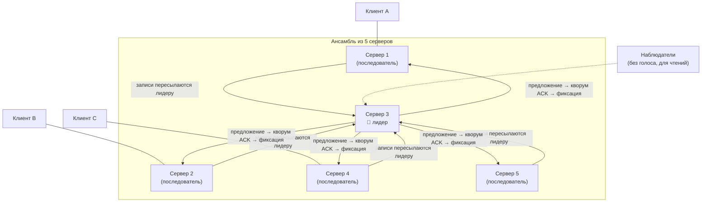
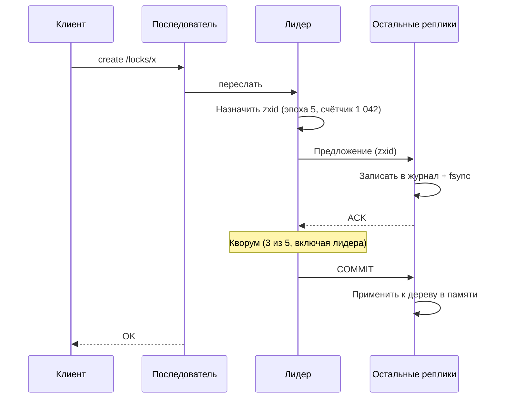
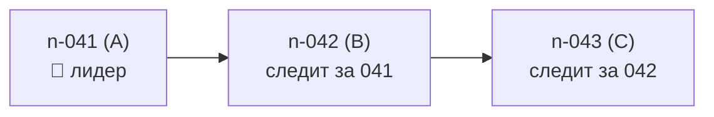
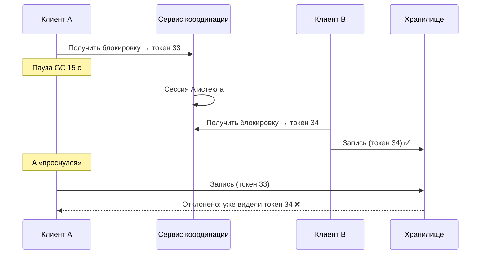

[English](README.md) | **Русский**

# Tier 2 · 4C · 02. Сервис распределённых блокировок и координации (Chubby / ZooKeeper)

> **Уровень:** Hard · **Время на интервью:** 45–60 мин · **Время на разбор:** ~5 ч
> **Ключевые аспекты:** реплицированный конечный автомат на консенсусе, иерархическое пространство имён, гарантии консистентности чтений, сессии и эфемерные узлы, watches, рецепты (выбор лидера, блокировки, обнаружение сервисов, конфигурация), fencing-токены, масштабирование чтений и кэш на клиенте, эксплуатация и чем сервис не должен быть
> **Опирается на:** [08-consensus](../../../08-consensus/README_RU.md) (Raft, кворумы, [лизы](../../../08-consensus/README_RU.md#9-лизы-и-выбор-лидера-для-приложений), [fencing](../../../08-consensus/README_RU.md#10-split-brain-и-fencing-токены), [обзор ZooKeeper и etcd](../../../08-consensus/README_RU.md#11-сервисы-координации-zookeeper-etcd-consul)), [07-consistency-models](../../../07-consistency-models/README_RU.md), [Tier 1 · 19 KV Store](../../../tier-1/19-distributed-kv-store/README_RU.md#11-deep-dive-6-членство-и-обнаружение-отказов)

---

## 🗺️ Как читать этот разбор

Разбор построен как интервью, но в каждом шаге есть объяснения: **почему** принимается решение, **как работает** механизм и **что будет**, если сделать иначе. Блоки «📘 Объяснение» — теория прямо по ходу задачи.

| Значок | Что значит |
|:------:|:-----------|
| 🎤 | Реплика интервьюера |
| 🗣️ | Что говорю вслух я (кандидат) |
| ✏️ | Что рисую на доске |
| ⏱️ | Сколько времени тратить на шаг |
| 📘 | Подробное объяснение концепции |

Блоки **TIP** — хороший приём, **WARNING** — ловушка, **IMPORTANT** — сигнал для уровня Senior+.

---

## 📑 Содержание

0. [Чему учит эта задача](#0-чему-учит-эта-задача)
1. [Условие задачи](#1-условие-задачи)
2. [Уточняющие вопросы и требования](#2-уточняющие-вопросы-и-требования)
3. [Оценки нагрузки](#3-оценки-нагрузки)
4. [API](#4-api)
5. [Модель данных](#5-модель-данных)
6. [High-level дизайн](#6-high-level-дизайн)
7. [Deep dive 1: реплицированный конечный автомат](#7-deep-dive-1-реплицированный-конечный-автомат)
8. [Deep dive 2: гарантии консистентности](#8-deep-dive-2-гарантии-консистентности)
9. [Deep dive 3: сессии, эфемерные узлы и обнаружение отказов](#9-deep-dive-3-сессии-эфемерные-узлы-и-обнаружение-отказов)
10. [Deep dive 4: watches](#10-deep-dive-4-watches)
11. [Deep dive 5: рецепты](#11-deep-dive-5-рецепты)
12. [Deep dive 6: fencing-токены](#12-deep-dive-6-fencing-токены)
13. [Deep dive 7: масштабирование чтений и кэш на клиенте](#13-deep-dive-7-масштабирование-чтений-и-кэш-на-клиенте)
14. [Deep dive 8: эксплуатация и границы применения](#14-deep-dive-8-эксплуатация-и-границы-применения)
15. [Узкие места и сценарии сбоев](#15-узкие-места-и-сценарии-сбоев)
16. [Что изменится при росте в 10 раз](#16-что-изменится-при-росте-в-10-раз)
17. [Ключевые концепции и новые понятия](#17-ключевые-концепции-и-новые-понятия)
18. [Варианты задачи и follow-up вопросы](#18-варианты-задачи-и-follow-up-вопросы)
19. [Типичные ошибки](#19-типичные-ошибки)
20. [Шпаргалка и самопроверка](#20-шпаргалка-и-самопроверка)

---

## 0. Чему учит эта задача

В [08-consensus](../../../08-consensus/README_RU.md) мы разобрали алгоритмы консенсуса и то, как **пользоваться** ZooKeeper и etcd. Здесь нужно **спроектировать такой сервис**: маленькое, но сверхнадёжное хранилище, на котором другие системы строят выбор лидера, блокировки, конфигурацию и обнаружение сервисов.

Особенность задачи: это **CP-система** — консистентность важнее доступности. Если сервис координации вернёт двум клиентам ответ «ты лидер», последствия для всех систем, которые на него полагаются, будут хуже, чем если он на время станет недоступен.

| Что проверяют | Где это в задаче |
|:--------------|:-----------------|
| Консенсус на практике | Реплицированный конечный автомат, кворумы, выбор лидера |
| Модели консистентности | Линеаризуемые записи против устаревающих чтений |
| Обнаружение отказов | Сессии, таймауты, эфемерные узлы |
| Уведомления | Watches и их подводные камни |
| Распределённые примитивы | Блокировки и выбор лидера поверх простого API |
| Безопасность при паузах процессов | Fencing-токены |
| Границы инструмента | Почему это не база данных и не очередь |

> [!TIP]
> Сильный ход на интервью: сказать, что сервис координации **не реализует блокировки напрямую**, а предоставляет небольшой набор примитивов (узлы, эфемерность, последовательные номера, watches), из которых клиенты собирают **рецепты**. Так спроектирован ZooKeeper — и это делает его универсальным.

---

## 1. Условие задачи

> 🎤 «Спроектируй сервис координации, как Chubby или ZooKeeper: другие системы используют его для выбора лидера, распределённых блокировок, хранения конфигурации и обнаружения сервисов. Он должен быть очень надёжным и строго консистентным».

**Как им пользуются:**

```
Kafka-подобный кластер:  выбирает контроллер через эфемерный узел /cluster/controller
Сервис оплат:            берёт блокировку /locks/payout-batch перед запуском пакетной выплаты
Все экземпляры сервиса:  регистрируются в /services/search/instance-17 (эфемерно)
                         и получают уведомления, когда список экземпляров меняется
Конфигурация:            /config/feature-flags — клиенты следят за изменениями
```

**План по времени:**

| Шаг | ⏱️ |
|:----|:--:|
| Требования | 5 мин |
| Оценки | 3 мин |
| API и данные | 6 мин |
| High-level дизайн | 5 мин |
| Deep dives | 25–30 мин |
| Итоги | 3 мин |

---

## 2. Уточняющие вопросы и требования

⏱️ 5 мин

| Мой вопрос | Ответ интервьюера | Что это меняет и почему |
|:-----------|:------------------|:------------------------|
| Объём данных? | Маленький: килобайты на узел, гигабайты всего | Всё состояние в памяти каждой реплики |
| Нагрузка? | Чтений намного больше, чем записей; записи — тысячи в секунду | Чтения масштабируются репликами; записи ограничены консенсусом |
| Клиентов? | Десятки–сотни тысяч сессий | Heartbeats и watches в большом количестве |
| Консистентность? | Записи — строго линеаризуемы | Консенсус на каждую запись |
| Доступность? | Переживать отказ 1–2 серверов | 3 или 5 реплик |
| Что поверх? | Выбор лидера, блокировки, конфигурация, обнаружение сервисов | Минимальный набор универсальных примитивов |
| Тонкие блокировки (на каждый запрос)? | Нет, грубые: лидерство на минуты и часы | Не нужно миллионы блокировок в секунду |

### Функциональные требования

1. Иерархическое пространство имён узлов с небольшими данными.
2. Создание, чтение, обновление (с проверкой версии), удаление; атомарные пакеты операций.
3. Эфемерные узлы, существующие, пока жива сессия клиента.
4. Последовательные узлы с монотонно растущим номером.
5. Уведомления (watches) об изменениях узлов и их детей.

### Нефункциональные требования

| Требование | Цель | Почему |
|:-----------|:-----|:-------|
| Консистентность записей | Линеаризуемость | На нём строятся блокировки и выбор лидера |
| Доступность | Работа при отказе меньшинства реплик | Зависимость многих систем |
| Задержка записи | Миллисекунды–десятки мс | Консенсус + fsync |
| Пропускная способность чтения | Сотни тысяч в секунду | Конфигурация и обнаружение сервисов читаются часто |
| Надёжность | Подтверждённая запись не теряется | Состояние координации критично |

---

## 3. Оценки нагрузки

⏱️ 3 мин

```
Реплики:             5 серверов (переживает отказ 2)
Данные:              ~1 млн узлов × ~1 КБ ≈ 1 ГБ → целиком в памяти каждой реплики
Записи:              консенсус через одного лидера + fsync журнала
                     → порядка 10 000–50 000 записей/с с пакетированием
Чтения:              обслуживаются локально любой репликой
                     → 5 реплик × десятки тысяч ≈ сотни тысяч чтений/с
Сессии:              100 000 клиентов × heartbeat раз в несколько секунд ≈ десятки тысяч/с
```

### Выводы

| Вывод | Следствие для дизайна |
|:------|:----------------------|
| Данных мало | Полная копия состояния в памяти; снимки и журнал на диске |
| Записи упираются в одного лидера и диск | Не использовать сервис для частых записей; отдельный быстрый диск под журнал |
| Чтения масштабируются репликами | Добавление реплик-наблюдателей без голосования |
| Сотни тысяч сессий | Heartbeats обрабатываются репликой, к которой подключён клиент |

---

## 4. API

⏱️ 3 мин

```
create(path, data, flags)        flags: PERSISTENT | EPHEMERAL | SEQUENTIAL
                                 → фактический путь (для SEQUENTIAL с номером: /locks/lock-0000000042)
delete(path, expected_version)
exists(path, watch?)             → stat (версии, zxid создания и изменения) или null
getData(path, watch?)            → (data, stat)
setData(path, data, expected_version)
getChildren(path, watch?)        → список имён
sync(path)                       ← догнать лидера перед чтением
multi([op1, op2, …])             ← атомарный пакет: всё или ничего

Сессия: открывается при подключении, поддерживается heartbeats, имеет таймаут
```

📘 **`expected_version`** — условное обновление (compare-and-set): запись проходит, только если версия узла не изменилась. Это основа безопасных изменений конфигурации и счётчиков без блокировок.

---

## 5. Модель данных

⏱️ 3 мин

```
/                                    ← дерево узлов, как файловая система
├── config/
│   └── feature-flags               data: {"new_feed": true}, version: 17
├── services/search/
│   ├── instance-0000000017         EPHEMERAL, data: "10.0.3.7:8080", owner: session 0x9a1
│   └── instance-0000000018         EPHEMERAL
├── election/controller/
│   ├── n-0000000041                EPHEMERAL | SEQUENTIAL
│   └── n-0000000042
└── locks/payout-batch/
    └── lock-0000000007             EPHEMERAL | SEQUENTIAL
```

| Поле узла | Зачем |
|:----------|:------|
| data | Небольшие данные (ограничение размера, например 1 МБ) |
| version | Для условных обновлений |
| czxid, mzxid | Идентификатор транзакции создания и последнего изменения — глобальный порядок |
| ephemeralOwner | Сессия-владелец эфемерного узла |
| cversion | Версия списка детей |

| Хранение на реплике | Как |
|:--------------------|:----|
| Дерево целиком в памяти | Быстрые чтения |
| **Журнал транзакций** на диске (fsync перед подтверждением) | Долговечность |
| Периодические **снимки** состояния | Быстрый перезапуск без воспроизведения всего журнала |

---

## 6. High-level дизайн

⏱️ 5 мин



🗣️ «Ансамбль из 5 серверов, один из них — **лидер**:
- клиент держит **сессию** с любым сервером; если сервер упал, переподключается к другому с той же сессией;
- **записи** пересылаются лидеру, он упорядочивает их и проводит через консенсус (кворум 3 из 5); каждая реплика применяет транзакции в одном порядке — это **реплицированный конечный автомат**;
- **чтения** обслуживаются локально сервером клиента;
- **watches** регистрируются на сервере клиента и срабатывают при применении изменений;
- для масштабирования чтений — **наблюдатели**, не участвующие в голосовании».

---

## 7. Deep dive 1: реплицированный конечный автомат

> 🎤 «Как гарантировать, что все реплики имеют одинаковое состояние?»

📘 **Реплицированный конечный автомат**: если все реплики начинают с одного состояния и применяют **одни и те же операции в одном порядке**, они приходят к одному состоянию. Задача консенсуса — согласовать этот порядок (подробно — в [08-consensus](../../../08-consensus/README_RU.md)).

### Запись



| Элемент | Зачем |
|:--------|:------|
| **zxid** = (эпоха лидера, счётчик) | Глобальный порядок всех транзакций; новая эпоха при смене лидера |
| fsync перед ACK | Подтверждённая запись переживает перезапуск |
| Кворум большинства | Любые два кворума пересекаются → новый лидер всегда знает о всех зафиксированных транзакциях |
| ZooKeeper использует **ZAB**, etcd — **Raft**, Chubby — **Paxos** | Разные алгоритмы, одна идея |

### Сколько реплик

| Реплик | Кворум | Переживает отказов | Комментарий |
|:-------|:-------|:-------------------|:------------|
| 3 | 2 | 1 | Минимум для продакшена |
| 4 | 3 | 1 | Не лучше 3, но медленнее — **чётное число бесполезно** |
| 5 | 3 | 2 | Типичный выбор: можно обслуживать один сервер и пережить отказ другого |
| 7 | 4 | 3 | Медленнее запись (больше подтверждений) |

### Задержка и пропускная способность записи

📘 Каждая запись — сетевой круг до кворума + **fsync** на диск. Поэтому журнал транзакций держат на **отдельном быстром диске**, а лидер **пакетирует** записи (несколько транзакций в одном fsync). Пропускная способность записи не растёт с добавлением реплик — наоборот, падает.

---

## 8. Deep dive 2: гарантии консистентности

> 🎤 «Клиент записал значение, а другой клиент сразу читает с другой реплики. Что он увидит?»

### Гарантии ZooKeeper

| Гарантия | Что значит |
|:---------|:-----------|
| **Линеаризуемые записи** | Все записи упорядочены одним глобальным порядком |
| **FIFO для клиента** | Операции одного клиента выполняются в порядке отправки |
| **Чтения — с реплики клиента** | Могут быть **устаревшими**: реплика ещё не применила последние транзакции |
| **Монотонность** | Клиент не увидит более старое состояние, чем уже видел (при переподключении сервер должен быть не позади) |
| `sync()` + чтение | Реплика догоняет лидера → чтение видит всё зафиксированное до sync |

### Ловушка устаревшего чтения

```
Клиент A (на сервере 1): setData(/config/leader, "A") → OK
Клиент B (на сервере 4, отстающем на 50 мс): getData(/config/leader) → "старое значение"
```

📘 Для большинства задач это допустимо: watches всё равно сообщат об изменении. Но если решение строится на только что записанном другим клиентом значении — нужен `sync()` перед чтением.

### Chubby — другой подход

📘 В Chubby (Google) все чтения и записи идут через **мастера**, а клиенты **кэшируют** данные с гарантией: мастер перед изменением рассылает **инвалидации** всем клиентам, кэширующим узел, и ждёт их подтверждения (или истечения их лизы). Поэтому чтение из кэша клиента всегда консистентно. Цена — нагрузка на мастера и задержка записей.

| | ZooKeeper | Chubby |
|:-|:----------|:-------|
| Чтения | С любой реплики, возможно устаревшие | Через мастера или из согласованного кэша клиента |
| Масштаб чтений | Реплики, наблюдатели | Кэш на клиенте |
| Свежесть | `sync()` по требованию | Всегда консистентно |

---

## 9. Deep dive 3: сессии, эфемерные узлы и обнаружение отказов

> 🎤 «Как сервис узнаёт, что клиент, державший блокировку, умер?»

### Сессии

| Механизм | Как |
|:---------|:----|
| Сессия | Создаётся при подключении, имеет ID и **таймаут** (например, 10 с) |
| Heartbeats | Клиент регулярно пингует сервер; любые запросы тоже продлевают сессию |
| Отказ сервера | Клиент переподключается к другому серверу **с той же сессией** в пределах таймаута — эфемерные узлы не теряются |
| Истечение сессии | Решает **лидер** (через консенсус): все эфемерные узлы сессии удаляются, срабатывают watches |

### Эфемерные узлы

📘 Эфемерный узел существует, пока жива сессия создателя. Это главный инструмент **обнаружения отказов**: экземпляр сервиса регистрируется эфемерным узлом; если процесс умер или потерял сеть дольше таймаута — узел исчезает, и все подписчики узнают об этом.

### Ловушка: пауза процесса

```
10:00:00  Клиент A — лидер (держит эфемерный узел), сессия 10 с
10:00:01  У A началась пауза сборки мусора на 15 секунд
10:00:11  Сессия A истекла → узел удалён → лидером стал B
10:00:16  A «проснулся», ещё не знает, что сессия истекла, и думает, что он лидер
          → два лидера одновременно ❌
```

📘 Таймаут не может гарантировать, что старый владелец **перестал действовать**: процесс может быть «заморожен» (GC, своп, остановка виртуальной машины) и продолжить работу, не зная об истечении. Решение — **fencing-токены** (deep dive 6).

| Выбор таймаута | Компромисс |
|:---------------|:-----------|
| Короткий | Быстрое обнаружение, но ложные истечения при сетевых задержках и паузах |
| Длинный | Меньше ложных срабатываний, но дольше простой при реальном отказе |

---

## 10. Deep dive 4: watches

> 🎤 «Как клиенты узнают об изменениях, не опрашивая сервер постоянно?»

📘 **Watch** — подписка на изменение узла, устанавливаемая при чтении: `getData(path, watch=true)`. Когда узел меняется, сервер отправляет клиенту уведомление.

### Классические watches — одноразовые

```
1. getData(/config/flags, watch) → данные v17, watch установлен
2. Кто-то меняет узел → v18 → уведомление «узел изменился» (без данных)
3. Клиент снова читает getData(/config/flags, watch) → v18 (или уже v19), watch установлен снова
```

| Свойство | Следствие |
|:---------|:----------|
| Уведомление без данных | Клиент перечитывает и получает **последнее** состояние |
| Одноразовость | Между уведомлением и повторной установкой изменения могут быть «пропущены» — но клиент всё равно увидит актуальное состояние при перечтении; промежуточные значения не важны для координации |
| Гарантия порядка | Клиент увидит уведомление до того, как увидит новое значение |
| Постоянные watches (в новых версиях ZooKeeper) | Не требуют переустановки |

### Эффект стада

📘 Если 1 000 клиентов следят за одним узлом (например, за узлом блокировки), его изменение вызывает 1 000 уведомлений и 1 000 одновременных запросов — **эффект стада** (herd effect). Рецепты строятся так, чтобы каждый клиент следил **только за своим предшественником** (deep dive 5).

---

## 11. Deep dive 5: рецепты

> 🎤 «Как построить выбор лидера и блокировку поверх этих примитивов?»

### Выбор лидера и блокировка

```
Каждый кандидат создаёт EPHEMERAL | SEQUENTIAL узел:
  /election/n-0000000041   ← кандидат A
  /election/n-0000000042   ← кандидат B
  /election/n-0000000043   ← кандидат C

Правило: лидер (владелец блокировки) — узел с наименьшим номером.
Остальные следят ТОЛЬКО за предшественником:
  B следит за 041, C следит за 042
```



| Событие | Что происходит |
|:--------|:---------------|
| A умер → сессия истекла → n-041 удалён | Уведомление получает **только B**; B проверяет, что он теперь наименьший → лидер |
| B умер раньше A | Уведомление получает C; C видит, что он не наименьший (есть 041) → начинает следить за 041 |
| Новый кандидат | Создаёт узел с большим номером и следит за последним |

| Почему так | Объяснение |
|:-----------|:-----------|
| Эфемерный узел | Смерть лидера автоматически освобождает лидерство |
| Последовательный номер | Справедливая очередь без гонок |
| Watch на предшественника | Нет эффекта стада: при освобождении просыпается один клиент |

### Другие рецепты

| Рецепт | Как |
|:-------|:----|
| **Обнаружение сервисов** | Экземпляры создают эфемерные узлы в `/services/name/`; клиенты читают детей с watch |
| **Конфигурация** | Узел с данными; клиенты читают с watch; изменения — `setData` с проверкой версии |
| **Блокировка чтения-записи** | Последовательные узлы `read-` и `write-`; читатель ждёт только предшествующих писателей |
| **Барьер** | Ждать, пока число детей узла не достигнет N |
| **Членство в группе** | Эфемерные узлы участников |

> [!IMPORTANT]
> **Сигнал Senior+:** нарисовать рецепт с **watch на предшественника** и объяснить, почему наивный вариант «все следят за узлом блокировки» вызывает эффект стада.

---

## 12. Deep dive 6: fencing-токены

> 🎤 «Как защититься от старого лидера, который не знает, что его лидерство истекло?»

### Проблема



### Решение

📘 Сервис координации выдаёт вместе с блокировкой **монотонно растущий токен** — например, zxid создания узла блокировки (в Chubby это называется sequencer). **Ресурс** (хранилище, база, внешний API) запоминает наибольший виденный токен и **отклоняет** операции с меньшим. Старый владелец, проснувшись, не сможет ничего испортить.

| Деталь | Почему |
|:-------|:-------|
| Токен генерирует сервис координации | Он единственный знает глобальный порядок |
| Проверку делает **ресурс** | Только он может отклонить запоздавшую запись |
| Если ресурс не умеет проверять токены | Блокировка даёт лишь **эффективность** (обычно не два исполнителя), но не **корректность** — нужно проектировать операции идемпотентными |

Подробнее — в [08-consensus](../../../08-consensus/README_RU.md#10-split-brain-и-fencing-токены).

> [!WARNING]
> Блокировка с таймаутом **без fencing** не гарантирует взаимного исключения. Это главный аргумент Мартина Клеппмана в критике алгоритма Redlock для Redis: никакой таймаут не защищает от паузы процесса.

---

## 13. Deep dive 7: масштабирование чтений и кэш на клиенте

> 🎤 «Сто тысяч клиентов читают конфигурацию. Как не перегрузить ансамбль?»

| Решение | Как | Компромисс |
|:--------|:----|:-----------|
| **Чтения с последователей** | Каждая реплика отвечает своим клиентам | Возможна устарелость |
| **Наблюдатели** (observers) | Реплики, получающие журнал, но не голосующие | Больше чтений без замедления записей |
| **Кэш на клиенте с инвалидацией** (Chubby) | Клиент держит данные; мастер инвалидирует перед изменением | Записи медленнее, мастер следит за кэшами |
| **Watch вместо опроса** | Клиент читает один раз и ждёт уведомления | Меньше запросов |
| **Прокси и локальные агенты** | Агент на машине держит одну сессию за всех процессов машины | Меньше сессий и heartbeats |

### Предел масштабирования

📘 Запись всегда проходит через одного лидера, а данные целиком хранятся в каждой реплике. Поэтому один ансамбль ограничен по **записям и объёму**. Для большой инфраструктуры — **несколько ансамблей**: например, отдельный на каждый кластер или по пространствам имён, а не один глобальный на всю компанию.

---

## 14. Deep dive 8: эксплуатация и границы применения

> 🎤 «Как эксплуатировать такой сервис и для чего его не стоит использовать?»

### Эксплуатация

| Тема | Решение |
|:-----|:--------|
| Задержка fsync | Отдельный быстрый диск (SSD) под журнал транзакций |
| Паузы GC на серверах | Настройка памяти; паузы приводят к выборам лидера и истечению сессий |
| Рост журнала | Регулярные снимки и очистка старых журналов |
| Обновления | Последовательные (rolling), по одному серверу, лидер — последним |
| Смена состава ансамбля | Динамическая реконфигурация через консенсус |
| Несколько регионов | Ансамбль между регионами — запись платит межрегиональную задержку; часто — ансамбль в регионе + наблюдатели в других |
| Мониторинг | Задержка записи, частота выборов лидера, число сессий и watches, отставание реплик |

### Чем сервис **не** должен быть

| Неправильное использование | Почему плохо | Что использовать |
|:---------------------------|:-------------|:-----------------|
| База данных для бизнес-данных | Маленький объём, всё в памяти, медленные записи | Обычная БД |
| Очередь сообщений | Частые записи, рост числа узлов | Kafka, RabbitMQ |
| Блокировка на каждый запрос | Тысячи записей в секунду на консенсусе | Разделение данных так, чтобы блокировки не требовались; блокировки на уровне строк в БД |
| Хранение больших значений | Ограничение размера узла, вся копия в памяти каждой реплики | Объектное хранилище, а в узле — ссылка |

> [!TIP]
> Chubby в статье Google подчёркивал: блокировки — **грубые** (coarse-grained), их держат минуты и часы. Это и позволяет обслуживать тысячи клиентов одним небольшим ансамблем.

### Альтернативы

| Система | Особенности |
|:--------|:------------|
| **ZooKeeper** | ZAB, дерево узлов, эфемерные и последовательные узлы, watches |
| **etcd** | Raft, плоское KV с ревизиями, лизы вместо сессий, watch по диапазону ключей; основа Kubernetes |
| **Consul** | Raft, обнаружение сервисов и проверки здоровья «из коробки» |
| **Chubby** | Paxos, файловая модель, согласованный кэш на клиенте |

---

## 15. Узкие места и сценарии сбоев

| Сценарий | Что произойдёт | Как защищаемся |
|:---------|:---------------|:---------------|
| Отказ лидера | Записи недоступны на время выборов (секунды) | Быстрые выборы, клиенты повторяют |
| Отказ меньшинства реплик | Работа продолжается | Кворум |
| Отказ большинства | Записи невозможны | Сознательный выбор CP; размещение реплик в разных зонах |
| Сетевое разделение | Меньшая часть не может писать | Только сторона с кворумом продолжает |
| Устаревшее чтение | Решение на старых данных | `sync()` перед чтением, где нужно |
| Пауза клиента-лидера | Два лидера | Fencing-токены |
| Эффект стада | Шквал запросов при освобождении блокировки | Watch на предшественника |
| Медленный fsync | Задержка всех записей | Отдельный диск, пакетирование |
| Использование как БД | Перегрузка | Чёткие границы применения |
| Слишком много watches и сессий | Нагрузка на память и сеть | Агенты, наблюдатели, несколько ансамблей |

---

## 16. Что изменится при росте в 10 раз

> 🎤 «В 10 раз больше клиентов и данных?»

| Изменение | Почему |
|:----------|:-------|
| **Несколько ансамблей** по кластерам или пространствам имён | Ограничение одного лидера |
| **Наблюдатели и локальные агенты** | Масштаб чтений и сессий |
| **Multi-Raft**: много групп консенсуса для разных диапазонов ключей | Масштабирование записей (как в распределённых базах) |
| **Кэширование на клиентах** | Меньше запросов к ансамблю |

---

## 17. Ключевые концепции и новые понятия

### Что применяется

| Концепция | Где разобрана | Как применяется здесь |
|:----------|:--------------|:----------------------|
| Raft, кворумы, выборы лидера | [08-consensus](../../../08-consensus/README_RU.md) | Ядро сервиса |
| Лизы и fencing | [08-consensus](../../../08-consensus/README_RU.md#10-split-brain-и-fencing-токены) | Защита от старого владельца |
| Модели консистентности | [07-consistency-models](../../../07-consistency-models/README_RU.md) | Линеаризуемые записи, устаревающие чтения |
| Обнаружение отказов | [Tier 1 · 19](../../../tier-1/19-distributed-kv-store/README_RU.md#11-deep-dive-6-членство-и-обнаружение-отказов) | Сессии и таймауты |

### Новые понятия этой задачи

| Понятие | Кратко |
|:--------|:-------|
| **Реплицированный конечный автомат** | Одинаковые операции в одинаковом порядке → одинаковое состояние |
| **zxid** | Глобальный идентификатор транзакции: эпоха + счётчик |
| **ZAB** | Протокол атомарной рассылки ZooKeeper |
| **Сессия** | Связь клиента с сервисом с таймаутом |
| **Эфемерный узел** | Существует, пока жива сессия создателя |
| **Последовательный узел** | Имя с монотонно растущим номером |
| **Watch** | Одноразовая подписка на изменение узла |
| **Эффект стада** | Шквал реакций многих клиентов на одно событие |
| **Рецепт** | Примитив (блокировка, выбор лидера), собранный клиентом из базовых операций |
| **Наблюдатель** | Реплика без голоса для масштабирования чтений |
| **Fencing-токен / sequencer** | Монотонный номер владения, проверяемый ресурсом |
| **Грубые блокировки** | Держатся минуты и часы, а не на каждый запрос |

---

## 18. Варианты задачи и follow-up вопросы

<details>
<summary><b>Можно ли использовать Redis для распределённых блокировок?</b></summary>

`SET key value NX PX 30000` даёт блокировку с таймаутом, годную для **эффективности** (избежать двойной работы в большинстве случаев). Для **корректности** её недостаточно: асинхронная репликация Redis может потерять блокировку при переключении, а таймаут не защищает от паузы процесса. Если важна корректность — сервис на консенсусе и fencing-токены, проверяемые ресурсом.
</details>

<details>
<summary><b>Чем etcd отличается от ZooKeeper?</b></summary>

etcd — плоское пространство ключей с ревизиями (каждое изменение получает глобальный номер ревизии, можно читать историю), лизы вместо сессий (ключи привязываются к лизе с TTL), watch на диапазон ключей с началом от определённой ревизии (не пропускает изменения), API через gRPC. Он стал стандартом в Kubernetes.
</details>

<details>
<summary><b>Почему не 4 реплики вместо 3?</b></summary>

Кворум из 4 — 3 сервера, значит, 4 реплики переживают отказ одного — как и 3, — но каждая запись ждёт больше подтверждений и вероятность отказа выше. Чётное число реплик не добавляет устойчивости.
</details>

<details>
<summary><b>Как реализовать распределённый счётчик (например, генератор ID)?</b></summary>

Через условное обновление: прочитать значение и версию, записать значение + 1 с ожидаемой версией, при конфликте повторить. Или использовать последовательные узлы. Но для высокой частоты лучше выдавать **диапазоны** ID (как в [Tier 1 · 04](../../../tier-1/04-unique-id-generator/README_RU.md)): одна запись в сервис на тысячу ID.
</details>

<details>
<summary><b>Что произойдёт с клиентами при сетевом разделении ансамбля?</b></summary>

Сторона с большинством реплик выбирает лидера и продолжает работать. Серверы меньшинства не могут обслуживать записи и (в зависимости от режима) чтения; их клиенты переподключаются к доступным серверам большинства. Сессии клиентов, не успевших переподключиться за таймаут, истекают, и их эфемерные узлы удаляются.
</details>

---

## 19. Типичные ошибки

| ❌ Ошибка | Почему плохо | ✅ Как правильно |
|:---------|:-------------|:----------------|
| Чётное число реплик | Нет выигрыша в устойчивости | 3 или 5 |
| Ожидать, что чтение с реплики видит только что записанное другим | Устаревшие данные | `sync()` перед критичным чтением |
| Все клиенты следят за узлом блокировки | Эффект стада | Watch на предшественника |
| Блокировка с таймаутом без fencing | Два владельца после паузы | Fencing-токены, проверяемые ресурсом |
| Использовать как базу данных или очередь | Перегрузка ансамбля | Отдельные системы |
| Блокировки на каждый запрос | Тысячи записей через консенсус | Грубые блокировки, разделение данных |
| Журнал на общем медленном диске | Задержка всех записей | Отдельный быстрый диск |
| Один ансамбль на всю компанию | Предел записей и объёма | Несколько ансамблей |
| Слишком короткий таймаут сессии | Ложные истечения | Баланс с паузами и сетью |
| Большие значения в узлах | Память каждой реплики | Ссылки на внешнее хранилище |

---

## 20. Шпаргалка и самопроверка

### Ответ за 30 секунд

> Небольшой CP-сервис: ансамбль из 5 реплик (переживает 2 отказа; чётное число бесполезно), состояние целиком в памяти, журнал транзакций с fsync на отдельном диске и снимки. Записи идут через лидера, получают zxid (эпоха + счётчик) и фиксируются кворумом (ZAB/Raft/Paxos) — реплицированный конечный автомат, линеаризуемые записи. Чтения — локально с реплики клиента, возможно устаревшие; `sync()` для свежести; наблюдатели масштабируют чтения (Chubby вместо этого держит согласованный кэш на клиенте с инвалидациями). Модель — дерево узлов с версиями для compare-and-set, эфемерные узлы живут с сессией (таймаут, heartbeats, переподключение к другой реплике), последовательные узлы, одноразовые watches. Рецепты: выбор лидера и блокировка — эфемерные последовательные узлы, наименьший — владелец, каждый следит за предшественником (без эффекта стада); обнаружение сервисов и конфигурация — эфемерные узлы и watches. Таймаут не защищает от паузы процесса — нужны fencing-токены (zxid / sequencer), проверяемые ресурсом. Блокировки грубые; не использовать как БД или очередь; для масштаба — несколько ансамблей.

### Самопроверка

- [ ] Могу объяснить реплицированный конечный автомат и путь записи
- [ ] Могу объяснить zxid и почему кворумы пересекаются
- [ ] Могу обосновать число реплик
- [ ] Могу описать гарантии консистентности и когда нужен `sync()`
- [ ] Могу сравнить ZooKeeper и Chubby по чтениям
- [ ] Могу объяснить сессии, эфемерные узлы и ловушку паузы процесса
- [ ] Могу описать watches и эффект стада
- [ ] Могу нарисовать рецепт выбора лидера с watch на предшественника
- [ ] Могу объяснить fencing-токены на диаграмме
- [ ] Могу назвать, для чего сервис не подходит, и как его масштабировать

### Что почитать

- Burrows, *The Chubby Lock Service for Loosely-Coupled Distributed Systems* (OSDI 2006)
- Hunt et al., *ZooKeeper: Wait-free Coordination for Internet-scale Systems* (USENIX ATC 2010)
- Junqueira, Reed, Serafini, *Zab: High-performance broadcast for primary-backup systems* (DSN 2011)
- Martin Kleppmann, *How to do distributed locking* (2016)
- Документация ZooKeeper (Recipes) и etcd
- Тема [08-consensus](../../../08-consensus/README_RU.md)
