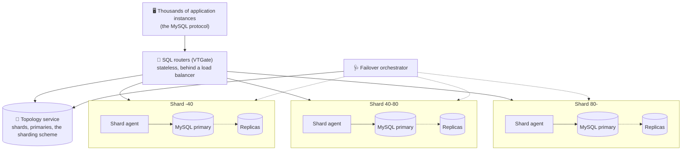
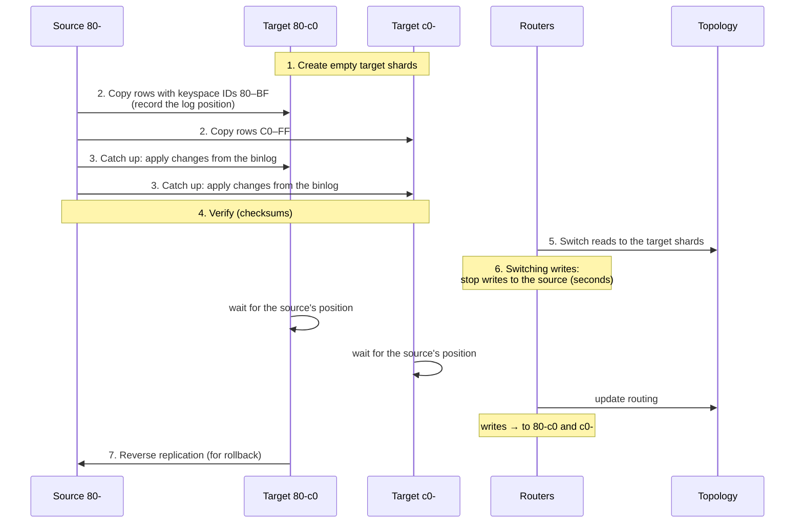
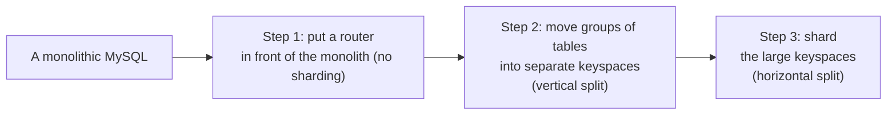

**English** | [Русский](README_RU.md)

# Tier 2 · 4C · 03. A Sharded SQL Database With Online Resharding (like Vitess)

> **Level:** Hard · **Interview time:** 45–60 min · **Study time:** ~5 h
> **Key aspects:** a SQL routing proxy, a topology service, choosing a sharding key, hashing into a keyspace and ranges, lookup indexes for other columns, co-locating related tables, single-shard queries and scatter-gather, cross-shard JOINs and aggregates, transactions, online resharding (copy + log catch-up + verification + cutover), online schema changes, connection pooling, failover
> **Builds on:** [06-partitioning](../../../06-partitioning/README.md), [05-replication](../../../05-replication/README.md), [04-databases](../../../04-databases/README.md), [11-distributed-transactions](../../../11-distributed-transactions/README.md), [Tier 1 · 08 Instagram](../../../tier-1/08-instagram/README.md#13-deep-dive-7-sharding-and-ids)

---

## 🗺️ How to Read This Walkthrough

The walkthrough follows an interview, but every step includes explanations: **why** a decision is made, **how** a mechanism works and **what happens** if you do it differently. The "📘 Explanation" blocks are theory right where you need it.

| Icon | Meaning |
|:----:|:--------|
| 🎤 | Interviewer |
| 🗣️ | What I (the candidate) say out loud |
| ✏️ | What I draw on the whiteboard |
| ⏱️ | Time budget for the step |
| 📘 | A detailed explanation of a concept |

Callouts: **TIP** — a good technique, **WARNING** — a trap, **IMPORTANT** — a Senior+ signal.

---

## 📑 Contents

0. [What This Problem Teaches](#0-what-this-problem-teaches)
1. [Problem Statement](#1-problem-statement)
2. [Clarifying Questions and Requirements](#2-clarifying-questions-and-requirements)
3. [Capacity Estimates](#3-capacity-estimates)
4. [Components](#4-components)
5. [The Sharding Model](#5-the-sharding-model)
6. [High-Level Design](#6-high-level-design)
7. [Deep Dive 1: Choosing a Sharding Key](#7-deep-dive-1-choosing-a-sharding-key)
8. [Deep Dive 2: Query Routing](#8-deep-dive-2-query-routing)
9. [Deep Dive 3: Transactions and Uniqueness](#9-deep-dive-3-transactions-and-uniqueness)
10. [Deep Dive 4: Online Resharding](#10-deep-dive-4-online-resharding)
11. [Deep Dive 5: Online Schema Changes](#11-deep-dive-5-online-schema-changes)
12. [Deep Dive 6: Connection Pooling and Protecting the Database](#12-deep-dive-6-connection-pooling-and-protecting-the-database)
13. [Deep Dive 7: Shard Fault Tolerance](#13-deep-dive-7-shard-fault-tolerance)
14. [Deep Dive 8: Operations and Migrating From a Monolith](#14-deep-dive-8-operations-and-migrating-from-a-monolith)
15. [Bottlenecks and Failure Scenarios](#15-bottlenecks-and-failure-scenarios)
16. [What Changes at 10x Scale](#16-what-changes-at-10x-scale)
17. [Key Concepts and New Terms](#17-key-concepts-and-new-terms)
18. [Variations and Follow-Up Questions](#18-variations-and-follow-up-questions)
19. [Common Mistakes](#19-common-mistakes)
20. [Cheat Sheet and Self-Check](#20-cheat-sheet-and-self-check)

---

## 0. What This Problem Teaches

Almost every successful company goes down this path: a single MySQL or PostgreSQL database stops coping — on volume, on writes, or on connections. Rewriting the application for NoSQL is years of work. Instead you can **shard the relational database transparently**: the application keeps speaking SQL, while the system decides which shard to send each query to and can split shards without downtime.

Vitess, created at YouTube and used by Slack among others, is the best-known example of such a system. The problem tests whether you understand **what breaks** when one database becomes hundreds, and how to live with it.

| What's tested | Where it shows up |
|:--------------|:------------------|
| Partitioning in practice | A sharding key, ranges in a hash space |
| Routing | A proxy that parses SQL |
| Indexes at scale | Lookups by columns that aren't the key |
| Distributed queries | Scatter-gather, JOINs and aggregates across shards |
| Transactions | ACID within a shard, trade-offs across shards |
| Zero-downtime migrations | Online resharding and schema changes |
| Operations | Connection pooling, failover, protecting the database |

> [!TIP]
> The key idea: **a good sharding key makes most queries and transactions single-shard**, and then the system behaves like many ordinary databases. Everything hard (scatter-gather, cross-shard transactions) is an exception to minimize through data design.

---

## 1. Problem Statement

> 🎤 "An application runs on a single MySQL that has hit its limits. Design a system that shards MySQL transparently to the application: the application sends ordinary SQL, and the system routes it. As data grows, shards must split without stopping the service."

**What it looks like to the application:**

```sql
-- The application connects to one address and writes ordinary SQL
SELECT * FROM orders WHERE customer_id = 42 ORDER BY created_at DESC LIMIT 20;
INSERT INTO orders (customer_id, total) VALUES (42, 99.90);

-- The system works out on its own: customer_id = 42 → shard 80-c0
```

**Time plan:**

| Step | ⏱️ |
|:-----|:--:|
| Requirements | 5 min |
| Estimates | 3 min |
| Components and the model | 7 min |
| High-level design | 5 min |
| Deep dives | 25 min |
| Wrap-up | 3 min |

---

## 2. Clarifying Questions and Requirements

⏱️ 5 min

| My question | Interviewer's answer | What it changes and why |
|:------------|:---------------------|:------------------------|
| Volume and load? | ~100 TB, ~1M queries/s, growing | Hundreds of shards |
| Change the application? | Minimally: SQL stays | A proxy that understands SQL |
| Transactions? | Needed, mostly within a single customer | A sharding key per customer |
| How many application instances? | Thousands | Connection pooling is essential |
| Downtime during resharding? | A few seconds of write unavailability at most | Online resharding |
| Schema changes? | Frequent, on large tables | Online migrations |
| Fault tolerance? | Automatic failover, no loss of acknowledged writes | Semi-sync replication, failover |

### Functional requirements

1. Transparently routing SQL queries to the right shards.
2. Queries without a sharding key (with limitations).
3. Transactions within a shard; defined behavior for cross-shard ones.
4. Splitting and merging shards without downtime.
5. Changing the schema without locks across every shard.
6. Backups, restores, read replicas.

### Non-functional requirements

| Requirement | Target | Why |
|:------------|:-------|:----|
| Latency | Like a single MySQL + a few ms for the proxy | The application shouldn't notice |
| Scalability | Adding shards increases capacity almost linearly | Data growth |
| Availability | A single shard's failure affects only its data | Isolation |
| Resharding | No downtime; writes unavailable for seconds | The business keeps running |
| Data safety | No loss on failover | Money, orders |

---

## 3. Capacity Estimates

⏱️ 3 min

```
Data:              100 TB
Shard size:        ~250 GB – 1 TB (the practical sweet spot: a backup, a restore
                   and building a replica take hours, not days)
                   → ~100–400 shards
Queries:           1M/s ÷ ~200 shards ≈ 5,000/s per shard — comfortable for MySQL
Connections:       10,000 application instances × 50 connections = 500,000
                   A single MySQL server handles thousands of connections, not hundreds of thousands
                   → connection pooling in the proxy
```

### Conclusions

| Conclusion | Design consequence |
|:-----------|:-------------------|
| Shards are small | Fast restores and resharding |
| Hundreds of thousands of connections | Pooling at the proxy and the shard agents |
| Per-shard load is moderate | Each shard is an ordinary MySQL with replicas |

---

## 4. Components

⏱️ 3 min

| Component (the Vitess name) | Role |
|:----------------------------|:-----|
| **A SQL router** (VTGate) | A stateless proxy: accepts SQL over the MySQL protocol, parses the query, determines the shards, sends it, gathers the result |
| **A shard agent** (VTTablet) | Next to each MySQL: connection pooling, protection from heavy queries, replication, taking part in resharding |
| **A topology service** (etcd / ZooKeeper) | Where each shard is, which servers it has, who's primary, the sharding scheme |
| **A MySQL primary + replicas** | In each shard |
| **A failover orchestrator** (VTOrc) | Detecting a primary failure and promoting a replica |

---

## 5. The Sharding Model

⏱️ 4 min

### Keyspaces and keyspace IDs

📘 **A keyspace** is a logical database (a set of tables) split into shards. For each row a **keyspace ID** is computed — e.g. a hash of the sharding key's value. Shards are **ranges** of keyspace IDs:

```
keyspace ID = hash(customer_id)   (a 64-bit value, written in hex)

Shard "-80":   keyspace IDs from 00… to 7F…   (the first half of the space)
Shard "80-":   from 80… to FF…                (the second half)

After resharding shard "80-":
Shard "80-c0": from 80… to BF…
Shard "c0-":   from C0… to FF…
```

| Why a hash, then ranges | Explanation |
|:------------------------|:------------|
| The hash | Even distribution of customers across the space |
| Ranges of the hash | A shard splits in half by a simple cut in its range — data moves only out of the shard being split |

### Vindexes

📘 **A vindex** (in Vitess) is a rule for deriving the keyspace ID from a column's value.

| Type | How | Example |
|:-----|:----|:--------|
| **Primary (hash)** | keyspace ID = hash(column) | `customer_id` → a shard |
| **Lookup** | A separate `value → keyspace ID` table | `email → customer_id`, to find a customer by email without querying every shard |
| A unique lookup | A lookup with a uniqueness constraint | Email is globally unique |

### Co-location

```
customers   — sharded by customer_id
orders      — sharded by customer_id (the same vindex!)
order_items — sharded by customer_id (stores customer_id, even though it logically belongs to an order)

→ a customer, their orders and order items live in one shard
→ JOINs and transactions for a customer are single-shard
```

| Table type | How it's placed |
|:-----------|:----------------|
| Related to the customer | By the same key |
| **Reference tables** (countries, currencies) | **A copy in every shard** — local JOINs |
| Rarely used global data | A separate unsharded keyspace |

---

## 6. High-Level Design

⏱️ 5 min



🗣️ "The application connects to **the routers** over the ordinary MySQL protocol. A router parses the SQL, determines the shards from **the sharding scheme** in the topology service, and sends queries to **the shard agents**. An agent holds a connection pool to MySQL and protects it from heavy queries. Each shard has a primary and replicas; **the orchestrator** handles failures."

---

## 7. Deep Dive 1: Choosing a Sharding Key

> 🎤 "How do you choose a sharding key?"

### Criteria

| Criterion | Why |
|:----------|:----|
| **It's present in most queries** | Otherwise queries become scatter-gather |
| **Transactions fit within one key value** | Single-shard transactions |
| **An even distribution** | No hot shards |
| **Related data groups together** | Single-shard JOINs |
| The value doesn't change | Changing the key = moving the row between shards |

### Examples

| Product | A good key | A bad key | Why |
|:--------|:-----------|:----------|:----|
| An online store | `customer_id` | `order_id` | "A customer's orders" queries and a customer's transactions stay in one shard |
| B2B SaaS | `tenant_id` | `user_id` | A company's data stays together; but huge customers → hot shards |
| A messenger | `conversation_id` | `sender_id` | Reading a conversation — one shard |
| An event log | `device_id` | `timestamp` | Time → every write goes to the last shard |

> [!WARNING]
> **Huge customers in multi-tenant SaaS.** If the key is `tenant_id`, one big customer may not fit into a shard or may overload it. Fixes: a dedicated shard for the big customer (a keyspace ID via a lookup pointing at a separate range) or a composite key (`tenant_id` + `user_id`) for big customers.

---

## 8. Deep Dive 2: Query Routing

> 🎤 "How does the router execute different kinds of queries?"

### Query types

| Query | Routing | Cost |
|:------|:--------|:-----|
| `WHERE customer_id = 42` | hash(42) → one shard | Like an ordinary query ⭐ |
| `WHERE customer_id IN (1, 7, 42)` | Several shards, only the needed ones | Several queries in parallel |
| `WHERE email = 'a@b.c'` | The lookup table → customer_id → a shard | Two queries |
| `WHERE created_at > …` (no key) | **Scatter-gather**: every shard | Expensive: N queries |

### Scatter-gather with sorting and a limit

```sql
SELECT * FROM orders WHERE status = 'paid' ORDER BY created_at DESC LIMIT 10;
```

```
1. Send the query with ORDER BY … LIMIT 10 to EACH of the N shards
2. Each shard returns its own top 10
3. The router merges N × 10 rows and takes the overall top 10
```

### Aggregates

| Aggregate | How it's computed |
|:----------|:------------------|
| `COUNT(*)`, `SUM(x)` | Partial on each shard, then summed |
| `MIN`, `MAX` | Partial, then the minimum or maximum |
| `AVG(x)` | **Not an average of averages!** Rewritten into `SUM(x)` and `COUNT(x)` on the shards, then divided |
| `COUNT(DISTINCT x)` | Hard: the values must be gathered, or an approximation used |
| `GROUP BY` the sharding key | Each group lives entirely in one shard — just concatenate |

### Cross-shard JOINs

```sql
SELECT o.id, p.name FROM orders o JOIN products p ON o.product_id = p.id WHERE o.customer_id = 42;
```

| Case | How it executes |
|:-----|:----------------|
| Both tables sharded by the same key, JOINed on it | Inside the shard — an ordinary JOIN |
| `products` is a reference table copied into every shard | Inside the shard |
| The tables are sharded differently | The router runs **a nested loop**: fetch orders from the customer's shard, then query the product shards for the `product_id`s found |

> [!IMPORTANT]
> **Senior+ signal:** know that scatter-gather is **N queries per call**, and with hundreds of shards it quickly eats capacity. A good architecture keeps such queries rare: analytics goes to a separate store (via CDC), and frequent keyless queries use lookup indexes or denormalization.

---

## 9. Deep Dive 3: Transactions and Uniqueness

> 🎤 "How do transactions work when the data is in different shards?"

| Case | Behavior |
|:-----|:---------|
| A transaction in one shard | Full MySQL ACID |
| A transaction across several shards, "one by one" mode | The router commits shards sequentially; a failure midway leaves some shards committed and others not — **not atomic** |
| Two-phase commit (2PC) | Atomic, but slower, and blocking if the coordinator fails (see [11-distributed-transactions](../../../11-distributed-transactions/README.md)) |
| **The best path** | A data design where transactions are single-shard; cross-shard processes as sagas |

### Global uniqueness

📘 A `UNIQUE(email)` constraint in each shard only checks uniqueness within that shard. For global uniqueness — **a unique lookup vindex**:

```
1. Inserting a customer with an email → first INSERT into the lookup table email → keyspace_id
   (the lookup table is itself sharded by the email's hash and has UNIQUE)
2. Success → insert the customer into their shard
3. A conflict in the lookup → the email is taken
```

It's the same "reserve → create" idea as for usernames in [the global profile service](../../4b-social-media/04-global-profile-service/README.md#11-deep-dive-5-globally-unique-usernames).

### Auto-increment

📘 `AUTO_INCREMENT` in each shard produces repeating IDs. Fixes: **sequences** — a separate unsharded table handing out blocks of IDs (Vitess sequences), or Snowflake-like IDs (see [Tier 1 · 04](../../../tier-1/04-unique-id-generator/README.md)).

---

## 10. Deep Dive 4: Online Resharding

> 🎤 "Shard 80- has grown to 2 TB. How do you split it in half without downtime?"



### Steps

| Step | What happens | Why it matters |
|:-----|:-------------|:---------------|
| 1. Targets | Empty shards are created with a primary and replicas | The source keeps serving traffic |
| 2. Copy | Rows are copied in batches from **a replica** of the source (so the primary isn't loaded); the log position is recorded | Terabytes can be copied without stopping writes |
| 3. Catch-up | Changes from the source's binlog after that position are applied to the targets, each row to its target shard by keyspace ID | The targets continuously catch up with the source |
| 4. Verification | Checksums of the source's and targets' rows (VDiff in Vitess) | Making sure the data matches |
| 5. Reads | Routing reads to the targets | Safe: it can be switched back |
| 6. Writes | Briefly stop writes to the source → wait until the targets reach the same position → switch routing → resume | The only moment of write unavailability — seconds |
| 7. Reverse replication | From the targets to the source | Rollback if something goes wrong |
| 8. Cleanup | Deleting the source after an observation period | — |

📘 The same mechanism (copy + log catch-up + cutover) is used to **move tables** between keyspaces — e.g. when carving tables out of a monolithic database (MoveTables in Vitess).

> [!TIP]
> The router can **buffer** queries during the write cutover: the application sees a couple of seconds of latency rather than errors.

---

## 11. Deep Dive 5: Online Schema Changes

> 🎤 "You need to add a column to a 500 GB table across 200 shards. How do you avoid locking the database?"

### The problem

📘 Many `ALTER TABLE`s on large tables rebuild the whole table, and some block writes for a long time. On a replica, such an ALTER causes huge replication lag.

### A shadow table

```
1. Create a shadow table _orders_new with the new schema
2. Copy rows from orders to _orders_new in batches (rate-limited)
3. Apply ongoing changes to orders onto _orders_new
   (via the binlog — like gh-ost and Vitess online DDL — or via triggers — like pt-online-schema-change)
4. Once caught up — atomically rename: orders → _orders_old, _orders_new → orders
5. Drop _orders_old later
```

| Decision | Why |
|:---------|:----|
| **Throttling by replica lag** | The migration slows down if replicas fall behind |
| Orchestration across every shard | Starting, tracking and resuming on hundreds of shards |
| **Backward-compatible changes** (expand → migrate → contract) | First add the new column, then roll out code that uses it, and only then remove the old — schema and code never diverge |
| The ability to cancel | Until the cutover, just drop the shadow table |

---

## 12. Deep Dive 6: Connection Pooling and Protecting the Database

> 🎤 "10,000 application instances, each with a pool of 50 connections. What happens to MySQL?"

| Solution | How |
|:---------|:----|
| **Pooling at the router and the agent** | The application holds connections to the router (cheap); the shard agent holds a small pool to MySQL (hundreds) |
| **Query limits** | A query timeout, a cap on result rows, rejecting queries without a WHERE on large tables |
| **Consolidating identical queries** | If hundreds of identical reads arrive at once, one goes to MySQL and the result is shared (query consolidation) |
| **Throttling by replica lag** | Bulk operations (reprocessing, migrations) slow down if replicas lag |
| Query blocking rules | Quickly forbid a specific problematic query without deploying the application |

---

## 13. Deep Dive 7: Shard Fault Tolerance

> 🎤 "One shard's primary has died. What happens?"

| Step | How |
|:-----|:----|
| Replication | **Semi-synchronous**: the primary acknowledges a commit once at least one replica has received the change — acknowledged writes aren't lost |
| Detection | The orchestrator checks the primary and replicas |
| Choosing the new primary | The replica with the freshest log position |
| Fencing the old one | The old primary is set read-only / shut down, so there aren't two primaries |
| Updating the topology | Routers learn the new primary |
| **Buffering** | The router holds writes during the failover (seconds), then sends them to the new primary |

| Failure | Consequences |
|:--------|:-------------|
| One shard's primary | That shard's writes are unavailable for seconds; other shards keep working |
| A replica | Reads are redirected to other replicas |
| A router | Stateless — the load balancer removes it |
| The topology service | Routers keep working on the cached topology; changes (failover, resharding) are temporarily impossible |

---

## 14. Deep Dive 8: Operations and Migrating From a Monolith

### Migrating from a single database



| Step | Why |
|:-----|:----|
| A router in front of the monolith | The application moves to the new connection address without changing data; queries incompatible with sharding can be fixed |
| A vertical split | Different domains (users, orders, analytics) into different databases; often this alone is enough |
| A horizontal split | Only for tables that really don't fit |

### Operations

| Topic | Solution |
|:------|:---------|
| Backups | Per shard; a new replica = a restore from backup + log catch-up |
| A hot shard | Monitoring per-shard load → resharding or carving out a big customer |
| Replicas in other regions | Reads and disaster recovery |
| Analytics | CDC from the shards → a data warehouse, rather than scatter-gather across production |
| Monitoring | Per-shard latency, replica lag, the share of scatter queries |

---

## 15. Bottlenecks and Failure Scenarios

| Scenario | What happens | How we protect |
|:---------|:-------------|:---------------|
| A query without the sharding key | N queries | Lookup indexes, denormalization, analytics off production |
| `AVG` across shards | A wrong average | Rewriting into SUM and COUNT |
| A cross-shard transaction | A partial commit | Single-shard design, 2PC or sagas |
| Global uniqueness | Duplicates | A unique lookup vindex |
| Auto-increment | Repeating IDs | Sequences, Snowflake |
| A hot shard (a big customer) | Overload | A dedicated shard, resharding |
| A shard has grown | Slow backups and restores | Online resharding |
| An ALTER on a huge table | Locks, replica lag | A shadow table, throttling |
| 500,000 connections | MySQL can't cope | Pooling at the proxy and agent |
| A primary failure | The shard's writes are unavailable | Semi-sync replication, automatic failover, buffering |
| A failure during the write cutover | Data loss or a split | Waiting for the log position, reverse replication for rollback |

---

## 16. What Changes at 10x Scale

> 🎤 "A petabyte of data and 10 million queries per second?"

| Change | Why |
|:-------|:----|
| **Thousands of shards**, automated resharding | Manual management is impossible |
| **Several keyspaces** by domain | Load isolation |
| **Regional shards** | Latency and data residency |
| **Consider NewSQL** (Spanner, CockroachDB, TiDB) for new systems | Automatic sharding and distributed transactions out of the box |

---

## 17. Key Concepts and New Terms

### What's applied

| Concept | Where it's covered | How it applies here |
|:--------|:-------------------|:--------------------|
| The partition key, rebalancing, secondary indexes | [06-partitioning](../../../06-partitioning/README.md) | The basis of sharding |
| Replication, failover | [05-replication](../../../05-replication/README.md) | A shard = a primary + replicas |
| Transactions, locks | [04-databases](../../../04-databases/README.md) | ACID within a shard, online ALTERs |
| 2PC, sagas, CDC | [11-distributed-transactions](../../../11-distributed-transactions/README.md) | Cross-shard transactions, analytics |
| The shard in the ID | [Tier 1 · 08](../../../tier-1/08-instagram/README.md#13-deep-dive-7-sharding-and-ids) | An alternative approach to routing |

### New terms in this problem

| Term | In short |
|:-----|:---------|
| **A keyspace** | A logical database split into shards |
| **A keyspace ID** | A hash of the sharding key; shards are ranges of it |
| **A vindex** | A rule for deriving the keyspace ID from a column |
| **A lookup vindex** | A "value → keyspace ID" table for lookups by other columns |
| **A reference table** | A copy in every shard for local JOINs |
| **Scatter-gather** | A query to every shard, merging the results |
| **Online resharding** | Copy + log catch-up + verification + cutover |
| **VReplication** | Vitess's mechanism for streaming replication between shards |
| **A shadow table** | An online schema change via a copy and an atomic rename |
| **Expand / contract** | Backward-compatible schema changes in several steps |
| **Query buffering** | Holding queries during a cutover |

---

## 18. Variations and Follow-Up Questions

<details>
<summary><b>How does Vitess differ from Spanner or CockroachDB?</b></summary>

Vitess shards ordinary MySQL: transactions and indexes live within a shard, a human chooses the sharding key, and cross-shard transactions are limited. NewSQL databases (Spanner, CockroachDB, TiDB) split data into ranges and move them on their own, and provide distributed ACID transactions via consensus — more convenient, but with a different performance and operational model. Vitess is good for migrating existing MySQL systems without a rewrite.
</details>

<details>
<summary><b>What if a customer's customer_id changes (e.g. merging accounts)?</b></summary>

Changing the sharding key means moving all of the customer's rows to another shard: copying to the target shard, deleting from the source, and updating lookup tables. It's done as a rare, process-style operation, and the design tries to choose immutable keys.
</details>

<details>
<summary><b>How do you build a secondary index that needs ranges (e.g. by date)?</b></summary>

A lookup vindex suits exact lookups. For ranges over a non-key column — either scatter-gather with a LIMIT (if rare) or a separate store built via CDC (e.g. a search index or an analytical DB).
</details>

<details>
<summary><b>Why not shard in application code?</b></summary>

You can (many started that way, including Instagram), but the logic for routing, resharding, connection pooling and failover gets smeared across every service. A proxy centralizes it: resharding needs no application changes, and keyless queries are handled uniformly.
</details>

<details>
<summary><b>How do you guarantee reading your own writes when reading from replicas?</b></summary>

Send reads that need fresh data to the primary and the rest to replicas. Or pass along the log position (GTID) of the last write and read from a replica that has applied it.
</details>

---

## 19. Common Mistakes

| ❌ Mistake | Why it's bad | ✅ Do this instead |
|:----------|:-------------|:------------------|
| A sharding key absent from queries | Almost everything becomes scatter-gather | A key from the main queries |
| A time-based key | Every write goes to the last shard | A hash of the entity key |
| Related tables sharded by different keys | Cross-shard JOINs and transactions | Co-location |
| `AVG` as an average of averages | A wrong result | SUM / COUNT |
| `UNIQUE` only within a shard | Global duplicates | A unique lookup |
| `AUTO_INCREMENT` in shards | ID conflicts | Sequences, Snowflake |
| Resharding with downtime | Hours of outage | Copy + catch-up + a fast cutover |
| A plain ALTER on a huge table | Locks and lag | A shadow table |
| The application connects to MySQL directly | Hundreds of thousands of connections | Pooling at the proxy |
| Async replication with automatic failover | Losing acknowledged writes | Semi-sync replication |
| Analytics via scatter queries across production | Load on every shard | CDC into a data warehouse |

---

## 20. Cheat Sheet and Self-Check

### 30-second answer

> The application talks to stateless routers (VTGate) over the MySQL protocol; using the sharding scheme from the topology service, they send queries to shard agents (VTTablet), which hold connection pools to MySQL and protect it (timeouts, limits, consolidating identical queries, throttling by replica lag). The sharding key (e.g. customer_id) is hashed into a keyspace ID, and shards are ranges of that space; related tables are placed by the same key and reference tables are copied into every shard — most queries, JOINs and transactions are single-shard. Lookups by other columns and global uniqueness — a lookup vindex; IDs — sequences. Keyless queries are scatter-gather (ORDER BY LIMIT partially on shards, AVG via SUM/COUNT) — keep them rare and do analytics via CDC. Cross-shard transactions — one by one (not atomic), 2PC or sagas. Online resharding: empty targets → copy from a replica with a log position → binlog catch-up → verification → switching reads → a brief write stop and cutover with buffering → reverse replication for rollback. Schema — shadow tables and expand/contract. A shard: a primary + replicas, semi-sync replication, automatic failover.

### Self-check

- [ ] I can name the components and their roles
- [ ] I can explain the keyspace ID and why shards are ranges of a hash
- [ ] I can choose a sharding key by the criteria and give bad examples
- [ ] I can explain co-location and reference tables
- [ ] I can describe how different query types are routed
- [ ] I can execute ORDER BY LIMIT and AVG across shards
- [ ] I can explain cross-shard transaction behavior and global uniqueness
- [ ] I can describe online resharding step by step
- [ ] I can explain online schema changes and expand/contract
- [ ] I can describe shard failover and connection pooling

### Further reading

- Vitess documentation: architecture, VSchema and vindexes, VReplication, MoveTables, Reshard, online DDL
- Sugu Sougoumarane's talks on building Vitess at YouTube
- Slack Engineering, *Scaling Datastores at Slack with Vitess* (2020)
- GitHub Engineering articles on gh-ost and scaling MySQL
- The [06-partitioning](../../../06-partitioning/README.md) topic
