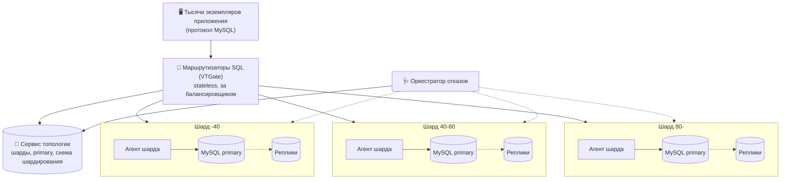
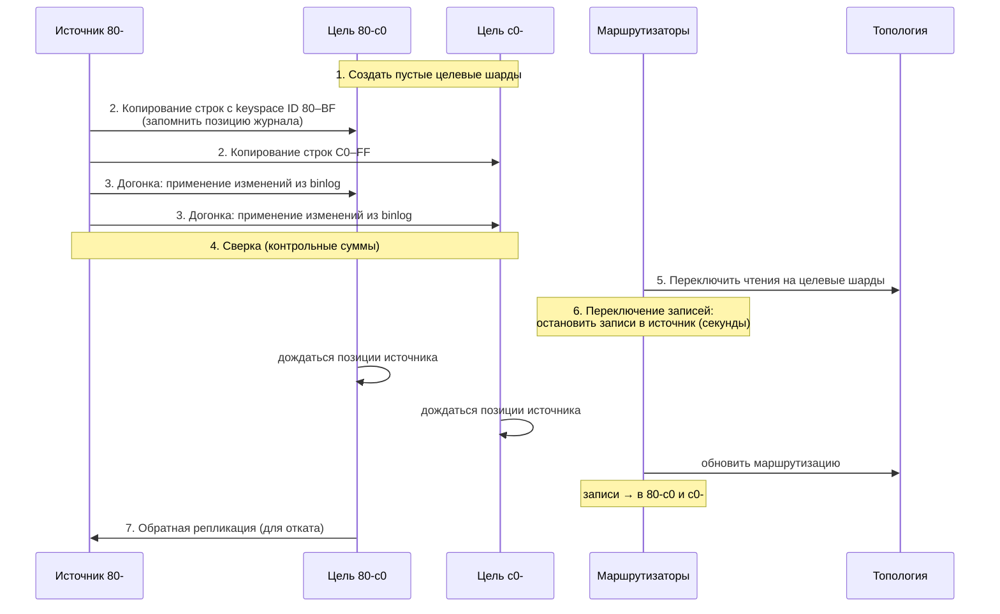
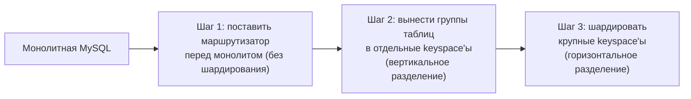

[English](README.md) | **Русский**

# Tier 2 · 4C · 03. Шардированная SQL-БД с онлайн-решардингом (как Vitess)

> **Уровень:** Hard · **Время на интервью:** 45–60 мин · **Время на разбор:** ~5 ч
> **Ключевые аспекты:** прокси-маршрутизатор SQL, сервис топологии, выбор ключа шардирования, хэш в пространство ключей и диапазоны, lookup-индексы для других столбцов, совместное размещение связанных таблиц, запросы на один шард и scatter-gather, межшардовые JOIN и агрегаты, транзакции, онлайн-решардинг (копирование + догонка журнала + сверка + переключение), онлайн-изменение схемы, пул соединений, failover
> **Опирается на:** [06-partitioning](../../../06-partitioning/README_RU.md), [05-replication](../../../05-replication/README_RU.md), [04-databases](../../../04-databases/README_RU.md), [11-distributed-transactions](../../../11-distributed-transactions/README_RU.md), [Tier 1 · 08 Instagram](../../../tier-1/08-instagram/README_RU.md#13-deep-dive-7-шардирование-и-id)

---

## 🗺️ Как читать этот разбор

Разбор построен как интервью, но в каждом шаге есть объяснения: **почему** принимается решение, **как работает** механизм и **что будет**, если сделать иначе. Блоки «📘 Объяснение» — теория прямо по ходу задачи.

| Значок | Что значит |
|:------:|:-----------|
| 🎤 | Реплика интервьюера |
| 🗣️ | Что говорю вслух я (кандидат) |
| ✏️ | Что рисую на доске |
| ⏱️ | Сколько времени тратить на шаг |
| 📘 | Подробное объяснение концепции |

Блоки **TIP** — хороший приём, **WARNING** — ловушка, **IMPORTANT** — сигнал для уровня Senior+.

---

## 📑 Содержание

0. [Чему учит эта задача](#0-чему-учит-эта-задача)
1. [Условие задачи](#1-условие-задачи)
2. [Уточняющие вопросы и требования](#2-уточняющие-вопросы-и-требования)
3. [Оценки нагрузки](#3-оценки-нагрузки)
4. [Компоненты](#4-компоненты)
5. [Модель шардирования](#5-модель-шардирования)
6. [High-level дизайн](#6-high-level-дизайн)
7. [Deep dive 1: выбор ключа шардирования](#7-deep-dive-1-выбор-ключа-шардирования)
8. [Deep dive 2: маршрутизация запросов](#8-deep-dive-2-маршрутизация-запросов)
9. [Deep dive 3: транзакции и уникальность](#9-deep-dive-3-транзакции-и-уникальность)
10. [Deep dive 4: онлайн-решардинг](#10-deep-dive-4-онлайн-решардинг)
11. [Deep dive 5: онлайн-изменение схемы](#11-deep-dive-5-онлайн-изменение-схемы)
12. [Deep dive 6: пул соединений и защита базы](#12-deep-dive-6-пул-соединений-и-защита-базы)
13. [Deep dive 7: отказоустойчивость шарда](#13-deep-dive-7-отказоустойчивость-шарда)
14. [Deep dive 8: эксплуатация и миграция с монолита](#14-deep-dive-8-эксплуатация-и-миграция-с-монолита)
15. [Узкие места и сценарии сбоев](#15-узкие-места-и-сценарии-сбоев)
16. [Что изменится при росте в 10 раз](#16-что-изменится-при-росте-в-10-раз)
17. [Ключевые концепции и новые понятия](#17-ключевые-концепции-и-новые-понятия)
18. [Варианты задачи и follow-up вопросы](#18-варианты-задачи-и-follow-up-вопросы)
19. [Типичные ошибки](#19-типичные-ошибки)
20. [Шпаргалка и самопроверка](#20-шпаргалка-и-самопроверка)

---

## 0. Чему учит эта задача

Почти каждая успешная компания проходит этот путь: одна база MySQL или PostgreSQL перестаёт справляться — по объёму, по числу записей или по числу соединений. Переписать приложение под NoSQL — годы работы. Вместо этого можно **шардировать реляционную базу прозрачно**: приложение продолжает говорить на SQL, а система сама решает, в какой шард отправить запрос, и умеет делить шарды без остановки.

Vitess, созданный в YouTube и используемый, например, в Slack, — самый известный пример такой системы. Задача проверяет, понимаешь ли ты, **что ломается**, когда одна база становится сотнями, и как с этим жить.

| Что проверяют | Где это в задаче |
|:--------------|:-----------------|
| Партиционирование на практике | Ключ шардирования, диапазоны в хэш-пространстве |
| Маршрутизация | Прокси, разбирающий SQL |
| Индексы на масштабе | Поиск по столбцам, не являющимся ключом |
| Распределённые запросы | Scatter-gather, JOIN и агрегаты между шардами |
| Транзакции | Внутри шарда — ACID, между шардами — компромиссы |
| Миграции без простоя | Онлайн-решардинг и изменение схемы |
| Эксплуатация | Пул соединений, failover, защита базы |

> [!TIP]
> Главная мысль: **хороший ключ шардирования делает большинство запросов и транзакций одношардовыми**, и тогда система ведёт себя как множество обычных баз. Всё сложное (scatter-gather, межшардовые транзакции) — исключения, которые нужно минимизировать дизайном данных.

---

## 1. Условие задачи

> 🎤 «Приложение работает на одной MySQL, она упёрлась в пределы. Спроектируй систему, которая шардирует MySQL прозрачно для приложения: приложение шлёт обычный SQL, система маршрутизирует. По мере роста данных шарды должны делиться без остановки сервиса».

**Как это выглядит для приложения:**

```sql
-- Приложение подключается к одному адресу и пишет обычный SQL
SELECT * FROM orders WHERE customer_id = 42 ORDER BY created_at DESC LIMIT 20;
INSERT INTO orders (customer_id, total) VALUES (42, 99.90);

-- Система сама понимает: customer_id = 42 → шард 80-c0
```

**План по времени:**

| Шаг | ⏱️ |
|:----|:--:|
| Требования | 5 мин |
| Оценки | 3 мин |
| Компоненты и модель | 7 мин |
| High-level дизайн | 5 мин |
| Deep dives | 25 мин |
| Итоги | 3 мин |

---

## 2. Уточняющие вопросы и требования

⏱️ 5 мин

| Мой вопрос | Ответ интервьюера | Что это меняет и почему |
|:-----------|:------------------|:------------------------|
| Объём и нагрузка? | ~100 ТБ, ~1M запросов/с, рост | Сотни шардов |
| Менять приложение? | Минимально: SQL остаётся | Прокси, понимающий SQL |
| Транзакции? | Нужны, в основном в пределах одного клиента | Ключ шардирования по клиенту |
| Сколько экземпляров приложения? | Тысячи | Пул соединений обязателен |
| Простой при решардинге? | Секунды недоступности записи максимум | Онлайн-решардинг |
| Изменения схемы? | Часто, на больших таблицах | Онлайн-миграции |
| Отказоустойчивость? | Автоматический failover, без потерь подтверждённых записей | Полусинхронная репликация, переключение |

### Функциональные требования

1. Прозрачная маршрутизация SQL-запросов в нужные шарды.
2. Запросы без ключа шардирования (с ограничениями).
3. Транзакции в пределах шарда; поведение межшардовых — определено.
4. Разделение и слияние шардов без остановки.
5. Изменение схемы без блокировок на всех шардах.
6. Резервные копии, восстановление, реплики для чтения.

### Нефункциональные требования

| Требование | Цель | Почему |
|:-----------|:-----|:-------|
| Задержка | Как у одной MySQL + единицы мс на прокси | Приложение не должно заметить |
| Масштабируемость | Добавление шардов почти линейно увеличивает ёмкость | Рост данных |
| Доступность | Отказ одного шарда затрагивает только его данные | Изоляция |
| Решардинг | Без остановки, записи недоступны секунды | Продолжение работы бизнеса |
| Безопасность данных | Без потерь при failover | Деньги, заказы |

---

## 3. Оценки нагрузки

⏱️ 3 мин

```
Данные:            100 ТБ
Размер шарда:      ~250 ГБ – 1 ТБ (практический оптимум: резервная копия, восстановление
                   и создание реплики занимают часы, а не дни)
                   → ~100–400 шардов
Запросы:           1M/с ÷ ~200 шардов ≈ 5 000/с на шард — комфортно для MySQL
Соединения:        10 000 экземпляров приложения × 50 соединений = 500 000
                   MySQL на одном сервере держит тысячи соединений, не сотни тысяч
                   → пул соединений на прокси
```

### Выводы

| Вывод | Следствие для дизайна |
|:------|:----------------------|
| Шарды небольшие | Быстрое восстановление и решардинг |
| Сотни тысяч соединений | Пул на уровне прокси и агентов шардов |
| Нагрузка на шард умеренная | Каждый шард — обычная MySQL с репликами |

---

## 4. Компоненты

⏱️ 3 мин

| Компонент (название в Vitess) | Роль |
|:------------------------------|:-----|
| **Маршрутизатор SQL** (VTGate) | Stateless-прокси: принимает SQL по протоколу MySQL, разбирает запрос, определяет шарды, отправляет, собирает результат |
| **Агент шарда** (VTTablet) | Рядом с каждой MySQL: пул соединений, защита от тяжёлых запросов, репликация, участие в решардинге |
| **Сервис топологии** (etcd / ZooKeeper) | Где какие шарды, какие серверы в них, кто primary, схема шардирования |
| **MySQL primary + реплики** | В каждом шарде |
| **Оркестратор отказов** (VTOrc) | Обнаружение отказа primary и повышение реплики |

---

## 5. Модель шардирования

⏱️ 4 мин

### Keyspace и keyspace ID

📘 **Keyspace** — логическая база (набор таблиц), разделённая на шарды. Для каждой строки вычисляется **keyspace ID** — например, хэш значения ключа шардирования. Шарды — это **диапазоны** keyspace ID:

```
keyspace ID = hash(customer_id)   (64-битное значение, записывается в hex)

Шард "-80":   keyspace ID от 00… до 7F…   (первая половина пространства)
Шард "80-":   от 80… до FF…               (вторая половина)

После решардинга шарда "80-":
Шард "80-c0": от 80… до BF…
Шард "c0-":   от C0… до FF…
```

| Почему хэш, а потом диапазоны | Объяснение |
|:------------------------------|:-----------|
| Хэш | Равномерное распределение клиентов по пространству |
| Диапазоны хэша | Шард делится пополам простым разрезом диапазона — данные переезжают только из делимого шарда |

### Vindex

📘 **Vindex** (в Vitess) — правило, как получить keyspace ID из значения столбца.

| Тип | Как | Пример |
|:----|:----|:-------|
| **Основной (хэш)** | keyspace ID = hash(столбец) | `customer_id` → шард |
| **Lookup** | Отдельная таблица `значение → keyspace ID` | `email → customer_id`, чтобы находить клиента по email без опроса всех шардов |
| Уникальный lookup | Lookup с ограничением уникальности | Email уникален глобально |

### Совместное размещение

```
customers   — шардирована по customer_id
orders      — шардирована по customer_id (тот же vindex!)
order_items — шардирована по customer_id (хранит customer_id, хотя логически принадлежит order)

→ клиент, его заказы и позиции заказов — в одном шарде
→ JOIN и транзакции по клиенту — одношардовые
```

| Тип таблицы | Как размещается |
|:------------|:----------------|
| Связанные с клиентом | По тому же ключу |
| **Справочники** (страны, валюты) | **Копия в каждом шарде** (reference tables) — JOIN локальный |
| Глобальные редкие данные | Отдельный нешардированный keyspace |

---

## 6. High-level дизайн

⏱️ 5 мин



🗣️ «Приложение подключается к **маршрутизаторам** по обычному протоколу MySQL. Маршрутизатор разбирает SQL, по **схеме шардирования** из сервиса топологии определяет шарды и отправляет запросы **агентам шардов**. Агент держит пул соединений к MySQL и защищает её от тяжёлых запросов. В каждом шарде — primary и реплики; **оркестратор** обрабатывает отказы».

---

## 7. Deep dive 1: выбор ключа шардирования

> 🎤 «Как выбрать ключ шардирования?»

### Критерии

| Критерий | Почему |
|:---------|:-------|
| **Есть в большинстве запросов** | Иначе запросы становятся scatter-gather |
| **Транзакции укладываются в одно значение ключа** | Одношардовые транзакции |
| **Равномерное распределение** | Нет горячих шардов |
| **Связанные данные группируются** | Одношардовые JOIN |
| Значение не меняется | Смена ключа = перенос строки между шардами |

### Примеры

| Продукт | Хороший ключ | Плохой ключ | Почему |
|:--------|:-------------|:------------|:-------|
| Интернет-магазин | `customer_id` | `order_id` | Запросы «заказы клиента» и транзакции клиента — в одном шарде |
| SaaS для компаний | `tenant_id` | `user_id` | Данные компании вместе; но огромные клиенты → горячие шарды |
| Мессенджер | `conversation_id` | `sender_id` | Чтение переписки — один шард |
| Журнал событий | `device_id` | `timestamp` | Время → все записи в последний шард |

> [!WARNING]
> **Огромные клиенты в multi-tenant SaaS.** Если ключ — `tenant_id`, один крупный клиент может не поместиться в шард или перегрузить его. Решения: выделенный шард для крупного клиента (keyspace ID через lookup, указывающий на отдельный диапазон) или составной ключ (`tenant_id` + `user_id`) для крупных клиентов.

---

## 8. Deep dive 2: маршрутизация запросов

> 🎤 «Как маршрутизатор выполняет разные виды запросов?»

### Типы запросов

| Запрос | Маршрутизация | Стоимость |
|:-------|:--------------|:----------|
| `WHERE customer_id = 42` | hash(42) → один шард | Как обычный запрос ⭐ |
| `WHERE customer_id IN (1, 7, 42)` | Несколько шардов, только нужные | Несколько запросов параллельно |
| `WHERE email = 'a@b.c'` | Lookup-таблица → customer_id → шард | Два запроса |
| `WHERE created_at > …` (без ключа) | **Scatter-gather**: все шарды | Дорого: N запросов |

### Scatter-gather с сортировкой и лимитом

```sql
SELECT * FROM orders WHERE status = 'paid' ORDER BY created_at DESC LIMIT 10;
```

```
1. Отправить запрос с ORDER BY … LIMIT 10 на КАЖДЫЙ из N шардов
2. Каждый шард возвращает свои 10 лучших
3. Маршрутизатор сливает N × 10 строк и берёт общие 10 лучших
```

### Агрегаты

| Агрегат | Как вычисляется |
|:--------|:----------------|
| `COUNT(*)`, `SUM(x)` | Частичные на каждом шарде, затем сумма |
| `MIN`, `MAX` | Частичные, затем минимум или максимум |
| `AVG(x)` | **Не среднее средних!** Переписать в `SUM(x)` и `COUNT(x)` на шардах, затем разделить |
| `COUNT(DISTINCT x)` | Сложно: нужно собрать значения или использовать приближение |
| `GROUP BY` по ключу шардирования | Каждая группа целиком в одном шарде — просто объединить |

### Межшардовые JOIN

```sql
SELECT o.id, p.name FROM orders o JOIN products p ON o.product_id = p.id WHERE o.customer_id = 42;
```

| Случай | Как выполняется |
|:-------|:----------------|
| Обе таблицы шардированы по одному ключу и JOIN по нему | Внутри шарда — обычный JOIN |
| `products` — справочник с копией в каждом шарде | Внутри шарда |
| Таблицы шардированы по-разному | Маршрутизатор выполняет **вложенный цикл**: получить заказы из шарда клиента, затем для найденных `product_id` запросить шарды товаров |

> [!IMPORTANT]
> **Сигнал Senior+:** знать, что scatter-gather — **N запросов на каждый вызов**, и при сотнях шардов это быстро съедает ёмкость. Хорошая архитектура держит такие запросы редкими: аналитику — в отдельное хранилище (через CDC), частые запросы без ключа — через lookup-индексы или денормализацию.

---

## 9. Deep dive 3: транзакции и уникальность

> 🎤 «Как работают транзакции, если данные в разных шардах?»

| Случай | Поведение |
|:-------|:----------|
| Транзакция в одном шарде | Полноценный ACID MySQL |
| Транзакция в нескольких шардах, режим «по очереди» | Маршрутизатор фиксирует шарды последовательно; при сбое посередине часть шардов зафиксирована, часть нет — **не атомарно** |
| Двухфазная фиксация (2PC) | Атомарно, но медленнее и с блокировками при сбое координатора (см. [11-distributed-transactions](../../../11-distributed-transactions/README_RU.md)) |
| **Лучший путь** | Дизайн данных, при котором транзакции одношардовые; межшардовые процессы — саги |

### Глобальная уникальность

📘 Ограничение `UNIQUE(email)` в каждом шарде проверяет уникальность только внутри шарда. Для глобальной уникальности — **уникальный lookup vindex**:

```
1. Вставка клиента с email → сначала INSERT в lookup-таблицу email → keyspace_id
   (lookup-таблица сама шардирована по хэшу email и имеет UNIQUE)
2. Успех → вставка клиента в его шард
3. Конфликт в lookup → email занят
```

Это та же идея «резерв → создание», что и для имён пользователей в [глобальном сервисе профилей](../../4b-social-media/04-global-profile-service/README_RU.md#11-deep-dive-5-глобальная-уникальность-имени-пользователя).

### Автоинкремент

📘 `AUTO_INCREMENT` в каждом шарде даёт повторяющиеся ID. Решения: **последовательности** — отдельная нешардированная таблица, выдающая блоки ID (Vitess sequences), или Snowflake-подобные ID (см. [Tier 1 · 04](../../../tier-1/04-unique-id-generator/README_RU.md)).

---

## 10. Deep dive 4: онлайн-решардинг

> 🎤 «Шард 80- вырос до 2 ТБ. Как разделить его пополам без остановки?»



### Шаги

| Шаг | Что происходит | Почему важно |
|:----|:---------------|:-------------|
| 1. Целевые шарды | Создаются пустые шарды с primary и репликами | Источник продолжает обслуживать трафик |
| 2. Копирование | Строки копируются из **реплики** источника (чтобы не нагружать primary) порциями; запоминается позиция журнала | Можно копировать терабайты, не останавливая записи |
| 3. Догонка | Изменения из binlog источника после позиции применяются к целям, каждая строка — в свой целевой шард по keyspace ID | Цели постоянно догоняют источник |
| 4. Сверка | Контрольные суммы строк источника и целей (в Vitess — VDiff) | Убедиться, что данные совпадают |
| 5. Чтения | Маршрутизация чтений на цели | Безопасно: можно вернуть обратно |
| 6. Записи | Кратко остановить записи в источник → дождаться, пока цели догонят до той же позиции → переключить маршрутизацию → возобновить | Единственный момент недоступности записи — секунды |
| 7. Обратная репликация | Из целей в источник | Откат, если что-то пошло не так |
| 8. Очистка | Удаление источника после периода наблюдения | — |

📘 Тот же механизм (копирование + догонка журнала + переключение) используется для **переноса таблиц** между keyspace'ами — например, при выделении таблиц из монолитной базы (в Vitess — MoveTables).

> [!TIP]
> Маршрутизатор может **буферизовать** запросы на время переключения записей: приложение видит задержку в пару секунд, а не ошибки.

---

## 11. Deep dive 5: онлайн-изменение схемы

> 🎤 «Нужно добавить столбец в таблицу на 500 ГБ в 200 шардах. Как не заблокировать базу?»

### Проблема

📘 Многие `ALTER TABLE` на больших таблицах перестраивают таблицу целиком, а иногда блокируют записи надолго. На реплике такой ALTER вызывает огромное отставание репликации.

### Теневая таблица

```
1. Создать теневую таблицу _orders_new с новой схемой
2. Копировать строки из orders в _orders_new порциями (с ограничением скорости)
3. Применять текущие изменения orders к _orders_new
   (через binlog — как gh-ost и Vitess online DDL, или через триггеры — как pt-online-schema-change)
4. Когда догнали — атомарно переименовать: orders → _orders_old, _orders_new → orders
5. Удалить _orders_old позже
```

| Решение | Почему |
|:--------|:-------|
| **Ограничение скорости по отставанию реплик** | Миграция замедляется, если реплики отстают |
| Оркестрация на всех шардах | Запуск, отслеживание, возобновление на сотнях шардов |
| **Обратно совместимые изменения** (expand → migrate → contract) | Сначала добавить новый столбец, затем выкатить код, использующий его, и только потом удалять старое — схема и код никогда не расходятся |
| Возможность отмены | Пока не переключено — просто удалить теневую таблицу |

---

## 12. Deep dive 6: пул соединений и защита базы

> 🎤 «10 000 экземпляров приложения, у каждого пул на 50 соединений. Что с MySQL?»

| Решение | Как |
|:--------|:----|
| **Пул на маршрутизаторе и агенте** | Приложение держит соединения с маршрутизатором (дёшево); агент шарда держит небольшой пул к MySQL (сотни) |
| **Ограничения запросов** | Таймаут запроса, ограничение числа строк в результате, отклонение запросов без WHERE на больших таблицах |
| **Объединение одинаковых запросов** | Если сотни одинаковых чтений пришли одновременно, к MySQL уходит один, результат раздаётся всем (query consolidation) |
| **Регулирование по отставанию реплик** | Массовые операции (переобработки, миграции) замедляются, если реплики отстают |
| Правила блокировки запросов | Оперативно запретить конкретный проблемный запрос без деплоя приложения |

---

## 13. Deep dive 7: отказоустойчивость шарда

> 🎤 «Primary одного шарда упал. Что происходит?»

| Шаг | Как |
|:----|:----|
| Репликация | **Полусинхронная**: primary подтверждает коммит, когда хотя бы одна реплика получила изменение — подтверждённые записи не теряются |
| Обнаружение | Оркестратор проверяет primary и реплики |
| Выбор нового primary | Реплика с самой свежей позицией журнала |
| Ограждение старого | Старый primary переводится в режим только чтения / отключается, чтобы не было двух primary |
| Обновление топологии | Маршрутизаторы узнают новый primary |
| **Буферизация** | Маршрутизатор удерживает записи на время переключения (секунды), затем отправляет новому primary |

| Отказ | Последствия |
|:------|:------------|
| Primary одного шарда | Записи этого шарда недоступны секунды; остальные шарды работают |
| Реплика | Чтения перенаправляются на другие реплики |
| Маршрутизатор | Stateless — балансировщик убирает его |
| Сервис топологии | Маршрутизаторы работают на закэшированной топологии; изменения (failover, решардинг) временно невозможны |

---

## 14. Deep dive 8: эксплуатация и миграция с монолита

### Миграция с одной базы



| Шаг | Зачем |
|:----|:------|
| Маршрутизатор перед монолитом | Приложение переходит на новый адрес подключения без изменения данных; можно исправить запросы, несовместимые с шардированием |
| Вертикальное разделение | Разные домены (пользователи, заказы, аналитика) — в разные базы; часто этого уже достаточно |
| Горизонтальное | Только для таблиц, которые реально не помещаются |

### Эксплуатация

| Тема | Решение |
|:-----|:--------|
| Резервные копии | По каждому шарду; новая реплика = восстановление из копии + догонка журнала |
| Горячий шард | Мониторинг нагрузки по шардам → решардинг или выделение крупного клиента |
| Реплики в других регионах | Чтение и восстановление после аварии |
| Аналитика | CDC из шардов → хранилище данных, а не scatter-gather по продакшену |
| Мониторинг | Задержка по шардам, отставание реплик, доля scatter-запросов |

---

## 15. Узкие места и сценарии сбоев

| Сценарий | Что произойдёт | Как защищаемся |
|:---------|:---------------|:---------------|
| Запрос без ключа шардирования | N запросов | Lookup-индексы, денормализация, аналитика вне продакшена |
| `AVG` по шардам | Неверное среднее | Переписывание в SUM и COUNT |
| Межшардовая транзакция | Частичная фиксация | Одношардовый дизайн, 2PC или саги |
| Глобальная уникальность | Дубликаты | Уникальный lookup vindex |
| Автоинкремент | Повторяющиеся ID | Последовательности, Snowflake |
| Горячий шард (крупный клиент) | Перегрузка | Выделенный шард, решардинг |
| Шард вырос | Медленные бэкапы и восстановление | Онлайн-решардинг |
| ALTER на большой таблице | Блокировки, отставание реплик | Теневая таблица, регулирование |
| 500 000 соединений | MySQL не выдерживает | Пул на маршрутизаторе и агенте |
| Отказ primary | Записи шарда недоступны | Полусинхронная репликация, автоматический failover, буферизация |
| Сбой при переключении записей | Потеря данных или раздвоение | Ожидание позиции журнала, обратная репликация для отката |

---

## 16. Что изменится при росте в 10 раз

> 🎤 «Петабайт данных и 10 миллионов запросов в секунду?»

| Изменение | Почему |
|:----------|:-------|
| **Тысячи шардов**, автоматизация решардинга | Ручное управление невозможно |
| **Несколько keyspace'ов** по доменам | Изоляция нагрузки |
| **Региональные шарды** | Задержка и локализация данных |
| **Рассмотреть NewSQL** (Spanner, CockroachDB, TiDB) для новых систем | Автоматическое шардирование и распределённые транзакции «из коробки» |

---

## 17. Ключевые концепции и новые понятия

### Что применяется

| Концепция | Где разобрана | Как применяется здесь |
|:----------|:--------------|:----------------------|
| Ключ партиционирования, ребалансировка, вторичные индексы | [06-partitioning](../../../06-partitioning/README_RU.md) | Основа шардирования |
| Репликация, failover | [05-replication](../../../05-replication/README_RU.md) | Шард = primary + реплики |
| Транзакции, блокировки | [04-databases](../../../04-databases/README_RU.md) | ACID внутри шарда, онлайн-ALTER |
| 2PC, саги, CDC | [11-distributed-transactions](../../../11-distributed-transactions/README_RU.md) | Межшардовые транзакции, аналитика |
| Шард в ID | [Tier 1 · 08](../../../tier-1/08-instagram/README_RU.md#13-deep-dive-7-шардирование-и-id) | Альтернативный подход к маршрутизации |

### Новые понятия этой задачи

| Понятие | Кратко |
|:--------|:-------|
| **Keyspace** | Логическая база, разделённая на шарды |
| **Keyspace ID** | Хэш ключа шардирования; шарды — его диапазоны |
| **Vindex** | Правило получения keyspace ID из столбца |
| **Lookup vindex** | Таблица «значение → keyspace ID» для поиска по другим столбцам |
| **Справочная таблица** | Копия в каждом шарде для локальных JOIN |
| **Scatter-gather** | Запрос ко всем шардам со слиянием результатов |
| **Онлайн-решардинг** | Копирование + догонка журнала + сверка + переключение |
| **VReplication** | Механизм Vitess для потоковой репликации между шардами |
| **Теневая таблица** | Онлайн-изменение схемы через копию и атомарное переименование |
| **Expand / contract** | Обратно совместимые изменения схемы в несколько шагов |
| **Буферизация запросов** | Удержание запросов на время переключения |

---

## 18. Варианты задачи и follow-up вопросы

<details>
<summary><b>Чем Vitess отличается от Spanner или CockroachDB?</b></summary>

Vitess шардирует обычные MySQL: транзакции и индексы — внутри шарда, ключ шардирования выбирает человек, межшардовые транзакции — ограничены. NewSQL-базы (Spanner, CockroachDB, TiDB) сами разбивают данные на диапазоны, перемещают их и предоставляют распределённые ACID-транзакции через консенсус — удобнее, но иная модель производительности и эксплуатации. Vitess хорош для миграции существующих MySQL-систем без переписывания.
</details>

<details>
<summary><b>Что если клиент сменил customer_id (например, слияние аккаунтов)?</b></summary>

Смена ключа шардирования — перенос всех строк клиента в другой шард: копирование в целевой шард, удаление в исходном, обновление lookup-таблиц. Это делается как редкая операция-процесс, а дизайн старается выбирать неизменяемые ключи.
</details>

<details>
<summary><b>Как построить вторичный индекс, по которому нужен диапазон (например, по дате)?</b></summary>

Lookup vindex подходит для точного поиска. Для диапазонов по столбцу, не являющемуся ключом, — либо scatter-gather с LIMIT (если редко), либо отдельное хранилище, построенное через CDC (например, поисковый индекс или аналитическая БД).
</details>

<details>
<summary><b>Почему бы не шардировать в коде приложения?</b></summary>

Можно (так начинали многие, включая Instagram), но логика маршрутизации, решардинга, пулов соединений и failover размазывается по всем сервисам. Прокси централизует её: решардинг не требует изменений в приложениях, а запросы без ключа обрабатываются единообразно.
</details>

<details>
<summary><b>Как обеспечить чтение своих записей при чтении с реплик?</b></summary>

Чтения, требующие свежих данных, отправлять на primary; остальные — на реплики. Либо передавать позицию журнала (GTID) последней записи и читать с реплики, которая её применила.
</details>

---

## 19. Типичные ошибки

| ❌ Ошибка | Почему плохо | ✅ Как правильно |
|:---------|:-------------|:----------------|
| Ключ шардирования, которого нет в запросах | Почти всё — scatter-gather | Ключ из основных запросов |
| Ключ по времени | Все записи в последний шард | Хэш ключа сущности |
| Связанные таблицы шардированы по разным ключам | Межшардовые JOIN и транзакции | Совместное размещение |
| `AVG` как среднее средних | Неверный результат | SUM / COUNT |
| `UNIQUE` только внутри шарда | Глобальные дубликаты | Уникальный lookup |
| `AUTO_INCREMENT` в шардах | Конфликты ID | Последовательности, Snowflake |
| Решардинг с остановкой | Часы простоя | Копирование + догонка + быстрое переключение |
| Обычный ALTER на огромной таблице | Блокировки и отставание | Теневая таблица |
| Приложение подключается напрямую к MySQL | Сотни тысяч соединений | Пул на прокси |
| Асинхронная репликация и автоматический failover | Потеря подтверждённых записей | Полусинхронная репликация |
| Аналитика scatter-запросами по продакшену | Нагрузка на все шарды | CDC в хранилище данных |

---

## 20. Шпаргалка и самопроверка

### Ответ за 30 секунд

> Приложение говорит с stateless-маршрутизаторами (VTGate) по протоколу MySQL; они по схеме шардирования из сервиса топологии отправляют запросы агентам шардов (VTTablet), которые держат пулы соединений к MySQL и защищают её (таймауты, лимиты, объединение одинаковых запросов, регулирование по отставанию реплик). Ключ шардирования (например, customer_id) хэшируется в keyspace ID, шарды — диапазоны этого пространства; связанные таблицы размещаются по тому же ключу, справочники копируются в каждый шард — большинство запросов, JOIN и транзакций одношардовые. Поиск по другим столбцам и глобальная уникальность — lookup vindex; ID — последовательности. Запросы без ключа — scatter-gather (ORDER BY LIMIT частично на шардах, AVG через SUM/COUNT) — держать редкими, аналитику — через CDC. Межшардовые транзакции — по очереди (не атомарно), 2PC или саги. Онлайн-решардинг: пустые цели → копирование с реплики с позицией журнала → догонка binlog → сверка → переключение чтений → короткая остановка записей и переключение с буферизацией → обратная репликация для отката. Схема — теневые таблицы и expand/contract. Шард: primary + реплики, полусинхронная репликация, автоматический failover.

### Самопроверка

- [ ] Могу назвать компоненты и их роли
- [ ] Могу объяснить keyspace ID и почему шарды — диапазоны хэша
- [ ] Могу выбрать ключ шардирования по критериям и привести плохие примеры
- [ ] Могу объяснить совместное размещение и справочные таблицы
- [ ] Могу описать маршрутизацию разных типов запросов
- [ ] Могу выполнить ORDER BY LIMIT и AVG поверх шардов
- [ ] Могу объяснить поведение межшардовых транзакций и глобальную уникальность
- [ ] Могу описать онлайн-решардинг по шагам
- [ ] Могу объяснить онлайн-изменение схемы и expand/contract
- [ ] Могу описать failover шарда и пул соединений

### Что почитать

- Документация Vitess: архитектура, VSchema и vindexes, VReplication, MoveTables, Reshard, online DDL
- Sugu Sougoumarane, доклады о создании Vitess в YouTube
- Slack Engineering, *Scaling Datastores at Slack with Vitess* (2020)
- GitHub Engineering, статьи о gh-ost и масштабировании MySQL
- Тема [06-partitioning](../../../06-partitioning/README_RU.md)
