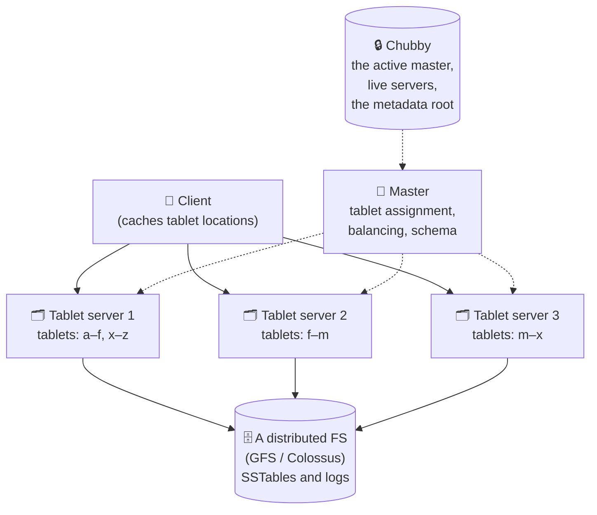
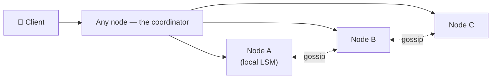
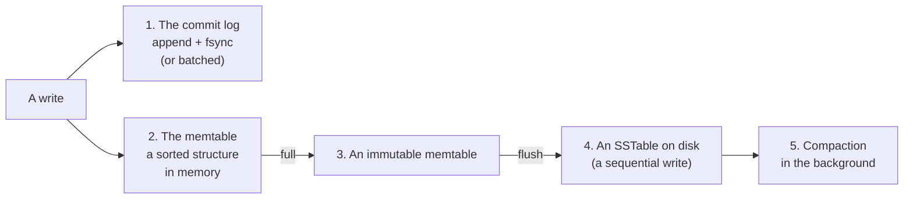
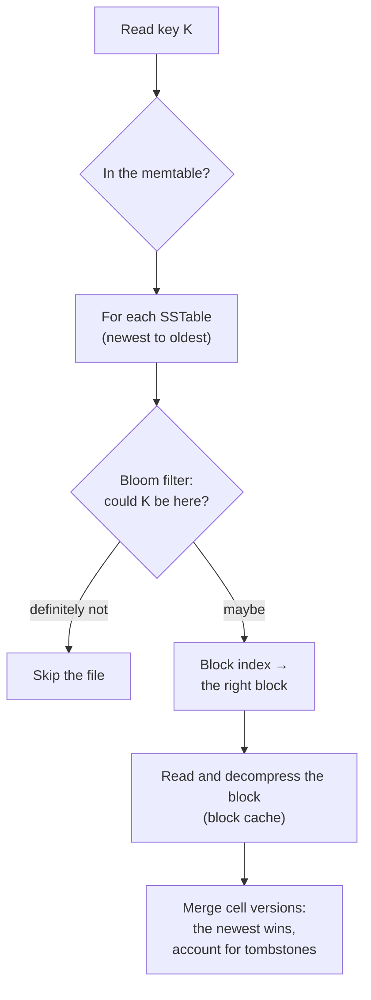
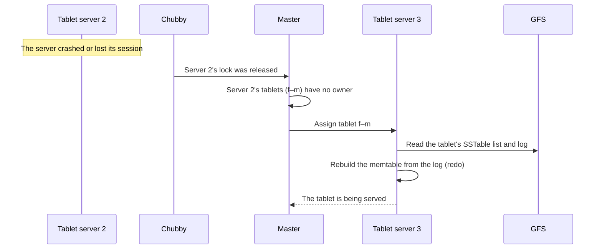

**English** | [Русский](README_RU.md)

# Tier 2 · 4C · 04. A Wide-Column Database (Cassandra / Bigtable)

> **Level:** Hard · **Interview time:** 45–60 min · **Study time:** ~5 h
> **Key aspects:** the wide-column data model (row keys, column families, versions, partition keys and clustering columns), query-first modeling, the LSM engine on a node (log, memtable, SSTables, indexes and Bloom filters), the read path, compaction strategies and write/read/space amplification, tombstones and TTLs, the Bigtable architecture (master, tablet servers, a distributed file system), splitting and merging tablets, hot keys and row key design
> **Builds on:** [04-databases](../../../04-databases/README.md#7-b-tree-vs-lsm-tree), [Tier 1 · 19 KV Store](../../../tier-1/19-distributed-kv-store/README.md) (the ring, quorums, repair), [Tier 2 · 4C · 02 Coordination](../02-coordination-service/README.md), [Tier 2 · 4C · 01 Object Storage](../01-object-storage-s3/README.md), [06-partitioning](../../../06-partitioning/README.md#8-hot-partitions-and-skew)

---

## 🗺️ How to Read This Walkthrough

The walkthrough follows an interview, but every step includes explanations: **why** a decision is made, **how** a mechanism works and **what happens** if you do it differently. The "📘 Explanation" blocks are theory right where you need it.

| Icon | Meaning |
|:----:|:--------|
| 🎤 | Interviewer |
| 🗣️ | What I (the candidate) say out loud |
| ✏️ | What I draw on the whiteboard |
| ⏱️ | Time budget for the step |
| 📘 | A detailed explanation of a concept |

Callouts: **TIP** — a good technique, **WARNING** — a trap, **IMPORTANT** — a Senior+ signal.

---

## 📑 Contents

0. [What This Problem Teaches](#0-what-this-problem-teaches)
1. [Problem Statement](#1-problem-statement)
2. [Clarifying Questions and Requirements](#2-clarifying-questions-and-requirements)
3. [Capacity Estimates](#3-capacity-estimates)
4. [The Wide-Column Data Model](#4-the-wide-column-data-model)
5. [Query-First Modeling](#5-query-first-modeling)
6. [High-Level Design: Two Approaches](#6-high-level-design-two-approaches)
7. [Deep Dive 1: The LSM Write Path](#7-deep-dive-1-the-lsm-write-path)
8. [Deep Dive 2: SSTable Structure and the Read Path](#8-deep-dive-2-sstable-structure-and-the-read-path)
9. [Deep Dive 3: Compaction and Amplification](#9-deep-dive-3-compaction-and-amplification)
10. [Deep Dive 4: Deletes, Tombstones and TTLs](#10-deep-dive-4-deletes-tombstones-and-ttls)
11. [Deep Dive 5: The Bigtable Architecture](#11-deep-dive-5-the-bigtable-architecture)
12. [Deep Dive 6: Tablets — Splitting, Merging, Locating](#12-deep-dive-6-tablets--splitting-merging-locating)
13. [Deep Dive 7: Row Key Design and Hot Spots](#13-deep-dive-7-row-key-design-and-hot-spots)
14. [Deep Dive 8: Consistency, Indexes and Operations](#14-deep-dive-8-consistency-indexes-and-operations)
15. [Bottlenecks and Failure Scenarios](#15-bottlenecks-and-failure-scenarios)
16. [What Changes at 10x Scale](#16-what-changes-at-10x-scale)
17. [Key Concepts and New Terms](#17-key-concepts-and-new-terms)
18. [Variations and Follow-Up Questions](#18-variations-and-follow-up-questions)
19. [Common Mistakes](#19-common-mistakes)
20. [Cheat Sheet and Self-Check](#20-cheat-sheet-and-self-check)

---

## 0. What This Problem Teaches

Wide-column databases (Bigtable, HBase, Cassandra, ScyllaDB) store petabytes and accept millions of writes per second: Discord's messages, feeds, metrics, search indexes. In [Tier 1 · 19](../../../tier-1/19-distributed-kv-store/README.md) we covered the **distributed** side (the ring, quorums, conflicts, repair). Here the focus is on two other things:

1. **The data model** — how "wide" rows work and why data must be modeled around queries;
2. **Storage on a node** — the LSM tree, SSTables, compaction and their trade-offs — plus **the Bigtable architecture**, with a master and tablets, as an alternative to a leaderless ring.

| What's tested | Where it shows up |
|:--------------|:------------------|
| Data modeling | Partitions, clustering, denormalizing for queries |
| Storage structures | The LSM tree, SSTables, Bloom filters |
| Resource trade-offs | Write, read and space amplification from compaction |
| Deletion in immutable structures | Tombstones, TTLs, resurrected data |
| A master-based architecture | Bigtable: master, tablet servers, a distributed FS, Chubby |
| Range sharding | Splitting tablets, hot keys |
| Key design | Salting, reversal, composite keys |

> [!TIP]
> Show that you know **both families**: Bigtable/HBase — ordered ranges, a master, strong consistency within a row; Cassandra/ScyllaDB — a leaderless hash ring, tunable consistency. Their storage on a node is nearly identical — LSM.

---

## 1. Problem Statement

> 🎤 "Design a wide-column database like Bigtable or Cassandra: tables with an enormous number of rows and dynamic columns, millions of writes per second, petabytes of data, fast reads by key and by range."

**Typical data:**

```
Chat messages:    partition = channel, rows inside = messages by time
Metrics:          partition = (metric, host, day), rows = data points by time
A web page profile (as in the Bigtable paper):
                  row key = "com.example.www/index.html",
                  columns = contents:, anchor:cnn.com, anchor:bbc.co.uk …, versioned by time
```

**Time plan:**

| Step | ⏱️ |
|:-----|:--:|
| Requirements | 4 min |
| Estimates | 3 min |
| The data model and queries | 8 min |
| High-level design | 5 min |
| Deep dives | 25 min |
| Wrap-up | 3 min |

---

## 2. Clarifying Questions and Requirements

⏱️ 4 min

| My question | Interviewer's answer | What it changes and why |
|:------------|:---------------------|:------------------------|
| Load? | ~1M writes/s, with comparable reads | Write-optimized → LSM |
| Volume? | Petabytes | Hundreds to thousands of nodes |
| Query types? | By key, by range within a partition, the latest N | Ordered storage within a partition |
| JOINs, ad hoc queries? | No | Denormalization, query-first modeling |
| Transactions? | Within a row or a partition | Row-level atomicity |
| Consistency? | Let's discuss both options | Bigtable: strong within a row; Cassandra: tunable |
| Data lifetime? | Some data has a TTL (metrics, logs) | TTLs and efficient deletion |

### Functional requirements

1. Tables with rows by key; columns grouped into families; rows may have different columns.
2. Writing, reading a row, reading a range of rows, deleting.
3. Several versions of a value with timestamps.
4. TTLs on values.
5. Atomic operations within a single row.

### Non-functional requirements

| Requirement | Target | Why |
|:------------|:-------|:----|
| Write throughput | Millions per second, linear in nodes | Logs, events, metrics |
| Latency | Single-digit ms at p99 for point reads | Online workloads |
| Scale | Petabytes | Keeping history |
| Availability | High; a node failure doesn't stop work | Critical data |
| Storage efficiency | Compression, removing stale data | Cost |

---

## 3. Capacity Estimates

⏱️ 3 min

```
Writes:          1M/s × ~1 KB = 1 GB/s of incoming data → ~30 PB per year without TTLs
A node:          tens of thousands of writes/s (sequential writes to the log and memtable)
                 → ~50–100 nodes for writes, more for volume and replication
Storage:         with ×3 replication and compression — volume determines the node count
Compaction:      each byte is rewritten several times — disk and CPU for background work
```

### Conclusions

| Conclusion | Design consequence |
|:-----------|:-------------------|
| Writes dominate | LSM: sequential writes, no in-place updates |
| Petabytes | Compression, TTLs, storage classes |
| Compaction is constant background load | Choosing a strategy for the pattern, resource headroom |

---

## 4. The Wide-Column Data Model

⏱️ 4 min

### Bigtable: a sparse, multidimensional, sorted map

📘 The Bigtable paper describes the model as: **(row key, column, timestamp) → value**. Rows are sorted by key. Columns are grouped into **column families** declared up front, while the columns within a family can be anything and differ from row to row.

```
Row key                        contents:            anchor:cnn.com      anchor:bbc.co.uk
"com.example.www/index.html"   t9: "<html>…"        t8: "Example"       t5: "EX site"
                               t6: "<html>…" (older)
"com.example.www/about.html"   t9: "<html>…"                            t7: "About"
```

| Element | What it is |
|:--------|:-----------|
| The row key | A byte string; rows are ordered lexicographically |
| A column family | The unit of settings: compression, number of versions kept, TTL, physical storage |
| A column | `family:qualifier`; there can be millions of distinct ones in a table |
| Versions | Several values of one cell with timestamps; the last N or those within a period are kept |
| Sparsity | Empty cells take no space |

### Cassandra: a partition key + clustering columns

```sql
CREATE TABLE messages (
  channel_id   bigint,
  bucket       int,            -- e.g. a week: caps the partition's size
  message_id   timeuuid,
  author_id    bigint,
  content      text,
  PRIMARY KEY ((channel_id, bucket), message_id)
) WITH CLUSTERING ORDER BY (message_id DESC);
```

| Key part | Role |
|:---------|:-----|
| **The partition key** `(channel_id, bucket)` | Determines the nodes (a hash on the ring); all of a partition's rows live together |
| **Clustering columns** `message_id` | The order of rows **within** the partition; a range read and "the latest N" are one sequential read |

📘 A "wide" row is a partition with many ordered rows inside. That's exactly how [Discord stores messages](../../../tier-1/06-chat-system/README.md#9-deep-dive-3-storing-history): a channel + a time bucket as the partition.

---

## 5. Query-First Modeling

⏱️ 4 min

📘 In a relational database you design the schema around entities and write queries later (JOINs connect everything). In wide-column it's the reverse: **queries first, then tables**, one table per query, with data **denormalized**.

| Query | Table |
|:------|:------|
| A channel's latest messages | `messages_by_channel ((channel_id, bucket), message_id DESC)` |
| An author's messages | `messages_by_author ((author_id, bucket), message_id DESC)` |
| A message by ID | `messages_by_id (message_id)` |

| Rule | Why |
|:-----|:----|
| A query reads **one partition** | One node (or a quorum of replicas), a sequential read |
| Cap the partition size (time buckets) | Giant partitions slow down reads, compaction and repair |
| Writing to several tables | The price of denormalization; atomicity across tables — via batches (a logged batch) or idempotent retries |
| No JOINs | The data a query needs lives in one row or partition |

> [!WARNING]
> **An unbounded partition** is a classic mistake: `PRIMARY KEY (channel_id, message_id)` with no bucket means a popular channel accumulates messages in one partition for years — gigabytes on one set of nodes. Add a time bucket to the partition key.

---

## 6. High-Level Design: Two Approaches

⏱️ 5 min

### Bigtable / HBase — a master and tablets



### Cassandra / ScyllaDB — a leaderless ring



| | Bigtable / HBase | Cassandra / ScyllaDB |
|:-|:-----------------|:---------------------|
| Distribution | **Ranges** of row keys (tablets) | **A hash** of the partition key on a ring |
| Where data physically lives | In the distributed FS; a tablet server **doesn't own** the data | On the nodes' local disks |
| Replication | Done by the FS (GFS/HDFS) | Done by the database itself (N replicas on the ring) |
| The key's owner | One tablet server | N equal replicas |
| Consistency | Strong for a row | Tunable (ONE/QUORUM/…) |
| Range queries over row keys | Yes | Only within a partition |
| A server failure | Tablets are quickly reassigned (the data is already in the FS) | Replicas keep serving |

📘 Cassandra's distributed side is covered in [Tier 1 · 19](../../../tier-1/19-distributed-kv-store/README.md). Below is what the two share: **storage on a node**, then the Bigtable architecture.

---

## 7. Deep Dive 1: The LSM Write Path

> 🎤 "How does a node accept tens of thousands of writes per second?"



| Step | Why |
|:-----|:----|
| **The commit log** | Durability: after a crash the memtable is rebuilt from the log |
| **The memtable** (a skip list or a tree) | Writing to memory — fast; the data is sorted |
| An immutable memtable + a new active one | Flushing to disk doesn't block new writes |
| **An SSTable** | A sorted, immutable file; the write is sequential — the disk runs at full speed |
| The log is deleted after the flush | Its data is already in the SSTable |

📘 **Why it's fast.** A write never modifies data in place and never reads the disk: an append to the log + an insert into memory. A comparison with B-trees is in [04-databases](../../../04-databases/README.md#7-b-tree-vs-lsm-tree).

| Log setting | Trade-off |
|:------------|:----------|
| fsync on every write | No loss, but slower |
| Batched fsync (every N ms) | Faster; a node crash may lose the last few ms — compensated for by replication |

---

## 8. Deep Dive 2: SSTable Structure and the Read Path

> 🎤 "A key's data may live in the memtable and in a dozen SSTables. How do you read it fast?"

### An SSTable

```
┌───────────────────────────────────────────────────────┐
│ Data blocks (~4–64 KB each, compressed)               │
│   sorted rows and cells                               │
├───────────────────────────────────────────────────────┤
│ A block index: each block's first key → its offset    │
├───────────────────────────────────────────────────────┤
│ A Bloom filter over keys (partitions or rows)         │
├───────────────────────────────────────────────────────┤
│ Metadata: the key range, min/max timestamps,          │
│ tombstone statistics                                  │
└───────────────────────────────────────────────────────┘
```

### The read path



| Mechanism | Effect |
|:----------|:-------|
| **The Bloom filter** | Most SSTables without the key are skipped without a disk read |
| An in-memory block index | One block read per SSTable |
| **The block cache** | Hot blocks come from memory |
| Min/max timestamps | A "last hour" query skips old files |
| Merging versions | A cell may be updated in different SSTables — the highest timestamp wins |

📘 **Why reads cost more than writes.** A write touches one place (the memtable), while a read may touch many SSTables. **Compaction's** job is keeping the number of SSTables a read must touch small.

---

## 9. Deep Dive 3: Compaction and Amplification

> 🎤 "What compaction strategies exist, and how do you choose?"

### The three amplifications

| Amplification | Meaning |
|:--------------|:--------|
| **Write** amplification | How many times a byte is rewritten to disk over its lifetime (the flush + each merge) |
| **Read** amplification | How many SSTables or blocks are read per query |
| **Space** amplification | How much more space is used than live data needs (old versions, deleted data, temporary copies during merges) |

📘 You can't minimize all three at once — a compaction strategy picks a trade-off.

### Strategies

| Strategy | How | Write | Read | Space | When |
|:---------|:----|:------|:-----|:------|:-----|
| **Size-tiered** | Merge several SSTables of similar size into one bigger one | Low | Higher (many overlapping files) | Up to ~2× (temporarily, while merging large files) | Writes dominate |
| **Leveled** | Levels L0, L1, L2…; each level ~10× the previous; files within a level don't overlap in keys | High (~10× per level when moving down) | Low: ≤ 1 file per level contains the key | Low (~10%) | Reads and updates dominate |
| **Time-window** | Files are grouped by time window; a window is merged once and never touched again | Low | Good for time-based queries | Good with TTLs: a whole window is deleted as a file | Time series, logs with TTLs |

```
Leveled:
  L0: [ 4 files, may overlap ]
  L1: [ 10 files, 10 MB ] — no overlap
  L2: [ 100 files ]       — no overlap
  L3: [ 1,000 files ]
  Reading a key: L0 (a few) + at most one file per level
```

> [!IMPORTANT]
> **Senior+ signal:** name the three amplifications and choose a strategy by workload: metrics with TTLs — time-window (deleting whole files), frequent updates and reads — leveled, a write stream without updates — size-tiered. And remember compaction is a constant background load on disk and CPU that needs headroom.

---

## 10. Deep Dive 4: Deletes, Tombstones and TTLs

> 🎤 "How do you delete data if SSTables are immutable?"

📘 A delete is **a write**: a **tombstone** (a deletion marker) with a timestamp is added to the memtable. On reads, the tombstone hides older values. The data physically disappears only during compaction, when the tombstone and the deleted values meet in the same merge.

| Problem | Why | Solution |
|:--------|:----|:---------|
| **Lots of tombstones** in a partition | Reading "the latest N" must scan past thousands of deletion markers — slow (Cassandra has a threshold beyond which the query is aborted) | Don't model a queue as a table with deletes; TTLs and time-window compaction |
| **Resurrected data** | In a distributed database a tombstone is kept for a limited time (`gc_grace_seconds`); a replica that missed the delete for longer will bring the old value back | Repair more often than tombstones expire (see [Tier 1 · 19](../../../tier-1/19-distributed-kv-store/README.md#12-deep-dive-7-the-storage-engine-on-a-node)) |
| Deleting large ranges | A tombstone per cell — enormous | A range or partition tombstone |

### TTLs

📘 A value with a TTL becomes a tombstone itself once the TTL expires. With **time-window compaction**, a window's files whose data has all expired are deleted **whole**, without rewriting — the cheapest deletion there is.

---

## 11. Deep Dive 5: The Bigtable Architecture

> 🎤 "Tell me how Bigtable works."

| Component | Role |
|:----------|:-----|
| **A tablet** | A contiguous range of a table's rows (~100–200 MB in the original paper); the unit of load distribution |
| **A tablet server** | Serves a set of tablets: memtables, caches, reading SSTables from the FS; it **doesn't store** data locally |
| **The master** | Assigns tablets to servers, balances, handles schema changes; it **isn't** on the data path |
| **GFS / Colossus** | Stores SSTables and logs with replication |
| **Chubby** | Electing a single active master, registering live tablet servers (their locks), the metadata root |

### A tablet server failure



📘 **Why recovery is fast.** The data already sits in the distributed FS with replication — the new server only needs to load the tablet's metadata and replay the tail of the log. There's no need to copy terabytes.

| Decision | Why |
|:---------|:----|
| One log per tablet server (rather than per tablet) | Fewer files and fsyncs; on recovery the log is sorted by tablet |
| Chubby sessions as a liveness detector | A server that loses its lock must stop serving — protection against two owners of a tablet |
| The master isn't on the data path | Its failure doesn't stop reads and writes |

---

## 12. Deep Dive 6: Tablets — Splitting, Merging, Locating

> 🎤 "How does a client find which server holds the key it needs? And what happens when a tablet grows?"

### Locating a tablet

```
A three-level hierarchy (as in the Bigtable paper):
  1. A file in Chubby → the location of the root METADATA tablet
  2. The root tablet → the locations of the other METADATA tablets
  3. A METADATA tablet → the location of a user tablet (range → server)

The client caches locations; on a miss or a "tablet moved" error, it rereads
```

### Splitting and merging

| Operation | When | How |
|:----------|:-----|:----|
| **A split** | A tablet exceeds its size or load | The tablet server splits it at a middle key and writes the new boundaries to METADATA; no data is copied — the new tablets reference the same SSTables until compaction |
| **A merge** | Adjacent tablets are small | The master merges them |
| **A move** | Load balancing | The master reassigns the tablet to another server (fast — the data is in the FS) |

📘 It's the same idea as object storage metadata ([4C · 01](../01-object-storage-s3/README.md#10-deep-dive-4-metadata-at-scale-and-listing)): range sharding with automatic splitting of hot ranges.

---

## 13. Deep Dive 7: Row Key Design and Hot Spots

> 🎤 "Metrics are written with the key `timestamp#metric`. Why is one server overloaded?"

### The problem with monotonic keys

📘 With range sharding, **a monotonically increasing key** (time, auto-increment) sends **every** new write to the last tablet — one server takes the whole stream while the rest sit idle.

### Techniques

| Technique | Example | Pros | Cons |
|:----------|:--------|:-----|:-----|
| **Field promotion** | `metric#host#timestamp` instead of `timestamp#…` | Writes spread across metrics and hosts; "a metric over a period" is a contiguous range | You must know the metric when reading |
| **Salting** | `hash(id) % 16 # timestamp` | Writes spread across 16 ranges | A time-range read becomes 16 queries |
| **Reversal** | Writing domains reversed: `com.example.www` | One site's pages sit together (as in the Bigtable paper) | — |
| **A reversed timestamp** | `metric#(MAX − timestamp)` | The newest records come first in the range | — |

> [!TIP]
> The row key is the main decision when working with Bigtable/HBase: it determines both load distribution and query efficiency. Queries first, then the key — and always check for a monotonic prefix.

### Cassandra

📘 In Cassandra the partition key is hashed, so a monotonic key doesn't create a hot node, but **one huge partition** (a popular channel, a celebrity) does: all its data lives on the same replicas. The fix — buckets in the partition key.

---

## 14. Deep Dive 8: Consistency, Indexes and Operations

### Consistency

| | Bigtable / HBase | Cassandra |
|:-|:-----------------|:----------|
| A row | A single owner → **atomic, strongly consistent** row operations (read-modify-write, conditional writes) | Replicas are equal; LWW by timestamp per cell |
| Levels | — | ONE / QUORUM / ALL per request |
| Multi-row transactions | No (in the original Bigtable) | Lightweight transactions (Paxos) within one partition |
| Cross-region replication | Async (eventual) | Multi-DC with LOCAL_QUORUM |

### Secondary indexes

| Option | How | Trade-off |
|:-------|:----|:----------|
| A separate table per query | Denormalization (section 5) | Explicit double writes |
| A built-in local index (Cassandra) | An index on each node over its own data | A query without the partition key visits every node |
| An external search index | CDC → Elasticsearch | Flexible queries, indexing lag |

### Operations

| Topic | Solution |
|:------|:---------|
| Headroom for compaction | Don't fill disks beyond ~50–60% |
| Partition sizes | Monitoring the largest partitions |
| Tombstones | Monitoring how many deletion markers a query reads |
| Repair (Cassandra) | Regularly, more often than `gc_grace_seconds` |
| Backups | Snapshots of immutable SSTables — cheap (hard links) |
| Compression | Per column family; different algorithms for hot and cold data |

---

## 15. Bottlenecks and Failure Scenarios

| Scenario | What happens | How we protect |
|:---------|:-------------|:---------------|
| A monotonic row key (Bigtable) | One hot tablet | Field promotion, salting |
| A huge partition (Cassandra) | Overloaded replicas, slow reads | Buckets in the partition key |
| Many SSTables | Slow reads | Compaction, Bloom filters |
| The wrong compaction strategy | An overloaded disk or slow reads | Choosing per workload |
| A flood of tombstones | Slow or aborted queries | Don't model queues; TTLs and time-window |
| Resurrected deletes | Old data comes back | Repair more often than tombstones expire |
| A tablet server failure | Tablets briefly unavailable | Reassignment within seconds, the data in the FS |
| A Bigtable master failure | Tablets can't be redistributed | A new master via Chubby; data keeps being served |
| Two owners of a tablet | Data corruption | Chubby locks; a server stops when it loses its session |
| A disk fills up from compaction | A node failure | Space headroom |

---

## 16. What Changes at 10x Scale

> 🎤 "10 million writes per second and hundreds of petabytes?"

| Change | Why |
|:-------|:----|
| **Separating compute and storage** (like Bigtable on Colossus) | Independent scaling, fast redistribution |
| **Tiered SSTable storage**: hot on SSDs, cold in object storage | Cost |
| **More efficient engines** (ScyllaDB in C++ with a thread-per-core model) | Fewer nodes for the same load |
| **Automatic splitting by load**, not just by size | Hot ranges |

---

## 17. Key Concepts and New Terms

### What's applied

| Concept | Where it's covered | How it applies here |
|:--------|:-------------------|:--------------------|
| B-tree versus LSM | [04-databases](../../../04-databases/README.md#7-b-tree-vs-lsm-tree) | The storage engine |
| The ring, quorums, repair | [Tier 1 · 19](../../../tier-1/19-distributed-kv-store/README.md) | Cassandra's distributed side |
| A coordination service | [Tier 2 · 4C · 02](../02-coordination-service/README.md) | Chubby in Bigtable |
| Distributed storage with replication | [Tier 2 · 4C · 01](../01-object-storage-s3/README.md) | GFS/Colossus underneath Bigtable |
| Hot partitions | [06-partitioning](../../../06-partitioning/README.md#8-hot-partitions-and-skew) | Row key design |

### New terms in this problem

| Term | In short |
|:-----|:---------|
| **A column family** | A group of columns with shared storage settings |
| **A partition key and clustering columns** | Distribution across nodes and order within a partition |
| **Query-first modeling** | A table per query, denormalization |
| **A memtable and an SSTable** | An in-memory buffer and an immutable sorted file |
| **An SSTable's block index and Bloom filter** | Fast lookups and skipping files |
| **Write, read and space amplification** | The three costs compaction chooses between |
| **Size-tiered, leveled, time-window** | Compaction strategies |
| **A tombstone, gc_grace** | A deletion marker and how long it's kept |
| **A tablet** | A range of rows, Bigtable's unit of distribution |
| **A tablet server and the master** | Serving tablets and assigning them |
| **Field promotion, salting, reversal** | Row key design techniques |

---

## 18. Variations and Follow-Up Questions

<details>
<summary><b>When should you choose Bigtable/HBase, and when Cassandra?</b></summary>

Bigtable/HBase — when you need range scans over row keys across the whole table, strong consistency within a row, and there's a distributed FS available (the Hadoop ecosystem or Google Cloud). Cassandra/ScyllaDB — when you need writes in several data centers without a master, tunable consistency, and simple operations with no external dependencies.
</details>

<details>
<summary><b>Why not PostgreSQL with partitioning?</b></summary>

For moderate volumes it's a good choice (rich queries, transactions). But a B-tree struggles with millions of writes per second, and scaling horizontally to hundreds of nodes needs external solutions. Wide-column databases were built from the start for linear write scaling and petabytes.
</details>

<details>
<summary><b>How do you implement a counter in a wide-column database?</b></summary>

In Bigtable/HBase — an atomic row increment on its single owner. In Cassandra — the dedicated counter type (with caveats: not idempotent on retries) or a CRDT approach: a counter per replica, summed.
</details>

<details>
<summary><b>Why keep several versions of a cell?</b></summary>

Change history (e.g. different versions of a web page from each crawl), point-in-time reads, rolling back a mistaken write. The number of versions or their retention period is configured per column family, and the extras are removed during compaction.
</details>

<details>
<summary><b>Why doesn't a Bigtable tablet server store data locally?</b></summary>

Separating compute and storage: a tablet can be reassigned to another server instantly (the data lives in the shared FS), a stateless server is easier to replace, and compute and storage scale independently. The price — network reads instead of local disk, partly hidden by caches.
</details>

---

## 19. Common Mistakes

| ❌ Mistake | Why it's bad | ✅ Do this instead |
|:----------|:-------------|:------------------|
| Designing the schema around entities, as in SQL | Queries need JOINs that don't exist | A table per query, denormalization |
| A partition with no size cap | Giant partitions | Time buckets in the partition key |
| A monotonic row key in Bigtable | One hot tablet | Field promotion, salting |
| A queue on a table with deletes | A flood of tombstones | A dedicated queue, or TTLs |
| One compaction strategy for every table | A poor trade-off for some workloads | Choosing by pattern |
| Disks filled to 90% | No room for compaction | 40–50% headroom |
| Repair less often than tombstones expire | Resurrected deletes | Regular repair |
| Queries without the partition key | Visiting every node | A separate table or an external index |
| Expecting multi-row transactions | They don't exist | Row atomicity, data design |
| Misunderstanding the Bigtable master's role | Thinking it's on the data path | The master only assigns tablets |

---

## 20. Cheat Sheet and Self-Check

### 30-second answer

> The model is a sparse sorted map (row key, family:column, timestamp) → value; in Cassandra — a partition key (distribution) + clustering columns (order within a partition). Query-first modeling: a table per query, denormalization, partition size capped with buckets. Storage on a node is LSM: a log (fsync, possibly batched) + a memtable → flushed into immutable SSTables (compressed blocks, a block index, a Bloom filter, min/max time) → a read merges the memtable and SSTables from newest to oldest. Compaction picks a trade-off among three amplifications: size-tiered for writes, leveled for reads and updates, time-window for time series with TTLs (deleting whole files). Deletes are tombstones; masses of them, and resurrected data under infrequent repair, are dangerous. Two distribution approaches: Bigtable/HBase — ranges (tablets) on tablet servers, the data in GFS/Colossus, a master assigning tablets, Chubby for the active master and server liveness, strong row consistency, fast reassignment, splitting tablets without copying; Cassandra — a leaderless hash ring with tunable consistency. A row key with no monotonic prefix: field promotion, salting, reversal.

### Self-check

- [ ] I can describe the Bigtable model and the Cassandra model
- [ ] I can design tables query-first and cap partition size
- [ ] I can describe the LSM write path
- [ ] I can describe an SSTable's structure and the read path
- [ ] I can name the three amplifications and compare compaction strategies
- [ ] I can explain tombstones, their problems and TTLs
- [ ] I can describe the Bigtable architecture and recovery after a tablet server failure
- [ ] I can explain locating, splitting and merging tablets
- [ ] I can fix a hot monotonic row key
- [ ] I can compare Bigtable/HBase and Cassandra on consistency and distribution

### Further reading

- Chang et al., *Bigtable: A Distributed Storage System for Structured Data* (OSDI 2006)
- Lakshman, Malik, *Cassandra: A Decentralized Structured Storage System* (2009)
- O'Neil et al., *The Log-Structured Merge-Tree (LSM-Tree)* (1996)
- Cassandra documentation: data modeling, compaction strategies, tombstones
- Google Cloud Bigtable documentation: row key design
- Discord Engineering, *How Discord Stores Billions of Messages* (2017)
