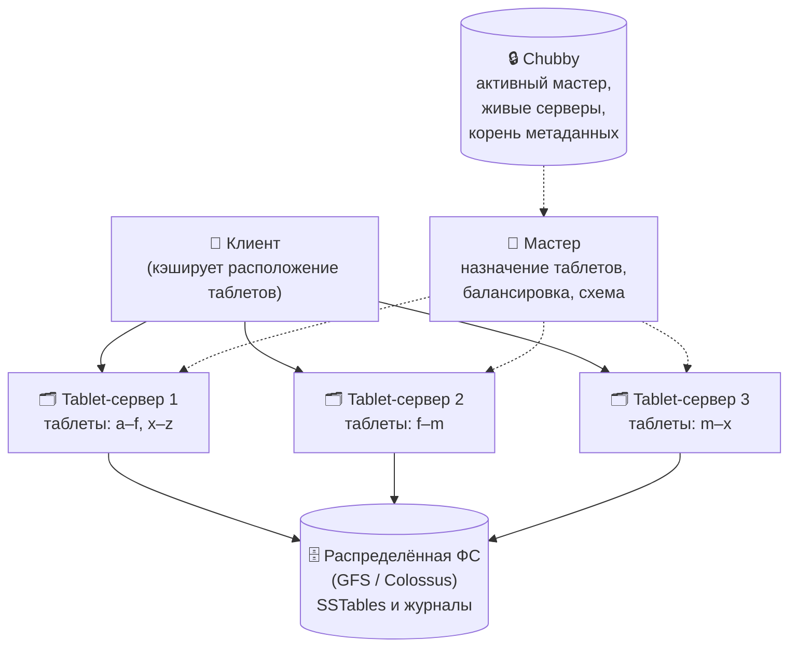
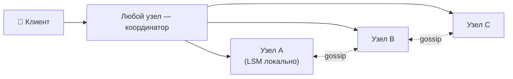
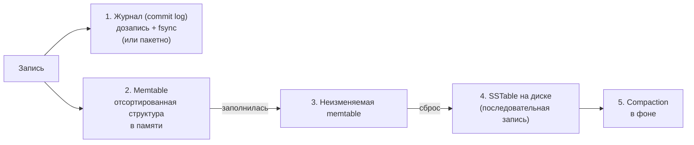
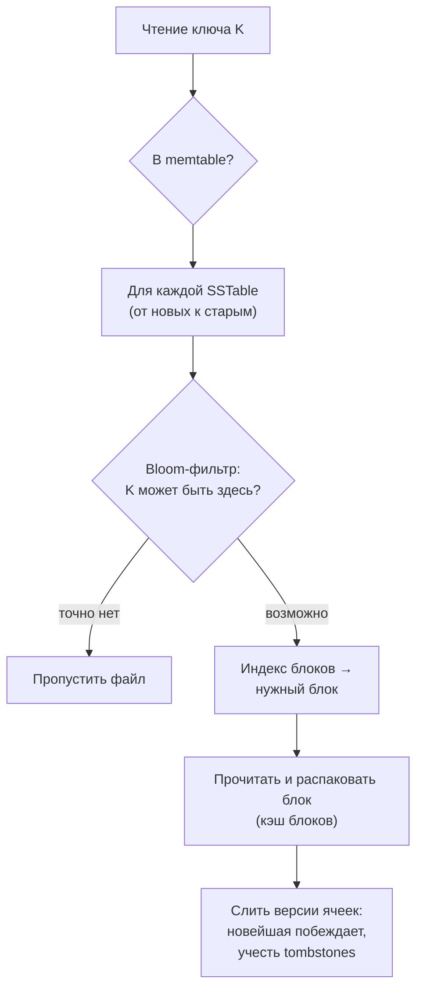
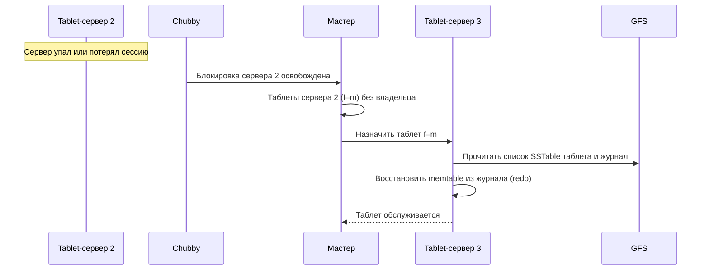

[English](README.md) | **Русский**

# Tier 2 · 4C · 04. Wide-column БД (Cassandra / Bigtable)

> **Уровень:** Hard · **Время на интервью:** 45–60 мин · **Время на разбор:** ~5 ч
> **Ключевые аспекты:** модель данных wide-column (ключ строки, семейства столбцов, версии, ключ партиции и кластеризующие столбцы), моделирование от запросов, LSM-движок на узле (журнал, memtable, SSTable, индексы и Bloom-фильтры), путь чтения, стратегии compaction и усиление записи/чтения/места, tombstones и TTL, архитектура Bigtable (мастер, tablet-серверы, распределённая ФС), разделение и слияние таблетов, горячие ключи и дизайн ключа строки
> **Опирается на:** [04-databases](../../../04-databases/README_RU.md#7-b-tree-vs-lsm-tree), [Tier 1 · 19 KV Store](../../../tier-1/19-distributed-kv-store/README_RU.md) (кольцо, кворумы, repair), [Tier 2 · 4C · 02 Coordination](../02-coordination-service/README_RU.md), [Tier 2 · 4C · 01 Object Storage](../01-object-storage-s3/README_RU.md), [06-partitioning](../../../06-partitioning/README_RU.md#8-горячие-партиции-и-перекос)

---

## 🗺️ Как читать этот разбор

Разбор построен как интервью, но в каждом шаге есть объяснения: **почему** принимается решение, **как работает** механизм и **что будет**, если сделать иначе. Блоки «📘 Объяснение» — теория прямо по ходу задачи.

| Значок | Что значит |
|:------:|:-----------|
| 🎤 | Реплика интервьюера |
| 🗣️ | Что говорю вслух я (кандидат) |
| ✏️ | Что рисую на доске |
| ⏱️ | Сколько времени тратить на шаг |
| 📘 | Подробное объяснение концепции |

Блоки **TIP** — хороший приём, **WARNING** — ловушка, **IMPORTANT** — сигнал для уровня Senior+.

---

## 📑 Содержание

0. [Чему учит эта задача](#0-чему-учит-эта-задача)
1. [Условие задачи](#1-условие-задачи)
2. [Уточняющие вопросы и требования](#2-уточняющие-вопросы-и-требования)
3. [Оценки нагрузки](#3-оценки-нагрузки)
4. [Модель данных wide-column](#4-модель-данных-wide-column)
5. [Моделирование от запросов](#5-моделирование-от-запросов)
6. [High-level дизайн: два подхода](#6-high-level-дизайн-два-подхода)
7. [Deep dive 1: путь записи в LSM](#7-deep-dive-1-путь-записи-в-lsm)
8. [Deep dive 2: устройство SSTable и путь чтения](#8-deep-dive-2-устройство-sstable-и-путь-чтения)
9. [Deep dive 3: compaction и усиления](#9-deep-dive-3-compaction-и-усиления)
10. [Deep dive 4: удаления, tombstones и TTL](#10-deep-dive-4-удаления-tombstones-и-ttl)
11. [Deep dive 5: архитектура Bigtable](#11-deep-dive-5-архитектура-bigtable)
12. [Deep dive 6: таблеты — разделение, слияние, поиск](#12-deep-dive-6-таблеты--разделение-слияние-поиск)
13. [Deep dive 7: дизайн ключа строки и горячие точки](#13-deep-dive-7-дизайн-ключа-строки-и-горячие-точки)
14. [Deep dive 8: консистентность, индексы и эксплуатация](#14-deep-dive-8-консистентность-индексы-и-эксплуатация)
15. [Узкие места и сценарии сбоев](#15-узкие-места-и-сценарии-сбоев)
16. [Что изменится при росте в 10 раз](#16-что-изменится-при-росте-в-10-раз)
17. [Ключевые концепции и новые понятия](#17-ключевые-концепции-и-новые-понятия)
18. [Варианты задачи и follow-up вопросы](#18-варианты-задачи-и-follow-up-вопросы)
19. [Типичные ошибки](#19-типичные-ошибки)
20. [Шпаргалка и самопроверка](#20-шпаргалка-и-самопроверка)

---

## 0. Чему учит эта задача

Wide-column базы (Bigtable, HBase, Cassandra, ScyllaDB) хранят петабайты и принимают миллионы записей в секунду: сообщения Discord, ленты, метрики, индексы поиска. В [Tier 1 · 19](../../../tier-1/19-distributed-kv-store/README_RU.md) мы разобрали **распределённую** сторону (кольцо, кворумы, конфликты, repair). Здесь фокус на двух других вещах:

1. **Модель данных** — как устроены «широкие» строки и почему данные нужно моделировать от запросов;
2. **Хранение на узле** — LSM-дерево, SSTables, compaction и их компромиссы — плюс **архитектура Bigtable** с мастером и таблетами как альтернатива кольцу без лидера.

| Что проверяют | Где это в задаче |
|:--------------|:-----------------|
| Моделирование данных | Партиции, кластеризация, денормализация под запросы |
| Структуры хранения | LSM-дерево, SSTable, Bloom-фильтры |
| Компромиссы ресурсов | Усиление записи, чтения и места при compaction |
| Удаление в неизменяемых структурах | Tombstones, TTL, воскрешение данных |
| Архитектура с мастером | Bigtable: мастер, tablet-серверы, распределённая ФС, Chubby |
| Шардирование по диапазону | Разделение таблетов, горячие ключи |
| Дизайн ключей | Соление, разворот, составные ключи |

> [!TIP]
> Покажи, что знаешь **оба семейства**: Bigtable/HBase — упорядоченные диапазоны, мастер, строгая консистентность в строке; Cassandra/ScyllaDB — хэш-кольцо без мастера, настраиваемая консистентность. Хранение на узле у них почти одинаковое — LSM.

---

## 1. Условие задачи

> 🎤 «Спроектируй wide-column базу данных вроде Bigtable или Cassandra: таблицы с огромным числом строк и динамическими столбцами, миллионы записей в секунду, петабайты данных, быстрые чтения по ключу и по диапазону».

**Типичные данные:**

```
Сообщения чата:   партиция = канал, строки внутри = сообщения по времени
Метрики:          партиция = (метрика, хост, день), строки = точки по времени
Профиль веб-страницы (как в статье Bigtable):
                  ключ строки = "com.example.www/index.html",
                  столбцы = contents:, anchor:cnn.com, anchor:bbc.co.uk …, с версиями по времени
```

**План по времени:**

| Шаг | ⏱️ |
|:----|:--:|
| Требования | 4 мин |
| Оценки | 3 мин |
| Модель данных и запросы | 8 мин |
| High-level дизайн | 5 мин |
| Deep dives | 25 мин |
| Итоги | 3 мин |

---

## 2. Уточняющие вопросы и требования

⏱️ 4 мин

| Мой вопрос | Ответ интервьюера | Что это меняет и почему |
|:-----------|:------------------|:------------------------|
| Нагрузка? | ~1M записей/с, чтения сопоставимы | Оптимизация под запись → LSM |
| Объём? | Петабайты | Сотни–тысячи узлов |
| Типы запросов? | По ключу, по диапазону внутри партиции, последние N | Упорядоченное хранение внутри партиции |
| JOIN, произвольные запросы? | Нет | Денормализация, моделирование от запросов |
| Транзакции? | В пределах строки или партиции | Атомарность на уровне строки |
| Консистентность? | Обсудим оба варианта | Bigtable: строгая в строке; Cassandra: настраиваемая |
| Время жизни данных? | Часть данных — с TTL (метрики, логи) | TTL и эффективное удаление |

### Функциональные требования

1. Таблицы со строками по ключу; столбцы группируются в семейства; столбцы могут быть разными в разных строках.
2. Запись, чтение строки, чтение диапазона строк, удаление.
3. Несколько версий значения с метками времени.
4. TTL на значения.
5. Атомарные операции в пределах одной строки.

### Нефункциональные требования

| Требование | Цель | Почему |
|:-----------|:-----|:-------|
| Пропускная способность записи | Миллионы в секунду, линейно с узлами | Логи, события, метрики |
| Задержка | Единицы мс на p99 для точечного чтения | Онлайн-нагрузка |
| Масштаб | Петабайты | Хранение истории |
| Доступность | Высокая; отказ узла не останавливает работу | Критичные данные |
| Эффективность хранения | Сжатие, удаление устаревшего | Стоимость |

---

## 3. Оценки нагрузки

⏱️ 3 мин

```
Записи:          1M/с × ~1 КБ = 1 ГБ/с входящих данных → ~30 ПБ в год без TTL
Узел:            десятки тысяч записей/с (последовательная запись в журнал и memtable)
                 → ~50–100 узлов на запись, больше — на объём и репликацию
Хранение:        с репликацией ×3 и сжатием — объёмы задают число узлов
Compaction:      каждый байт перезаписывается несколько раз — диск и CPU под фоновую работу
```

### Выводы

| Вывод | Следствие для дизайна |
|:------|:----------------------|
| Запись доминирует | LSM: последовательная запись, без обновлений на месте |
| Петабайты | Сжатие, TTL, классы хранения |
| Compaction — постоянная фоновая нагрузка | Выбор стратегии под паттерн, запас ресурсов |

---

## 4. Модель данных wide-column

⏱️ 4 мин

### Bigtable: разреженная многомерная сортированная карта

📘 Статья о Bigtable описывает модель так: **(ключ строки, столбец, метка времени) → значение**. Строки отсортированы по ключу. Столбцы сгруппированы в **семейства** (column families), объявляемые заранее, а сами столбцы внутри семейства могут быть любыми и разными в разных строках.

```
Ключ строки                    contents:            anchor:cnn.com      anchor:bbc.co.uk
"com.example.www/index.html"   t9: "<html>…"        t8: "Example"       t5: "EX site"
                               t6: "<html>…" (стар.)
"com.example.www/about.html"   t9: "<html>…"                            t7: "About"
```

| Элемент | Что это |
|:--------|:--------|
| Ключ строки | Строка байт; строки упорядочены лексикографически |
| Семейство столбцов | Единица настроек: сжатие, число хранимых версий, TTL, физическое хранение |
| Столбец | `семейство:квалификатор`, может быть миллионы разных в таблице |
| Версии | Несколько значений одной ячейки с метками времени; хранится N последних или за период |
| Разреженность | Пустые ячейки не занимают места |

### Cassandra: ключ партиции + кластеризующие столбцы

```sql
CREATE TABLE messages (
  channel_id   bigint,
  bucket       int,            -- например, неделя: ограничивает размер партиции
  message_id   timeuuid,
  author_id    bigint,
  content      text,
  PRIMARY KEY ((channel_id, bucket), message_id)
) WITH CLUSTERING ORDER BY (message_id DESC);
```

| Часть ключа | Роль |
|:------------|:-----|
| **Ключ партиции** `(channel_id, bucket)` | Определяет узлы (хэш на кольце); все строки партиции — вместе |
| **Кластеризующие столбцы** `message_id` | Порядок строк **внутри** партиции; чтение диапазона и «последние N» — одно последовательное чтение |

📘 «Широкая» строка — это партиция с множеством упорядоченных строк внутри. Именно так [Discord хранит сообщения](../../../tier-1/06-chat-system/README_RU.md#9-deep-dive-3-хранение-истории): канал + временной бакет как партиция.

---

## 5. Моделирование от запросов

⏱️ 4 мин

📘 В реляционной базе схему проектируют от сущностей, а запросы пишут потом (JOIN всё соединит). В wide-column — наоборот: **сначала запросы, затем таблицы**, по одной таблице на запрос, данные **денормализуются**.

| Запрос | Таблица |
|:-------|:--------|
| Последние сообщения канала | `messages_by_channel ((channel_id, bucket), message_id DESC)` |
| Сообщения автора | `messages_by_author ((author_id, bucket), message_id DESC)` |
| Сообщение по ID | `messages_by_id (message_id)` |

| Правило | Почему |
|:--------|:-------|
| Запрос читает **одну партицию** | Один узел (или кворум реплик), последовательное чтение |
| Ограничивать размер партиции (бакеты по времени) | Гигантские партиции тормозят чтение, compaction и repair |
| Запись в несколько таблиц | Цена денормализации; атомарность между таблицами — через пакеты (logged batch) или идемпотентные повторы |
| Нет JOIN | Данные, нужные запросу, лежат в одной строке или партиции |

> [!WARNING]
> **Неограниченная партиция** — классическая ошибка: `PRIMARY KEY (channel_id, message_id)` без бакета означает, что популярный канал копит сообщения в одной партиции годами — гигабайты на одном наборе узлов. Добавляйте временной бакет в ключ партиции.

---

## 6. High-level дизайн: два подхода

⏱️ 5 мин

### Bigtable / HBase — мастер и таблеты



### Cassandra / ScyllaDB — кольцо без мастера



| | Bigtable / HBase | Cassandra / ScyllaDB |
|:-|:-----------------|:---------------------|
| Распределение | **Диапазоны** ключей строк (таблеты) | **Хэш** ключа партиции на кольце |
| Где данные физически | В распределённой ФС; tablet-сервер **не владеет** данными | На локальных дисках узлов |
| Репликация | Делает ФС (GFS/HDFS) | Сама база (N реплик на кольце) |
| Владелец ключа | Один tablet-сервер | N равноправных реплик |
| Консистентность | Строгая для строки | Настраиваемая (ONE/QUORUM/…) |
| Диапазонные запросы по ключу строки | Да | Только внутри партиции |
| Отказ сервера | Таблеты быстро переназначаются (данные уже в ФС) | Реплики продолжают обслуживать |

📘 Распределённая сторона Cassandra разобрана в [Tier 1 · 19](../../../tier-1/19-distributed-kv-store/README_RU.md). Ниже — общее для обоих: **хранение на узле**, затем архитектура Bigtable.

---

## 7. Deep dive 1: путь записи в LSM

> 🎤 «Как узел принимает десятки тысяч записей в секунду?»



| Шаг | Зачем |
|:----|:------|
| **Журнал** | Долговечность: после сбоя memtable восстанавливается из журнала |
| **Memtable** (skip list или дерево) | Запись в память — быстро; данные отсортированы |
| Неизменяемая memtable + новая активная | Сброс на диск не блокирует новые записи |
| **SSTable** | Отсортированный неизменяемый файл; запись последовательная — диск работает с максимальной скоростью |
| Журнал удаляется после сброса | Его данные уже в SSTable |

📘 **Почему это быстро.** Запись никогда не изменяет данные на месте и не читает диск: дозапись в журнал + вставка в память. Сравнение с B-tree — в [04-databases](../../../04-databases/README_RU.md#7-b-tree-vs-lsm-tree).

| Настройка журнала | Компромисс |
|:------------------|:-----------|
| fsync на каждую запись | Без потерь, но медленнее |
| Пакетный fsync (раз в N мс) | Быстрее; при сбое узла можно потерять последние мс — компенсируется репликацией |

---

## 8. Deep dive 2: устройство SSTable и путь чтения

> 🎤 «Данные ключа могут лежать в memtable и в десятке SSTable. Как быстро прочитать?»

### SSTable

```
┌───────────────────────────────────────────────────────┐
│ Блоки данных (по ~4–64 КБ, сжатые)                    │
│   отсортированные строки и ячейки                     │
├───────────────────────────────────────────────────────┤
│ Индекс блоков: первый ключ каждого блока → смещение   │
├───────────────────────────────────────────────────────┤
│ Bloom-фильтр по ключам (партиций или строк)           │
├───────────────────────────────────────────────────────┤
│ Метаданные: диапазон ключей, мин/макс метки времени,  │
│ статистика tombstones                                 │
└───────────────────────────────────────────────────────┘
```

### Путь чтения



| Механизм | Эффект |
|:---------|:-------|
| **Bloom-фильтр** | Большинство SSTable, где ключа нет, отсекаются без чтения диска |
| Индекс блоков в памяти | Одно чтение блока на SSTable |
| **Кэш блоков** | Горячие блоки — из памяти |
| Мин/макс метки времени | Запрос «за последний час» пропускает старые файлы |
| Слияние версий | Ячейка может быть обновлена в разных SSTable — побеждает наибольшая метка времени |

📘 **Почему чтение дороже записи.** Запись — одно место (memtable), а чтение может затронуть много SSTable. Задача **compaction** — держать число SSTable, которые нужно читать, небольшим.

---

## 9. Deep dive 3: compaction и усиления

> 🎤 «Какие бывают стратегии compaction и как выбрать?»

### Три усиления

| Усиление | Что значит |
|:---------|:-----------|
| **Записи** (write amplification) | Сколько раз байт перезаписывается на диск за жизнь (сброс + каждое слияние) |
| **Чтения** (read amplification) | Сколько SSTable или блоков читается на один запрос |
| **Места** (space amplification) | Во сколько раз занятое место больше живых данных (старые версии, удалённое, временные копии при слиянии) |

📘 Нельзя минимизировать все три одновременно — стратегия compaction выбирает компромисс.

### Стратегии

| Стратегия | Как | Записи | Чтения | Место | Когда |
|:----------|:----|:-------|:-------|:------|:------|
| **Size-tiered** | Сливать несколько SSTable похожего размера в одну большую | Низкое | Выше (много перекрывающихся файлов) | До ~2× (временно при слиянии больших файлов) | Запись доминирует |
| **Leveled** | Уровни L0, L1, L2…; каждый уровень в ~10 раз больше предыдущего; на уровне файлы не перекрываются по ключам | Высокое (~10× на уровень при переносе вниз) | Низкое: на каждом уровне ≤ 1 файл с ключом | Низкое (~10%) | Чтения и обновления доминируют |
| **Time-window** | Файлы группируются по окнам времени; окно сливается один раз и больше не трогается | Низкое | Хорошее для запросов по времени | Хорошее с TTL: целое окно удаляется файлом | Временные ряды, логи с TTL |

```
Leveled:
  L0: [ 4 файла, могут перекрываться ]
  L1: [ 10 файлов, 10 МБ ] — не перекрываются
  L2: [ 100 файлов ]       — не перекрываются
  L3: [ 1 000 файлов ]
  Чтение ключа: L0 (несколько) + максимум по одному файлу на каждом уровне
```

> [!IMPORTANT]
> **Сигнал Senior+:** назвать три усиления и выбрать стратегию под нагрузку: метрики с TTL — time-window (удаление целыми файлами), частые обновления и чтения — leveled, поток записи без обновлений — size-tiered. И помнить, что compaction — постоянная фоновая нагрузка на диск и CPU, под которую нужен запас.

---

## 10. Deep dive 4: удаления, tombstones и TTL

> 🎤 «Как удалить данные, если SSTable неизменяемы?»

📘 Удаление — это **запись**: в memtable добавляется **tombstone** (метка удаления) с меткой времени. При чтении tombstone скрывает более старые значения. Физически данные исчезают только при compaction, когда tombstone и удаляемые значения встречаются в одном слиянии.

| Проблема | Почему | Решение |
|:---------|:-------|:--------|
| **Много tombstones** в партиции | Чтение «последних N» должно пролистать тысячи меток удаления — медленно (в Cassandra есть порог, после которого запрос прерывается) | Не моделировать очередь как таблицу с удалениями; TTL и time-window compaction |
| **Воскрешение данных** | В распределённой базе tombstone хранится ограниченное время (`gc_grace_seconds`); реплика, пропустившая удаление дольше этого срока, вернёт старое значение | Repair чаще срока хранения tombstones (см. [Tier 1 · 19](../../../tier-1/19-distributed-kv-store/README_RU.md#12-deep-dive-7-движок-хранения-на-узле)) |
| Удаление больших диапазонов | Tombstone на каждую ячейку — огромно | Tombstone на диапазон или на партицию |

### TTL

📘 Значение с TTL само становится tombstone по истечении срока. С **time-window compaction** файлы окна, у которых истёк TTL всех данных, удаляются **целиком**, без перезаписи — самое дешёвое удаление.

---

## 11. Deep dive 5: архитектура Bigtable

> 🎤 «Расскажи, как устроен Bigtable».

| Компонент | Роль |
|:----------|:-----|
| **Таблет** | Непрерывный диапазон строк таблицы (~100–200 МБ в оригинальной статье); единица распределения нагрузки |
| **Tablet-сервер** | Обслуживает набор таблетов: memtable, кэши, чтение SSTable из ФС; данные **не хранит локально** |
| **Мастер** | Назначает таблеты серверам, балансирует, обрабатывает изменения схемы; **не участвует** в пути данных |
| **GFS / Colossus** | Хранит SSTables и журналы с репликацией |
| **Chubby** | Выбор единственного активного мастера, регистрация живых tablet-серверов (их блокировки), корень метаданных |

### Отказ tablet-сервера



📘 **Почему восстановление быстрое.** Данные уже лежат в распределённой ФС с репликацией — новому серверу нужно только загрузить метаданные таблета и воспроизвести хвост журнала. Не нужно копировать терабайты.

| Решение | Почему |
|:--------|:-------|
| Один журнал на tablet-сервер (а не на таблет) | Меньше файлов и fsync; при восстановлении журнал сортируется по таблетам |
| Chubby-сессии как детектор живости | Сервер, потерявший блокировку, обязан прекратить обслуживание — защита от двух владельцев таблета |
| Мастер не в пути данных | Его отказ не останавливает чтения и записи |

---

## 12. Deep dive 6: таблеты — разделение, слияние, поиск

> 🎤 «Как клиент находит, на каком сервере нужный ключ? И что происходит, когда таблет растёт?»

### Поиск таблета

```
Трёхуровневая иерархия (как в статье Bigtable):
  1. Файл в Chubby → расположение корневого таблета METADATA
  2. Корневой таблет → расположение остальных таблетов METADATA
  3. Таблет METADATA → расположение пользовательского таблета (диапазон → сервер)

Клиент кэширует расположения; при промахе или ошибке «таблет переехал» — перечитывает
```

### Разделение и слияние

| Операция | Когда | Как |
|:---------|:------|:----|
| **Разделение** | Таблет превысил размер или нагрузку | Tablet-сервер разделяет по ключу посередине, записывает новые границы в METADATA; данные не копируются — новые таблеты ссылаются на те же SSTable до compaction |
| **Слияние** | Соседние таблеты маленькие | Мастер объединяет |
| **Перенос** | Балансировка нагрузки | Мастер переназначает таблет другому серверу (быстро — данные в ФС) |

📘 Это та же идея, что у метаданных объектного хранилища ([4C · 01](../01-object-storage-s3/README_RU.md#10-deep-dive-4-метаданные-на-масштабе-и-листинг)): шардирование по диапазонам с автоматическим разделением горячих диапазонов.

---

## 13. Deep dive 7: дизайн ключа строки и горячие точки

> 🎤 «Метрики пишутся с ключом `timestamp#metric`. Почему один сервер перегружен?»

### Проблема монотонных ключей

📘 При шардировании по диапазону **монотонно растущий ключ** (время, автоинкремент) отправляет **все** новые записи в последний таблет — один сервер принимает весь поток, остальные простаивают.

### Приёмы

| Приём | Пример | Плюсы | Минусы |
|:------|:-------|:------|:-------|
| **Продвижение поля** | `metric#host#timestamp` вместо `timestamp#…` | Записи распределены по метрикам и хостам; запрос «метрика за период» — непрерывный диапазон | Нужно знать метрику при чтении |
| **Соление** | `hash(id) % 16 # timestamp` | Записи распределены по 16 диапазонам | Чтение диапазона по времени — 16 запросов |
| **Разворот** | Обратная запись доменов: `com.example.www` | Страницы одного сайта рядом (как в статье Bigtable) | — |
| **Обратная метка времени** | `metric#(MAX − timestamp)` | Новейшие записи — первыми в диапазоне | — |

> [!TIP]
> Ключ строки — главное решение при работе с Bigtable/HBase: он определяет и распределение нагрузки, и эффективность запросов. Сначала запросы, потом ключ — и всегда проверка: нет ли монотонного префикса.

### Cassandra

📘 В Cassandra ключ партиции хэшируется, поэтому монотонный ключ не создаёт горячий узел, но **одна огромная партиция** (популярный канал, знаменитость) — создаёт: все её данные на одних и тех же репликах. Решение — бакеты в ключе партиции.

---

## 14. Deep dive 8: консистентность, индексы и эксплуатация

### Консистентность

| | Bigtable / HBase | Cassandra |
|:-|:-----------------|:----------|
| Строка | Один владелец → **атомарные и строго консистентные** операции над строкой (read-modify-write, условные записи) | Реплики равноправны; LWW по метке времени на ячейку |
| Уровни | — | ONE / QUORUM / ALL на запрос |
| Многострочные транзакции | Нет (в оригинальном Bigtable) | Lightweight transactions (Paxos) для одной партиции |
| Межрегиональная репликация | Асинхронная (eventual) | Мульти-ДЦ с LOCAL_QUORUM |

### Вторичные индексы

| Вариант | Как | Компромисс |
|:--------|:----|:-----------|
| Отдельная таблица под запрос | Денормализация (раздел 5) | Явная двойная запись |
| Встроенный локальный индекс (Cassandra) | Индекс на каждом узле по его данным | Запрос без ключа партиции обходит все узлы |
| Внешний поисковый индекс | CDC → Elasticsearch | Гибкие запросы, задержка индексации |

### Эксплуатация

| Тема | Решение |
|:-----|:--------|
| Запас ресурсов под compaction | Не загружать диски более чем на ~50–60% |
| Размер партиций | Мониторинг крупнейших партиций |
| Tombstones | Мониторинг числа меток удаления, читаемых на запрос |
| Repair (Cassandra) | Регулярно, чаще `gc_grace_seconds` |
| Резервное копирование | Снимки неизменяемых SSTable — дёшево (жёсткие ссылки) |
| Сжатие | По семействам столбцов; разные алгоритмы для горячих и холодных данных |

---

## 15. Узкие места и сценарии сбоев

| Сценарий | Что произойдёт | Как защищаемся |
|:---------|:---------------|:---------------|
| Монотонный ключ строки (Bigtable) | Один горячий таблет | Продвижение поля, соление |
| Огромная партиция (Cassandra) | Перегрузка реплик, медленные чтения | Бакеты в ключе партиции |
| Много SSTable | Медленное чтение | Compaction, Bloom-фильтры |
| Неверная стратегия compaction | Перегрузка диска или медленные чтения | Выбор под нагрузку |
| Шквал tombstones | Медленные или прерванные запросы | Не моделировать очереди; TTL и time-window |
| Воскрешение удалённого | Старые данные возвращаются | Repair чаще срока tombstones |
| Отказ tablet-сервера | Таблеты временно недоступны | Переназначение за секунды, данные в ФС |
| Отказ мастера Bigtable | Нельзя перераспределять таблеты | Новый мастер через Chubby; данные обслуживаются |
| Два владельца таблета | Порча данных | Блокировки Chubby, сервер прекращает работу при потере сессии |
| Диск заполнен из-за compaction | Сбой узла | Запас места |

---

## 16. Что изменится при росте в 10 раз

> 🎤 «10 миллионов записей в секунду и сотни петабайт?»

| Изменение | Почему |
|:----------|:-------|
| **Разделение вычислений и хранения** (как Bigtable на Colossus) | Независимое масштабирование, быстрое перераспределение |
| **Многоуровневое хранение** SSTable: горячие на SSD, холодные в объектном хранилище | Стоимость |
| **Более эффективные движки** (ScyllaDB на C++ с моделью «поток на ядро») | Меньше узлов на ту же нагрузку |
| **Автоматическое разделение по нагрузке**, а не только по размеру | Горячие диапазоны |

---

## 17. Ключевые концепции и новые понятия

### Что применяется

| Концепция | Где разобрана | Как применяется здесь |
|:----------|:--------------|:----------------------|
| B-tree против LSM | [04-databases](../../../04-databases/README_RU.md#7-b-tree-vs-lsm-tree) | Движок хранения |
| Кольцо, кворумы, repair | [Tier 1 · 19](../../../tier-1/19-distributed-kv-store/README_RU.md) | Распределённая сторона Cassandra |
| Сервис координации | [Tier 2 · 4C · 02](../02-coordination-service/README_RU.md) | Chubby в Bigtable |
| Распределённое хранилище с репликацией | [Tier 2 · 4C · 01](../01-object-storage-s3/README_RU.md) | GFS/Colossus под Bigtable |
| Горячие партиции | [06-partitioning](../../../06-partitioning/README_RU.md#8-горячие-партиции-и-перекос) | Дизайн ключа строки |

### Новые понятия этой задачи

| Понятие | Кратко |
|:--------|:-------|
| **Семейство столбцов** | Группа столбцов с общими настройками хранения |
| **Ключ партиции и кластеризующие столбцы** | Распределение по узлам и порядок внутри партиции |
| **Моделирование от запросов** | Таблица на запрос, денормализация |
| **Memtable и SSTable** | Буфер в памяти и неизменяемый отсортированный файл |
| **Индекс блоков и Bloom-фильтр SSTable** | Быстрый поиск и отсечение файлов |
| **Усиления записи, чтения и места** | Три стоимости, между которыми выбирает compaction |
| **Size-tiered, leveled, time-window** | Стратегии compaction |
| **Tombstone, gc_grace** | Метка удаления и срок её хранения |
| **Таблет** | Диапазон строк, единица распределения в Bigtable |
| **Tablet-сервер и мастер** | Обслуживание таблетов и их назначение |
| **Продвижение поля, соление, разворот** | Приёмы дизайна ключа строки |

---

## 18. Варианты задачи и follow-up вопросы

<details>
<summary><b>Когда выбрать Bigtable/HBase, а когда Cassandra?</b></summary>

Bigtable/HBase — когда нужны диапазонные сканирования по ключу строки через всю таблицу, строгая консистентность в строке и есть распределённая ФС (экосистема Hadoop или Google Cloud). Cassandra/ScyllaDB — когда нужна запись в нескольких дата-центрах без мастера, настраиваемая консистентность и простая эксплуатация без внешних зависимостей.
</details>

<details>
<summary><b>Почему не PostgreSQL с секционированием?</b></summary>

Для умеренного объёма это хороший выбор (богатые запросы, транзакции). Но B-tree плохо выдерживает миллионы записей в секунду, а горизонтальное масштабирование на сотни узлов требует внешних решений. Wide-column базы изначально построены для линейного роста записи и петабайтов.
</details>

<details>
<summary><b>Как реализовать счётчик в wide-column базе?</b></summary>

В Bigtable/HBase — атомарный инкремент строки на её единственном владельце. В Cassandra — специальный тип counter (с ограничениями: не идемпотентен при повторе) или CRDT-подход: счётчик на реплику и суммирование.
</details>

<details>
<summary><b>Зачем хранить несколько версий ячейки?</b></summary>

История изменений (например, разные версии веб-страницы при каждом обходе краулера), чтение «на момент времени», откат ошибочной записи. Число версий или срок их хранения настраивается на семейство столбцов, а лишние удаляются при compaction.
</details>

<details>
<summary><b>Почему в Bigtable tablet-сервер не хранит данные локально?</b></summary>

Разделение вычислений и хранения: таблет можно мгновенно переназначить другому серверу (данные в общей ФС), сервер без состояния проще заменить, масштабировать вычисления и хранение можно независимо. Цена — сетевое чтение вместо локального диска, частично скрываемое кэшами.
</details>

---

## 19. Типичные ошибки

| ❌ Ошибка | Почему плохо | ✅ Как правильно |
|:---------|:-------------|:----------------|
| Проектировать схему от сущностей, как в SQL | Запросы требуют JOIN, которых нет | Таблица на запрос, денормализация |
| Партиция без ограничения размера | Гигантские партиции | Временные бакеты в ключе партиции |
| Монотонный ключ строки в Bigtable | Один горячий таблет | Продвижение поля, соление |
| Очередь на таблице с удалениями | Шквал tombstones | Специальная очередь или TTL |
| Одна стратегия compaction для всех таблиц | Плохой компромисс для части нагрузок | Выбор по паттерну |
| Диски загружены под 90% | Нет места под compaction | Запас 40–50% |
| Repair реже срока tombstones | Воскрешение удалённого | Регулярный repair |
| Запросы без ключа партиции | Обход всех узлов | Отдельная таблица или внешний индекс |
| Ожидать многострочных транзакций | Их нет | Атомарность строки, дизайн данных |
| Путать роли мастера Bigtable | Думать, что он в пути данных | Мастер только назначает таблеты |

---

## 20. Шпаргалка и самопроверка

### Ответ за 30 секунд

> Модель — разреженная сортированная карта (ключ строки, семейство:столбец, метка времени) → значение; в Cassandra — ключ партиции (распределение) + кластеризующие столбцы (порядок внутри партиции). Моделирование от запросов: таблица на запрос, денормализация, размер партиции ограничен бакетами. Хранение на узле — LSM: журнал (fsync, возможно пакетно) + memtable → сброс в неизменяемые SSTable (сжатые блоки, индекс блоков, Bloom-фильтр, мин/макс время) → чтение сливает memtable и SSTable от новых к старым. Compaction выбирает компромисс трёх усилений: size-tiered для записи, leveled для чтения и обновлений, time-window для временных рядов с TTL (удаление целыми файлами). Удаления — tombstones; опасны их массы и воскрешение данных при редком repair. Два подхода к распределению: Bigtable/HBase — диапазоны (таблеты) на tablet-серверах, данные в GFS/Colossus, мастер назначает таблеты, Chubby — активный мастер и живость серверов, строгая консистентность строки, быстрое переназначение, разделение таблетов без копирования; Cassandra — хэш-кольцо без мастера, настраиваемая консистентность. Ключ строки без монотонного префикса: продвижение поля, соление, разворот.

### Самопроверка

- [ ] Могу описать модель Bigtable и модель Cassandra
- [ ] Могу спроектировать таблицы от запросов и ограничить размер партиции
- [ ] Могу описать путь записи в LSM
- [ ] Могу описать устройство SSTable и путь чтения
- [ ] Могу назвать три усиления и сравнить стратегии compaction
- [ ] Могу объяснить tombstones, их проблемы и TTL
- [ ] Могу описать архитектуру Bigtable и восстановление после отказа tablet-сервера
- [ ] Могу объяснить поиск, разделение и слияние таблетов
- [ ] Могу исправить горячий монотонный ключ строки
- [ ] Могу сравнить Bigtable/HBase и Cassandra по консистентности и распределению

### Что почитать

- Chang et al., *Bigtable: A Distributed Storage System for Structured Data* (OSDI 2006)
- Lakshman, Malik, *Cassandra: A Decentralized Structured Storage System* (2009)
- O'Neil et al., *The Log-Structured Merge-Tree (LSM-Tree)* (1996)
- Документация Cassandra: моделирование данных, стратегии compaction, tombstones
- Документация Google Cloud Bigtable: дизайн ключа строки
- Discord Engineering, *How Discord Stores Billions of Messages* (2017)
