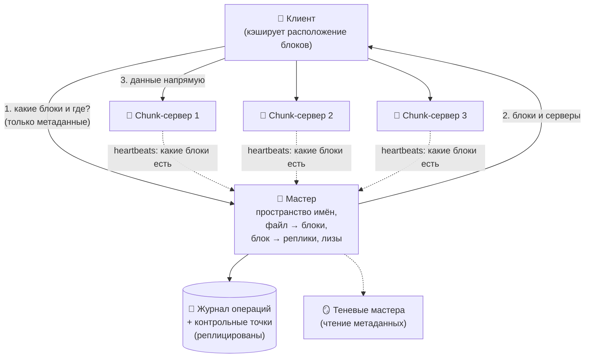
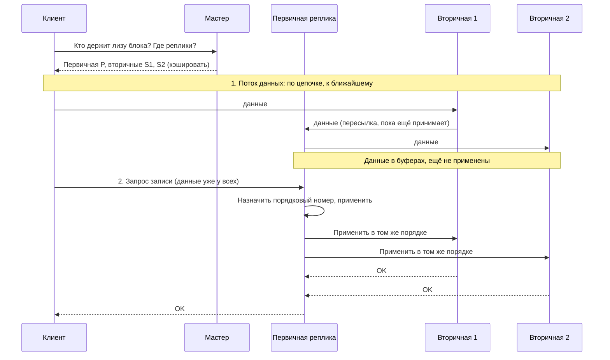
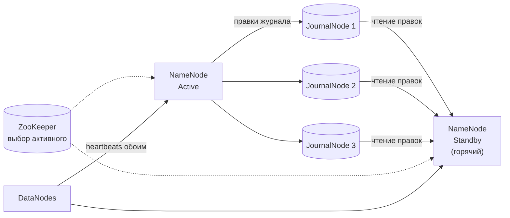

[English](README.md) | **Русский**

# Tier 2 · 4C · 05. Распределённая файловая система (GFS / HDFS)

> **Уровень:** Hard · **Время на интервью:** 45–60 мин · **Время на разбор:** ~5 ч
> **Ключевые аспекты:** единый мастер с метаданными в памяти, chunk-серверы, большие блоки, разделение потока управления и потока данных, лизы и первичная реплика для порядка изменений, конвейерная передача данных, ослабленная модель консистентности и атомарная дозапись записей, размещение реплик по стойкам, повторная репликация и версии блоков, отказоустойчивость мастера, контрольные суммы, ленивое удаление, снимки, проблема мелких файлов, эволюция (Colossus, erasure coding)
> **Опирается на:** [14-storage-types](../../../14-storage-types/README_RU.md), [05-replication](../../../05-replication/README_RU.md), [08-consensus](../../../08-consensus/README_RU.md#9-лизы-и-выбор-лидера-для-приложений), [Tier 2 · 4C · 01 Object Storage](../01-object-storage-s3/README_RU.md), [Tier 2 · 4C · 04 Wide-column](../04-wide-column-db/README_RU.md#11-deep-dive-5-архитектура-bigtable)

---

## 🗺️ Как читать этот разбор

Разбор построен как интервью, но в каждом шаге есть объяснения: **почему** принимается решение, **как работает** механизм и **что будет**, если сделать иначе. Блоки «📘 Объяснение» — теория прямо по ходу задачи.

| Значок | Что значит |
|:------:|:-----------|
| 🎤 | Реплика интервьюера |
| 🗣️ | Что говорю вслух я (кандидат) |
| ✏️ | Что рисую на доске |
| ⏱️ | Сколько времени тратить на шаг |
| 📘 | Подробное объяснение концепции |

Блоки **TIP** — хороший приём, **WARNING** — ловушка, **IMPORTANT** — сигнал для уровня Senior+.

---

## 📑 Содержание

0. [Чему учит эта задача](#0-чему-учит-эта-задача)
1. [Условие задачи](#1-условие-задачи)
2. [Уточняющие вопросы и требования](#2-уточняющие-вопросы-и-требования)
3. [Оценки нагрузки](#3-оценки-нагрузки)
4. [API](#4-api)
5. [Модель данных](#5-модель-данных)
6. [High-level дизайн](#6-high-level-дизайн)
7. [Deep dive 1: единый мастер](#7-deep-dive-1-единый-мастер)
8. [Deep dive 2: большие блоки](#8-deep-dive-2-большие-блоки)
9. [Deep dive 3: путь записи — лизы и конвейер](#9-deep-dive-3-путь-записи--лизы-и-конвейер)
10. [Deep dive 4: модель консистентности и дозапись](#10-deep-dive-4-модель-консистентности-и-дозапись)
11. [Deep dive 5: размещение реплик и повторная репликация](#11-deep-dive-5-размещение-реплик-и-повторная-репликация)
12. [Deep dive 6: отказоустойчивость мастера](#12-deep-dive-6-отказоустойчивость-мастера)
13. [Deep dive 7: целостность, удаление и снимки](#13-deep-dive-7-целостность-удаление-и-снимки)
14. [Deep dive 8: мелкие файлы, локальность данных и эволюция](#14-deep-dive-8-мелкие-файлы-локальность-данных-и-эволюция)
15. [Узкие места и сценарии сбоев](#15-узкие-места-и-сценарии-сбоев)
16. [Что изменится при росте в 10 раз](#16-что-изменится-при-росте-в-10-раз)
17. [Ключевые концепции и новые понятия](#17-ключевые-концепции-и-новые-понятия)
18. [Варианты задачи и follow-up вопросы](#18-варианты-задачи-и-follow-up-вопросы)
19. [Типичные ошибки](#19-типичные-ошибки)
20. [Шпаргалка и самопроверка](#20-шпаргалка-и-самопроверка)

---

## 0. Чему учит эта задача

Google File System (2003) и её открытый наследник HDFS стали основой больших данных: MapReduce, Hadoop, Bigtable и HBase работают поверх них. Задача интересна не масштабом, а **смелыми упрощениями**: один мастер на весь кластер, блоки по 64 МБ, ослабленная консистентность — и всё это ради высокой пропускной способности на дешёвом железе, где отказы — обычное дело.

| Что проверяют | Где это в задаче |
|:--------------|:-----------------|
| Разделение потоков | Метаданные через мастера, данные напрямую с серверов |
| Компромиссы простоты | Единый мастер и его пределы |
| Порядок изменений без консенсуса на каждую запись | Лизы и первичная реплика |
| Использование сети | Конвейерная передача данных по цепочке |
| Модели консистентности | «Определённые» и «неопределённые» области, дозапись «хотя бы один раз» |
| Отказы как норма | Повторная репликация, версии блоков, контрольные суммы |
| Отказоустойчивость метаданных | Журнал операций, контрольные точки, резервный мастер |

> [!TIP]
> Хорошее начало: «Система проектируется под **конкретную нагрузку**: огромные файлы, потоковое чтение, массовая дозапись, отказы каждый день. Поэтому мы сознательно жертвуем задержкой, полной POSIX-семантикой и строгой консистентностью конкурентных записей ради пропускной способности и простоты».

---

## 1. Условие задачи

> 🎤 «Спроектируй распределённую файловую систему для аналитики больших данных, как GFS или HDFS: файлы размером от сотен мегабайт до терабайт, тысячи клиентов читают и дописывают данные, кластер из обычных серверов, которые регулярно отказывают».

**Как ей пользуются:**

```
Краулер:    сотни процессов одновременно ДОПИСЫВАЮТ записи в /crawl/2026-11-30/pages
MapReduce:  тысячи задач ЧИТАЮТ файлы по 1 ТБ последовательно, каждая — свой диапазон
Bigtable:   хранит SSTables и журналы как файлы
Аналитик:   ls /logs/2026/11/ , cat, удаление старых каталогов
```

**План по времени:**

| Шаг | ⏱️ |
|:----|:--:|
| Требования | 5 мин |
| Оценки | 3 мин |
| API и данные | 5 мин |
| High-level дизайн | 5 мин |
| Deep dives | 25–30 мин |
| Итоги | 3 мин |

---

## 2. Уточняющие вопросы и требования

⏱️ 5 мин

| Мой вопрос | Ответ интервьюера | Что это меняет и почему |
|:-----------|:------------------|:------------------------|
| Размер файлов? | В основном большие: сотни МБ – ТБ; файлов — миллионы | Большие блоки, метаданные помещаются в память мастера |
| Паттерн чтения? | Большие последовательные чтения, редкие мелкие случайные | Оптимизация пропускной способности, а не задержки |
| Паттерн записи? | Дозапись в конец, часто многими клиентами одновременно; перезапись в середине редка | Атомарная дозапись записей |
| Задержка или пропускная способность? | Пропускная способность | Можно жертвовать задержкой |
| Железо? | Обычные серверы, отказы дисков и машин — ежедневно | Репликация, автоматическое восстановление |
| Нужен ли полный POSIX? | Нет: свой API похожий на файловый | Свобода в семантике |

### Функциональные требования

1. Иерархическое пространство имён: каталоги и файлы.
2. Создание, удаление, открытие, чтение, запись, переименование.
3. **Атомарная дозапись** записи многими клиентами одновременно.
4. Снимки файлов и каталогов.

### Нефункциональные требования

| Требование | Цель | Почему |
|:-----------|:-----|:-------|
| Пропускная способность | Суммарно сотни ГБ/с, растёт с числом серверов | Аналитика читает петабайты |
| Отказоустойчивость | Отказы дисков и серверов не теряют данные и не останавливают работу | Отказы — норма |
| Масштаб | Петабайты, тысячи серверов | Большие данные |
| Простота | Минимум сложных распределённых протоколов | Надёжность реализации |

---

## 3. Оценки нагрузки

⏱️ 3 мин

```
Данные:            10 ПБ логически, ×3 репликации = 30 ПБ на дисках
Серверы:           по ~20 дисков × 16 ТБ = 320 ТБ → ~100 серверов хранения (и больше ради пропускной способности)
Блоки:             10 ПБ / 64 МБ ≈ 156M блоков
Метаданные блоков: < 64 Б на блок (оценка из статьи GFS) → ~10 ГБ → помещается в память мастера
Пространство имён: миллионы файлов × ~100 Б (сжатие префиксов путей) → сотни МБ
Отказы:            при сотнях серверов и тысячах дисков — отказы ежедневно
```

### Выводы

| Вывод | Следствие для дизайна |
|:------|:----------------------|
| Метаданные — гигабайты | Единый мастер может держать их **в памяти** |
| Блоки большие | Мало метаданных и мало обращений к мастеру |
| Отказы ежедневно | Автоматическая повторная репликация, проверка целостности |

---

## 4. API

⏱️ 2 мин

```
create(path) / delete(path) / mkdir(path) / list(dir) / rename(src, dst)
open(path) → handle ; close(handle)
read(handle, offset, length) → bytes
write(handle, offset, bytes)                 ← перезапись в указанном месте (редко)
append(handle, record) → offset              ← атомарная дозапись записи; смещение выбирает система
snapshot(path, snapshot_path)
```

📘 **Почему `append` возвращает смещение.** При одновременной дозаписи сотнями клиентов никто не знает заранее, где кончается файл. Система сама выбирает место и гарантирует, что запись будет добавлена атомарно (целиком) хотя бы один раз — подробно в deep dive 4.

---

## 5. Модель данных

⏱️ 3 мин

```
Мастер (в памяти):
  Пространство имён:   /logs/2026/11/30/app.log → метаданные файла, права
  Файл → блоки:        app.log → [chunk 0x1a2b…, chunk 0x1a2c…, …]   (64-битные идентификаторы)
  Блок → состояние:    chunk 0x1a2b → версия 7, реплики [cs-12, cs-48, cs-90], владелец лизы cs-12

  Пространство имён и отображение файл → блоки: в журнале операций (долговечно)
  Расположение реплик: НЕ сохраняется — мастер узнаёт его от chunk-серверов при запуске и в heartbeats

Chunk-сервер:
  Каждый блок — обычный файл в локальной ФС (Linux)
  Контрольная сумма на каждые 64 КБ блока
```

📘 **Почему мастер не сохраняет расположение реплик.** Источник правды о том, какие блоки есть на диске, — сам chunk-сервер (диск мог отказать, блок — повредиться). Хранить отдельную копию и поддерживать её согласованность сложнее, чем спрашивать серверы при запуске и получать обновления в heartbeats.

---

## 6. High-level дизайн

⏱️ 5 мин



🗣️ «Главная идея — **разделение потоков**:
- **поток управления** (метаданные) идёт через мастера: клиент спрашивает, из каких блоков состоит файл и на каких серверах они лежат, и кэширует ответ;
- **поток данных** идёт напрямую между клиентом и chunk-серверами — мастер никогда не передаёт содержимое файлов;
- мастер хранит всё в памяти, а изменения пространства имён — в **реплицированном журнале операций**;
- chunk-серверы сообщают мастеру, какие блоки у них есть, через **heartbeats**».

---

## 7. Deep dive 1: единый мастер

> 🎤 «Один мастер на весь кластер — это же единая точка отказа и узкое место?»

### Почему один мастер

| Плюс | Объяснение |
|:-----|:-----------|
| **Простота** | Пространство имён, блокировки каталогов, размещение — в одном месте, без распределённого консенсуса на каждую операцию |
| **Глобальное знание** | Мастер видит весь кластер: принимает решения о размещении и повторной репликации |
| Метаданные малы | Помещаются в память → операции за микросекунды |

### Как не стать узким местом

| Приём | Эффект |
|:------|:-------|
| Мастер **вне пути данных** | Терабайты идут мимо него |
| **Большие блоки** | Одна операция с мастером на 64 МБ данных |
| **Кэш на клиенте** | Расположение блоков кэшируется; повторные чтения — без мастера |
| Запрос сразу нескольких блоков | Меньше обращений |
| Мастер отвечает и на соседние блоки «наперёд» | Последовательное чтение не возвращается к мастеру |

### Пределы

📘 Память мастера ограничивает **число файлов и блоков**, а не объём данных. Для HDFS известна грубая оценка: каждый файл, каталог и блок занимает в памяти NameNode порядка 150 байт. Миллиард маленьких файлов исчерпает память мастера при относительно небольшом объёме данных.

| Решение | Как |
|:--------|:----|
| **Федерация** (HDFS) | Несколько независимых мастеров, каждый отвечает за часть пространства имён |
| **Распределённые метаданные** (Colossus) | Наследник GFS хранит метаданные в Bigtable — масштабируемо, без одного мастера |

---

## 8. Deep dive 2: большие блоки

> 🎤 «Почему блоки по 64 МБ (в HDFS — 128 МБ), а не по 4 КБ, как в обычной ФС?»

| Плюс | Объяснение |
|:-----|:-----------|
| Меньше метаданных | 10 ПБ = 156M блоков вместо триллионов |
| Меньше запросов к мастеру | Одна операция на большой кусок файла |
| Долгие соединения | Клиент читает много данных с одного сервера по одному TCP-соединению |

| Минус | Решение |
|:------|:--------|
| **Горячие точки на маленьких файлах** | Файл из одного блока (например, исполняемый файл задачи), который одновременно читают тысячи машин, перегружает 3 сервера → **повышенный фактор репликации** для таких файлов, разнесение запусков во времени |
| Внутренняя фрагментация | **Ленивое выделение**: блок на диске растёт по мере записи, не занимает 64 МБ сразу |

---

## 9. Deep dive 3: путь записи — лизы и конвейер

> 🎤 «Три реплики блока, несколько клиентов пишут. Как гарантировать одинаковый порядок изменений на всех репликах без консенсуса на каждую запись?»

### Лизы

📘 Мастер выдаёт одной из реплик **лизу** на блок (например, на 60 секунд, продлевается в heartbeats). Эта реплика — **первичная**: она назначает порядок всем изменениям блока. Мастер участвует только при выдаче лизы — не на каждой записи.

### Поток данных отделён от потока управления



| Решение | Почему |
|:--------|:-------|
| **Данные по цепочке** «клиент → ближайший → следующий» | Каждая машина использует **всю** исходящую пропускную способность сети; передача начинается, не дожидаясь получения всех данных (конвейер) |
| Цепочка строится по топологии сети | Минимизация межстоечного трафика |
| **Порядок назначает первичная** | Все реплики применяют изменения в одном порядке |
| Мастер только выдаёт лизы | Не становится узким местом |
| **Версия блока** увеличивается при выдаче лизы | Реплика, пропустившая изменения (была выключена), определяется как устаревшая |

### Сбой при записи

📘 Если одна вторичная реплика не смогла применить изменение, первичная возвращает клиенту ошибку, и клиент **повторяет** запись. В результате на части реплик изменение может оказаться дважды или частично — отсюда ослабленная модель консистентности (deep dive 4).

📘 **HDFS** использует похожую схему: клиент пишет пакеты в конвейер из трёх DataNode, подтверждения идут обратно по цепочке; у файла в каждый момент **один писатель** (лиза на файл у NameNode).

---

## 10. Deep dive 4: модель консистентности и дозапись

> 🎤 «Сто процессов краулера одновременно дописывают в один файл. Что гарантирует система?»

### Термины GFS

| Состояние области файла | Что значит |
|:------------------------|:-----------|
| **Консистентная** | Все клиенты видят одни и те же данные, с какой реплики ни читай |
| **Определённая** (defined) | Консистентная **и** отражает одно изменение целиком |
| **Неопределённая** | Консистентная, но содержит перемешанные фрагменты нескольких одновременных записей |
| **Неконсистентная** | Разные реплики содержат разное (после неудачной записи) |

| Операция | Успех без конкуренции | Успех с конкуренцией | Неудача |
|:---------|:---------------------|:---------------------|:--------|
| Запись по смещению | Определённая | Консистентная, но **неопределённая** | Неконсистентная |
| **Дозапись записи** | Определённая | Определённая, **местами вперемешку с неконсистентными** | Неконсистентная |

### Атомарная дозапись «хотя бы один раз»

```
1. Клиент отправляет запись R первичной реплике последнего блока
2. Если R не помещается в остаток блока → первичная дополняет блок «заполнителем»,
   клиент повторяет в новом блоке
3. Иначе первичная выбирает смещение, дописывает R, велит вторичным записать R по тому же смещению
4. Если хоть одна реплика не смогла → клиент повторяет
   → на некоторых репликах R может оказаться ДВАЖДЫ, на других — мусор в том месте
```

📘 **Как приложения с этим живут.** Каждая запись содержит **контрольную сумму** (отбросить мусор и заполнители) и **уникальный ID** (отбросить дубликаты при чтении). Цена простоты файловой системы перекладывается на формат записей — и для потоков логов и результатов это дёшево.

### HDFS проще

| | GFS | HDFS |
|:-|:----|:-----|
| Писатели файла | Много одновременно (дозапись) | **Один** (лиза на файл) |
| Запись по смещению | Есть | Нет (только создание и дозапись) |
| Модель | Ослабленная, с дубликатами | Проще: данные видны после закрытия или явного hflush |

> [!IMPORTANT]
> **Сигнал Senior+:** объяснить, что дозапись **«хотя бы один раз»** — сознательный выбор, перекладывающий дедупликацию на приложение ради отсутствия распределённых блокировок между сотнями писателей. Это тот же принцип, что at-least-once доставка + идемпотентные потребители в очередях.

---

## 11. Deep dive 5: размещение реплик и повторная репликация

> 🎤 «Куда класть три реплики и что делать, когда сервер умер?»

### Размещение

📘 Политика размещения HDFS по умолчанию:

```
Реплика 1: на узле писателя (или на случайном, если писатель вне кластера)
Реплика 2: на узле в ДРУГОЙ стойке
Реплика 3: в той же стойке, что реплика 2, но на другом узле
```

| Компромисс | Объяснение |
|:-----------|:-----------|
| Переживает отказ целой стойки | Реплики в двух стойках |
| Меньше межстоечного трафика при записи | Только одна передача между стойками (а не две) |
| Распределение по дискам | Мастер учитывает заполненность и недавние создания на сервере (чтобы новый сервер не получил шквал записей) |

### Повторная репликация

| Событие | Действие мастера |
|:--------|:-----------------|
| Chunk-сервер не прислал heartbeat | Считается мёртвым; его блоки становятся **недореплицированными** |
| Очередь повторной репликации | **Приоритет**: блок с одной оставшейся репликой — раньше блока с двумя; блоки, мешающие работе клиентов, — раньше |
| Копирование | С существующей реплики на новый сервер, с ограничением скорости, чтобы не мешать клиентам |
| **Ребалансировка** | Периодическое перемещение реплик для выравнивания заполненности дисков |

### Устаревшие реплики

📘 Если chunk-сервер был выключен во время изменения блока, его реплика устарела. Мастер увеличивает **номер версии** блока при каждой выдаче лизы; при возвращении сервера его реплика с меньшей версией распознаётся как устаревшая и удаляется сборщиком мусора, а клиенты никогда не получают её в списке реплик.

---

## 12. Deep dive 6: отказоустойчивость мастера

> 🎤 «Что если мастер упадёт?»

### GFS

| Механизм | Как |
|:---------|:----|
| **Журнал операций** | Каждое изменение метаданных пишется в журнал и **реплицируется на удалённые машины до ответа клиенту** |
| **Контрольные точки** | Периодический снимок состояния мастера в компактном виде — перезапуск = загрузка снимка + воспроизведение хвоста журнала |
| Перезапуск | Секунды; расположение реплик восстанавливается из heartbeats |
| **Теневые мастера** | Читают журнал и обслуживают **чтение** метаданных (возможно, немного устаревших), пока основной недоступен |
| Внешний мониторинг | Запускает нового мастера на другой машине с тем же журналом |

### HDFS High Availability



| Механизм | Зачем |
|:---------|:------|
| **Кворум JournalNode** (большинство из 3 или 5) | Журнал правок переживает отказ узлов |
| Standby применяет правки постоянно | Горячий резерв, переключение за секунды |
| DataNodes шлют heartbeats обоим | Standby знает расположение блоков |
| **ZooKeeper** для выбора активного | Автоматическое переключение (см. [4C · 02](../02-coordination-service/README_RU.md)) |
| **Fencing**: JournalNodes принимают правки только от NameNode с актуальной эпохой | Старый активный не может испортить журнал |

---

## 13. Deep dive 7: целостность, удаление и снимки

> 🎤 «Как обнаружить повреждённые данные и как работает удаление?»

### Контрольные суммы

| Решение | Почему |
|:--------|:-------|
| Контрольная сумма на каждые 64 КБ блока, хранится отдельно | Повреждённый фрагмент обнаруживается при чтении |
| **Каждый chunk-сервер проверяет сам** | Реплики могут законно отличаться (при неудачных дозаписях), поэтому сравнивать реплики между собой нельзя |
| Ошибка при чтении | Клиент читает с другой реплики; мастер повторно реплицирует блок с хорошей реплики |
| Фоновое сканирование | Редко читаемые блоки тоже проверяются |

### Ленивое удаление

```
1. delete(/logs/old.log) → мастер переименовывает файл в скрытое имя с отметкой времени
2. Файл можно восстановить в течение нескольких дней
3. Затем метаданные удаляются → блоки становятся «сиротами»
4. В heartbeat chunk-сервер сообщает свои блоки → мастер отвечает, какие больше не нужны
5. Сервер удаляет их в фоне
```

| Плюс ленивого удаления | Объяснение |
|:-----------------------|:-----------|
| Защита от ошибок | Случайное удаление обратимо |
| Надёжность | Не нужно доставлять «удали блок» каждому серверу немедленно — heartbeats сверяют всё |
| Нагрузка | Удаление выполняется в фоне, пачками |

### Снимки

📘 **Копирование при записи**: мастер отзывает лизы на блоки файла, дублирует метаданные (новый файл указывает на те же блоки, счётчик ссылок блоков растёт). При первой записи в общий блок chunk-сервер создаёт его копию локально (без передачи по сети), и запись идёт в копию.

---

## 14. Deep dive 8: мелкие файлы, локальность данных и эволюция

### Проблема мелких файлов

| Проблема | Почему | Решение |
|:---------|:-------|:--------|
| Миллиарды файлов по несколько КБ | Каждый — запись в памяти мастера; память заканчивается раньше дисков | Упаковка в контейнеры (HAR, SequenceFile, Parquet с крупными файлами), объединение при записи |
| Много мелких операций | Мастер перегружен запросами | То же |

### Локальность данных

📘 MapReduce планирует задачу **на том сервере, где лежит блок** (или хотя бы в той же стойке) — «вычисления к данным», а не данные к вычислениям. Это было решающим, когда сеть была узким местом. Сегодня, с быстрыми сетями, многие системы **разделяют вычисления и хранение** (Spark поверх объектного хранилища).

### Эволюция

| Система | Что изменилось |
|:--------|:---------------|
| **Colossus** (наследник GFS в Google) | Распределённые метаданные (в Bigtable) вместо единого мастера; erasure coding на клиенте; поддержка гораздо большего числа файлов |
| **HDFS 3** | Erasure coding (например, RS-6-3, накладные расходы 1,5× вместо 3×) для холодных данных; федерация пространства имён |
| **Объектные хранилища** (S3 и аналоги) | Озёра данных переехали туда: проще эксплуатация, независимое масштабирование, табличные форматы (Iceberg, Delta) поверх |

---

## 15. Узкие места и сценарии сбоев

| Сценарий | Что произойдёт | Как защищаемся |
|:---------|:---------------|:---------------|
| Отказ мастера | Метаданные недоступны | Реплицированный журнал, быстрый перезапуск, теневые мастера, HDFS HA с JournalNodes и ZooKeeper |
| Два активных мастера | Порча метаданных | Fencing по эпохе в журнале |
| Отказ chunk-сервера | Блоки недореплицированы | Обнаружение по heartbeats, повторная репликация с приоритетом |
| Отказ стойки | Потеря нескольких реплик | Размещение в двух стойках |
| Сервер вернулся со старыми данными | Устаревшие реплики | Номера версий блоков |
| Повреждение данных на диске | Неверные данные | Контрольные суммы на сервере, повторная репликация |
| Сбой при дозаписи | Дубликаты, мусор в файле | Контрольные суммы и ID в записях приложения |
| Тысячи клиентов читают маленький файл | Горячие серверы | Повышенный фактор репликации |
| Миллиарды мелких файлов | Исчерпание памяти мастера | Упаковка, федерация |
| Случайное удаление | Потеря данных | Ленивое удаление, снимки |

---

## 16. Что изменится при росте в 10 раз

> 🎤 «100 петабайт и миллиарды файлов?»

| Изменение | Почему |
|:----------|:-------|
| **Распределённые метаданные** (как Colossus) или федерация | Память одного мастера |
| **Erasure coding** для холодных данных | Стоимость хранения |
| **Разделение вычислений и хранения** | Независимое масштабирование |
| **Переход на объектное хранилище** для озера данных | Проще эксплуатация |

---

## 17. Ключевые концепции и новые понятия

### Что применяется

| Концепция | Где разобрана | Как применяется здесь |
|:----------|:--------------|:----------------------|
| Типы хранилищ, erasure coding | [14-storage-types](../../../14-storage-types/README_RU.md) | Блоки, репликация, HDFS 3 |
| Репликация | [05-replication](../../../05-replication/README_RU.md) | Три реплики, первичная |
| Лизы, fencing | [08-consensus](../../../08-consensus/README_RU.md#9-лизы-и-выбор-лидера-для-приложений) | Лизы на блок, HA NameNode |
| Сервис координации | [Tier 2 · 4C · 02](../02-coordination-service/README_RU.md) | ZooKeeper для HA |
| Объектное хранилище | [Tier 2 · 4C · 01](../01-object-storage-s3/README_RU.md) | Современная альтернатива |

### Новые понятия этой задачи

| Понятие | Кратко |
|:--------|:-------|
| **Мастер и chunk-серверы** | Метаданные в одном месте, данные — на многих серверах |
| **Разделение потока управления и потока данных** | Мастер не передаёт содержимое файлов |
| **Большой блок (chunk)** | 64–128 МБ — мало метаданных и запросов |
| **Лиза и первичная реплика** | Порядок изменений без консенсуса на каждую запись |
| **Конвейерная передача по цепочке** | Полное использование сети каждой машины |
| **Определённая и неопределённая область** | Термины ослабленной модели консистентности GFS |
| **Атомарная дозапись «хотя бы один раз»** | Запись добавляется целиком, возможно с дубликатами |
| **Версия блока** | Обнаружение устаревших реплик |
| **Журнал операций и контрольные точки** | Долговечность и быстрый перезапуск мастера |
| **JournalNodes, федерация** | HA и масштабирование метаданных в HDFS |
| **Ленивое удаление** | Переименование и последующая сборка мусора |
| **Локальность данных** | Запуск вычислений рядом с данными |

---

## 18. Варианты задачи и follow-up вопросы

<details>
<summary><b>Чем распределённая ФС отличается от объектного хранилища?</b></summary>

ФС даёт иерархию каталогов, переименование (атомарное в пределах пространства имён), дозапись и чтение файлов, пока они пишутся. Объектное хранилище — плоские ключи, неизменяемые объекты целиком, но проще масштабируется по числу объектов и в эксплуатации. Для аналитики индустрия в основном перешла на объектные хранилища с табличными форматами.
</details>

<details>
<summary><b>Почему бы не сделать мастер на консенсусе с самого начала?</b></summary>

Можно (так устроены HDFS HA и Colossus с метаданными в Bigtable), но в 2003 году авторы GFS выбрали простоту: один мастер с реплицированным журналом закрывал задачу, а сложность консенсуса добавила бы риски. Хороший пример того, как требования эпохи определяют архитектуру.
</details>

<details>
<summary><b>Как прочитать файл, который сейчас дописывается?</b></summary>

В GFS — читатель видит дописанные данные, но должен учитывать возможные заполнители и дубликаты. В HDFS — писатель вызывает hflush, после чего данные видны новым читателям; последний незаполненный блок читается с учётом подтверждённой длины.
</details>

<details>
<summary><b>Как работает переименование каталога?</b></summary>

Только в метаданных мастера: блоки не перемещаются. Операция атомарна, потому что вся иерархия — в одном месте под блокировками пространства имён (в GFS — блокировки на путь и все родительские каталоги). Это одно из преимуществ единого мастера перед объектным хранилищем.
</details>

<details>
<summary><b>Зачем блоку номер версии, если есть контрольные суммы?</b></summary>

Контрольная сумма ловит повреждение данных, а номер версии — **пропущенные изменения**: реплика может быть целой и корректной, но старой. Это разные виды ошибок.
</details>

---

## 19. Типичные ошибки

| ❌ Ошибка | Почему плохо | ✅ Как правильно |
|:---------|:-------------|:----------------|
| Данные проходят через мастера | Мастер — узкое место | Поток данных напрямую с chunk-серверов |
| Маленькие блоки | Огромные метаданные, частые запросы к мастеру | 64–128 МБ |
| Консенсус на каждую запись блока | Медленно | Лиза первичной реплики задаёт порядок |
| Клиент отправляет данные каждой реплике отдельно | Узкое место в исходящем канале клиента | Конвейер по цепочке |
| Ожидать строгой семантики при одновременных дозаписях | Дубликаты и мусор | Контрольные суммы и ID в записях |
| Все реплики в одной стойке | Отказ стойки теряет данные | Две стойки |
| Повторная репликация в порядке обнаружения | Блок с одной репликой ждёт | Приоритет по числу оставшихся реплик |
| Нет версий блоков | Устаревшие реплики выдаются клиентам | Версия при выдаче лизы |
| Сравнивать контрольные суммы реплик между собой | Реплики законно различаются | Проверка на каждом сервере |
| Миллиарды мелких файлов | Память мастера | Упаковка, федерация |

---

## 20. Шпаргалка и самопроверка

### Ответ за 30 секунд

> Единый мастер держит в памяти пространство имён, отображение файл → блоки по 64–128 МБ и блок → реплики (расположение узнаёт из heartbeats, не сохраняет); изменения метаданных — в журнал операций, реплицированный до ответа, плюс контрольные точки. Клиент спрашивает мастера только о метаданных и кэширует их, данные читает и пишет напрямую с chunk-серверов. Запись: мастер выдаёт лизу первичной реплике (номер версии блока растёт), клиент передаёт данные по цепочке реплик конвейером, затем первичная назначает порядок и рассылает команду применить. Ослабленная консистентность: одновременные записи — консистентно, но неопределённо; дозапись записей — атомарно «хотя бы один раз», с дубликатами и заполнителями, которые отсеивают контрольные суммы и ID в записях (HDFS проще: один писатель на файл). Реплики: на узле писателя и две в другой стойке; повторная репликация с приоритетом по числу оставшихся реплик, ребалансировка, устаревшие реплики — по версиям. Контрольные суммы на 64 КБ проверяет каждый сервер; удаление ленивое; снимки — копирование при записи. Отказ мастера: теневые мастера, в HDFS — Active/Standby NameNode с кворумом JournalNodes, ZooKeeper и fencing. Пределы — число файлов; эволюция — Colossus, erasure coding, объектные хранилища.

### Самопроверка

- [ ] Могу объяснить разделение потока управления и потока данных
- [ ] Могу обосновать единый мастер и назвать его пределы
- [ ] Могу объяснить, зачем большие блоки и их минус
- [ ] Могу нарисовать путь записи с лизой и конвейером
- [ ] Могу объяснить «определённые» и «неопределённые» области
- [ ] Могу описать дозапись «хотя бы один раз» и как приложения с ней работают
- [ ] Могу описать размещение реплик по стойкам и повторную репликацию
- [ ] Могу объяснить номера версий блоков
- [ ] Могу описать отказоустойчивость мастера в GFS и HDFS HA
- [ ] Могу объяснить контрольные суммы, ленивое удаление и снимки
- [ ] Могу объяснить проблему мелких файлов и эволюцию к Colossus и объектным хранилищам

### Что почитать

- Ghemawat, Gobioff, Leung, *The Google File System* (SOSP 2003)
- Shvachko et al., *The Hadoop Distributed File System* (MSST 2010)
- McKusick, Quinlan, *GFS: Evolution on Fast-forward* (ACM Queue, 2009)
- Документация Apache Hadoop: HDFS Architecture, HDFS High Availability, Erasure Coding
- Тема [14-storage-types](../../../14-storage-types/README_RU.md)
