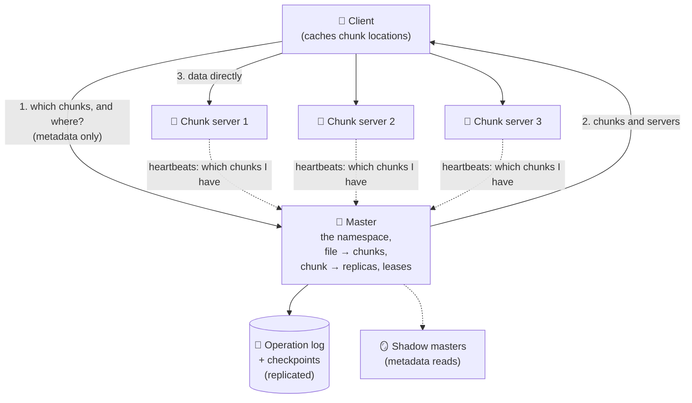
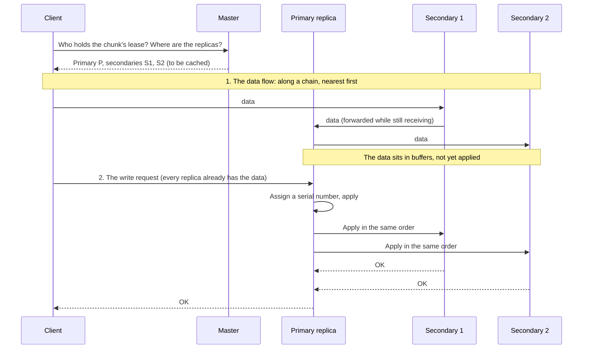
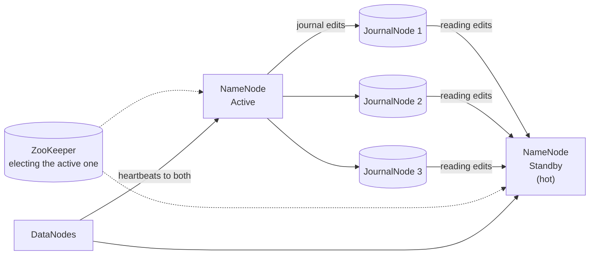

**English** | [Русский](README_RU.md)

# Tier 2 · 4C · 05. A Distributed File System (GFS / HDFS)

> **Level:** Hard · **Interview time:** 45–60 min · **Study time:** ~5 h
> **Key aspects:** a single master with in-memory metadata, chunk servers, large chunks, separating the control flow from the data flow, leases and a primary replica for mutation order, pipelined data transfer, a relaxed consistency model and atomic record append, rack-aware replica placement, re-replication and chunk versions, master fault tolerance, checksums, lazy deletion, snapshots, the small-files problem, evolution (Colossus, erasure coding)
> **Builds on:** [14-storage-types](../../../14-storage-types/README.md), [05-replication](../../../05-replication/README.md), [08-consensus](../../../08-consensus/README.md#9-leases-and-leader-election-for-applications), [Tier 2 · 4C · 01 Object Storage](../01-object-storage-s3/README.md), [Tier 2 · 4C · 04 Wide-column](../04-wide-column-db/README.md#11-deep-dive-5-the-bigtable-architecture)

---

## 🗺️ How to Read This Walkthrough

The walkthrough follows an interview, but every step includes explanations: **why** a decision is made, **how** a mechanism works and **what happens** if you do it differently. The "📘 Explanation" blocks are theory right where you need it.

| Icon | Meaning |
|:----:|:--------|
| 🎤 | Interviewer |
| 🗣️ | What I (the candidate) say out loud |
| ✏️ | What I draw on the whiteboard |
| ⏱️ | Time budget for the step |
| 📘 | A detailed explanation of a concept |

Callouts: **TIP** — a good technique, **WARNING** — a trap, **IMPORTANT** — a Senior+ signal.

---

## 📑 Contents

0. [What This Problem Teaches](#0-what-this-problem-teaches)
1. [Problem Statement](#1-problem-statement)
2. [Clarifying Questions and Requirements](#2-clarifying-questions-and-requirements)
3. [Capacity Estimates](#3-capacity-estimates)
4. [API](#4-api)
5. [Data Model](#5-data-model)
6. [High-Level Design](#6-high-level-design)
7. [Deep Dive 1: A Single Master](#7-deep-dive-1-a-single-master)
8. [Deep Dive 2: Large Chunks](#8-deep-dive-2-large-chunks)
9. [Deep Dive 3: The Write Path — Leases and Pipelining](#9-deep-dive-3-the-write-path--leases-and-pipelining)
10. [Deep Dive 4: The Consistency Model and Record Append](#10-deep-dive-4-the-consistency-model-and-record-append)
11. [Deep Dive 5: Replica Placement and Re-Replication](#11-deep-dive-5-replica-placement-and-re-replication)
12. [Deep Dive 6: Master Fault Tolerance](#12-deep-dive-6-master-fault-tolerance)
13. [Deep Dive 7: Integrity, Deletion and Snapshots](#13-deep-dive-7-integrity-deletion-and-snapshots)
14. [Deep Dive 8: Small Files, Data Locality and Evolution](#14-deep-dive-8-small-files-data-locality-and-evolution)
15. [Bottlenecks and Failure Scenarios](#15-bottlenecks-and-failure-scenarios)
16. [What Changes at 10x Scale](#16-what-changes-at-10x-scale)
17. [Key Concepts and New Terms](#17-key-concepts-and-new-terms)
18. [Variations and Follow-Up Questions](#18-variations-and-follow-up-questions)
19. [Common Mistakes](#19-common-mistakes)
20. [Cheat Sheet and Self-Check](#20-cheat-sheet-and-self-check)

---

## 0. What This Problem Teaches

The Google File System (2003) and its open-source successor HDFS became the foundation of big data: MapReduce, Hadoop, Bigtable and HBase run on top of them. The problem is interesting not for its scale but for its **bold simplifications**: one master for the whole cluster, 64 MB chunks, relaxed consistency — all for the sake of high throughput on cheap hardware, where failures are routine.

| What's tested | Where it shows up |
|:--------------|:------------------|
| Separating flows | Metadata through the master, data straight from the servers |
| The trade-offs of simplicity | A single master and its limits |
| Ordering mutations without consensus per write | Leases and a primary replica |
| Using the network | Pipelined data transfer along a chain |
| Consistency models | "Defined" and "undefined" regions, "at least once" record append |
| Failures as the norm | Re-replication, chunk versions, checksums |
| Metadata fault tolerance | An operation log, checkpoints, a standby master |

> [!TIP]
> A good opening: "The system is designed for **a specific workload**: huge files, streaming reads, massive appends, daily failures. So we deliberately give up latency, full POSIX semantics and strong consistency for concurrent writes in exchange for throughput and simplicity."

---

## 1. Problem Statement

> 🎤 "Design a distributed file system for big data analytics, like GFS or HDFS: files from hundreds of megabytes to terabytes, thousands of clients reading and appending data, a cluster of ordinary servers that fail regularly."

**How it's used:**

```
A crawler:   hundreds of processes simultaneously APPEND records to /crawl/2026-11-30/pages
MapReduce:   thousands of tasks READ 1 TB files sequentially, each its own range
Bigtable:    stores SSTables and logs as files
An analyst:  ls /logs/2026/11/ , cat, deleting old directories
```

**Time plan:**

| Step | ⏱️ |
|:-----|:--:|
| Requirements | 5 min |
| Estimates | 3 min |
| API and data | 5 min |
| High-level design | 5 min |
| Deep dives | 25–30 min |
| Wrap-up | 3 min |

---

## 2. Clarifying Questions and Requirements

⏱️ 5 min

| My question | Interviewer's answer | What it changes and why |
|:------------|:---------------------|:------------------------|
| File sizes? | Mostly large: hundreds of MB to TB; millions of files | Large chunks; metadata fits in the master's memory |
| The read pattern? | Large sequential reads, rare small random ones | Optimizing for throughput, not latency |
| The write pattern? | Appends at the end, often by many clients at once; overwrites in the middle are rare | Atomic record append |
| Latency or throughput? | Throughput | Latency can be sacrificed |
| Hardware? | Ordinary servers; disk and machine failures daily | Replication, automatic recovery |
| Is full POSIX needed? | No: a custom file-like API | Freedom in the semantics |

### Functional requirements

1. A hierarchical namespace: directories and files.
2. Create, delete, open, read, write, rename.
3. **Atomic record append** by many clients at once.
4. Snapshots of files and directories.

### Non-functional requirements

| Requirement | Target | Why |
|:------------|:-------|:----|
| Throughput | Hundreds of GB/s in aggregate, growing with the number of servers | Analytics reads petabytes |
| Fault tolerance | Disk and server failures neither lose data nor stop work | Failures are the norm |
| Scale | Petabytes, thousands of servers | Big data |
| Simplicity | A minimum of complex distributed protocols | A reliable implementation |

---

## 3. Capacity Estimates

⏱️ 3 min

```
Data:              10 PB logical, ×3 replication = 30 PB on disk
Servers:           ~20 disks × 16 TB = 320 TB each → ~100 storage servers (and more for throughput)
Chunks:            10 PB / 64 MB ≈ 156M chunks
Chunk metadata:    < 64 B per chunk (an estimate from the GFS paper) → ~10 GB → fits in the master's memory
The namespace:     millions of files × ~100 B (with path prefix compression) → hundreds of MB
Failures:          with hundreds of servers and thousands of disks — daily
```

### Conclusions

| Conclusion | Design consequence |
|:-----------|:-------------------|
| Metadata is gigabytes | A single master can keep it **in memory** |
| Chunks are large | Little metadata and few master requests |
| Daily failures | Automatic re-replication, integrity checks |

---

## 4. API

⏱️ 2 min

```
create(path) / delete(path) / mkdir(path) / list(dir) / rename(src, dst)
open(path) → handle ; close(handle)
read(handle, offset, length) → bytes
write(handle, offset, bytes)                 ← an overwrite at a given position (rare)
append(handle, record) → offset              ← an atomic record append; the system picks the offset
snapshot(path, snapshot_path)
```

📘 **Why `append` returns an offset.** With hundreds of clients appending at once, nobody knows in advance where the file ends. The system chooses the position itself and guarantees the record is appended atomically (whole) at least once — details in deep dive 4.

---

## 5. Data Model

⏱️ 3 min

```
The master (in memory):
  The namespace:       /logs/2026/11/30/app.log → file metadata, permissions
  File → chunks:       app.log → [chunk 0x1a2b…, chunk 0x1a2c…, …]   (64-bit handles)
  Chunk → state:       chunk 0x1a2b → version 7, replicas [cs-12, cs-48, cs-90], lease holder cs-12

  The namespace and the file → chunks mapping: in the operation log (durable)
  Replica locations: NOT persisted — the master learns them from chunk servers at startup and via heartbeats

A chunk server:
  Each chunk is an ordinary file in the local FS (Linux)
  A checksum for every 64 KB of a chunk
```

📘 **Why the master doesn't persist replica locations.** The source of truth about which chunks are on disk is the chunk server itself (a disk may have failed, a chunk may be corrupted). Keeping a separate copy consistent is harder than asking the servers at startup and receiving updates via heartbeats.

---

## 6. High-Level Design

⏱️ 5 min



🗣️ "The key idea is **separating the flows**:
- **the control flow** (metadata) goes through the master: the client asks which chunks make up a file and which servers hold them, and caches the answer;
- **the data flow** goes directly between the client and the chunk servers — the master never transfers file contents;
- the master keeps everything in memory, with namespace changes in **a replicated operation log**;
- chunk servers tell the master which chunks they have via **heartbeats**."

---

## 7. Deep Dive 1: A Single Master

> 🎤 "One master for the whole cluster — isn't that a single point of failure and a bottleneck?"

### Why one master

| Pro | Explanation |
|:----|:------------|
| **Simplicity** | The namespace, directory locks and placement live in one place, without distributed consensus on every operation |
| **Global knowledge** | The master sees the whole cluster: it makes placement and re-replication decisions |
| Metadata is small | It fits in memory → operations in microseconds |

### How it avoids becoming a bottleneck

| Technique | Effect |
|:----------|:-------|
| The master is **off the data path** | Terabytes flow past it |
| **Large chunks** | One master operation per 64 MB of data |
| **A client cache** | Chunk locations are cached; repeat reads skip the master |
| Requesting several chunks at once | Fewer round trips |
| The master also returns the following chunks "ahead" | Sequential reads don't come back to the master |

### Limits

📘 The master's memory limits **the number of files and chunks**, not the data volume. For HDFS there's a well-known rough estimate: each file, directory and block takes on the order of 150 bytes of NameNode memory. A billion small files will exhaust the master's memory at a relatively small data volume.

| Solution | How |
|:---------|:----|
| **Federation** (HDFS) | Several independent masters, each owning part of the namespace |
| **Distributed metadata** (Colossus) | GFS's successor stores metadata in Bigtable — scalable, with no single master |

---

## 8. Deep Dive 2: Large Chunks

> 🎤 "Why 64 MB chunks (128 MB in HDFS) rather than 4 KB, as in an ordinary FS?"

| Pro | Explanation |
|:----|:------------|
| Less metadata | 10 PB = 156M chunks instead of trillions |
| Fewer master requests | One operation per large piece of a file |
| Long-lived connections | The client reads a lot from one server over one TCP connection |

| Con | Solution |
|:----|:---------|
| **Hot spots on small files** | A single-chunk file (e.g. a task's executable) read by thousands of machines at once overloads 3 servers → **a higher replication factor** for such files, staggering start times |
| Internal fragmentation | **Lazy allocation**: a chunk grows on disk as it's written rather than taking 64 MB up front |

---

## 9. Deep Dive 3: The Write Path — Leases and Pipelining

> 🎤 "A chunk has three replicas, and several clients are writing. How do you guarantee the same mutation order on every replica without consensus on every write?"

### Leases

📘 The master grants one of the replicas **a lease** on the chunk (e.g. for 60 seconds, extended via heartbeats). That replica is **the primary**: it assigns the order of every mutation to the chunk. The master is involved only when granting the lease — not on every write.

### The data flow is decoupled from the control flow



| Decision | Why |
|:---------|:----|
| **Data along a chain** "client → nearest → next" | Each machine uses **its full** outbound network bandwidth; forwarding starts before all the data has arrived (pipelining) |
| The chain follows the network topology | Minimizing cross-rack traffic |
| **The primary assigns the order** | Every replica applies mutations in the same order |
| The master only grants leases | It doesn't become a bottleneck |
| **The chunk version** increments when a lease is granted | A replica that missed mutations (it was down) is identified as stale |

### A failure during a write

📘 If a secondary couldn't apply a mutation, the primary returns an error to the client, and the client **retries** the write. As a result, some replicas may contain the mutation twice or partially — hence the relaxed consistency model (deep dive 4).

📘 **HDFS** uses a similar scheme: the client writes packets into a pipeline of three DataNodes, with acknowledgments flowing back up the chain; a file has **one writer** at a time (a per-file lease held by the NameNode).

---

## 10. Deep Dive 4: The Consistency Model and Record Append

> 🎤 "A hundred crawler processes append to one file at the same time. What does the system guarantee?"

### GFS's terms

| State of a file region | Meaning |
|:-----------------------|:--------|
| **Consistent** | Every client sees the same data, whichever replica it reads |
| **Defined** | Consistent **and** reflecting one mutation in full |
| **Undefined** | Consistent, but containing interleaved fragments of several concurrent writes |
| **Inconsistent** | Different replicas hold different data (after a failed write) |

| Operation | Success without concurrency | Success with concurrency | Failure |
|:----------|:----------------------------|:-------------------------|:--------|
| A write at an offset | Defined | Consistent but **undefined** | Inconsistent |
| **Record append** | Defined | Defined, **interspersed with inconsistent regions** | Inconsistent |

### Atomic "at least once" record append

```
1. The client sends record R to the primary of the last chunk
2. If R doesn't fit in the chunk's remaining space → the primary pads the chunk with "filler",
   and the client retries in a new chunk
3. Otherwise the primary picks an offset, appends R, and tells the secondaries to write R at the same offset
4. If any replica failed → the client retries
   → on some replicas R may appear TWICE, and on others there's junk at that spot
```

📘 **How applications live with it.** Each record carries **a checksum** (to discard junk and filler) and **a unique ID** (to discard duplicates on read). The file system's simplicity is paid for by the record format — and for streams of logs and results that's cheap.

### HDFS is simpler

| | GFS | HDFS |
|:-|:----|:-----|
| A file's writers | Many at once (appends) | **One** (a per-file lease) |
| Writes at an offset | Yes | No (create and append only) |
| The model | Relaxed, with duplicates | Simpler: data becomes visible after close or an explicit hflush |

> [!IMPORTANT]
> **Senior+ signal:** explain that **"at least once"** append is a deliberate choice, pushing dedup onto the application in exchange for having no distributed locks among hundreds of writers. It's the same principle as at-least-once delivery + idempotent consumers in queues.

---

## 11. Deep Dive 5: Replica Placement and Re-Replication

> 🎤 "Where do you put the three replicas, and what do you do when a server dies?"

### Placement

📘 HDFS's default placement policy:

```
Replica 1: on the writer's node (or a random one if the writer is outside the cluster)
Replica 2: on a node in a DIFFERENT rack
Replica 3: in the same rack as replica 2, but on a different node
```

| Trade-off | Explanation |
|:----------|:------------|
| Survives the loss of a whole rack | Replicas in two racks |
| Less cross-rack traffic on writes | Only one transfer between racks (not two) |
| Spreading across disks | The master accounts for disk usage and recent creations on a server (so a new server doesn't get a flood of writes) |

### Re-replication

| Event | The master's action |
|:------|:--------------------|
| A chunk server stopped sending heartbeats | It's considered dead; its chunks become **under-replicated** |
| The re-replication queue | **Priority**: a chunk with one replica left goes before one with two; chunks blocking clients go first |
| Copying | From an existing replica to a new server, rate-limited so as not to disturb clients |
| **Rebalancing** | Periodically moving replicas to even out disk usage |

### Stale replicas

📘 If a chunk server was down while a chunk was mutated, its replica is stale. The master increments the chunk's **version number** each time it grants a lease; when the server returns, its lower-version replica is recognized as stale and removed by garbage collection, and clients never receive it in a replica list.

---

## 12. Deep Dive 6: Master Fault Tolerance

> 🎤 "What if the master crashes?"

### GFS

| Mechanism | How |
|:----------|:----|
| **The operation log** | Every metadata change is written to the log and **replicated to remote machines before replying to the client** |
| **Checkpoints** | A periodic snapshot of the master's state in compact form — a restart = loading the snapshot + replaying the log's tail |
| Restart | Seconds; replica locations are rebuilt from heartbeats |
| **Shadow masters** | Read the log and serve **metadata reads** (possibly slightly stale) while the primary is unavailable |
| External monitoring | Starts a new master on another machine with the same log |

### HDFS High Availability



| Mechanism | Why |
|:----------|:----|
| **A JournalNode quorum** (a majority of 3 or 5) | The edit log survives node failures |
| The standby applies edits continuously | A hot standby, failover within seconds |
| DataNodes send heartbeats to both | The standby knows block locations |
| **ZooKeeper** to elect the active one | Automatic failover (see [4C · 02](../02-coordination-service/README.md)) |
| **Fencing**: JournalNodes accept edits only from a NameNode with the current epoch | The old active can't corrupt the log |

---

## 13. Deep Dive 7: Integrity, Deletion and Snapshots

> 🎤 "How do you detect corrupted data, and how does deletion work?"

### Checksums

| Decision | Why |
|:---------|:----|
| A checksum for every 64 KB of a chunk, stored separately | A corrupted fragment is detected on read |
| **Each chunk server checks for itself** | Replicas may legitimately differ (after failed appends), so replicas can't be compared with each other |
| An error on read | The client reads from another replica; the master re-replicates the chunk from a good replica |
| Background scanning | Rarely read chunks get checked too |

### Lazy deletion

```
1. delete(/logs/old.log) → the master renames the file to a hidden name with a timestamp
2. The file can be restored for several days
3. Then the metadata is removed → its chunks become "orphans"
4. In a heartbeat a chunk server reports its chunks → the master replies which are no longer needed
5. The server deletes them in the background
```

| Benefit of lazy deletion | Explanation |
|:-------------------------|:------------|
| Protection against mistakes | An accidental deletion is reversible |
| Reliability | There's no need to deliver "delete this chunk" to every server immediately — heartbeats reconcile everything |
| Load | Deletion happens in the background, in batches |

### Snapshots

📘 **Copy-on-write**: the master revokes the leases on the file's chunks and duplicates the metadata (the new file points to the same chunks, and their reference counts rise). On the first write to a shared chunk, the chunk server makes a local copy (no network transfer), and the write goes to the copy.

---

## 14. Deep Dive 8: Small Files, Data Locality and Evolution

### The small-files problem

| Problem | Why | Solution |
|:--------|:----|:---------|
| Billions of files of a few KB each | Each is an entry in the master's memory; memory runs out before the disks do | Packing into containers (HAR, SequenceFile, Parquet with large files), consolidating at write time |
| Many tiny operations | The master is overloaded with requests | The same |

### Data locality

📘 MapReduce schedules a task **on the server holding the chunk** (or at least in the same rack) — "move compute to data", not data to compute. That was decisive when the network was the bottleneck. Today, with fast networks, many systems **separate compute and storage** (Spark on top of object storage).

### Evolution

| System | What changed |
|:-------|:-------------|
| **Colossus** (GFS's successor at Google) | Distributed metadata (in Bigtable) instead of a single master; client-side erasure coding; support for far more files |
| **HDFS 3** | Erasure coding (e.g. RS-6-3, a 1.5× overhead instead of 3×) for cold data; namespace federation |
| **Object stores** (S3 and the like) | Data lakes moved there: simpler operations, independent scaling, table formats (Iceberg, Delta) on top |

---

## 15. Bottlenecks and Failure Scenarios

| Scenario | What happens | How we protect |
|:---------|:-------------|:---------------|
| The master fails | Metadata is unavailable | A replicated log, a fast restart, shadow masters, HDFS HA with JournalNodes and ZooKeeper |
| Two active masters | Corrupted metadata | Fencing by epoch in the journal |
| A chunk server fails | Chunks are under-replicated | Detection via heartbeats, prioritized re-replication |
| A rack fails | Losing several replicas | Placement across two racks |
| A server returns with old data | Stale replicas | Chunk version numbers |
| On-disk data corruption | Wrong data | Server-side checksums, re-replication |
| A failure during an append | Duplicates, junk in the file | Checksums and IDs in the application's records |
| Thousands of clients read a small file | Hot servers | A higher replication factor |
| Billions of small files | Exhausting the master's memory | Packing, federation |
| An accidental deletion | Data loss | Lazy deletion, snapshots |

---

## 16. What Changes at 10x Scale

> 🎤 "100 petabytes and billions of files?"

| Change | Why |
|:-------|:----|
| **Distributed metadata** (like Colossus) or federation | One master's memory |
| **Erasure coding** for cold data | Storage cost |
| **Separating compute and storage** | Independent scaling |
| **Moving the data lake to object storage** | Simpler operations |

---

## 17. Key Concepts and New Terms

### What's applied

| Concept | Where it's covered | How it applies here |
|:--------|:-------------------|:--------------------|
| Storage types, erasure coding | [14-storage-types](../../../14-storage-types/README.md) | Chunks, replication, HDFS 3 |
| Replication | [05-replication](../../../05-replication/README.md) | Three replicas, a primary |
| Leases, fencing | [08-consensus](../../../08-consensus/README.md#9-leases-and-leader-election-for-applications) | Chunk leases, NameNode HA |
| A coordination service | [Tier 2 · 4C · 02](../02-coordination-service/README.md) | ZooKeeper for HA |
| Object storage | [Tier 2 · 4C · 01](../01-object-storage-s3/README.md) | The modern alternative |

### New terms in this problem

| Term | In short |
|:-----|:---------|
| **A master and chunk servers** | Metadata in one place, data on many servers |
| **Separating the control flow from the data flow** | The master never transfers file contents |
| **A large chunk** | 64–128 MB — little metadata and few requests |
| **A lease and a primary replica** | Mutation ordering without consensus per write |
| **Pipelined transfer along a chain** | Using each machine's full network bandwidth |
| **Defined and undefined regions** | Terms from GFS's relaxed consistency model |
| **Atomic "at least once" record append** | A record is appended whole, possibly with duplicates |
| **A chunk version** | Detecting stale replicas |
| **An operation log and checkpoints** | Master durability and fast restarts |
| **JournalNodes, federation** | HA and scaling metadata in HDFS |
| **Lazy deletion** | Renaming, followed by garbage collection |
| **Data locality** | Running compute next to the data |

---

## 18. Variations and Follow-Up Questions

<details>
<summary><b>How does a distributed FS differ from object storage?</b></summary>

An FS offers a directory hierarchy, renames (atomic within the namespace), appends, and reading files while they're being written. Object storage offers flat keys and immutable whole objects, but scales more easily in object count and in operations. For analytics the industry has largely moved to object storage with table formats.
</details>

<details>
<summary><b>Why not build the master on consensus from the start?</b></summary>

You can (HDFS HA and Colossus, with metadata in Bigtable, work that way), but in 2003 the GFS authors chose simplicity: one master with a replicated log did the job, and consensus would have added risk. It's a good example of how the requirements of an era shape the architecture.
</details>

<details>
<summary><b>How do you read a file that's currently being appended to?</b></summary>

In GFS — the reader sees the appended data but must account for possible filler and duplicates. In HDFS — the writer calls hflush, after which the data is visible to new readers; the last, partially filled block is read using its acknowledged length.
</details>

<details>
<summary><b>How does renaming a directory work?</b></summary>

Only in the master's metadata: no chunks move. The operation is atomic because the whole hierarchy lives in one place under namespace locks (in GFS — locks on the path and every parent directory). It's one of the advantages a single master has over object storage.
</details>

<details>
<summary><b>Why does a chunk need a version number if there are checksums?</b></summary>

A checksum catches data corruption, while a version number catches **missed mutations**: a replica can be intact and correct, yet old. They're different kinds of error.
</details>

---

## 19. Common Mistakes

| ❌ Mistake | Why it's bad | ✅ Do this instead |
|:----------|:-------------|:------------------|
| Data flows through the master | The master becomes a bottleneck | The data flow goes straight to chunk servers |
| Small chunks | Huge metadata, frequent master requests | 64–128 MB |
| Consensus on every chunk write | Slow | The primary's lease sets the order |
| The client sends data to each replica separately | A bottleneck in the client's outbound link | Pipelining along a chain |
| Expecting strict semantics under concurrent appends | Duplicates and junk | Checksums and IDs in records |
| All replicas in one rack | A rack failure loses data | Two racks |
| Re-replicating in order of discovery | A chunk with one replica left waits | Prioritizing by replicas remaining |
| No chunk versions | Stale replicas are given to clients | A version on lease grant |
| Comparing replicas' checksums with each other | Replicas legitimately differ | Per-server checks |
| Billions of small files | The master's memory | Packing, federation |

---

## 20. Cheat Sheet and Self-Check

### 30-second answer

> A single master keeps the namespace, the file → 64–128 MB chunks mapping and chunk → replicas in memory (it learns locations from heartbeats rather than persisting them); metadata changes go to an operation log replicated before replying, plus checkpoints. The client asks the master only for metadata and caches it, and reads and writes data directly with chunk servers. A write: the master grants a lease to a primary replica (the chunk version increments), the client pushes data along a chain of replicas in a pipeline, then the primary assigns the order and tells the others to apply. Relaxed consistency: concurrent writes are consistent but undefined; record append is atomic "at least once", with duplicates and filler filtered out by checksums and IDs in the records (HDFS is simpler: one writer per file). Replicas: on the writer's node plus two in another rack; re-replication prioritized by replicas remaining, rebalancing, stale replicas caught by versions. Per-64 KB checksums are verified by each server; deletion is lazy; snapshots are copy-on-write. Master failure: shadow masters; in HDFS — an Active/Standby NameNode with a JournalNode quorum, ZooKeeper and fencing. The limit is the number of files; the evolution — Colossus, erasure coding, object storage.

### Self-check

- [ ] I can explain separating the control flow from the data flow
- [ ] I can justify a single master and name its limits
- [ ] I can explain why chunks are large, and the downside
- [ ] I can draw the write path with a lease and a pipeline
- [ ] I can explain "defined" and "undefined" regions
- [ ] I can describe "at least once" record append and how applications cope with it
- [ ] I can describe rack-aware replica placement and re-replication
- [ ] I can explain chunk version numbers
- [ ] I can describe master fault tolerance in GFS and HDFS HA
- [ ] I can explain checksums, lazy deletion and snapshots
- [ ] I can explain the small-files problem and the evolution to Colossus and object storage

### Further reading

- Ghemawat, Gobioff, Leung, *The Google File System* (SOSP 2003)
- Shvachko et al., *The Hadoop Distributed File System* (MSST 2010)
- McKusick, Quinlan, *GFS: Evolution on Fast-forward* (ACM Queue, 2009)
- Apache Hadoop documentation: HDFS Architecture, HDFS High Availability, Erasure Coding
- The [14-storage-types](../../../14-storage-types/README.md) topic
