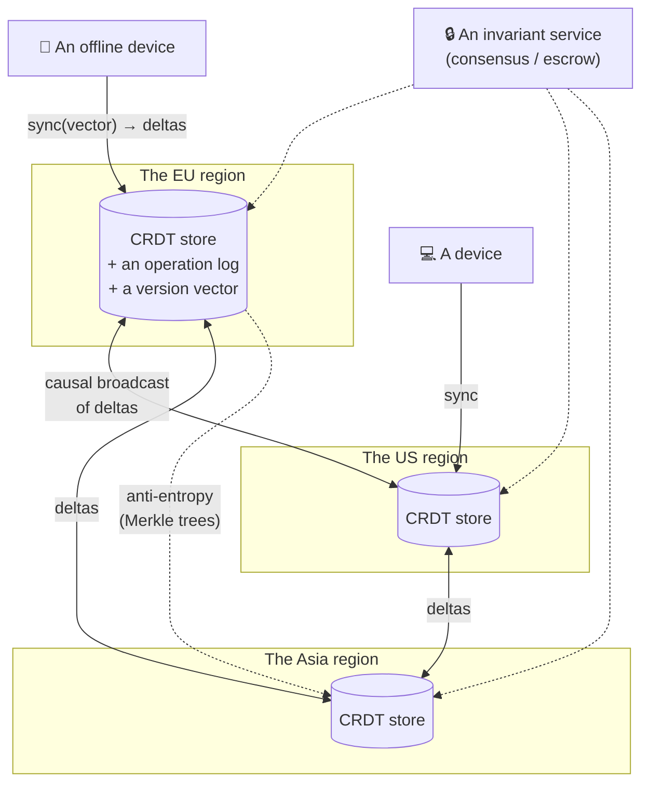
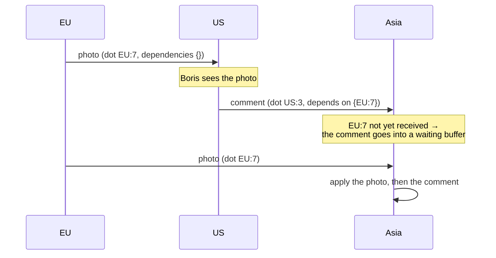
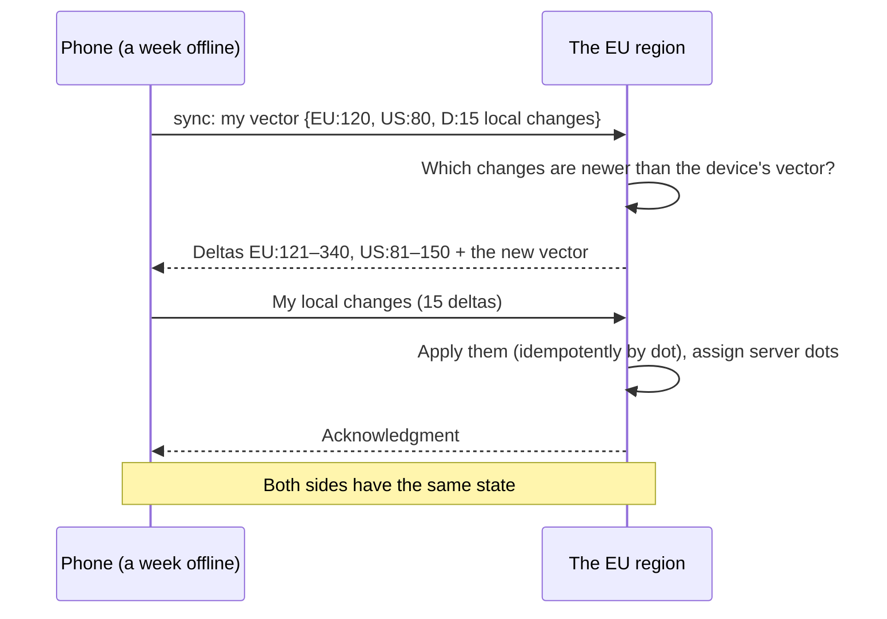
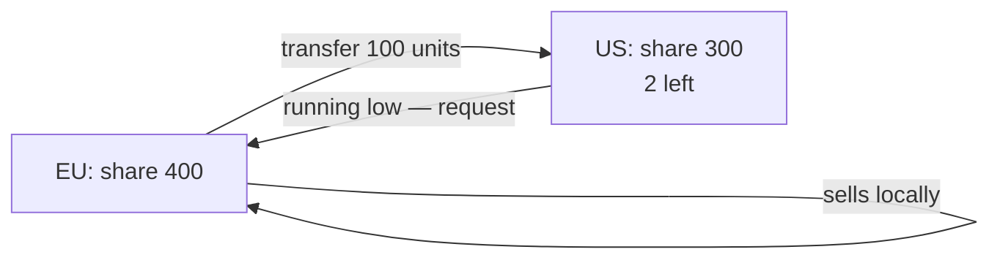

**English** | [Русский](README_RU.md)

# Tier 2 · 4C · 07. Multi-Region Replication Without Conflicts

> **Level:** Advanced · **Interview time:** 45–60 min · **Study time:** ~5–6 h
> **Key aspects:** strong eventual consistency, state-, operation- and delta-based CRDTs, tracking causality (Lamport clocks, vector clocks, version vectors, dotted version vectors), a catalog of CRDTs (counters, registers, sets, maps, sequences), causal consistency and causal delivery, anti-entropy and syncing offline devices, garbage-collecting metadata and causal stability, the CALM theorem and invariants that need coordination
> **Builds on:** [Tier 2 · 4B · 05 Active-active Feed](../../4b-social-media/05-active-active-feed/README.md#7-deep-dive-2-data-without-conflicts) (G-Counter, LWW, HLC), [Tier 1 · 19 KV Store](../../../tier-1/19-distributed-kv-store/README.md#8-deep-dive-3-versions-and-conflicts) (vector clocks), [Tier 2 · 4A · 01 Google Docs](../../4a-realtime-collaboration/01-google-docs/README.md#9-deep-dive-3-crdts) (text CRDTs), [07-consistency-models](../../../07-consistency-models/README.md), [08-consensus](../../../08-consensus/README.md)

---

## 🗺️ How to Read This Walkthrough

The walkthrough follows an interview, but every step includes explanations: **why** a decision is made, **how** a mechanism works and **what happens** if you do it differently. The "📘 Explanation" blocks are theory right where you need it.

| Icon | Meaning |
|:----:|:--------|
| 🎤 | Interviewer |
| 🗣️ | What I (the candidate) say out loud |
| ✏️ | What I draw on the whiteboard |
| ⏱️ | Time budget for the step |
| 📘 | A detailed explanation of a concept |

Callouts: **TIP** — a good technique, **WARNING** — a trap, **IMPORTANT** — a Senior+ signal.

---

## 📑 Contents

0. [What This Problem Teaches](#0-what-this-problem-teaches)
1. [Problem Statement](#1-problem-statement)
2. [Clarifying Questions and Requirements](#2-clarifying-questions-and-requirements)
3. [Capacity Estimates](#3-capacity-estimates)
4. [The Model and API](#4-the-model-and-api)
5. [High-Level Design](#5-high-level-design)
6. [Deep Dive 1: Strong Eventual Consistency and Kinds of CRDTs](#6-deep-dive-1-strong-eventual-consistency-and-kinds-of-crdts)
7. [Deep Dive 2: Tracking Causality](#7-deep-dive-2-tracking-causality)
8. [Deep Dive 3: A Catalog of CRDTs](#8-deep-dive-3-a-catalog-of-crdts)
9. [Deep Dive 4: Causal Consistency and the Replication Protocol](#9-deep-dive-4-causal-consistency-and-the-replication-protocol)
10. [Deep Dive 5: Deltas, Anti-Entropy and Offline Devices](#10-deep-dive-5-deltas-anti-entropy-and-offline-devices)
11. [Deep Dive 6: Garbage-Collecting Metadata](#11-deep-dive-6-garbage-collecting-metadata)
12. [Deep Dive 7: The Limits — Invariants and Coordination](#12-deep-dive-7-the-limits--invariants-and-coordination)
13. [Deep Dive 8: Semantics for the Application and Verifying Correctness](#13-deep-dive-8-semantics-for-the-application-and-verifying-correctness)
14. [Bottlenecks and Failure Scenarios](#14-bottlenecks-and-failure-scenarios)
15. [What Changes at 10x Scale](#15-what-changes-at-10x-scale)
16. [Key Concepts and New Terms](#16-key-concepts-and-new-terms)
17. [Variations and Follow-Up Questions](#17-variations-and-follow-up-questions)
18. [Common Mistakes](#18-common-mistakes)
19. [Cheat Sheet and Self-Check](#19-cheat-sheet-and-self-check)

---

## 0. What This Problem Teaches

In [the active-active feed](../../4b-social-media/05-active-active-feed/README.md) we applied a few techniques — a G-Counter, LWW on small keys, hybrid clocks — to a specific product. Here the task is broader: design **a general-purpose replication layer** where every region, and even an offline device, accepts writes locally, and every replica **is guaranteed to converge** — with no coordination and no lost updates.

This is a problem about **theory applied to a system**: what mathematical properties a merge operation needs, how to track causality, how not to drown in metadata, and where the boundary lies of what can be done without coordination at all.

| What's tested | Where it shows up |
|:--------------|:------------------|
| Consistency models | Strong eventual consistency, causal consistency |
| The math of merging | Semilattices: commutativity, associativity, idempotence |
| Causality | Vector clocks, version vectors, dots |
| Data structures | The catalog of CRDTs and choosing semantics |
| Protocols | Causal delivery, deltas, anti-entropy |
| Operations | Metadata growth, garbage collection, offline devices |
| The approach's limits | The CALM theorem, invariants, escrow |

> [!TIP]
> A good framing for the answer: "Without coordination you can guarantee **convergence**, but not **invariants**. So we do everything we can with CRDTs, and the few things that need invariants go through consensus or quotas allocated to regions."

---

## 1. Problem Statement

> 🎤 "Design a geo-distributed replication layer: 5 regions and millions of mobile devices with an offline mode. Writes are accepted locally with minimal latency, and once connectivity returns, every copy must converge to the same state without losing changes. Support counters, sets, maps and registers."

**Example data:**

```
A shopping cart:    a set of items with quantities (a phone offline + the web in another region)
A like counter:     incremented in 5 regions at once
Profile settings:   a map of fields, changed from several devices
Notes:              text edited offline on two devices
```

**Time plan:**

| Step | ⏱️ |
|:-----|:--:|
| Requirements | 5 min |
| Estimates | 3 min |
| The model and API | 4 min |
| High-level design | 5 min |
| Deep dives | 28 min |
| Wrap-up | 3 min |

---

## 2. Clarifying Questions and Requirements

⏱️ 5 min

| My question | Interviewer's answer | What it changes and why |
|:------------|:---------------------|:------------------------|
| How many replicas? | 5 regions + millions of devices working offline | Causality metadata can't grow with the number of devices |
| Write latency? | Local, with no cross-region calls | No consensus on the write path |
| Can changes be lost? | No: concurrent changes must merge, not overwrite | Not LWW for everything; CRDTs with meaningful merges |
| Ordering? | Causal: a reply is never visible before the message it replies to | Causal consistency |
| Data types? | Counters, registers, sets, maps, text | A catalog of CRDTs |
| Invariants? | Some: an item's stock can't go negative | A separate mechanism with coordination |
| Offline? | Days and weeks | Syncing with deltas, garbage collection that accounts for long absences |

### Functional requirements

1. Local reads and writes in any region and on a device.
2. Async replication between regions and device syncing.
3. Guaranteed convergence with no lost concurrent changes.
4. Causal consistency.
5. Data types: registers, counters, sets, maps, sequences.

### Non-functional requirements

| Requirement | Target | Why |
|:------------|:-------|:----|
| Write latency | Local | Offline use and distant regions |
| Convergence | Replicas that received the same updates have the same state | Strong eventual consistency |
| Availability | Writes work through any network partition | Offline-first |
| Metadata | Bounded growth | Millions of replicas |
| Propagation latency | Seconds between regions when connected | User experience |

---

## 3. Capacity Estimates

⏱️ 3 min

```
Regions:              5 → a 5-entry version vector — cheap
Devices:              10M active → if every device is a separate replica in the vector,
                      a vector per object could grow to millions of entries ❌

CRDT metadata:        an OR-Set: a unique tag per addition + tombstones for removals
                      → without garbage collection, metadata grows forever

The replication stream: 10,000 updates/s per region × 4 other regions — a small stream
Syncing a device after a week offline: only deltas, not the full state
```

### Conclusions

| Conclusion | Design consequence |
|:-----------|:-------------------|
| There are millions of devices | Vectors over regions (server replicas); devices use server-issued event identifiers or dotted version vectors |
| CRDT metadata grows | Garbage collection by causal stability |
| Long offline periods | Deltas and a versioned sync protocol |

---

## 4. The Model and API

⏱️ 4 min

```
An object = a key + a CRDT type + state + a causal context (version vector)

counter.increment(key, n)            ← a PN-Counter
register.set(key, value)             ← an LWW-Register or an MV-Register
set.add(key, element) / set.remove(key, element)   ← an OR-Set (add-wins)
map.update(key, field, op)           ← an OR-Map with nested CRDTs
text.insert(key, pos, str) / text.delete(key, pos, len)   ← a sequence (RGA / YATA)

read(key) → (value, causal context)

Syncing:
  sync(my_version_vector) → the deltas I'm missing + the server's new vector
```

📘 **Why a read returns a causal context.** The client's next write passes that context back — so the system knows **which** versions the client saw, and can tell "replace what I saw" from "concurrent with something I didn't see".

---

## 5. High-Level Design

⏱️ 5 min



🗣️ "Each region stores objects as **CRDTs** along with **a causal context**. Writes are applied locally and sent to the other regions as **deltas** with **causal delivery**: an update is applied only after everything it depends on. **Anti-entropy** repairs gaps. Devices sync with the nearest region by **version vector**: 'here's what I have — send what's missing'. Operations that need **invariants** (stock, uniqueness) go through a separate service with coordination."

---

## 6. Deep Dive 1: Strong Eventual Consistency and Kinds of CRDTs

> 🎤 "What does 'converge without conflicts' mean formally?"

### Strong eventual consistency

| Property | Meaning |
|:---------|:--------|
| **Eventual delivery** | Every update eventually reaches every replica |
| **Strong convergence** | Replicas that received **the same set** of updates have **the same** state — with no rollbacks and no manual conflict resolution |

📘 Plain eventual consistency only says "they'll converge eventually" and allows rollbacks (LWW threw away someone's change). **Strong eventual consistency (SEC)** guarantees that convergence follows deterministically from the same set of updates. CRDTs are the data structures that provide SEC.

### Three kinds of CRDTs

| Kind | What's transmitted | Requirement on the merge or operations | Delivery requirement |
|:-----|:-------------------|:---------------------------------------|:---------------------|
| **State-based** (CvRDT) | The full state | The merge is **the join of a semilattice**: commutative, associative, **idempotent** | Any: duplicates, reordering, loss (as long as a newer state eventually arrives) |
| **Operation-based** (CmRDT) | Operations | Concurrent operations **commute** | Each operation exactly once, in causal order |
| **Delta-CRDTs** | Small state deltas | As for state-based | As for state-based — tolerant of duplicates and reordering |

📘 **Why the three merge properties.** Commutativity — exchange order doesn't matter; associativity — grouping doesn't matter; idempotence — receiving the same thing again doesn't change the result. Together they mean replicas can exchange state as often as they like, in any order and with repeats — and still reach the same result.

```
A G-Counter, merge = per-entry maximum:
  EU: {EU:5, US:2}     US: {EU:3, US:4}
  merge = {EU:max(5,3), US:max(2,4)} = {EU:5, US:4}  → value 9
  merge(a, a) = a (idempotent), merge(a,b) = merge(b,a) (commutative)
```

> [!IMPORTANT]
> **Senior+ signal:** explain the difference between eventual and **strong** eventual consistency, and tie the merge requirements (semilattice properties) to the network requirements: state- and delta-CRDTs tolerate duplicates and reordering, while op-based ones need exactly-once causal delivery.

---

## 7. Deep Dive 2: Tracking Causality

> 🎤 "How do you tell that one change happened 'after' another, while two others happened at the same time?"

### The "happened-before" relation

📘 Event A **happened before** B if B was made on a replica that already knew about A (directly or through a chain). If neither A happened before B nor B before A, they're **concurrent**, and only concurrent events need merging.

| Tool | What it can do | What it can't |
|:-----|:---------------|:--------------|
| **Lamport clocks** (a single counter) | A total order consistent with causality | Can't tell "concurrent" from "after" |
| **Vector clocks / version vectors** | Determine "before", "after" and "concurrent" exactly | Size grows with the number of replicas |
| **Hybrid logical clocks** | Timestamps close to physical time that respect causality | Like Lamport: for LWW, not for detecting concurrency |

### Version vectors

```
A vector = {replica: the number of known updates from that replica}

Version A: {EU:2, US:1, AS:0}
Version B: {EU:1, US:2, AS:0}

A ≤ B?  EU: 2 > 1 — no
B ≤ A?  US: 2 > 1 — no
→ A and B are concurrent → a merge is needed

Version C: {EU:2, US:2, AS:0} — C ≥ A and C ≥ B → C is newer than both
```

### The size problem and dots

📘 If every device is a separate replica in the vector, a popular object's vector grows to millions of entries. Solutions:

| Solution | How |
|:---------|:----|
| **Vectors over server replicas** | Devices don't get their own entries; a device's event receives an identifier from the server on sync (or the client uses a session identifier that's later "folded in") |
| **Dots** | Each event is a (replica, number) pair; the state records which dots it has incorporated |
| **Dotted version vectors** (Riak) | A vector + a separate dot for the latest write — precisely distinguishes concurrent writes through one server and avoids a "sibling explosion" |

> [!WARNING]
> A classic mistake in Riak-like systems with per-client vectors: if a client doesn't pass back the context it received when writing, every write looks concurrent with all previous ones, and the number of stored conflicting versions ("siblings") grows without bound.

---

## 8. Deep Dive 3: A Catalog of CRDTs

> 🎤 "Which CRDTs do you need for counters, sets and maps, and what semantics do they give?"

### Counters

| CRDT | How | Where |
|:-----|:----|:------|
| **G-Counter** | A counter per replica; the value is the sum; the merge takes the per-replica maximum | Increment only: views, likes |
| **PN-Counter** | Two G-Counters: increments and decrements | Increments and decrements |

### Registers (a single value)

| CRDT | Behavior on concurrent writes | Where |
|:-----|:------------------------------|:------|
| **LWW-Register** | The largest timestamp wins (HLC + replica ID to break ties); the losing value **is lost** | Fields where losing rare concurrent edits is acceptable |
| **MV-Register** | **All** concurrent values are kept ("siblings"); the application shows the conflict or merges | Important fields that mustn't be silently lost |

### Sets

| CRDT | Semantics | Limitation |
|:-----|:----------|:-----------|
| **G-Set** | Add only | No removal |
| **2P-Set** | Add and remove; a removed element can't be re-added | Awkward for carts |
| **LWW-Element-Set** | Each element has add and remove timestamps; the latest wins | Depends on clocks |
| **OR-Set** (observed-remove) | **Add-wins**: only the additions the remover **observed** are removed | Metadata: tags and tombstones |

### An OR-Set by example

```
Start: the cart holds "book" with tag a1 (both replicas know about a1)

EU:  remove("book")        → removes the observed tags {a1}
US:  add("book") (again)   → a new unique tag b1   (concurrently, without seeing the removal)

The merge:
  "book"'s tags: a1 (removed in the EU), b1 (alive) → "book" is in the cart ✅

The user in the US just added the book — their intent is preserved (add-wins)
```

### Maps and nesting

📘 **An OR-Map** is a map whose values are themselves CRDTs (a counter, a register, a set). A key is added as an OR-Set element; fields are merged by their own rules. That's how complex documents are built: a profile = a map of register fields, a cart = a map of "item → PN-Counter quantity".

### Sequences

📘 For lists and text — RGA, YATA (Yjs), Logoot: each element has a unique identifier and a position relative to its neighbors (details in [Google Docs](../../4a-realtime-collaboration/01-google-docs/README.md#9-deep-dive-3-crdts)).

---

## 9. Deep Dive 4: Causal Consistency and the Replication Protocol

> 🎤 "Anna in the EU posts a photo, Boris in the US sees it and comments. Vika in Asia sees the comment, but not yet the photo. How do you prevent that?"

### Causal consistency

📘 **Causal consistency**: if B causally depends on A, every replica shows B only after A. Concurrent (independent) updates may appear in different orders. It's **the strongest model compatible with availability** under network partitions (see [07-consistency-models](../../../07-consistency-models/README.md)).

| Guarantee | Example |
|:----------|:--------|
| Read your writes | Your own comment shows immediately |
| Monotonic reads | Never "rolling back" to an older state |
| Writes follow reads | Boris's comment won't appear before the photo he saw |

### Causal delivery



| Element | Why |
|:--------|:----|
| Each update carries **a dot** (replica, number) | Uniqueness and idempotence |
| And **dependencies** (a vector or an explicit list) | Determining what must be applied first |
| A waiting buffer at the receiver | Application is deferred until dependencies are met |
| Region logs shipped in order | Within one region's stream, order is already causal |

📘 The research system **COPS** showed how to provide causal consistency in a geo-distributed store with explicit dependency tracking; many production systems use a simpler variant — ordered region logs and vectors.

---

## 10. Deep Dive 5: Deltas, Anti-Entropy and Offline Devices

> 🎤 "A phone was offline for a week. How do you sync it without sending the entire state?"

### Delta-CRDTs

📘 Sending the full state of an OR-Set with thousands of elements on every addition is wasteful. **A delta** is a small piece of state describing only the change; it's merged by the same semilattice operator, so it's just as tolerant of duplicates and reordering.

### Syncing a device



| Decision | Why |
|:---------|:----|
| Exchanging by version vector | Only the missing changes are sent |
| Idempotent application by dot | Retrying a sync after a drop is safe |
| If the device has fallen too far behind (the log has been compacted) | Send a full **snapshot** of the state, then deltas |

### Anti-entropy between regions

📘 Causal broadcast can lose messages during failures. **Anti-entropy** periodically compares replicas (Merkle trees over key ranges, as in [Tier 1 · 19](../../../tier-1/19-distributed-kv-store/README.md#10-deep-dive-5-repairing-replicas--read-repair-and-merkle-trees)) and exchanges the missing state — for state/delta-CRDTs that's safe in any order.

---

## 11. Deep Dive 6: Garbage-Collecting Metadata

> 🎤 "An OR-Set keeps a tag for every addition and tombstones for removals. Does that grow forever?"

📘 Yes, if nothing is done. The metadata is needed to correctly merge **future** concurrent operations. Once **every** replica knows about an operation, no operation concurrent with it can appear anymore — so its metadata can be compacted.

### Causal stability

```
An operation with dot EU:7 is causally stable if every replica has already seen EU:7

The minimum of every replica's version vector:
  EU:   {EU:50, US:40, AS:30}
  US:   {EU:45, US:42, AS:31}
  Asia: {EU:48, US:41, AS:33}
  min = {EU:45, US:40, AS:30}

Every operation with EU ≤ 45, US ≤ 40, AS ≤ 30 is stable → its tombstones and extra tags can be removed
```

| Problem | Solution |
|:--------|:---------|
| A replica is unavailable for long → the minimum doesn't advance → garbage collection stalls | **Membership and eviction**: a device offline for more than N days is excluded from the calculation; on return — a full resync from a snapshot |
| Millions of devices in the minimum calculation | Compute stability over **server** replicas; devices sync through them |
| Compacting text history | Tombstones in sequences are removed after stability or when snapshotting the document |

> [!WARNING]
> Eviction is a deliberate trade-off: an evicted device can't simply send its old deltas on return — their context has already been collected. The protocol must define what happens to its offline changes (reapplying them on top of a snapshot as new operations).

---

## 12. Deep Dive 7: The Limits — Invariants and Coordination

> 🎤 "An item's stock is 1, and it's bought concurrently in the EU and the US. Will CRDTs solve this?"

📘 No. CRDTs guarantee **convergence**, not **invariants**: a PN-Counter for stock will honestly converge to −1. No coordination-free scheme can guarantee "stock ≥ 0" if both replicas accept a purchase without knowing about each other.

### The CALM theorem

📘 **CALM** (Consistency As Logical Monotonicity): a program can run consistently **without coordination** if and only if it's **monotonic** — new data only adds conclusions and never retracts earlier ones.

| Monotonic (no coordination) | Non-monotonic (needs coordination) |
|:----------------------------|:-----------------------------------|
| Adding to a set | Checking that an element is **absent** |
| Incrementing a counter | Checking that a value is **at least** a threshold |
| "Is there at least one like" | "This name is unique" |
| Merging carts | Debiting only if the balance suffices |

### Living with invariants

| Technique | How | Example |
|:----------|:----|:--------|
| **Consensus** per operation | The operation goes through a global, strongly consistent service | Unique names, payments |
| **Escrow / a bounded counter** | The resource is split among regions in advance: each spends its share locally; when short — request a transfer of shares | Stock of 1,000: EU 400, US 300, Asia 300 — sales stay local while a region has its share |
| **Reservation** | Reserve first (with coordination), then execute locally | Tickets |
| **Compensation** | Allow the violation and fix it afterwards (an apology, cancelling the order) | Overselling an item by 1 — a refund |



> [!IMPORTANT]
> **Senior+ signal:** name the CALM theorem or its essence ("without coordination — only monotonic operations") and show **escrow** as a way to keep most operations with an invariant local: coordination is needed only when shares are redistributed, not on every purchase.

---

## 13. Deep Dive 8: Semantics for the Application and Verifying Correctness

> 🎤 "The CRDT converges. But is the result always what the user wanted?"

### Choosing the semantics is a product decision

| Situation | Options | What to choose |
|:----------|:--------|:---------------|
| An item was concurrently added and removed | Add-wins / remove-wins | A cart — add-wins (don't lose what was added); an access list — remove-wins (revoking is safer) |
| A field was changed concurrently | LWW / an MV-register | A note's title — LWW; a delivery address — show the conflict (MV) |
| Two people type at the same spot at once | The order of insertions | An algorithm that avoids interleaving the two authors' characters |
| A cart quantity counter | A PN-Counter | Phone +1 and web +1 → 2 (not 1, as LWW would give) |

### Verifying correctness

| Method | How |
|:-------|:----|
| **Property-based tests** | Random operation sequences on several replicas, random delivery order → check that every replica converged |
| Checking merge properties | Commutativity, associativity and idempotence on random states |
| Network chaos tests | Partitions, duplicates, reordering (in the spirit of Jepsen) |
| **Detecting divergence in production** | A hash of an object's state at the same vector on different replicas — must match |
| Schema evolution | New fields — new keys in an OR-Map; changing a field's CRDT type — a versioned migration |

---

## 14. Bottlenecks and Failure Scenarios

| Scenario | What happens | How we protect |
|:---------|:-------------|:---------------|
| A non-idempotent merge | Duplicate messages change the state | Semilattice properties, property-based tests |
| Op-based CRDTs without causal delivery | Replicas diverge | Causal delivery, or state/delta-CRDTs |
| A vector entry per device | Exploding metadata size | Vectors over server replicas, dots, DVV |
| A client doesn't pass back the context | A sibling explosion | Mandatory context on writes |
| LWW for important data | Silently lost changes | MV-registers, OR-Sets, counters |
| A comment before the photo | Violated causality | Causal delivery, a waiting buffer |
| Growing tombstones | Memory and disk | Garbage collection by causal stability |
| A device offline for months | Garbage collection stalls | Eviction, resync from a snapshot |
| Lost replication messages | Replicas fall behind | Anti-entropy |
| An invariant (stock ≥ 0) | Overselling | Escrow, consensus, compensation |

---

## 15. What Changes at 10x Scale

> 🎤 "50 regions and 100 million devices?"

| Change | Why |
|:-------|:----|
| **Hierarchical replication** (region → continent → global) | Fewer links, more compact vectors |
| **Partial replication**: an object only in the regions that need it | Volume |
| **More aggressive garbage collection** and snapshots | Metadata |
| **Escrow with automatic redistribution** based on demand forecasts | Less coordination |

---

## 16. Key Concepts and New Terms

### What's applied

| Concept | Where it's covered | How it applies here |
|:--------|:-------------------|:--------------------|
| G-Counter, LWW, HLC | [Tier 2 · 4B · 05](../../4b-social-media/05-active-active-feed/README.md) | The basic techniques |
| Vector clocks, siblings | [Tier 1 · 19](../../../tier-1/19-distributed-kv-store/README.md#8-deep-dive-3-versions-and-conflicts) | Causality |
| Text CRDTs | [Tier 2 · 4A · 01](../../4a-realtime-collaboration/01-google-docs/README.md#9-deep-dive-3-crdts) | Sequences |
| Consistency models | [07-consistency-models](../../../07-consistency-models/README.md) | SEC, causal consistency |
| Consensus | [08-consensus](../../../08-consensus/README.md) | Operations with invariants |

### New terms in this problem

| Term | In short |
|:-----|:---------|
| **Strong eventual consistency** | The same set of updates → the same state, with no rollbacks |
| **A semilattice and its join** | The mathematical basis of state-based CRDT merges |
| **State-, op- and delta-CRDTs** | What's transmitted, and the delivery requirements |
| **Lamport clocks** | An order consistent with causality, without detecting concurrency |
| **A version vector, a dot, a DVV** | Tracking causality and events |
| **An MV-Register** | A register that keeps concurrent values |
| **An OR-Set** | A set with add-wins semantics via unique tags |
| **An OR-Map** | A map of nested CRDTs |
| **Causal delivery** | Applying an update after its dependencies |
| **Causal stability** | Every replica has seen an operation — its metadata can be compacted |
| **The CALM theorem** | Without coordination — only monotonic programs |
| **Escrow** | Splitting a resource across regions for local operations with an invariant |

---

## 17. Variations and Follow-Up Questions

<details>
<summary><b>How does this problem differ from the active-active feed (4B #5)?</b></summary>

In the feed we applied a few CRDT techniques to one product's specific data. Here it's a general replication layer: formal guarantees (SEC), a full catalog of types, causal delivery, syncing offline devices, garbage-collecting metadata, and the boundary of what's possible without coordination (CALM, escrow).
</details>

<details>
<summary><b>Which systems implement this approach?</b></summary>

Riak (CRDT data types and dotted version vectors), Redis Enterprise Active-Active (CRDBs built on CRDTs), AntidoteDB (a research database with causal consistency and CRDTs), Automerge and Yjs for local-first applications, and Azure Cosmos DB in multi-region-write mode with custom conflict resolution.
</details>

<details>
<summary><b>Why not just use LWW everywhere?</b></summary>

LWW converges, but loses concurrent changes: two additions to a cart from different devices become one, and counter increments get lost. It suits only fields where "the latest value" really is what's wanted and concurrent edits are rare.
</details>

<details>
<summary><b>Can you get causal consistency without vectors?</b></summary>

You can come close if each object has a single "home" region through which its writes pass (as in [the profile service](../../4b-social-media/04-global-profile-service/README.md)) — then that region sets the order. But for writes in any region and offline, dependency tracking is unavoidable.
</details>

<details>
<summary><b>How do you undo an operation in a CRDT?</b></summary>

Perform a new inverse operation: for a counter — a decrement, for an OR-Set — removing the added tags, for text — deleting the inserted identifiers. The history stays monotonic; an undo is just another update.
</details>

---

## 18. Common Mistakes

| ❌ Mistake | Why it's bad | ✅ Do this instead |
|:----------|:-------------|:------------------|
| Confusing eventual with strong eventual consistency | Rollbacks and manual resolution are possible | CRDTs for SEC |
| A non-idempotent merge | Duplicates break the state | Semilattice properties |
| Op-based without delivery guarantees | Divergence | Causal delivery or delta-CRDTs |
| Lamport clocks for detecting conflicts | They can't see concurrency | Version vectors |
| A vector with an entry per device | Huge metadata | Server replicas, dots, DVV |
| LWW for a cart and counters | Lost additions | OR-Sets, PN-Counters |
| No garbage collection | Metadata grows forever | Causal stability, eviction |
| Expecting CRDTs to preserve invariants | Stock goes negative | Escrow, consensus, compensation |
| Merge semantics without a product decision | Unexpected behavior for users | Choosing add-wins or remove-wins deliberately |
| No convergence checks | Hidden merge bugs | Property-based tests, state hashes in production |

---

## 19. Cheat Sheet and Self-Check

### 30-second answer

> The goal is strong eventual consistency: replicas with the same set of updates have the same state, with no rollbacks. CRDTs provide it: state-based (the merge is a semilattice join — commutative, associative, idempotent — tolerating duplicates and reordering), op-based (commuting operations, but needing exactly-once causal delivery), delta-CRDTs (small deltas with state-based robustness). Causality — version vectors over server regions, dots (replica, number) for device events, dotted version vectors against sibling explosions; HLC only for LWW. The catalog: G/PN-Counters, LWW- and MV-Registers, OR-Sets (add-wins via tags), OR-Maps with nested CRDTs, RGA/YATA for text. Regions exchange deltas with causal delivery (a buffer until dependencies are met), and anti-entropy over Merkle trees repairs gaps; devices sync by vector — only the missing deltas, or a snapshot if too far behind. Metadata is collected by causal stability (the minimum of the vectors), and long-absent devices are evicted. Without coordination — only monotonic operations (CALM): invariants like stock ≥ 0 go through escrow (shares per region), consensus or compensation. Merge semantics is a product decision; convergence is verified with property-based tests and hash comparisons.

### Self-check

- [ ] I can explain the difference between eventual and strong eventual consistency
- [ ] I can name the three merge properties and why they're needed
- [ ] I can compare state-, op- and delta-CRDTs and their delivery requirements
- [ ] I can compare vectors and detect concurrency
- [ ] I can explain the vector size problem and dots / DVV
- [ ] I can show an OR-Set at work with an add-wins example
- [ ] I can choose between an LWW- and an MV-Register
- [ ] I can explain causal consistency and causal delivery with an example
- [ ] I can describe syncing an offline device with deltas
- [ ] I can explain garbage collection by causal stability
- [ ] I can explain CALM and apply escrow to stock

### Further reading

- Shapiro, Preguiça, Baquero, Zawirski, *Conflict-free Replicated Data Types* (SSS 2011) and *A comprehensive study of CRDTs* (2011)
- Almeida, Shoker, Baquero, *Delta State Replicated Data Types* (2018)
- Lloyd et al., *Don't Settle for Eventual: Scalable Causal Consistency for Wide-Area Storage with COPS* (SOSP 2011)
- Hellerstein, Alvaro, *Keeping CALM: When Distributed Consistency Is Easy* (CACM 2020)
- Preguiça et al., *Dotted Version Vectors* (2012)
- Kleppmann et al., *Local-First Software* (2019)
