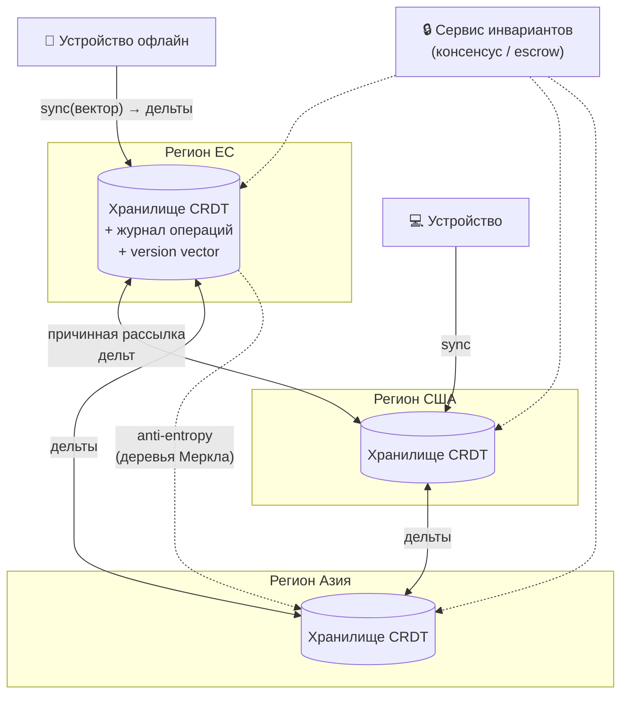
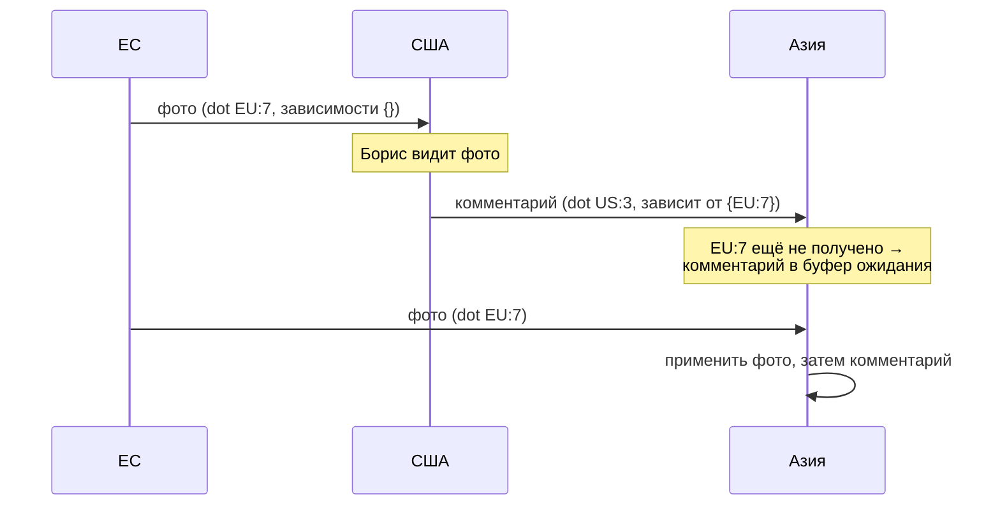
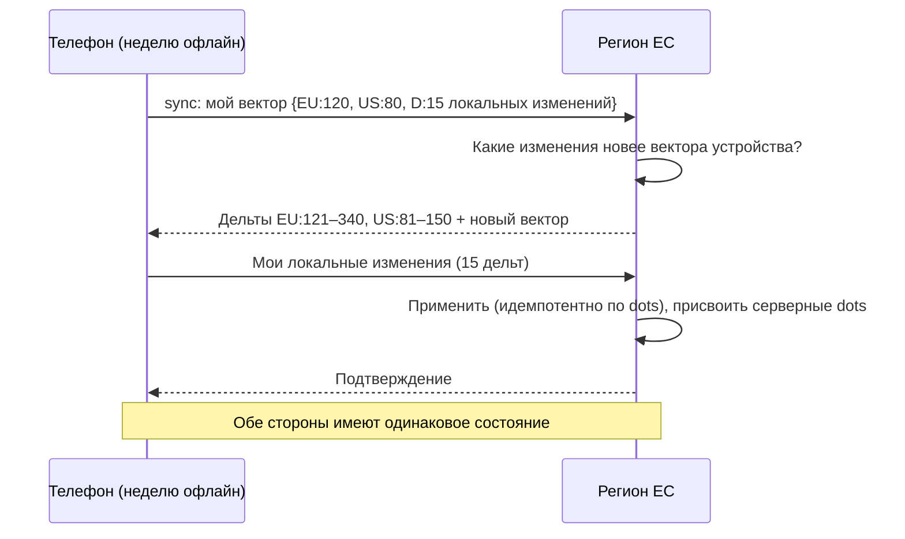
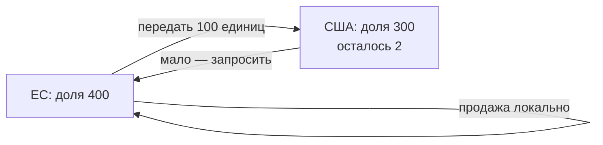

[English](README.md) | **Русский**

# Tier 2 · 4C · 07. Мульти-регион репликация без конфликтов

> **Уровень:** Advanced · **Время на интервью:** 45–60 мин · **Время на разбор:** ~5–6 ч
> **Ключевые аспекты:** strong eventual consistency, CRDT на основе состояния, операций и дельт, отслеживание причинности (часы Лэмпорта, векторные часы, version vectors, dotted version vectors), каталог CRDT (счётчики, регистры, множества, карты, последовательности), причинная консистентность и причинная доставка, anti-entropy и синхронизация офлайн-устройств, сборка мусора метаданных и причинная стабильность, теорема CALM и инварианты, требующие координации
> **Опирается на:** [Tier 2 · 4B · 05 Active-active Feed](../../4b-social-media/05-active-active-feed/README_RU.md#7-deep-dive-2-данные-без-конфликтов) (G-Counter, LWW, HLC), [Tier 1 · 19 KV Store](../../../tier-1/19-distributed-kv-store/README_RU.md#8-deep-dive-3-версии-и-конфликты) (векторные часы), [Tier 2 · 4A · 01 Google Docs](../../4a-realtime-collaboration/01-google-docs/README_RU.md#9-deep-dive-3-crdt) (CRDT для текста), [07-consistency-models](../../../07-consistency-models/README_RU.md), [08-consensus](../../../08-consensus/README_RU.md)

---

## 🗺️ Как читать этот разбор

Разбор построен как интервью, но в каждом шаге есть объяснения: **почему** принимается решение, **как работает** механизм и **что будет**, если сделать иначе. Блоки «📘 Объяснение» — теория прямо по ходу задачи.

| Значок | Что значит |
|:------:|:-----------|
| 🎤 | Реплика интервьюера |
| 🗣️ | Что говорю вслух я (кандидат) |
| ✏️ | Что рисую на доске |
| ⏱️ | Сколько времени тратить на шаг |
| 📘 | Подробное объяснение концепции |

Блоки **TIP** — хороший приём, **WARNING** — ловушка, **IMPORTANT** — сигнал для уровня Senior+.

---

## 📑 Содержание

0. [Чему учит эта задача](#0-чему-учит-эта-задача)
1. [Условие задачи](#1-условие-задачи)
2. [Уточняющие вопросы и требования](#2-уточняющие-вопросы-и-требования)
3. [Оценки нагрузки](#3-оценки-нагрузки)
4. [Модель и API](#4-модель-и-api)
5. [High-level дизайн](#5-high-level-дизайн)
6. [Deep dive 1: strong eventual consistency и виды CRDT](#6-deep-dive-1-strong-eventual-consistency-и-виды-crdt)
7. [Deep dive 2: отслеживание причинности](#7-deep-dive-2-отслеживание-причинности)
8. [Deep dive 3: каталог CRDT](#8-deep-dive-3-каталог-crdt)
9. [Deep dive 4: причинная консистентность и протокол репликации](#9-deep-dive-4-причинная-консистентность-и-протокол-репликации)
10. [Deep dive 5: дельты, anti-entropy и офлайн-устройства](#10-deep-dive-5-дельты-anti-entropy-и-офлайн-устройства)
11. [Deep dive 6: сборка мусора метаданных](#11-deep-dive-6-сборка-мусора-метаданных)
12. [Deep dive 7: пределы — инварианты и координация](#12-deep-dive-7-пределы--инварианты-и-координация)
13. [Deep dive 8: семантика для приложения и проверка корректности](#13-deep-dive-8-семантика-для-приложения-и-проверка-корректности)
14. [Узкие места и сценарии сбоев](#14-узкие-места-и-сценарии-сбоев)
15. [Что изменится при росте в 10 раз](#15-что-изменится-при-росте-в-10-раз)
16. [Ключевые концепции и новые понятия](#16-ключевые-концепции-и-новые-понятия)
17. [Варианты задачи и follow-up вопросы](#17-варианты-задачи-и-follow-up-вопросы)
18. [Типичные ошибки](#18-типичные-ошибки)
19. [Шпаргалка и самопроверка](#19-шпаргалка-и-самопроверка)

---

## 0. Чему учит эта задача

В [active-active ленте](../../4b-social-media/05-active-active-feed/README_RU.md) мы применили несколько приёмов — G-Counter, LWW на маленьких ключах, гибридные часы — для конкретного продукта. Здесь задача шире: спроектировать **слой репликации общего назначения**, где каждый регион и даже офлайн-устройство принимает записи локально, а все реплики **гарантированно сходятся** — без координации и без потерь изменений.

Это задача про **теорию, применённую к системе**: какие математические свойства нужны операции слияния, как отслеживать причинность, как не утонуть в метаданных и где проходит граница того, что вообще можно сделать без координации.

| Что проверяют | Где это в задаче |
|:--------------|:-----------------|
| Модели консистентности | Strong eventual consistency, причинная консистентность |
| Математика слияния | Полурешётки: коммутативность, ассоциативность, идемпотентность |
| Причинность | Векторные часы, version vectors, dots |
| Структуры данных | Каталог CRDT и выбор семантики |
| Протоколы | Причинная доставка, дельты, anti-entropy |
| Эксплуатация | Рост метаданных, сборка мусора, офлайн-устройства |
| Границы подхода | Теорема CALM, инварианты, escrow |

> [!TIP]
> Хорошая рамка ответа: «Без координации можно гарантировать **сходимость**, но не **инварианты**. Поэтому мы делаем всё, что можно, на CRDT, а то немногое, что требует инвариантов, — через консенсус или выделение квот регионам».

---

## 1. Условие задачи

> 🎤 «Спроектируй слой геораспределённой репликации: 5 регионов и миллионы мобильных устройств с офлайн-режимом. Записи принимаются локально с минимальной задержкой, после восстановления связи все копии должны сойтись к одному состоянию без потери изменений. Поддержи счётчики, множества, словари и регистры».

**Примеры данных:**

```
Корзина покупок:   множество товаров с количествами (телефон офлайн + веб в другом регионе)
Счётчик лайков:    увеличивается в 5 регионах одновременно
Настройки профиля: словарь полей, меняется с нескольких устройств
Заметки:           текст, редактируемый офлайн на двух устройствах
```

**План по времени:**

| Шаг | ⏱️ |
|:----|:--:|
| Требования | 5 мин |
| Оценки | 3 мин |
| Модель и API | 4 мин |
| High-level дизайн | 5 мин |
| Deep dives | 28 мин |
| Итоги | 3 мин |

---

## 2. Уточняющие вопросы и требования

⏱️ 5 мин

| Мой вопрос | Ответ интервьюера | Что это меняет и почему |
|:-----------|:------------------|:------------------------|
| Сколько реплик? | 5 регионов + миллионы устройств, работающих офлайн | Метаданные причинности не могут расти с числом устройств |
| Задержка записи? | Локальная, без межрегиональных обращений | Никакого консенсуса на пути записи |
| Можно ли терять изменения? | Нет: одновременные изменения должны объединяться, а не перезаписываться | Не LWW для всего; CRDT с осмысленным слиянием |
| Порядок? | Причинный: ответ не виден раньше сообщения, на которое он отвечает | Причинная консистентность |
| Типы данных? | Счётчики, регистры, множества, словари, текст | Каталог CRDT |
| Инварианты? | Есть: остаток товара не может уйти в минус | Отдельный механизм с координацией |
| Офлайн? | Дни и недели | Синхронизация дельтами, сборка мусора с учётом долгого отсутствия |

### Функциональные требования

1. Локальные чтения и записи в любом регионе и на устройстве.
2. Асинхронная репликация между регионами и синхронизация устройств.
3. Гарантированная сходимость без потерь одновременных изменений.
4. Причинная консистентность.
5. Типы данных: регистры, счётчики, множества, словари, последовательности.

### Нефункциональные требования

| Требование | Цель | Почему |
|:-----------|:-----|:-------|
| Задержка записи | Локальная | Офлайн и далёкие регионы |
| Сходимость | Все реплики, получившие одни и те же обновления, имеют одинаковое состояние | Strong eventual consistency |
| Доступность | Запись работает при любых разрывах сети | Офлайн-first |
| Метаданные | Ограниченный рост | Миллионы реплик |
| Задержка распространения | Секунды между регионами при наличии связи | Пользовательский опыт |

---

## 3. Оценки нагрузки

⏱️ 3 мин

```
Регионы:              5 → вектор версий из 5 элементов — дёшево
Устройства:           10M активных → если каждое устройство — отдельная реплика в векторе,
                      вектор на объект может вырасти до миллионов элементов ❌

Метаданные CRDT:      OR-Set: уникальный тег на каждое добавление + tombstones удалённого
                      → без сборки мусора метаданные растут бесконечно

Поток репликации:     10 000 обновлений/с на регион × 4 других региона — небольшой поток
Синхронизация устройства после недели офлайн: только дельты, а не полное состояние
```

### Выводы

| Вывод | Следствие для дизайна |
|:------|:----------------------|
| Устройств миллионы | Векторы — по регионам (серверным репликам), устройства используют идентификаторы событий, выданные сервером, или dotted version vectors |
| Метаданные CRDT растут | Сборка мусора по причинной стабильности |
| Офлайн надолго | Дельты и протокол синхронизации с версиями |

---

## 4. Модель и API

⏱️ 4 мин

```
Объект = ключ + тип CRDT + состояние + причинный контекст (version vector)

counter.increment(key, n)            ← PN-Counter
register.set(key, value)             ← LWW-Register или MV-Register
set.add(key, element) / set.remove(key, element)   ← OR-Set (add-wins)
map.update(key, field, op)           ← OR-Map с вложенными CRDT
text.insert(key, pos, str) / text.delete(key, pos, len)   ← последовательность (RGA / YATA)

read(key) → (значение, причинный контекст)

Синхронизация:
  sync(my_version_vector) → дельты, которых у меня нет + новый вектор сервера
```

📘 **Зачем чтение возвращает причинный контекст.** Следующая запись клиента передаёт этот контекст — так система знает, **какие** версии клиент видел, и отличает «заменить то, что я видел» от «одновременно с тем, чего я не видел».

---

## 5. High-level дизайн

⏱️ 5 мин



🗣️ «Каждый регион хранит объекты как **CRDT** вместе с **причинным контекстом**. Записи применяются локально и рассылаются другим регионам как **дельты** с **причинной доставкой**: обновление применяется только после всех, от которых оно зависит. Пропуски чинит **anti-entropy**. Устройства синхронизируются с ближайшим регионом по **version vector**: «вот что у меня есть — пришли недостающее». Операции, требующие **инвариантов** (остатки, уникальность), идут через отдельный сервис с координацией».

---

## 6. Deep dive 1: strong eventual consistency и виды CRDT

> 🎤 «Что значит “сходятся без конфликтов” формально?»

### Strong eventual consistency

| Свойство | Что значит |
|:---------|:-----------|
| **Eventual delivery** | Каждое обновление в конце концов доходит до каждой реплики |
| **Strong convergence** | Реплики, получившие **один и тот же набор** обновлений, имеют **одинаковое** состояние — без откатов и без разрешения конфликтов вручную |

📘 Обычная eventual consistency говорит лишь «когда-нибудь сойдутся» и допускает откаты (LWW выбросил чьё-то изменение). **Strong eventual consistency (SEC)** гарантирует, что сходимость — детерминированное следствие одного набора обновлений. CRDT — структуры данных, дающие SEC.

### Три вида CRDT

| Вид | Что передаётся | Требование к слиянию или операциям | Требование к доставке |
|:----|:---------------|:-----------------------------------|:----------------------|
| **На основе состояния** (CvRDT) | Полное состояние | Слияние — **верхняя грань полурешётки**: коммутативно, ассоциативно, **идемпотентно** | Любое: дубли, перестановки, потери (если со временем дойдёт новое состояние) |
| **На основе операций** (CmRDT) | Операции | Одновременные операции **коммутируют** | Каждая операция ровно один раз, в причинном порядке |
| **Дельта-CRDT** | Небольшие дельты состояния | Как у состояния | Как у состояния — устойчиво к дублям и перестановкам |

📘 **Почему три свойства слияния.** Коммутативность — порядок обмена не важен; ассоциативность — группировка не важна; идемпотентность — повторное получение того же не меняет результат. Вместе они значат, что реплики могут обмениваться состоянием как угодно часто, в любом порядке и с повторами — и всё равно придут к одному результату.

```
G-Counter, слияние = покомпонентный максимум:
  ЕС: {EU:5, US:2}     США: {EU:3, US:4}
  merge = {EU:max(5,3), US:max(2,4)} = {EU:5, US:4}  → значение 9
  merge(a, a) = a (идемпотентно), merge(a,b) = merge(b,a) (коммутативно)
```

> [!IMPORTANT]
> **Сигнал Senior+:** объяснить разницу между eventual и **strong** eventual consistency и связать требования к слиянию (свойства полурешётки) с требованиями к сети: state- и delta-CRDT терпят дубли и перестановки, op-based требуют причинной доставки ровно один раз.

---

## 7. Deep dive 2: отслеживание причинности

> 🎤 «Как понять, что одно изменение произошло “после” другого, а два других — одновременно?»

### Отношение «произошло до»

📘 Событие A **произошло до** B, если B было сделано на реплике, которая уже знала об A (непосредственно или через цепочку). Если ни A не произошло до B, ни B до A — они **одновременны** (concurrent), и только для них нужно слияние.

| Инструмент | Что умеет | Чего не умеет |
|:-----------|:----------|:--------------|
| **Часы Лэмпорта** (один счётчик) | Полный порядок, согласованный с причинностью | Не различают «одновременно» и «после» |
| **Векторные часы / version vectors** | Точно определяют «до», «после» и «одновременно» | Размер растёт с числом реплик |
| **Гибридные логические часы** | Метки, близкие к физическому времени и учитывающие причинность | Как Лэмпорт: для LWW, но не для обнаружения одновременности |

### Version vectors

```
Вектор = {реплика: число известных обновлений от этой реплики}

Версия A: {EU:2, US:1, AS:0}
Версия B: {EU:1, US:2, AS:0}

A ≤ B?  EU: 2 > 1 — нет
B ≤ A?  US: 2 > 1 — нет
→ A и B одновременны → нужно слияние

Версия C: {EU:2, US:2, AS:0} — C ≥ A и C ≥ B → C новее обеих
```

### Проблема размера и dots

📘 Если каждое устройство — отдельная реплика в векторе, на популярном объекте вектор вырастет до миллионов элементов. Решения:

| Решение | Как |
|:--------|:----|
| **Векторы по серверным репликам** | Устройства не получают своих элементов; событие устройства получает идентификатор от сервера при синхронизации (или клиент использует идентификатор сессии, который позднее «сворачивается») |
| **Dots** | Каждое событие — пара (реплика, номер); состояние хранит, какие dots уже учтены |
| **Dotted version vectors** (Riak) | Вектор + отдельный dot для последней записи — точно различает одновременные записи через один сервер и избегает «взрыва сиблингов» |

> [!WARNING]
> Классическая ошибка Riak-подобных систем с векторами по клиентам: если клиент не передаёт полученный контекст при записи, каждая запись выглядит одновременной со всеми предыдущими, и количество хранимых конфликтующих версий («сиблингов») растёт без предела.

---

## 8. Deep dive 3: каталог CRDT

> 🎤 «Какие CRDT нужны для счётчиков, множеств и словарей, и какую семантику они дают?»

### Счётчики

| CRDT | Как | Где |
|:-----|:----|:----|
| **G-Counter** | Счётчик на каждую реплику, значение — сумма, слияние — максимум по реплике | Только увеличение: просмотры, лайки |
| **PN-Counter** | Два G-Counter: прибавления и вычитания | Увеличение и уменьшение |

### Регистры (одно значение)

| CRDT | Поведение при одновременной записи | Где |
|:-----|:-----------------------------------|:----|
| **LWW-Register** | Побеждает наибольшая метка (HLC + ID реплики для разрешения равенства); проигравшее значение **теряется** | Поля, где потеря редких одновременных правок допустима |
| **MV-Register** | Сохраняются **все** одновременные значения («сиблинги»); приложение показывает конфликт или объединяет | Важные поля, где нельзя молча терять |

### Множества

| CRDT | Семантика | Ограничение |
|:-----|:----------|:------------|
| **G-Set** | Только добавление | Нельзя удалять |
| **2P-Set** | Добавление и удаление; удалённое нельзя добавить снова | Неудобно для корзин |
| **LWW-Element-Set** | Каждый элемент с метками добавления и удаления; побеждает последняя | Зависит от часов |
| **OR-Set** (observed-remove) | **Add-wins**: удаляются только те добавления, которые удаляющий **видел** | Метаданные: теги и tombstones |

### OR-Set на примере

```
Начало: в корзине "книга" с тегом a1 (обе реплики знают об a1)

ЕС:  remove("книга")      → удаляет наблюдаемые теги {a1}
США: add("книга") (снова) → новый уникальный тег b1   (одновременно, не видя удаления)

Слияние:
  теги "книги": a1 (удалён в ЕС), b1 (жив) → "книга" в корзине ✅

Пользователь в США только что добавил книгу — его намерение сохранено (add-wins)
```

### Карты и вложенность

📘 **OR-Map** — словарь, значения которого сами CRDT (счётчик, регистр, множество). Ключ добавляется как элемент OR-Set; поля объединяются своими правилами. Так строятся сложные документы: профиль = карта полей-регистров, корзина = карта «товар → PN-Counter количества».

### Последовательности

📘 Для списков и текста — RGA, YATA (Yjs), Logoot: каждый элемент имеет уникальный идентификатор и позицию относительно соседей (подробно — в [Google Docs](../../4a-realtime-collaboration/01-google-docs/README_RU.md#9-deep-dive-3-crdt)).

---

## 9. Deep dive 4: причинная консистентность и протокол репликации

> 🎤 «Анна в ЕС публикует фото, Борис в США видит его и комментирует. Вика в Азии видит комментарий, но фото ещё нет. Как это предотвратить?»

### Причинная консистентность

📘 **Причинная консистентность**: если B причинно зависит от A, любая реплика показывает B только после A. Одновременные (независимые) обновления могут появляться в разном порядке. Это **самая сильная модель, совместимая с доступностью** при разрывах сети (см. [07-consistency-models](../../../07-consistency-models/README_RU.md)).

| Гарантия | Пример |
|:---------|:-------|
| Read your writes | Свой комментарий виден сразу |
| Monotonic reads | Не «откатываться» к более старому состоянию |
| Writes follow reads | Комментарий Бориса не появится раньше фото, которое он видел |

### Причинная доставка



| Элемент | Зачем |
|:--------|:------|
| Каждое обновление несёт **dot** (реплика, номер) | Уникальность и идемпотентность |
| И **зависимости** (вектор или явный список) | Определить, что нужно применить раньше |
| Буфер ожидания на получателе | Применение откладывается, пока зависимости не выполнены |
| Журналы регионов, передаваемые по порядку | Внутри потока одного региона порядок уже причинный |

📘 Исследовательская система **COPS** показала, как обеспечить причинную консистентность в геораспределённом хранилище с явным отслеживанием зависимостей; многие продуктовые системы используют более простой вариант — упорядоченные журналы регионов и векторы.

---

## 10. Deep dive 5: дельты, anti-entropy и офлайн-устройства

> 🎤 «Телефон был офлайн неделю. Как синхронизировать его без передачи всего состояния?»

### Дельта-CRDT

📘 Передавать полное состояние OR-Set с тысячами элементов при каждом добавлении — расточительно. **Дельта** — маленький кусок состояния, описывающий только изменение; он сливается тем же оператором полурешётки и поэтому так же устойчив к дублям и перестановкам.

### Синхронизация устройства



| Решение | Почему |
|:--------|:-------|
| Обмен по version vector | Передаются только недостающие изменения |
| Идемпотентное применение по dots | Повтор синхронизации после обрыва безопасен |
| Если устройство слишком отстало (журнал уже свернули) | Передать **снимок** состояния целиком, затем дельты |

### Anti-entropy между регионами

📘 Причинная рассылка может терять сообщения при сбоях. **Anti-entropy** периодически сравнивает реплики (деревья Меркла по диапазонам ключей, как в [Tier 1 · 19](../../../tier-1/19-distributed-kv-store/README_RU.md#10-deep-dive-5-восстановление-реплик--read-repair-и-деревья-меркла)) и обменивается недостающими состояниями — для state/delta-CRDT это безопасно при любом порядке.

---

## 11. Deep dive 6: сборка мусора метаданных

> 🎤 «OR-Set хранит теги для каждого добавления и tombstones удалённого. Это растёт бесконечно?»

📘 Да, если ничего не делать. Метаданные нужны, чтобы правильно слить **будущие** одновременные операции. Когда **все** реплики уже знают об операции, одновременных с ней операций больше быть не может — её метаданные можно сжать.

### Причинная стабильность

```
Операция с dot EU:7 причинно стабильна, если каждая реплика уже видела EU:7

Минимум version vectors всех реплик:
  ЕС:   {EU:50, US:40, AS:30}
  США:  {EU:45, US:42, AS:31}
  Азия: {EU:48, US:41, AS:33}
  min = {EU:45, US:40, AS:30}

Все операции EU ≤ 45, US ≤ 40, AS ≤ 30 стабильны → их tombstones и лишние теги можно удалить
```

| Проблема | Решение |
|:---------|:--------|
| Реплика долго недоступна → минимум не растёт → сборка мусора стоит | **Членство и вытеснение**: устройство офлайн дольше N дней исключается из расчёта; при возвращении — полная ресинхронизация снимком |
| Миллионы устройств в расчёте минимума | Считать стабильность по **серверным** репликам; устройства синхронизируются через них |
| Сжатие истории текста | Tombstones в последовательностях удаляются после стабильности или при снимке документа |

> [!WARNING]
> Вытеснение — это сознательный компромисс: устройство, исключённое из расчёта, при возвращении не может просто прислать старые дельты — их контекст уже собран. Протокол должен определять, что делать с его офлайн-изменениями (повторное применение поверх снимка как новых операций).

---

## 12. Deep dive 7: пределы — инварианты и координация

> 🎤 «Остаток товара — 1, и его одновременно покупают в ЕС и США. CRDT это решат?»

📘 Нет. CRDT гарантируют **сходимость**, но не **инварианты**: PN-Counter остатка честно сойдётся к −1. Никакая схема без координации не может гарантировать «остаток ≥ 0», если обе реплики принимают покупку, не зная друг о друге.

### Теорема CALM

📘 **CALM** (Consistency As Logical Monotonicity): программа может выполняться согласованно **без координации** тогда и только тогда, когда она **монотонна** — новые данные только добавляют выводы и никогда не отменяют прежние.

| Монотонно (без координации) | Немонотонно (нужна координация) |
|:----------------------------|:-------------------------------|
| Добавить в множество | Проверить, что элемента **нет** |
| Увеличить счётчик | Проверить, что значение **не меньше** порога |
| «Есть ли хоть один лайк» | «Это уникальное имя» |
| Объединить корзины | Списать, если хватает баланса |

### Как жить с инвариантами

| Техника | Как | Пример |
|:--------|:----|:-------|
| **Консенсус** на операцию | Операция идёт через глобальный строго консистентный сервис | Уникальные имена, платежи |
| **Escrow / ограниченный счётчик** | Ресурс заранее делится между регионами: каждый тратит свою долю локально; при нехватке — запросить передачу доли | Остаток 1 000: ЕС 400, США 300, Азия 300 — продажи локальны, пока у региона есть доля |
| **Резервирование** | Сначала зарезервировать (с координацией), потом выполнять локально | Билеты |
| **Компенсация** | Разрешить нарушение и исправить после (извинение, отмена заказа) | Перепродажа товара на 1 штуку — вернуть деньги |



> [!IMPORTANT]
> **Сигнал Senior+:** назвать теорему CALM или её суть («без координации — только монотонные операции») и показать **escrow** как способ сохранить локальность для большинства операций с инвариантом: координация нужна только при перераспределении долей, а не на каждую покупку.

---

## 13. Deep dive 8: семантика для приложения и проверка корректности

> 🎤 «CRDT сходится. Но всегда ли результат — то, что хотел пользователь?»

### Выбор семантики — продуктовое решение

| Ситуация | Варианты | Что выбрать |
|:---------|:---------|:------------|
| Одновременно добавили и удалили товар | Add-wins / remove-wins | Корзина — add-wins (не терять добавленное); список доступа — remove-wins (безопаснее отозвать) |
| Одновременно изменили поле | LWW / MV-регистр | Название заметки — LWW; адрес доставки — показать конфликт (MV) |
| Двое одновременно печатают в одном месте | Порядок вставок | Алгоритм, избегающий перемешивания символов двух авторов |
| Счётчик количества в корзине | PN-Counter | Телефон +1 и веб +1 → 2 (а не 1, как дал бы LWW) |

### Проверка корректности

| Метод | Как |
|:------|:----|
| **Тесты свойств** (property-based) | Случайные последовательности операций на нескольких репликах, случайный порядок доставки → проверка, что все реплики сошлись |
| Проверка свойств слияния | Коммутативность, ассоциативность, идемпотентность на случайных состояниях |
| Хаос-тесты сети | Разрывы, дубли, перестановки (в духе Jepsen) |
| **Обнаружение расхождений в продакшене** | Хэш состояния объекта при одинаковом векторе на разных репликах — должен совпадать |
| Эволюция схемы | Новые поля — новые ключи в OR-Map; изменение типа CRDT поля — миграция с версией |

---

## 14. Узкие места и сценарии сбоев

| Сценарий | Что произойдёт | Как защищаемся |
|:---------|:---------------|:---------------|
| Слияние не идемпотентно | Дубли сообщений меняют состояние | Свойства полурешётки, тесты свойств |
| Op-based CRDT без причинной доставки | Расхождение реплик | Причинная доставка или state/delta-CRDT |
| Векторы по устройствам | Взрыв размера метаданных | Векторы по серверным репликам, dots, DVV |
| Клиент не передаёт контекст | Взрыв сиблингов | Обязательный контекст при записи |
| LWW для важных данных | Молчаливая потеря изменений | MV-регистр, OR-Set, счётчики |
| Комментарий раньше фото | Нарушение причинности | Причинная доставка, буфер ожидания |
| Рост tombstones | Память и диск | Сборка мусора по причинной стабильности |
| Устройство офлайн месяцами | Сборка мусора стоит | Вытеснение, ресинхронизация снимком |
| Потерянные сообщения репликации | Реплики отстают | Anti-entropy |
| Инвариант (остаток ≥ 0) | Перепродажа | Escrow, консенсус, компенсация |

---

## 15. Что изменится при росте в 10 раз

> 🎤 «50 регионов и 100 миллионов устройств?»

| Изменение | Почему |
|:----------|:-------|
| **Иерархическая репликация** (регион → континент → глобально) | Меньше связей, компактнее векторы |
| **Частичная репликация**: объект — только в регионах, где он нужен | Объём |
| **Агрессивнее сборка мусора** и снимки | Метаданные |
| **Escrow с автоматическим перераспределением** по прогнозу спроса | Меньше координации |

---

## 16. Ключевые концепции и новые понятия

### Что применяется

| Концепция | Где разобрана | Как применяется здесь |
|:----------|:--------------|:----------------------|
| G-Counter, LWW, HLC | [Tier 2 · 4B · 05](../../4b-social-media/05-active-active-feed/README_RU.md) | Базовые приёмы |
| Векторные часы, сиблинги | [Tier 1 · 19](../../../tier-1/19-distributed-kv-store/README_RU.md#8-deep-dive-3-версии-и-конфликты) | Причинность |
| CRDT для текста | [Tier 2 · 4A · 01](../../4a-realtime-collaboration/01-google-docs/README_RU.md#9-deep-dive-3-crdt) | Последовательности |
| Модели консистентности | [07-consistency-models](../../../07-consistency-models/README_RU.md) | SEC, причинная консистентность |
| Консенсус | [08-consensus](../../../08-consensus/README_RU.md) | Операции с инвариантами |

### Новые понятия этой задачи

| Понятие | Кратко |
|:--------|:-------|
| **Strong eventual consistency** | Одинаковый набор обновлений → одинаковое состояние, без откатов |
| **Полурешётка и верхняя грань** | Математическая основа слияния state-based CRDT |
| **State-, op- и delta-CRDT** | Что передаётся и какие требования к доставке |
| **Часы Лэмпорта** | Порядок, согласованный с причинностью, без обнаружения одновременности |
| **Version vector, dot, DVV** | Отслеживание причинности и событий |
| **MV-Register** | Регистр, сохраняющий одновременные значения |
| **OR-Set** | Множество с семантикой add-wins через уникальные теги |
| **OR-Map** | Словарь вложенных CRDT |
| **Причинная доставка** | Применение обновления после его зависимостей |
| **Причинная стабильность** | Все реплики видели операцию — её метаданные можно сжать |
| **Теорема CALM** | Без координации — только монотонные программы |
| **Escrow** | Распределение ресурса по регионам для локальных операций с инвариантом |

---

## 17. Варианты задачи и follow-up вопросы

<details>
<summary><b>Чем эта задача отличается от active-active ленты (4B #5)?</b></summary>

В ленте мы применили несколько CRDT-приёмов к конкретным данным одного продукта. Здесь — общий слой репликации: формальные гарантии (SEC), полный каталог типов, причинная доставка, синхронизация офлайн-устройств, сборка мусора метаданных и граница возможного без координации (CALM, escrow).
</details>

<details>
<summary><b>Какие системы реализуют такой подход?</b></summary>

Riak (CRDT-типы данных и dotted version vectors), Redis Enterprise Active-Active (CRDB на CRDT), AntidoteDB (исследовательская база с причинной консистентностью и CRDT), Automerge и Yjs для local-first приложений, Azure Cosmos DB в режиме мульти-региональной записи с пользовательским разрешением конфликтов.
</details>

<details>
<summary><b>Почему не использовать просто LWW везде?</b></summary>

LWW сходится, но теряет одновременные изменения: два добавления в корзину с разных устройств превращаются в одно, увеличения счётчика теряются. Он подходит только для полей, где «последнее значение» действительно то, что нужно, и одновременные правки редки.
</details>

<details>
<summary><b>Можно ли получить причинную консистентность без векторов?</b></summary>

Можно приблизиться, если у каждого объекта один «домашний» регион, через который проходят его записи (как в [сервисе профилей](../../4b-social-media/04-global-profile-service/README_RU.md)), — тогда порядок задаёт этот регион. Но для записей в любой регион и офлайн без отслеживания зависимостей не обойтись.
</details>

<details>
<summary><b>Как отменить операцию (undo) в CRDT?</b></summary>

Выполнить новую обратную операцию: для счётчика — вычитание, для OR-Set — удаление добавленных тегов, для текста — удаление вставленных идентификаторов. История остаётся монотонной, отмена — это просто ещё одно обновление.
</details>

---

## 18. Типичные ошибки

| ❌ Ошибка | Почему плохо | ✅ Как правильно |
|:---------|:-------------|:----------------|
| Путать eventual и strong eventual consistency | Возможны откаты и ручное разрешение | CRDT для SEC |
| Неидемпотентное слияние | Дубли ломают состояние | Свойства полурешётки |
| Op-based без гарантий доставки | Расхождение | Причинная доставка или delta-CRDT |
| Часы Лэмпорта для обнаружения конфликтов | Не видят одновременность | Version vectors |
| Вектор с элементом на каждое устройство | Метаданные огромны | Серверные реплики, dots, DVV |
| LWW для корзины и счётчиков | Потеря добавлений | OR-Set, PN-Counter |
| Нет сборки мусора | Бесконечный рост метаданных | Причинная стабильность, вытеснение |
| Ожидать, что CRDT сохранят инварианты | Остаток уходит в минус | Escrow, консенсус, компенсация |
| Семантика слияния без продуктового решения | Неожиданное поведение для пользователя | Add-wins или remove-wins осознанно |
| Нет проверки сходимости | Скрытые баги слияния | Тесты свойств, хэши состояний в продакшене |

---

## 19. Шпаргалка и самопроверка

### Ответ за 30 секунд

> Цель — strong eventual consistency: реплики с одинаковым набором обновлений имеют одинаковое состояние без откатов. Даёт её CRDT: state-based (слияние — верхняя грань полурешётки: коммутативно, ассоциативно, идемпотентно — терпит дубли и перестановки), op-based (коммутирующие операции, но нужна причинная доставка ровно один раз), delta-CRDT (маленькие дельты с устойчивостью state-based). Причинность — version vectors по серверным регионам, dots (реплика, номер) для событий устройств, dotted version vectors против взрыва сиблингов; HLC только для LWW. Каталог: G/PN-Counter, LWW- и MV-Register, OR-Set (add-wins через теги), OR-Map с вложенными CRDT, RGA/YATA для текста. Регионы обмениваются дельтами с причинной доставкой (буфер до выполнения зависимостей), anti-entropy на деревьях Меркла чинит пропуски; устройства синхронизируются по вектору — только недостающие дельты, при слишком большом отставании — снимок. Метаданные собираются по причинной стабильности (минимум векторов), долго отсутствующие устройства вытесняются. Без координации — только монотонные операции (CALM): инварианты вроде остатка ≥ 0 — через escrow (доли по регионам), консенсус или компенсацию. Семантика слияния — продуктовое решение; сходимость проверяется тестами свойств и сравнением хэшей.

### Самопроверка

- [ ] Могу объяснить разницу eventual и strong eventual consistency
- [ ] Могу назвать три свойства слияния и почему они нужны
- [ ] Могу сравнить state-, op- и delta-CRDT и их требования к доставке
- [ ] Могу сравнить векторы между собой и определить одновременность
- [ ] Могу объяснить проблему размера векторов и dots / DVV
- [ ] Могу показать работу OR-Set на примере add-wins
- [ ] Могу выбрать между LWW- и MV-Register
- [ ] Могу объяснить причинную консистентность и причинную доставку на примере
- [ ] Могу описать синхронизацию офлайн-устройства дельтами
- [ ] Могу объяснить сборку мусора по причинной стабильности
- [ ] Могу объяснить CALM и применить escrow к остаткам

### Что почитать

- Shapiro, Preguiça, Baquero, Zawirski, *Conflict-free Replicated Data Types* (SSS 2011) и *A comprehensive study of CRDTs* (2011)
- Almeida, Shoker, Baquero, *Delta State Replicated Data Types* (2018)
- Lloyd et al., *Don't Settle for Eventual: Scalable Causal Consistency for Wide-Area Storage with COPS* (SOSP 2011)
- Hellerstein, Alvaro, *Keeping CALM: When Distributed Consistency Is Easy* (CACM 2020)
- Preguiça et al., *Dotted Version Vectors* (2012)
- Kleppmann et al., *Local-First Software* (2019)
