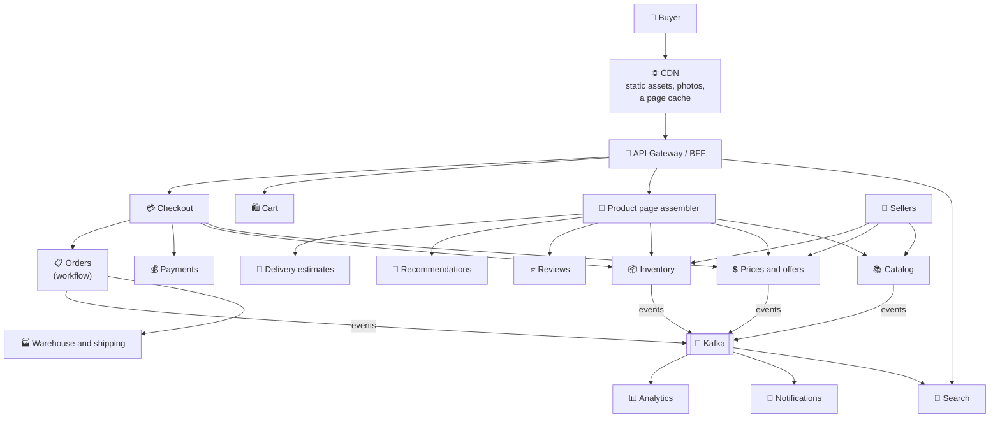
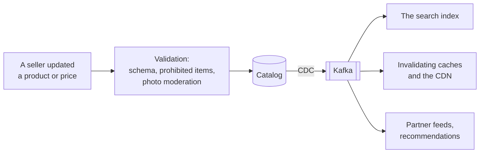
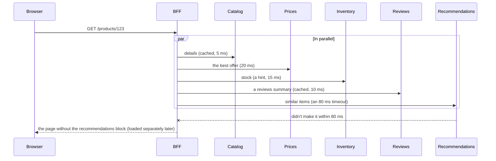
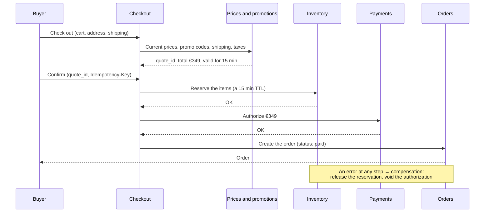
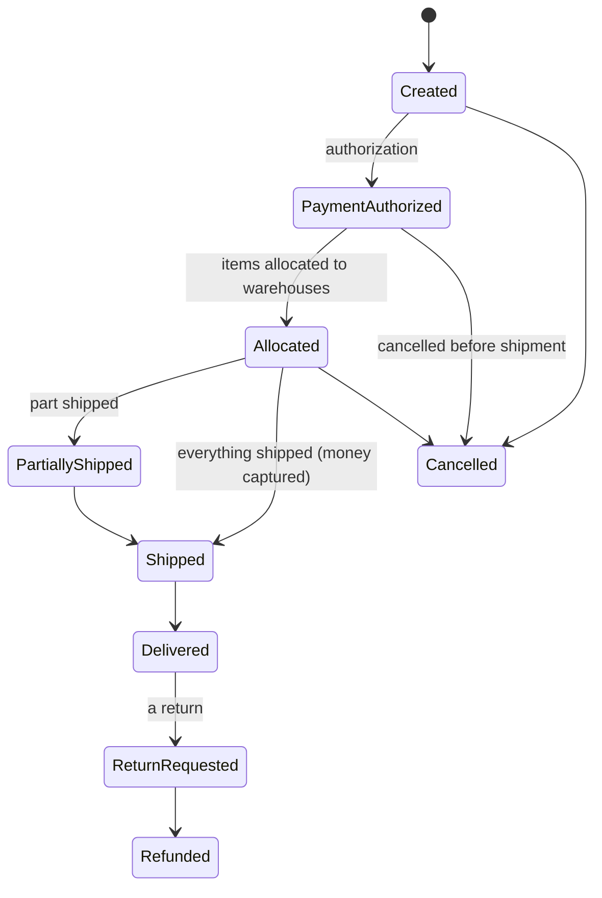

**English** | [Русский](README_RU.md)

# Tier 2 · 4D · 01. An E-Commerce Platform (Amazon / Shopify)

> **Level:** Medium · **Interview time:** 45 min · **Study time:** ~4–5 h
> **Key aspects:** splitting into domains and services, different consistency for different domains, the catalog model (products, variants, seller offers), assembling the product page with degradation, search and facets, the cart and checkout, the order workflow as a saga, peak sales, multi-tenant stores (Shopify)
> **Builds on:** [Tier 1 · 20 Payments](../../../tier-1/20-payment-system/README.md), [Tier 1 · 13 Ticketmaster](../../../tier-1/13-ticketmaster/README.md#10-deep-dive-4-on-sale-time-and-the-virtual-waiting-room), [15-search-basics](../../../15-search-basics/README.md), [11-distributed-transactions](../../../11-distributed-transactions/README.md#13-workflow-engines), [13-reliability-patterns](../../../13-reliability-patterns/README.md), [Tier 1 · 15 Autocomplete](../../../tier-1/15-search-autocomplete/README.md)

---

## 🗺️ How to Read This Walkthrough

The walkthrough follows an interview, but every step includes explanations: **why** a decision is made, **how** a mechanism works and **what happens** if you do it differently. The "📘 Explanation" blocks are theory right where you need it.

| Icon | Meaning |
|:----:|:--------|
| 🎤 | Interviewer |
| 🗣️ | What I (the candidate) say out loud |
| ✏️ | What I draw on the whiteboard |
| ⏱️ | Time budget for the step |
| 📘 | A detailed explanation of a concept |

Callouts: **TIP** — a good technique, **WARNING** — a trap, **IMPORTANT** — a Senior+ signal.

---

## 📑 Contents

0. [What This Problem Teaches](#0-what-this-problem-teaches)
1. [Problem Statement](#1-problem-statement)
2. [Clarifying Questions and Requirements](#2-clarifying-questions-and-requirements)
3. [Capacity Estimates](#3-capacity-estimates)
4. [API](#4-api)
5. [The Domain and Data Map](#5-the-domain-and-data-map)
6. [High-Level Design](#6-high-level-design)
7. [Deep Dive 1: Domains and Consistency](#7-deep-dive-1-domains-and-consistency)
8. [Deep Dive 2: The Catalog](#8-deep-dive-2-the-catalog)
9. [Deep Dive 3: Assembling the Product Page](#9-deep-dive-3-assembling-the-product-page)
10. [Deep Dive 4: Search and Browsing](#10-deep-dive-4-search-and-browsing)
11. [Deep Dive 5: The Cart and Checkout](#11-deep-dive-5-the-cart-and-checkout)
12. [Deep Dive 6: The Order Workflow](#12-deep-dive-6-the-order-workflow)
13. [Deep Dive 7: Peak Sales](#13-deep-dive-7-peak-sales)
14. [Deep Dive 8: Marketplaces and Multi-Tenancy](#14-deep-dive-8-marketplaces-and-multi-tenancy)
15. [Bottlenecks and Failure Scenarios](#15-bottlenecks-and-failure-scenarios)
16. [What Changes at 10x Scale](#16-what-changes-at-10x-scale)
17. [Key Concepts and New Terms](#17-key-concepts-and-new-terms)
18. [Variations and Follow-Up Questions](#18-variations-and-follow-up-questions)
19. [Common Mistakes](#19-common-mistakes)
20. [Cheat Sheet and Self-Check](#20-cheat-sheet-and-self-check)

---

## 0. What This Problem Teaches

An online store isn't one system but **a dozen domains** with very different requirements: the catalog is read billions of times and can lag by minutes, while checkout runs less often but must never charge twice or sell a nonexistent item. The core skill is **splitting the system into domains and choosing, for each one, its own consistency, store and scaling strategy**.

| What's tested | Where it shows up |
|:--------------|:------------------|
| Decomposition | Domains and services with clear boundaries |
| Different consistency | Eventual for the catalog, strict for orders and money |
| Aggregation with degradation | A product page from many services |
| Search | Relevance + business signals, facets |
| Distributed processes | Checkout and the order workflow as sagas |
| Peak load | Sales, prioritizing the critical path |
| Multi-tenancy | Thousands of stores on one platform |

> [!TIP]
> Don't try to design everything in equal detail. Draw the domain map, name each domain's requirements, and go deep in the 2–3 places the interviewer picks. Usually that's the product page, checkout and peak load.

> [!NOTE]
> The cart and inventory are covered in detail in the next problems of the group (4D #2 and #3). Here they appear at the level of the overall architecture.

---

## 1. Problem Statement

> 🎤 "Design an e-commerce platform like Amazon: a product catalog, search, product pages, a cart, checkout, order tracking. Sellers manage their products. Account for sales events like Black Friday."

**The buyer's journey:**

```
Search "wireless headphones" → filters: brand, price, rating
→ the product page: photos, price, "in stock", delivery by Wednesday, reviews, similar items
→ "Add to cart" → "Check out" → address, shipping, payment
→ "Order placed" → notifications: paid → packed → shipped → delivered
```

**Time plan:**

| Step | ⏱️ |
|:-----|:--:|
| Requirements | 5 min |
| Estimates | 3 min |
| The domain map | 5 min |
| High-level design | 6 min |
| Deep dives | 22 min |
| Wrap-up | 4 min |

---

## 2. Clarifying Questions and Requirements

⏱️ 5 min

| My question | Interviewer's answer | What it changes and why |
|:------------|:---------------------|:------------------------|
| Scale? | 300M users, 50M daily | Caching, a CDN, sharding |
| The catalog? | ~500M product listings, many sellers | A separate catalog service and a search index |
| Page views? | ~2B per day | Reads dominate |
| Orders? | ~10M per day; 10–20× more at peak during sales | Checkout must scale and stay correct |
| A marketplace? | Yes: one product may be sold by several sellers | A "product + seller offers" model |
| Consistency? | The catalog and reviews may lag; price and stock are checked at order time | Different consistency per domain |
| Availability? | Browsing — maximal; checkout — correctness matters more | Degradation, priorities |

### Functional requirements

1. The catalog: products, variants, attributes, photos; management by sellers.
2. Search with filters and sorting, browsing by category.
3. The product page: price, stock, delivery estimates, reviews, recommendations.
4. The cart, checkout, payment.
5. The order workflow: payment, packing, shipping, delivery, cancellation, returns.
6. Notifications and order history.

### Non-functional requirements

| Requirement | Target | Why |
|:------------|:-------|:----|
| Product page latency | p99 < 200–300 ms | Every 100 ms of latency lowers conversion |
| Browsing availability | 99.99% | An unavailable store means lost sales |
| Order correctness | No double charges, no selling what's unavailable | Money and trust |
| Peak load | ×10–20 during sales | Black Friday |
| Price and stock freshness in search | Minutes are acceptable | Checked at checkout |

---

## 3. Capacity Estimates

⏱️ 3 min

```
Page views:      2B per day → ~23,000/s, a sales peak of ~200,000–400,000/s
Search:          ~500M queries per day → ~6,000/s
Orders:          10M per day → ~120/s, a peak of ~2,000–3,000/s
The catalog:     500M listings × ~10 KB ≈ 5 TB (photos are separate, on a CDN)
A product page:  calls 6–8 services → hundreds of thousands of internal requests per second
```

### Conclusions

| Conclusion | Design consequence |
|:-----------|:-------------------|
| Page views outnumber orders hundreds of times | The catalog and pages — caches and a CDN; orders — a separate, reliable path |
| A page = many services | Parallel aggregation, timeouts, degradation |
| Peaks of 10–20× | Scale up in advance, protect the checkout path |
| The catalog is terabytes | A sharded store + a search index |

---

## 4. API

⏱️ 2 min

```http
GET  /v1/search?q=headphones&brand=sony&price_max=200&sort=rating&page=2
GET  /v1/products/{product_id}?variant=black      ← an aggregated page (BFF)
POST /v1/cart/items           { sku, quantity }
POST /v1/checkout/quote       { cart_id, address_id, shipping_option }   → quote_id, total, expiry
POST /v1/orders               Idempotency-Key: …   { quote_id, payment_method }
GET  /v1/orders/{order_id}

Sellers:
PUT  /v1/seller/listings/{sku}   { price, quantity, condition }
POST /v1/seller/products         { title, attributes, images }
```

---

## 5. The Domain and Data Map

⏱️ 5 min

| Domain | What it stores | Store | Consistency | Load |
|:-------|:---------------|:------|:------------|:-----|
| **Catalog** | Products, variants, attributes, descriptions | A document DB (or sharded SQL with JSON) | Eventual (minutes) | Enormous reads |
| **Offers and prices** | A seller's price, terms | KV / SQL, a cache | Freshness matters; the final check is at order time | Reads and frequent updates |
| **Inventory** | Stock by warehouse | SQL / a dedicated service | Strict on reservation | Hot keys during sales |
| **Search** | A product index | Elasticsearch / OpenSearch | Eventual | Reads |
| **Cart** | Cart items | KV (Dynamo-like) | Availability matters more | Writes and reads |
| **Orders** | Orders, line items, statuses | Sharded SQL (by buyer) | Strict | Moderate |
| **Payments** | Payments, a ledger | SQL, double entry | Strict | Moderate |
| **Shipping** | Shipments, tracking | SQL + events | Strict on statuses | Moderate |
| **Reviews** | Reviews, ratings | A document DB + aggregates | Eventual | Reads |
| **Recommendations** | Models, similar items | A feature store, ANN | Eventual | Reads |

> [!IMPORTANT]
> **Senior+ signal:** the "domain → consistency" table. It shows you're not making everything strict (slow and expensive) or everything eventual (losing money), but choosing deliberately per domain.

---

## 6. High-Level Design

⏱️ 6 min



🗣️ "Key decisions:
- **a CDN** — static assets, photos and a cache of the shared parts of pages;
- **a BFF** assembles the product page from several services in parallel, with timeouts and degradation;
- **the catalog, prices and inventory** are separate domains; changes flow as events into search and caches;
- **checkout** verifies current prices and stock, reserves the items, authorizes payment and creates the order;
- **an order** is a long-running workflow (a saga) through delivery and returns;
- **Kafka** connects domains with events: search, notifications, analytics."

---

## 7. Deep Dive 1: Domains and Consistency

> 🎤 "Why not one big database? And microservices from the start, or a monolith?"

### Why different stores

| Domain | Key requirement | Why a separate store |
|:-------|:----------------|:---------------------|
| Catalog | Billions of reads, flexible attributes | A document model, aggressive caching |
| Search | Full-text search and facets | An inverted index |
| Cart | Writes always available | An AP store |
| Orders and payments | Transactions, auditing | A relational DB with strong consistency |

### Microservices or a modular monolith

| | Microservices | A modular monolith |
|:-|:--------------|:-------------------|
| Independent scaling and deployment | Yes | Limited |
| Complexity | The network, distributed transactions, observability | Lower |
| Example | Amazon historically moved to services | Shopify is known for a large modular Rails monolith with clear module boundaries |

🗣️ "What matters isn't 'micro' versus 'monolith' but **domain boundaries** and data ownership: each domain owns its tables, and others access them through APIs or events. Then you can split into services gradually — where it's really needed for scale or team independence."

---

## 8. Deep Dive 2: The Catalog

> 🎤 "How do you model products with different attributes, and several sellers of one product?"

### The model

```
A product:          "Sony WH-1000XM5 headphones"
  ├─ attributes:    brand, type, connectivity… (the "shoes" category has entirely different ones)
  ├─ variants (SKU): black, silver
  │     └─ offers:  seller A — €349, new, 2-day delivery
  │                 seller B — €329, new, 5-day delivery
  └─ media:         photos, video (in object storage + a CDN)
```

| Decision | Why |
|:---------|:----|
| **A document model** for attributes (or JSONB) | Attributes differ greatly between categories |
| **An attribute schema per category** | Validation, search facets, consistent units |
| The product separate from **offers** | One product, many sellers; the "best offer" (the buy box) is chosen by price, delivery time and seller rating |
| A canonical listing | Merging duplicates created by different sellers |

### The update pipeline



📘 The catalog is the source of truth; search, caches and feeds are **derived**, updated through a change stream (CDC). A lag of seconds to minutes is acceptable: the final price and stock are verified at checkout.

---

## 9. Deep Dive 3: Assembling the Product Page

> 🎤 "A product page is assembled from 6–8 services. How do you fit into 200 ms?"



| Technique | Why |
|:----------|:----|
| **Parallel requests** | Latency = the slowest call, not the sum |
| **A timeout per service** | A slow secondary service doesn't slow down the page |
| **Degradation** | The page works without recommendations and reviews; without a price — show "see offers" |
| **Critical and non-critical blocks** | The catalog and price are required; recommendations are optional |
| **Per-component caching** with different TTLs | Descriptions — hours, price — seconds to minutes, stock — a short TTL |
| **Edge caching** of the shared part + loading the personal parts | The part identical for everyone comes from the CDN; personal blocks come in separate requests |
| Circuit breakers | A failed service doesn't receive a flood of requests (see [13-reliability-patterns](../../../13-reliability-patterns/README.md)) |

> [!WARNING]
> "In stock" on the page is **a hint**, not a guarantee: exact stock is checked and reserved only at checkout. Otherwise every page view would hit the strongly consistent inventory system.

---

## 10. Deep Dive 4: Search and Browsing

> 🎤 "How does search over 500 million products work?"

| Component | How |
|:----------|:----|
| **The index** | Elasticsearch / OpenSearch: text fields, attributes, price, rating, stock (see [15-search-basics](../../../15-search-basics/README.md)) |
| **Candidate retrieval** | BM25 on text + vector search on meaning ("headphones for running" → wireless sports models) |
| **Ranking** | Relevance + business signals: sales, conversion, rating, stock, delivery speed, margin; personalization |
| **Facets** | Aggregations by brand, price and rating for filters |
| **Autocomplete and typos** | See [Tier 1 · 15](../../../tier-1/15-search-autocomplete/README.md) |
| **Freshness** | Partial document updates when price and stock change; out-of-stock items are demoted or hidden |
| **Ads** | Sponsored slots are inserted into results through a separate auction |

📘 **Sharding the index**: by product (document) with read replicas; a query goes to every shard and the results are merged (scatter-gather). Popular queries are cached.

---

## 11. Deep Dive 5: The Cart and Checkout

> 🎤 "What happens when the user clicks 'Check out'?"

### The cart (briefly)

📘 The cart must **always** accept additions — a classic example of choosing availability (Amazon's cart was the motivation for Dynamo). Details — merging guest and signed-in carts, storage and consistency — are in problem 4D #2.

### Checkout



| Decision | Why |
|:---------|:----|
| **A quote with a limited lifetime** | The buyer pays exactly the price they saw; the price doesn't change mid-checkout |
| **An Idempotency-Key** | A double click doesn't create two orders (see [Tier 1 · 20](../../../tier-1/20-payment-system/README.md#7-deep-dive-1-idempotency-keys)) |
| **A reservation with a TTL** | The item is held for the buyer while they pay; an abandoned reservation releases itself |
| **Authorization, not capture** | Money is captured at shipment; on cancellation — the authorization is voided |
| **Compensations** | A saga: each step has an inverse action |
| Taxes and shipping — at quote time | The total is known before payment |

---

## 12. Deep Dive 6: The Order Workflow

> 🎤 "An order lives for days: payment, packing, delivery, returns. How do you manage that?"

### A state machine



| Specific | Solution |
|:---------|:---------|
| **Splitting an order** | Items from different warehouses or sellers → several **shipments**, each with its own status |
| A long process (days to weeks) | **A workflow engine** (Temporal, Step Functions — see [11-distributed-transactions](../../../11-distributed-transactions/README.md#13-workflow-engines)) or an explicit state machine with timers |
| Capturing money | A partial capture when each shipment ships |
| Events | Each transition is an event via the outbox → notifications, analytics, support |
| Returns | A separate process: receiving the item → inspection → refund |
| Timeouts | An authorization expires — reauthorize or cancel |

---

## 13. Deep Dive 7: Peak Sales

> 🎤 "Black Friday: traffic is 20× higher than usual. What do you do?"

| Measure | How |
|:--------|:----|
| **Capacity planning and load tests** | Test the system at the expected peak, with headroom, in advance |
| **Pre-scaling** | Autoscaling can't keep up with an instant spike — raise capacity in advance |
| **Aggressive caching** | Pages for discounted items — on the CDN; the catalog — in caches |
| **Prioritizing the critical path** | Under overload, shed secondary features first (recommendations, reviews) and protect checkout (priority-based load shedding) |
| **Turning features off** (feature flags) | Temporarily disabling heavy features |
| **A virtual waiting room** for hot items | Limited items at a super price — through a queue, like tickets (see [Tier 1 · 13](../../../tier-1/13-ticketmaster/README.md#10-deep-dive-4-on-sale-time-and-the-virtual-waiting-room)) |
| **Hot inventory keys** | One item bought by thousands per second — a special reservation scheme (4D #3) |
| **Asynchrony** | Heavy post-payment steps (notifications, analytics) — through a queue |
| A change freeze | No deploys on peak days |

> [!TIP]
> A strong answer: "During the peak our goal is **to preserve checkout**. Anything that doesn't bring in money right now is the first candidate for degradation."

---

## 14. Deep Dive 8: Marketplaces and Multi-Tenancy

> 🎤 "And if this is Shopify: millions of independent stores on one platform?"

| Question | Solution |
|:---------|:---------|
| **Data isolation** | Each store is a tenant; every query filters by `shop_id`; sharding by store |
| **Pods** | Shopify described a "pods" architecture: a group of stores is served by an isolated set of databases and services; a store lives in one pod, and pods are independent |
| **Noisy neighbors** | One big store's sale mustn't slow down the rest — per-tenant limits, moving a big store to its own pod |
| **Moving a store between pods** | Online migration of the store's data (like resharding, see [4C · 03](../../4c-storage-databases/03-sharded-sql-vitess/README.md#10-deep-dive-4-online-resharding)) |
| **Storefronts** | Store themes are rendered and cached at the edge; custom domains with automatic TLS certificates |
| **Paying sellers** | Splitting the payment: the platform fee, the seller's payout, a ledger (see [Tier 1 · 20](../../../tier-1/20-payment-system/README.md#13-deep-dive-7-seller-payouts-and-currencies)) |
| **Extensions** | Third-party apps via APIs and webhooks, with limits |

---

## 15. Bottlenecks and Failure Scenarios

| Scenario | What happens | How we protect |
|:---------|:-------------|:---------------|
| A slow recommendations service | A slow product page | Timeouts, degradation, circuit breakers |
| The price changed during checkout | The buyer pays something else | A quote |
| A double click on "Check out" | Two orders | An Idempotency-Key |
| The item ran out during checkout | Selling what isn't there | A reservation at checkout; "in stock" on the page is a hint |
| A payment error after reserving | The item stays blocked | Compensation: release the reservation; the reservation's TTL |
| A 20× peak | Overload | Pre-scaling, a CDN, priorities, a virtual waiting room |
| A stale search index | Wrong prices and stock in results | CDC, partial updates, checks at checkout |
| A noisy neighbor (multi-tenancy) | Other stores slow down | Limits, pods, moving big stores |
| A lost order event | No notification | The outbox, idempotent consumers |
| Search fails | Products can't be found | Category browsing from a cache, degradation |

---

## 16. What Changes at 10x Scale

> 🎤 "10× more buyers and sellers?"

| Change | Why |
|:-------|:----|
| **Regional deployments** | Latency, data residency, countries' taxes and laws |
| **A cell-based architecture** | Limiting the blast radius: each cell serves a share of users |
| **More compute at the edge** | Pages and personalization closer to users |
| **ML for ranking and demand forecasting** | Distributing stock across warehouses in advance |

---

## 17. Key Concepts and New Terms

### What's applied

| Concept | Where it's covered | How it applies here |
|:--------|:-------------------|:--------------------|
| Payments, idempotency, a ledger | [Tier 1 · 20](../../../tier-1/20-payment-system/README.md) | Paying for orders |
| Reservations with a TTL, a virtual waiting room | [Tier 1 · 13](../../../tier-1/13-ticketmaster/README.md) | Inventory and sales |
| Search and ranking | [15-search-basics](../../../15-search-basics/README.md) | Product search |
| Sagas, workflow engines | [11-distributed-transactions](../../../11-distributed-transactions/README.md) | Checkout and the order workflow |
| Timeouts, circuit breakers, load shedding | [13-reliability-patterns](../../../13-reliability-patterns/README.md) | The product page and peaks |
| Sharding and resharding | [Tier 2 · 4C · 03](../../4c-storage-databases/03-sharded-sql-vitess/README.md) | Orders, store pods |

### New terms in this problem

| Term | In short |
|:-----|:---------|
| **A domain and data ownership** | Each domain owns its data |
| **A product, a variant (SKU), an offer** | A marketplace catalog model |
| **The buy box** | Choosing the best offer among sellers |
| **A BFF** | A service that assembles data for a specific interface |
| **Page degradation** | Working without secondary blocks |
| **A quote** | A locked total with a limited lifetime |
| **A shipment** | A part of an order from one warehouse or seller |
| **Priority-based load shedding** | Dropping secondary work under overload |
| **Pods / cells** | Isolated groups of tenants or users |

---

## 18. Variations and Follow-Up Questions

<details>
<summary><b>How do you show a "by Wednesday" delivery estimate on the product page?</b></summary>

The delivery service computes the estimate from the nearest warehouse with stock, the order cutoff time, the carrier's schedule and the user's address (the region from their profile or IP). The result is cached per (product, region) for minutes; the exact date is recomputed at checkout.
</details>

<details>
<summary><b>How do you apply promo codes and discounts?</b></summary>

A separate promotions service with rules (a percentage, a fixed amount, "buy 2 for the price of 1", a minimum total), priorities and restrictions on combining. Discounts are computed at quote time; a promo code's usage limit is a strongly consistent counter, reserved at checkout and returned on cancellation.
</details>

<details>
<summary><b>How do you recommend "frequently bought together"?</b></summary>

Offline: from order history, compute pairs of products often bought together (co-occurrence with normalization), and store the result per product. Online: ranking that accounts for stock and personalization; see the approaches in [the video feed](../../4b-social-media/01-tiktok-feed/README.md).
</details>

<details>
<summary><b>Why shard orders by buyer rather than by order ID?</b></summary>

The most frequent queries are "my orders" and operations on a buyer's orders; sharding by buyer makes them single-shard. Seller queries ("my sales") are served by a separate projection built from events.
</details>

<details>
<summary><b>What if a warehouse reports that an item is physically missing even though the order is paid?</b></summary>

It's inevitable (inventory discrepancies, damage). The process: try to allocate the order to another warehouse or seller; if that's impossible — a partial cancellation, voiding the authorization or refunding, notifying and compensating the buyer. Regular inventory reconciliation reduces such cases.
</details>

---

## 19. Common Mistakes

| ❌ Mistake | Why it's bad | ✅ Do this instead |
|:----------|:-------------|:------------------|
| One database and the same consistency for everything | Either slow or losing money | Consistency per domain |
| Sequential service calls for a page | Latency is the sum | In parallel, with timeouts |
| The page fails because of recommendations | Lost sales | Degradation |
| A strict stock check on every page view | Load on inventory | A hint on the page, a reservation at checkout |
| Recomputing the price after confirmation | The buyer pays a different amount | A quote |
| No checkout idempotency | Duplicate orders | An Idempotency-Key |
| Capturing money immediately at checkout | Complicated refunds on cancellation | Authorization, capture at shipment |
| An order as a single record with a status | Can't ship in parts | Shipments |
| Counting on autoscaling for Black Friday | It can't keep up | Scale up in advance |
| Every feature equally important under overload | Checkout falls over | Priorities and turning off secondary features |

---

## 20. Cheat Sheet and Self-Check

### 30-second answer

> The platform is a set of domains with their own consistency: the catalog (a document model, product → variants → seller offers, eventual, CDC into search and caches), prices and promotions (freshness, a final check in the quote), inventory (strict only when reserving), the cart (availability first), orders and payments (strict, SQL, a ledger). The product page is assembled by a BFF in parallel from 6–8 services with timeouts, degradation and per-component caching; the shared part comes from a CDN, and "in stock" is a hint. Search: BM25 + vectors, ranking with business signals, facets, partial updates of price and stock. Checkout: a quote with a limited lifetime → an Idempotency-Key → a reservation with a TTL → payment authorization → an order; errors trigger compensations. An order is a long-running workflow (a workflow engine): allocation to warehouses, shipments, capture at shipment, returns, events via the outbox. Peaks: load tests, scaling up in advance, a CDN, prioritizing checkout and shedding secondary load, a virtual waiting room for hot items. Multi-tenancy: sharding by store, pods, limits against noisy neighbors.

### Self-check

- [ ] I can draw the domain map and state each domain's consistency
- [ ] I can discuss microservices versus a modular monolith
- [ ] I can model products, variants and seller offers
- [ ] I can describe the catalog update pipeline
- [ ] I can design product page assembly with degradation
- [ ] I can describe product search and facets
- [ ] I can draw checkout with a quote, a reservation and compensations
- [ ] I can describe the order workflow and shipments
- [ ] I can list the measures for Black Friday
- [ ] I can describe Shopify-style multi-tenancy

### Further reading

- DeCandia et al., *Dynamo* (2007) — motivated by Amazon's cart
- Shopify Engineering articles on the modular monolith and the pods architecture
- The Amazon Builders' Library — articles on timeouts, retries, load shedding
- Sam Newman, *Building Microservices* — domain boundaries
- The [Tier 1 · 20](../../../tier-1/20-payment-system/README.md) and [Tier 1 · 13](../../../tier-1/13-ticketmaster/README.md) walkthroughs
