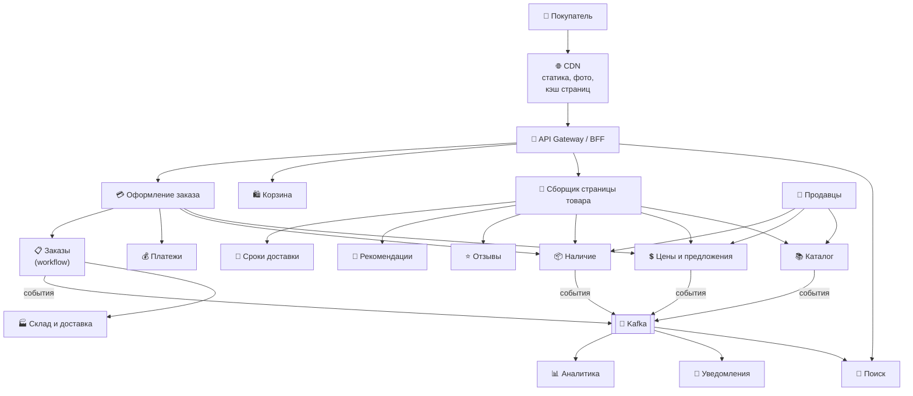
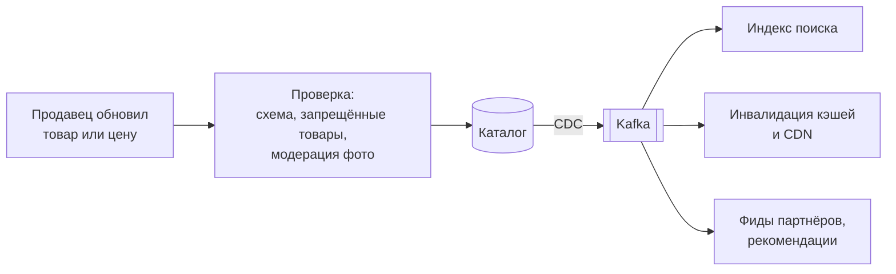
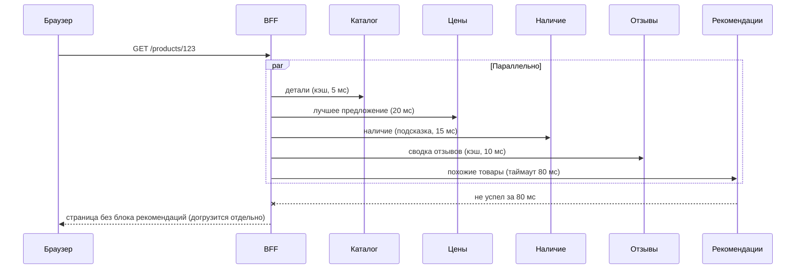
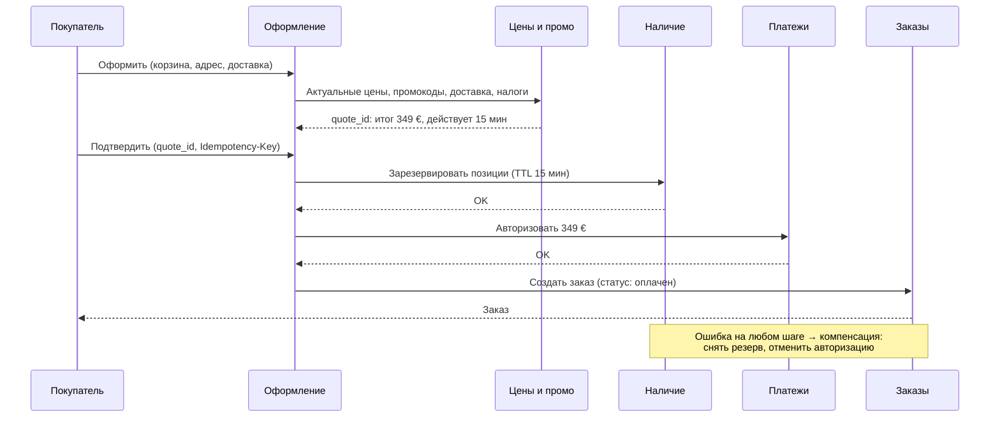
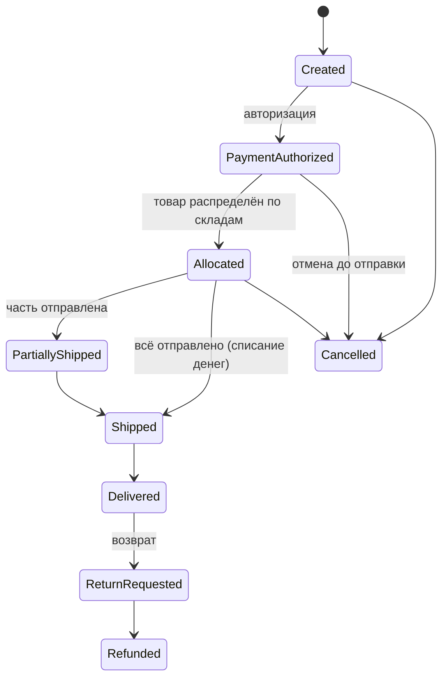

[English](README.md) | **Русский**

# Tier 2 · 4D · 01. E-commerce платформа (Amazon / Shopify)

> **Уровень:** Medium · **Время на интервью:** 45 мин · **Время на разбор:** ~4–5 ч
> **Ключевые аспекты:** разбиение на домены и сервисы, разная консистентность для разных доменов, модель каталога (товары, варианты, предложения продавцов), сборка страницы товара с деградацией, поиск и фасеты, корзина и оформление заказа, workflow заказа как сага, пиковые распродажи, мультиарендность магазинов (Shopify)
> **Опирается на:** [Tier 1 · 20 Payments](../../../tier-1/20-payment-system/README_RU.md), [Tier 1 · 13 Ticketmaster](../../../tier-1/13-ticketmaster/README_RU.md#10-deep-dive-4-старт-продаж-и-виртуальная-очередь), [15-search-basics](../../../15-search-basics/README_RU.md), [11-distributed-transactions](../../../11-distributed-transactions/README_RU.md#13-движки-рабочих-процессов), [13-reliability-patterns](../../../13-reliability-patterns/README_RU.md), [Tier 1 · 15 Autocomplete](../../../tier-1/15-search-autocomplete/README_RU.md)

---

## 🗺️ Как читать этот разбор

Разбор построен как интервью, но в каждом шаге есть объяснения: **почему** принимается решение, **как работает** механизм и **что будет**, если сделать иначе. Блоки «📘 Объяснение» — теория прямо по ходу задачи.

| Значок | Что значит |
|:------:|:-----------|
| 🎤 | Реплика интервьюера |
| 🗣️ | Что говорю вслух я (кандидат) |
| ✏️ | Что рисую на доске |
| ⏱️ | Сколько времени тратить на шаг |
| 📘 | Подробное объяснение концепции |

Блоки **TIP** — хороший приём, **WARNING** — ловушка, **IMPORTANT** — сигнал для уровня Senior+.

---

## 📑 Содержание

0. [Чему учит эта задача](#0-чему-учит-эта-задача)
1. [Условие задачи](#1-условие-задачи)
2. [Уточняющие вопросы и требования](#2-уточняющие-вопросы-и-требования)
3. [Оценки нагрузки](#3-оценки-нагрузки)
4. [API](#4-api)
5. [Карта доменов и данных](#5-карта-доменов-и-данных)
6. [High-level дизайн](#6-high-level-дизайн)
7. [Deep dive 1: домены и консистентность](#7-deep-dive-1-домены-и-консистентность)
8. [Deep dive 2: каталог](#8-deep-dive-2-каталог)
9. [Deep dive 3: сборка страницы товара](#9-deep-dive-3-сборка-страницы-товара)
10. [Deep dive 4: поиск и навигация](#10-deep-dive-4-поиск-и-навигация)
11. [Deep dive 5: корзина и оформление заказа](#11-deep-dive-5-корзина-и-оформление-заказа)
12. [Deep dive 6: workflow заказа](#12-deep-dive-6-workflow-заказа)
13. [Deep dive 7: пиковые распродажи](#13-deep-dive-7-пиковые-распродажи)
14. [Deep dive 8: маркетплейс и мультиарендность](#14-deep-dive-8-маркетплейс-и-мультиарендность)
15. [Узкие места и сценарии сбоев](#15-узкие-места-и-сценарии-сбоев)
16. [Что изменится при росте в 10 раз](#16-что-изменится-при-росте-в-10-раз)
17. [Ключевые концепции и новые понятия](#17-ключевые-концепции-и-новые-понятия)
18. [Варианты задачи и follow-up вопросы](#18-варианты-задачи-и-follow-up-вопросы)
19. [Типичные ошибки](#19-типичные-ошибки)
20. [Шпаргалка и самопроверка](#20-шпаргалка-и-самопроверка)

---

## 0. Чему учит эта задача

Интернет-магазин — это не одна система, а **десяток доменов** с очень разными требованиями: каталог читают миллиарды раз и он может отставать на минуты, а оформление заказа выполняется реже, но не имеет права списать деньги дважды или продать несуществующий товар. Главный навык — **разделить систему на домены и для каждого выбрать свою консистентность, хранилище и стратегию масштабирования**.

| Что проверяют | Где это в задаче |
|:--------------|:-----------------|
| Декомпозиция | Домены и сервисы с понятными границами |
| Разная консистентность | Eventual для каталога, строгая для заказа и денег |
| Агрегация с деградацией | Страница товара из многих сервисов |
| Поиск | Релевантность + бизнес-сигналы, фасеты |
| Распределённые процессы | Оформление заказа и workflow заказа как саги |
| Пиковая нагрузка | Распродажи, приоритет критического пути |
| Мультиарендность | Тысячи магазинов на одной платформе |

> [!TIP]
> Не пытайся спроектировать всё одинаково подробно. Нарисуй карту доменов, назови требования каждого, а глубоко уходи в 2–3 места, которые выберет интервьюер. Обычно это страница товара, оформление заказа и пиковые нагрузки.

> [!NOTE]
> Корзина и складские остатки подробно разобраны в следующих задачах группы (4D #2 и #3). Здесь они — на уровне общей архитектуры.

---

## 1. Условие задачи

> 🎤 «Спроектируй e-commerce платформу вроде Amazon: каталог товаров, поиск, страница товара, корзина, оформление заказа, отслеживание заказа. Продавцы управляют своими товарами. Учти распродажи вроде Black Friday».

**Путь покупателя:**

```
Поиск «беспроводные наушники» → фильтры: бренд, цена, рейтинг
→ страница товара: фото, цена, «в наличии», доставка к среде, отзывы, похожие товары
→ «Добавить в корзину» → «Оформить» → адрес, доставка, оплата
→ «Заказ оформлен» → уведомления: оплачен → собран → отправлен → доставлен
```

**План по времени:**

| Шаг | ⏱️ |
|:----|:--:|
| Требования | 5 мин |
| Оценки | 3 мин |
| Карта доменов | 5 мин |
| High-level дизайн | 6 мин |
| Deep dives | 22 мин |
| Итоги | 4 мин |

---

## 2. Уточняющие вопросы и требования

⏱️ 5 мин

| Мой вопрос | Ответ интервьюера | Что это меняет и почему |
|:-----------|:------------------|:------------------------|
| Масштаб? | 300M пользователей, 50M в день | Кэширование, CDN, шардирование |
| Каталог? | ~500M товарных позиций, много продавцов | Отдельный сервис каталога и индекс поиска |
| Просмотры? | ~2 млрд в день | Чтение доминирует |
| Заказы? | ~10M в день, в распродажи — в 10–20 раз больше в пике | Оформление заказа должно масштабироваться и быть корректным |
| Маркетплейс? | Да: один товар могут продавать несколько продавцов | Модель «товар + предложения продавцов» |
| Консистентность? | Каталог и отзывы могут отставать; цена и наличие — проверяются при заказе | Разная консистентность по доменам |
| Доступность? | Просмотр — максимально; оформление — корректность важнее | Деградация, приоритеты |

### Функциональные требования

1. Каталог: товары, варианты, атрибуты, фото; управление продавцами.
2. Поиск с фильтрами и сортировкой, навигация по категориям.
3. Страница товара: цена, наличие, сроки доставки, отзывы, рекомендации.
4. Корзина, оформление заказа, оплата.
5. Workflow заказа: оплата, сборка, отправка, доставка, отмена, возврат.
6. Уведомления и история заказов.

### Нефункциональные требования

| Требование | Цель | Почему |
|:-----------|:-----|:-------|
| Задержка страницы товара | p99 < 200–300 мс | Каждые 100 мс задержки снижают конверсию |
| Доступность просмотра | 99,99% | Недоступный магазин — потерянные продажи |
| Корректность заказа | Без двойных списаний и продажи отсутствующего | Деньги и доверие |
| Пиковая нагрузка | ×10–20 в распродажи | Black Friday |
| Свежесть цены и наличия в поиске | Минуты допустимы | Проверка при оформлении |

---

## 3. Оценки нагрузки

⏱️ 3 мин

```
Просмотры:        2 млрд в день → ~23 000/с, пик распродажи ~200 000–400 000/с
Поиск:            ~500M запросов в день → ~6 000/с
Заказы:           10M в день → ~120/с, пик ~2 000–3 000/с
Каталог:          500M позиций × ~10 КБ ≈ 5 ТБ (фото — отдельно, в CDN)
Страница товара:  обращается к 6–8 сервисам → сотни тысяч внутренних запросов в секунду
```

### Выводы

| Вывод | Следствие для дизайна |
|:------|:----------------------|
| Просмотров в сотни раз больше заказов | Каталог и страницы — кэш и CDN; заказ — отдельный надёжный путь |
| Страница = много сервисов | Параллельная агрегация, таймауты, деградация |
| Пики в 10–20 раз | Заранее масштабировать, защищать путь оформления |
| Каталог — терабайты | Шардированное хранилище + индекс поиска |

---

## 4. API

⏱️ 2 мин

```http
GET  /v1/search?q=наушники&brand=sony&price_max=200&sort=rating&page=2
GET  /v1/products/{product_id}?variant=black      ← агрегированная страница (BFF)
POST /v1/cart/items           { sku, quantity }
POST /v1/checkout/quote       { cart_id, address_id, shipping_option }   → quote_id, итог, срок действия
POST /v1/orders               Idempotency-Key: …   { quote_id, payment_method }
GET  /v1/orders/{order_id}

Продавцы:
PUT  /v1/seller/listings/{sku}   { price, quantity, condition }
POST /v1/seller/products         { title, attributes, images }
```

---

## 5. Карта доменов и данных

⏱️ 5 мин

| Домен | Что хранит | Хранилище | Консистентность | Нагрузка |
|:------|:-----------|:----------|:----------------|:---------|
| **Каталог** | Товары, варианты, атрибуты, описания | Документная БД (или шардированная SQL с JSON) | Eventual (минуты) | Чтение огромное |
| **Предложения и цены** | Цена продавца, условия | KV / SQL, кэш | Свежесть важна; окончательная проверка при заказе | Чтение и частые обновления |
| **Наличие** | Остатки по складам | SQL / специальный сервис | Строгая при резервировании | Горячие ключи в распродажи |
| **Поиск** | Индекс товаров | Elasticsearch / OpenSearch | Eventual | Чтение |
| **Корзина** | Позиции корзины | KV (Dynamo-подобное) | Доступность важнее | Запись и чтение |
| **Заказы** | Заказы, позиции, статусы | Шардированная SQL (по покупателю) | Строгая | Средняя |
| **Платежи** | Платежи, реестр | SQL, двойная запись | Строгая | Средняя |
| **Доставка** | Отправления, трекинг | SQL + события | Строгая по статусам | Средняя |
| **Отзывы** | Отзывы, рейтинги | Документная БД + агрегаты | Eventual | Чтение |
| **Рекомендации** | Модели, похожие товары | Feature store, ANN | Eventual | Чтение |

> [!IMPORTANT]
> **Сигнал Senior+:** таблица «домен → консистентность». Показывает, что ты не делаешь всё строго (медленно и дорого) или всё eventual (теряются деньги), а выбираешь осознанно для каждого домена.

---

## 6. High-level дизайн

⏱️ 6 мин



🗣️ «Ключевые решения:
- **CDN** — статика, фото и кэш общих частей страниц;
- **BFF** собирает страницу товара из нескольких сервисов параллельно, с таймаутами и деградацией;
- **каталог, цены, наличие** — отдельные домены; изменения идут событиями в поиск и кэши;
- **оформление заказа** проверяет актуальные цены и наличие, резервирует товар, авторизует оплату и создаёт заказ;
- **заказ** — долгий workflow (сага) до доставки и возврата;
- **Kafka** связывает домены событиями: поиск, уведомления, аналитика».

---

## 7. Deep dive 1: домены и консистентность

> 🎤 «Почему не одна большая база? И сразу микросервисы или монолит?»

### Почему разные хранилища

| Домен | Ключевое требование | Почему отдельное хранилище |
|:------|:--------------------|:---------------------------|
| Каталог | Миллиарды чтений, гибкие атрибуты | Документная модель, агрессивный кэш |
| Поиск | Полнотекстовый поиск и фасеты | Инвертированный индекс |
| Корзина | Запись всегда доступна | AP-хранилище |
| Заказы и платежи | Транзакции, аудит | Реляционная БД со строгой консистентностью |

### Микросервисы или модульный монолит

| | Микросервисы | Модульный монолит |
|:-|:-------------|:------------------|
| Независимое масштабирование и деплой | Да | Ограниченно |
| Сложность | Сеть, распределённые транзакции, наблюдаемость | Ниже |
| Пример | Amazon исторически перешёл на сервисы | Shopify известен большим модульным монолитом на Rails с чёткими границами модулей |

🗣️ «Важнее не “микро” или “монолит”, а **границы доменов** и владение данными: каждый домен владеет своими таблицами, другие обращаются через API или события. Тогда разделить на сервисы можно постепенно — там, где это действительно нужно для масштаба или независимости команд».

---

## 8. Deep dive 2: каталог

> 🎤 «Как моделировать товары с разными атрибутами и несколько продавцов одного товара?»

### Модель

```
Товар (product):    «Наушники Sony WH-1000XM5»
  ├─ атрибуты:      бренд, тип, подключение… (у категории «обувь» — совсем другие)
  ├─ варианты (SKU): чёрный, серебристый
  │     └─ предложения (offers): продавец A — 349 €, новый, доставка 2 дня
  │                              продавец B — 329 €, новый, доставка 5 дней
  └─ медиа:         фото, видео (в объектном хранилище + CDN)
```

| Решение | Почему |
|:--------|:-------|
| **Документная модель** для атрибутов (или JSONB) | Атрибуты сильно различаются по категориям |
| **Схема атрибутов по категориям** | Валидация, фасеты поиска, единые единицы измерения |
| Товар отдельно от **предложений** | Один товар — много продавцов; «лучшее предложение» (buy box) выбирается по цене, сроку доставки, рейтингу продавца |
| Каноническая карточка | Объединение дубликатов, созданных разными продавцами |

### Конвейер обновлений



📘 Каталог — источник правды; поиск, кэши и фиды — **производные**, обновляемые через поток изменений (CDC). Задержка в секунды–минуты допустима: окончательная цена и наличие проверяются при оформлении.

---

## 9. Deep dive 3: сборка страницы товара

> 🎤 «Страница товара собирается из 6–8 сервисов. Как уложиться в 200 мс?»



| Приём | Зачем |
|:------|:------|
| **Параллельные запросы** | Задержка = самый медленный, а не сумма |
| **Таймаут на каждый сервис** | Медленный второстепенный сервис не тормозит страницу |
| **Деградация** | Без рекомендаций и отзывов страница работает; без цены — показываем «посмотреть предложения» |
| **Критичные и некритичные блоки** | Каталог и цена — обязательны; рекомендации — опциональны |
| **Кэш по компонентам** с разным TTL | Описание — часы, цена — секунды–минуты, наличие — короткий TTL |
| **Кэш на edge** общей части + догрузка персонального | Одинаковая для всех часть страницы — из CDN; персональные блоки — отдельными запросами |
| Circuit breaker | Упавший сервис не получает шквал запросов (см. [13-reliability-patterns](../../../13-reliability-patterns/README_RU.md)) |

> [!WARNING]
> «Есть в наличии» на странице — **подсказка**, а не гарантия: точное наличие проверяется и резервируется только при оформлении. Иначе каждый просмотр стал бы обращением к строго консистентному складу.

---

## 10. Deep dive 4: поиск и навигация

> 🎤 «Как работает поиск по 500 миллионам товаров?»

| Компонент | Как |
|:----------|:----|
| **Индекс** | Elasticsearch / OpenSearch: текстовые поля, атрибуты, цена, рейтинг, наличие (см. [15-search-basics](../../../15-search-basics/README_RU.md)) |
| **Отбор кандидатов** | BM25 по тексту + векторный поиск по смыслу («наушники для бега» → спортивные беспроводные) |
| **Ранжирование** | Релевантность + бизнес-сигналы: продажи, конверсия, рейтинг, наличие, скорость доставки, маржа; персонализация |
| **Фасеты** | Агрегации по бренду, цене, рейтингу для фильтров |
| **Автодополнение и опечатки** | См. [Tier 1 · 15](../../../tier-1/15-search-autocomplete/README_RU.md) |
| **Свежесть** | Частичные обновления документа при изменении цены и наличия; товары без наличия понижаются или скрываются |
| **Реклама** | Спонсорские позиции вставляются в выдачу отдельным аукционом |

📘 **Шардирование индекса**: по товару (документу) с репликами для чтения; запрос идёт на все шарды и сливается (scatter-gather). Популярные запросы кэшируются.

---

## 11. Deep dive 5: корзина и оформление заказа

> 🎤 «Что происходит, когда пользователь нажимает “Оформить заказ”?»

### Корзина (кратко)

📘 Корзина должна **всегда** принимать добавление — это классический пример выбора доступности (корзина Amazon стала мотивацией для Dynamo). Подробно — слияние гостевой и авторизованной корзин, хранение и консистентность — в задаче 4D #2.

### Оформление заказа



| Решение | Почему |
|:--------|:-------|
| **Котировка (quote) с ограниченным сроком** | Покупатель платит ровно ту цену, что видел; цена не меняется посреди оформления |
| **Idempotency-Key** | Двойной клик не создаёт два заказа (см. [Tier 1 · 20](../../../tier-1/20-payment-system/README_RU.md#7-deep-dive-1-idempotency-keys)) |
| **Резерв с TTL** | Товар держится за покупателем, пока он платит; брошенный резерв освобождается сам |
| **Авторизация, а не списание** | Деньги списываются при отправке; при отмене — снятие авторизации |
| **Компенсации** | Сага: каждый шаг имеет обратное действие |
| Налоги и доставка — при котировке | Итог известен до оплаты |

---

## 12. Deep dive 6: workflow заказа

> 🎤 «Заказ живёт дни: оплата, сборка, доставка, возврат. Как этим управлять?»

### Конечный автомат



| Особенность | Решение |
|:------------|:--------|
| **Разделение заказа** | Позиции с разных складов или от разных продавцов → несколько **отправлений**, у каждого свой статус |
| Долгий процесс (дни–недели) | **Движок рабочих процессов** (Temporal, Step Functions — см. [11-distributed-transactions](../../../11-distributed-transactions/README_RU.md#13-движки-рабочих-процессов)) или явный автомат с таймерами |
| Списание денег | При отправке каждого отправления — частичное списание |
| События | Каждый переход — событие через outbox → уведомления, аналитика, поддержка |
| Возвраты | Отдельный процесс: получение товара → проверка → возврат денег |
| Таймауты | Авторизация истекает — повторная авторизация или отмена |

---

## 13. Deep dive 7: пиковые распродажи

> 🎤 «Black Friday: трафик в 20 раз выше обычного. Что делать?»

| Мера | Как |
|:-----|:----|
| **Планирование ёмкости и нагрузочные тесты** | Заранее проверить систему на ожидаемом пике с запасом |
| **Предварительное масштабирование** | Автоскейлинг не успевает за мгновенным всплеском — поднять ёмкость заранее |
| **Агрессивное кэширование** | Страницы акционных товаров — в CDN; каталог — в кэше |
| **Приоритет критического пути** | При перегрузке отбрасывать в первую очередь второстепенное (рекомендации, отзывы), а оформление заказа защищать (load shedding по приоритету) |
| **Отключение функций** (feature flags) | Временно выключить тяжёлые функции |
| **Виртуальная очередь** для горячих лотов | Ограниченные товары по супер-цене — через очередь, как билеты (см. [Tier 1 · 13](../../../tier-1/13-ticketmaster/README_RU.md#10-deep-dive-4-старт-продаж-и-виртуальная-очередь)) |
| **Горячие ключи наличия** | Один товар покупают тысячи в секунду — специальная схема резервирования (4D #3) |
| **Асинхронность** | Тяжёлые шаги после оплаты (уведомления, аналитика) — через очередь |
| Заморозка изменений | Никаких деплоев в пиковые дни |

> [!TIP]
> Сильный ответ: «Во время пика наша цель — **сохранить оформление заказа**. Всё, что не приносит денег прямо сейчас, — первым кандидатом на деградацию».

---

## 14. Deep dive 8: маркетплейс и мультиарендность

> 🎤 «А если это Shopify: миллионы независимых магазинов на одной платформе?»

| Вопрос | Решение |
|:-------|:--------|
| **Изоляция данных** | Каждый магазин — арендатор; все запросы фильтруются по `shop_id`; шардирование по магазину |
| **Поды** | Shopify описывал архитектуру «подов»: группа магазинов обслуживается изолированным набором баз и сервисов; магазин живёт в одном поде, поды независимы |
| **Шумный сосед** | Распродажа одного крупного магазина не должна замедлить остальные — лимиты на арендатора, перенос крупного магазина в отдельный под |
| **Перенос магазина между подами** | Онлайн-миграция данных магазина (как решардинг, см. [4C · 03](../../4c-storage-databases/03-sharded-sql-vitess/README_RU.md#10-deep-dive-4-онлайн-решардинг)) |
| **Витрины** | Темы магазинов рендерятся и кэшируются на edge; собственные домены с автоматическими TLS-сертификатами |
| **Платежи продавцам** | Разделение платежа: комиссия платформы, выплаты продавцу, реестр (см. [Tier 1 · 20](../../../tier-1/20-payment-system/README_RU.md#13-deep-dive-7-выплаты-продавцам-и-валюты)) |
| **Расширения** | Приложения сторонних разработчиков через API и вебхуки с лимитами |

---

## 15. Узкие места и сценарии сбоев

| Сценарий | Что произойдёт | Как защищаемся |
|:---------|:---------------|:---------------|
| Медленный сервис рекомендаций | Медленная страница товара | Таймауты, деградация, circuit breaker |
| Цена изменилась во время оформления | Покупатель платит не то | Котировка с ограниченным сроком |
| Двойной клик «Оформить» | Два заказа | Idempotency-Key |
| Товар закончился во время оформления | Продажа отсутствующего | Резерв при оформлении, «наличие» на странице — подсказка |
| Ошибка оплаты после резерва | Товар заблокирован | Компенсация: снять резерв; TTL резерва |
| Пик в 20 раз | Перегрузка | Предварительное масштабирование, CDN, приоритеты, виртуальная очередь |
| Устаревший индекс поиска | Неверные цены и наличие в выдаче | CDC, частичные обновления, проверка при оформлении |
| Шумный сосед (мультиарендность) | Замедление других магазинов | Лимиты, поды, перенос крупных |
| Потеря события заказа | Нет уведомления | Outbox, идемпотентные потребители |
| Сбой поиска | Нельзя найти товары | Навигация по категориям из кэша, деградация |

---

## 16. Что изменится при росте в 10 раз

> 🎤 «В 10 раз больше покупателей и продавцов?»

| Изменение | Почему |
|:----------|:-------|
| **Региональные развёртывания** | Задержка, локализация данных, налоги и законы стран |
| **Ячеистая архитектура** (cells) | Ограничение радиуса отказа: каждая ячейка обслуживает часть пользователей |
| **Больше вычислений на edge** | Страницы и персонализация ближе к пользователю |
| **ML для ранжирования и прогнозов спроса** | Распределение товара по складам заранее |

---

## 17. Ключевые концепции и новые понятия

### Что применяется

| Концепция | Где разобрана | Как применяется здесь |
|:----------|:--------------|:----------------------|
| Платежи, идемпотентность, реестр | [Tier 1 · 20](../../../tier-1/20-payment-system/README_RU.md) | Оплата заказа |
| Резерв с TTL, виртуальная очередь | [Tier 1 · 13](../../../tier-1/13-ticketmaster/README_RU.md) | Наличие и распродажи |
| Поиск и ранжирование | [15-search-basics](../../../15-search-basics/README_RU.md) | Поиск товаров |
| Саги, движки рабочих процессов | [11-distributed-transactions](../../../11-distributed-transactions/README_RU.md) | Оформление и workflow заказа |
| Таймауты, circuit breaker, load shedding | [13-reliability-patterns](../../../13-reliability-patterns/README_RU.md) | Страница товара и пики |
| Шардирование и решардинг | [Tier 2 · 4C · 03](../../4c-storage-databases/03-sharded-sql-vitess/README_RU.md) | Заказы, поды магазинов |

### Новые понятия этой задачи

| Понятие | Кратко |
|:--------|:-------|
| **Домен и владение данными** | Каждый домен владеет своими данными |
| **Товар, вариант (SKU), предложение** | Модель каталога маркетплейса |
| **Buy box** | Выбор лучшего предложения среди продавцов |
| **BFF** | Сервис, собирающий данные для конкретного интерфейса |
| **Деградация страницы** | Работа без второстепенных блоков |
| **Котировка (quote)** | Зафиксированный итог с ограниченным сроком |
| **Отправление** | Часть заказа с одного склада или от одного продавца |
| **Load shedding по приоритету** | Отбрасывание второстепенного при перегрузке |
| **Поды / ячейки** | Изолированные группы арендаторов или пользователей |

---

## 18. Варианты задачи и follow-up вопросы

<details>
<summary><b>Как показывать срок доставки «к среде» на странице товара?</b></summary>

Сервис доставки вычисляет срок по ближайшему складу с наличием, времени отсечки заказа, графику перевозчика и адресу пользователя (по региону из профиля или IP). Результат кэшируется по (товар, регион) на минуты; точный срок пересчитывается при оформлении.
</details>

<details>
<summary><b>Как применять промокоды и скидки?</b></summary>

Отдельный сервис промо с правилами (процент, фикс, «2 по цене 1», минимальная сумма), приоритетами и ограничениями на сочетание. Скидки вычисляются при котировке; лимит использований промокода — строго консистентный счётчик с резервированием при оформлении и возвратом при отмене.
</details>

<details>
<summary><b>Как рекомендовать «С этим товаром покупают»?</b></summary>

Офлайн: по истории заказов вычисляются пары товаров, которые часто покупают вместе (совместная встречаемость с нормировкой), результат хранится по товару. Онлайн: ранжирование с учётом наличия и персонализации; см. подходы из [видеоленты](../../4b-social-media/01-tiktok-feed/README_RU.md).
</details>

<details>
<summary><b>Почему заказ шардируется по покупателю, а не по ID заказа?</b></summary>

Самые частые запросы — «мои заказы» и операции над заказами покупателя; при шардировании по покупателю они одношардовые. Запросы продавца («мои продажи») обслуживаются отдельной проекцией, построенной по событиям.
</details>

<details>
<summary><b>Что делать, если склад сообщил, что товара физически нет, хотя заказ оплачен?</b></summary>

Это неизбежно (расхождения учёта, брак). Процесс: попытаться распределить заказ на другой склад или продавца; если нельзя — частичная отмена, снятие авторизации или возврат, уведомление и компенсация покупателю. Регулярная сверка остатков уменьшает такие случаи.
</details>

---

## 19. Типичные ошибки

| ❌ Ошибка | Почему плохо | ✅ Как правильно |
|:---------|:-------------|:----------------|
| Одна база и одинаковая консистентность для всего | Либо медленно, либо теряются деньги | Консистентность по доменам |
| Последовательные запросы к сервисам на странице | Задержка — сумма | Параллельно, с таймаутами |
| Страница падает из-за рекомендаций | Потерянные продажи | Деградация |
| Строгая проверка наличия на каждом просмотре | Нагрузка на склад | Подсказка на странице, резерв при оформлении |
| Цена пересчитывается после подтверждения | Покупатель платит иначе | Котировка |
| Нет идемпотентности оформления | Двойные заказы | Idempotency-Key |
| Списание денег сразу при оформлении | Сложные возвраты при отменах | Авторизация, списание при отправке |
| Заказ как одна запись со статусом | Нельзя отправлять частями | Отправления |
| Надежда на автоскейлинг в Black Friday | Не успевает | Заранее масштабировать |
| Все функции одинаково важны при перегрузке | Падает оформление | Приоритеты и отключение второстепенного |

---

## 20. Шпаргалка и самопроверка

### Ответ за 30 секунд

> Платформа — набор доменов со своей консистентностью: каталог (документная модель, товар → варианты → предложения продавцов, eventual, CDC в поиск и кэши), цены и промо (свежесть, окончательная проверка в котировке), наличие (строго только при резервировании), корзина (доступность важнее), заказы и платежи (строго, SQL, реестр). Страницу товара собирает BFF параллельно из 6–8 сервисов с таймаутами, деградацией и кэшем по компонентам; общая часть — из CDN, «в наличии» — подсказка. Поиск: BM25 + векторы, ранжирование с бизнес-сигналами, фасеты, частичные обновления цены и наличия. Оформление: котировка с ограниченным сроком → Idempotency-Key → резерв с TTL → авторизация оплаты → заказ; ошибки — компенсации. Заказ — долгий workflow (движок рабочих процессов): распределение по складам, отправления, списание при отправке, возвраты, события через outbox. Пики: нагрузочные тесты, заранее масштабировать, CDN, приоритет оформления и load shedding второстепенного, виртуальная очередь для горячих лотов. Мультиарендность: шардирование по магазину, поды, лимиты против шумных соседей.

### Самопроверка

- [ ] Могу нарисовать карту доменов и указать консистентность каждого
- [ ] Могу обсудить микросервисы против модульного монолита
- [ ] Могу смоделировать товар, варианты и предложения продавцов
- [ ] Могу описать конвейер обновлений каталога
- [ ] Могу спроектировать сборку страницы товара с деградацией
- [ ] Могу описать поиск товаров и фасеты
- [ ] Могу нарисовать оформление заказа с котировкой, резервом и компенсациями
- [ ] Могу описать workflow заказа и отправления
- [ ] Могу перечислить меры для Black Friday
- [ ] Могу описать мультиарендность в стиле Shopify

### Что почитать

- DeCandia et al., *Dynamo* (2007) — мотивация на примере корзины Amazon
- Shopify Engineering, статьи о модульном монолите и архитектуре подов
- Amazon Builders' Library — статьи о таймаутах, повторах, load shedding
- Sam Newman, *Building Microservices* — границы доменов
- Разборы [Tier 1 · 20](../../../tier-1/20-payment-system/README_RU.md) и [Tier 1 · 13](../../../tier-1/13-ticketmaster/README_RU.md)
