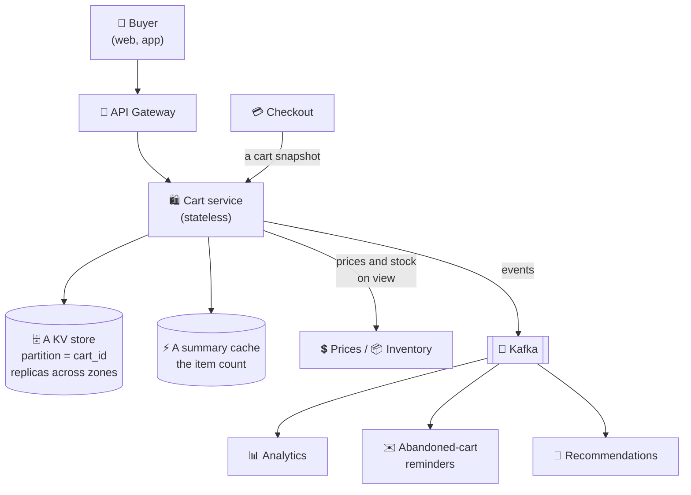
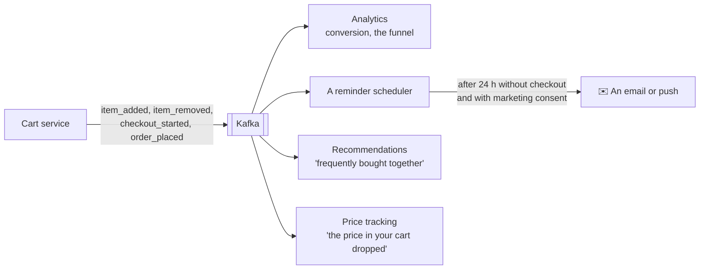

**English** | [Русский](README_RU.md)

# Tier 2 · 4D · 02. A Cart Service

> **Level:** Medium · **Interview time:** 45 min · **Study time:** ~3–4 h
> **Key aspects:** why availability beats consistency, the cart data model, concurrent changes from several tabs and devices, guest carts and merging on sign-in, syncing across devices, prices and stock in the cart, storage and scaling, events and abandoned carts, the boundary between the cart and checkout
> **Builds on:** [Tier 2 · 4D · 01 E-commerce](../01-ecommerce-platform/README.md#11-deep-dive-5-the-cart-and-checkout), [Tier 1 · 19 KV Store](../../../tier-1/19-distributed-kv-store/README.md#8-deep-dive-3-versions-and-conflicts), [Tier 2 · 4C · 07 Conflict-free Replication](../../4c-storage-databases/07-conflict-free-replication/README.md#8-deep-dive-3-a-catalog-of-crdts), [10-idempotency](../../../10-idempotency/README.md), [02-caching](../../../02-caching/README.md)

---

## 🗺️ How to Read This Walkthrough

The walkthrough follows an interview, but every step includes explanations: **why** a decision is made, **how** a mechanism works and **what happens** if you do it differently. The "📘 Explanation" blocks are theory right where you need it.

| Icon | Meaning |
|:----:|:--------|
| 🎤 | Interviewer |
| 🗣️ | What I (the candidate) say out loud |
| ✏️ | What I draw on the whiteboard |
| ⏱️ | Time budget for the step |
| 📘 | A detailed explanation of a concept |

Callouts: **TIP** — a good technique, **WARNING** — a trap, **IMPORTANT** — a Senior+ signal.

---

## 📑 Contents

0. [What This Problem Teaches](#0-what-this-problem-teaches)
1. [Problem Statement](#1-problem-statement)
2. [Clarifying Questions and Requirements](#2-clarifying-questions-and-requirements)
3. [Capacity Estimates](#3-capacity-estimates)
4. [API](#4-api)
5. [Data Model](#5-data-model)
6. [High-Level Design](#6-high-level-design)
7. [Deep Dive 1: Availability Over Consistency](#7-deep-dive-1-availability-over-consistency)
8. [Deep Dive 2: Concurrent Changes](#8-deep-dive-2-concurrent-changes)
9. [Deep Dive 3: The Guest Cart and Merging on Sign-In](#9-deep-dive-3-the-guest-cart-and-merging-on-sign-in)
10. [Deep Dive 4: Multiple Devices](#10-deep-dive-4-multiple-devices)
11. [Deep Dive 5: Prices, Stock and Staleness](#11-deep-dive-5-prices-stock-and-staleness)
12. [Deep Dive 6: Storage and Scaling](#12-deep-dive-6-storage-and-scaling)
13. [Deep Dive 7: Events and Abandoned Carts](#13-deep-dive-7-events-and-abandoned-carts)
14. [Deep Dive 8: The Boundary With Checkout](#14-deep-dive-8-the-boundary-with-checkout)
15. [Bottlenecks and Failure Scenarios](#15-bottlenecks-and-failure-scenarios)
16. [What Changes at 10x Scale](#16-what-changes-at-10x-scale)
17. [Key Concepts and New Terms](#17-key-concepts-and-new-terms)
18. [Variations and Follow-Up Questions](#18-variations-and-follow-up-questions)
19. [Common Mistakes](#19-common-mistakes)
20. [Cheat Sheet and Self-Check](#20-cheat-sheet-and-self-check)

---

## 0. What This Problem Teaches

A cart looks simple — a list of items with quantities. But it became the textbook example of distributed systems: Amazon's **Dynamo** paper explained the choice of "availability over consistency" using the cart. The problem tests whether you can **articulate which errors are acceptable and which aren't**, and design the data around that choice.

| What's tested | Where it shows up |
|:--------------|:------------------|
| A deliberate CAP choice | Writing to the cart must always work |
| Data modeling | A document or a row per item |
| Concurrent changes | Two tabs, two devices |
| Product merge logic | A guest cart + an account cart |
| Domain boundaries | What the cart does and doesn't do (reservations, prices) |
| Events | Analytics, abandoned-cart emails |

> [!TIP]
> Start with the question: "What's worse for the business — a lost add-to-cart, or an occasionally 'resurrected' removed item?" The answer (the former is worse) shapes the whole design.

---

## 1. Problem Statement

> 🎤 "Design the cart service for a large online store: adding and removing items, guest carts and signed-in carts, access from several devices. The cart must always work."

**Scenarios:**

```
A guest adds headphones → closes the browser → returns a week later — the headphones are in the cart
The guest signs in → the account already had a keyboard → the cart holds both the headphones and the keyboard
Anna adds an item from her phone → opens her laptop → the item is already in the cart
An item's price changed → the cart shows "price dropped from €349 to €329"
A database region is partially unavailable → "Add to cart" still works
```

**Time plan:**

| Step | ⏱️ |
|:-----|:--:|
| Requirements | 5 min |
| Estimates | 3 min |
| API and the model | 6 min |
| High-level design | 4 min |
| Deep dives | 22 min |
| Wrap-up | 5 min |

---

## 2. Clarifying Questions and Requirements

⏱️ 5 min

| My question | Interviewer's answer | What it changes and why |
|:------------|:---------------------|:------------------------|
| How many active carts? | ~100M | Hundreds of GB, sharding |
| Load? | The cart counter on every page → hundreds of thousands of reads/s; writes — tens of thousands/s | A cache for reads, a KV store for writes |
| Guests? | Yes, the cart is kept for 30 days | A guest identifier, a TTL |
| Merging on sign-in? | Yes | Merge rules |
| Availability? | Adding to the cart must never fail | An AP store |
| Reserve items in the cart? | No (except for special sales) | Stock is checked at checkout |
| Prices in the cart? | Current, with a note when they change | A price snapshot only for comparison |

### Functional requirements

1. Add, change quantity, remove an item; clear the cart.
2. View the cart with current prices and stock.
3. Guest and account carts, merging on sign-in.
4. Access from several devices.
5. "Save for later".
6. Events for analytics and reminders.

### Non-functional requirements

| Requirement | Target | Why |
|:------------|:-------|:----|
| Write availability | Maximal | A failed "add to cart" = a lost sale |
| Latency | p99 < 50 ms | An interaction on every page |
| Durability | What was added isn't lost | Users trust the cart |
| Cross-device consistency | Seconds | A small delay is acceptable |
| Retention | Guests — 30 days, accounts — longer | Returning users |

---

## 3. Capacity Estimates

⏱️ 3 min

```
Carts:           100M active × ~2 KB (an average of ~5 items + metadata) ≈ 200 GB
Reads:           the cart counter in every page header → up to ~200,000/s at peak
Writes:          ~20,000/s at peak (additions, changes)
Sales:           ×10 writes in the first minutes
```

### Conclusions

| Conclusion | Design consequence |
|:-----------|:-------------------|
| There isn't much data | Any distributed KV store handles the volume |
| Reads dominate | A cache for the cart summary (the item count) |
| Writes must be available above all | An AP store with replication |

---

## 4. API

⏱️ 2 min

```http
GET    /v1/cart                         → items + current prices and stock + a version
GET    /v1/cart/summary                 → { item_count: 3 }   ← for the site header, from a cache
POST   /v1/cart/items                   Idempotency-Key: …   { sku, quantity: 1 }       ← "add"
PUT    /v1/cart/items/{sku}             { quantity: 3 }                                ← "set quantity"
DELETE /v1/cart/items/{sku}
POST   /v1/cart/items/{sku}/save-for-later
(merging the guest cart — automatic on sign-in)
```

📘 **"Add" and "set quantity" are different operations.** "Add" is `+1` (a commutative operation), while "set to 3" replaces the value. The difference matters under concurrent changes (deep dive 2).

---

## 5. Data Model

⏱️ 4 min

### A document or rows

| Option | How | Pros | Cons |
|:-------|:----|:-----|:-----|
| **A document per cart** | `cart_id → { items: {...}, version }` | One read | Concurrent changes to different items conflict at the document level |
| **A row per item** ⭐ | `(cart_id, sku) → { qty, added_at, price_seen, seller }` | Changes to different items are independent; reading the cart is one partition | Summary counts are slightly more involved |

```
The partition key: cart_id  (= user_id for an account or guest_id for a guest)
The sort key:      sku
Attributes:        quantity, added_at, price_seen (the price when added),
                   seller_id, saved_for_later (bool), updated_at
Cart metadata (a separate row): owner_type, merged_from, version, ttl
```

📘 The "row per item" model within one partition is the "wide row" from [wide-column](../../4c-storage-databases/04-wide-column-db/README.md#4-the-wide-column-data-model): the whole cart is read in one query, while changes to different items don't interfere.

---

## 6. High-Level Design

⏱️ 4 min



🗣️ "A stateless cart service writes to **an AP store** partitioned by `cart_id` with replicas in several zones. The summary (the item count) lives in a cache, because it's shown on every page. Prices and stock **aren't stored** in the cart as truth — they're fetched on view. Cart changes are published as events for analytics and reminders. Checkout takes **a snapshot** of the cart."

---

## 7. Deep Dive 1: Availability Over Consistency

> 🎤 "Why is the cart AP rather than CP?"

📘 In the Dynamo paper, Amazon stated that a customer must be able to add an item to the cart **even when disks, networks and data centers fail**. A failed write is a direct lost sale, while small cart inconsistencies can be fixed.

| Error | Consequences | Acceptable? |
|:------|:-------------|:------------|
| "Add to cart" returned an error | The buyer left | ❌ No |
| An added item disappeared | The buyer didn't buy; trust is undermined | ❌ No |
| A removed item "came back" after a merge | The buyer removes it again; they'll see it at checkout | ⚠️ Acceptable |
| A change shows on a second device 2 seconds later | Unnoticeable | ✅ Yes |

### Store settings

| Decision | Why |
|:---------|:----|
| Replicas in 3 zones | A zone failure doesn't stop writes |
| Writes acknowledged by a quorum, or a "sloppy quorum" | Availability during node failures (see [Tier 1 · 19](../../../tier-1/19-distributed-kv-store/README.md#9-deep-dive-4-temporary-failures--sloppy-quorums-and-hinted-handoff)) |
| Quorum reads for your own cart | Usually fresh; on divergence — a merge |
| Managed options | DynamoDB (Amazon uses it for carts too), Cassandra with LOCAL_QUORUM |

> [!IMPORTANT]
> **Senior+ signal:** frame the choice in terms of **the business consequences of errors**, not abstract CAP: losing an addition is unacceptable, while a "resurrected" item is tolerable, so we choose availability and add-wins semantics.

---

## 8. Deep Dive 2: Concurrent Changes

> 🎤 "A user opened two tabs and changes the cart in both at once. What happens?"

### Different items — no conflicts

📘 With the "row per item" model, tab A adds headphones and tab B adds a keyboard: these are **different keys** `(cart_id, sku)`, so there's no conflict at all.

### The same item

| Operation | Semantics under concurrency | Implementation |
|:----------|:----------------------------|:---------------|
| "Add +1" in two tabs | Expected: +2 | A counter (an increment), not an overwrite |
| "Set to 2" and "set to 3" | The latest intent wins | LWW by time, or a conditional write with a version |
| Removed in one tab, added in another | Add-wins: the item stays | OR-Set semantics (see [4C · 07](../../4c-storage-databases/07-conflict-free-replication/README.md#8-deep-dive-3-a-catalog-of-crdts)) |

### A conditional write with a version

```
Read:   sku=X, quantity=2, version=7
Write:  UPDATE quantity=3 WHERE version=7  → OK, version=8
A concurrent write with version=7 → rejected → the client rereads and retries
```

📘 **Optimistic locking** works when the store offers conditional writes within one region (DynamoDB conditional writes). For multi-region writes in any region — a CRDT approach: quantity as a counter, the item's presence as an OR-Set.

### "Resurrecting" a removed item

📘 The Dynamo paper described this effect directly: when merging conflicting versions of Amazon's cart, removed items would sometimes reappear — because adding matters more. It's a deliberate trade-off, not a bug.

---

## 9. Deep Dive 3: The Guest Cart and Merging on Sign-In

> 🎤 "A guest filled a cart, then signed in to an account that already had its own cart. What do you do?"

### The guest cart

| Decision | Why |
|:---------|:----|
| **A random guest_id in a signed cookie** | Identifies a guest without an account; the signature protects against guessing other people's carts |
| The cart is stored **on the server** by guest_id | Survives closing the browser; available to services (analytics) |
| A 30-day TTL, extended on activity | Abandoned guest carts delete themselves |
| An alternative: localStorage only | Cheap, but the cart isn't on the server and is lost when the browser is cleared |

### Merge rules

```
The guest cart:       headphones ×1, cable ×2
The account cart:     keyboard ×1, cable ×1

The union:            headphones ×1, keyboard ×1, cable — ?
```

| Rule for a shared item | The result for the cable | When it fits |
|:-----------------------|:-------------------------|:-------------|
| **Maximum** | 2 | Usually the best choice: the user most likely wanted 2, not 3 |
| Sum | 3 | If items "accumulate" (groceries) |
| The guest cart wins | 2 | The user's latest intent |
| The account cart wins | 1 | Rarely |

| Merge requirement | Solution |
|:------------------|:---------|
| **Idempotency** | A `merged_from = guest_id` marker; signing in again with the same cookie doesn't merge twice |
| Atomicity | The merge is one conditional write (or a batch) into the account cart |
| Cleanup | After the merge, the guest cart is deleted and the cookie is reset |
| Limits | The quantity doesn't exceed the per-item limit |

---

## 10. Deep Dive 4: Multiple Devices

> 🎤 "Anna added an item from her phone. How does it show up on her laptop?"

| Mechanism | How |
|:----------|:----|
| The account cart lives on the server | Every device reads the same cart |
| Refreshing on open and on tab focus | Simple and sufficient in most cases |
| A change push (optional) | Over the app's WebSocket/SSE channel: "the cart changed" → reread |
| An optimistic UI | The change shows immediately and the request runs in the background; on error — a rollback |
| Offline in the mobile app | A queue of operations with idempotency keys, sent when the network returns |

📘 A delay of seconds between devices is unnoticeable to the user — so eventual consistency plus rereading on open is enough.

---

## 11. Deep Dive 5: Prices, Stock and Staleness

> 🎤 "An item has been in the cart for a week. Its price changed and it went out of stock. What do you show?"

| Data | Where it comes from | Why |
|:-----|:--------------------|:----|
| Price | **The pricing service on every view** | The cart keeps only `price_seen`, for a "price changed" note |
| Stock | The inventory service on view (a hint) | Reservation happens only at checkout |
| The item was discontinued | Marked "unavailable" and excluded from checkout | Don't silently remove it — the user should understand |
| The seller changed (the buy box) | Show the current best offer | The cart stores the SKU; the offer is chosen at checkout |

### Why not reserve items in the cart

📘 Most carts are **abandoned**. If items were reserved on add, abandoned carts would lock up stock, and the item would appear "sold out" to people ready to buy. So reservation happens **at checkout**, with a short TTL (see [4D · 01](../01-ecommerce-platform/README.md#11-deep-dive-5-the-cart-and-checkout)).

| Exception | Solution |
|:----------|:---------|
| A flash sale with limited quantity | A reservation for a few minutes on add ("this item is held for you for 10 minutes") |
| Tickets, time slots | A hold, as in [Tier 1 · 13](../../../tier-1/13-ticketmaster/README.md) |

### Limits

- A maximum quantity of one item (protection against scalpers and mistakes).
- A maximum number of items in the cart.
- Checking that the item can ship to the user's region.

---

## 12. Deep Dive 6: Storage and Scaling

| Decision | Why |
|:---------|:----|
| Partitioning by `cart_id` | The cart is read in one query; load spreads across users |
| A summary cache (the item count) | Hundreds of thousands of reads per second for the site header; invalidated on writes |
| A TTL on guest carts | Automatic cleanup |
| Archiving old account carts | Carts unchanged for a year — moved to cheap storage or deleted per policy |
| **The cart's region** | A user's cart lives in their home region (see [profiles](../../4b-social-media/04-global-profile-service/README.md#7-deep-dive-1-where-a-users-data-lives)); while traveling — writes via the home region, or a CRDT model for writes in any region |

📘 **There are almost no hot keys**: carts belong to different users. A sales peak means many writes to **different** partitions, which scales horizontally well.

---

## 13. Deep Dive 7: Events and Abandoned Carts

> 🎤 "Marketing wants abandoned-cart reminders. How do you do it?"



| Decision | Why |
|:---------|:----|
| Events via the outbox | Not lost on failures |
| A per-cart timer: "if there's no checkout within 24 h — remind" | Cancelled by the `order_placed` event |
| Idempotent sending | One reminder per cart per period |
| Marketing consent and frequency caps | The law and respect for the user |

---

## 14. Deep Dive 8: The Boundary With Checkout

> 🎤 "A user is checking out while adding another item in a different tab. What ends up in the order?"

| Step | Decision |
|:-----|:---------|
| Starting checkout | Checkout takes **a snapshot** of the cart with its version |
| The cart changed during checkout | The quote is tied to the version → on confirmation the version doesn't match → recompute the quote and show it to the user |
| The order is placed | **Only the purchased items** are removed from the cart (per the snapshot), conditionally and idempotently by `order_id` |
| An item added during checkout | Stays in the cart |
| Checkout didn't complete | The cart doesn't change |

```
The snapshot for order A-1042: {headphones ×1 @ v12}
A cable was added during payment → the cart is now v13
After the order: remove the headphones (from the snapshot) → the cable stays in the cart ✅
```

> [!WARNING]
> A mistake: "clear the whole cart" after an order — the items the user added during checkout are lost. Remove only what went into the order.

---

## 15. Bottlenecks and Failure Scenarios

| Scenario | What happens | How we protect |
|:---------|:-------------|:---------------|
| A storage zone fails | Writes are unavailable | Replicas in 3 zones, an AP store |
| Two tabs change the cart | A lost change | A row per item, counters, conditional writes |
| A removed item "came back" | An inconvenience | A deliberate add-wins trade-off |
| Signing in again merges the cart twice | Doubled quantities | `merged_from`, an idempotent merge |
| A double click on "Add" | Quantity +2 | An Idempotency-Key |
| The price changed | An unexpected total | The price on view, a note, a quote at checkout |
| Reserving in the cart | Abandoned carts lock up stock | Reservation at checkout |
| Clearing the cart after an order | Losing new items | Removing only purchased items |
| A flood of summary reads | Load on the store | A summary cache |
| Guessing someone else's guest cart | A leak | A random identifier, a signed cookie |

---

## 16. What Changes at 10x Scale

> 🎤 "A billion carts?"

| Change | Why |
|:-------|:----|
| **Multi-region** with a CRDT cart model | Writes in any region |
| **More aggressive cleanup** of old carts | Volume |
| **Personalizing the cart** (recommendations right inside it) | A separate service, a cache |
| **Client-side storage for guests** with syncing | Less server-side data |

---

## 17. Key Concepts and New Terms

### What's applied

| Concept | Where it's covered | How it applies here |
|:--------|:-------------------|:--------------------|
| The cart and checkout | [Tier 2 · 4D · 01](../01-ecommerce-platform/README.md) | The cart's place in the platform |
| Dynamo, quorums, conflicts | [Tier 1 · 19](../../../tier-1/19-distributed-kv-store/README.md) | An AP store |
| OR-Sets, counters | [Tier 2 · 4C · 07](../../4c-storage-databases/07-conflict-free-replication/README.md) | Concurrent changes |
| Idempotency | [10-idempotency](../../../10-idempotency/README.md) | Adding and merging |
| Caching | [02-caching](../../../02-caching/README.md) | The cart summary |

### New terms in this problem

| Term | In short |
|:-----|:---------|
| **"Add" versus "set"** | A commutative increment versus replacing a value |
| **A row per item** | Independent changes to different items |
| **A guest identifier** | A random ID in a signed cookie |
| **A merge rule** | Maximum, sum, or one cart taking priority |
| **price_seen** | The price when added — for a change note |
| **A cart snapshot** | The cart version an order is based on |
| **An abandoned cart** | A cart without a checkout over a period |

---

## 18. Variations and Follow-Up Questions

<details>
<summary><b>Why not store the cart in Redis?</b></summary>

Redis works as a cache, or for fast carts with replication, but a cart must survive failures and be kept for weeks; losing data when a Redis node with async replication fails is unacceptable. A durable KV store (DynamoDB, Cassandra) + a summary cache is a safer combination.
</details>

<details>
<summary><b>How do you build a shared cart for a family or a team?</b></summary>

A cart with several owners and permissions (who can add and who can check out); concurrent changes from different people use the same "row per item" model with add-wins; each item records who added it.
</details>

<details>
<summary><b>How do you apply a promo code in the cart?</b></summary>

The cart stores the entered code; the promotions service computes its applicability and the discount on every view (like the price). Finally — in the quote at checkout; the usage limit is consumed only when the order is placed.
</details>

<details>
<summary><b>What if the pricing service is unavailable when viewing the cart?</b></summary>

Show the cart with the last known prices (`price_seen` or a cache) marked "prices are being updated"; don't continue checkout without a current quote. The cart itself stays available for changes.
</details>

<details>
<summary><b>How do you implement "buy now" without the cart?</b></summary>

A separate checkout path with a temporary one-item cart (or a quote directly by SKU) that doesn't touch the user's main cart.
</details>

---

## 19. Common Mistakes

| ❌ Mistake | Why it's bad | ✅ Do this instead |
|:----------|:-------------|:------------------|
| Strong consistency for the cart at the cost of availability | "Add" fails during outages | An AP store |
| A document per cart, overwritten whole | Losing concurrent changes | A row per item |
| "Add" as overwriting the quantity | Two tabs give +1 instead of +2 | An increment |
| Reserving items on add | Abandoned carts lock up stock | Reservation at checkout |
| Storing the price as truth | Checking out at a stale price | The price from the pricing service, a quote |
| A merge without idempotency | Doubled quantities | `merged_from` |
| Summing quantities on merge by default | An unexpected 3 instead of 2 | Maximum (usually) |
| Clearing the whole cart after an order | Losing new items | Removing purchased items per the snapshot |
| A predictable guest_id | Access to other people's carts | A random ID, a signature |
| Reading the cart summary from the store on every page | Unnecessary load | A cache |

---

## 20. Cheat Sheet and Self-Check

### 30-second answer

> The cart is AP: losing an addition is unacceptable, while a "resurrected" removed item is tolerable (as in Dynamo). Storage — a KV store partitioned by cart_id with a row per item (cart_id, sku), replicas in 3 zones; the summary (the item count) is cached. "Add" is an increment (two tabs → +2), "set quantity" is LWW or a conditional write with a version, and a concurrent remove and add means add-wins; in multi-region — CRDTs (a counter + an OR-Set). A guest gets a random guest_id in a signed cookie, with the cart on the server and a 30-day TTL; on sign-in — an idempotent merge (merged_from), with the maximum quantity for a shared item. Prices and stock come from services on view; the cart keeps only price_seen for a note; reservation happens not in the cart but at checkout (except flash sales). Checkout takes a snapshot with a version; a cart change requires a new quote; after the order only the purchased items are removed. Events via the outbox — analytics, abandoned-cart reminders with a timer and consent.

### Self-check

- [ ] I can justify AP through the consequences of errors
- [ ] I can compare a document with a row per item
- [ ] I can explain the difference between "add" and "set" under concurrency
- [ ] I can describe the guest cart and how it's protected
- [ ] I can propose merge rules and make the merge idempotent
- [ ] I can explain syncing across devices
- [ ] I can explain why items aren't reserved in the cart
- [ ] I can design events and abandoned-cart reminders
- [ ] I can describe the boundary between the cart and checkout

### Further reading

- DeCandia et al., *Dynamo: Amazon's Highly Available Key-value Store* (SOSP 2007) — the cart example
- Amazon DynamoDB documentation: conditional writes, TTL
- The [Tier 2 · 4D · 01](../01-ecommerce-platform/README.md) and [Tier 2 · 4C · 07](../../4c-storage-databases/07-conflict-free-replication/README.md) walkthroughs
