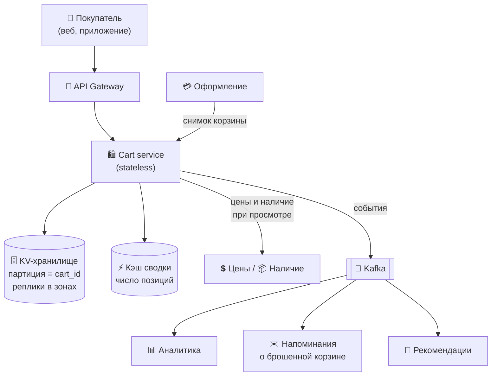
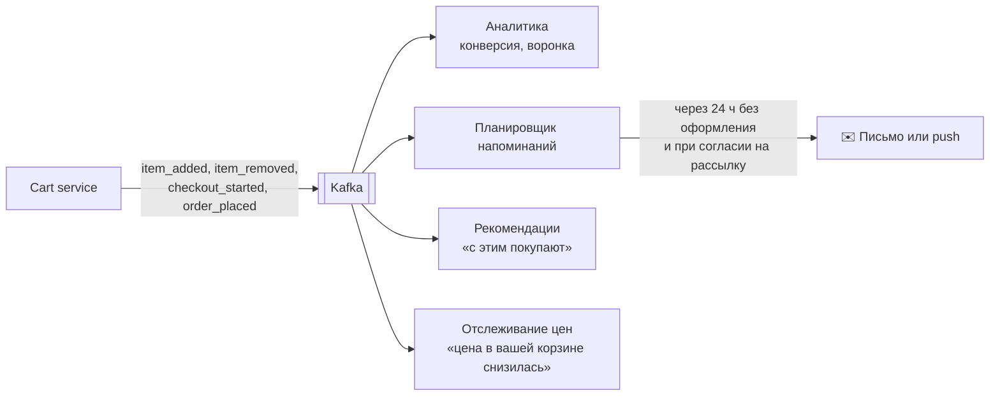

[English](README.md) | **Русский**

# Tier 2 · 4D · 02. Сервис корзины

> **Уровень:** Medium · **Время на интервью:** 45 мин · **Время на разбор:** ~3–4 ч
> **Ключевые аспекты:** почему доступность важнее консистентности, модель данных корзины, одновременные изменения с нескольких вкладок и устройств, гостевые корзины и слияние при входе, синхронизация между устройствами, цены и наличие в корзине, хранение и масштабирование, события и брошенные корзины, граница корзины и оформления заказа
> **Опирается на:** [Tier 2 · 4D · 01 E-commerce](../01-ecommerce-platform/README_RU.md#11-deep-dive-5-корзина-и-оформление-заказа), [Tier 1 · 19 KV Store](../../../tier-1/19-distributed-kv-store/README_RU.md#8-deep-dive-3-версии-и-конфликты), [Tier 2 · 4C · 07 Conflict-free Replication](../../4c-storage-databases/07-conflict-free-replication/README_RU.md#8-deep-dive-3-каталог-crdt), [10-idempotency](../../../10-idempotency/README_RU.md), [02-caching](../../../02-caching/README_RU.md)

---

## 🗺️ Как читать этот разбор

Разбор построен как интервью, но в каждом шаге есть объяснения: **почему** принимается решение, **как работает** механизм и **что будет**, если сделать иначе. Блоки «📘 Объяснение» — теория прямо по ходу задачи.

| Значок | Что значит |
|:------:|:-----------|
| 🎤 | Реплика интервьюера |
| 🗣️ | Что говорю вслух я (кандидат) |
| ✏️ | Что рисую на доске |
| ⏱️ | Сколько времени тратить на шаг |
| 📘 | Подробное объяснение концепции |

Блоки **TIP** — хороший приём, **WARNING** — ловушка, **IMPORTANT** — сигнал для уровня Senior+.

---

## 📑 Содержание

0. [Чему учит эта задача](#0-чему-учит-эта-задача)
1. [Условие задачи](#1-условие-задачи)
2. [Уточняющие вопросы и требования](#2-уточняющие-вопросы-и-требования)
3. [Оценки нагрузки](#3-оценки-нагрузки)
4. [API](#4-api)
5. [Модель данных](#5-модель-данных)
6. [High-level дизайн](#6-high-level-дизайн)
7. [Deep dive 1: доступность важнее консистентности](#7-deep-dive-1-доступность-важнее-консистентности)
8. [Deep dive 2: одновременные изменения](#8-deep-dive-2-одновременные-изменения)
9. [Deep dive 3: гостевая корзина и слияние при входе](#9-deep-dive-3-гостевая-корзина-и-слияние-при-входе)
10. [Deep dive 4: несколько устройств](#10-deep-dive-4-несколько-устройств)
11. [Deep dive 5: цены, наличие и устаревание](#11-deep-dive-5-цены-наличие-и-устаревание)
12. [Deep dive 6: хранение и масштабирование](#12-deep-dive-6-хранение-и-масштабирование)
13. [Deep dive 7: события и брошенные корзины](#13-deep-dive-7-события-и-брошенные-корзины)
14. [Deep dive 8: граница с оформлением заказа](#14-deep-dive-8-граница-с-оформлением-заказа)
15. [Узкие места и сценарии сбоев](#15-узкие-места-и-сценарии-сбоев)
16. [Что изменится при росте в 10 раз](#16-что-изменится-при-росте-в-10-раз)
17. [Ключевые концепции и новые понятия](#17-ключевые-концепции-и-новые-понятия)
18. [Варианты задачи и follow-up вопросы](#18-варианты-задачи-и-follow-up-вопросы)
19. [Типичные ошибки](#19-типичные-ошибки)
20. [Шпаргалка и самопроверка](#20-шпаргалка-и-самопроверка)

---

## 0. Чему учит эта задача

Корзина выглядит простой — список товаров с количествами. Но именно она стала учебным примером распределённых систем: статья Amazon о **Dynamo** объясняла выбор «доступность важнее консистентности» на примере корзины. Задача проверяет, умеешь ли ты **сформулировать, какие ошибки допустимы, а какие нет**, и спроектировать данные под этот выбор.

| Что проверяют | Где это в задаче |
|:--------------|:-----------------|
| Осознанный выбор в CAP | Запись в корзину всегда должна работать |
| Моделирование данных | Документ или строки на позицию |
| Одновременные изменения | Две вкладки, два устройства |
| Продуктовая логика слияния | Гостевая корзина + корзина аккаунта |
| Границы доменов | Что корзина делает и чего не делает (резерв, цена) |
| События | Аналитика, письма о брошенной корзине |

> [!TIP]
> Начни с вопроса: «Что хуже для бизнеса — потерянное добавление в корзину или иногда “воскресший” удалённый товар?». Ответ (первое хуже) определяет весь дизайн.

---

## 1. Условие задачи

> 🎤 «Спроектируй сервис корзины для крупного интернет-магазина: добавление и удаление товаров, корзины гостей и авторизованных пользователей, доступ с нескольких устройств. Корзина должна работать всегда».

**Сценарии:**

```
Гость добавляет наушники → закрывает браузер → через неделю возвращается — наушники в корзине
Гость входит в аккаунт → в аккаунте уже была клавиатура → в корзине и наушники, и клавиатура
Анна добавляет товар с телефона → открывает ноутбук → товар уже в корзине
Цена товара изменилась → в корзине пометка «цена снизилась с 349 € до 329 €»
Регион базы данных частично недоступен → «Добавить в корзину» всё равно работает
```

**План по времени:**

| Шаг | ⏱️ |
|:----|:--:|
| Требования | 5 мин |
| Оценки | 3 мин |
| API и модель | 6 мин |
| High-level дизайн | 4 мин |
| Deep dives | 22 мин |
| Итоги | 5 мин |

---

## 2. Уточняющие вопросы и требования

⏱️ 5 мин

| Мой вопрос | Ответ интервьюера | Что это меняет и почему |
|:-----------|:------------------|:------------------------|
| Сколько активных корзин? | ~100M | Сотни ГБ, шардирование |
| Нагрузка? | Счётчик корзины на каждой странице → сотни тысяч чтений/с; записей — десятки тысяч/с | Кэш для чтения, KV для записи |
| Гости? | Да, корзина хранится 30 дней | Гостевой идентификатор, TTL |
| Слияние при входе? | Да | Правила слияния |
| Доступность? | Добавление в корзину не должно отказывать | AP-хранилище |
| Резервировать товар в корзине? | Нет (кроме особых распродаж) | Наличие проверяется при оформлении |
| Цена в корзине? | Актуальная, с пометкой об изменении | Снимок цены только для сравнения |

### Функциональные требования

1. Добавить, изменить количество, удалить товар; очистить корзину.
2. Просмотр корзины с актуальными ценами и наличием.
3. Корзина гостя и аккаунта, слияние при входе.
4. Доступ с нескольких устройств.
5. «Отложить на потом» (saved for later).
6. События для аналитики и напоминаний.

### Нефункциональные требования

| Требование | Цель | Почему |
|:-----------|:-----|:-------|
| Доступность записи | Максимальная | Отказ «добавить в корзину» = потерянная продажа |
| Задержка | p99 < 50 мс | Взаимодействие на каждой странице |
| Сохранность | Добавленное не теряется | Пользователь доверяет корзине |
| Консистентность между устройствами | Секунды | Допустима небольшая задержка |
| Срок хранения | Гость — 30 дней, аккаунт — дольше | Возврат пользователей |

---

## 3. Оценки нагрузки

⏱️ 3 мин

```
Корзины:          100M активных × ~2 КБ (в среднем ~5 позиций + метаданные) ≈ 200 ГБ
Чтения:           счётчик корзины в шапке каждой страницы → до ~200 000/с в пик
Записи:           ~20 000/с в пик (добавления, изменения)
Распродажи:       ×10 к записям в первые минуты
```

### Выводы

| Вывод | Следствие для дизайна |
|:------|:----------------------|
| Данных немного | Любое распределённое KV справится по объёму |
| Чтения доминируют | Кэш сводки корзины (число позиций) |
| Записи важнее всего доступны | AP-хранилище с репликацией |

---

## 4. API

⏱️ 2 мин

```http
GET    /v1/cart                         → позиции + актуальные цены и наличие + версия
GET    /v1/cart/summary                 → { item_count: 3 }   ← для шапки сайта, из кэша
POST   /v1/cart/items                   Idempotency-Key: …   { sku, quantity: 1 }       ← «добавить»
PUT    /v1/cart/items/{sku}             { quantity: 3 }                                ← «установить количество»
DELETE /v1/cart/items/{sku}
POST   /v1/cart/items/{sku}/save-for-later
(слияние гостевой корзины — автоматически при входе)
```

📘 **«Добавить» и «установить количество» — разные операции.** «Добавить» — это `+1` (коммутативная операция), а «установить 3» — замена значения. Это различие важно при одновременных изменениях (deep dive 2).

---

## 5. Модель данных

⏱️ 4 мин

### Документ или строки

| Вариант | Как | Плюсы | Минусы |
|:--------|:----|:------|:-------|
| **Документ на корзину** | `cart_id → { items: {...}, version }` | Одно чтение | Одновременные изменения разных позиций конфликтуют на уровне документа |
| **Строка на позицию** ⭐ | `(cart_id, sku) → { qty, added_at, price_seen, seller }` | Изменения разных позиций независимы; чтение корзины — одна партиция | Чуть сложнее счётчики сводки |

```
Ключ партиции:   cart_id  (= user_id для аккаунта или guest_id для гостя)
Ключ сортировки: sku
Атрибуты:        quantity, added_at, price_seen (цена на момент добавления),
                 seller_id, saved_for_later (bool), updated_at
Метаданные корзины (отдельная строка): owner_type, merged_from, version, ttl
```

📘 Модель «строка на позицию» в одной партиции — это «широкая строка» из [wide-column](../../4c-storage-databases/04-wide-column-db/README_RU.md#4-модель-данных-wide-column): вся корзина читается одним запросом, а изменения разных товаров не мешают друг другу.

---

## 6. High-level дизайн

⏱️ 4 мин



🗣️ «Stateless-сервис корзины пишет в **AP-хранилище** с партицией по `cart_id` и репликами в нескольких зонах. Сводка (число позиций) — в кэше, потому что её показывают на каждой странице. Цены и наличие **не хранятся** в корзине как истина — они подтягиваются при просмотре. Изменения корзины публикуются событиями для аналитики и напоминаний. Оформление заказа берёт **снимок** корзины».

---

## 7. Deep dive 1: доступность важнее консистентности

> 🎤 «Почему корзина — AP, а не CP?»

📘 В статье о Dynamo Amazon сформулировал: клиент должен иметь возможность добавить товар в корзину **даже при отказах дисков, сетей и дата-центров**. Отказ записи — прямая потеря продажи, а небольшие несогласованности корзины можно исправить.

| Ошибка | Последствия | Допустимо? |
|:-------|:------------|:-----------|
| «Добавить в корзину» вернуло ошибку | Покупатель ушёл | ❌ Нет |
| Добавленный товар исчез | Покупатель не купил, доверие подорвано | ❌ Нет |
| Удалённый товар «вернулся» после слияния | Покупатель удалит ещё раз; при оформлении увидит его | ⚠️ Допустимо |
| На втором устройстве изменение видно через 2 секунды | Незаметно | ✅ Да |

### Настройки хранилища

| Решение | Почему |
|:--------|:-------|
| Реплики в 3 зонах | Отказ зоны не останавливает запись |
| Запись с подтверждением кворума или «sloppy quorum» | Доступность при отказах узлов (см. [Tier 1 · 19](../../../tier-1/19-distributed-kv-store/README_RU.md#9-deep-dive-4-временные-отказы--sloppy-quorum-и-hinted-handoff)) |
| Чтение по кворуму для своей корзины | Обычно свежо; при расхождении — слияние |
| Управляемые варианты | DynamoDB (Amazon использует его и для корзин), Cassandra с LOCAL_QUORUM |

> [!IMPORTANT]
> **Сигнал Senior+:** сформулировать выбор через **последствия ошибок для бизнеса**, а не через абстрактный CAP: потерять добавление недопустимо, а «воскресший» товар — терпимо, поэтому выбираем доступность и семантику add-wins.

---

## 8. Deep dive 2: одновременные изменения

> 🎤 «Пользователь открыл две вкладки и одновременно меняет корзину. Что произойдёт?»

### Разные товары — без конфликтов

📘 При модели «строка на позицию» вкладка A добавляет наушники, вкладка B — клавиатуру: это **разные ключи** `(cart_id, sku)`, конфликта нет вообще.

### Один товар

| Операция | Семантика при одновременности | Реализация |
|:---------|:------------------------------|:-----------|
| «Добавить +1» в двух вкладках | Ожидаемо: +2 | Счётчик (инкремент), а не перезапись |
| «Установить 2» и «установить 3» | Побеждает последнее намерение | LWW по времени или условная запись с версией |
| Удалить в одной вкладке, добавить в другой | Add-wins: товар остаётся | OR-Set-семантика (см. [4C · 07](../../4c-storage-databases/07-conflict-free-replication/README_RU.md#8-deep-dive-3-каталог-crdt)) |

### Условная запись с версией

```
Чтение:  sku=X, quantity=2, version=7
Запись:  UPDATE quantity=3 WHERE version=7  → OK, version=8
Параллельная запись с version=7 → отклонена → клиент перечитывает и повторяет
```

📘 **Оптимистичная блокировка** подходит, когда хранилище в одном регионе даёт условные записи (DynamoDB conditional writes). В мульти-регионе с записью в любой регион — CRDT-подход: количество как счётчик, наличие позиции как OR-Set.

### «Воскрешение» удалённого

📘 Статья о Dynamo прямо описывала этот эффект: при слиянии конфликтующих версий корзины Amazon удалённые товары иногда появлялись снова — так как добавление важнее. Это осознанный компромисс, а не ошибка.

---

## 9. Deep dive 3: гостевая корзина и слияние при входе

> 🎤 «Гость набрал корзину, потом вошёл в аккаунт, где уже была своя корзина. Что делать?»

### Гостевая корзина

| Решение | Почему |
|:--------|:-------|
| **Случайный guest_id в подписанной cookie** | Идентифицирует гостя без аккаунта; подпись — защита от подбора чужих корзин |
| Корзина хранится **на сервере** по guest_id | Переживает закрытие браузера; доступна сервисам (аналитика) |
| TTL 30 дней, продлевается при активности | Брошенные гостевые корзины удаляются сами |
| Альтернатива: только localStorage | Дёшево, но корзина не на сервере и потеряется при очистке браузера |

### Правила слияния

```
Гостевая корзина:     наушники ×1, кабель ×2
Корзина аккаунта:     клавиатура ×1, кабель ×1

Объединение:          наушники ×1, клавиатура ×1, кабель — ?
```

| Правило для общего товара | Результат для кабеля | Когда подходит |
|:--------------------------|:---------------------|:---------------|
| **Максимум** | 2 | Обычно лучший выбор: пользователь, скорее всего, хотел 2, а не 3 |
| Сумма | 3 | Если товары «накопительные» (продукты) |
| Гостевая побеждает | 2 | Последнее намерение пользователя |
| Аккаунт побеждает | 1 | Редко |

| Требование к слиянию | Решение |
|:---------------------|:--------|
| **Идемпотентность** | Отметка `merged_from = guest_id`; повторный вход с той же cookie не сливает повторно |
| Атомарность | Слияние — одна условная запись (или пакет) в корзину аккаунта |
| Уборка | После слияния гостевая корзина удаляется, cookie сбрасывается |
| Ограничения | Количество не превышает лимит на товар |

---

## 10. Deep dive 4: несколько устройств

> 🎤 «Анна добавила товар с телефона. Как он появится на ноутбуке?»

| Механизм | Как |
|:---------|:----|
| Корзина аккаунта — на сервере | Любое устройство читает одну корзину |
| Обновление при открытии и фокусе вкладки | Простое и достаточное в большинстве случаев |
| Push-уведомление об изменении (опционально) | По каналу WebSocket/SSE приложения: «корзина изменилась» → перечитать |
| Оптимистичный интерфейс | Изменение видно сразу, запрос — в фоне; при ошибке — откат |
| Офлайн в мобильном приложении | Очередь операций с ключами идемпотентности, отправка при появлении сети |

📘 Задержка в секунды между устройствами незаметна пользователю — поэтому достаточно eventual consistency и перечитывания при открытии.

---

## 11. Deep dive 5: цены, наличие и устаревание

> 🎤 «Товар лежит в корзине неделю. Цена изменилась, товар закончился. Что показывать?»

| Данные | Где берутся | Почему |
|:-------|:------------|:-------|
| Цена | **Сервис цен при каждом просмотре** | В корзине — только `price_seen` для пометки «цена изменилась» |
| Наличие | Сервис наличия при просмотре (подсказка) | Резерв — только при оформлении |
| Товар снят с продажи | Пометка «недоступен», не участвует в оформлении | Не удалять молча — пользователь должен понять |
| Изменился продавец (buy box) | Показать текущее лучшее предложение | Корзина хранит SKU, предложение выбирается при оформлении |

### Почему не резервировать товар в корзине

📘 Большинство корзин **брошены**. Если резервировать товар при добавлении, брошенные корзины заблокируют остатки, и товар будет «закончившимся» для тех, кто готов купить. Поэтому резерв делается **при оформлении** с коротким TTL (см. [4D · 01](../01-ecommerce-platform/README_RU.md#11-deep-dive-5-корзина-и-оформление-заказа)).

| Исключение | Решение |
|:-----------|:--------|
| Флеш-распродажа с ограниченным количеством | Резерв на несколько минут при добавлении («товар закреплён за вами на 10 минут») |
| Билеты, слоты | Удержание как в [Tier 1 · 13](../../../tier-1/13-ticketmaster/README_RU.md) |

### Ограничения

- Максимальное количество одного товара (защита от перекупщиков и ошибок).
- Максимальное число позиций в корзине.
- Проверка, что товар можно отправить в регион пользователя.

---

## 12. Deep dive 6: хранение и масштабирование

| Решение | Почему |
|:--------|:-------|
| Партиция по `cart_id` | Корзина читается одним запросом; нагрузка распределена по пользователям |
| Кэш сводки (число позиций) | Сотни тысяч чтений в секунду для шапки сайта; инвалидация при записи |
| TTL на гостевые корзины | Автоматическая очистка |
| Архивирование старых корзин аккаунтов | Корзины, не менявшиеся год, — в дешёвое хранилище или удаление по политике |
| **Регион корзины** | Корзина пользователя живёт в его домашнем регионе (см. [профили](../../4b-social-media/04-global-profile-service/README_RU.md#7-deep-dive-1-где-живут-данные-пользователя)); при поездке — запись через домашний регион или CRDT-модель для записи в любом регионе |

📘 **Горячих ключей почти нет**: корзины принадлежат разным пользователям. Пик распродажи — это много записей в **разные** партиции, что хорошо масштабируется горизонтально.

---

## 13. Deep dive 7: события и брошенные корзины

> 🎤 «Маркетинг хочет напоминать о брошенных корзинах. Как это сделать?»



| Решение | Почему |
|:--------|:-------|
| События через outbox | Не теряются при сбоях |
| Таймер на корзину: «если через 24 ч не было оформления — напомнить» | Отменяется событием `order_placed` |
| Идемпотентность отправки | Одно напоминание на корзину за период |
| Согласие на рассылки и частотные лимиты | Законы и уважение к пользователю |

---

## 14. Deep dive 8: граница с оформлением заказа

> 🎤 «Пользователь оформляет заказ, а в другой вкладке добавляет ещё товар. Что попадёт в заказ?»

| Шаг | Решение |
|:----|:--------|
| Начало оформления | Оформление берёт **снимок** корзины с её версией |
| Корзина изменилась во время оформления | Котировка привязана к версии → при подтверждении версия не совпала → пересчитать котировку и показать пользователю |
| Заказ оформлен | Из корзины удаляются **только купленные позиции** (по снимку), условно и идемпотентно по `order_id` |
| Товар, добавленный во время оформления | Остаётся в корзине |
| Оформление не завершилось | Корзина не меняется |

```
Снимок для заказа A-1042: {наушники ×1 @ v12}
Во время оплаты добавлен кабель → корзина v13
После оформления: удалить наушники (из снимка) → в корзине остаётся кабель ✅
```

> [!WARNING]
> Ошибка — «очистить корзину целиком» после заказа: теряются товары, добавленные пользователем во время оформления. Удалять нужно только то, что вошло в заказ.

---

## 15. Узкие места и сценарии сбоев

| Сценарий | Что произойдёт | Как защищаемся |
|:---------|:---------------|:---------------|
| Отказ зоны хранилища | Записи недоступны | Реплики в 3 зонах, AP-хранилище |
| Две вкладки меняют корзину | Потеря изменения | Строка на позицию, счётчики, условные записи |
| Удалённый товар «вернулся» | Неудобство | Осознанный компромисс add-wins |
| Повторный вход сливает корзину дважды | Удвоение количеств | `merged_from`, идемпотентное слияние |
| Двойной клик «Добавить» | Количество +2 | Idempotency-Key |
| Цена изменилась | Неожиданный итог | Цена при просмотре, пометка, котировка при оформлении |
| Резерв в корзине | Брошенные корзины блокируют остатки | Резерв при оформлении |
| Очистка корзины после заказа | Потеря новых товаров | Удаление только купленных |
| Шквал чтений сводки | Нагрузка на хранилище | Кэш сводки |
| Подбор чужой гостевой корзины | Утечка | Случайный идентификатор, подпись cookie |

---

## 16. Что изменится при росте в 10 раз

> 🎤 «Миллиард корзин?»

| Изменение | Почему |
|:----------|:-------|
| **Мульти-регион** с CRDT-моделью корзины | Запись в любом регионе |
| **Агрессивная очистка** старых корзин | Объём |
| **Персонализация корзины** (рекомендации прямо в ней) | Отдельный сервис, кэш |
| **Клиентское хранение для гостей** с синхронизацией | Меньше серверных данных |

---

## 17. Ключевые концепции и новые понятия

### Что применяется

| Концепция | Где разобрана | Как применяется здесь |
|:----------|:--------------|:----------------------|
| Корзина и оформление | [Tier 2 · 4D · 01](../01-ecommerce-platform/README_RU.md) | Место корзины в платформе |
| Dynamo, кворумы, конфликты | [Tier 1 · 19](../../../tier-1/19-distributed-kv-store/README_RU.md) | AP-хранилище |
| OR-Set, счётчики | [Tier 2 · 4C · 07](../../4c-storage-databases/07-conflict-free-replication/README_RU.md) | Одновременные изменения |
| Идемпотентность | [10-idempotency](../../../10-idempotency/README_RU.md) | Добавление и слияние |
| Кэширование | [02-caching](../../../02-caching/README_RU.md) | Сводка корзины |

### Новые понятия этой задачи

| Понятие | Кратко |
|:--------|:-------|
| **«Добавить» против «установить»** | Коммутативный инкремент против замены значения |
| **Строка на позицию** | Независимые изменения разных товаров |
| **Гостевой идентификатор** | Случайный ID в подписанной cookie |
| **Правило слияния** | Максимум, сумма или приоритет одной корзины |
| **price_seen** | Цена на момент добавления — для пометки об изменении |
| **Снимок корзины** | Версия корзины, на которой основан заказ |
| **Брошенная корзина** | Корзина без оформления за период |

---

## 18. Варианты задачи и follow-up вопросы

<details>
<summary><b>Почему бы не хранить корзину в Redis?</b></summary>

Redis подходит как кэш или для быстрых корзин с репликацией, но корзина должна переживать отказы и храниться неделями; потеря данных при отказе узла Redis с асинхронной репликацией неприемлема. Надёжное KV-хранилище (DynamoDB, Cassandra) + кэш сводки — более безопасная комбинация.
</details>

<details>
<summary><b>Как сделать общую корзину для семьи или команды?</b></summary>

Корзина с несколькими владельцами и правами (кто может добавлять и оформлять); одновременные изменения от разных людей — та же модель «строка на позицию» с add-wins; в позиции хранится, кто добавил.
</details>

<details>
<summary><b>Как применить промокод в корзине?</b></summary>

Корзина хранит введённый код; применимость и размер скидки вычисляет сервис промо при каждом просмотре (как цену). Окончательно — при котировке на оформлении; лимит использований списывается только при заказе.
</details>

<details>
<summary><b>Что делать, если сервис цен недоступен при просмотре корзины?</b></summary>

Показать корзину с последними известными ценами (`price_seen` или кэш) с пометкой «цены уточняются»; оформление заказа без актуальной котировки не продолжать. Корзина при этом остаётся доступной для изменений.
</details>

<details>
<summary><b>Как реализовать «купить сейчас» без корзины?</b></summary>

Отдельный путь оформления с временной корзиной из одной позиции (или напрямую котировка по SKU), не затрагивающий основную корзину пользователя.
</details>

---

## 19. Типичные ошибки

| ❌ Ошибка | Почему плохо | ✅ Как правильно |
|:---------|:-------------|:----------------|
| Строгая консистентность корзины ценой доступности | Отказ «добавить» при сбоях | AP-хранилище |
| Документ на корзину с перезаписью целиком | Потеря одновременных изменений | Строка на позицию |
| «Добавить» как перезапись количества | Две вкладки дают +1 вместо +2 | Инкремент |
| Резервировать товар при добавлении | Брошенные корзины блокируют остатки | Резерв при оформлении |
| Хранить цену как истину | Оформление по устаревшей цене | Цена из сервиса цен, котировка |
| Слияние без идемпотентности | Удвоение количеств | `merged_from` |
| Сумма количеств при слиянии по умолчанию | Неожиданные 3 вместо 2 | Максимум (обычно) |
| Очищать всю корзину после заказа | Потеря новых товаров | Удаление купленного по снимку |
| Предсказуемый guest_id | Доступ к чужим корзинам | Случайный ID, подпись |
| Сводка корзины из хранилища на каждой странице | Лишняя нагрузка | Кэш |

---

## 20. Шпаргалка и самопроверка

### Ответ за 30 секунд

> Корзина — AP: потерять добавление недопустимо, «воскресший» удалённый товар — терпимо (как в Dynamo). Хранение — KV с партицией по cart_id и строкой на позицию (cart_id, sku), реплики в 3 зонах; сводка (число позиций) — в кэше. «Добавить» — инкремент (две вкладки → +2), «установить количество» — LWW или условная запись с версией, одновременные удаление и добавление — add-wins; в мульти-регионе — CRDT (счётчик + OR-Set). Гость — случайный guest_id в подписанной cookie, корзина на сервере с TTL 30 дней; при входе — идемпотентное слияние (merged_from), общий товар — максимум количеств. Цены и наличие берутся из сервисов при просмотре; в корзине — только price_seen для пометки; резерв — не в корзине, а при оформлении (кроме флеш-распродаж). Оформление берёт снимок с версией; изменение корзины требует новой котировки; после заказа удаляются только купленные позиции. События через outbox — аналитика, напоминания о брошенной корзине с таймером и согласием.

### Самопроверка

- [ ] Могу обосновать AP через последствия ошибок
- [ ] Могу сравнить документ и строку на позицию
- [ ] Могу объяснить разницу «добавить» и «установить» при одновременности
- [ ] Могу описать гостевую корзину и её защиту
- [ ] Могу предложить правила слияния и сделать его идемпотентным
- [ ] Могу объяснить синхронизацию между устройствами
- [ ] Могу объяснить, почему не резервировать товар в корзине
- [ ] Могу спроектировать события и напоминания о брошенной корзине
- [ ] Могу описать границу корзины и оформления заказа

### Что почитать

- DeCandia et al., *Dynamo: Amazon's Highly Available Key-value Store* (SOSP 2007) — пример корзины
- Документация Amazon DynamoDB: условные записи, TTL
- Разборы [Tier 2 · 4D · 01](../01-ecommerce-platform/README_RU.md) и [Tier 2 · 4C · 07](../../4c-storage-databases/07-conflict-free-replication/README_RU.md)
