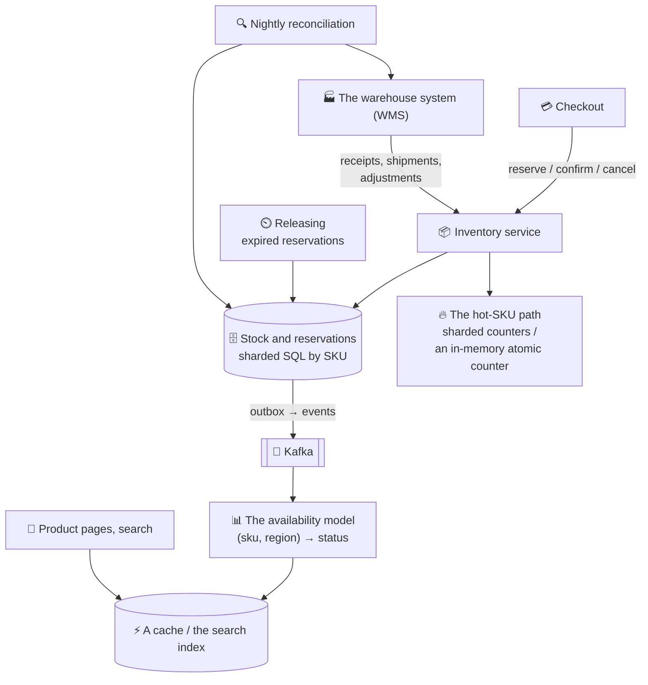
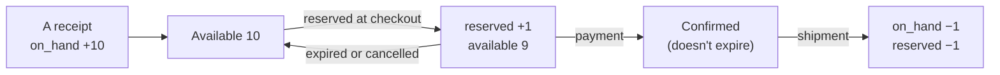
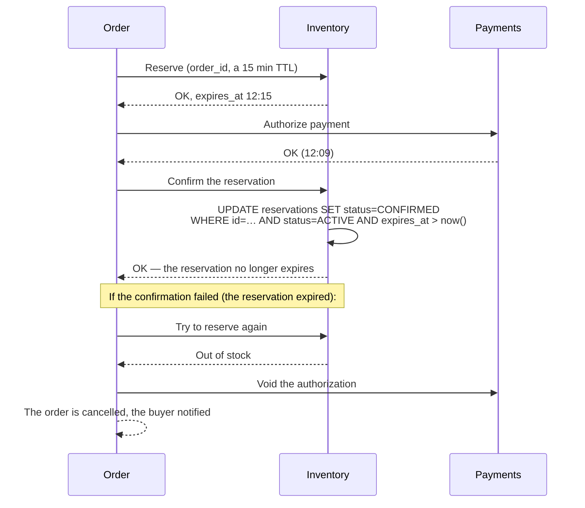
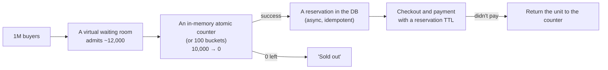

**English** | [Русский](README_RU.md)

# Tier 2 · 4D · 03. Inventory Consistency

> **Level:** Hard · **Interview time:** 45–60 min · **Study time:** ~5 h
> **Key aspects:** the stock model (on hand, reserved, available, allocated), atomic reservation without overselling, the reservation lifecycle with a TTL and races with payment, order sagas, allocation across warehouses, flash sales and hot SKUs (sharded counters, atomic in-memory operations, queue-based admission), an availability model for the storefront, syncing with the physical warehouse and reconciliation, multi-region
> **Builds on:** [Tier 1 · 13 Ticketmaster](../../../tier-1/13-ticketmaster/README.md#7-deep-dive-1-preventing-double-booking), [Tier 2 · 4D · 01 E-commerce](../01-ecommerce-platform/README.md#11-deep-dive-5-the-cart-and-checkout), [11-distributed-transactions](../../../11-distributed-transactions/README.md), [Tier 2 · 4C · 07 Conflict-free Replication](../../4c-storage-databases/07-conflict-free-replication/README.md#12-deep-dive-7-the-limits--invariants-and-coordination), [04-databases](../../../04-databases/README.md)

---

## 🗺️ How to Read This Walkthrough

The walkthrough follows an interview, but every step includes explanations: **why** a decision is made, **how** a mechanism works and **what happens** if you do it differently. The "📘 Explanation" blocks are theory right where you need it.

| Icon | Meaning |
|:----:|:--------|
| 🎤 | Interviewer |
| 🗣️ | What I (the candidate) say out loud |
| ✏️ | What I draw on the whiteboard |
| ⏱️ | Time budget for the step |
| 📘 | A detailed explanation of a concept |

Callouts: **TIP** — a good technique, **WARNING** — a trap, **IMPORTANT** — a Senior+ signal.

---

## 📑 Contents

0. [What This Problem Teaches](#0-what-this-problem-teaches)
1. [Problem Statement](#1-problem-statement)
2. [Clarifying Questions and Requirements](#2-clarifying-questions-and-requirements)
3. [Capacity Estimates](#3-capacity-estimates)
4. [Data Model](#4-data-model)
5. [API](#5-api)
6. [High-Level Design](#6-high-level-design)
7. [Deep Dive 1: The States of Stock](#7-deep-dive-1-the-states-of-stock)
8. [Deep Dive 2: Atomic Reservation Without Overselling](#8-deep-dive-2-atomic-reservation-without-overselling)
9. [Deep Dive 3: The Reservation Lifecycle and the Order Saga](#9-deep-dive-3-the-reservation-lifecycle-and-the-order-saga)
10. [Deep Dive 4: Allocating Across Warehouses](#10-deep-dive-4-allocating-across-warehouses)
11. [Deep Dive 5: Flash Sales and Hot SKUs](#11-deep-dive-5-flash-sales-and-hot-skus)
12. [Deep Dive 6: An Availability Model for the Storefront](#12-deep-dive-6-an-availability-model-for-the-storefront)
13. [Deep Dive 7: The Physical Warehouse and Reconciliation](#13-deep-dive-7-the-physical-warehouse-and-reconciliation)
14. [Deep Dive 8: Scaling and Multiple Regions](#14-deep-dive-8-scaling-and-multiple-regions)
15. [Bottlenecks and Failure Scenarios](#15-bottlenecks-and-failure-scenarios)
16. [What Changes at 10x Scale](#16-what-changes-at-10x-scale)
17. [Key Concepts and New Terms](#17-key-concepts-and-new-terms)
18. [Variations and Follow-Up Questions](#18-variations-and-follow-up-questions)
19. [Common Mistakes](#19-common-mistakes)
20. [Cheat Sheet and Self-Check](#20-cheat-sheet-and-self-check)

---

## 0. What This Problem Teaches

The cart could afford inaccuracies; inventory can't: if a warehouse holds 10 TVs and 11 are sold, the eleventh buyer has to be told why their paid order was cancelled. Meanwhile stock is read on every product page, and during a flash sale a million people try to buy 10,000 units of **one** item at once. The task is to combine **strict correctness** of reservations with **high read load** and **extreme contention** for hot items.

| What's tested | Where it shows up |
|:--------------|:------------------|
| Correctness under contention | Atomic reservation, no overselling |
| Temporary holds | A reservation with a TTL, races between expiry and payment |
| Distributed transactions | A saga: the order, payment, stock |
| Hot keys | A flash sale of one SKU |
| Separating read and write models | Exact stock versus "in stock" on the storefront |
| Connecting to the physical world | The warehouse, losses, cycle counts, reconciliation |

> [!TIP]
> Separate two questions right away: **"what to show on the storefront"** (approximate, fast, for millions of views) and **"can this unit be sold"** (strict, atomic, only at checkout). They're two different data models.

---

## 1. Problem Statement

> 🎤 "Design the inventory service for a large store with several warehouses and sellers: tracking stock, reserving at checkout, never selling beyond what's available. Separately — a flash sale: 10,000 units, a million buyers within a few seconds."

**Scenarios:**

```
The Warsaw warehouse has 3 TVs. Anna and Boris check out the last one at the same moment → it sells to one of them
Anna checked out but didn't pay within 15 minutes → the TV is available again
A flash sale: 10,000 smartphones, starting at 12:00 → exactly 10,000 sales, not one more
A warehouse worker found a damaged box → stock decreased, and the storefront updated
```

**Time plan:**

| Step | ⏱️ |
|:-----|:--:|
| Requirements | 5 min |
| Estimates | 3 min |
| The model and API | 6 min |
| High-level design | 5 min |
| Deep dives | 25 min |
| Wrap-up | 3 min |

---

## 2. Clarifying Questions and Requirements

⏱️ 5 min

| My question | Interviewer's answer | What it changes and why |
|:------------|:---------------------|:------------------------|
| How many SKUs and warehouses? | ~500M SKUs, dozens of warehouses, plus sellers' warehouses | Sharding by SKU |
| Is overselling acceptable? | No (except deliberate exceptions, like pre-orders) | An atomic check on reservation |
| When to reserve? | At checkout, for the duration of payment | A reservation with a TTL |
| Normal load? | Availability reads — hundreds of thousands/s; reservations — thousands/s | A separate read model |
| Flash sales? | Yes: up to 100,000 attempts/s on one SKU | A special scheme for hot keys |
| The source of truth for physical stock? | The warehouse management system (WMS) | Syncing and reconciliation |
| Auditing? | Every stock movement is explainable | A movements log |

### Functional requirements

1. Tracking stock per SKU and warehouse.
2. Reserving at checkout (all of an order's items — all or nothing), confirming on payment, releasing on cancellation or expiry.
3. Shipments, returns, adjustments, receipts from the warehouse.
4. Availability for the storefront and search.
5. Flash sales with limited quantity.

### Non-functional requirements

| Requirement | Target | Why |
|:------------|:-------|:----|
| Correctness | Sold ≤ available | Cancelling paid orders costs trust and money |
| Reservation latency | p99 < 100 ms | Part of checkout |
| Read availability | High; data may lag by seconds | The storefront |
| Hot SKU throughput | 100,000 attempts/s | Flash sales |
| Auditability | A log of every movement | Investigating discrepancies |

---

## 3. Capacity Estimates

⏱️ 3 min

```
Stock records:       500M SKUs × ~3 warehouses ≈ 1.5B rows × ~100 B ≈ 150 GB
Availability reads:  ~200,000/s (pages and search)
Reservations:        ~3,000/s at a normal peak

A hot SKU:           a single row in a relational DB handles on the order of thousands
                     of updates per second (each one a row lock + a log write)
A flash sale:        100,000 attempts/s on one row → dozens of times more than it can take
```

### Conclusions

| Conclusion | Design consequence |
|:-----------|:-------------------|
| Reads outnumber reservations hundreds of times | An availability model separate from exact stock |
| Ordinary reservations are spread across SKUs | A sharded DB with atomic conditional updates |
| A hot SKU doesn't fit in one row | Sharded counters, an in-memory atomic counter, an admission queue |

---

## 4. Data Model

⏱️ 4 min

```
stock_levels (sku, location_id)
  on_hand      — physically in the warehouse (per the warehouse)
  reserved     — reserved for unpaid and unshipped orders
  safety_stock — a safety buffer, not for sale
  version
  available    = on_hand − reserved − safety_stock     (computed)

reservations (reservation_id)
  order_id, sku, location_id, quantity,
  status: ACTIVE | CONFIRMED | RELEASED | EXPIRED | FULFILLED,
  expires_at, created_at

stock_movements (movement_id)                      ← a log, append-only
  sku, location_id, type: RECEIPT | SHIPMENT | RETURN | ADJUSTMENT | TRANSFER,
  quantity_delta, reference (an order, a delivery, a cycle count), created_at
```

| Table | Why |
|:------|:----|
| `stock_levels` | The current state for fast checks |
| `reservations` | Who holds how much, and until when |
| `stock_movements` | Auditing: `on_hand` must equal the sum of movements; the basis for reconciliation |

---

## 5. API

⏱️ 2 min

```http
GET  /v1/availability?sku=…&region=pl          → { status: "in_stock" | "low_stock" | "out_of_stock", eta }
                                                  ← approximate, from the read model

POST /v1/reservations     Idempotency-Key: order_id
     { order_id, items: [{ sku, quantity }], ship_to_region, ttl_seconds: 900 }
→ 201 { reservation_id, allocations: [{ sku, location_id, quantity }], expires_at }
→ 409 { unavailable: [{ sku, available: 0 }] }

POST   /v1/reservations/{id}/confirm            ← after payment: the reservation no longer expires
DELETE /v1/reservations/{id}                    ← cancellation: return to available

From the warehouse system (events):
  shipment.dispatched, receipt.posted, adjustment.posted, return.received
```

---

## 6. High-Level Design

⏱️ 5 min



🗣️ "Key decisions:
- **exact stock and reservations** live in sharded SQL by SKU; a reservation is **an atomic conditional update**;
- **hot SKUs** in flash sales take a separate path: sharded counters or an in-memory atomic counter;
- **the availability model** for the storefront is built from events and cached — it's approximate and never used for selling;
- **the warehouse system** is the source of truth for physical stock; its events update `on_hand`, and nightly reconciliation catches discrepancies;
- **expired reservations** are released by a background process."

---

## 7. Deep Dive 1: The States of Stock

> 🎤 "What does 'stock' mean? A single number?"

📘 No. Stock is a set of quantities, each with its own meaning:

| Quantity | Meaning | Who changes it |
|:---------|:--------|:---------------|
| **On hand** | Physically in the warehouse | The warehouse: receipts, shipments, adjustments |
| **Reserved** | Promised to orders, not yet shipped | Checkout (reserve), payment, shipment, cancellation |
| **Safety stock** | A buffer against accounting errors | Configuration |
| **Available** | Sellable = on hand − reserved − safety stock | Computed |
| **In transit** | Moving between warehouses or from a supplier | Transfers and deliveries |
| **Incoming** | An expected delivery (for pre-orders) | Purchasing |



📘 **Why not decrement `on_hand` right at order time.** `on_hand` describes the physical world — what's on the shelf. Until the item leaves the warehouse, it's physically there. A reservation is **a logical** promise; separating them allows reconciling the books with the warehouse and cancelling orders correctly.

---

## 8. Deep Dive 2: Atomic Reservation Without Overselling

> 🎤 "Anna and Boris are buying the last TV at the same moment. How do you guarantee only one sale?"

### The "read — check — write" trap

```
Anna:  SELECT available → 1         Boris:  SELECT available → 1
Anna:  1 ≥ 1 → UPDATE reserved+1    Boris:  1 ≥ 1 → UPDATE reserved+1
→ 2 sold with stock of 1 ❌
```

### An atomic conditional update ⭐

```sql
UPDATE stock_levels
SET reserved = reserved + :qty
WHERE sku = :sku AND location_id = :loc
  AND on_hand - reserved - safety_stock >= :qty;

-- 1 row affected → reserved
-- 0 rows affected → not enough
```

📘 The check and the change are **one operation**: the database locks the row for the duration of the update, so the second query runs after the first and sees the already-updated value. It's the same technique as for seats in [Ticketmaster](../../../tier-1/13-ticketmaster/README.md#7-deep-dive-1-preventing-double-booking).

| Approach | How | Pros | Cons |
|:---------|:----|:-----|:-----|
| **An atomic conditional UPDATE** ⭐ | The check in the WHERE | Simple, one round trip, no extra locks | One row at a time |
| Pessimistic locking | `SELECT … FOR UPDATE`, then UPDATE | Flexible (complex checks) | Holds the lock longer |
| Optimistic with a version | `WHERE version = :v`, retry on conflict | No locks | A storm of retries under high contention |

### An order with several items

| Situation | Solution |
|:----------|:---------|
| All SKUs in one shard | One transaction: every conditional UPDATE; if any affected 0 rows — roll back |
| SKUs in different shards | **A saga**: reserve one by one; on failure — release what was already reserved |
| Deadlocks | Reserve in **a fixed order** (e.g. ascending SKU) |
| Retries | Idempotency by `(order_id, sku)`: reserving the same order again doesn't double it |

> [!IMPORTANT]
> **Senior+ signal:** show the "read — check — write" race and fix it with **an atomic conditional update**, and for a multi-item order — a saga with compensations and a fixed order against deadlocks.

---

## 9. Deep Dive 3: The Reservation Lifecycle and the Order Saga

> 🎤 "A reservation lives for 15 minutes. What if payment succeeds at minute 16?"

### The order saga



### Expiring reservations

| Mechanism | How |
|:----------|:----|
| **A lazy check** | The available count considers only active reservations; expired ones are ignored during checks |
| **Background release** | Periodically: find `ACTIVE` with `expires_at < now()` → move to `EXPIRED` and decrement `reserved` (conditionally, by status) |
| **The race between confirmation and expiry** | Both transitions are conditional on status: whoever changes `ACTIVE` first wins |
| A time margin | The reservation's TTL is slightly longer than the payment timeout, so a normal payment fits |

| Transition | Condition | Effect on stock |
|:-----------|:----------|:----------------|
| ACTIVE → CONFIRMED | Payment succeeded before expiry | None (stays in reserved) |
| ACTIVE → EXPIRED / RELEASED | Expired or cancelled | reserved −q |
| CONFIRMED → FULFILLED | Shipped from the warehouse | on_hand −q, reserved −q |
| CONFIRMED → RELEASED | Cancelled after payment, before shipment | reserved −q, a refund |

---

## 10. Deep Dive 4: Allocating Across Warehouses

> 🎤 "The item is in three warehouses. Which one do you reserve from?"

| Approach | How | Trade-off |
|:---------|:----|:----------|
| **Directly at a specific warehouse** | Pick the warehouse nearest the buyer that has stock (shipping cost, delivery time) | Precise, but more contention on warehouse rows |
| **Two-level** ⭐ | At checkout — reserve from **a regional pool** (the sum over the region's warehouses); a fulfillment optimizer picks the exact warehouse later | Less contention at checkout; better allocation (it considers every order) |

| The optimizer's decision | It considers |
|:-------------------------|:-------------|
| The shipping warehouse | Distance, cost, warehouse load, the order's other items being available |
| Splitting an order | If items are in different warehouses — several shipments |
| Transfers | Replenishing warehouses based on demand forecasts |

📘 The two-level model is another example of separating a fast "promise" from later, exact fulfillment.

---

## 11. Deep Dive 5: Flash Sales and Hot SKUs

> 🎤 "At 12:00, 10,000 smartphones go on sale. 100,000 attempts per second on one SKU. What do you do?"

### The problem

📘 Every attempt hits **one row** of `stock_levels`. Each conditional UPDATE locks the row; the database runs them one at a time — thousands per second at best. The rest wait for the lock, time out, and failures cascade.

### Solutions

| Approach | How | Throughput | Trade-off |
|:---------|:----|:-----------|:----------|
| **Sharded counters** | The 10,000 units are split into 100 buckets of 100 (separate rows); a request picks a random bucket and tries others if it's empty | ~100× a single row | Checking "is everything sold out" means scanning buckets; the tail of the sale is slower |
| **An in-memory atomic counter** | Redis: a Lua script "if stock ≥ q, decrement" — one atomic operation in microseconds | Hundreds of thousands/s | Needs durability (AOF, replication) and reconciliation with the DB; passing the counter → then an async reservation write to the DB |
| **An admission queue** | A virtual waiting room lets roughly as many people into checkout as there are items (with a margin) | Load on inventory is bounded | Users wait (see [Tier 1 · 13](../../../tier-1/13-ticketmaster/README.md#10-deep-dive-4-on-sale-time-and-the-virtual-waiting-room)) |
| **Pre-issued tokens** | Create 10,000 tokens up front; a purchase = taking a token (from a queue or list) | High | Cancellations and returns to the pool are more complex |

### The combination in practice



| Detail | Why |
|:-------|:----|
| The queue admits slightly more people than there are items | Some won't pay |
| The in-memory counter is the "gate", the DB is the source of truth | Speed + durability; reconciliation resolves discrepancies |
| Returning units on non-payment | Freed units become available to the next people in the queue |
| A per-buyer limit | 1–2 units per person against scalpers |

> [!WARNING]
> If the in-memory counter loses data on a failure (async replication), more can be sold than exists. You need: replication with acknowledgments, a log, **reconciliation** of "issued by the counter" against "reserved in the DB", and sometimes a small buffer (selling 9,950 of 10,000).

---

## 12. Deep Dive 6: An Availability Model for the Storefront

> 🎤 "How do you show 'in stock' on millions of pages without loading the inventory service?"

| Decision | Why |
|:---------|:----|
| **A separate read model** `(sku, region) → status` | Keep reads off the exact stock |
| Built **from events** of stock changes | Updated within seconds |
| **Statuses instead of numbers**: "in stock", "low stock", "out of stock" | Fewer changes: going from 57 → 56 doesn't change the status or update the cache |
| A cache and the search index | Hundreds of thousands of reads per second |
| Never used for selling | Selling happens only through atomic reservation |

📘 This is CQRS: **the write model** (exact stock, strict checks) and **the read model** (approximate, denormalized, fast) are separate and connected by an event stream.

---

## 13. Deep Dive 7: The Physical Warehouse and Reconciliation

> 🎤 "The books say the warehouse has 5, but the shelf holds 4. Where does that come from, and what do you do?"

### Sources of discrepancies

| Cause | Example |
|:------|:--------|
| Damage and losses | A box was dropped |
| Picking errors | The wrong item was shipped |
| Event delays | A shipment is recorded late |
| Delivery errors | Fewer items arrived than the invoice says |
| Marketplace sellers' data | A seller updates stock via the API late |

### Mechanisms

| Mechanism | How |
|:----------|:----|
| **A movements log** | Every change to `on_hand` is a record in `stock_movements`; `on_hand` = the sum of movements |
| Events from the warehouse | Receipts, shipments, adjustments — via the outbox and idempotent by event ID |
| **Cycle counting** | Regularly recounting some of the shelves; the difference → an adjustment |
| **Nightly reconciliation** | The service's books versus the warehouse system's data; discrepancies → alerts and adjustments |
| **Safety stock** | A small buffer isn't sold — it absorbs accounting errors |
| A buffer for marketplace sellers | Selling slightly less than declared if a seller updates stock rarely |

### If you oversold anyway

| Action | When |
|:-------|:-----|
| Ship from another warehouse | It's available elsewhere |
| Offer a substitute or wait for a delivery | A delivery is coming soon |
| Cancel with an apology and compensation | Otherwise impossible |

📘 Overselling can't be eliminated entirely in the physical world — an item can break on the shelf. The goal is to make it **rare** and handle it **predictably**.

---

## 14. Deep Dive 8: Scaling and Multiple Regions

| Decision | Why |
|:---------|:----|
| Sharding by SKU | Reservations of different items are independent |
| Hot SKUs take a separate path (deep dive 5) | They don't break the shards |
| A warehouse's stock lives in the warehouse's region | A warehouse is physically in one country; stock is written in the warehouse's "home" region |
| A global item sold in many regions | **Escrow**: a global quota is split among regions; each sells its share locally and requests a transfer when short (see [4C · 07](../../4c-storage-databases/07-conflict-free-replication/README.md#12-deep-dive-7-the-limits--invariants-and-coordination)) |
| Events via the outbox | The availability model and analytics don't lose changes |
| Auditing | The movements and reservations logs are kept for years |

---

## 15. Bottlenecks and Failure Scenarios

| Scenario | What happens | How we protect |
|:---------|:-------------|:---------------|
| "Read — check — write" | Overselling | An atomic conditional update |
| A multi-item order across shards | A partial reservation | A saga with compensations |
| Deadlocks when reserving several SKUs | Hangs | A fixed order |
| A repeated reservation | A double reservation | Idempotency by (order_id, sku) |
| Payment after the reservation expired | Selling without the item | A conditional confirmation, re-reserving or cancelling |
| Abandoned reservations | The item is locked up | A TTL, a lazy check, background release |
| A flash sale | A hot row, timeouts | Buckets, an in-memory counter, an admission queue |
| The in-memory counter loses data | More is sold | Replication, a log, reconciliation, a buffer |
| A flood of availability reads | Load on inventory | A read model with statuses and a cache |
| The books and the shelf diverge | Selling what isn't there | A log, cycle counts, reconciliation, safety stock |

---

## 16. What Changes at 10x Scale

> 🎤 "10× more SKUs, warehouses and sales?"

| Change | Why |
|:-------|:----|
| **Demand forecasting** and pre-positioning stock across warehouses | Fewer transfers and split orders |
| **Automatic bucketing** of hot SKUs based on forecasts | Sales without manual setup |
| **Regional pools with escrow** for every global item | Latency and scale |
| **Streaming reconciliation** instead of nightly | Discrepancies found within minutes |

---

## 17. Key Concepts and New Terms

### What's applied

| Concept | Where it's covered | How it applies here |
|:--------|:-------------------|:--------------------|
| Conditional updates, holds with a TTL, a queue | [Tier 1 · 13](../../../tier-1/13-ticketmaster/README.md) | Reservations and flash sales |
| Checkout, the quote | [Tier 2 · 4D · 01](../01-ecommerce-platform/README.md) | Inventory's place in checkout |
| Sagas, the outbox | [11-distributed-transactions](../../../11-distributed-transactions/README.md) | The order saga |
| Escrow, invariants | [Tier 2 · 4C · 07](../../4c-storage-databases/07-conflict-free-replication/README.md) | Multi-region |
| Transactions and locks | [04-databases](../../../04-databases/README.md) | Atomic reservation |

### New terms in this problem

| Term | In short |
|:-----|:---------|
| **On hand, reserved, available** | Physical stock, what's promised, what's sellable |
| **Safety stock** | A buffer against accounting errors |
| **Overselling** | Selling beyond what's available |
| **A reservation with a TTL** | A temporary promise for the duration of payment |
| **Two-level allocation** | A regional pool at checkout, the warehouse later |
| **A sharded counter** | A hot SKU's stock split across rows |
| **An in-memory "gate" counter** | A fast atomic check before writing to the DB |
| **The availability model** | Approximate statuses for the storefront (CQRS) |
| **A movements log** | Auditing every change to physical stock |
| **Cycle counting** | Regularly recounting part of the shelves |

---

## 18. Variations and Follow-Up Questions

<details>
<summary><b>How do pre-orders work for an item that isn't in the warehouse yet?</b></summary>

A separate "incoming" pool: reservations are made against the expected delivery, capped at its volume. On arrival, pre-order reservations become ordinary ones and ship in order of checkout; on a short delivery — cancelling part of the pre-orders by rule (e.g. the most recent ones).
</details>

<details>
<summary><b>Can you reserve in Redis instead of the database for every item?</b></summary>

As a fast path, yes, but the source of truth must remain a durable database with a movements log: losing Redis data on a failure leads to overselling or "lost" reservations. Usually Redis is used only for hot SKUs, while atomic database updates suffice for everything else.
</details>

<details>
<summary><b>How do you handle bundles (a set of several items)?</b></summary>

A bundle's availability is the minimum over its components, accounting for quantities; reserving a bundle means reserving every component in one transaction or saga. If the bundle is pre-assembled in the warehouse, it's a separate SKU with its own stock.
</details>

<details>
<summary><b>How do marketplace sellers update stock?</b></summary>

Through an API or files with an absolute stock value and a timestamp (so an old update can't overwrite a new one); the platform's reservations are subtracted from the declared amount; with infrequent updates — a buffer. Sellers who often sell what they don't have are ranked lower.
</details>

<details>
<summary><b>What do you do with returns?</b></summary>

A return is a `RETURN` movement: the item arrives at the warehouse, is inspected, and is either returned to sellable stock or written off as damaged. Until inspection it doesn't become available.
</details>

---

## 19. Common Mistakes

| ❌ Mistake | Why it's bad | ✅ Do this instead |
|:----------|:-------------|:------------------|
| Read stock, check in code, write | Overselling | An atomic conditional update |
| Decrementing on_hand at checkout | The books diverge from the physical world | A reservation, decrementing at shipment |
| A reservation without an expiry | Abandoned orders lock up items | A TTL and release |
| Confirming without checking the status | Confirming an expired reservation | A conditional ACTIVE → CONFIRMED transition |
| Reserving SKUs in arbitrary order | Deadlocks | A fixed order |
| The storefront reads exact stock | Overload | An availability model with statuses |
| One row for a flash sale | A hot spot, timeouts | Buckets, an in-memory counter, a queue |
| An in-memory counter as the only source of truth | Loss on failure | The DB + a log + reconciliation |
| No movements log | Discrepancies can't be explained | A log and reconciliation |
| Believing overselling can be eliminated entirely | No plan for rare cases | Safety stock, handling rules |

---

## 20. Cheat Sheet and Self-Check

### 30-second answer

> Stock is a set of quantities: on_hand (physical, changed by the warehouse), reserved (promised), safety_stock, available = on_hand − reserved − safety_stock. A reservation is an atomic conditional UPDATE with the availability check in the WHERE (0 rows — not enough); a multi-SKU order is one transaction within a shard or a saga with compensations, a fixed order against deadlocks, idempotency by (order_id, sku). A reservation has a TTL (~15 min): confirming on payment is a conditional ACTIVE → CONFIRMED transition; expiry — a lazy check + background release; losing the race means re-reserving or voiding the payment. Allocation across warehouses — a regional pool at checkout, the specific warehouse chosen by an optimizer. A flash sale: a virtual waiting room admits roughly as many people as there are items, then an in-memory atomic counter (Lua in Redis) or 100 row buckets, then an async reservation in the DB, returning units on non-payment, a per-person limit, reconciling the counter with the DB. The storefront uses an availability model (statuses, from events, cached), not for selling. The physical world: a movements log, warehouse events, cycle counts, nightly reconciliation, safety stock, and rules for overselling. Globally — escrow across regions.

### Self-check

- [ ] I can explain on hand, reserved, available and safety stock
- [ ] I can show the "read — check — write" race and fix it
- [ ] I can compare atomic updates, pessimistic and optimistic locking
- [ ] I can reserve a multi-SKU order without deadlocks
- [ ] I can describe the reservation lifecycle and the race between expiry and payment
- [ ] I can explain two-level allocation across warehouses
- [ ] I can design a flash sale at 100,000 attempts per second
- [ ] I can explain the availability model and why it isn't for selling
- [ ] I can describe the movements log, reconciliation and handling overselling
- [ ] I can apply escrow to a global item

### Further reading

- The [Tier 1 · 13 Ticketmaster](../../../tier-1/13-ticketmaster/README.md) and [Tier 2 · 4D · 01](../01-ecommerce-platform/README.md) walkthroughs
- The Amazon Builders' Library — articles on handling contention and hot keys
- Redis documentation: Lua scripts and atomicity
- Martin Fowler, *CQRS* and *Event Sourcing*
- The [11-distributed-transactions](../../../11-distributed-transactions/README.md) topic
