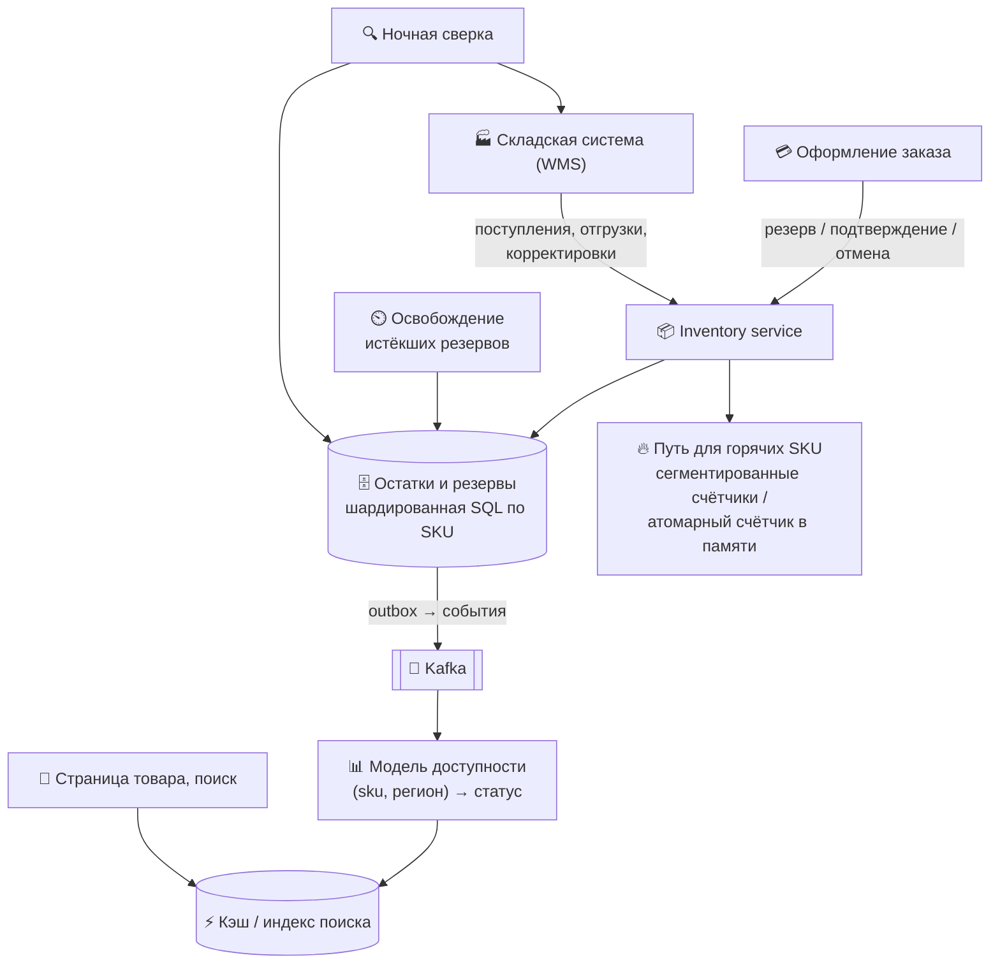
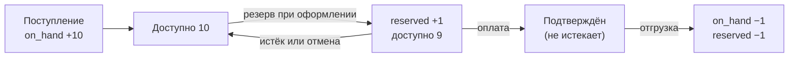
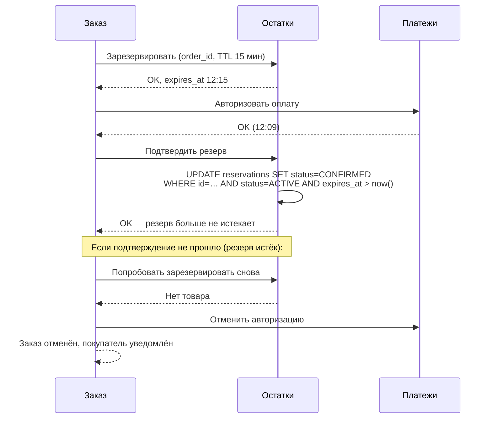
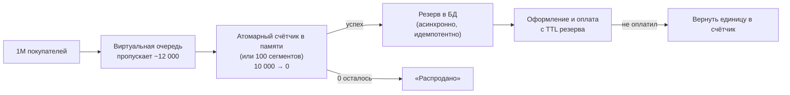

[English](README.md) | **Русский**

# Tier 2 · 4D · 03. Консистентность складских остатков

> **Уровень:** Hard · **Время на интервью:** 45–60 мин · **Время на разбор:** ~5 ч
> **Ключевые аспекты:** модель остатков (на складе, зарезервировано, доступно, распределено), атомарное резервирование без overselling, жизненный цикл резерва с TTL и гонки с оплатой, саги заказа, распределение по складам, флеш-распродажи и горячие SKU (сегментированные счётчики, атомарные операции в памяти, допуск через очередь), модель доступности для витрины, синхронизация с физическим складом и сверка, мульти-регион
> **Опирается на:** [Tier 1 · 13 Ticketmaster](../../../tier-1/13-ticketmaster/README_RU.md#7-deep-dive-1-защита-от-двойного-бронирования), [Tier 2 · 4D · 01 E-commerce](../01-ecommerce-platform/README_RU.md#11-deep-dive-5-корзина-и-оформление-заказа), [11-distributed-transactions](../../../11-distributed-transactions/README_RU.md), [Tier 2 · 4C · 07 Conflict-free Replication](../../4c-storage-databases/07-conflict-free-replication/README_RU.md#12-deep-dive-7-пределы--инварианты-и-координация), [04-databases](../../../04-databases/README_RU.md)

---

## 🗺️ Как читать этот разбор

Разбор построен как интервью, но в каждом шаге есть объяснения: **почему** принимается решение, **как работает** механизм и **что будет**, если сделать иначе. Блоки «📘 Объяснение» — теория прямо по ходу задачи.

| Значок | Что значит |
|:------:|:-----------|
| 🎤 | Реплика интервьюера |
| 🗣️ | Что говорю вслух я (кандидат) |
| ✏️ | Что рисую на доске |
| ⏱️ | Сколько времени тратить на шаг |
| 📘 | Подробное объяснение концепции |

Блоки **TIP** — хороший приём, **WARNING** — ловушка, **IMPORTANT** — сигнал для уровня Senior+.

---

## 📑 Содержание

0. [Чему учит эта задача](#0-чему-учит-эта-задача)
1. [Условие задачи](#1-условие-задачи)
2. [Уточняющие вопросы и требования](#2-уточняющие-вопросы-и-требования)
3. [Оценки нагрузки](#3-оценки-нагрузки)
4. [Модель данных](#4-модель-данных)
5. [API](#5-api)
6. [High-level дизайн](#6-high-level-дизайн)
7. [Deep dive 1: состояния остатка](#7-deep-dive-1-состояния-остатка)
8. [Deep dive 2: атомарное резервирование без overselling](#8-deep-dive-2-атомарное-резервирование-без-overselling)
9. [Deep dive 3: жизненный цикл резерва и сага заказа](#9-deep-dive-3-жизненный-цикл-резерва-и-сага-заказа)
10. [Deep dive 4: распределение по складам](#10-deep-dive-4-распределение-по-складам)
11. [Deep dive 5: флеш-распродажи и горячие SKU](#11-deep-dive-5-флеш-распродажи-и-горячие-sku)
12. [Deep dive 6: модель доступности для витрины](#12-deep-dive-6-модель-доступности-для-витрины)
13. [Deep dive 7: физический склад и сверка](#13-deep-dive-7-физический-склад-и-сверка)
14. [Deep dive 8: масштабирование и несколько регионов](#14-deep-dive-8-масштабирование-и-несколько-регионов)
15. [Узкие места и сценарии сбоев](#15-узкие-места-и-сценарии-сбоев)
16. [Что изменится при росте в 10 раз](#16-что-изменится-при-росте-в-10-раз)
17. [Ключевые концепции и новые понятия](#17-ключевые-концепции-и-новые-понятия)
18. [Варианты задачи и follow-up вопросы](#18-варианты-задачи-и-follow-up-вопросы)
19. [Типичные ошибки](#19-типичные-ошибки)
20. [Шпаргалка и самопроверка](#20-шпаргалка-и-самопроверка)

---

## 0. Чему учит эта задача

Корзина могла позволить себе неточности, а остатки — нет: если на складе 10 телевизоров, а продано 11, одиннадцатому покупателю придётся объяснять, почему его оплаченный заказ отменён. При этом остатки читаются на каждой странице товара, а во время флеш-распродажи миллион человек одновременно пытается купить 10 000 единиц **одного** товара. Задача — совместить **строгую корректность** резервирования с **высокой нагрузкой** чтения и **экстремальной конкуренцией** за горячие товары.

| Что проверяют | Где это в задаче |
|:--------------|:-----------------|
| Корректность при конкуренции | Атомарное резервирование, отсутствие overselling |
| Временные блокировки | Резерв с TTL, гонки истечения и оплаты |
| Распределённые транзакции | Сага: заказ, оплата, остатки |
| Горячие ключи | Флеш-распродажа одного SKU |
| Разделение моделей чтения и записи | Точные остатки против «есть в наличии» на витрине |
| Связь с физическим миром | Склад, потери, инвентаризация, сверка |

> [!TIP]
> Сразу раздели два вопроса: **«сколько показать на витрине»** (приблизительно, быстро, для миллионов просмотров) и **«можно ли продать эту единицу»** (строго, атомарно, только при оформлении). Это две разные модели данных.

---

## 1. Условие задачи

> 🎤 «Спроектируй сервис складских остатков для крупного магазина с несколькими складами и продавцами: учёт остатков, резервирование при оформлении, никакой продажи сверх наличия. Отдельно — флеш-распродажа: 10 000 единиц, миллион покупателей за несколько секунд».

**Сценарии:**

```
На складе Варшава — 3 телевизора. Анна и Борис одновременно оформляют заказ на последний → продаётся одному
Анна оформила, но не оплатила за 15 минут → телевизор снова доступен
Флеш-распродажа: 10 000 смартфонов, старт в 12:00 → ровно 10 000 продаж, ни одной лишней
Кладовщик нашёл повреждённую коробку → остаток уменьшился, витрина обновилась
```

**План по времени:**

| Шаг | ⏱️ |
|:----|:--:|
| Требования | 5 мин |
| Оценки | 3 мин |
| Модель и API | 6 мин |
| High-level дизайн | 5 мин |
| Deep dives | 25 мин |
| Итоги | 3 мин |

---

## 2. Уточняющие вопросы и требования

⏱️ 5 мин

| Мой вопрос | Ответ интервьюера | Что это меняет и почему |
|:-----------|:------------------|:------------------------|
| Сколько SKU и складов? | ~500M SKU, десятки складов, плюс склады продавцов | Шардирование по SKU |
| Допустим ли overselling? | Нет (кроме осознанных исключений, вроде предзаказа) | Атомарная проверка при резервировании |
| Когда резервировать? | При оформлении заказа, на время оплаты | Резерв с TTL |
| Нагрузка обычная? | Чтения доступности — сотни тысяч/с; резервирований — тысячи/с | Отдельная модель чтения |
| Флеш-распродажи? | Да: до 100 000 попыток/с на один SKU | Специальная схема для горячих ключей |
| Источник правды о физическом остатке? | Складская система (WMS) | Синхронизация и сверка |
| Аудит? | Каждое движение остатка объяснимо | Журнал движений |

### Функциональные требования

1. Учёт остатков по SKU и складу.
2. Резервирование при оформлении (все позиции заказа — всё или ничего), подтверждение при оплате, освобождение при отмене или истечении.
3. Отгрузка, возвраты, корректировки, поступления от склада.
4. Доступность для витрины и поиска.
5. Флеш-распродажи с ограниченным количеством.

### Нефункциональные требования

| Требование | Цель | Почему |
|:-----------|:-----|:-------|
| Корректность | Продано ≤ доступно | Отмены оплаченных заказов — потеря доверия и денег |
| Задержка резервирования | p99 < 100 мс | Часть оформления заказа |
| Доступность чтения | Высокая, данные могут отставать на секунды | Витрина |
| Пропускная способность горячего SKU | 100 000 попыток/с | Флеш-распродажи |
| Аудируемость | Журнал всех движений | Расследование расхождений |

---

## 3. Оценки нагрузки

⏱️ 3 мин

```
Записи остатков:     500M SKU × ~3 склада ≈ 1,5 млрд строк × ~100 Б ≈ 150 ГБ
Чтения доступности:  ~200 000/с (страницы и поиск)
Резервирования:      ~3 000/с в обычный пик

Горячий SKU:         одна строка в реляционной БД выдерживает порядка тысяч обновлений
                     в секунду (каждое — блокировка строки + запись журнала)
Флеш-распродажа:     100 000 попыток/с на одну строку → в десятки раз больше, чем она выдержит
```

### Выводы

| Вывод | Следствие для дизайна |
|:------|:----------------------|
| Чтений в сотни раз больше резервирований | Модель доступности отдельно от точных остатков |
| Обычные резервирования распределены по SKU | Шардированная БД с атомарными условными обновлениями |
| Горячий SKU не помещается в одну строку | Сегментированные счётчики, атомарный счётчик в памяти, очередь допуска |

---

## 4. Модель данных

⏱️ 4 мин

```
stock_levels (sku, location_id)
  on_hand      — физически на складе (по данным склада)
  reserved     — зарезервировано под неоплаченные и неотгруженные заказы
  safety_stock — страховой запас, не продаётся
  version
  available    = on_hand − reserved − safety_stock     (вычисляется)

reservations (reservation_id)
  order_id, sku, location_id, quantity,
  status: ACTIVE | CONFIRMED | RELEASED | EXPIRED | FULFILLED,
  expires_at, created_at

stock_movements (movement_id)                      ← журнал, только добавление
  sku, location_id, type: RECEIPT | SHIPMENT | RETURN | ADJUSTMENT | TRANSFER,
  quantity_delta, reference (заказ, поставка, инвентаризация), created_at
```

| Таблица | Зачем |
|:--------|:------|
| `stock_levels` | Текущее состояние для быстрых проверок |
| `reservations` | Кто и сколько держит, до какого времени |
| `stock_movements` | Аудит: `on_hand` должен равняться сумме движений; основа сверки |

---

## 5. API

⏱️ 2 мин

```http
GET  /v1/availability?sku=…&region=pl          → { status: "in_stock" | "low_stock" | "out_of_stock", eta }
                                                  ← приблизительно, из модели чтения

POST /v1/reservations     Idempotency-Key: order_id
     { order_id, items: [{ sku, quantity }], ship_to_region, ttl_seconds: 900 }
→ 201 { reservation_id, allocations: [{ sku, location_id, quantity }], expires_at }
→ 409 { unavailable: [{ sku, available: 0 }] }

POST   /v1/reservations/{id}/confirm            ← после оплаты: резерв больше не истекает
DELETE /v1/reservations/{id}                    ← отмена: вернуть в доступное

От складской системы (события):
  shipment.dispatched, receipt.posted, adjustment.posted, return.received
```

---

## 6. High-level дизайн

⏱️ 5 мин



🗣️ «Ключевые решения:
- **точные остатки и резервы** — в шардированной SQL по SKU; резервирование — **атомарное условное обновление**;
- **горячие SKU** флеш-распродаж — отдельный путь: сегментированные счётчики или атомарный счётчик в памяти;
- **модель доступности** для витрины строится из событий и кэшируется — она приблизительная и не используется для продажи;
- **складская система** — источник правды о физическом остатке; её события обновляют `on_hand`, ночная сверка ловит расхождения;
- **истёкшие резервы** освобождаются фоновым процессом».

---

## 7. Deep dive 1: состояния остатка

> 🎤 «Что значит “остаток”? Одно число?»

📘 Нет. Остаток — набор величин, каждая со своим смыслом:

| Величина | Что значит | Кто меняет |
|:---------|:-----------|:-----------|
| **On hand** | Физически лежит на складе | Склад: поступления, отгрузки, корректировки |
| **Reserved** | Обещано заказам, ещё не отгружено | Оформление (резерв), оплата, отгрузка, отмена |
| **Safety stock** | Страховой запас против ошибок учёта | Настройка |
| **Available** | Можно продать = on hand − reserved − safety stock | Вычисляется |
| **In transit** | Едет между складами или от поставщика | Перемещения и поставки |
| **Incoming** | Ожидаемая поставка (для предзаказа) | Закупки |



📘 **Почему не уменьшать `on_hand` сразу при заказе.** `on_hand` описывает физический мир — что лежит на полке. Пока товар не уехал со склада, он физически там. Резерв — это **логическое** обещание; разделение позволяет сверять учёт со складом и корректно отменять заказы.

---

## 8. Deep dive 2: атомарное резервирование без overselling

> 🎤 «Анна и Борис одновременно покупают последний телевизор. Как гарантировать, что продастся один?»

### Ловушка «прочитать — проверить — записать»

```
Анна:  SELECT available → 1         Борис:  SELECT available → 1
Анна:  1 ≥ 1 → UPDATE reserved+1    Борис:  1 ≥ 1 → UPDATE reserved+1
→ продано 2 при остатке 1 ❌
```

### Атомарное условное обновление ⭐

```sql
UPDATE stock_levels
SET reserved = reserved + :qty
WHERE sku = :sku AND location_id = :loc
  AND on_hand - reserved - safety_stock >= :qty;

-- затронута 1 строка → зарезервировано
-- затронуто 0 строк → не хватает
```

📘 Проверка и изменение — **одна операция**: база блокирует строку на время обновления, второй запрос выполняется после первого и видит уже обновлённое значение. Это тот же приём, что для мест в [Ticketmaster](../../../tier-1/13-ticketmaster/README_RU.md#7-deep-dive-1-защита-от-двойного-бронирования).

| Подход | Как | Плюсы | Минусы |
|:-------|:----|:------|:-------|
| **Атомарное условное UPDATE** ⭐ | Проверка в WHERE | Просто, одно обращение, нет лишних блокировок | Только для одной строки за раз |
| Пессимистичная блокировка | `SELECT … FOR UPDATE`, затем UPDATE | Гибко (сложные проверки) | Дольше держит блокировку |
| Оптимистичная с версией | `WHERE version = :v`, при конфликте повтор | Без блокировок | При высокой конкуренции — шквал повторов |

### Заказ из нескольких позиций

| Ситуация | Решение |
|:---------|:--------|
| Все SKU в одном шарде | Одна транзакция: все условные UPDATE; если хоть один затронул 0 строк — откат |
| SKU в разных шардах | **Сага**: резервировать по очереди; при неудаче — освободить уже зарезервированное |
| Взаимоблокировки | Резервировать в **фиксированном порядке** (например, по возрастанию SKU) |
| Повторы | Идемпотентность по `(order_id, sku)`: повторный резерв того же заказа не удваивает |

> [!IMPORTANT]
> **Сигнал Senior+:** показать гонку «прочитать — проверить — записать» и исправить её **условным атомарным обновлением**, а для заказа из нескольких позиций — сагой с компенсациями и фиксированным порядком против взаимоблокировок.

---

## 9. Deep dive 3: жизненный цикл резерва и сага заказа

> 🎤 «Резерв живёт 15 минут. Что если оплата прошла на 16-й минуте?»

### Сага заказа



### Истечение резервов

| Механизм | Как |
|:---------|:----|
| **Ленивая проверка** | Доступное количество учитывает только действующие резервы; истёкшие игнорируются при проверке |
| **Фоновое освобождение** | Периодически: найти `ACTIVE` с `expires_at < now()` → перевести в `EXPIRED` и уменьшить `reserved` (условно, по статусу) |
| **Гонка подтверждения и истечения** | Оба перехода — условные по статусу: выигрывает тот, кто первым сменил `ACTIVE` |
| Запас по времени | TTL резерва чуть больше таймаута оплаты, чтобы обычная оплата укладывалась |

| Переход | Условие | Эффект на остатки |
|:--------|:--------|:------------------|
| ACTIVE → CONFIRMED | Оплата прошла до истечения | Нет (остаётся в reserved) |
| ACTIVE → EXPIRED / RELEASED | Истёк срок или отмена | reserved −q |
| CONFIRMED → FULFILLED | Отгрузка со склада | on_hand −q, reserved −q |
| CONFIRMED → RELEASED | Отмена после оплаты, до отгрузки | reserved −q, возврат денег |

---

## 10. Deep dive 4: распределение по складам

> 🎤 «Товар есть на трёх складах. С какого резервировать?»

| Подход | Как | Компромисс |
|:-------|:----|:-----------|
| **Сразу на конкретный склад** | Выбрать ближайший к покупателю склад с наличием (стоимость доставки, срок) | Точно, но больше конкуренции за строки складов |
| **Двухуровневый** ⭐ | При оформлении — резерв в **региональном пуле** (сумма по складам региона); конкретный склад выбирает позже оптимизатор исполнения | Меньше конкуренции при оформлении; распределение оптимальнее (учитывает все заказы) |

| Решение оптимизатора | Учитывает |
|:---------------------|:----------|
| Склад отгрузки | Расстояние, стоимость, загрузку склада, наличие других позиций заказа |
| Разделение заказа | Если позиции на разных складах — несколько отправлений |
| Перемещения | Пополнение складов по прогнозу спроса |

📘 Двухуровневая модель — ещё один пример разделения быстрого «обещания» и последующего точного исполнения.

---

## 11. Deep dive 5: флеш-распродажи и горячие SKU

> 🎤 «В 12:00 старт продаж 10 000 смартфонов. 100 000 попыток в секунду на один SKU. Что делать?»

### Проблема

📘 Все попытки — к **одной строке** `stock_levels`. Каждое условное UPDATE блокирует строку; база выполняет их по одному — тысячи в секунду в лучшем случае. Остальные ждут блокировки, таймауты, каскадные отказы.

### Решения

| Подход | Как | Пропускная способность | Компромисс |
|:-------|:----|:-----------------------|:-----------|
| **Сегментированные счётчики** | 10 000 единиц делятся на 100 сегментов по 100 (отдельные строки); запрос выбирает случайный сегмент, при пустом — пробует другие | ~в 100 раз больше одной строки | Проверка «распродано ли всё» требует обхода сегментов; хвост распродажи медленнее |
| **Атомарный счётчик в памяти** | Redis: Lua-скрипт «если остаток ≥ q, уменьшить» — одна атомарная операция за микросекунды | Сотни тысяч/с | Нужна долговечность (AOF, репликация) и сверка с БД; вход через счётчик → затем асинхронная запись резерва в БД |
| **Очередь допуска** | Виртуальная очередь пропускает к оформлению примерно столько людей, сколько есть товара (с запасом) | Нагрузка на остатки ограничена | Ожидание для пользователей (см. [Tier 1 · 13](../../../tier-1/13-ticketmaster/README_RU.md#10-deep-dive-4-старт-продаж-и-виртуальная-очередь)) |
| **Предвыданные токены** | Заранее создать 10 000 токенов; покупка = забрать токен (из очереди или списка) | Высокая | Сложнее отмены и возвраты в пул |

### Комбинация на практике



| Деталь | Почему |
|:-------|:-------|
| Очередь пропускает немного больше, чем товара | Часть людей не оплатит |
| Счётчик в памяти — «ворота», БД — источник правды | Скорость + долговечность; расхождения устраняет сверка |
| Возврат единиц при неоплате | Освободившиеся единицы снова доступны следующим в очереди |
| Ограничение на покупателя | 1–2 единицы в руки против перекупщиков |

> [!WARNING]
> Если счётчик в памяти потеряет данные при отказе (асинхронная репликация), можно продать больше, чем есть. Нужны: репликация с подтверждением, журнал, и **сверка** «выдано из счётчика» с «зарезервировано в БД»; иногда — небольшой буфер (продавать 9 950 из 10 000).

---

## 12. Deep dive 6: модель доступности для витрины

> 🎤 «Как показывать “в наличии” на миллионах страниц, не нагружая сервис остатков?»

| Решение | Почему |
|:--------|:-------|
| **Отдельная модель чтения** `(sku, регион) → статус` | Не нагружать точные остатки чтениями |
| Строится **по событиям** изменений остатков | Обновление за секунды |
| **Статусы вместо чисел**: «в наличии», «осталось мало», «нет в наличии» | Меньше изменений: переход 57 → 56 не меняет статус и не обновляет кэш |
| Кэш и индекс поиска | Сотни тысяч чтений в секунду |
| Никогда не используется для продажи | Продажа — только через атомарное резервирование |

📘 Это CQRS: **модель записи** (точные остатки, строгие проверки) и **модель чтения** (приблизительная, денормализованная, быстрая) разделены и связаны потоком событий.

---

## 13. Deep dive 7: физический склад и сверка

> 🎤 «Учёт говорит, что на складе 5 штук, а на полке 4. Откуда и что делать?»

### Источники расхождений

| Причина | Пример |
|:--------|:-------|
| Повреждения и потери | Коробку уронили |
| Ошибки комплектации | Отгрузили не тот товар |
| Задержка событий | Отгрузка отражена в учёте позже |
| Ошибки поставок | Пришло меньше, чем в накладной |
| Данные продавцов маркетплейса | Продавец обновляет остатки по API с опозданием |

### Механизмы

| Механизм | Как |
|:---------|:----|
| **Журнал движений** | Каждое изменение `on_hand` — запись в `stock_movements`; `on_hand` = сумма движений |
| События от склада | Поступления, отгрузки, корректировки — через outbox и идемпотентно по ID события |
| **Инвентаризация** (cycle counting) | Регулярный пересчёт части полок; разница → корректировка |
| **Ночная сверка** | Учёт сервиса против данных складской системы; расхождения → алерты и корректировки |
| **Страховой запас** | Небольшой буфер не продаётся — поглощает ошибки учёта |
| Буфер для продавцов маркетплейса | Продавать чуть меньше заявленного, если продавец обновляет остатки редко |

### Если всё же продали лишнее

| Действие | Когда |
|:---------|:------|
| Отгрузить с другого склада | Есть в другом месте |
| Предложить замену или ожидание поставки | Скоро поступление |
| Отменить с извинением и компенсацией | Иначе нельзя |

📘 Совсем исключить overselling в физическом мире невозможно — товар может разбиться на полке. Цель — сделать его **редким** и обрабатывать **предсказуемо**.

---

## 14. Deep dive 8: масштабирование и несколько регионов

| Решение | Почему |
|:--------|:-------|
| Шардирование по SKU | Резервирования разных товаров независимы |
| Горячие SKU — отдельный путь (deep dive 5) | Не ломают шарды |
| Остатки склада — в регионе склада | Склад физически в одной стране; запись остатка — в «домашнем» регионе склада |
| Глобальный товар, продаваемый во многих регионах | **Escrow**: глобальная квота делится между регионами, каждый продаёт свою долю локально и запрашивает передачу при нехватке (см. [4C · 07](../../4c-storage-databases/07-conflict-free-replication/README_RU.md#12-deep-dive-7-пределы--инварианты-и-координация)) |
| События через outbox | Модель доступности и аналитика не теряют изменений |
| Аудит | Журнал движений и резервов хранится годами |

---

## 15. Узкие места и сценарии сбоев

| Сценарий | Что произойдёт | Как защищаемся |
|:---------|:---------------|:---------------|
| «Прочитать — проверить — записать» | Overselling | Атомарное условное обновление |
| Заказ из нескольких позиций в разных шардах | Частичный резерв | Сага с компенсациями |
| Взаимоблокировки при резерве нескольких SKU | Зависания | Фиксированный порядок |
| Повтор резерва | Двойной резерв | Идемпотентность по (order_id, sku) |
| Оплата после истечения резерва | Продажа без товара | Условное подтверждение, повторный резерв или отмена |
| Брошенные резервы | Товар заблокирован | TTL, ленивая проверка, фоновое освобождение |
| Флеш-распродажа | Горячая строка, таймауты | Сегменты, счётчик в памяти, очередь допуска |
| Потеря данных счётчика в памяти | Продано больше | Репликация, журнал, сверка, буфер |
| Шквал чтений доступности | Нагрузка на остатки | Модель чтения со статусами и кэшем |
| Расхождение учёта и полки | Продажа отсутствующего | Журнал, инвентаризация, сверка, страховой запас |

---

## 16. Что изменится при росте в 10 раз

> 🎤 «В 10 раз больше SKU, складов и распродаж?»

| Изменение | Почему |
|:----------|:-------|
| **Прогнозирование спроса** и предварительное распределение по складам | Меньше перемещений и split-заказов |
| **Автоматическое сегментирование** горячих SKU по прогнозу | Распродажи без ручной настройки |
| **Региональные пулы с escrow** для всех глобальных товаров | Задержка и масштаб |
| **Потоковая сверка** вместо ночной | Расхождения обнаруживаются за минуты |

---

## 17. Ключевые концепции и новые понятия

### Что применяется

| Концепция | Где разобрана | Как применяется здесь |
|:----------|:--------------|:----------------------|
| Условное обновление, удержание с TTL, очередь | [Tier 1 · 13](../../../tier-1/13-ticketmaster/README_RU.md) | Резерв и флеш-распродажи |
| Оформление заказа, котировка | [Tier 2 · 4D · 01](../01-ecommerce-platform/README_RU.md) | Место остатков в оформлении |
| Саги, outbox | [11-distributed-transactions](../../../11-distributed-transactions/README_RU.md) | Сага заказа |
| Escrow, инварианты | [Tier 2 · 4C · 07](../../4c-storage-databases/07-conflict-free-replication/README_RU.md) | Мульти-регион |
| Транзакции и блокировки | [04-databases](../../../04-databases/README_RU.md) | Атомарность резервирования |

### Новые понятия этой задачи

| Понятие | Кратко |
|:--------|:-------|
| **On hand, reserved, available** | Физический остаток, обещанное, доступное к продаже |
| **Safety stock** | Страховой запас против ошибок учёта |
| **Overselling** | Продажа сверх доступного |
| **Резерв с TTL** | Временное обещание на время оплаты |
| **Двухуровневое распределение** | Региональный пул при оформлении, склад — позже |
| **Сегментированный счётчик** | Остаток горячего SKU, разделённый на строки |
| **Счётчик-«ворота» в памяти** | Быстрая атомарная проверка перед записью в БД |
| **Модель доступности** | Приблизительные статусы для витрины (CQRS) |
| **Журнал движений** | Аудит всех изменений физического остатка |
| **Инвентаризация (cycle counting)** | Регулярный пересчёт части полок |

---

## 18. Варианты задачи и follow-up вопросы

<details>
<summary><b>Как работает предзаказ товара, которого ещё нет на складе?</b></summary>

Отдельный пул «ожидаемых поступлений» (incoming): резерв делается против ожидаемой поставки с ограничением на её объём. При поступлении резервы предзаказа становятся обычными, отгрузка идёт в порядке оформления; при недопоставке — отмена части предзаказов по правилам (например, последние оформленные).
</details>

<details>
<summary><b>Можно ли резервировать в Redis вместо базы для всех товаров?</b></summary>

Можно как быстрый путь, но источником правды должна оставаться долговечная база с журналом движений: потеря данных Redis при отказе приведёт к overselling или «потерянным» резервам. Обычно Redis используют только для горячих SKU, а для остальных хватает атомарных обновлений в базе.
</details>

<details>
<summary><b>Как обрабатывать комплекты (набор из нескольких товаров)?</b></summary>

Доступность комплекта — минимум по составляющим с учётом количества; резерв комплекта — резерв всех составляющих в одной транзакции или саге. Если комплект собирается заранее на складе — это отдельный SKU со своим остатком.
</details>

<details>
<summary><b>Как продавцы маркетплейса обновляют остатки?</b></summary>

Через API или файлы с абсолютным значением остатка и меткой времени (чтобы старое обновление не перезаписало новое); резервы платформы вычитаются из заявленного; при редких обновлениях — буфер. Продавцам, часто продающим отсутствующее, понижают рейтинг.
</details>

<details>
<summary><b>Что делать с возвратами?</b></summary>

Возврат — движение `RETURN`: товар поступает на склад, проходит проверку и либо возвращается в продаваемый остаток, либо списывается как повреждённый. До проверки он не становится доступным.
</details>

---

## 19. Типичные ошибки

| ❌ Ошибка | Почему плохо | ✅ Как правильно |
|:---------|:-------------|:----------------|
| Прочитать остаток, проверить в коде, записать | Overselling | Атомарное условное обновление |
| Уменьшать on_hand при оформлении | Учёт расходится с физикой | Резерв, уменьшение при отгрузке |
| Резерв без срока | Брошенные заказы блокируют товар | TTL и освобождение |
| Подтверждение без проверки статуса | Подтверждение истёкшего резерва | Условный переход ACTIVE → CONFIRMED |
| Резервировать SKU в произвольном порядке | Взаимоблокировки | Фиксированный порядок |
| Витрина читает точные остатки | Перегрузка | Модель доступности со статусами |
| Одна строка для флеш-распродажи | Горячая точка, таймауты | Сегменты, счётчик в памяти, очередь |
| Счётчик в памяти как единственный источник правды | Потеря при отказе | БД + журнал + сверка |
| Нет журнала движений | Нельзя объяснить расхождение | Журнал и сверка |
| Считать, что overselling можно исключить полностью | Нет плана на редкие случаи | Страховой запас, правила обработки |

---

## 20. Шпаргалка и самопроверка

### Ответ за 30 секунд

> Остаток — набор величин: on_hand (физически, меняет склад), reserved (обещано), safety_stock, available = on_hand − reserved − safety_stock. Резерв — атомарный условный UPDATE с проверкой доступного в WHERE (0 строк — не хватает); заказ из нескольких SKU — одна транзакция в шарде или сага с компенсациями, фиксированный порядок против взаимоблокировок, идемпотентность по (order_id, sku). Резерв с TTL (~15 мин): подтверждение при оплате — условный переход ACTIVE → CONFIRMED; истечение — ленивая проверка + фоновое освобождение; проиграл гонку — повторный резерв или отмена оплаты. Распределение по складам — региональный пул при оформлении, конкретный склад — оптимизатором. Флеш-распродажа: виртуальная очередь пропускает примерно столько, сколько товара, затем атомарный счётчик в памяти (Lua в Redis) или 100 сегментов-строк, затем асинхронный резерв в БД, возврат единиц при неоплате, лимит в руки, сверка счётчика с БД. Витрина — модель доступности (статусы, по событиям, кэш), не для продажи. Физический мир: журнал движений, события склада, инвентаризация, ночная сверка, страховой запас и правила на случай overselling. Глобально — escrow по регионам.

### Самопроверка

- [ ] Могу объяснить on hand, reserved, available и safety stock
- [ ] Могу показать гонку «прочитать — проверить — записать» и исправить её
- [ ] Могу сравнить атомарное обновление, пессимистичную и оптимистичную блокировки
- [ ] Могу резервировать заказ из нескольких SKU без взаимоблокировок
- [ ] Могу описать жизненный цикл резерва и гонку истечения с оплатой
- [ ] Могу объяснить двухуровневое распределение по складам
- [ ] Могу спроектировать флеш-распродажу на 100 000 попыток в секунду
- [ ] Могу объяснить модель доступности и почему она не для продажи
- [ ] Могу описать журнал движений, сверку и обработку overselling
- [ ] Могу применить escrow для глобального товара

### Что почитать

- Разборы [Tier 1 · 13 Ticketmaster](../../../tier-1/13-ticketmaster/README_RU.md) и [Tier 2 · 4D · 01](../01-ecommerce-platform/README_RU.md)
- Amazon Builders' Library — статьи о работе с конкуренцией и горячими ключами
- Документация Redis: Lua-скрипты и атомарность
- Martin Fowler, *CQRS* и *Event Sourcing*
- Тема [11-distributed-transactions](../../../11-distributed-transactions/README_RU.md)
