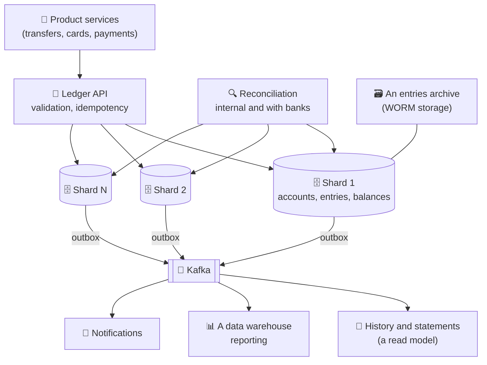
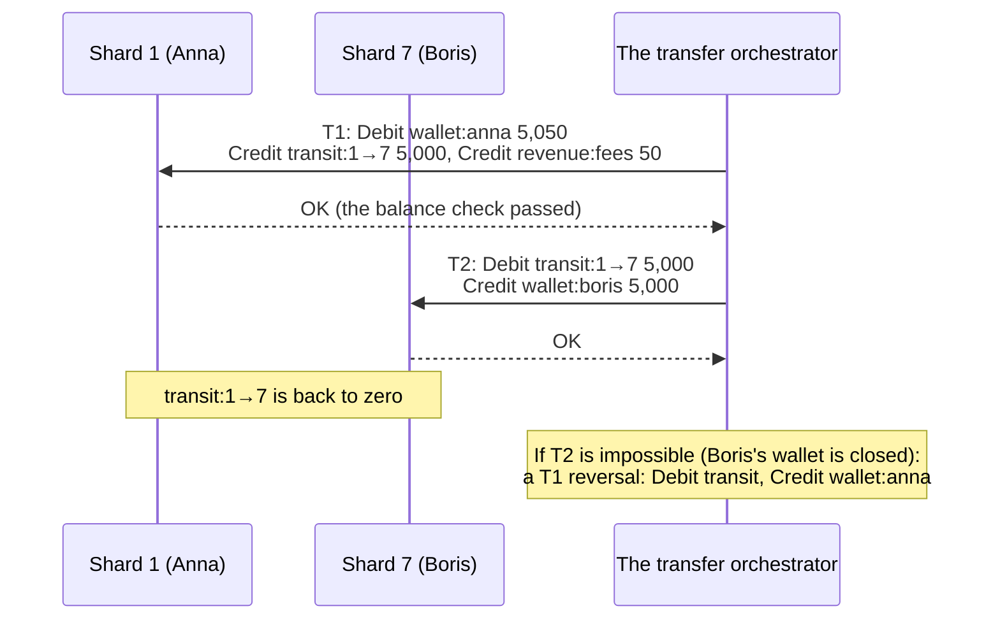
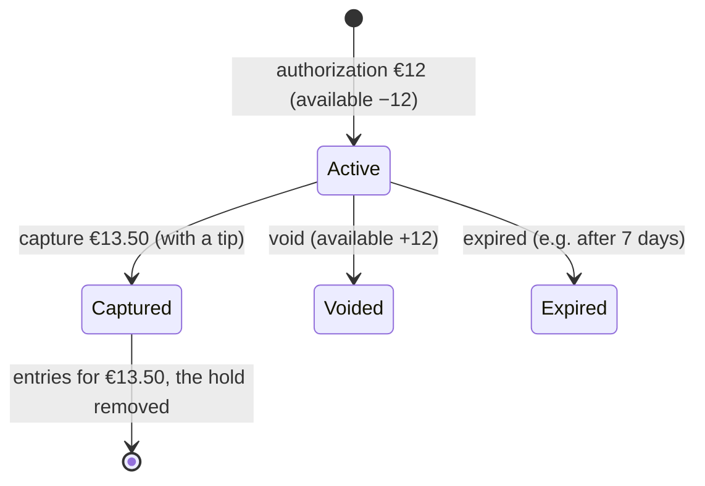

**English** | [Русский](README_RU.md)

# Tier 2 · 4D · 04. A Double-Entry Ledger and Wallet

> **Level:** Hard · **Interview time:** 45–60 min · **Study time:** ~5 h
> **Key aspects:** the ledger as a standalone platform service, account types and the normal balance side, atomic posting without going negative, cross-shard transfers via a transit account, holds and the available balance, hot accounts, materialized balances and point-in-time balances, immutability and hash chains, corrections via reversals, reconciliation, currencies, archiving
> **Builds on:** [Tier 1 · 20 Payments](../../../tier-1/20-payment-system/README.md#10-deep-dive-4-double-entry-bookkeeping) (double entry, reconciliation), [11-distributed-transactions](../../../11-distributed-transactions/README.md), [Tier 2 · 4C · 03 Vitess](../../4c-storage-databases/03-sharded-sql-vitess/README.md#9-deep-dive-3-transactions-and-uniqueness), [Tier 2 · 4D · 03 Inventory](../03-inventory-consistency/README.md#8-deep-dive-2-atomic-reservation-without-overselling), [Tier 2 · 4C · 01 Object Storage](../../4c-storage-databases/01-object-storage-s3/README.md#14-deep-dive-8-storage-classes-replication-and-security)

---

## 🗺️ How to Read This Walkthrough

The walkthrough follows an interview, but every step includes explanations: **why** a decision is made, **how** a mechanism works and **what happens** if you do it differently. The "📘 Explanation" blocks are theory right where you need it.

| Icon | Meaning |
|:----:|:--------|
| 🎤 | Interviewer |
| 🗣️ | What I (the candidate) say out loud |
| ✏️ | What I draw on the whiteboard |
| ⏱️ | Time budget for the step |
| 📘 | A detailed explanation of a concept |

Callouts: **TIP** — a good technique, **WARNING** — a trap, **IMPORTANT** — a Senior+ signal.

---

## 📑 Contents

0. [What This Problem Teaches](#0-what-this-problem-teaches)
1. [Problem Statement](#1-problem-statement)
2. [Clarifying Questions and Requirements](#2-clarifying-questions-and-requirements)
3. [Capacity Estimates](#3-capacity-estimates)
4. [Data Model](#4-data-model)
5. [API](#5-api)
6. [High-Level Design](#6-high-level-design)
7. [Deep Dive 1: Accounts and Wallet Entries](#7-deep-dive-1-accounts-and-wallet-entries)
8. [Deep Dive 2: Atomic Posting Without Going Negative](#8-deep-dive-2-atomic-posting-without-going-negative)
9. [Deep Dive 3: Cross-Shard Transfers](#9-deep-dive-3-cross-shard-transfers)
10. [Deep Dive 4: Holds and the Available Balance](#10-deep-dive-4-holds-and-the-available-balance)
11. [Deep Dive 5: Hot Accounts](#11-deep-dive-5-hot-accounts)
12. [Deep Dive 6: Balances — Store or Compute](#12-deep-dive-6-balances--store-or-compute)
13. [Deep Dive 7: Immutability, Auditing and Corrections](#13-deep-dive-7-immutability-auditing-and-corrections)
14. [Deep Dive 8: Reconciliation, Currencies and Scaling](#14-deep-dive-8-reconciliation-currencies-and-scaling)
15. [Bottlenecks and Failure Scenarios](#15-bottlenecks-and-failure-scenarios)
16. [What Changes at 10x Scale](#16-what-changes-at-10x-scale)
17. [Key Concepts and New Terms](#17-key-concepts-and-new-terms)
18. [Variations and Follow-Up Questions](#18-variations-and-follow-up-questions)
19. [Common Mistakes](#19-common-mistakes)
20. [Cheat Sheet and Self-Check](#20-cheat-sheet-and-self-check)

---

## 0. What This Problem Teaches

In [the payment system](../../../tier-1/20-payment-system/README.md) the ledger was one of the components. Here it's **a standalone platform service** through which all of a company's money flows: users' wallets, transfers, fees, card holds. Square, Stripe, Uber and Revolut build such services — and all of them face the same questions: how to guarantee a balance never goes negative, how to move money between shards without distributed transactions, what to do with an account that takes part in every operation, and how to prove to an auditor that history wasn't changed.

| What's tested | Where it shows up |
|:--------------|:------------------|
| The accounting model | Account types, the normal side, balanced entries |
| Strong consistency | Atomic posting, no negative balances |
| Distributed transactions | Cross-shard transfers |
| Hot keys | The fee account, large recipients |
| Storing derived data | Materialized balances versus the sum of entries |
| Auditing | Immutability, hash chains, reversals |
| Reconciliation | Internal and with banks |

> [!TIP]
> The key observation for the interview: **constraints are needed only when available funds decrease**. Crediting an account can't violate "balance ≥ 0", so credits needn't be serialized — and that opens the way to solving the hot-account problem.

---

## 1. Problem Statement

> 🎤 "Design a ledger and user wallets, as in Revolut or PayPal: top-ups, transfers between users, paying merchants, card holds, real-time balances, transaction history. A balance must never go negative, and history must be immutable and verifiable."

**Scenarios:**

```
Anna tops up her wallet with €100 from a card
Anna sends Boris €50 (a €0.50 fee) → Anna has €49.50, Boris +€50
Anna pays €12 by card at a café → first a hold (available €37.50), then the capture two days later
Two simultaneous €40 payments with a €49.50 balance → only one succeeds
An auditor asks: what was Anna's balance on March 31 at 23:59? Was the history ever changed?
```

**Time plan:**

| Step | ⏱️ |
|:-----|:--:|
| Requirements | 5 min |
| Estimates | 3 min |
| The model and API | 7 min |
| High-level design | 5 min |
| Deep dives | 25 min |
| Wrap-up | 3 min |

---

## 2. Clarifying Questions and Requirements

⏱️ 5 min

| My question | Interviewer's answer | What it changes and why |
|:------------|:---------------------|:------------------------|
| How many wallets? | ~100M | Sharding by account |
| Load? | ~10,000 operations/s, peaking at ~50,000/s | Each operation is 2–4 entries |
| Can a balance go negative? | No (overdraft is a separate product) | A check on every debit |
| Latency? | p99 < 100 ms | Synchronous posting |
| Card holds? | Yes | Pending and posted amounts |
| Currencies? | Several | Single-currency accounts, exchange as a separate operation |
| Retention? | 10 years, regulatory auditing | Immutability, an archive |
| A balance as of a date? | Yes, for statements and reporting | Snapshots and entries |

### Functional requirements

1. Accounts (users' wallets, platform accounts).
2. Entries: top-ups, transfers, payments, fees, refunds.
3. Holds: create, capture (possibly for a different amount), void, expire.
4. Balances: posted, pending, available — in real time.
5. Transaction history and a balance as of a point in time.
6. Corrections without changing history.

### Non-functional requirements

| Requirement | Target | Why |
|:------------|:-------|:----|
| Correctness | Every transaction is balanced; a balance never goes negative | Money |
| Strong consistency | A debit sees every previous operation | Double spending is unacceptable |
| Idempotency | A retry doesn't create a second operation | Networks are unreliable |
| Immutability | Records are never changed or deleted | Auditing and the regulator |
| Availability | High; on failure — better to refuse than to err | A CP choice for money |

---

## 3. Capacity Estimates

⏱️ 3 min

```
Operations:      up to 50,000/s at peak, ~10,000/s on average
Entries:         ~3 per operation → ~30,000/s on average ≈ 2.6B per day
Volume:          ~150 B per entry → ~390 GB per day ≈ 140 TB per year
Balance reads:   ~100,000/s (the app shows the balance constantly)

The platform's hot fee account: receives an entry from EVERY operation → up to 50,000 updates/s
```

### Conclusions

| Conclusion | Design consequence |
|:-----------|:-------------------|
| Hundreds of TB per year | Partitioning by time, archiving old entries |
| Billions of entries | A balance can't be summed on every request — it must be materialized |
| The fee account is hot | A special scheme for credits |
| Many balance reads | Replicas and a cache, with care (for display, not for decisions) |

---

## 4. Data Model

⏱️ 5 min

```
accounts
  account_id, owner_id, type: ASSET | LIABILITY | REVENUE | EXPENSE | EQUITY,
  currency, normal_side: DEBIT | CREDIT, status, allow_negative (false)

ledger_transactions
  txn_id, idempotency_key (UNIQUE), type: TOPUP | TRANSFER | PAYMENT | FEE | REFUND | REVERSAL,
  status: POSTED, reverses_txn_id (for reversals), metadata, created_at

entries                                   ← append-only
  entry_id, txn_id, account_id, direction: DEBIT | CREDIT, amount (an integer, in cents), currency,
  account_seq (the entry's sequence number within the account), prev_hash, hash, created_at

balances                                   ← materialized state
  account_id, posted, pending_holds, available = posted − pending_holds (for wallet liability accounts),
  last_account_seq, version

holds
  hold_id, account_id, amount, status: ACTIVE | CAPTURED | VOIDED | EXPIRED, expires_at, reference
```

| Invariant | How it's checked |
|:----------|:-----------------|
| In every transaction Σ debits = Σ credits (per currency) | Validation before writing |
| `balances.posted` = the sum of the account's entries | Background reconciliation |
| The sum of all the platform's balances per currency = 0 (accounting for side) | A daily check |

---

## 5. API

⏱️ 2 min

```http
POST /v1/transactions      Idempotency-Key: …
     { type: "TRANSFER", entries: [
         { account: "wallet:anna",  direction: "DEBIT",  amount: 5050, currency: "EUR" },
         { account: "wallet:boris", direction: "CREDIT", amount: 5000, currency: "EUR" },
         { account: "revenue:fees", direction: "CREDIT", amount:   50, currency: "EUR" } ] }
→ 201 { txn_id, status: "POSTED" }
→ 409 { error: "INSUFFICIENT_FUNDS" }

POST /v1/holds             { account, amount, expires_in, reference }   → hold_id
POST /v1/holds/{id}/capture  { amount }                                  ← may differ from the hold
POST /v1/holds/{id}/void

GET  /v1/accounts/{id}/balance            → { posted, pending, available }
GET  /v1/accounts/{id}/balance?as_of=2026-03-31T23:59:59Z
GET  /v1/accounts/{id}/entries?cursor=…
```

📘 The service accepts **entries**, not "transfer €50": business logic (the fee amount, the exchange rate) lives in the calling services, and the ledger guarantees only the accounting invariants. Convenience wrappers (`/transfers`) can be added on top.

---

## 6. High-Level Design

⏱️ 5 min



🗣️ "Key decisions:
- **the ledger is a separate service** with a narrow API: it accepts balanced entries, guarantees the invariants, and knows nothing about business logic;
- **a sharded relational DB** by `account_id`: an account's entries and balance live in one shard and are updated in one transaction;
- **outbox → events** for history, reporting, notifications;
- **reconciliation** — internal invariants and external statements;
- **an archive** of old entries in immutable storage."

---

## 7. Deep Dive 1: Accounts and Wallet Entries

> 🎤 "What do the entries for a transfer between wallets look like?"

### A wallet is the platform's liability

📘 From the platform's point of view, the money in Anna's wallet is **the platform's debt to Anna** (a liability). A top-up increases both the platform's assets (money in its bank account) and its liabilities.

| Account type | Normal side | Increase | Decrease |
|:-------------|:------------|:---------|:---------|
| An asset (the platform's bank account) | Debit | Debit | Credit |
| A liability (a user's wallet) | Credit | Credit | Debit |
| Revenue (fees) | Credit | Credit | Debit |
| An expense (bank fees) | Debit | Debit | Credit |

### Examples

```
1. Topping up Anna's wallet with €100 from a card:
   Debit   assets:bank_settlement   10,000   ← money will arrive from the acquirer
   Credit  wallet:anna              10,000   ← the platform owes Anna

2. A transfer Anna → Boris of €50 with a €0.50 fee:
   Debit   wallet:anna               5,050   ← the debt to Anna decreased
   Credit  wallet:boris              5,000   ← the debt to Boris increased
   Credit  revenue:transfer_fees        50   ← the platform's revenue
   Σ debit 5,050 = Σ credit 5,050 ✅

3. Refunding the fee (a mistake) — not a change, but a new reversal transaction:
   Debit   revenue:transfer_fees        50
   Credit  wallet:anna                  50
```

📘 The principles of double entry are covered in [the payment system](../../../tier-1/20-payment-system/README.md#10-deep-dive-4-double-entry-bookkeeping); what matters here is that **every product operation is a set of balanced entries**, and the ledger rejects any unbalanced transaction.

---

## 8. Deep Dive 2: Atomic Posting Without Going Negative

> 🎤 "The wallet holds €49.50. Two €40 payments arrive at the same moment. How do you let only one through?"

### Posting within one shard

```sql
BEGIN;
  -- 1. Idempotency
  INSERT INTO ledger_transactions (txn_id, idempotency_key, type, …) VALUES (…);
     -- UNIQUE(idempotency_key): a retry → a uniqueness error → return the first attempt's result

  -- 2. The debit with a check — atomically
  UPDATE balances
  SET posted = posted - 4000, available = available - 4000,
      last_account_seq = last_account_seq + 1, version = version + 1
  WHERE account_id = 'wallet:anna' AND available >= 4000;
     -- 0 rows → INSUFFICIENT_FUNDS → ROLLBACK

  -- 3. The credits
  UPDATE balances SET posted = posted + 4000, … WHERE account_id = 'merchant:cafe';

  -- 4. The entries, with a per-account sequence number
  INSERT INTO entries (…, account_seq, …) VALUES (…), (…);
COMMIT;
```

| Decision | Why |
|:---------|:----|
| A conditional update `WHERE available >= amount` | The check and the debit are atomic — the second payment sees the already-reduced balance (as with inventory, see [4D · 03](../03-inventory-consistency/README.md#8-deep-dive-2-atomic-reservation-without-overselling)) |
| The balance and the entries in one transaction | The materialized balance always matches the entries |
| Locking accounts in **a fixed order** (by account_id) | No deadlocks on transfers in opposite directions |
| `account_seq` | A strict order of entries per account; the basis for statements and hash chains |
| An idempotency key with UNIQUE | A retry doesn't create a second operation |

> [!IMPORTANT]
> **Senior+ signal:** the ledger is **a CP system**: when in doubt (a shard is unavailable, a timeout) it's better to reject the operation than to risk double spending. For money, correctness matters more than availability.

---

## 9. Deep Dive 3: Cross-Shard Transfers

> 🎤 "Anna's wallet is in shard 1, Boris's in shard 7. How do you transfer atomically?"

| Option | How | Trade-off |
|:-------|:----|:----------|
| **2PC** across shards | A distributed database transaction | Atomic, but blocking if the coordinator fails, plus latency |
| **A distributed DB** (Spanner, CockroachDB) | Cross-shard transactions out of the box | Simple for developers; every write is more expensive and slower |
| **A saga via a transit account** ⭐ | Two balanced local transactions | Each step is correct on its own; the intermediate state is visible in the books |

### A saga via a transit account



| Property | Why it matters |
|:---------|:---------------|
| **Each local transaction is balanced** | The ledger's invariants hold at every step |
| The balance check happens in the first step, in the sender's shard | Money never "hangs" without cover |
| **The transit account must return to zero** | Reconciliation: a non-zero transit account older than N minutes → an unfinished transfer → an alert and automatic completion or reversal |
| Idempotent steps by transfer ID | The orchestrator's retries are safe |
| Compensation is a reversal, not a deletion | History is preserved |

---

## 10. Deep Dive 4: Holds and the Available Balance

> 🎤 "Anna pays by card at a café. The café's bank will capture the money in two days, and the amount may differ (a tip). How do you record that?"

### Two balances

```
posted      = the sum of posted operations              €49.50
holds       = the sum of active holds                   €12.00
available   = posted − holds                            €37.50   ← shown, and checked for new spending
```

### The hold lifecycle



| Decision | Why |
|:---------|:----|
| Creating a hold is conditional: `available >= amount` | You can't hold more than there is |
| A hold **creates no entries** | The money hasn't moved yet; only the available balance changes |
| Capture — entries for **the actual** amount + removing the hold in one transaction | The amount may differ |
| A capture larger than the hold | Allowed within network rules (e.g. tips) — with an availability check, or a short permitted negative per product rules |
| Expiry | A background process releases it; a late capture is still accepted (the card network may capture after expiry) — per the scheme's rules |

---

## 11. Deep Dive 5: Hot Accounts

> 🎤 "The platform's fee account receives an entry from every operation — 50,000 times per second. What happens?"

### The problem

📘 Updating `balances` for `revenue:fees` is a single row, locked on every transaction. Every platform operation queues up behind that lock: the whole system's throughput is capped by one row.

### The observation: credits needn't be serialized

📘 The "balance ≥ 0" check is needed only when available funds **decrease**. A credit (to a liability account, or revenue) can't violate the invariant. So credits can be **accumulated** rather than updating the balance synchronously.

| Solution | How | For which accounts |
|:---------|:----|:-------------------|
| **Sub-accounts** | `revenue:fees` → 64 sub-accounts (`revenue:fees:0..63`), with each entry going to a random one; reporting sums them | The platform's internal accounts |
| **Deferred balance updates** | Entries are written immediately (inserts only), and the materialized balance is updated in a batch once a second | Accounts that don't need real-time checks |
| **Separating credits and debits** | Credits — entry inserts only; debits — with a lock and a check; balance = a snapshot + accumulated credits | Large merchants receiving thousands of payments per second |

```
A large merchant (a marketplace):
  incoming payments:  1,000/s  → only INSERTs of entries, no balance lock
  payouts to the merchant: once a day → a checked debit: available = the snapshot + Σ new credits
```

> [!TIP]
> A good phrasing: "**Serialize only what can violate an invariant**. Debits from users' wallets — under a lock with a check; credits to revenue accounts and large recipients — without a lock, with aggregation."

---

## 12. Deep Dive 6: Balances — Store or Compute

> 🎤 "A balance is the sum of entries. Why store it separately?"

| Approach | Pros | Cons |
|:---------|:-----|:-----|
| **Compute** by summing entries | Always correct by definition | Millions of entries on an active account — slow |
| **A materialized balance** ⭐ | Read in one access; checked on debits | Must match the entries exactly — updated in the same transaction and reconciled |
| **Snapshots + a tail** | A balance at any moment: the nearest snapshot + the entries after it | Storing snapshots |

### A point-in-time balance

```
Anna's balance on 03/31 at 23:59:
  the nearest snapshot before the date: 03/31 00:00 → €120.00
  + the account's entries from 03/31 00:00 to 23:59:59 by account_seq
  = €87.40
```

| Decision | Why |
|:---------|:----|
| Daily balance snapshots per account | Fast statements and reporting |
| `account_seq` and (optionally) `balance_after` on each entry | A statement with the balance after each operation, no recomputation |
| **A background check**: the materialized balance = the sum of entries | Detecting code bugs |
| A balance cache — for **display** only | Debit decisions — only against the source in the DB |

---

## 13. Deep Dive 7: Immutability, Auditing and Corrections

> 🎤 "How do you prove to an auditor that history wasn't changed retroactively?"

### Append-only

| Measure | How |
|:--------|:----|
| No UPDATE or DELETE on `entries` and `ledger_transactions` | Database permissions: the service's role can only insert |
| **Corrections are reversals** | A mistaken transaction is offset by a new transaction with opposite entries and a `reverses_txn_id` reference |
| An action audit | Who initiated an operation, when, and why (the service, the operator, the basis) |

### A hash chain

```
An account's entries in account_seq order:
  e1: hash1 = H(data of e1 + "")
  e2: hash2 = H(data of e2 + hash1)
  e3: hash3 = H(data of e3 + hash2)

Changing e2 retroactively → hash2 differs → hash3 doesn't match → the tampering is visible
```

| Decision | Why |
|:---------|:----|
| An entry's hash includes the hash of the account's previous entry | Detecting changes and gaps |
| **Periodically anchoring** a "root" hash (e.g. a hash over every account for the day) in external immutable storage | Even a database administrator can't rewrite history unnoticed |
| An archive in WORM storage (object lock) | Regulatory retention requirements (see [4C · 01](../../4c-storage-databases/01-object-storage-s3/README.md#14-deep-dive-8-storage-classes-replication-and-security)) |

> [!NOTE]
> Specialized databases with verifiable history exist (e.g. Amazon QLDB, now discontinued), but the same effect is achieved with an ordinary database + insert-only permissions + a hash chain + external anchoring.

---

## 14. Deep Dive 8: Reconciliation, Currencies and Scaling

### Reconciliation

| Level | What's checked |
|:------|:---------------|
| **Internal** | Every transaction is balanced; the sum of balances per currency = 0; materialized balances = sums of entries; transit accounts are back to zero |
| **With banks and card networks** | The `assets:bank` account versus the bank statement; holds and captures versus the networks' settlement files (see [Tier 1 · 20](../../../tier-1/20-payment-system/README.md#12-deep-dive-6-reconciliation)) |
| **The sum of wallets** | The sum of all users' wallets = the money in the platform's safeguarded account (a regulatory requirement for holding customer funds) |

### Currencies

```
Anna exchanges €100 for $108 (a rate of 1.08):
  Debit   wallet:anna:EUR    10,000 EUR
  Credit  fx:position:EUR    10,000 EUR
  Debit   fx:position:USD    10,800 USD
  Credit  wallet:anna:USD    10,800 USD
Each currency balances separately; the rate and its source are in the transaction's metadata
```

| Rule | Why |
|:-----|:----|
| An account holds one currency | You can't add euros and dollars |
| An exchange is entries in each currency through currency position accounts | Balanced per currency |
| The rate is recorded in the transaction | Auditing |

### Scaling

| Decision | Why |
|:---------|:----|
| Sharding by `account_id` | One account's operations stay in one shard |
| One owner's accounts in one shard | An in-wallet currency exchange is a local transaction |
| Partitioning `entries` by time | Archiving old partitions to object storage |
| History and statements — a read model from events | Keeping load off the main DB |
| Reporting — CDC into a data warehouse | Analytical queries kept separate |

---

## 15. Bottlenecks and Failure Scenarios

| Scenario | What happens | How we protect |
|:---------|:-------------|:---------------|
| Two simultaneous spends | Going negative | A conditional balance update |
| A retried request | A double operation | UNIQUE on the idempotency key |
| Transfers in opposite directions | A deadlock | Locks in a fixed order |
| A cross-shard transfer failed midway | Money "in transit" | A transit account, reconciliation, completion or reversal |
| The hot fee account | A queue behind a lock | Sub-accounts, deferred balances, lock-free credits |
| The materialized balance diverged from the entries | Wrong decisions | One transaction, a background check |
| A mistaken entry | A wrong balance | A reversal, not a change |
| An attempt to rewrite history | Tampering | Insert-only, a hash chain, external anchoring |
| A shard is unavailable | Its accounts' operations are impossible | CP: refuse rather than risk; replicas for reading history |
| Mixing currencies | Wrong balances | One currency per account, per-currency checks |

---

## 16. What Changes at 10x Scale

> 🎤 "A billion wallets and 500,000 operations per second?"

| Change | Why |
|:-------|:----|
| **A distributed SQL database** (Spanner-like) or more shards | Write scale and cross-shard operations |
| **Regional ledgers** with data residency | Laws on financial data |
| **Batching credits** wherever there are no checks | Throughput |
| **Streaming reconciliation** | Discrepancies found within minutes |

---

## 17. Key Concepts and New Terms

### What's applied

| Concept | Where it's covered | How it applies here |
|:--------|:-------------------|:--------------------|
| Double entry, reconciliation | [Tier 1 · 20](../../../tier-1/20-payment-system/README.md) | The basis of the ledger |
| Sagas, the outbox | [11-distributed-transactions](../../../11-distributed-transactions/README.md) | Cross-shard transfers, events |
| Cross-shard transactions | [Tier 2 · 4C · 03](../../4c-storage-databases/03-sharded-sql-vitess/README.md) | Why they're best avoided |
| An atomic check | [Tier 2 · 4D · 03](../03-inventory-consistency/README.md) | Debiting without going negative |
| WORM storage | [Tier 2 · 4C · 01](../../4c-storage-databases/01-object-storage-s3/README.md) | The archive |

### New terms in this problem

| Term | In short |
|:-----|:---------|
| **Account types and the normal side** | Assets, liabilities, revenue, expenses; where a debit increases and where it decreases |
| **A wallet as a liability** | A user's money is the platform's debt |
| **A transit account** | An intermediate account for cross-shard transfers, which must return to zero |
| **A hold** | Reducing the available balance without entries |
| **Posted, pending, available** | The posted, held and available balances |
| **A hot account** | An account involved in almost every operation |
| **Sub-accounts** | Splitting a hot account into several |
| **account_seq** | An entry's sequence number within the account |
| **A hash chain** | Detecting changes to history |
| **A reversal** | Correcting with an opposite transaction |
| **A currency position** | Accounts for currency exchange |

---

## 18. Variations and Follow-Up Questions

<details>
<summary><b>Why not store just the balance and update it?</b></summary>

Without entries you can't explain where a balance came from, restore it after a bug, produce a statement, or pass an audit and reconciliation. The balance is derived from immutable entries; the entries are the source of truth.
</details>

<details>
<summary><b>How do you implement an overdraft or a credit line?</b></summary>

An account with a permitted minimum balance (−limit) and a separate debt account; the debit check becomes `available + credit_limit >= amount`. Interest accrual is separate periodic entries.
</details>

<details>
<summary><b>How do you implement scheduled and recurring payments?</b></summary>

At the right moment a scheduler creates a transaction with an idempotency key of (payment, period) — a rerun won't debit twice. On insufficient funds — retries on a schedule and a notification.
</details>

<details>
<summary><b>Can a blockchain be used for such a ledger?</b></summary>

A company's internal ledger doesn't need decentralized consensus among mutually distrusting parties: a trusted operator + a hash chain + external anchoring give verifiability far more cheaply and quickly. A blockchain is justified when several independent organizations must keep a shared ledger without a trusted operator.
</details>

<details>
<summary><b>How do you handle a card dispute (a chargeback)?</b></summary>

Separate entries: holding the disputed amount on the merchant's or wallet's account (moving it to a "disputed funds" account), then, depending on the outcome — refunding the buyer or releasing the hold. The history of every step is preserved.
</details>

---

## 19. Common Mistakes

| ❌ Mistake | Why it's bad | ✅ Do this instead |
|:----------|:-------------|:------------------|
| Storing only the balance | No history or audit trail | Entries as the source of truth |
| Floating-point numbers | Rounding errors | Integer amounts in minor units |
| Checking the balance in code, then UPDATE | Double spending | An atomic conditional update |
| The balance and entries in different transactions | Divergence | One transaction |
| 2PC on every cross-shard transfer | Locks, latency | A saga via a transit account |
| Locking a hot account's balance on every operation | The whole system hits one row | Sub-accounts, lock-free credits |
| Debit decisions based on a balance cache | Double spending | Only against the source in the DB |
| UPDATE or DELETE on entries | Auditing becomes impossible | Reversals |
| Multi-currency accounts | Wrong sums | One currency per account |
| Availability over correctness | Errors with money | CP: better to refuse |

---

## 20. Cheat Sheet and Self-Check

### 30-second answer

> The ledger is a separate CP service with a narrow API: it accepts only balanced transactions (Σ debits = Σ credits per currency), integer amounts in cents, and an idempotency key with UNIQUE. A wallet is the platform's liability (a credit increases it). Sharding by account_id; in one shard transaction — inserting entries with account_seq and a conditional update of the materialized balance (`WHERE available >= amount`), with locks in a fixed order. A cross-shard transfer is a saga of two balanced local transactions through a transit account that must return to zero; the balance check happens in the sender's step; compensation is a reversal. Holds reduce available without entries; a capture means entries for the actual amount + removing the hold. Hot accounts: serialize only debits; credits go without a lock, via sub-accounts and batched balance updates. A point-in-time balance — snapshots + the tail of entries; a background check "balance = sum of entries". Immutability: insert-only, corrections via reversals, a per-account hash chain, external anchoring of the root hash, a WORM archive. Reconciliation: internal invariants, banks and card networks, the sum of wallets = the safeguarded account. Currencies — separate accounts and entries through a currency position.

### Self-check

- [ ] I can explain account types and why a wallet is a liability
- [ ] I can write the entries for a top-up, a transfer with a fee, and a currency exchange
- [ ] I can write an atomic posting that can't go negative
- [ ] I can design a cross-shard transfer via a transit account
- [ ] I can explain holds and the three balances
- [ ] I can solve the hot-account problem and explain why credits needn't be serialized
- [ ] I can compare storing and computing a balance and produce a balance as of a date
- [ ] I can explain immutability, reversals and hash chains
- [ ] I can list the levels of reconciliation

### Further reading

- Martin Fowler, *Accounting Patterns*
- Square Engineering, *Books: an immutable double-entry accounting database service*
- Uber Engineering articles on LedgerStore
- Modern Treasury's article series on designing ledgers
- The [Tier 1 · 20 Payment System](../../../tier-1/20-payment-system/README.md) walkthrough
