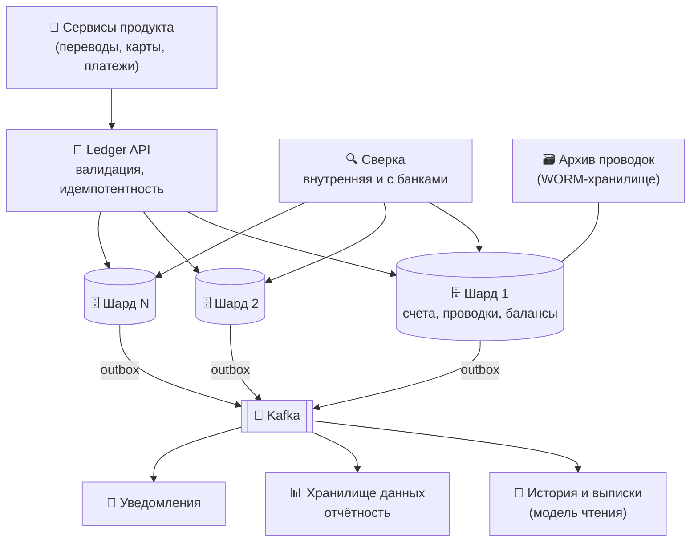
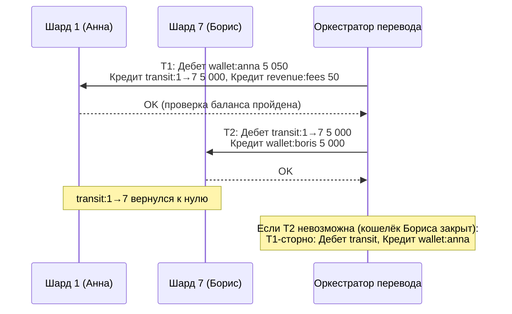
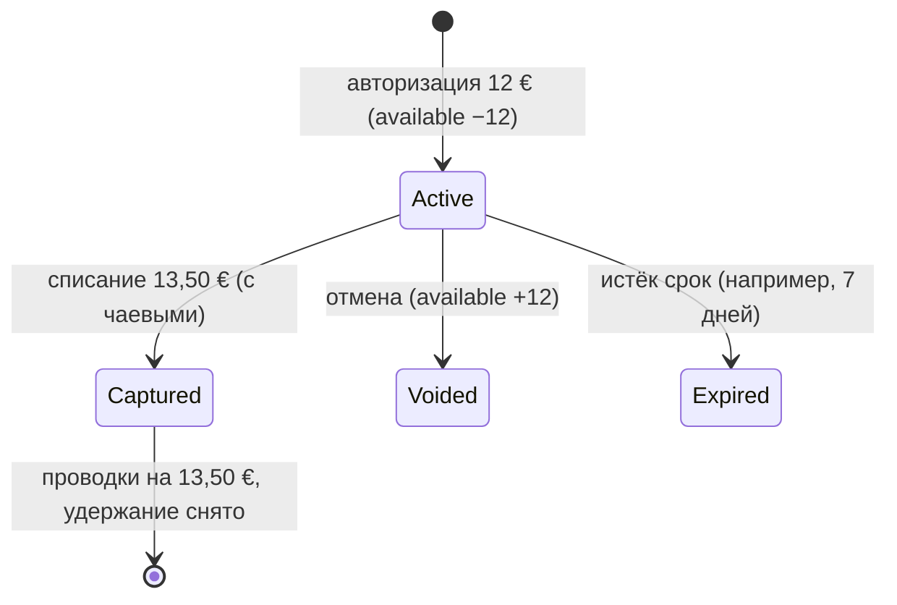

[English](README.md) | **Русский**

# Tier 2 · 4D · 04. Double-entry ledger и кошелёк

> **Уровень:** Hard · **Время на интервью:** 45–60 мин · **Время на разбор:** ~5 ч
> **Ключевые аспекты:** реестр как отдельный платформенный сервис, типы счетов и нормальная сторона баланса, атомарная проводка без ухода в минус, переводы между шардами через транзитный счёт, удержания (holds) и доступный баланс, горячие счета, материализованные балансы и баланс на момент времени, неизменяемость и цепочка хэшей, исправления сторнированием, сверка, валюты, архивирование
> **Опирается на:** [Tier 1 · 20 Payments](../../../tier-1/20-payment-system/README_RU.md#10-deep-dive-4-бухгалтерия-двойной-записи) (двойная запись, сверка), [11-distributed-transactions](../../../11-distributed-transactions/README_RU.md), [Tier 2 · 4C · 03 Vitess](../../4c-storage-databases/03-sharded-sql-vitess/README_RU.md#9-deep-dive-3-транзакции-и-уникальность), [Tier 2 · 4D · 03 Inventory](../03-inventory-consistency/README_RU.md#8-deep-dive-2-атомарное-резервирование-без-overselling), [Tier 2 · 4C · 01 Object Storage](../../4c-storage-databases/01-object-storage-s3/README_RU.md#14-deep-dive-8-классы-хранения-репликация-и-безопасность)

---

## 🗺️ Как читать этот разбор

Разбор построен как интервью, но в каждом шаге есть объяснения: **почему** принимается решение, **как работает** механизм и **что будет**, если сделать иначе. Блоки «📘 Объяснение» — теория прямо по ходу задачи.

| Значок | Что значит |
|:------:|:-----------|
| 🎤 | Реплика интервьюера |
| 🗣️ | Что говорю вслух я (кандидат) |
| ✏️ | Что рисую на доске |
| ⏱️ | Сколько времени тратить на шаг |
| 📘 | Подробное объяснение концепции |

Блоки **TIP** — хороший приём, **WARNING** — ловушка, **IMPORTANT** — сигнал для уровня Senior+.

---

## 📑 Содержание

0. [Чему учит эта задача](#0-чему-учит-эта-задача)
1. [Условие задачи](#1-условие-задачи)
2. [Уточняющие вопросы и требования](#2-уточняющие-вопросы-и-требования)
3. [Оценки нагрузки](#3-оценки-нагрузки)
4. [Модель данных](#4-модель-данных)
5. [API](#5-api)
6. [High-level дизайн](#6-high-level-дизайн)
7. [Deep dive 1: счета и проводки кошелька](#7-deep-dive-1-счета-и-проводки-кошелька)
8. [Deep dive 2: атомарная проводка без ухода в минус](#8-deep-dive-2-атомарная-проводка-без-ухода-в-минус)
9. [Deep dive 3: переводы между шардами](#9-deep-dive-3-переводы-между-шардами)
10. [Deep dive 4: удержания и доступный баланс](#10-deep-dive-4-удержания-и-доступный-баланс)
11. [Deep dive 5: горячие счета](#11-deep-dive-5-горячие-счета)
12. [Deep dive 6: балансы — хранить или вычислять](#12-deep-dive-6-балансы--хранить-или-вычислять)
13. [Deep dive 7: неизменяемость, аудит и исправления](#13-deep-dive-7-неизменяемость-аудит-и-исправления)
14. [Deep dive 8: сверка, валюты и масштабирование](#14-deep-dive-8-сверка-валюты-и-масштабирование)
15. [Узкие места и сценарии сбоев](#15-узкие-места-и-сценарии-сбоев)
16. [Что изменится при росте в 10 раз](#16-что-изменится-при-росте-в-10-раз)
17. [Ключевые концепции и новые понятия](#17-ключевые-концепции-и-новые-понятия)
18. [Варианты задачи и follow-up вопросы](#18-варианты-задачи-и-follow-up-вопросы)
19. [Типичные ошибки](#19-типичные-ошибки)
20. [Шпаргалка и самопроверка](#20-шпаргалка-и-самопроверка)

---

## 0. Чему учит эта задача

В [платёжной системе](../../../tier-1/20-payment-system/README_RU.md) реестр был одним из компонентов. Здесь он — **самостоятельный платформенный сервис**, через который проходят все деньги компании: кошельки пользователей, переводы, комиссии, удержания по картам. Такие сервисы строят Square, Stripe, Uber, Revolut — и все сталкиваются с одними и теми же вопросами: как гарантировать, что баланс никогда не уйдёт в минус, как переводить деньги между шардами без распределённых транзакций, что делать со счётом, на который приходит каждая операция, и как доказать аудитору, что история не изменялась.

| Что проверяют | Где это в задаче |
|:--------------|:-----------------|
| Бухгалтерская модель | Типы счетов, нормальная сторона, сбалансированные проводки |
| Строгая консистентность | Атомарная проводка, запрет отрицательного баланса |
| Распределённые транзакции | Переводы между шардами |
| Горячие ключи | Счёт комиссий, крупные получатели |
| Хранение производных данных | Материализованные балансы против суммы проводок |
| Аудит | Неизменяемость, цепочка хэшей, сторно |
| Сверка | Внутренняя и с банками |

> [!TIP]
> Ключевое наблюдение для интервью: **ограничения нужны только при уменьшении доступных средств**. Зачисление на счёт не может нарушить «баланс ≥ 0», поэтому его можно не сериализовать — это открывает путь к решению проблемы горячих счетов.

---

## 1. Условие задачи

> 🎤 «Спроектируй реестр (ledger) и кошельки пользователей, как в Revolut или PayPal: пополнение, переводы между пользователями, оплата у продавцов, удержания по картам, баланс в реальном времени, история операций. Баланс не должен уходить в минус, история должна быть неизменяемой и проверяемой».

**Сценарии:**

```
Анна пополняет кошелёк на 100 € с карты
Анна переводит Борису 50 € (комиссия 0,50 €) → у Анны 49,50 €, у Бориса +50 €
Анна платит картой в кафе 12 € → сначала удержание (доступно 37,50), через 2 дня списание
Две одновременные оплаты по 40 € при балансе 49,50 → проходит только одна
Аудитор спрашивает: каким был баланс Анны 31 марта в 23:59? Изменялась ли история?
```

**План по времени:**

| Шаг | ⏱️ |
|:----|:--:|
| Требования | 5 мин |
| Оценки | 3 мин |
| Модель и API | 7 мин |
| High-level дизайн | 5 мин |
| Deep dives | 25 мин |
| Итоги | 3 мин |

---

## 2. Уточняющие вопросы и требования

⏱️ 5 мин

| Мой вопрос | Ответ интервьюера | Что это меняет и почему |
|:-----------|:------------------|:------------------------|
| Сколько кошельков? | ~100M | Шардирование по счёту |
| Нагрузка? | ~10 000 операций/с, пик ~50 000/с | Каждая операция — 2–4 проводки |
| Можно ли уйти в минус? | Нет (овердрафт — отдельный продукт) | Проверка при каждом списании |
| Задержка? | p99 < 100 мс | Синхронная проводка |
| Удержания по картам? | Да | Ожидающие и проведённые суммы |
| Валюты? | Несколько | Счета в одной валюте, обмен — отдельной операцией |
| Хранение? | 10 лет, аудит регулятора | Неизменяемость, архив |
| Баланс на дату? | Да, для выписок и отчётности | Снимки и проводки |

### Функциональные требования

1. Счета (кошельки пользователей, счета платформы).
2. Проводки: пополнение, перевод, оплата, комиссия, возврат.
3. Удержания: создать, списать (возможно на другую сумму), отменить, истечение.
4. Баланс: проведённый, ожидающий, доступный — в реальном времени.
5. История операций и баланс на момент времени.
6. Исправления без изменения истории.

### Нефункциональные требования

| Требование | Цель | Почему |
|:-----------|:-----|:-------|
| Корректность | Каждая проводка сбалансирована; баланс не уходит в минус | Деньги |
| Строгая консистентность | Списание видит все предыдущие операции | Двойная трата недопустима |
| Идемпотентность | Повтор не создаёт вторую операцию | Сети ненадёжны |
| Неизменяемость | Записи не изменяются и не удаляются | Аудит и регулятор |
| Доступность | Высокая; при сбое — лучше отказать, чем ошибиться | CP-выбор для денег |

---

## 3. Оценки нагрузки

⏱️ 3 мин

```
Операции:        до 50 000/с в пике, в среднем ~10 000/с
Проводки:        ~3 на операцию → ~30 000/с в среднем ≈ 2,6 млрд в сутки
Объём:           ~150 Б на проводку → ~390 ГБ в сутки ≈ 140 ТБ в год
Чтения баланса:  ~100 000/с (приложение показывает баланс постоянно)

Горячий счёт комиссий платформы: получает проводку от КАЖДОЙ операции → до 50 000 обновлений/с
```

### Выводы

| Вывод | Следствие для дизайна |
|:------|:----------------------|
| Сотни ТБ в год | Секционирование по времени, архив старых проводок |
| Миллиарды проводок | Баланс нельзя считать суммированием на каждый запрос — нужен материализованный |
| Счёт комиссий — горячий | Особая схема для зачислений |
| Чтений баланса много | Реплики и кэш с осторожностью (для показа, не для решений) |

---

## 4. Модель данных

⏱️ 5 мин

```
accounts
  account_id, owner_id, type: ASSET | LIABILITY | REVENUE | EXPENSE | EQUITY,
  currency, normal_side: DEBIT | CREDIT, status, allow_negative (false)

ledger_transactions
  txn_id, idempotency_key (UNIQUE), type: TOPUP | TRANSFER | PAYMENT | FEE | REFUND | REVERSAL,
  status: POSTED, reverses_txn_id (для сторно), metadata, created_at

entries                                   ← только добавление
  entry_id, txn_id, account_id, direction: DEBIT | CREDIT, amount (целое, в центах), currency,
  account_seq (порядковый номер проводки по счёту), prev_hash, hash, created_at

balances                                   ← материализованное состояние
  account_id, posted, pending_holds, available = posted − pending_holds (для пассивных счетов кошельков),
  last_account_seq, version

holds
  hold_id, account_id, amount, status: ACTIVE | CAPTURED | VOIDED | EXPIRED, expires_at, reference
```

| Инвариант | Как проверяется |
|:----------|:----------------|
| В каждой транзакции Σ дебетов = Σ кредитов (по каждой валюте) | Валидация до записи |
| `balances.posted` = сумма проводок счёта | Фоновая сверка |
| Сумма всех балансов платформы по валюте = 0 (с учётом стороны) | Ежедневная проверка |

---

## 5. API

⏱️ 2 мин

```http
POST /v1/transactions      Idempotency-Key: …
     { type: "TRANSFER", entries: [
         { account: "wallet:anna",  direction: "DEBIT",  amount: 5050, currency: "EUR" },
         { account: "wallet:boris", direction: "CREDIT", amount: 5000, currency: "EUR" },
         { account: "revenue:fees", direction: "CREDIT", amount:   50, currency: "EUR" } ] }
→ 201 { txn_id, status: "POSTED" }
→ 409 { error: "INSUFFICIENT_FUNDS" }

POST /v1/holds             { account, amount, expires_in, reference }   → hold_id
POST /v1/holds/{id}/capture  { amount }                                  ← может отличаться от удержания
POST /v1/holds/{id}/void

GET  /v1/accounts/{id}/balance            → { posted, pending, available }
GET  /v1/accounts/{id}/balance?as_of=2026-03-31T23:59:59Z
GET  /v1/accounts/{id}/entries?cursor=…
```

📘 Сервис принимает **проводки**, а не «переведи 50 €»: бизнес-логика (размер комиссии, курс) живёт в вызывающих сервисах, а реестр гарантирует только бухгалтерские инварианты. Удобные обёртки (`/transfers`) можно добавить сверху.

---

## 6. High-level дизайн

⏱️ 5 мин



🗣️ «Ключевые решения:
- **реестр — отдельный сервис** с узким API: принимает сбалансированные проводки, гарантирует инварианты, ничего не знает о бизнес-логике;
- **шардированная реляционная БД** по `account_id`: проводки и баланс счёта — в одном шарде, обновляются в одной транзакции;
- **outbox → события** для истории, отчётности, уведомлений;
- **сверка** — внутренние инварианты и внешние выписки;
- **архив** старых проводок в неизменяемом хранилище».

---

## 7. Deep dive 1: счета и проводки кошелька

> 🎤 «Как выглядят проводки перевода между кошельками?»

### Кошелёк — обязательство платформы

📘 С точки зрения платформы деньги на кошельке Анны — это **долг платформы перед Анной** (обязательство, LIABILITY). Пополнение увеличивает и активы платформы (деньги на банковском счёте), и её обязательства.

| Тип счёта | Нормальная сторона | Увеличение | Уменьшение |
|:----------|:-------------------|:-----------|:-----------|
| Актив (банковский счёт платформы) | Дебет | Дебет | Кредит |
| Обязательство (кошелёк пользователя) | Кредит | Кредит | Дебет |
| Доход (комиссии) | Кредит | Кредит | Дебет |
| Расход (комиссии банков) | Дебет | Дебет | Кредит |

### Примеры

```
1. Пополнение кошелька Анны на 100 € с карты:
   Дебет   assets:bank_settlement   10 000   ← деньги придут от эквайера
   Кредит  wallet:anna              10 000   ← платформа должна Анне

2. Перевод Анна → Борис 50 € с комиссией 0,50 €:
   Дебет   wallet:anna               5 050   ← долг перед Анной уменьшился
   Кредит  wallet:boris              5 000   ← долг перед Борисом вырос
   Кредит  revenue:transfer_fees        50   ← доход платформы
   Σ дебет 5 050 = Σ кредит 5 050 ✅

3. Возврат комиссии (ошибка) — не изменение, а новая транзакция-сторно:
   Дебет   revenue:transfer_fees        50
   Кредит  wallet:anna                  50
```

📘 Принципы двойной записи разобраны в [платёжной системе](../../../tier-1/20-payment-system/README_RU.md#10-deep-dive-4-бухгалтерия-двойной-записи); здесь важно, что **каждая операция продукта — это набор сбалансированных проводок**, и реестр отклоняет любую несбалансированную транзакцию.

---

## 8. Deep dive 2: атомарная проводка без ухода в минус

> 🎤 «На кошельке 49,50 €. Одновременно приходят две оплаты по 40 €. Как пропустить только одну?»

### Проводка в одном шарде

```sql
BEGIN;
  -- 1. Идемпотентность
  INSERT INTO ledger_transactions (txn_id, idempotency_key, type, …) VALUES (…);
     -- UNIQUE(idempotency_key): повтор → ошибка уникальности → вернуть результат первой попытки

  -- 2. Списание с проверкой — атомарно
  UPDATE balances
  SET posted = posted - 4000, available = available - 4000,
      last_account_seq = last_account_seq + 1, version = version + 1
  WHERE account_id = 'wallet:anna' AND available >= 4000;
     -- 0 строк → INSUFFICIENT_FUNDS → ROLLBACK

  -- 3. Зачисления
  UPDATE balances SET posted = posted + 4000, … WHERE account_id = 'merchant:cafe';

  -- 4. Проводки с порядковым номером по счёту
  INSERT INTO entries (…, account_seq, …) VALUES (…), (…);
COMMIT;
```

| Решение | Почему |
|:--------|:-------|
| Условное обновление `WHERE available >= amount` | Проверка и списание атомарны — вторая оплата увидит уже уменьшенный баланс (как с остатками, см. [4D · 03](../03-inventory-consistency/README_RU.md#8-deep-dive-2-атомарное-резервирование-без-overselling)) |
| Баланс и проводки — в одной транзакции | Материализованный баланс всегда согласован с проводками |
| Блокировки счетов в **фиксированном порядке** (по account_id) | Нет взаимоблокировок при встречных переводах |
| `account_seq` | Строгий порядок проводок по счёту; основа выписок и цепочки хэшей |
| Ключ идемпотентности с UNIQUE | Повтор не создаёт вторую операцию |

> [!IMPORTANT]
> **Сигнал Senior+:** реестр — **CP-система**: при сомнении (недоступен шард, таймаут) лучше отказать в операции, чем рискнуть двойной тратой. Для денег корректность важнее доступности.

---

## 9. Deep dive 3: переводы между шардами

> 🎤 «Кошелёк Анны в шарде 1, кошелёк Бориса — в шарде 7. Как перевести атомарно?»

| Вариант | Как | Компромисс |
|:--------|:----|:-----------|
| **2PC** между шардами | Распределённая транзакция базы | Атомарно, но блокировки при сбое координатора, задержка |
| **Распределённая БД** (Spanner, CockroachDB) | Межшардовые транзакции «из коробки» | Простота для разработчика; дороже и медленнее каждая запись |
| **Сага через транзитный счёт** ⭐ | Две сбалансированные локальные транзакции | Каждый шаг корректен сам по себе; промежуточное состояние видно в учёте |

### Сага через транзитный счёт



| Свойство | Почему важно |
|:---------|:-------------|
| **Каждая локальная транзакция сбалансирована** | Инварианты реестра не нарушаются ни на одном шаге |
| Проверка баланса — на первом шаге, в шарде отправителя | Деньги не «зависают» без покрытия |
| **Транзитный счёт должен возвращаться к нулю** | Сверка: ненулевой транзитный счёт старше N минут → незавершённый перевод → алерт и автоматическое завершение или сторно |
| Идемпотентность шагов по ID перевода | Повторы оркестратора безопасны |
| Компенсация — сторно, а не удаление | История сохраняется |

---

## 10. Deep dive 4: удержания и доступный баланс

> 🎤 «Анна платит картой в кафе. Банк кафе спишет деньги через два дня, и сумма может отличаться (чаевые). Как это отразить?»

### Два баланса

```
posted      = сумма проведённых операций              49,50 €
holds       = сумма действующих удержаний             12,00 €
available   = posted − holds                          37,50 €   ← показывается и проверяется при новых тратах
```

### Жизненный цикл удержания



| Решение | Почему |
|:--------|:-------|
| Создание удержания — условное: `available >= amount` | Нельзя удержать больше, чем есть |
| Удержание **не создаёт проводок** | Деньги ещё не переместились; меняется только доступный баланс |
| Списание — проводки на **фактическую** сумму + снятие удержания в одной транзакции | Сумма может отличаться |
| Списание больше удержания | Разрешается в пределах правил сети (например, чаевые) — с проверкой доступного или допустимым коротким минусом по правилам продукта |
| Истечение | Фоновый процесс освобождает; позднее списание всё равно принимается (сеть карт может списать после истечения) — по правилам схемы |

---

## 11. Deep dive 5: горячие счета

> 🎤 «Счёт комиссий платформы получает проводку от каждой операции — 50 000 раз в секунду. Что будет?»

### Проблема

📘 Обновление `balances` для `revenue:fees` — одна строка, блокируемая при каждой транзакции. Все операции платформы выстраиваются в очередь за этой блокировкой: пропускная способность всей системы ограничена одной строкой.

### Наблюдение: зачисления не нужно сериализовать

📘 Проверка «баланс ≥ 0» нужна только при **уменьшении** доступных средств. Зачисление (кредит пассивного счёта, доход) не может нарушить инвариант. Значит, зачисления можно **накапливать**, а не обновлять баланс синхронно.

| Решение | Как | Для каких счетов |
|:--------|:----|:-----------------|
| **Подсчета** | `revenue:fees` → 64 подсчёта (`revenue:fees:0..63`), проводка идёт на случайный; отчётность суммирует | Внутренние счета платформы |
| **Отложенное обновление баланса** | Проводки записываются сразу (только вставка), а материализованный баланс обновляется пакетом раз в секунду | Счета, по которым не нужна проверка в реальном времени |
| **Разделение кредитов и дебетов** | Кредиты — только вставка проводок; дебеты — с блокировкой и проверкой; баланс = снимок + накопленные кредиты | Крупные продавцы, получающие тысячи платежей в секунду |

```
Крупный продавец (маркетплейс):
  входящие платежи:  1 000/с  → только INSERT проводок, без блокировки баланса
  выплаты продавцу:  раз в день → дебет с проверкой: доступно = снимок + Σ новых кредитов
```

> [!TIP]
> Хорошая формулировка: «**Сериализуем только то, что может нарушить инвариант**. Списания с кошельков пользователей — под блокировкой с проверкой; зачисления на счета дохода и крупных получателей — без блокировки, с агрегацией».

---

## 12. Deep dive 6: балансы — хранить или вычислять

> 🎤 «Баланс — это сумма проводок. Зачем хранить его отдельно?»

| Подход | Плюсы | Минусы |
|:-------|:------|:-------|
| **Вычислять** суммой проводок | Всегда верно по определению | Миллионы проводок на активном счёте — медленно |
| **Материализованный баланс** ⭐ | Чтение за одно обращение; проверка при списании | Должен строго соответствовать проводкам — обновляется в той же транзакции и сверяется |
| **Снимки + хвост** | Баланс на любой момент: ближайший снимок + проводки после | Хранение снимков |

### Баланс на момент времени

```
Баланс Анны на 31.03 23:59:
  ближайший снимок до даты: 31.03 00:00 → 120,00 €
  + проводки счёта от 31.03 00:00 до 23:59:59 по account_seq
  = 87,40 €
```

| Решение | Почему |
|:--------|:-------|
| Ежедневные снимки баланса по счетам | Быстрые выписки и отчётность |
| `account_seq` и (опционально) `balance_after` в проводке | Выписка с остатком после каждой операции без пересчёта |
| **Фоновая проверка**: материализованный баланс = сумма проводок | Обнаружение ошибок кода |
| Кэш баланса — только для **показа** | Решения о списании — только по источнику в БД |

---

## 13. Deep dive 7: неизменяемость, аудит и исправления

> 🎤 «Как доказать аудитору, что история не изменялась задним числом?»

### Только добавление

| Мера | Как |
|:-----|:----|
| Нет UPDATE и DELETE для `entries` и `ledger_transactions` | Права базы: роль сервиса может только вставлять |
| **Исправления — сторно** | Ошибочная транзакция компенсируется новой транзакцией с обратными проводками и ссылкой `reverses_txn_id` |
| Аудит действий | Кто, когда и почему инициировал операцию (сервис, оператор, основание) |

### Цепочка хэшей

```
Проводки счёта по порядку account_seq:
  e1: hash1 = H(данные e1 + "")
  e2: hash2 = H(данные e2 + hash1)
  e3: hash3 = H(данные e3 + hash2)

Изменение e2 задним числом → hash2 другой → hash3 не сходится → подделка видна
```

| Решение | Зачем |
|:--------|:------|
| Хэш проводки включает хэш предыдущей по счёту | Обнаружение изменений и пропусков |
| **Периодическая фиксация** «корневого» хэша (например, хэш всех счетов за день) во внешнем неизменяемом хранилище | Даже администратор базы не может незаметно переписать историю |
| Архив в WORM-хранилище (object lock) | Требования регулятора к хранению (см. [4C · 01](../../4c-storage-databases/01-object-storage-s3/README_RU.md#14-deep-dive-8-классы-хранения-репликация-и-безопасность)) |

> [!NOTE]
> Существуют специализированные базы с проверяемой историей (например, Amazon QLDB, поддержка которого прекращена), но тот же эффект достигается обычной базой + правами только на вставку + цепочкой хэшей + внешней фиксацией.

---

## 14. Deep dive 8: сверка, валюты и масштабирование

### Сверка

| Уровень | Что проверяется |
|:--------|:----------------|
| **Внутренняя** | Каждая транзакция сбалансирована; сумма балансов по валюте = 0; материализованные балансы = суммы проводок; транзитные счета вернулись к нулю |
| **С банками и сетями карт** | Счёт `assets:bank` против банковской выписки; удержания и списания против файлов расчётов сетей (см. [Tier 1 · 20](../../../tier-1/20-payment-system/README_RU.md#12-deep-dive-6-сверка)) |
| **Сумма кошельков** | Сумма всех кошельков пользователей = деньги на защищённом счёте платформы (требование регуляторов к хранению средств клиентов) |

### Валюты

```
Анна меняет 100 € на 108 $ (курс 1,08):
  Дебет   wallet:anna:EUR    10 000 EUR
  Кредит  fx:position:EUR    10 000 EUR
  Дебет   fx:position:USD    10 800 USD
  Кредит  wallet:anna:USD    10 800 USD
Каждая валюта сбалансирована отдельно; курс и источник — в метаданных транзакции
```

| Правило | Почему |
|:--------|:-------|
| Счёт — в одной валюте | Нельзя складывать евро и доллары |
| Обмен — проводки по каждой валюте через счета валютной позиции | Сбалансированность по каждой валюте |
| Курс фиксируется в транзакции | Аудит |

### Масштабирование

| Решение | Почему |
|:--------|:-------|
| Шардирование по `account_id` | Операции одного счёта — в одном шарде |
| Счета одного владельца — в одном шарде | Обмен валют внутри кошелька — локальная транзакция |
| Секционирование `entries` по времени | Архивирование старых секций в объектное хранилище |
| История и выписки — модель чтения из событий | Не нагружать основную БД |
| Отчётность — CDC в хранилище данных | Аналитические запросы отдельно |

---

## 15. Узкие места и сценарии сбоев

| Сценарий | Что произойдёт | Как защищаемся |
|:---------|:---------------|:---------------|
| Две одновременные траты | Уход в минус | Условное обновление баланса |
| Повтор запроса | Двойная операция | UNIQUE на ключ идемпотентности |
| Встречные переводы | Взаимоблокировка | Блокировки в фиксированном порядке |
| Перевод между шардами упал посередине | Деньги «в пути» | Транзитный счёт, сверка, завершение или сторно |
| Горячий счёт комиссий | Очередь за блокировкой | Подсчета, отложенный баланс, кредиты без блокировки |
| Материализованный баланс разошёлся с проводками | Неверные решения | Одна транзакция, фоновая проверка |
| Ошибочная проводка | Неверный баланс | Сторно, а не изменение |
| Попытка переписать историю | Подделка | Только вставка, цепочка хэшей, внешняя фиксация |
| Шард недоступен | Операции счетов шарда невозможны | CP: отказ, а не риск; реплики для чтения истории |
| Смешение валют | Неверные балансы | Счёт в одной валюте, проверка по валютам |

---

## 16. Что изменится при росте в 10 раз

> 🎤 «Миллиард кошельков и 500 000 операций в секунду?»

| Изменение | Почему |
|:----------|:-------|
| **Распределённая SQL** (Spanner-подобная) или больше шардов | Масштаб записи и межшардовые операции |
| **Региональные реестры** с локализацией данных | Законы о финансовых данных |
| **Пакетирование зачислений** везде, где нет проверок | Пропускная способность |
| **Потоковая сверка** | Расхождения за минуты |

---

## 17. Ключевые концепции и новые понятия

### Что применяется

| Концепция | Где разобрана | Как применяется здесь |
|:----------|:--------------|:----------------------|
| Двойная запись, сверка | [Tier 1 · 20](../../../tier-1/20-payment-system/README_RU.md) | Основа реестра |
| Саги, outbox | [11-distributed-transactions](../../../11-distributed-transactions/README_RU.md) | Межшардовые переводы, события |
| Межшардовые транзакции | [Tier 2 · 4C · 03](../../4c-storage-databases/03-sharded-sql-vitess/README_RU.md) | Почему лучше избегать |
| Атомарная проверка | [Tier 2 · 4D · 03](../03-inventory-consistency/README_RU.md) | Списание без ухода в минус |
| WORM-хранилище | [Tier 2 · 4C · 01](../../4c-storage-databases/01-object-storage-s3/README_RU.md) | Архив |

### Новые понятия этой задачи

| Понятие | Кратко |
|:--------|:-------|
| **Типы счетов и нормальная сторона** | Актив, обязательство, доход, расход; где дебет увеличивает, где уменьшает |
| **Кошелёк как обязательство** | Деньги пользователя — долг платформы |
| **Транзитный счёт** | Промежуточный счёт для межшардовых переводов, должен возвращаться к нулю |
| **Удержание (hold)** | Уменьшение доступного баланса без проводок |
| **Posted, pending, available** | Проведённый, удержанный, доступный баланс |
| **Горячий счёт** | Счёт, участвующий почти в каждой операции |
| **Подсчета** | Разделение горячего счёта на несколько |
| **account_seq** | Порядковый номер проводки по счёту |
| **Цепочка хэшей** | Обнаружение изменений истории |
| **Сторно** | Исправление обратной транзакцией |
| **Валютная позиция** | Счета для обмена валют |

---

## 18. Варианты задачи и follow-up вопросы

<details>
<summary><b>Почему не хранить только баланс и обновлять его?</b></summary>

Без проводок невозможно объяснить, откуда взялся баланс, восстановить его после ошибки, построить выписку, пройти аудит и сверку. Баланс — производная от неизменяемых проводок; проводки — источник правды.
</details>

<details>
<summary><b>Как сделать овердрафт или кредитную линию?</b></summary>

Счёт с разрешённым минимальным балансом (−лимит) и отдельный счёт задолженности; проверка при списании — `available + credit_limit >= amount`. Начисление процентов — отдельные периодические проводки.
</details>

<details>
<summary><b>Как реализовать запланированные и повторяющиеся платежи?</b></summary>

Планировщик в нужный момент создаёт транзакцию с ключом идемпотентности (платёж, период) — повторный запуск не спишет дважды. При нехватке средств — повторные попытки по расписанию и уведомление.
</details>

<details>
<summary><b>Можно ли использовать блокчейн для такого реестра?</b></summary>

Внутренний реестр компании не нуждается в децентрализованном консенсусе между недоверяющими сторонами: доверенный оператор + цепочка хэшей + внешняя фиксация дают проверяемость намного дешевле и быстрее. Блокчейн оправдан, когда несколько независимых организаций должны вести общий реестр без доверенного оператора.
</details>

<details>
<summary><b>Как обработать спор (chargeback) по карте?</b></summary>

Отдельные проводки: удержание спорной суммы на счёте продавца или кошелька (перевод на счёт «спорные средства»), затем по итогу спора — возврат покупателю или снятие удержания. История всех шагов сохраняется.
</details>

---

## 19. Типичные ошибки

| ❌ Ошибка | Почему плохо | ✅ Как правильно |
|:---------|:-------------|:----------------|
| Хранить только баланс | Нет истории и аудита | Проводки как источник правды |
| Числа с плавающей точкой | Ошибки округления | Целые суммы в минимальных единицах |
| Проверка баланса в коде, затем UPDATE | Двойная трата | Условное атомарное обновление |
| Баланс и проводки в разных транзакциях | Расхождение | Одна транзакция |
| 2PC на каждый межшардовый перевод | Блокировки, задержки | Сага через транзитный счёт |
| Блокировать баланс горячего счёта на каждой операции | Вся система упирается в одну строку | Подсчета, кредиты без блокировки |
| Решения о списании по кэшу баланса | Двойная трата | Только по источнику в БД |
| UPDATE или DELETE проводок | Невозможен аудит | Сторно |
| Счета с несколькими валютами | Неверные суммы | Счёт — одна валюта |
| Доступность важнее корректности | Ошибки в деньгах | CP: лучше отказать |

---

## 20. Шпаргалка и самопроверка

### Ответ за 30 секунд

> Реестр — отдельный CP-сервис с узким API: принимает только сбалансированные транзакции (Σ дебет = Σ кредит по каждой валюте), суммы целые в центах, ключ идемпотентности с UNIQUE. Кошелёк — обязательство платформы (кредит увеличивает). Шардирование по account_id; в одной транзакции шарда — вставка проводок с account_seq и условное обновление материализованного баланса (`WHERE available >= amount`), блокировки в фиксированном порядке. Межшардовый перевод — сага из двух сбалансированных локальных транзакций через транзитный счёт, который должен вернуться к нулю; проверка баланса — на шаге отправителя; компенсация — сторно. Удержания уменьшают available без проводок; списание — проводки на фактическую сумму + снятие удержания. Горячие счета: сериализуем только списания; зачисления — без блокировки, подсчета, пакетное обновление баланса. Баланс на момент — снимки + хвост проводок; фоновая проверка «баланс = сумма проводок». Неизменяемость: только вставка, исправления сторно, цепочка хэшей по счёту, внешняя фиксация корневого хэша, архив в WORM. Сверка: внутренние инварианты, банки и сети карт, сумма кошельков = защищённый счёт. Валюты — отдельные счета и проводки через валютную позицию.

### Самопроверка

- [ ] Могу объяснить типы счетов и почему кошелёк — обязательство
- [ ] Могу составить проводки пополнения, перевода с комиссией и обмена валют
- [ ] Могу написать атомарную проводку без ухода в минус
- [ ] Могу спроектировать межшардовый перевод через транзитный счёт
- [ ] Могу объяснить удержания и три баланса
- [ ] Могу решить проблему горячего счёта и объяснить, почему кредиты не нужно сериализовать
- [ ] Могу сравнить хранение и вычисление баланса и получить баланс на дату
- [ ] Могу объяснить неизменяемость, сторно и цепочку хэшей
- [ ] Могу перечислить уровни сверки

### Что почитать

- Martin Fowler, *Accounting Patterns*
- Square Engineering, *Books: an immutable double-entry accounting database service*
- Uber Engineering, статьи о LedgerStore
- Modern Treasury, серия статей о проектировании реестров
- Разбор [Tier 1 · 20 Payment System](../../../tier-1/20-payment-system/README_RU.md)
