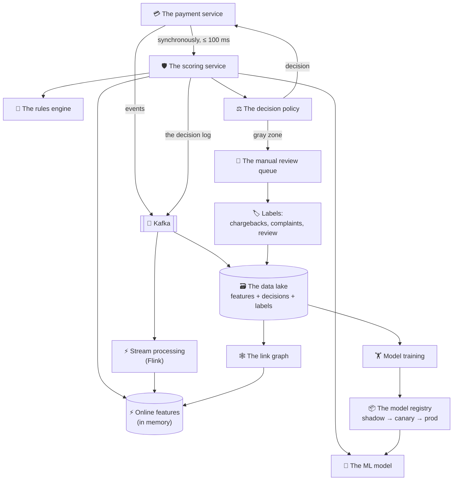
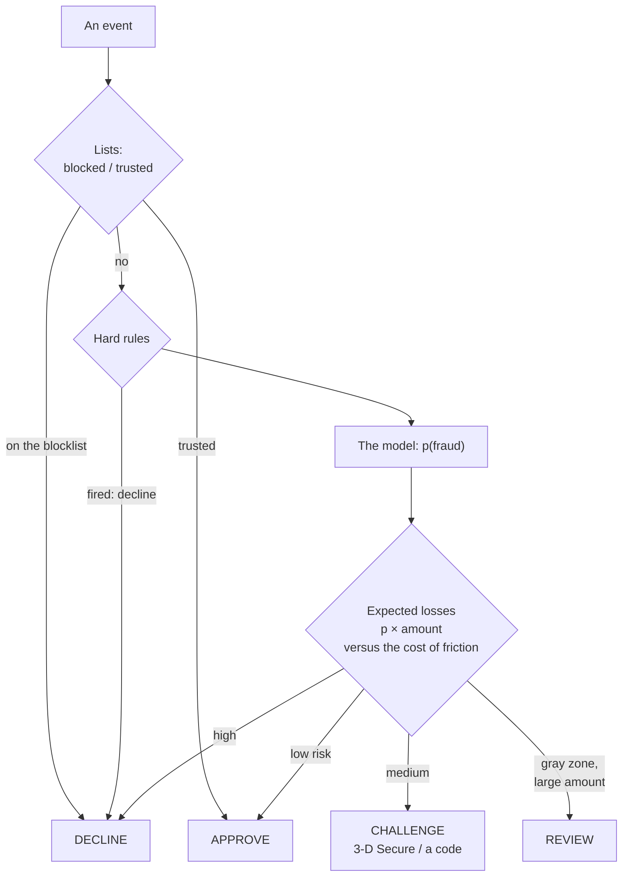
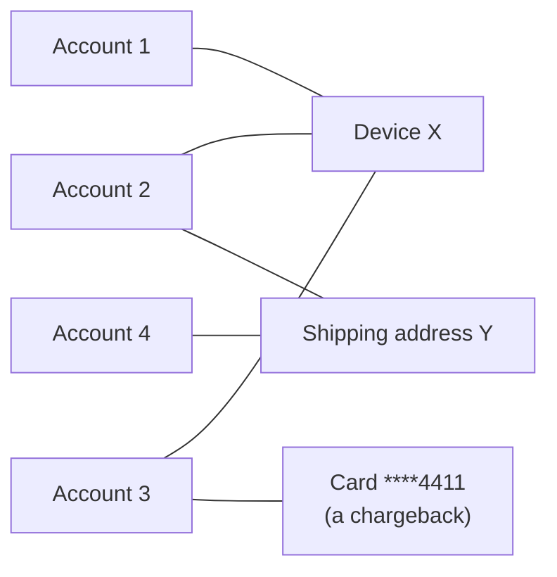

**English** | [Русский](README_RU.md)

# Tier 2 · 4D · 05. Real-Time Fraud Detection

> **Level:** Hard · **Interview time:** 45–60 min · **Study time:** ~5 h
> **Key aspects:** a decision on the payment's critical path with a latency budget, behavior on failure (fail open or fail closed), features (transactional, velocity, behavioral, graph), streaming feature computation and a feature store, a rules engine and an ML model, a decision policy and expected losses, delayed labels and feedback, safely rolling out rules and models, graphs of fraud rings, case review and explainability
> **Builds on:** [Tier 1 · 20 Payments](../../../tier-1/20-payment-system/README.md#14-deep-dive-8-security-anti-fraud-and-reliability), [Tier 1 · 17 Ad Click Aggregator](../../../tier-1/17-ad-click-aggregator/README.md#10-deep-dive-4-fraudulent-clicks), [Tier 2 · 4B · 01 TikTok Feed](../../4b-social-media/01-tiktok-feed/README.md#10-deep-dive-4-real-time-personalization) (a feature store, training-serving skew), [Tier 1 · 16 Top-K](../../../tier-1/16-top-k-leaderboard/README.md#7-deep-dive-2-sliding-windows-and-decay), [13-reliability-patterns](../../../13-reliability-patterns/README.md)

---

## 🗺️ How to Read This Walkthrough

The walkthrough follows an interview, but every step includes explanations: **why** a decision is made, **how** a mechanism works and **what happens** if you do it differently. The "📘 Explanation" blocks are theory right where you need it.

| Icon | Meaning |
|:----:|:--------|
| 🎤 | Interviewer |
| 🗣️ | What I (the candidate) say out loud |
| ✏️ | What I draw on the whiteboard |
| ⏱️ | Time budget for the step |
| 📘 | A detailed explanation of a concept |

Callouts: **TIP** — a good technique, **WARNING** — a trap, **IMPORTANT** — a Senior+ signal.

---

## 📑 Contents

0. [What This Problem Teaches](#0-what-this-problem-teaches)
1. [Problem Statement](#1-problem-statement)
2. [Clarifying Questions and Requirements](#2-clarifying-questions-and-requirements)
3. [Capacity Estimates](#3-capacity-estimates)
4. [API](#4-api)
5. [Data Model](#5-data-model)
6. [High-Level Design](#6-high-level-design)
7. [Deep Dive 1: The Latency Budget and Behavior on Failure](#7-deep-dive-1-the-latency-budget-and-behavior-on-failure)
8. [Deep Dive 2: Features](#8-deep-dive-2-features)
9. [Deep Dive 3: Streaming Feature Computation](#9-deep-dive-3-streaming-feature-computation)
10. [Deep Dive 4: Rules, the Model and the Decision Policy](#10-deep-dive-4-rules-the-model-and-the-decision-policy)
11. [Deep Dive 5: Labels and Feedback](#11-deep-dive-5-labels-and-feedback)
12. [Deep Dive 6: Safely Rolling Out Rules and Models](#12-deep-dive-6-safely-rolling-out-rules-and-models)
13. [Deep Dive 7: Fraud Rings and Graphs](#13-deep-dive-7-fraud-rings-and-graphs)
14. [Deep Dive 8: Case Review, Explainability and Adversaries](#14-deep-dive-8-case-review-explainability-and-adversaries)
15. [Bottlenecks and Failure Scenarios](#15-bottlenecks-and-failure-scenarios)
16. [What Changes at 10x Scale](#16-what-changes-at-10x-scale)
17. [Key Concepts and New Terms](#17-key-concepts-and-new-terms)
18. [Variations and Follow-Up Questions](#18-variations-and-follow-up-questions)
19. [Common Mistakes](#19-common-mistakes)
20. [Cheat Sheet and Self-Check](#20-cheat-sheet-and-self-check)

---

## 0. What This Problem Teaches

Anti-fraud in [the payment system](../../../tier-1/20-payment-system/README.md) was one line on the diagram. Here it's a separate system that decides the fate of every payment within **tens of milliseconds**: approve, decline, request additional verification, or send it for manual review. An error one way means stolen money and chargebacks; the other way — declined honest customers who'll go to a competitor.

| What's tested | Where it shows up |
|:--------------|:------------------|
| Systems on the critical path | A strict latency budget, behavior on failure |
| Stream processing | Velocity features over sliding windows |
| ML in production | A feature store, training-serving skew, rolling out models |
| Product trade-offs | Expected losses versus friction for honest customers |
| Dealing with delay | Labels (chargebacks) arrive weeks later |
| An adapting adversary | Fraudsters probe thresholds and change behavior |

> [!TIP]
> Frame the task in money: "We minimize **fraud losses + losses from declined honest payments + the cost of manual review**." That turns "catch as many fraudsters as possible" into an optimization problem with a clear price for every error.

---

## 1. Problem Statement

> 🎤 "Design a fraud detection system for a payments platform: every card payment, transfer and account sign-in is scored in real time. Stop fraudsters without getting in honest users' way."

**Scenarios:**

```
A stolen card: 15 electronics purchases in 3 minutes at different stores → decline from the 3rd
An account takeover: a sign-in from a new device in another country + an email change + transferring all the money → verification
An honest customer traveling: a purchase abroad → don't decline; ask for confirmation in the app
A fraud ring: 200 accounts from one device → block the whole ring
```

**Time plan:**

| Step | ⏱️ |
|:-----|:--:|
| Requirements | 5 min |
| Estimates | 3 min |
| API and data | 5 min |
| High-level design | 6 min |
| Deep dives | 25 min |
| Wrap-up | 3 min |

---

## 2. Clarifying Questions and Requirements

⏱️ 5 min

| My question | Interviewer's answer | What it changes and why |
|:------------|:---------------------|:------------------------|
| Which events? | Card payments, transfers, sign-ins, account data changes | Different models and features per type |
| Load? | ~10,000 events/s, peaking at ~50,000/s | Scalable online scoring |
| The latency budget? | ≤ 100 ms per decision (part of a card authorization) | Everything on the critical path comes from memory |
| The fraud rate? | ~0.1% | Severe class imbalance |
| Decisions? | Approve, decline, additional verification (3-D Secure, a code), manual review | A policy with several actions |
| Who changes rules? | Analysts, without a deploy, quickly | A rules engine with a DSL |
| When is fraud known? | A chargeback — after 30–120 days; a complaint — after days | Delayed labels |
| Explainability? | Decision reasons are needed for review and regulators | Reason codes |

### Functional requirements

1. Synchronously scoring an event: a risk score, a decision, reasons.
2. Real-time features: velocity counters, behavior, a network of links.
3. A rules engine that analysts can edit.
4. ML models retrained on new labels.
5. A manual review queue and tools for analysts.
6. Ingesting labels: chargebacks, complaints, review decisions.

### Non-functional requirements

| Requirement | Target | Why |
|:------------|:-------|:----|
| Latency | p99 < 100 ms | The card authorization waits for the answer |
| Availability | Very high | An anti-fraud outage mustn't stop payments |
| Feature freshness | Seconds | A burst of attacks within a minute must count |
| Quality | High recall with a low false decline rate | Money on both sides |
| Auditing | Every decision is reproducible | Disputes, regulators, training |

---

## 3. Capacity Estimates

⏱️ 3 min

```
Events:              10,000/s on average → ~860M per day; a peak of 50,000/s
Features:            ~200 per event
Feature reads:       ~10 entities per event (card, device, IP, user, merchant…)
                     → ~500,000 reads from the online store per second at peak
Counter updates:     ~20 windows × several entities → ~1M increments per second
The model:           gradient boosting — single-digit ms on a CPU
The decision log:    860M × ~2 KB (features + decision) ≈ 1.7 TB per day → a data lake for training
Manual review:       even 0.01% of events ≈ 86,000 cases per day → prioritization is needed
```

### Conclusions

| Conclusion | Design consequence |
|:-----------|:-------------------|
| Hundreds of thousands of feature reads per second | An in-memory online store, batched reads |
| A million counter updates per second | Stream processing, sharding by entity |
| The decision log is terabytes per day | The basis for training and auditing |
| Humans can't review much | Manual review only for a narrow gray zone |

---

## 4. API

⏱️ 2 min

```http
POST /v1/score
{
  "event_type": "card_payment",
  "event_id": "evt_81",
  "amount": 79900, "currency": "EUR",
  "card_token": "tok_…", "bin": "41xxxx",
  "user_id": "u_42", "device_id": "dev_9f", "ip": "203.0.113.7",
  "merchant_id": "m_17", "mcc": "5732", "ship_country": "PL"
}
→ 200 {
  "decision": "CHALLENGE",            ← APPROVE | DECLINE | CHALLENGE | REVIEW
  "score": 0.31,
  "reasons": ["NEW_DEVICE", "HIGH_VELOCITY_CARD_1H", "AMOUNT_ABOVE_USUAL"],
  "model_version": "gbdt-2026-11-20", "rules_hit": ["R-104"]
}

POST /v1/labels    { event_id, label: "FRAUD" | "LEGIT", source: "chargeback" | "review" | "user_report" }
PUT  /v1/rules/{id}  ← analysts: a condition, an action, a mode (shadow / active)
```

---

## 5. Data Model

⏱️ 3 min

| Data | Store | Why |
|:-----|:------|:----|
| **Online features** (counters, entity profiles) | An in-memory KV store (Redis, Aerospike), sharded by entity | Reads in milliseconds |
| **Offline features** | A data lake | Training, historical replay |
| **The decision log** | Kafka → a data lake | Every request: features, model version, rules hit, decision |
| **Labels** | A DB + the data lake | Linking an event to its outcome |
| **Rules** | A versioned DB + a cache in the scoring service | Fast changes without a deploy |
| **Lists** (blocklists, trusted lists) | An in-memory KV store | Instant checks |
| **The link graph** | A graph store or edge tables | Fraud rings |
| **Review cases** | A relational DB | Analysts' work |

---

## 6. High-Level Design

⏱️ 6 min



🗣️ "Two loops:
- **the synchronous one**: the payment service calls scoring, which reads online features in one batch, applies rules and the model, and the policy returns a decision — all within tens of milliseconds;
- **the asynchronous one**: events and the decision log go to Kafka; stream processing updates features within seconds; labels (chargebacks, complaints, review) are joined with the decision log in the data lake; models are retrained and rolled out via shadow and canary; the link graph updates network features."

---

## 7. Deep Dive 1: The Latency Budget and Behavior on Failure

> 🎤 "You have 100 ms. Where does it go, and what if you don't make it?"

### The budget

```
The network to the payment service and back       ~5 ms
A batched read of online features                 ~10–20 ms (in parallel for every entity)
Synchronously updating critical counters          ~5 ms
Rules                                             ~2–5 ms
The model                                         ~5–10 ms
The policy, the log (async), headroom             ~the rest
Total                                             ~40–60 ms with p99 < 100 ms
```

| Technique | Why |
|:----------|:----|
| **Batched, parallel feature reads** | Latency is the slowest read, not the sum |
| The model **in-process** in the scoring service | No network call to a separate model service |
| The decision log — asynchronously | Off the critical path |
| **A timeout per dependency** | A slow store doesn't slow down the payment |

### If you miss it: fail open or fail closed

| Policy | Meaning | When |
|:-------|:--------|:-----|
| **Fail open** | On an anti-fraud failure — approve | Small amounts, trusted customers — otherwise an anti-fraud outage halts the whole business |
| **Fail closed** | On failure — decline | Very risky operations (large transfers to new recipients) |
| **Degradation** | A decision from rules and lists only (no model) or from the last known features | A partial failure |
| **Request verification** | On failure — 3-D Secure or a code instead of a decision | Medium risk |

> [!IMPORTANT]
> **Senior+ signal:** the failure policy is **per risk tier**, not one for everything. An anti-fraud system that declines every payment when it fails does more harm than the fraudsters.

---

## 8. Deep Dive 2: Features

> 🎤 "What lets the system recognize a payment as fraudulent?"

| Group | Examples | Why it works |
|:------|:---------|:-------------|
| **Transactional** | The amount, the merchant category, the card's country versus the shipping country, time of day | Fraudsters buy resellable goods (electronics, gift cards) |
| **Velocity** | The count and sum of operations per card / device / IP over 1 min, 1 h, 24 h; the number of distinct cards on a device per hour | Stolen cards are "cashed out" quickly, in bursts |
| **Behavioral** | Deviation from the user's usual amount, a new device, time since sign-up, time since the last password change | An account takeover changes habits |
| **Network** (graph) | How many accounts use this device; how many of them were already fraudulent | Fraud rings share resources |
| **External** | IP reputation (proxies, data centers), email age, the card's BIN data | Signals from outside the platform |

### An example

```
A €799 payment for a laptop:
  the card was issued in DE, shipping to PL, the IP is a hosting provider        → suspicious
  the device was first seen 4 minutes ago                                         → suspicious
  this card had 6 attempts in the last hour, 4 declined                           → very suspicious
  9 different cards were used on this device in 24 hours                          → very suspicious
  the user's usual purchase is €35                                                → suspicious
→ the model: 0.87 → DECLINE
```

---

## 9. Deep Dive 3: Streaming Feature Computation

> 🎤 "How do you compute 'the number of operations per card in the last hour' for millions of cards in real time?"

### Sliding windows

📘 As in [Top-K](../../../tier-1/16-top-k-leaderboard/README.md#7-deep-dive-2-sliding-windows-and-decay): the window is split into buckets (e.g. per minute), and the window's counter is the sum of the buckets. Each bucket is a key with a TTL.

```
card:tok_77:count:2026-11-30T14:05  = 2     (a 1 h TTL)
card:tok_77:count:2026-11-30T14:06  = 3
…
The count for the hour = the sum of 60 buckets (or a sliding aggregate in Flink)
```

| Method | How | Trade-off |
|:-------|:----|:----------|
| **Flink** with keyed state | An event → update the entity's windows → write the aggregate to the online store | Scalable; latency — seconds |
| **A synchronous atomic increment** in Redis during scoring | The scoring service increments the current minute's counter itself and reads the window | Accounts for **the current** operation instantly; adds milliseconds |

### The burst-attack race

📘 A fraudster sends 10 payments within 2 seconds. If counters are updated asynchronously (via Kafka and Flink in 1–3 s), all 10 requests see "0 attempts in the last minute" and pass. So **the most critical** velocity counters (attempts per card or device per minute) are updated **synchronously** in the request path, while complex aggregates are updated asynchronously.

### Training-serving skew

| Problem | Solution |
|:--------|:---------|
| For training a feature is computed in batch, for serving — in a stream, and the values diverge | **A feature store** with a single feature definition (see [the video feed](../../4b-social-media/01-tiktok-feed/README.md#10-deep-dive-4-real-time-personalization)) |
| **Future leakage**: for training, a feature is computed with data from after the event | **Logging features at decision time** — the model learns from exactly what it saw in production (point-in-time correctness) |

---

## 10. Deep Dive 4: Rules, the Model and the Decision Policy

> 🎤 "Rules or machine learning?"

🗣️ "Both: they have different strengths."

| | Rules | An ML model |
|:-|:------|:------------|
| Reaction speed to a new scheme | Minutes: an analyst writes a rule | Days: labels and retraining are needed |
| Explainability | Full | Via reason codes (feature contributions) |
| Accounting for hundreds of features and their combinations | Poor | Good |
| The risk of a mistake | One bad rule can decline everything | Degradation is gradual |
| Examples | Blocklists, limits, "amount > 1,000 and a new device and the country doesn't match → verify" | Gradient boosting over 200 features → a fraud probability |

### The decision policy



📘 **Expected losses.** The threshold depends on the amount:

```
p = 0.05, amount €20    → expected loss €1    → approve (friction costs more)
p = 0.05, amount €2,000 → expected loss €100  → request confirmation
p = 0.30, amount €800   → expected loss €240  → request confirmation or decline
```

| Decision | Why |
|:---------|:----|
| Thresholds per segment (merchant type, country, customer history) | Different risk levels and friction costs |
| **Additional verification** instead of a decline for medium risk | An honest customer confirms; a fraudster doesn't |
| Rules can **override** the model (blocklists) | Instant reaction |

---

## 11. Deep Dive 5: Labels and Feedback

> 🎤 "How does the model find out it was wrong?"

### Label sources

| Source | Delay | Characteristics |
|:-------|:------|:----------------|
| **A chargeback** from the issuing bank | 30–120 days | A reliable fraud signal, but late |
| A user complaint ("that wasn't me") | Hours to days | Faster, sometimes mistaken |
| A manual review decision | Hours | Accurate, but only for the gray zone |
| 3-D Secure confirmation succeeded | Immediately | A sign the cardholder is most likely present |

### Pitfalls

| Problem | Why | Solution |
|:--------|:----|:---------|
| **Label delay** | The model learns from data three months old | Train on "matured" data + fast proxy labels (complaints) for new schemes |
| **Selection bias** | Declined operations never get a label — whether they were fraud is unknown | A small control group: some low-amount gray-zone operations are approved for evaluation; careful counterfactual evaluation methods |
| **Class imbalance** (0.1%) | An "everything is honest" model is right 99.9% of the time | Weighting, downsampling honest examples, PR-AUC and recall at a given false decline rate |
| **Drift** | Fraudsters change tactics | Monitoring feature distributions and quality, frequent retraining |

### Metrics

| Metric | What it shows |
|:-------|:--------------|
| Recall | The share of fraud caught |
| The false decline rate | How many honest payments were declined |
| **Money**: losses prevented versus revenue lost | The business outcome |
| The share of additional verifications and their success rate | Friction for customers |

---

## 12. Deep Dive 6: Safely Rolling Out Rules and Models

> 🎤 "An analyst added a rule with a typo, and it declines every payment. How do you prevent that?"

| Stage | How |
|:------|:----|
| **A backtest** | Run the rule or model over historical events: how many it would have declined, how much fraud it would have caught |
| **Shadow mode** | The rule or model runs on real traffic and its decisions are logged, but **not applied** |
| **Canary** | Apply it to 1–5% of traffic and compare metrics |
| Full rollout | With an instant rollback (the version in configuration) |
| **An automatic circuit breaker** | If the decline rate spikes (e.g. 3× in 5 minutes) — roll back the latest changes and raise an alert |

📘 Rules are **code** written by non-programmers and shipped without a deploy. So they need the same safety cycle as code: verification, shadow mode, gradual rollout, rollback.

---

## 13. Deep Dive 7: Fraud Rings and Graphs

> 🎤 "Fraudsters create hundreds of accounts. Each one looks clean on its own. How do you catch them?"

📘 Fraud rings share resources: devices, cards, shipping addresses, IPs, phones. Building **a graph** of "account — device — card — address" makes the ring visible as a connected group.



| Graph feature | Meaning |
|:--------------|:--------|
| The size of the connected component | 200 accounts linked through shared devices — suspicious |
| The share of "bad" neighbors | A device that already had a chargeback |
| The component's growth rate | New accounts joining quickly |

| Decision | Why |
|:---------|:----|
| The graph is updated in near real time (minutes) | Rings grow fast |
| Graph features live in the online store | Used during scoring without querying the graph |
| Investigation tools | An analyst sees the ring and blocks it as a whole |
| Blocking the ring | Every linked account goes to review or onto the blocklist |

---

## 14. Deep Dive 8: Case Review, Explainability and Adversaries

### Manual review

| Decision | Why |
|:---------|:----|
| Queue priority: risk × amount × urgency | Analysts look at the most expensive cases first |
| A time limit per decision | A payment "under review" can't wait forever |
| An analyst's decision → a label | Feedback for the model |
| Tools: customer history, the graph, decision reasons | Fast, accurate decisions |

### Explainability

| Consumer | What they need |
|:---------|:---------------|
| An analyst | Reason codes: which features had the strongest influence (e.g. via SHAP values) |
| A customer | A clear message that doesn't reveal the logic |
| A regulator | The ability to explain an automated decision |
| A developer | Replaying a decision from the log (features + versions) |

### Adversaries and privacy

| Decision | Why |
|:---------|:----|
| Not revealing the exact decline reason to the customer | Otherwise a fraudster tunes a workaround |
| A little randomness in thresholds for borderline cases | Harder to "probe" the exact threshold |
| Hashing and tokenizing card numbers and personal data | PCI DSS, privacy |
| Data retention periods | Personal data laws |

---

## 15. Bottlenecks and Failure Scenarios

| Scenario | What happens | How we protect |
|:---------|:-------------|:---------------|
| The feature store is slow | The latency budget is exceeded | Timeouts, degrading to rules and lists |
| The scoring service is unavailable | Payments stop | Fail open for low risk, fail closed / verification for high |
| A burst of attacks within seconds | Every attempt passes before counters update | Synchronous counters for critical features |
| Training and serving features diverge | The model is worse than in tests | A feature store, logging features at decision time |
| A bad rule | Every payment declined | A backtest, shadow, canary, an automatic rollback |
| Label delay | The model doesn't know new schemes | Fast proxy labels, analysts' rules |
| Declined operations without labels | Biased training | A control group |
| A fraud ring | Each account looks clean | Graph features |
| Fraudsters probe thresholds | Workarounds | Hidden reasons, randomness, fast rules |
| The review queue overflows | Delayed decisions | A narrow gray zone, priorities, automation |

---

## 16. What Changes at 10x Scale

> 🎤 "500,000 events per second?"

| Change | Why |
|:-------|:----|
| **Regional scoring clusters** | Latency and data residency |
| **Hardware-accelerated** models, or simpler models on the critical path + heavy ones asynchronously | The latency budget |
| **Sharing signals between companies** (consortiums) | A fraudster caught by one is visible to others |
| **Online learning** | Faster reaction to new schemes |

---

## 17. Key Concepts and New Terms

### What's applied

| Concept | Where it's covered | How it applies here |
|:--------|:-------------------|:--------------------|
| Payment anti-fraud, 3-D Secure | [Tier 1 · 20](../../../tier-1/20-payment-system/README.md) | The place in the payment flow |
| Anti-fraud layers, offline ML | [Tier 1 · 17](../../../tier-1/17-ad-click-aggregator/README.md#10-deep-dive-4-fraudulent-clicks) | A similar structure |
| A feature store, training-serving skew | [Tier 2 · 4B · 01](../../4b-social-media/01-tiktok-feed/README.md) | The model's features |
| Sliding windows | [Tier 1 · 16](../../../tier-1/16-top-k-leaderboard/README.md) | Velocity counters |
| Timeouts, degradation, circuit breakers | [13-reliability-patterns](../../../13-reliability-patterns/README.md) | The critical path |

### New terms in this problem

| Term | In short |
|:-----|:---------|
| **Fail open / fail closed** | Behavior on failure: approve or decline |
| **Velocity features** | An entity's count and sum of operations over time windows |
| **Point-in-time correctness** | Training features use only data from before the event |
| **A rules engine** | Analysts' conditions, rolled out without a deploy |
| **Expected losses** | p(fraud) × amount — the basis for thresholds |
| **Step-up verification** | 3-D Secure, a code — instead of a decline |
| **Delayed labels** | Chargebacks months later |
| **Selection bias** | No labels for declined operations |
| **Shadow mode and canary** | Safely rolling out rules and models |
| **Graph features** | Links between accounts, devices, cards |
| **Reason codes** | Explaining a decision |

---

## 18. Variations and Follow-Up Questions

<details>
<summary><b>How does detecting account takeover differ from card fraud?</b></summary>

The event is a sign-in and actions in the account, not a payment. Features: a new device and location, impossible travel (sign-ins from two countries within an hour), password guessing (many failed attempts), changing the email and phone before withdrawing money. Actions: additional authentication, a temporary block on withdrawals, notifying the owner.
</details>

<details>
<summary><b>Why gradient boosting rather than a deep neural network?</b></summary>

On tabular features, boosting often matches neural networks, is faster on a CPU, is easier to explain and is more robust with few labels. Neural networks are used for event sequences (behavioral embeddings) — their outputs become features for the boosted model.
</details>

<details>
<summary><b>How do you protect against "card testing"?</b></summary>

Fraudsters test stolen cards with small payments at one merchant. Features: many small authorizations with different cards from one device or IP, a high decline rate. Measures: rate limits per merchant and device, a CAPTCHA, a temporary block, notifying the merchant.
</details>

<details>
<summary><b>Can scoring be made asynchronous so it doesn't delay the payment?</b></summary>

For some events, yes: e.g. a transfer between your own accounts can be approved immediately and checked afterwards, with the option to freeze funds before withdrawal. But a card authorization needs the decision before responding to the bank — that one has to be synchronous.
</details>

<details>
<summary><b>How do you update blocklists instantly across every instance of the service?</b></summary>

The source is a versioned DB; changes are published as an event, and each instance updates its in-memory copy within seconds; when in doubt (out of sync) — read from a shared KV store. For urgent cases — check the shared KV store on every request.
</details>

---

## 19. Common Mistakes

| ❌ Mistake | Why it's bad | ✅ Do this instead |
|:----------|:-------------|:------------------|
| Sequential feature reads | Blowing the budget | Batched and in parallel |
| One failure policy for every operation | Either halting the business or a hole | Per risk tier |
| Asynchronous counters only | A burst of attacks gets through | Synchronous counters for critical features |
| Recomputing training features from historical data | Future leakage, skew | Logging features at decision time |
| Only ML, or only rules | Slow reaction or weak quality | A combination |
| Declining everything suspicious | Losing honest customers | Additional verification, expected losses |
| Rolling rules out to all traffic at once | Mass false declines | A backtest, shadow, canary, a circuit breaker |
| Evaluating a model by accuracy | A trivial model scores 99.9% | PR-AUC, recall at a given false decline rate, money |
| Ignoring selection bias | The model never learns from what it declined | A control group |
| Telling the customer the exact reason | Fraudsters work around it | General wording |

---

## 20. Cheat Sheet and Self-Check

### 30-second answer

> Synchronous scoring on the payment's critical path with a ~100 ms budget: a batched, parallel read of online features from an in-memory store, a synchronous increment of critical velocity counters (against burst attacks), lists and hard rules, an in-process model (gradient boosting), and a decision policy based on expected losses (p × amount versus the cost of friction) with APPROVE / CHALLENGE (3-D Secure) / DECLINE / REVIEW actions; on failure — degrading to rules, failing open for low risk and failing closed or verifying for high risk. Asynchronously: events and the decision log (features + versions) → Kafka → Flink updates windows within seconds; labels (chargebacks after months, complaints, review) are joined with the log in the data lake; training with point-in-time correctness, accounting for imbalance and selection bias (a control group); rolling out models and rules via a backtest, shadow, canary and an automatic circuit breaker on the decline rate. An "account — device — card — address" graph provides network features against fraud rings. Manual review covers a narrow gray zone prioritized by risk × amount; reason codes for analysts; no details for customers.

### Self-check

- [ ] I can break down the 100 ms latency budget
- [ ] I can justify fail open and fail closed per risk tier
- [ ] I can list feature groups with examples
- [ ] I can design velocity counters and explain the burst-attack race
- [ ] I can explain point-in-time correctness and logging features
- [ ] I can compare rules and ML and describe the decision policy
- [ ] I can compute expected losses and choose an action
- [ ] I can describe the label problems: delay, bias, imbalance
- [ ] I can describe safely rolling out rules and models
- [ ] I can explain graph features against fraud rings

### Further reading

- Stripe Engineering articles on Radar and machine learning for anti-fraud
- Uber Engineering articles on risk systems and link graphs
- PayPal / Feedzai material on real-time transaction scoring
- Feature stores: the Feast and Tecton documentation
- The [Tier 1 · 20](../../../tier-1/20-payment-system/README.md) and [Tier 2 · 4B · 01](../../4b-social-media/01-tiktok-feed/README.md) walkthroughs
