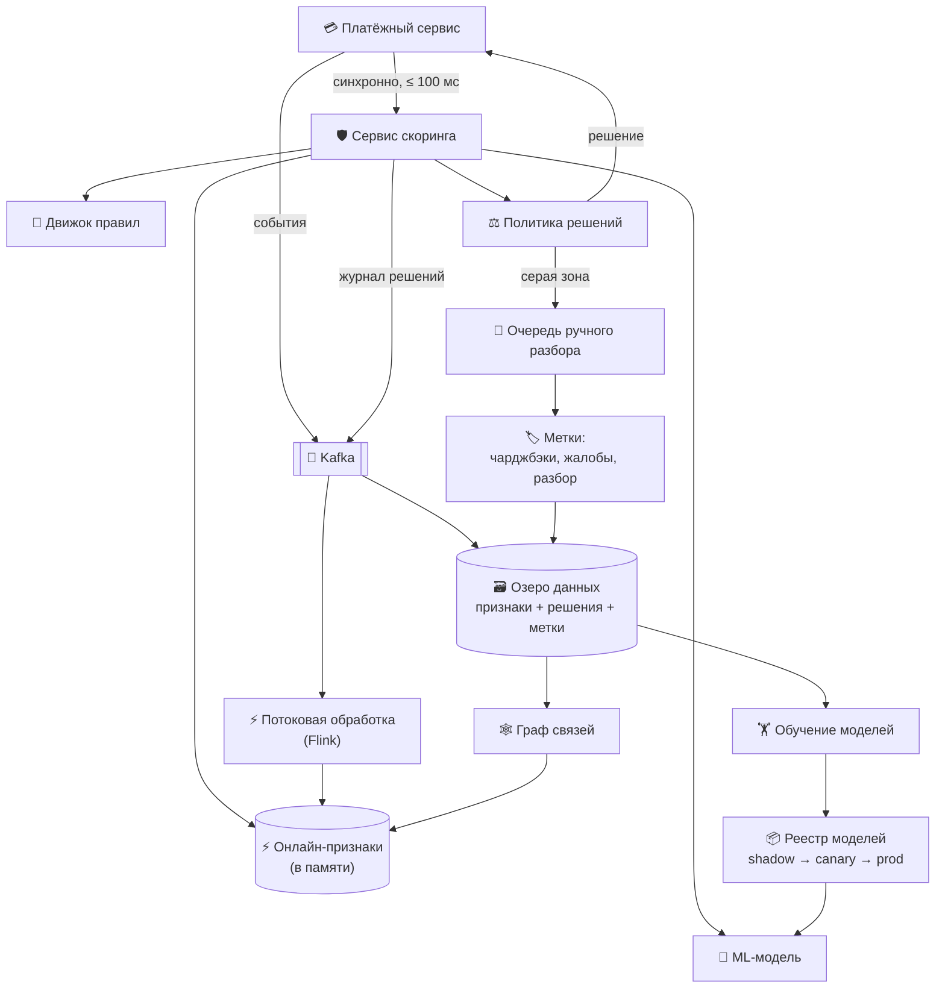
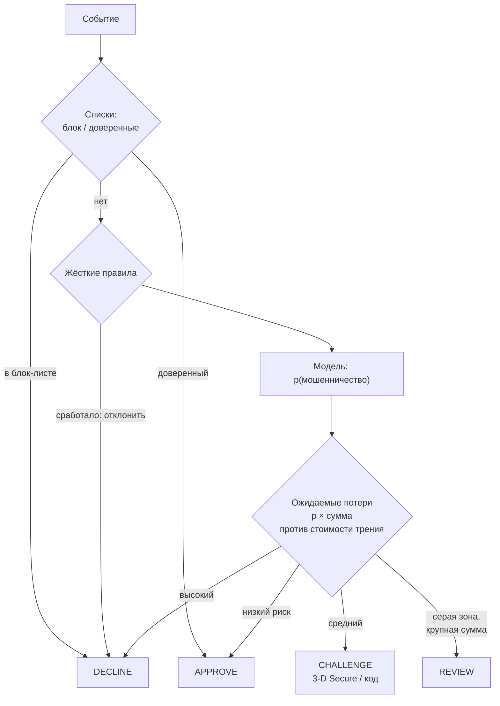
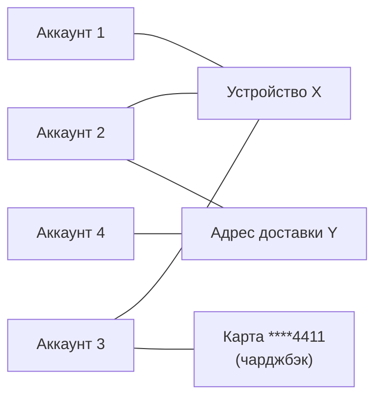

[English](README.md) | **Русский**

# Tier 2 · 4D · 05. Обнаружение мошенничества в реальном времени

> **Уровень:** Hard · **Время на интервью:** 45–60 мин · **Время на разбор:** ~5 ч
> **Ключевые аспекты:** решение на критическом пути платежа с бюджетом задержки, поведение при сбоях (fail open или fail closed), признаки (транзакционные, скоростные, поведенческие, графовые), потоковый расчёт признаков и feature store, движок правил и ML-модель, политика решений и ожидаемые потери, запаздывающие метки и обратная связь, безопасный выпуск правил и моделей, графы мошеннических сетей, разбор случаев и объяснимость
> **Опирается на:** [Tier 1 · 20 Payments](../../../tier-1/20-payment-system/README_RU.md#14-deep-dive-8-безопасность-антифрод-и-надёжность), [Tier 1 · 17 Ad Click Aggregator](../../../tier-1/17-ad-click-aggregator/README_RU.md#10-deep-dive-4-мошеннические-клики), [Tier 2 · 4B · 01 TikTok Feed](../../4b-social-media/01-tiktok-feed/README_RU.md#10-deep-dive-4-персонализация-в-реальном-времени) (feature store, training-serving skew), [Tier 1 · 16 Top-K](../../../tier-1/16-top-k-leaderboard/README_RU.md#7-deep-dive-2-скользящие-окна-и-затухание), [13-reliability-patterns](../../../13-reliability-patterns/README_RU.md)

---

## 🗺️ Как читать этот разбор

Разбор построен как интервью, но в каждом шаге есть объяснения: **почему** принимается решение, **как работает** механизм и **что будет**, если сделать иначе. Блоки «📘 Объяснение» — теория прямо по ходу задачи.

| Значок | Что значит |
|:------:|:-----------|
| 🎤 | Реплика интервьюера |
| 🗣️ | Что говорю вслух я (кандидат) |
| ✏️ | Что рисую на доске |
| ⏱️ | Сколько времени тратить на шаг |
| 📘 | Подробное объяснение концепции |

Блоки **TIP** — хороший приём, **WARNING** — ловушка, **IMPORTANT** — сигнал для уровня Senior+.

---

## 📑 Содержание

0. [Чему учит эта задача](#0-чему-учит-эта-задача)
1. [Условие задачи](#1-условие-задачи)
2. [Уточняющие вопросы и требования](#2-уточняющие-вопросы-и-требования)
3. [Оценки нагрузки](#3-оценки-нагрузки)
4. [API](#4-api)
5. [Модель данных](#5-модель-данных)
6. [High-level дизайн](#6-high-level-дизайн)
7. [Deep dive 1: бюджет задержки и поведение при сбоях](#7-deep-dive-1-бюджет-задержки-и-поведение-при-сбоях)
8. [Deep dive 2: признаки](#8-deep-dive-2-признаки)
9. [Deep dive 3: потоковый расчёт признаков](#9-deep-dive-3-потоковый-расчёт-признаков)
10. [Deep dive 4: правила, модель и политика решений](#10-deep-dive-4-правила-модель-и-политика-решений)
11. [Deep dive 5: метки и обратная связь](#11-deep-dive-5-метки-и-обратная-связь)
12. [Deep dive 6: безопасный выпуск правил и моделей](#12-deep-dive-6-безопасный-выпуск-правил-и-моделей)
13. [Deep dive 7: мошеннические сети и графы](#13-deep-dive-7-мошеннические-сети-и-графы)
14. [Deep dive 8: разбор случаев, объяснимость и противодействие](#14-deep-dive-8-разбор-случаев-объяснимость-и-противодействие)
15. [Узкие места и сценарии сбоев](#15-узкие-места-и-сценарии-сбоев)
16. [Что изменится при росте в 10 раз](#16-что-изменится-при-росте-в-10-раз)
17. [Ключевые концепции и новые понятия](#17-ключевые-концепции-и-новые-понятия)
18. [Варианты задачи и follow-up вопросы](#18-варианты-задачи-и-follow-up-вопросы)
19. [Типичные ошибки](#19-типичные-ошибки)
20. [Шпаргалка и самопроверка](#20-шпаргалка-и-самопроверка)

---

## 0. Чему учит эта задача

Антифрод в [платёжной системе](../../../tier-1/20-payment-system/README_RU.md) был одной строкой схемы. Здесь это отдельная система, которая за **десятки миллисекунд** решает судьбу каждого платежа: пропустить, отклонить, запросить дополнительную проверку или отправить на ручной разбор. Ошибка в одну сторону — украденные деньги и чарджбэки; в другую — отклонённые честные покупатели, которые уйдут к конкурентам.

| Что проверяют | Где это в задаче |
|:--------------|:-----------------|
| Системы на критическом пути | Жёсткий бюджет задержки, поведение при сбоях |
| Потоковая обработка | Скоростные признаки в скользящих окнах |
| ML в продакшене | Feature store, расхождение обучения и обслуживания, выпуск моделей |
| Продуктовые компромиссы | Ожидаемые потери против трения для честных клиентов |
| Работа с запаздыванием | Метки (чарджбэки) приходят через недели |
| Противник, который адаптируется | Мошенники изучают пороги и меняют поведение |

> [!TIP]
> Сформулируй задачу через деньги: «Мы минимизируем **потери от мошенничества + потери от отклонённых честных платежей + стоимость ручного разбора**». Это превращает «поймать как можно больше мошенников» в задачу оптимизации с понятной ценой каждой ошибки.

---

## 1. Условие задачи

> 🎤 «Спроектируй систему обнаружения мошенничества для платёжной платформы: каждый платёж картой, перевод и вход в аккаунт оценивается в реальном времени. Нужно останавливать мошенников, не мешая честным пользователям».

**Сценарии:**

```
Украденная карта: 15 покупок электроники за 3 минуты в разных магазинах → отклонить с 3-й
Захват аккаунта: вход с нового устройства из другой страны + смена email + перевод всех денег → проверка
Честный клиент в поездке: покупка за границей → не отклонять, а запросить подтверждение в приложении
Мошенническая сеть: 200 аккаунтов с одного устройства → заблокировать всю сеть
```

**План по времени:**

| Шаг | ⏱️ |
|:----|:--:|
| Требования | 5 мин |
| Оценки | 3 мин |
| API и данные | 5 мин |
| High-level дизайн | 6 мин |
| Deep dives | 25 мин |
| Итоги | 3 мин |

---

## 2. Уточняющие вопросы и требования

⏱️ 5 мин

| Мой вопрос | Ответ интервьюера | Что это меняет и почему |
|:-----------|:------------------|:------------------------|
| Какие события? | Платежи картой, переводы, входы, смена данных аккаунта | Разные модели и признаки по типам |
| Нагрузка? | ~10 000 событий/с, пик ~50 000/с | Масштабируемый онлайн-скоринг |
| Бюджет задержки? | ≤ 100 мс на решение (часть авторизации карты) | Всё на критическом пути — из памяти |
| Доля мошенничества? | ~0,1% | Сильный дисбаланс классов |
| Решения? | Пропустить, отклонить, дополнительная проверка (3-D Secure, код), ручной разбор | Политика с несколькими действиями |
| Кто меняет правила? | Аналитики, без деплоя, быстро | Движок правил с DSL |
| Когда известно, что это мошенничество? | Чарджбэк — через 30–120 дней; жалоба — через дни | Запаздывающие метки |
| Объяснимость? | Нужны причины решения для разбора и регуляторов | Коды причин |

### Функциональные требования

1. Синхронная оценка события: оценка риска, решение, причины.
2. Признаки в реальном времени: скоростные счётчики, поведение, сеть связей.
3. Движок правил, редактируемых аналитиками.
4. ML-модели с переобучением на новых метках.
5. Очередь ручного разбора и инструменты аналитиков.
6. Приём меток: чарджбэки, жалобы, решения разбора.

### Нефункциональные требования

| Требование | Цель | Почему |
|:-----------|:-----|:-------|
| Задержка | p99 < 100 мс | Авторизация карты ждёт ответа |
| Доступность | Очень высокая | Отказ антифрода не должен останавливать платежи |
| Свежесть признаков | Секунды | Серия атак за минуту должна учитываться |
| Качество | Высокая полнота при малой доле ложных отклонений | Деньги с обеих сторон |
| Аудит | Каждое решение воспроизводимо | Споры, регуляторы, обучение |

---

## 3. Оценки нагрузки

⏱️ 3 мин

```
События:             10 000/с в среднем → ~860M в сутки; пик 50 000/с
Признаки:            ~200 на событие
Чтения признаков:    ~10 сущностей на событие (карта, устройство, IP, пользователь, продавец…)
                     → ~500 000 чтений из онлайн-хранилища в секунду в пике
Обновления счётчиков: ~20 окон × несколько сущностей → ~1M инкрементов в секунду
Модель:              градиентный бустинг — единицы мс на CPU
Журнал решений:      860M × ~2 КБ (признаки + решение) ≈ 1,7 ТБ в сутки → озеро данных для обучения
Ручной разбор:       даже 0,01% событий ≈ 86 000 случаев в сутки → нужен приоритет
```

### Выводы

| Вывод | Следствие для дизайна |
|:------|:----------------------|
| Сотни тысяч чтений признаков в секунду | Онлайн-хранилище в памяти, пакетные чтения |
| Миллион обновлений счётчиков в секунду | Потоковая обработка, шардирование по сущности |
| Журнал решений — терабайты в сутки | Основа обучения и аудита |
| Люди не разберут много | Ручной разбор — только для узкой серой зоны |

---

## 4. API

⏱️ 2 мин

```http
POST /v1/score
{
  "event_type": "card_payment",
  "event_id": "evt_81",
  "amount": 79900, "currency": "EUR",
  "card_token": "tok_…", "bin": "41xxxx",
  "user_id": "u_42", "device_id": "dev_9f", "ip": "203.0.113.7",
  "merchant_id": "m_17", "mcc": "5732", "ship_country": "PL"
}
→ 200 {
  "decision": "CHALLENGE",            ← APPROVE | DECLINE | CHALLENGE | REVIEW
  "score": 0.31,
  "reasons": ["NEW_DEVICE", "HIGH_VELOCITY_CARD_1H", "AMOUNT_ABOVE_USUAL"],
  "model_version": "gbdt-2026-11-20", "rules_hit": ["R-104"]
}

POST /v1/labels    { event_id, label: "FRAUD" | "LEGIT", source: "chargeback" | "review" | "user_report" }
PUT  /v1/rules/{id}  ← аналитики: условие, действие, режим (shadow / active)
```

---

## 5. Модель данных

⏱️ 3 мин

| Данные | Хранилище | Почему |
|:-------|:----------|:-------|
| **Онлайн-признаки** (счётчики, профили сущностей) | KV в памяти (Redis, Aerospike), шард по сущности | Чтение за миллисекунды |
| **Офлайн-признаки** | Озеро данных | Обучение, историческое воспроизведение |
| **Журнал решений** | Kafka → озеро данных | Каждый запрос: признаки, версия модели, сработавшие правила, решение |
| **Метки** | БД + озеро данных | Связь события с итогом |
| **Правила** | БД с версиями + кэш в сервисе скоринга | Быстрые изменения без деплоя |
| **Списки** (блок-листы, доверенные) | KV в памяти | Мгновенная проверка |
| **Граф связей** | Графовое хранилище или таблицы рёбер | Мошеннические сети |
| **Случаи для разбора** | Реляционная БД | Работа аналитиков |

---

## 6. High-level дизайн

⏱️ 6 мин



🗣️ «Два контура:
- **синхронный**: платёжный сервис вызывает скоринг; тот одним пакетом читает онлайн-признаки, применяет правила и модель, политика выдаёт решение — всё за десятки миллисекунд;
- **асинхронный**: события и журнал решений идут в Kafka; потоковая обработка обновляет признаки за секунды; метки (чарджбэки, жалобы, разбор) соединяются с журналом решений в озере данных; модели переобучаются и выпускаются через shadow и canary; граф связей обновляет сетевые признаки».

---

## 7. Deep dive 1: бюджет задержки и поведение при сбоях

> 🎤 «У тебя 100 мс. Куда они уходят и что делать, если не успеваешь?»

### Бюджет

```
Сеть от платёжного сервиса и обратно      ~5 мс
Пакетное чтение онлайн-признаков           ~10–20 мс (параллельно для всех сущностей)
Синхронное обновление критичных счётчиков   ~5 мс
Правила                                    ~2–5 мс
Модель                                     ~5–10 мс
Политика, журнал (асинхронно), запас        ~остальное
Итого                                       ~40–60 мс при p99 < 100 мс
```

| Приём | Зачем |
|:------|:------|
| **Пакетное параллельное чтение** признаков | Задержка — самое медленное чтение, а не сумма |
| Модель **в процессе** сервиса скоринга | Без сетевого вызова к отдельному сервису моделей |
| Журнал решений — асинхронно | Не на критическом пути |
| **Таймауты на каждую зависимость** | Медленное хранилище не тормозит платёж |

### Если не успели: fail open или fail closed

| Политика | Что значит | Когда |
|:---------|:-----------|:------|
| **Fail open** | При сбое антифрода — пропустить | Малые суммы, доверенные клиенты — иначе сбой антифрода останавливает весь бизнес |
| **Fail closed** | При сбое — отклонить | Очень рискованные операции (крупные переводы на новых получателей) |
| **Деградация** | Решение только по правилам и спискам (без модели) или по последним известным признакам | Частичный сбой |
| **Запросить проверку** | При сбое — 3-D Secure или код вместо решения | Средний риск |

> [!IMPORTANT]
> **Сигнал Senior+:** политика сбоев — **по уровням риска**, а не одна на всё. Антифрод, отклоняющий все платежи при собственном сбое, наносит больше вреда, чем мошенники.

---

## 8. Deep dive 2: признаки

> 🎤 «На основании чего система понимает, что платёж мошеннический?»

| Группа | Примеры | Почему работает |
|:-------|:--------|:----------------|
| **Транзакционные** | Сумма, категория продавца, страна карты против страны доставки, время суток | Мошенники покупают перепродаваемое (электроника, подарочные карты) |
| **Скоростные** (velocity) | Число и сумма операций по карте / устройству / IP за 1 мин, 1 ч, 24 ч; число разных карт на устройстве за час | Украденные карты «обналичивают» быстро, сериями |
| **Поведенческие** | Отклонение суммы от обычной для пользователя, новое устройство, время с регистрации, время с последней смены пароля | Захват аккаунта меняет привычки |
| **Сетевые** (графовые) | Сколько аккаунтов на этом устройстве; сколько из них уже были мошенническими | Мошеннические сети разделяют ресурсы |
| **Внешние** | Репутация IP (прокси, дата-центр), возраст email, данные BIN карты | Сигналы вне платформы |

### Пример

```
Платёж 799 € за ноутбук:
  карта выпущена в DE, доставка в PL, IP — хостинг-провайдер     → подозрительно
  устройство увидено впервые 4 минуты назад                       → подозрительно
  по этой карте за последний час — 6 попыток, 4 отклонены         → очень подозрительно
  на устройстве за 24 часа использовано 9 разных карт             → очень подозрительно
  обычная покупка пользователя — 35 €                             → подозрительно
→ модель: 0,87 → DECLINE
```

---

## 9. Deep dive 3: потоковый расчёт признаков

> 🎤 «Как считать “число операций по карте за последний час” для миллионов карт в реальном времени?»

### Скользящие окна

📘 Как в [Top-K](../../../tier-1/16-top-k-leaderboard/README_RU.md#7-deep-dive-2-скользящие-окна-и-затухание): окно делится на корзины (например, по минутам), счётчик окна — сумма корзин. Каждая корзина — ключ с TTL.

```
card:tok_77:count:2026-11-30T14:05  = 2     (TTL 1 ч)
card:tok_77:count:2026-11-30T14:06  = 3
…
Число за час = сумма 60 корзин (или скользящий агрегат в Flink)
```

| Способ | Как | Компромисс |
|:-------|:----|:-----------|
| **Flink** с состоянием по ключу | Событие → обновить окна сущности → записать агрегат в онлайн-хранилище | Масштабируемо; задержка — секунды |
| **Синхронный атомарный инкремент** в Redis при скоринге | Сервис скоринга сам увеличивает счётчик текущей минуты и читает окно | Учитывает **текущую** операцию мгновенно; добавляет миллисекунды |

### Гонка серии атак

📘 Мошенник отправляет 10 платежей за 2 секунды. Если счётчики обновляются асинхронно (через Kafka и Flink за 1–3 с), все 10 запросов увидят «0 попыток за минуту» и пройдут. Поэтому **самые критичные** скоростные счётчики (попытки по карте, устройству за минуту) обновляются **синхронно** в пути запроса, а сложные агрегаты — асинхронно.

### Расхождение обучения и обслуживания

| Проблема | Решение |
|:---------|:--------|
| При обучении признак посчитан пакетно, при обслуживании — потоково, значения расходятся | **Feature store** с единым определением признака (см. [видеолента](../../4b-social-media/01-tiktok-feed/README_RU.md#10-deep-dive-4-персонализация-в-реальном-времени)) |
| **Утечка будущего**: при обучении признак посчитан с данными после события | **Логирование признаков в момент решения** — модель учится ровно на том, что видела в продакшене (point-in-time correctness) |

---

## 10. Deep dive 4: правила, модель и политика решений

> 🎤 «Правила или машинное обучение?»

🗣️ «И то, и другое: у них разные сильные стороны».

| | Правила | ML-модель |
|:-|:--------|:----------|
| Скорость реакции на новую схему | Минуты: аналитик пишет правило | Дни: нужны метки и переобучение |
| Объяснимость | Полная | Через коды причин (вклад признаков) |
| Учёт сотен признаков и их сочетаний | Плохо | Хорошо |
| Риск ошибки | Одно неудачное правило может отклонить всё | Деградация медленная |
| Примеры | Блок-листы, лимиты, «сумма > 1 000 и новое устройство и страна не совпадает → проверка» | Градиентный бустинг по 200 признакам → вероятность мошенничества |

### Политика решений



📘 **Ожидаемые потери.** Порог зависит от суммы:

```
p = 0,05, сумма 20 €   → ожидаемые потери 1 €    → пропустить (трение дороже)
p = 0,05, сумма 2 000 € → ожидаемые потери 100 €  → запросить подтверждение
p = 0,30, сумма 800 €   → ожидаемые потери 240 €  → запросить подтверждение или отклонить
```

| Решение | Почему |
|:--------|:-------|
| Пороги по сегментам (тип продавца, страна, история клиента) | Разные уровни риска и стоимость трения |
| **Дополнительная проверка** вместо отклонения для среднего риска | Честный клиент подтвердит, мошенник — нет |
| Правила могут **переопределять** модель (блок-листы) | Мгновенная реакция |

---

## 11. Deep dive 5: метки и обратная связь

> 🎤 «Как модель узнаёт, что ошиблась?»

### Источники меток

| Источник | Задержка | Особенности |
|:---------|:---------|:------------|
| **Чарджбэк** от банка-эмитента | 30–120 дней | Надёжный сигнал мошенничества, но поздний |
| Жалоба пользователя («это не я») | Часы–дни | Быстрее, иногда ошибочна |
| Решение ручного разбора | Часы | Точная, но только по серой зоне |
| Подтверждение 3-D Secure прошло | Сразу | Сигнал, что владелец карты, скорее всего, на месте |

### Подводные камни

| Проблема | Почему | Решение |
|:---------|:-------|:--------|
| **Запаздывание меток** | Модель учится на данных 3-месячной давности | Учиться на «созревших» данных + быстрые прокси-метки (жалобы) для новых схем |
| **Смещение выборки** | Отклонённые операции никогда не получат метку — неизвестно, были ли они мошенническими | Небольшая контрольная группа: часть операций из серой зоны с малыми суммами пропускается для оценки; осторожные методы контрфактической оценки |
| **Дисбаланс классов** (0,1%) | Модель «всё честное» верна в 99,9% случаев | Взвешивание, понижающая выборка честных, метрики PR-AUC и полнота при заданной доле ложных отклонений |
| **Дрейф** | Мошенники меняют тактику | Мониторинг распределений признаков и качества, частое переобучение |

### Метрики

| Метрика | Что показывает |
|:--------|:---------------|
| Полнота (recall) | Доля пойманного мошенничества |
| Доля ложных отклонений | Сколько честных платежей отклонено |
| **Деньги**: предотвращённые потери против потерянной выручки | Итог для бизнеса |
| Доля дополнительных проверок и их успешность | Трение для клиентов |

---

## 12. Deep dive 6: безопасный выпуск правил и моделей

> 🎤 «Аналитик добавил правило с опечаткой, и оно отклоняет все платежи. Как это предотвратить?»

| Этап | Как |
|:-----|:----|
| **Ретроспективная проверка** (backtest) | Прогнать правило или модель на исторических событиях: сколько бы отклонили, сколько мошенничества поймали |
| **Теневой режим** (shadow) | Правило или модель работает на реальном трафике, решения записываются, но **не применяются** |
| **Canary** | Применять к 1–5% трафика, сравнивать метрики |
| Полный выпуск | С возможностью мгновенного отката (версия в конфигурации) |
| **Автоматический предохранитель** | Если доля отклонений резко выросла (например, в 3 раза за 5 минут) — откатить последние изменения и поднять алерт |

📘 Правила — это **код**, который пишут не программисты и выкатывают без деплоя. Поэтому для них нужен тот же цикл безопасности, что и для кода: проверка, теневой режим, постепенный выпуск, откат.

---

## 13. Deep dive 7: мошеннические сети и графы

> 🎤 «Мошенники создают сотни аккаунтов. Каждый по отдельности выглядит чистым. Как их поймать?»

📘 Мошеннические сети разделяют ресурсы: устройства, карты, адреса доставки, IP, телефоны. Если построить **граф** «аккаунт — устройство — карта — адрес», сеть видна как связная группа.



| Признак графа | Значение |
|:--------------|:---------|
| Размер связной компоненты | 200 аккаунтов через общие устройства — подозрительно |
| Доля «плохих» соседей | Устройство, на котором уже был чарджбэк |
| Скорость роста компоненты | Новые аккаунты быстро присоединяются |

| Решение | Почему |
|:--------|:-------|
| Граф обновляется почти в реальном времени (минуты) | Сеть растёт быстро |
| Графовые признаки — в онлайн-хранилище | Используются при скоринге без запросов к графу |
| Инструменты расследования | Аналитик видит сеть и блокирует её целиком |
| Блокировка сети | Все связанные аккаунты — на проверку или в блок-лист |

---

## 14. Deep dive 8: разбор случаев, объяснимость и противодействие

### Ручной разбор

| Решение | Почему |
|:--------|:-------|
| Приоритет очереди: риск × сумма × срочность | Аналитики сначала смотрят самое дорогое |
| Время на решение ограничено | Платёж в статусе «на проверке» не может ждать вечно |
| Решение аналитика → метка | Обратная связь для модели |
| Инструменты: история клиента, граф, причины решения | Быстрые и точные решения |

### Объяснимость

| Потребитель | Что нужно |
|:------------|:----------|
| Аналитик | Коды причин: какие признаки сильнее всего повлияли (например, через значения SHAP) |
| Клиент | Понятное сообщение без раскрытия логики |
| Регулятор | Возможность объяснить автоматическое решение |
| Разработчик | Воспроизведение решения по журналу (признаки + версии) |

### Противодействие и приватность

| Решение | Почему |
|:--------|:-------|
| Не раскрывать клиенту точную причину отклонения | Иначе мошенник подберёт обход |
| Небольшая случайность в порогах для пограничных случаев | Сложнее «прощупать» точный порог |
| Хэширование и токенизация номеров карт и персональных данных | PCI DSS, приватность |
| Сроки хранения данных | Законы о персональных данных |

---

## 15. Узкие места и сценарии сбоев

| Сценарий | Что произойдёт | Как защищаемся |
|:---------|:---------------|:---------------|
| Хранилище признаков медленное | Превышение бюджета задержки | Таймауты, деградация до правил и списков |
| Сервис скоринга недоступен | Остановка платежей | Fail open для малого риска, fail closed / проверка для крупного |
| Серия атак за секунды | Все попытки проходят до обновления счётчиков | Синхронные счётчики для критичных признаков |
| Расхождение признаков обучения и обслуживания | Модель хуже, чем на тестах | Feature store, логирование признаков в момент решения |
| Неудачное правило | Отклонение всех платежей | Backtest, shadow, canary, автоматический откат |
| Запаздывание меток | Модель не знает новых схем | Быстрые прокси-метки, правила аналитиков |
| Отклонённые без меток | Смещённое обучение | Контрольная группа, осторожная оценка |
| Мошенническая сеть | Каждый аккаунт выглядит чистым | Графовые признаки |
| Мошенники прощупывают пороги | Обход | Скрытые причины, случайность, быстрые правила |
| Очередь разбора переполнена | Задержка решений | Узкая серая зона, приоритеты, автоматизация |

---

## 16. Что изменится при росте в 10 раз

> 🎤 «500 000 событий в секунду?»

| Изменение | Почему |
|:----------|:-------|
| **Региональные кластеры скоринга** | Задержка и локализация данных |
| **Аппаратное ускорение** моделей или упрощённые модели на критическом пути + тяжёлые асинхронно | Бюджет задержки |
| **Обмен сигналами между компаниями** (консорциумы) | Мошенник, пойманный у одних, виден другим |
| **Онлайн-обучение** | Быстрее реакция на новые схемы |

---

## 17. Ключевые концепции и новые понятия

### Что применяется

| Концепция | Где разобрана | Как применяется здесь |
|:----------|:--------------|:----------------------|
| Антифрод платежей, 3-D Secure | [Tier 1 · 20](../../../tier-1/20-payment-system/README_RU.md) | Место в платёжном потоке |
| Слои антифрода, ML офлайн | [Tier 1 · 17](../../../tier-1/17-ad-click-aggregator/README_RU.md#10-deep-dive-4-мошеннические-клики) | Похожая структура |
| Feature store, training-serving skew | [Tier 2 · 4B · 01](../../4b-social-media/01-tiktok-feed/README_RU.md) | Признаки модели |
| Скользящие окна | [Tier 1 · 16](../../../tier-1/16-top-k-leaderboard/README_RU.md) | Скоростные счётчики |
| Таймауты, деградация, предохранители | [13-reliability-patterns](../../../13-reliability-patterns/README_RU.md) | Критический путь |

### Новые понятия этой задачи

| Понятие | Кратко |
|:--------|:-------|
| **Fail open / fail closed** | Поведение при сбое: пропустить или отклонить |
| **Скоростные признаки (velocity)** | Число и сумма операций сущности в окнах времени |
| **Point-in-time correctness** | Признаки для обучения — только из данных до события |
| **Движок правил** | Условия от аналитиков, выпускаемые без деплоя |
| **Ожидаемые потери** | p(мошенничество) × сумма — основа порогов |
| **Дополнительная проверка (step-up)** | 3-D Secure, код — вместо отклонения |
| **Запаздывающие метки** | Чарджбэки через месяцы |
| **Смещение выборки** | Нет меток для отклонённых операций |
| **Теневой режим и canary** | Безопасный выпуск правил и моделей |
| **Графовые признаки** | Связи между аккаунтами, устройствами, картами |
| **Коды причин** | Объяснение решения |

---

## 18. Варианты задачи и follow-up вопросы

<details>
<summary><b>Чем обнаружение захвата аккаунта отличается от мошенничества с картами?</b></summary>

Событие — вход и действия в аккаунте, а не платёж. Признаки: новое устройство и местоположение, невозможное перемещение (вход из двух стран за час), подбор паролей (много неудачных попыток), смена email и телефона перед выводом денег. Действия: дополнительная аутентификация, временная блокировка вывода средств, уведомление владельца.
</details>

<details>
<summary><b>Почему градиентный бустинг, а не глубокая нейросеть?</b></summary>

На табличных признаках бустинг часто не уступает нейросетям, быстрее на CPU, проще объясняется и устойчивее при малом числе меток. Нейросети применяют для последовательностей событий (поведенческие эмбеддинги) — их выходы становятся признаками бустинга.
</details>

<details>
<summary><b>Как защититься от «тестирования карт» (card testing)?</b></summary>

Мошенники проверяют украденные карты мелкими платежами на одном продавце. Признаки: много мелких авторизаций с разными картами с одного устройства или IP, высокая доля отказов. Меры: лимиты скорости на продавца и устройство, CAPTCHA, временная блокировка, уведомление продавца.
</details>

<details>
<summary><b>Можно ли сделать скоринг асинхронным, чтобы не задерживать платёж?</b></summary>

Для некоторых событий — да: например, перевод между своими счетами можно пропустить сразу, а проверить после, с возможностью заморозить средства до вывода. Но для авторизации карты решение нужно до ответа банку — здесь только синхронно.
</details>

<details>
<summary><b>Как обновлять блок-листы мгновенно во всех экземплярах сервиса?</b></summary>

Источник — БД с версиями; изменения публикуются событием, каждый экземпляр обновляет локальную копию в памяти за секунды; при сомнении (рассинхронизация) — чтение из общего KV. Для срочных случаев — проверка по общему KV на каждом запросе.
</details>

---

## 19. Типичные ошибки

| ❌ Ошибка | Почему плохо | ✅ Как правильно |
|:---------|:-------------|:----------------|
| Последовательные чтения признаков | Превышение бюджета | Пакетно и параллельно |
| Одна политика сбоев для всех операций | Либо остановка бизнеса, либо дыра | По уровням риска |
| Только асинхронные счётчики | Серия атак проходит | Синхронные счётчики для критичных признаков |
| Признаки обучения считаются заново по историческим данным | Утечка будущего, расхождение | Логирование признаков в момент решения |
| Только ML или только правила | Медленная реакция или слабое качество | Комбинация |
| Отклонять всё подозрительное | Потеря честных клиентов | Дополнительная проверка, ожидаемые потери |
| Выпускать правила сразу на весь трафик | Массовые ложные отклонения | Backtest, shadow, canary, предохранитель |
| Оценивать модель точностью (accuracy) | 99,9% у тривиальной модели | PR-AUC, полнота при заданной доле ложных отклонений, деньги |
| Игнорировать смещение выборки | Модель не учится на отклонённом | Контрольная группа |
| Сообщать клиенту точную причину | Обход мошенниками | Общие формулировки |

---

## 20. Шпаргалка и самопроверка

### Ответ за 30 секунд

> Синхронный скоринг на критическом пути платежа с бюджетом ~100 мс: пакетное параллельное чтение онлайн-признаков из хранилища в памяти, синхронный инкремент критичных скоростных счётчиков (против серии атак), списки и жёсткие правила, модель (градиентный бустинг) в процессе, политика решений по ожидаемым потерям (p × сумма против стоимости трения) с действиями APPROVE / CHALLENGE (3-D Secure) / DECLINE / REVIEW; при сбоях — деградация до правил, fail open для малого риска и fail closed или проверка для крупного. Асинхронно: события и журнал решений (признаки + версии) → Kafka → Flink обновляет окна за секунды; метки (чарджбэки через месяцы, жалобы, разбор) соединяются с журналом в озере данных; обучение с point-in-time correctness, учётом дисбаланса и смещения выборки (контрольная группа); выпуск моделей и правил через backtest, shadow, canary и автоматический предохранитель по доле отклонений. Граф «аккаунт — устройство — карта — адрес» даёт сетевые признаки против мошеннических сетей. Ручной разбор — узкая серая зона по приоритету риск × сумма; коды причин для аналитиков; клиенту — без деталей.

### Самопроверка

- [ ] Могу разложить бюджет задержки 100 мс
- [ ] Могу обосновать fail open и fail closed по уровням риска
- [ ] Могу перечислить группы признаков с примерами
- [ ] Могу спроектировать скоростные счётчики и объяснить гонку серии атак
- [ ] Могу объяснить point-in-time correctness и логирование признаков
- [ ] Могу сравнить правила и ML и описать политику решений
- [ ] Могу посчитать ожидаемые потери и выбрать действие
- [ ] Могу описать проблемы меток: запаздывание, смещение, дисбаланс
- [ ] Могу описать безопасный выпуск правил и моделей
- [ ] Могу объяснить графовые признаки против мошеннических сетей

### Что почитать

- Stripe Engineering, статьи о Radar и машинном обучении для антифрода
- Uber Engineering, статьи о системах риска и графах связей
- PayPal / Feedzai, материалы о скоринге транзакций в реальном времени
- Feature store: документация Feast, Tecton
- Разборы [Tier 1 · 20](../../../tier-1/20-payment-system/README_RU.md) и [Tier 2 · 4B · 01](../../4b-social-media/01-tiktok-feed/README_RU.md)
