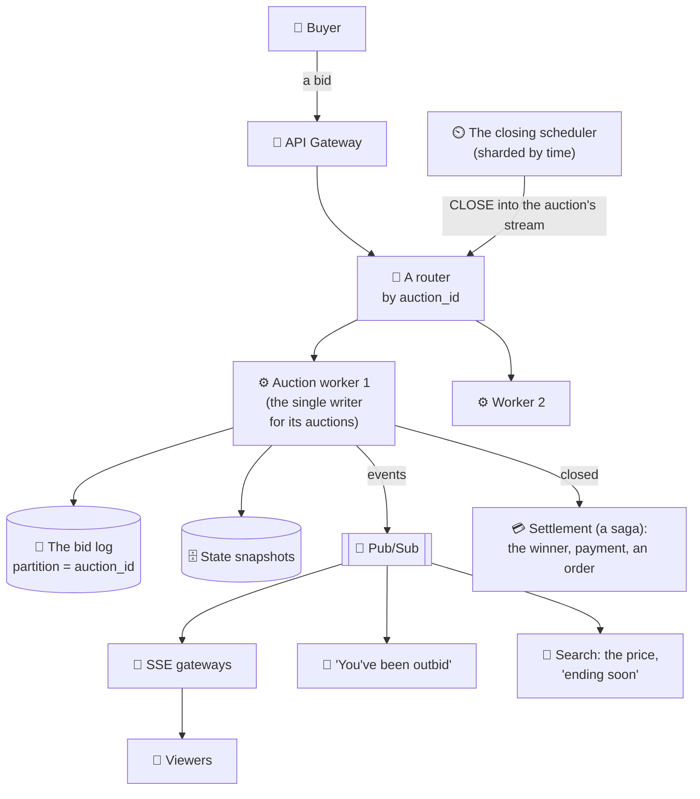
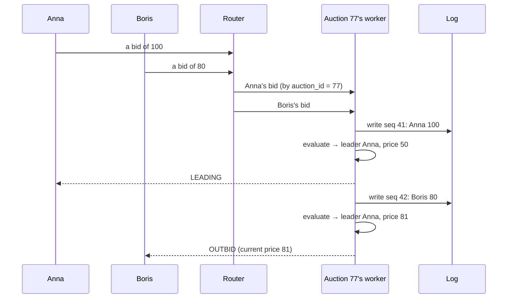
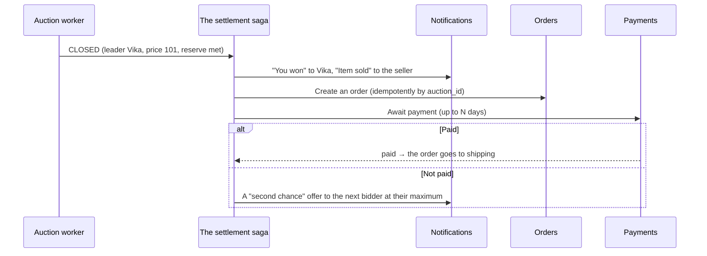

**English** | [Русский](README_RU.md)

# Tier 2 · 4D · 06. An Online Auction (eBay)

> **Level:** Hard · **Interview time:** 45–60 min · **Study time:** ~4–5 h
> **Key aspects:** bidding rules and automatic (proxy) bidding, ordering bids within an auction, a single writer per auction, closing exactly on time, sniping and soft close, real-time updates for viewers, hot auctions in the final seconds, settlement after the auction, shill bidding, the bid log and recovery
> **Builds on:** [Tier 2 · 4D · 03 Inventory](../03-inventory-consistency/README.md#8-deep-dive-2-atomic-reservation-without-overselling), [Tier 2 · 4A · 03 Live Comments](../../4a-realtime-collaboration/03-live-comments-reactions/README.md#7-deep-dive-1-hierarchical-distribution), [Tier 1 · 06 Chat](../../../tier-1/06-chat-system/README.md#8-deep-dive-2-sending-a-message-and-ordering), [08-consensus](../../../08-consensus/README.md#10-split-brain-and-fencing-tokens), [Tier 2 · 4D · 05 Fraud](../05-fraud-detection/README.md#13-deep-dive-7-fraud-rings-and-graphs)

---

## 🗺️ How to Read This Walkthrough

The walkthrough follows an interview, but every step includes explanations: **why** a decision is made, **how** a mechanism works and **what happens** if you do it differently. The "📘 Explanation" blocks are theory right where you need it.

| Icon | Meaning |
|:----:|:--------|
| 🎤 | Interviewer |
| 🗣️ | What I (the candidate) say out loud |
| ✏️ | What I draw on the whiteboard |
| ⏱️ | Time budget for the step |
| 📘 | A detailed explanation of a concept |

Callouts: **TIP** — a good technique, **WARNING** — a trap, **IMPORTANT** — a Senior+ signal.

---

## 📑 Contents

0. [What This Problem Teaches](#0-what-this-problem-teaches)
1. [Problem Statement](#1-problem-statement)
2. [Clarifying Questions and Requirements](#2-clarifying-questions-and-requirements)
3. [Capacity Estimates](#3-capacity-estimates)
4. [API](#4-api)
5. [Data Model](#5-data-model)
6. [High-Level Design](#6-high-level-design)
7. [Deep Dive 1: Bidding Rules and Automatic Bidding](#7-deep-dive-1-bidding-rules-and-automatic-bidding)
8. [Deep Dive 2: Ordering and Concurrency](#8-deep-dive-2-ordering-and-concurrency)
9. [Deep Dive 3: Closing on Time and Sniping](#9-deep-dive-3-closing-on-time-and-sniping)
10. [Deep Dive 4: Updates for Viewers](#10-deep-dive-4-updates-for-viewers)
11. [Deep Dive 5: Scale and Hot Auctions](#11-deep-dive-5-scale-and-hot-auctions)
12. [Deep Dive 6: After the Auction — Settlement](#12-deep-dive-6-after-the-auction--settlement)
13. [Deep Dive 7: Fairness and Fraud](#13-deep-dive-7-fairness-and-fraud)
14. [Deep Dive 8: The Bid Log and Recovery](#14-deep-dive-8-the-bid-log-and-recovery)
15. [Bottlenecks and Failure Scenarios](#15-bottlenecks-and-failure-scenarios)
16. [What Changes at 10x Scale](#16-what-changes-at-10x-scale)
17. [Key Concepts and New Terms](#17-key-concepts-and-new-terms)
18. [Variations and Follow-Up Questions](#18-variations-and-follow-up-questions)
19. [Common Mistakes](#19-common-mistakes)
20. [Cheat Sheet and Self-Check](#20-cheat-sheet-and-self-check)

---

## 0. What This Problem Teaches

An auction resembles inventory: many people compete for one item. But there's an important difference — **a bid's outcome depends on every previous bid and their order**: automatic bids, the increment, ties, closing at exactly the scheduled second. So instead of "atomically decrement a counter", you need **strict ordering of every event in the auction**.

| What's tested | Where it shows up |
|:--------------|:------------------|
| Stateful business logic | Automatic bids, increments, ties |
| Serialization per key | A single writer per auction |
| Time in distributed systems | Closing "at exactly 20:00:00" — whose clock counts |
| Hot keys | A popular auction's final seconds |
| Real-time fan-out | Thousands of viewers see the new price |
| Settlement after an event | A saga: the winner, payment, a second chance |
| Fairness | Shill bidding, bots |

> [!TIP]
> The key idea for the interview: **every event of one auction — bids, closing, cancellation — flows through one ordered stream**. Then "did the bid arrive before closing" isn't a question of clocks but of order in the stream.

---

## 1. Problem Statement

> 🎤 "Design an online auction like eBay: sellers list items, buyers place bids (including automatic ones up to a maximum), everyone sees the current price in real time, the auction closes at the scheduled time, and the winner pays for the item."

**A scenario:**

```
An item: a watch, starting at €50, closing at 20:00:00
Anna bids a maximum of €100 → current price €50, leader Anna
Boris bids a maximum of €80  → the price automatically becomes €81, leader Anna (her maximum is higher)
Vika at 19:59:58 bids €120   → price €101, leader Vika; Anna gets an "you've been outbid" notification
20:00:00 — closed. Vika won at €101 (not €120)
```

**Time plan:**

| Step | ⏱️ |
|:-----|:--:|
| Requirements | 5 min |
| Estimates | 3 min |
| API and data | 5 min |
| High-level design | 5 min |
| Deep dives | 25 min |
| Wrap-up | 3 min |

---

## 2. Clarifying Questions and Requirements

⏱️ 5 min

| My question | Interviewer's answer | What it changes and why |
|:------------|:---------------------|:------------------------|
| How many active auctions? | ~50M | Distribution across many workers |
| Bids? | ~10,000/s on average; a hot auction — up to ~1,000/s in its final seconds | Serialization per auction, hot keys |
| Automatic bids? | Yes, with the buyer's maximum | Proxy bidding logic |
| Closing? | Strictly on time; let's discuss sniping | Timers, soft close |
| Viewers? | Up to 100,000 at once on a popular item | Distributing updates |
| A reserve price, "Buy It Now"? | Yes | Additional rules |
| Bid latency? | A response < 200 ms, viewer updates < 1 s | In-memory processing |

### Functional requirements

1. Listing an item: a start price, an increment, a reserve price, "Buy It Now", a closing time.
2. Bids (manual and automatic) validated against the rules.
3. The current price, the leader, the bid count and the time left — in real time.
4. "You've been outbid" and "you won" notifications.
5. Closing and settlement: the winner, payment, an order.
6. Bid history (with bidders masked).

### Non-functional requirements

| Requirement | Target | Why |
|:------------|:-------|:----|
| Correctness | Every bid evaluated in the right order; closing is deterministic | Money and disputes |
| Bid latency | p99 < 200 ms | Bidding in the final seconds |
| Update latency | < 1 s | Bidders react to the price |
| Availability | High, especially at the end of an auction | A failure in the last minute means complaints |
| Auditing | A complete bid history | Resolving disputes |

---

## 3. Capacity Estimates

⏱️ 3 min

```
Active auctions:     50M, averaging 7 days long
Closing:             50M / (7 × 86,400 s) ≈ 83 per second; hundreds per second at the evening peak
Bids:                ~10,000/s in total; most auctions receive only a handful
A hot auction:       ~1,000 bids/s in the final 10 seconds
Viewers:             up to 100,000 on a hot item
The bid log:         ~860M bids per day × ~200 B ≈ 170 GB per day
```

### Conclusions

| Conclusion | Design consequence |
|:-----------|:-------------------|
| 50M auctions, nearly all "quiet" | State spread across many workers, loaded on demand |
| One auction's bids must be evaluated in order | A single writer per auction |
| 1,000 bids/s on one auction | In-memory processing (microseconds per bid) |
| 100,000 viewers | A separate distribution layer |
| Closings cluster in the evening | A sharded closing scheduler |

---

## 4. API

⏱️ 2 min

```http
POST /v1/auctions               { item, start_price, increment_rule, reserve_price?, buy_now_price?, ends_at }
GET  /v1/auctions/{id}          → { current_price, leader (masked), bid_count, ends_at, server_time }
POST /v1/auctions/{id}/bids     Idempotency-Key: …   { max_amount: 12000 }
→ 200 { status: "LEADING" | "OUTBID" | "REJECTED", current_price, reason? }
POST /v1/auctions/{id}/buy-now
GET  /v1/auctions/{id}/stream   ← SSE: new prices, the bid count, extensions, closing
```

📘 A bid is **the maximum** the buyer is willing to pay, not "the price right now". The system raises the price itself within that maximum (deep dive 1).

---

## 5. Data Model

⏱️ 3 min

```
auctions
  auction_id, seller_id, item, start_price, increment_rule, reserve_price, buy_now_price,
  starts_at, ends_at (may be extended), status: SCHEDULED | ACTIVE | CLOSED | SETTLED | CANCELLED,
  current_price, leader_bidder_id, leader_max (hidden), bid_count, last_seq, version

bids                                                 ← a log, append-only
  auction_id, seq (the sequence number within the auction), bid_id, bidder_id, max_amount,
  received_at (server time), result: LEADING | OUTBID | REJECTED, price_after

auction_events                                       ← for subscribers
  auction_id, seq, type: BID_ACCEPTED | EXTENDED | CLOSED, payload
```

| Data | Store | Why |
|:-----|:------|:----|
| An active auction's state | In a worker's memory + a snapshot in the DB | Fast bid evaluation |
| The bid log | A durable log (Kafka / an append-only DB), partitioned by auction_id | The source of truth, ordering, auditing |
| Ended auctions | A relational DB, then an archive | History |
| Searching active items | A search index | Updated asynchronously |

---

## 6. High-Level Design

⏱️ 5 min



🗣️ "Key decisions:
- **the router** sends all of an auction's events to one **worker** — the single writer, which keeps the auction's state in memory and evaluates bids strictly in order;
- each event is first written to **the log** (partitioned by auction), then applied — the log enables recovery and resolving disputes;
- **closing** is an event in the same ordered stream, sent by the scheduler;
- changes are published to **pub/sub**: viewers via SSE, notifications, search;
- after closing — **a settlement saga**."

---

## 7. Deep Dive 1: Bidding Rules and Automatic Bidding

> 🎤 "How does automatic bidding work?"

📘 **Automatic bidding (proxy bidding):** the buyer states a maximum, and the system bids on their behalf exactly as much as needed to stay one increment ahead of the others — but never above the maximum. It's a second-price auction: the winner pays **the second-highest bid + an increment**.

### The rules

```
A new maximum M_new from buyer X versus the current leader L with maximum M_lead:

1. M_new < current_price + increment     → reject ("too low")
2. X = L (the leader raises their maximum) → update M_lead; the price doesn't change
3. M_new > M_lead                        → leader X; price = min(M_new, M_lead + increment)
4. M_new < M_lead                        → leader L; price = min(M_lead, M_new + increment)
5. M_new = M_lead                        → the EARLIER bidder leads; price = M_lead
```

### An example

```
Start €50, increment €1
Anna:  maximum 100 → price 50, leader Anna
Boris: maximum 80  → rule 4 → price min(100, 81) = 81, leader Anna
Vika:  maximum 100 → rule 5 (a tie) → Anna was earlier → price 100, leader Anna
Gleb:  maximum 150 → rule 3 → price min(150, 101) = 101, leader Gleb
```

| Detail | Solution |
|:-------|:---------|
| **An increment table** | The increment depends on the price (e.g. €0.50 up to €25, €1 up to €100, €5 up to €1,000) |
| **The maximum is hidden** | Only the current price is visible; otherwise everyone knows how much to beat |
| **A reserve price** | If the final price is below the reserve, the item doesn't sell; bidders see "reserve not met" |
| **"Buy It Now"** | Available while there are no bids (or while the price is lower); a purchase closes the auction — also an event in the stream |

> [!IMPORTANT]
> **Senior+ signal:** notice that a bid's outcome **depends on state and order** (a tie goes to whoever was earlier). So an atomic conditional update of one field isn't enough — you need sequential evaluation of every event in the auction.

---

## 8. Deep Dive 2: Ordering and Concurrency

> 🎤 "Two bids on one auction arrived at the same moment. How do you guarantee the right outcome?"

### Options

| Approach | How | Pros | Cons |
|:---------|:----|:-----|:-----|
| **Optimistic DB writes** | Read the state, compute, write `WHERE version = v`; a conflict → retry | Simple, no extra layer | In the final seconds, hundreds of bids conflict and retry |
| **A pessimistic row lock** | `SELECT … FOR UPDATE`, evaluate, write | Order is guaranteed | Locks and queues in the DB under load |
| **A single writer per auction** ⭐ | Every event of an auction is routed to one worker, which evaluates them in turn in memory | Deterministic order, microseconds per bid, no conflicts | Needs routing, ownership and recovery |

### A single writer



| Decision | Why |
|:---------|:----|
| **Order = the order in the log** (seq), not clients' clocks | Unambiguous and verifiable |
| A bid's time is **server time** when it's written to the log | Client clocks can't be trusted |
| Writing to the log **before** responding | An accepted bid isn't lost |
| A synchronous response via request-reply to the worker | The buyer sees immediately whether they lead |
| Implementation | An actor per auction (Akka, Orleans), or a Kafka partition with one consumer, or a shard with a leader |

📘 It's the same principle as message ordering in [chat](../../../tier-1/06-chat-system/README.md#8-deep-dive-2-sending-a-message-and-ordering): each entity has one ordering owner.

---

## 9. Deep Dive 3: Closing on Time and Sniping

> 🎤 "The auction closes at 20:00:00. A bid arrived at 20:00:00.050. Do you accept it?"

### Closing as an event in the stream

📘 If "is the auction closed" is decided by comparing different servers' clocks, the outcome depends on their skew. The fix: **closing is a CLOSE event in the auction's same ordered stream**. Everything written to the log before CLOSE is accepted; everything after is rejected.

```
seq 1,041: Vika's bid       (the worker received it at 19:59:59.980)
seq 1,042: CLOSE            (the scheduler sent it at exactly 20:00:00.000 by the worker's clock)
seq 1,043: Gleb's bid       → REJECTED: the auction is closed
```

| Decision | Why |
|:---------|:----|
| The worker itself checks `received_at ≥ ends_at` against **its own** clock when writing | One time source per auction |
| The scheduler guarantees CLOSE even with no bids | The auction closes without activity too |
| The scheduler is **a sharded timer** (by closing time), using a hierarchical timing wheel or a delay queue | Hundreds of closings per second at peak |
| Clients get **server time** | The countdown is synchronized, not based on the phone's clock |

### Sniping

📘 **Sniping** means bidding in the final seconds so others can't respond. Bots do it a fraction of a second before closing.

| Policy | How | Trade-off |
|:-------|:----|:----------|
| **A hard close** (eBay's approach) | Closing strictly on time | Sniping is allowed; it encourages bidding your real maximum early (automatic bids make it fair) |
| **A soft close** | A bid in the last N minutes extends the auction by N minutes | Sniping is pointless; the auction can run longer; used on many platforms |

```
A soft close, N = 2 min:
  19:59:30 a bid → ends_at = 20:01:30 (an EXTENDED event goes to everyone)
  20:01:10 a bid → ends_at = 20:03:10
  …until 2 minutes pass with no bids
```

📘 An extension is also an event in the worker's stream: it changes `ends_at` and reschedules the closing timer.

---

## 10. Deep Dive 4: Updates for Viewers

> 🎤 "100,000 people are watching an item. How do you show them the new price within a second?"

| Decision | Why |
|:---------|:----|
| The worker publishes a `BID_ACCEPTED` event (price, bid count, time) to pub/sub | Decoupling distribution from bid evaluation |
| **Hierarchical distribution** through SSE gateways | As in [live comments](../../4a-realtime-collaboration/03-live-comments-reactions/README.md#7-deep-dive-1-hierarchical-distribution): a gateway subscribes once for all its viewers |
| **Coalescing updates** | No more than a few updates per second per viewer — each next one carries the latest price |
| An event number (seq) in each update | The client discards stale ones and detects gaps |
| Personal notifications | "You've been outbid" — only to the previous leader, through the notification system (push, email) |
| Server time in the stream | An accurate countdown |

---

## 11. Deep Dive 5: Scale and Hot Auctions

> 🎤 "50 million auctions. How do you spread them across workers?"

| Decision | Why |
|:---------|:----|
| **Consistent hashing** auction_id → worker | Even distribution, few moves when the number of workers changes |
| **Lazy loading** | An auction's state loads into memory on its first event and is evicted after inactivity; 50M auctions aren't held in memory at once |
| A hot auction | 1,000 bids/s is one sequence, each evaluation taking microseconds; log writes are batched (group commit) |
| A hot worker | Moving other auctions off an overloaded worker |
| Distribution to viewers | A separate layer; viewer load doesn't affect bid processing |

📘 The key idea: **sequential processing isn't the bottleneck** if it's in memory with no network calls per bid. The bottleneck is locks and conflicts in the database, which a single writer eliminates.

---

## 12. Deep Dive 6: After the Auction — Settlement

> 🎤 "The auction closed. What happens next?"



| Decision | Why |
|:---------|:----|
| Idempotency by `auction_id` | A repeated CLOSE event doesn't create a second order |
| The reserve wasn't met | The item doesn't sell; the seller may make an offer to the top bidder |
| A payment deadline and a "second chance" | Non-paying winners are a real problem for auctions |
| Payment and the seller payout | Through the payment system and the ledger (see [4D · 04](../04-ledger-wallet/README.md)) |

---

## 13. Deep Dive 7: Fairness and Fraud

| Problem | What it is | Measures |
|:--------|:-----------|:---------|
| **Shill bidding** | The seller bids from their other accounts to raise the price | A graph of account links (devices, addresses, payments — see [4D · 05](../05-fraud-detection/README.md#13-deep-dive-7-fraud-rings-and-graphs)); suspicious patterns: an account bidding only on one seller's items |
| **Retracting bids** | Raising the price, then retracting | Limits on retractions, especially near the end of an auction |
| **Unpaid wins** | "Winning" without paying | A buyer rating, requiring a verified payment method for expensive items |
| **Bots** | Mass bidding, sniping | Rate limiting, bot detection, soft close |
| **New accounts** | Fraudsters create accounts for one-off actions | Restrictions on new accounts for expensive items |

---

## 14. Deep Dive 8: The Bid Log and Recovery

> 🎤 "An auction worker crashed in the final 10 seconds of a hot auction. What happens?"

| Mechanism | How |
|:----------|:----|
| **The log is the source of truth** | An auction's state = applying the log's events in order (event sourcing) |
| **Snapshots** | The state is saved periodically; recovery = a snapshot + the log's tail |
| **Ownership via a lease with an epoch** | A new worker takes over the crashed worker's auctions; writes to the log carry the epoch — if the old owner "wakes up", it can't write (fencing, see [08-consensus](../../../08-consensus/README.md#10-split-brain-and-fencing-tokens)) |
| Recovery time | Seconds: loading the snapshot and the tail |
| Bids during the failover | Clients retry with the same idempotency key; the router buffers |
| **Closing during a failure** | If CLOSE fell during the failover, the new worker sees `ends_at` in the past on load and applies the close by server time; bids with `received_at` after `ends_at` are rejected |

> [!WARNING]
> A failure in the final seconds is the most sensitive moment: a bidder whose bid "didn't arrive" will dispute it. A log recording each bid's server receive time, plus a transparent policy ("a bid is accepted if it was written before closing"), is the basis for resolving such disputes.

---

## 15. Bottlenecks and Failure Scenarios

| Scenario | What happens | How we protect |
|:---------|:-------------|:---------------|
| Simultaneous bids | The wrong leader or price | A single writer, the log's order |
| Tied maximums | A disputed winner | The "earlier in the log" rule |
| A bid at the moment of closing | A "did it make it" dispute | Closing as an event in the stream, server time |
| Sniping by bots | Unhappy bidders | Soft close, or automatic bids + fair rules |
| 100,000 viewers | Load on the worker | A separate hierarchical distribution layer |
| 50M auctions | Memory | Lazy loading, consistent hashing |
| A worker crashes | Lost bids, two owners | The log before the response, snapshots, a lease with an epoch |
| A repeated closing event | Two orders | Idempotency by auction_id |
| Non-paying winners | A lost sale | A payment deadline, a second chance, ratings |
| Shill bidding | Deceiving buyers | A link graph, patterns, restrictions |

---

## 16. What Changes at 10x Scale

> 🎤 "500 million items and viral auctions with a million viewers?"

| Change | Why |
|:-------|:----|
| **Regional workers**, placing an auction in the seller's region | Latency |
| **Edge distribution** for viral items | Millions of viewers |
| **Separate pools** for premium and mass-market auctions | Isolating hot items |
| **ML against shill bidding and bots** | The scale of abuse |

---

## 17. Key Concepts and New Terms

### What's applied

| Concept | Where it's covered | How it applies here |
|:--------|:-------------------|:--------------------|
| Concurrent access to one item | [Tier 2 · 4D · 03](../03-inventory-consistency/README.md) | Why ordering is needed here, not a counter |
| Hierarchical distribution | [Tier 2 · 4A · 03](../../4a-realtime-collaboration/03-live-comments-reactions/README.md) | Updates for viewers |
| An ordering owner | [Tier 1 · 06](../../../tier-1/06-chat-system/README.md) | Bid ordering |
| Leases and fencing | [08-consensus](../../../08-consensus/README.md) | Owning an auction |
| Fraud graphs | [Tier 2 · 4D · 05](../05-fraud-detection/README.md) | Shill bidding |

### New terms in this problem

| Term | In short |
|:-----|:---------|
| **Automatic (proxy) bidding** | The system bids for the buyer up to their maximum |
| **A second-price auction** | The winner pays the second bid + an increment |
| **An increment table** | The minimum raise, depending on the price |
| **A reserve price** | The minimum below which the item doesn't sell |
| **A single writer** | One owner processes all of an auction's events in order |
| **Closing as an event** | CLOSE in an ordered stream instead of comparing clocks |
| **Sniping** | Bidding in the final seconds |
| **A soft close** | Extending on late bids |
| **A second chance** | An offer to the next bidder when the winner doesn't pay |
| **Shill bidding** | A seller inflating bids |

---

## 18. Variations and Follow-Up Questions

<details>
<summary><b>How do you implement a sealed-bid auction?</b></summary>

Bids are accepted and stored hidden (encrypted or in a closed log), and nobody sees a current price; at closing, all bids are revealed and the winner is determined (first- or second-price). Order matters only for ties and the deadline; real-time price distribution isn't needed.
</details>

<details>
<summary><b>How does a Dutch auction (a falling price) work?</b></summary>

The price drops on a schedule; the first person to press "buy" wins. It's a race for one item: the "buy" event and the price-drop ticks flow through one ordered stream, and the first "buy" closes the auction. For several units — like inventory, with an atomic decrement.
</details>

<details>
<summary><b>What if "Buy It Now" and a bid arrive at the same time?</b></summary>

Both are events in the auction's stream; whichever was written first is applied. If the bid went first and the rules remove "Buy It Now" after the first bid, the purchase is rejected; if the purchase went first, the auction is closed and the bid is rejected.
</details>

<details>
<summary><b>Can it all be done on a database without separate workers?</b></summary>

At small scale, yes: an auction row with `SELECT … FOR UPDATE` or an optimistic version. The problems start in hot items' final seconds (conflicts, lock queues). An in-memory single writer with a log solves that and gives a deterministic order.
</details>

<details>
<summary><b>How do you show bid history without revealing bidders?</b></summary>

Masked identifiers (e.g. "a***9") that are stable within an auction, plus the bid amounts that became the price; maximums aren't revealed. Full data is available only to support for resolving disputes.
</details>

---

## 19. Common Mistakes

| ❌ Mistake | Why it's bad | ✅ Do this instead |
|:----------|:-------------|:------------------|
| An atomic UPDATE "if the bid exceeds the current price" | Ignores automatic bids and ties | Sequential evaluation of every event |
| Optimistic retries in the final seconds | A storm of conflicts | An in-memory single writer |
| A bid's time from the client's clock | Manipulation, disputes | Server time when writing to the log |
| Closing by comparing different servers' clocks | A non-deterministic outcome | CLOSE as an event in the stream |
| Showing the leader's maximum | Everyone knows how much to beat | A hidden maximum |
| Responding before writing to the log | Losing an accepted bid on a crash | The log before the response |
| Distributing to viewers from the bid worker | The load interferes with evaluation | A separate pub/sub layer |
| Keeping all 50M auctions in memory | Running out of memory | Lazy loading |
| Settlement without idempotency | Duplicate orders | An auction_id key |
| Ignoring unpaid wins | Lost sales | A payment deadline, a second chance |

---

## 20. Cheat Sheet and Self-Check

### 30-second answer

> A bid's outcome depends on state and order (automatic bids: the larger maximum leads, price = min(the leader's maximum, the second maximum + an increment), a tie goes to whoever was earlier), so every event of an auction — bids, "Buy It Now", extensions, closing — goes through a single writer: a router by auction_id (consistent hashing) sends them to a worker that keeps the state in memory (lazily loaded), first writes the event to the log (partitioned by auction, with server time and a seq), then evaluates and responds. Closing is a CLOSE event in the same stream, sent by a sharded scheduler; everything after it is rejected; clients get server time. Sniping: a hard close (eBay, made fair by automatic bids) or a soft close — extending by N minutes on a late bid. Changes go to pub/sub: viewers through hierarchical SSE distribution with coalesced updates, "you've been outbid" as a personal notification, search asynchronously. A worker crash: a snapshot + the log's tail, a lease with an epoch against two owners. After closing — a saga: the winner, an order idempotent by auction_id, payment by a deadline, a second chance. Against shill bidding — a link graph, limits on retractions and new accounts.

### Self-check

- [ ] I can explain automatic bidding and compute the price for an example
- [ ] I can explain why an atomic update isn't enough
- [ ] I can compare optimistic writes, locking and a single writer
- [ ] I can describe a bid's path through the log and the worker
- [ ] I can explain closing as an event in the stream
- [ ] I can compare a hard close and a soft close
- [ ] I can design updates for 100,000 viewers
- [ ] I can spread 50M auctions across workers
- [ ] I can describe recovery after a worker crash
- [ ] I can describe the settlement saga and the measures against shill bidding

### Further reading

- eBay: the rules for automatic bidding and the increment table (help for buyers)
- Akka / Microsoft Orleans documentation — the actor model and the single writer
- Martin Fowler, *Event Sourcing*
- The [Tier 2 · 4D · 03](../03-inventory-consistency/README.md) and [Tier 2 · 4A · 03](../../4a-realtime-collaboration/03-live-comments-reactions/README.md) walkthroughs
