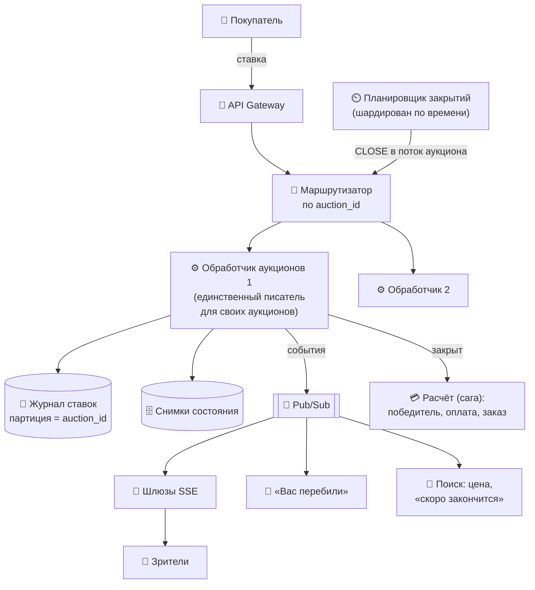
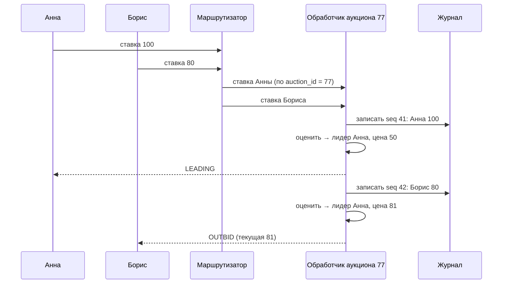
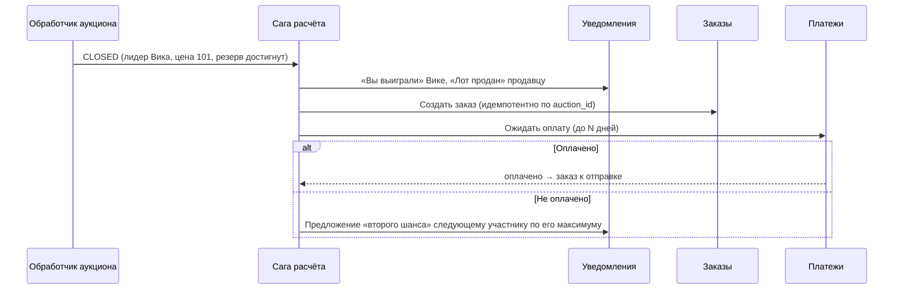

[English](README.md) | **Русский**

# Tier 2 · 4D · 06. Аукцион (eBay)

> **Уровень:** Hard · **Время на интервью:** 45–60 мин · **Время на разбор:** ~4–5 ч
> **Ключевые аспекты:** правила ставок и автоматические ставки (proxy bidding), порядок ставок внутри аукциона, единственный писатель на аукцион, точное закрытие по времени, снайпинг и мягкое закрытие, обновления в реальном времени для зрителей, горячие аукционы в последние секунды, расчёт после аукциона, накрутка ставок продавцом, журнал ставок и восстановление
> **Опирается на:** [Tier 2 · 4D · 03 Inventory](../03-inventory-consistency/README_RU.md#8-deep-dive-2-атомарное-резервирование-без-overselling), [Tier 2 · 4A · 03 Live Comments](../../4a-realtime-collaboration/03-live-comments-reactions/README_RU.md#7-deep-dive-1-иерархическая-рассылка), [Tier 1 · 06 Chat](../../../tier-1/06-chat-system/README_RU.md#8-deep-dive-2-отправка-сообщения-и-порядок), [08-consensus](../../../08-consensus/README_RU.md#10-split-brain-и-fencing-токены), [Tier 2 · 4D · 05 Fraud](../05-fraud-detection/README_RU.md#13-deep-dive-7-мошеннические-сети-и-графы)

---

## 🗺️ Как читать этот разбор

Разбор построен как интервью, но в каждом шаге есть объяснения: **почему** принимается решение, **как работает** механизм и **что будет**, если сделать иначе. Блоки «📘 Объяснение» — теория прямо по ходу задачи.

| Значок | Что значит |
|:------:|:-----------|
| 🎤 | Реплика интервьюера |
| 🗣️ | Что говорю вслух я (кандидат) |
| ✏️ | Что рисую на доске |
| ⏱️ | Сколько времени тратить на шаг |
| 📘 | Подробное объяснение концепции |

Блоки **TIP** — хороший приём, **WARNING** — ловушка, **IMPORTANT** — сигнал для уровня Senior+.

---

## 📑 Содержание

0. [Чему учит эта задача](#0-чему-учит-эта-задача)
1. [Условие задачи](#1-условие-задачи)
2. [Уточняющие вопросы и требования](#2-уточняющие-вопросы-и-требования)
3. [Оценки нагрузки](#3-оценки-нагрузки)
4. [API](#4-api)
5. [Модель данных](#5-модель-данных)
6. [High-level дизайн](#6-high-level-дизайн)
7. [Deep dive 1: правила ставок и автоматические ставки](#7-deep-dive-1-правила-ставок-и-автоматические-ставки)
8. [Deep dive 2: порядок и конкурентный доступ](#8-deep-dive-2-порядок-и-конкурентный-доступ)
9. [Deep dive 3: закрытие по времени и снайпинг](#9-deep-dive-3-закрытие-по-времени-и-снайпинг)
10. [Deep dive 4: обновления для зрителей](#10-deep-dive-4-обновления-для-зрителей)
11. [Deep dive 5: масштаб и горячие аукционы](#11-deep-dive-5-масштаб-и-горячие-аукционы)
12. [Deep dive 6: после аукциона — расчёт](#12-deep-dive-6-после-аукциона--расчёт)
13. [Deep dive 7: честность и мошенничество](#13-deep-dive-7-честность-и-мошенничество)
14. [Deep dive 8: журнал ставок и восстановление](#14-deep-dive-8-журнал-ставок-и-восстановление)
15. [Узкие места и сценарии сбоев](#15-узкие-места-и-сценарии-сбоев)
16. [Что изменится при росте в 10 раз](#16-что-изменится-при-росте-в-10-раз)
17. [Ключевые концепции и новые понятия](#17-ключевые-концепции-и-новые-понятия)
18. [Варианты задачи и follow-up вопросы](#18-варианты-задачи-и-follow-up-вопросы)
19. [Типичные ошибки](#19-типичные-ошибки)
20. [Шпаргалка и самопроверка](#20-шпаргалка-и-самопроверка)

---

## 0. Чему учит эта задача

Аукцион похож на остатки товара: много людей борются за один объект. Но есть важное отличие — **результат ставки зависит от всех предыдущих ставок и их порядка**: автоматические ставки, шаг повышения, ничьи, закрытие ровно в назначенную секунду. Поэтому вместо «атомарно уменьшить счётчик» нужен **строгий порядок обработки всех событий аукциона**.

| Что проверяют | Где это в задаче |
|:--------------|:-----------------|
| Бизнес-логика с состоянием | Автоматические ставки, шаг, ничьи |
| Сериализация по ключу | Единственный писатель на аукцион |
| Время в распределённых системах | Закрытие «ровно в 20:00:00», чьи часы считаются |
| Горячие ключи | Последние секунды популярного аукциона |
| Fan-out в реальном времени | Тысячи зрителей видят новую цену |
| Расчёт после события | Сага: победитель, оплата, второй шанс |
| Честность | Накрутка ставок, боты |

> [!TIP]
> Главная мысль для интервью: **все события одного аукциона — ставки, закрытие, отмена — проходят через один упорядоченный поток**. Тогда «пришла ли ставка до закрытия» — не вопрос часов, а вопрос порядка в потоке.

---

## 1. Условие задачи

> 🎤 «Спроектируй онлайн-аукцион вроде eBay: продавцы выставляют лоты, покупатели делают ставки (в том числе автоматические до максимума), все видят текущую цену в реальном времени, аукцион закрывается в назначенное время, победитель оплачивает покупку».

**Сценарий:**

```
Лот: часы, старт 50 €, закрытие 20:00:00
Анна ставит максимум 100 € → текущая цена 50 €, лидер Анна
Борис ставит максимум 80 €  → цена автоматически 81 €, лидер Анна (её максимум выше)
Вика в 19:59:58 ставит 120 € → цена 101 €, лидер Вика; Анне — уведомление «вас перебили»
20:00:00 — закрыто. Вика выиграла за 101 € (а не за 120 €)
```

**План по времени:**

| Шаг | ⏱️ |
|:----|:--:|
| Требования | 5 мин |
| Оценки | 3 мин |
| API и данные | 5 мин |
| High-level дизайн | 5 мин |
| Deep dives | 25 мин |
| Итоги | 3 мин |

---

## 2. Уточняющие вопросы и требования

⏱️ 5 мин

| Мой вопрос | Ответ интервьюера | Что это меняет и почему |
|:-----------|:------------------|:------------------------|
| Сколько активных аукционов? | ~50M | Распределение по множеству обработчиков |
| Ставок? | ~10 000/с в среднем; горячий аукцион — до ~1 000/с в последние секунды | Сериализация на аукцион, горячие ключи |
| Автоматические ставки? | Да, с максимумом покупателя | Логика proxy bidding |
| Закрытие? | Строго по времени; обсудим снайпинг | Таймеры, мягкое закрытие |
| Зрители? | У популярного лота — до 100 000 одновременно | Рассылка обновлений |
| Резервная цена, «Купить сейчас»? | Да | Дополнительные правила |
| Задержка ставки? | Ответ < 200 мс, обновление у зрителей < 1 с | Обработка в памяти |

### Функциональные требования

1. Создание лота: старт, шаг, резервная цена, «Купить сейчас», время закрытия.
2. Ставки (ручные и автоматические) с проверкой правил.
3. Текущая цена, лидер, число ставок, оставшееся время — в реальном времени.
4. Уведомления «вас перебили», «вы выиграли».
5. Закрытие и расчёт: победитель, оплата, заказ.
6. История ставок (с маскировкой участников).

### Нефункциональные требования

| Требование | Цель | Почему |
|:-----------|:-----|:-------|
| Корректность | Каждая ставка оценена в правильном порядке; закрытие детерминированно | Деньги и споры |
| Задержка ставки | p99 < 200 мс | Торги в последние секунды |
| Задержка обновлений | < 1 с | Участники реагируют на цену |
| Доступность | Высокая, особенно в конце аукциона | Сбой в последнюю минуту — жалобы |
| Аудит | Полная история ставок | Разрешение споров |

---

## 3. Оценки нагрузки

⏱️ 3 мин

```
Активные аукционы:   50M, средняя длительность 7 дней
Закрываются:         50M / (7 × 86 400 с) ≈ 83 в секунду; вечером в пик — сотни в секунду
Ставки:              ~10 000/с суммарно; большинство аукционов получают единицы ставок
Горячий аукцион:     ~1 000 ставок/с в последние 10 секунд
Зрители:             до 100 000 на горячий лот
Журнал ставок:       ~860M ставок в сутки × ~200 Б ≈ 170 ГБ в сутки
```

### Выводы

| Вывод | Следствие для дизайна |
|:------|:----------------------|
| 50M аукционов, почти все «тихие» | Состояние распределено по многим обработчикам, загружается по требованию |
| Ставки одного аукциона должны оцениваться по порядку | Единственный писатель на аукцион |
| 1 000 ставок/с на один аукцион | Обработка в памяти (микросекунды на ставку) |
| 100 000 зрителей | Отдельный слой рассылки |
| Закрытия сгущаются по вечерам | Шардированный планировщик закрытий |

---

## 4. API

⏱️ 2 мин

```http
POST /v1/auctions               { item, start_price, increment_rule, reserve_price?, buy_now_price?, ends_at }
GET  /v1/auctions/{id}          → { current_price, leader (маскирован), bid_count, ends_at, server_time }
POST /v1/auctions/{id}/bids     Idempotency-Key: …   { max_amount: 12000 }
→ 200 { status: "LEADING" | "OUTBID" | "REJECTED", current_price, reason? }
POST /v1/auctions/{id}/buy-now
GET  /v1/auctions/{id}/stream   ← SSE: новые цены, число ставок, продление, закрытие
```

📘 Ставка — это **максимум**, который покупатель готов заплатить, а не «цена прямо сейчас». Система сама поднимает цену в пределах максимума (deep dive 1).

---

## 5. Модель данных

⏱️ 3 мин

```
auctions
  auction_id, seller_id, item, start_price, increment_rule, reserve_price, buy_now_price,
  starts_at, ends_at (может продлеваться), status: SCHEDULED | ACTIVE | CLOSED | SETTLED | CANCELLED,
  current_price, leader_bidder_id, leader_max (скрыт), bid_count, last_seq, version

bids                                                 ← журнал, только добавление
  auction_id, seq (порядковый номер в аукционе), bid_id, bidder_id, max_amount,
  received_at (время сервера), result: LEADING | OUTBID | REJECTED, price_after

auction_events                                       ← для подписчиков
  auction_id, seq, type: BID_ACCEPTED | EXTENDED | CLOSED, payload
```

| Данные | Хранилище | Почему |
|:-------|:----------|:-------|
| Состояние активного аукциона | В памяти обработчика + снимок в БД | Скорость оценки ставок |
| Журнал ставок | Долговечный журнал (Kafka / БД с дозаписью), партиция по auction_id | Источник правды, порядок, аудит |
| Завершённые аукционы | Реляционная БД, затем архив | История |
| Поиск активных лотов | Поисковый индекс | Обновляется асинхронно |

---

## 6. High-level дизайн

⏱️ 5 мин



🗣️ «Ключевые решения:
- **маршрутизатор** направляет все события аукциона одному **обработчику** — единственному писателю, который держит состояние аукциона в памяти и оценивает ставки строго по порядку;
- каждое событие сначала записывается в **журнал** (партиция по аукциону), потом применяется — журнал позволяет восстановиться и разрешать споры;
- **закрытие** — это событие в том же упорядоченном потоке, которое отправляет планировщик;
- изменения публикуются в **pub/sub**: зрители по SSE, уведомления, поиск;
- после закрытия — **сага расчёта**».

---

## 7. Deep dive 1: правила ставок и автоматические ставки

> 🎤 «Как работают автоматические ставки?»

📘 **Автоматическая ставка (proxy bidding):** покупатель указывает максимум, а система ставит за него ровно столько, сколько нужно, чтобы опережать остальных на шаг, — но не больше максимума. Это аукцион второй цены: победитель платит **вторую по величине ставку + шаг**.

### Правила

```
Новый максимум M_new от покупателя X против текущего лидера L с максимумом M_lead:

1. M_new < current_price + шаг           → отклонить («слишком мало»)
2. X = L (лидер повышает свой максимум)  → обновить M_lead, цена не меняется
3. M_new > M_lead                        → лидер X; цена = min(M_new, M_lead + шаг)
4. M_new < M_lead                        → лидер L; цена = min(M_lead, M_new + шаг)
5. M_new = M_lead                        → лидер тот, кто поставил РАНЬШЕ; цена = M_lead
```

### Пример

```
Старт 50 €, шаг 1 €
Анна: максимум 100 → цена 50, лидер Анна
Борис: максимум 80  → правило 4 → цена min(100, 81) = 81, лидер Анна
Вика:  максимум 100 → правило 5 (ничья) → Анна раньше → цена 100, лидер Анна
Глеб:  максимум 150 → правило 3 → цена min(150, 101) = 101, лидер Глеб
```

| Деталь | Решение |
|:-------|:--------|
| **Таблица шагов** | Шаг зависит от цены (например, 0,50 € до 25 €, 1 € до 100 €, 5 € до 1 000 €) |
| **Максимум скрыт** | Видна только текущая цена; иначе остальные знают, сколько нужно перебить |
| **Резервная цена** | Если итоговая цена ниже резерва — лот не продан; участники видят «резерв не достигнут» |
| **«Купить сейчас»** | Доступно, пока нет ставок (или пока цена ниже); покупка закрывает аукцион — тоже событие в потоке |

> [!IMPORTANT]
> **Сигнал Senior+:** заметить, что результат ставки **зависит от состояния и порядка** (ничья решается тем, кто раньше). Поэтому атомарного условного обновления одного поля недостаточно — нужна последовательная оценка всех событий аукциона.

---

## 8. Deep dive 2: порядок и конкурентный доступ

> 🎤 «Две ставки на один аукцион пришли одновременно. Как гарантировать правильный результат?»

### Варианты

| Подход | Как | Плюсы | Минусы |
|:-------|:----|:------|:-------|
| **Оптимистичная запись в БД** | Прочитать состояние, вычислить, записать `WHERE version = v`; конфликт → повтор | Просто, без отдельного слоя | В последние секунды сотни ставок конфликтуют и повторяются |
| **Пессимистичная блокировка строки** | `SELECT … FOR UPDATE`, оценка, запись | Порядок гарантирован | Блокировки и очередь в БД под нагрузкой |
| **Единственный писатель на аукцион** ⭐ | Все события аукциона маршрутизируются одному обработчику, который оценивает их по очереди в памяти | Детерминированный порядок, микросекунды на ставку, нет конфликтов | Нужны маршрутизация, владение и восстановление |

### Единственный писатель



| Решение | Почему |
|:--------|:-------|
| **Порядок = порядок в журнале** (seq), а не часы клиентов | Однозначно и проверяемо |
| Время ставки — **время сервера** при записи в журнал | Клиентским часам доверять нельзя |
| Запись в журнал **до** ответа | Принятая ставка не потеряется |
| Синхронный ответ через «запрос — ответ» к обработчику | Покупатель сразу видит, лидирует ли он |
| Реализация | Актор на аукцион (Akka, Orleans), или партиция Kafka с одним потребителем, или шард с лидером |

📘 Это тот же принцип, что порядок сообщений в [чате](../../../tier-1/06-chat-system/README_RU.md#8-deep-dive-2-отправка-сообщения-и-порядок): у каждой сущности — один упорядочивающий владелец.

---

## 9. Deep dive 3: закрытие по времени и снайпинг

> 🎤 «Аукцион закрывается в 20:00:00. Ставка пришла в 20:00:00,050. Принять?»

### Закрытие как событие в потоке

📘 Если «закрыт ли аукцион» проверять сравнением часов разных серверов, результат зависит от их расхождения. Решение: **закрытие — это событие CLOSE в том же упорядоченном потоке аукциона**. Всё, что записано в журнал раньше CLOSE, — принимается; всё после — отклоняется.

```
seq 1 041: ставка Вики     (обработчик получил в 19:59:59,980)
seq 1 042: CLOSE           (планировщик отправил ровно в 20:00:00,000 по часам обработчика)
seq 1 043: ставка Глеба    → REJECTED: аукцион закрыт
```

| Решение | Почему |
|:--------|:-------|
| Обработчик сам проверяет `received_at ≥ ends_at` по **своим** часам при записи | Один источник времени для аукциона |
| Планировщик гарантирует CLOSE, даже если ставок нет | Аукцион закрывается и без активности |
| Планировщик — **шардированный таймер** (по времени закрытия) с иерархическим колесом таймеров или очередью с задержкой | Сотни закрытий в секунду в пик |
| Клиенту — **время сервера** | Обратный отсчёт синхронизирован, а не по часам телефона |

### Снайпинг

📘 **Снайпинг** — ставка в последние секунды, чтобы другие не успели ответить. Боты делают это за доли секунды до закрытия.

| Политика | Как | Компромисс |
|:---------|:----|:-----------|
| **Жёсткое закрытие** (так у eBay) | Закрытие строго по времени | Снайпинг разрешён; поощряет ставить свой реальный максимум заранее (автоставки делают это честным) |
| **Мягкое закрытие** | Ставка в последние N минут продлевает аукцион на N минут | Нет смысла в снайпинге; аукцион может длиться дольше; используется на многих площадках |

```
Мягкое закрытие, N = 2 мин:
  19:59:30 ставка → ends_at = 20:01:30 (событие EXTENDED рассылается всем)
  20:01:10 ставка → ends_at = 20:03:10
  …до тех пор, пока 2 минуты не пройдут без ставок
```

📘 Продление — тоже событие в потоке обработчика: он меняет `ends_at` и переносит таймер закрытия.

---

## 10. Deep dive 4: обновления для зрителей

> 🎤 «100 000 человек смотрят на лот. Как показать им новую цену за секунду?»

| Решение | Почему |
|:--------|:-------|
| Обработчик публикует событие `BID_ACCEPTED` (цена, число ставок, время) в pub/sub | Отделить рассылку от оценки ставок |
| **Иерархическая рассылка** через шлюзы SSE | Как в [живых комментариях](../../4a-realtime-collaboration/03-live-comments-reactions/README_RU.md#7-deep-dive-1-иерархическая-рассылка): шлюз подписан один раз за всех своих зрителей |
| **Объединение обновлений** | Не больше нескольких обновлений в секунду на зрителя — каждое следующее содержит последнюю цену |
| Номер события (seq) в обновлении | Клиент отбрасывает устаревшие и обнаруживает пропуски |
| Личные уведомления | «Вас перебили» — только бывшему лидеру, через систему уведомлений (push, email) |
| Время сервера в потоке | Точный обратный отсчёт |

---

## 11. Deep dive 5: масштаб и горячие аукционы

> 🎤 «50 миллионов аукционов. Как распределить их по обработчикам?»

| Решение | Почему |
|:--------|:-------|
| **Consistent hashing** auction_id → обработчик | Равномерное распределение, мало переносов при изменении числа обработчиков |
| **Ленивая загрузка** | Состояние аукциона загружается в память при первом событии, выгружается после бездействия; 50M аукционов не держатся в памяти одновременно |
| Горячий аукцион | 1 000 ставок/с — одна последовательность, каждая оценка — микросекунды; запись в журнал — пакетами (group commit) |
| Горячий обработчик | Перенос других аукционов с перегруженного обработчика |
| Рассылка зрителям | Отдельный слой; нагрузка зрителей не влияет на обработку ставок |

📘 Ключевая мысль: **последовательная обработка — не узкое место**, если она в памяти и без сетевых вызовов на каждую ставку. Узкое место — блокировки и конфликты в базе, от которых единственный писатель избавляет.

---

## 12. Deep dive 6: после аукциона — расчёт

> 🎤 «Аукцион закрылся. Что дальше?»



| Решение | Почему |
|:--------|:-------|
| Идемпотентность по `auction_id` | Повтор события CLOSE не создаёт второй заказ |
| Резерв не достигнут | Лот не продан; продавцу — возможность предложить цену лучшему участнику |
| Срок оплаты и «второй шанс» | Неоплатившие победители — реальная проблема аукционов |
| Оплата и выплата продавцу | Через платёжную систему и реестр (см. [4D · 04](../04-ledger-wallet/README_RU.md)) |

---

## 13. Deep dive 7: честность и мошенничество

| Проблема | Что это | Меры |
|:---------|:--------|:-----|
| **Накрутка ставок продавцом** (shill bidding) | Продавец ставит со своих других аккаунтов, чтобы поднять цену | Граф связей аккаунтов (устройства, адреса, платежи — см. [4D · 05](../05-fraud-detection/README_RU.md#13-deep-dive-7-мошеннические-сети-и-графы)); подозрительные паттерны: аккаунт ставит только на лоты одного продавца |
| **Отзыв ставок** | Поднять цену и отозвать | Ограничение отзывов, особенно в конце аукциона |
| **Неоплаченные победы** | «Выиграть» и не заплатить | Рейтинг покупателя, требование подтверждённого способа оплаты для дорогих лотов |
| **Боты** | Массовые ставки, снайпинг | Rate limiting, обнаружение ботов, мягкое закрытие |
| **Новые аккаунты** | Мошенники создают аккаунты для разовых действий | Ограничения для новых аккаунтов на дорогих лотах |

---

## 14. Deep dive 8: журнал ставок и восстановление

> 🎤 «Обработчик аукционов упал в последние 10 секунд горячего аукциона. Что будет?»

| Механизм | Как |
|:---------|:----|
| **Журнал — источник правды** | Состояние аукциона = применение событий журнала по порядку (event sourcing) |
| **Снимки** | Периодически сохраняется состояние; восстановление = снимок + хвост журнала |
| **Владение по лизе с эпохой** | Новый обработчик получает аукционы упавшего; запись в журнал с эпохой — старый владелец, если «проснётся», не сможет писать (fencing, см. [08-consensus](../../../08-consensus/README_RU.md#10-split-brain-и-fencing-токены)) |
| Время восстановления | Секунды: загрузка снимка и хвоста |
| Ставки во время переключения | Клиенты повторяют с тем же ключом идемпотентности; маршрутизатор буферизует |
| **Закрытие во время сбоя** | Если CLOSE пришёлся на переключение — новый обработчик при загрузке видит `ends_at` в прошлом и применяет закрытие по времени сервера; ставки с `received_at` после `ends_at` отклоняются |

> [!WARNING]
> Сбой в последние секунды — самый чувствительный момент: участник, чья ставка «не дошла», будет спорить. Журнал с серверным временем приёма каждой ставки и прозрачная политика («ставка принята, если записана до закрытия») — основа разрешения таких споров.

---

## 15. Узкие места и сценарии сбоев

| Сценарий | Что произойдёт | Как защищаемся |
|:---------|:---------------|:---------------|
| Одновременные ставки | Неверный лидер или цена | Единственный писатель, порядок журнала |
| Ничья максимумов | Спорный победитель | Правило «раньше в журнале» |
| Ставка в момент закрытия | Спор «успел или нет» | Закрытие как событие в потоке, время сервера |
| Снайпинг ботами | Недовольство участников | Мягкое закрытие или автоставки + честные правила |
| 100 000 зрителей | Нагрузка на обработчик | Отдельная иерархическая рассылка |
| 50M аукционов | Память | Ленивая загрузка, consistent hashing |
| Падение обработчика | Потеря ставок, двойной владелец | Журнал до ответа, снимки, лиза с эпохой |
| Повтор события закрытия | Два заказа | Идемпотентность по auction_id |
| Неоплатившие победители | Потеря сделки | Срок оплаты, второй шанс, рейтинг |
| Накрутка ставок | Обман покупателей | Граф связей, паттерны, ограничения |

---

## 16. Что изменится при росте в 10 раз

> 🎤 «500 миллионов лотов и вирусные аукционы с миллионом зрителей?»

| Изменение | Почему |
|:----------|:-------|
| **Региональные обработчики** с размещением аукциона в регионе продавца | Задержка |
| **Edge-рассылка** для вирусных лотов | Миллионы зрителей |
| **Отдельные пулы** для премиальных и массовых аукционов | Изоляция горячих лотов |
| **ML против накрутки и ботов** | Масштаб злоупотреблений |

---

## 17. Ключевые концепции и новые понятия

### Что применяется

| Концепция | Где разобрана | Как применяется здесь |
|:----------|:--------------|:----------------------|
| Конкурентный доступ к одному объекту | [Tier 2 · 4D · 03](../03-inventory-consistency/README_RU.md) | Почему здесь нужен порядок, а не счётчик |
| Иерархическая рассылка | [Tier 2 · 4A · 03](../../4a-realtime-collaboration/03-live-comments-reactions/README_RU.md) | Обновления для зрителей |
| Упорядочивающий владелец | [Tier 1 · 06](../../../tier-1/06-chat-system/README_RU.md) | Порядок ставок |
| Лизы и fencing | [08-consensus](../../../08-consensus/README_RU.md) | Владение аукционом |
| Графы мошенничества | [Tier 2 · 4D · 05](../05-fraud-detection/README_RU.md) | Накрутка ставок |

### Новые понятия этой задачи

| Понятие | Кратко |
|:--------|:-------|
| **Автоматическая ставка (proxy bidding)** | Система ставит за покупателя до его максимума |
| **Аукцион второй цены** | Победитель платит вторую ставку + шаг |
| **Таблица шагов** | Минимальное повышение в зависимости от цены |
| **Резервная цена** | Минимум, ниже которого лот не продаётся |
| **Единственный писатель** | Все события аукциона обрабатывает один владелец по порядку |
| **Закрытие как событие** | CLOSE в упорядоченном потоке вместо сравнения часов |
| **Снайпинг** | Ставка в последние секунды |
| **Мягкое закрытие** | Продление при поздних ставках |
| **Второй шанс** | Предложение следующему участнику при неоплате |
| **Shill bidding** | Накрутка ставок продавцом |

---

## 18. Варианты задачи и follow-up вопросы

<details>
<summary><b>Как реализовать аукцион с закрытыми ставками (sealed-bid)?</b></summary>

Ставки принимаются и хранятся скрыто (зашифрованными или в закрытом журнале), никто не видит текущую цену; при закрытии все ставки раскрываются и определяется победитель (первой или второй цены). Порядок важен только для ничьих и для дедлайна; рассылка цены в реальном времени не нужна.
</details>

<details>
<summary><b>Как работает голландский аукцион (цена снижается)?</b></summary>

Цена снижается по расписанию; первый, кто нажал «купить», выигрывает. Это гонка за одним объектом: событие «купить» и тики снижения цены идут в одном упорядоченном потоке, первое «купить» закрывает аукцион. Для нескольких единиц — как остатки с атомарным уменьшением.
</details>

<details>
<summary><b>Что если «Купить сейчас» и ставка пришли одновременно?</b></summary>

Оба — события в потоке аукциона; что записано раньше, то и применяется. Если первой прошла ставка и правила убирают «Купить сейчас» после первой ставки — покупка отклоняется; если первой прошла покупка — аукцион закрыт и ставка отклоняется.
</details>

<details>
<summary><b>Можно ли сделать всё на базе данных без отдельных обработчиков?</b></summary>

Для небольшого масштаба — да: строка аукциона с `SELECT … FOR UPDATE` или оптимистичной версией. Проблемы начинаются в последние секунды горячих лотов (конфликты, очереди блокировок). Единственный писатель в памяти с журналом решает это и даёт детерминированный порядок.
</details>

<details>
<summary><b>Как показывать историю ставок, не раскрывая участников?</b></summary>

Маскированные идентификаторы (например, «a***9»), стабильные в пределах аукциона, и суммы ставок, которые стали ценой; максимумы не раскрываются. Полные данные доступны только поддержке для разрешения споров.
</details>

---

## 19. Типичные ошибки

| ❌ Ошибка | Почему плохо | ✅ Как правильно |
|:---------|:-------------|:----------------|
| Атомарный UPDATE «если ставка больше текущей» | Не учитывает автоставки и ничьи | Последовательная оценка всех событий |
| Оптимистичные повторы в последние секунды | Шквал конфликтов | Единственный писатель в памяти |
| Время ставки по часам клиента | Манипуляции, споры | Время сервера при записи в журнал |
| Закрытие сравнением часов разных серверов | Недетерминированный результат | CLOSE как событие в потоке |
| Показывать максимум лидера | Остальные знают, сколько перебить | Скрытый максимум |
| Ответ до записи в журнал | Потеря принятой ставки при сбое | Журнал до ответа |
| Рассылка зрителям из обработчика ставок | Нагрузка мешает оценке | Отдельный слой pub/sub |
| Держать все 50M аукционов в памяти | Нехватка памяти | Ленивая загрузка |
| Без идемпотентности расчёта | Двойные заказы | Ключ auction_id |
| Игнорировать неоплаченные победы | Потерянные сделки | Срок оплаты, второй шанс |

---

## 20. Шпаргалка и самопроверка

### Ответ за 30 секунд

> Результат ставки зависит от состояния и порядка (автоставки: лидер — больший максимум, цена = min(максимум лидера, второй максимум + шаг), ничья — кто раньше), поэтому все события аукциона — ставки, «Купить сейчас», продление, закрытие — проходят через единственного писателя: маршрутизатор по auction_id (consistent hashing) направляет их обработчику, который держит состояние в памяти (ленивая загрузка), сначала пишет событие в журнал (партиция по аукциону, время сервера, seq), затем оценивает и отвечает. Закрытие — событие CLOSE в том же потоке от шардированного планировщика; всё после него отклоняется; клиентам — время сервера. Снайпинг: жёсткое закрытие (eBay, честность через автоставки) или мягкое — продление на N минут при поздней ставке. Изменения — в pub/sub: зрители через иерархическую рассылку SSE с объединением обновлений, «вас перебили» — личным уведомлением, поиск — асинхронно. Сбой обработчика: снимок + хвост журнала, лиза с эпохой против двух владельцев. После закрытия — сага: победитель, заказ идемпотентно по auction_id, оплата в срок, второй шанс. Против накрутки — граф связей, ограничения отзыва ставок и новых аккаунтов.

### Самопроверка

- [ ] Могу объяснить автоматические ставки и посчитать цену на примере
- [ ] Могу объяснить, почему атомарного обновления недостаточно
- [ ] Могу сравнить оптимистичную запись, блокировку и единственного писателя
- [ ] Могу описать путь ставки через журнал и обработчик
- [ ] Могу объяснить закрытие как событие в потоке
- [ ] Могу сравнить жёсткое и мягкое закрытие
- [ ] Могу спроектировать обновления для 100 000 зрителей
- [ ] Могу распределить 50M аукционов по обработчикам
- [ ] Могу описать восстановление после падения обработчика
- [ ] Могу описать сагу расчёта и меры против накрутки

### Что почитать

- eBay: правила автоматических ставок и таблица шагов (справка для покупателей)
- Документация Akka / Microsoft Orleans — модель акторов и единственный писатель
- Martin Fowler, *Event Sourcing*
- Разборы [Tier 2 · 4D · 03](../03-inventory-consistency/README_RU.md) и [Tier 2 · 4A · 03](../../4a-realtime-collaboration/03-live-comments-reactions/README_RU.md)
